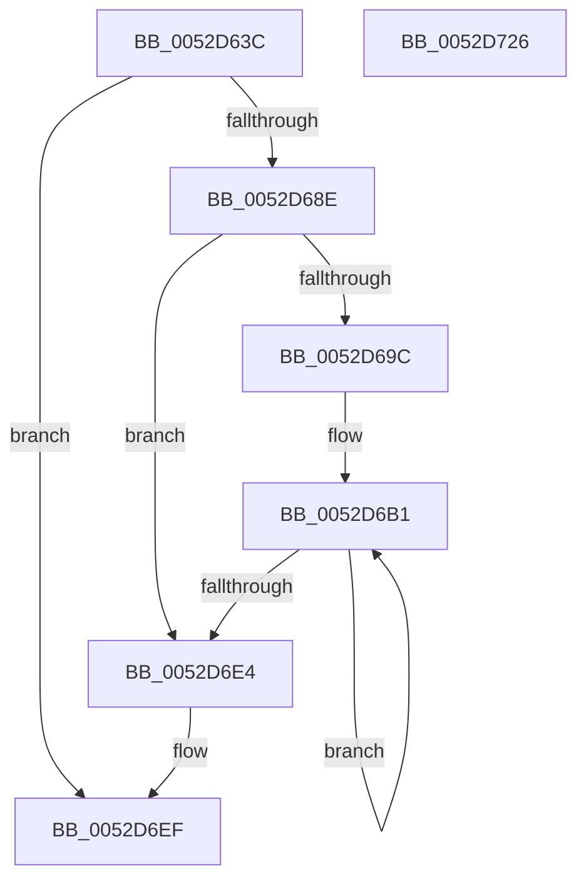

# SymCryptFdefIntDivPow2

- RVA: `0x0052D63C`–`0x0052D727` (길이 `235` bytes)
- VA: `0x000000014052D63C`
- 실행 섹션: `.text`
- PDB 이름 있음: `예`; PDB Function 태그: `아니요`
- unwind 정보 RVA: `0x0005FEF8`
- 디코드: `68`개 명령, `235/235` bytes 표시
- 미해석 바이트: `0` (있으면 어셈블리에 `.byte`로 보존)

> 이 문서는 커널 이미지의 기계어와 PDB 기호를 분석해 생성했습니다. 4번과 5번은 함수 원형과 자료형을 바이너리 사용 방식에서 추정한 C 해석이며 원본 소스 복구 결과는 아닙니다.

## 1. Dependencies

- 직접 호출 지점: **1**; 고유 호출 대상: **1**
- 직접 호출자로 확인된 함수: **1**
- RIP 상대 이미지 참조: **0**

### Outgoing calls
- `0x0052D702` → [SymCryptWipe](../51/SymCryptWipe_function_0051F914.md) (function, `0x0051F914`)

### Direct callers
- [SymCryptIntDivPow2](SymCryptIntDivPow2_function_005255B0.md) at `0x005255B4`

### Static image references
- 디코드된 RIP-relative 메모리 참조가 없습니다.

## 2. Other-region calls and transfers

- 다른 실행 섹션으로 향하는 call: **0**
- 별도 외부 분기/꼬리 이동을 확인하지 못했습니다.

## 3. Assembly (complete function range)

```asm
0052D63C  48 8B C4                        mov rax, rsp
0052D63F  48 89 58 08                     mov qword ptr [rax + 8], rbx
0052D643  48 89 68 10                     mov qword ptr [rax + 0x10], rbp
0052D647  48 89 70 18                     mov qword ptr [rax + 0x18], rsi
0052D64B  48 89 78 20                     mov qword ptr [rax + 0x20], rdi
0052D64F  41 54                           push r12
0052D651  41 56                           push r14
0052D653  41 57                           push r15
0052D655  48 83 EC 20                     sub rsp, 0x20
0052D659  45 8B 48 04                     mov r9d, dword ptr [r8 + 4]
0052D65D  41 BF 3F 00 00 00               mov r15d, 0x3f
0052D663  49 C1 E1 03                     shl r9, 3
0052D667  33 ED                           xor ebp, ebp
0052D669  4D 8B D8                        mov r11, r8
0052D66C  48 8B FA                        mov rdi, rdx
0052D66F  49 23 FF                        and rdi, r15
0052D672  48 8B C2                        mov rax, rdx
0052D675  48 C1 E8 06                     shr rax, 6
0052D679  4C 2B FF                        sub r15, rdi
0052D67C  49 3B C1                        cmp rax, r9
0052D67F  4D 8B C1                        mov r8, r9
0052D682  4C 8B F1                        mov r14, rcx
0052D685  4C 0F 42 C0                     cmovb r8, rax
0052D689  4D 3B C1                        cmp r8, r9
0052D68C  73 61                           jae 0x14052d6ef
0052D68E  4E 8B 54 C1 20                  mov r10, qword ptr [rcx + r8*8 + 0x20]
0052D693  49 8D 58 01                     lea rbx, [r8 + 1]
0052D697  49 3B D9                        cmp rbx, r9
0052D69A  73 48                           jae 0x14052d6e4
0052D69C  8D 45 04                        lea eax, [rbp + 4]
0052D69F  49 2B C0                        sub rax, r8
0052D6A2  4A 8D 14 C5 00 00 00 00         lea rdx, [r8*8]
0052D6AA  48 8B F2                        mov rsi, rdx
0052D6AD  4D 8D 24 C3                     lea r12, [r11 + rax*8]
0052D6B1  4A 8B 54 32 28                  mov rdx, qword ptr [rdx + r14 + 0x28]
0052D6B6  49 8B CF                        mov rcx, r15
0052D6B9  48 8B C2                        mov rax, rdx
0052D6BC  48 FF C5                        inc rbp
0052D6BF  48 D3 E0                        shl rax, cl
0052D6C2  48 FF C3                        inc rbx
0052D6C5  48 03 C0                        add rax, rax
0052D6C8  48 8B CF                        mov rcx, rdi
0052D6CB  49 D3 EA                        shr r10, cl
0052D6CE  49 0B C2                        or rax, r10
0052D6D1  4C 8B D2                        mov r10, rdx
0052D6D4  49 89 04 34                     mov qword ptr [r12 + rsi], rax
0052D6D8  48 83 C6 08                     add rsi, 8
0052D6DC  48 8B D6                        mov rdx, rsi
0052D6DF  49 3B D9                        cmp rbx, r9
0052D6E2  72 CD                           jb 0x14052d6b1
0052D6E4  48 8B CF                        mov rcx, rdi
0052D6E7  49 D3 EA                        shr r10, cl
0052D6EA  4D 89 54 EB 20                  mov qword ptr [r11 + rbp*8 + 0x20], r10
0052D6EF  4D 2B C8                        sub r9, r8
0052D6F2  4A 8D 14 C5 00 00 00 00         lea rdx, [r8*8]
0052D6FA  49 83 C3 20                     add r11, 0x20
0052D6FE  4B 8D 0C CB                     lea rcx, [r11 + r9*8]
0052D702  E8 0D 22 FF FF                  call 0x14051f914
0052D707  48 8B 5C 24 40                  mov rbx, qword ptr [rsp + 0x40]
0052D70C  48 8B 6C 24 48                  mov rbp, qword ptr [rsp + 0x48]
0052D711  48 8B 74 24 50                  mov rsi, qword ptr [rsp + 0x50]
0052D716  48 8B 7C 24 58                  mov rdi, qword ptr [rsp + 0x58]
0052D71B  48 83 C4 20                     add rsp, 0x20
0052D71F  41 5F                           pop r15
0052D721  41 5E                           pop r14
0052D723  41 5C                           pop r12
0052D725  C3                              ret
0052D726  CC                              int3
```

## 4. C-style interpretation (structured pseudocode)

```c
__int64 __fastcall SymCryptFdefIntDivPow2(__int64 a1, __int64 a2, __int64 a3)
{
    __int64 result;
    __int64 v_r10;
    __int64 v_r11;
    __int64 v_r15;
    __int64 v_rbp;
    __int64 v_rbx;
    __int64 v_rdi;
    __int64 v_rsi;
    __int64 v_rsp;
    unsigned __int64 v_stack_p10;
    unsigned __int64 v_stack_p18;
    unsigned __int64 v_stack_p20;
    unsigned __int64 v_stack_p8;

    *(unsigned __int64 *)(v_rsp + 8) = v_rbx;
    *(unsigned __int64 *)(v_rsp + 16) = v_rbp;
    *(unsigned __int64 *)(v_rsp + 24) = v_rsi;
    *(unsigned __int64 *)(v_rsp + 32) = v_rdi;
    v_rsp = (v_rsp) - (32);
    a4 = ((unsigned int)(*(unsigned int *)(a3 + 4))) << (3);
    v_rbp = 0;
    v_rdi = (a2) & (63);
    result = (a2) >> (6);
    v_r15 = (63) - (v_rdi);
    if (result < a4) { a4 = result; }
    if (a4 >= a4) goto loc_0052D6EF;
    if ((a4 + 1) >= a4) goto loc_0052D6E4;
    result = (v_rbp + 4) - (a4);
loc_0052D6B1:
    v_rbp = (v_rbp) + 1;
    result = (*(unsigned __int64 *)(a4 * 8 + a1 * 1 + 40)) << ((unsigned __int8)(v_r15));
    v_rbx = (a4 + 1) + 1;
    result = (result) + (result);
    v_r10 = (*(unsigned __int64 *)(a1 + a4 * 8 + 32)) >> ((unsigned __int8)(v_rdi));
    result = (result) | (v_r10);
    *(unsigned __int64 *)(a3 + result * 8 + a4 * 8 * 1) = result;
    v_rsi = (a4 * 8) + (8);
    if (v_rbx < a4) goto loc_0052D6B1;
loc_0052D6E4:
    v_r10 = (*(unsigned __int64 *)(a4 * 8 + a1 * 1 + 40)) >> ((unsigned __int8)(v_rdi));
    *(unsigned __int64 *)(a3 + v_rbp * 8 + 32) = v_r10;
loc_0052D6EF:
    a4 = (a4) - (a4);
    v_r11 = (a3) + (32);
    result = SymCryptWipe(v_r11 + a4 * 8, a4 * 8, a4, a4);
    v_rsp = (v_rsp) + (32);
    return result;
}
```

## 5. (Beta) C Style

```c
int64_t SymCryptFdefIntDivPow2(void *Arg1, int64_t Arg2, void *Arg3)
{
    uint8_t *arg1 = (uint8_t *)Arg1;
    uint8_t *arg3 = (uint8_t *)Arg3;

    int64_t result;
    int64_t local_r10;
    int64_t local_r11;
    int64_t local_r15;
    int64_t local_rbp;
    int64_t local_rbx;
    int64_t local_rdi;
    int64_t local_rsi;
    int64_t local_rsp;
    uint64_t v_stack_p10;
    uint64_t v_stack_p18;
    uint64_t v_stack_p20;
    uint64_t v_stack_p8;

    *(uint64_t *)(local_rsp + 0x8) = local_rbx;
    *(uint64_t *)(local_rsp + 0x10) = local_rbp;
    *(uint64_t *)(local_rsp + 0x18) = local_rsi;
    *(uint64_t *)(local_rsp + 0x20) = local_rdi;
    local_rsp = (local_rsp) - (32);
    a4 = ((uint32_t)(*(uint32_t *)(arg3 + 0x4))) << (3);
    local_rbp = 0;
    local_rdi = (Arg2) & (63);
    result = (Arg2) >> (6);
    local_r15 = (63) - (local_rdi);
    if (result < a4) { a4 = result; }
    if (a4 >= a4) goto loc_0052D6EF;
    if ((a4 + 1) >= a4) goto loc_0052D6E4;
    result = (local_rbp + 4) - (a4);
loc_0052D6B1:
    local_rbp = (local_rbp) + 1;
    result = (*(uint64_t *)(a4 * 8 + arg1 * 1 + 0x28)) << ((uint8_t)(local_r15));
    local_rbx = (a4 + 1) + 1;
    result = (result) + (result);
    local_r10 = (*(uint64_t *)(arg1 + a4 * 8 + 0x20)) >> ((uint8_t)(local_rdi));
    result = (result) | (local_r10);
    *(uint64_t *)(arg3 + result * 8 + a4 * 8 * 1) = result;
    local_rsi = (a4 * 8) + (8);
    if (local_rbx < a4) goto loc_0052D6B1;
loc_0052D6E4:
    local_r10 = (*(uint64_t *)(a4 * 8 + arg1 * 1 + 0x28)) >> ((uint8_t)(local_rdi));
    *(uint64_t *)(arg3 + local_rbp * 8 + 0x20) = local_r10;
loc_0052D6EF:
    a4 = (a4) - (a4);
    local_r11 = (Arg3) + (32);
    result = SymCryptWipe(local_r11 + a4 * 8, a4 * 8, a4, a4);
    local_rsp = (local_rsp) + (32);
    return result;
}
```

### 관측된 메모리 오프셋

구조체 형식이 확인되지 않은 접근은 인자 기준의 오프셋으로만 기록했습니다.

| 기준 인자 | 오프셋 표현 | 폭 (bit) | 접근 |
|---|---:|---:|---|
| `Arg1` | `+ 0x20 + r8*8` | `64` | `R` |
| `Arg3` | `+ 0x0 + r9*8` | `64` | `R` |
| `Arg3` | `+ 0x0 + rax*8` | `64` | `R` |
| `Arg3` | `+ 0x0 + rsi*1` | `64` | `W` |
| `Arg3` | `+ 0x4` | `32` | `R` |
| `Arg3` | `+ 0x20 + rbp*8` | `64` | `W` |

## 6. Execution-region graph

[열기: 2D/3D 그래프와 함수 탐색 컨트롤 패널](../../../control-panel.html?section=text&rva=0x0052D63C&view=graph)

- 2D 그래프는 위에서 아래로 흐르고, 3D 그래프는 빈 공간을 드래그해 회전합니다. Shift+드래그는 이동, 휠은 확대·축소, 함수 노드 선택은 대상 보고서 이동입니다.

### Static fallback


