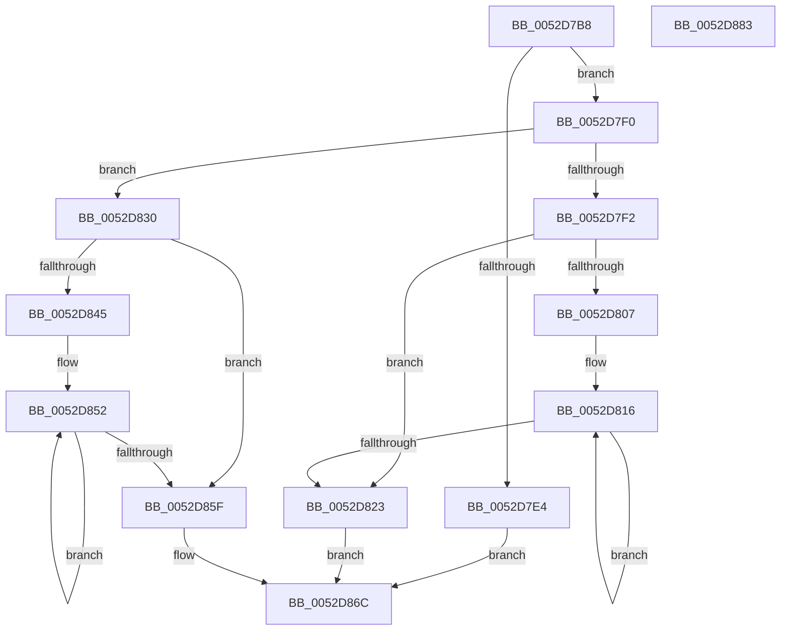

# SymCryptFdefIntIsLessThan

- RVA: `0x0052D7B8`–`0x0052D884` (길이 `204` bytes)
- VA: `0x000000014052D7B8`
- 실행 섹션: `.text`
- PDB 이름 있음: `예`; PDB Function 태그: `아니요`
- unwind 정보 RVA: `0x0005C954`
- 디코드: `69`개 명령, `204/204` bytes 표시
- 미해석 바이트: `0` (있으면 어셈블리에 `.byte`로 보존)

> 이 문서는 커널 이미지의 기계어와 PDB 기호를 분석해 생성했습니다. 4번과 5번은 함수 원형과 자료형을 바이너리 사용 방식에서 추정한 C 해석이며 원본 소스 복구 결과는 아닙니다.

## 1. Dependencies

- 직접 호출 지점: **3**; 고유 호출 대상: **1**
- 직접 호출자로 확인된 함수: **1**
- RIP 상대 이미지 참조: **0**

### Outgoing calls
- `0x0052D7E7` → [SymCryptFdefRawIsLessThanC](SymCryptFdefRawIsLessThanC_function_0052DE9C.md) (function, `0x0052DE9C`)
- `0x0052D7F5` → [SymCryptFdefRawIsLessThanC](SymCryptFdefRawIsLessThanC_function_0052DE9C.md) (function, `0x0052DE9C`)
- `0x0052D833` → [SymCryptFdefRawIsLessThanC](SymCryptFdefRawIsLessThanC_function_0052DE9C.md) (function, `0x0052DE9C`)

### Direct callers
- [SymCryptIntIsLessThan](SymCryptIntIsLessThan_function_005256C8.md) at `0x005256CC`

### Static image references
- 디코드된 RIP-relative 메모리 참조가 없습니다.

## 2. Other-region calls and transfers

- 다른 실행 섹션으로 향하는 call: **0**
- 별도 외부 분기/꼬리 이동을 확인하지 못했습니다.

## 3. Assembly (complete function range)

```asm
0052D7B8  48 89 5C 24 08                  mov qword ptr [rsp + 8], rbx
0052D7BD  48 89 6C 24 10                  mov qword ptr [rsp + 0x10], rbp
0052D7C2  48 89 74 24 18                  mov qword ptr [rsp + 0x18], rsi
0052D7C7  57                              push rdi
0052D7C8  48 83 EC 20                     sub rsp, 0x20
0052D7CC  8B 59 04                        mov ebx, dword ptr [rcx + 4]
0052D7CF  48 8B F2                        mov rsi, rdx
0052D7D2  8B 7A 04                        mov edi, dword ptr [rdx + 4]
0052D7D5  48 8B E9                        mov rbp, rcx
0052D7D8  48 83 C2 20                     add rdx, 0x20
0052D7DC  48 83 C1 20                     add rcx, 0x20
0052D7E0  3B DF                           cmp ebx, edi
0052D7E2  75 0C                           jne 0x14052d7f0
0052D7E4  44 8B C3                        mov r8d, ebx
0052D7E7  E8 B0 06 00 00                  call 0x14052de9c
0052D7EC  8B D0                           mov edx, eax
0052D7EE  EB 7C                           jmp 0x14052d86c
0052D7F0  73 3E                           jae 0x14052d830
0052D7F2  44 8B C3                        mov r8d, ebx
0052D7F5  E8 A2 06 00 00                  call 0x14052de9c
0052D7FA  2B FB                           sub edi, ebx
0052D7FC  33 C9                           xor ecx, ecx
0052D7FE  C1 E7 04                        shl edi, 4
0052D801  8B D0                           mov edx, eax
0052D803  85 FF                           test edi, edi
0052D805  74 1C                           je 0x14052d823
0052D807  C1 E3 04                        shl ebx, 4
0052D80A  8B C3                           mov eax, ebx
0052D80C  48 83 C0 08                     add rax, 8
0052D810  4C 8D 04 86                     lea r8, [rsi + rax*4]
0052D814  8B C7                           mov eax, edi
0052D816  41 0B 08                        or ecx, dword ptr [r8]
0052D819  4D 8D 40 04                     lea r8, [r8 + 4]
0052D81D  48 83 E8 01                     sub rax, 1
0052D821  75 F3                           jne 0x14052d816
0052D823  8B C1                           mov eax, ecx
0052D825  48 F7 D8                        neg rax
0052D828  48 C1 E8 20                     shr rax, 0x20
0052D82C  0B D0                           or edx, eax
0052D82E  EB 3C                           jmp 0x14052d86c
0052D830  44 8B C7                        mov r8d, edi
0052D833  E8 64 06 00 00                  call 0x14052de9c
0052D838  2B DF                           sub ebx, edi
0052D83A  33 C9                           xor ecx, ecx
0052D83C  C1 E3 04                        shl ebx, 4
0052D83F  8B D0                           mov edx, eax
0052D841  85 DB                           test ebx, ebx
0052D843  74 1A                           je 0x14052d85f
0052D845  C1 E7 04                        shl edi, 4
0052D848  4C 8D 45 20                     lea r8, [rbp + 0x20]
0052D84C  8B C3                           mov eax, ebx
0052D84E  4D 8D 04 B8                     lea r8, [r8 + rdi*4]
0052D852  41 0B 08                        or ecx, dword ptr [r8]
0052D855  4D 8D 40 04                     lea r8, [r8 + 4]
0052D859  48 83 E8 01                     sub rax, 1
0052D85D  75 F3                           jne 0x14052d852
0052D85F  8B C1                           mov eax, ecx
0052D861  48 F7 D8                        neg rax
0052D864  48 C1 E8 20                     shr rax, 0x20
0052D868  F7 D0                           not eax
0052D86A  23 D0                           and edx, eax
0052D86C  48 8B 5C 24 30                  mov rbx, qword ptr [rsp + 0x30]
0052D871  8B C2                           mov eax, edx
0052D873  48 8B 6C 24 38                  mov rbp, qword ptr [rsp + 0x38]
0052D878  48 8B 74 24 40                  mov rsi, qword ptr [rsp + 0x40]
0052D87D  48 83 C4 20                     add rsp, 0x20
0052D881  5F                              pop rdi
0052D882  C3                              ret
0052D883  CC                              int3
```

## 4. C-style interpretation (structured pseudocode)

```c
__int64 __fastcall SymCryptFdefIntIsLessThan(__int64 a1, __int64 a2)
{
    __int64 result;
    __int64 v_rbx;
    __int64 v_rdi;
    __int64 v_rsp;
    unsigned __int64 v_stack_p10;
    unsigned __int64 v_stack_p18;
    unsigned __int64 v_stack_p8;

    v_stack_p8 = v_rbx;
    v_stack_p10 = v_rbp;
    v_stack_p18 = v_rsi;
    v_rsp = (v_rsp) - (32);
    a2 = (a2) + (32);
    a1 = (a1) + (32);
    if (((unsigned int)((unsigned int)(*(unsigned int *)(a1 + 4)))) != ((unsigned int)((unsigned int)(*(unsigned int *)(a2 + 4))))) goto loc_0052D7F0;
    result = SymCryptFdefRawIsLessThanC(a1, a2, (unsigned int)((unsigned int)((unsigned int)(*(unsigned int *)(a1 + 4)))), a4);
    goto loc_0052D86C;
loc_0052D7F0:
    if (((unsigned int)((unsigned int)(*(unsigned int *)(a1 + 4)))) >= ((unsigned int)((unsigned int)(*(unsigned int *)(a2 + 4))))) goto loc_0052D830;
    result = SymCryptFdefRawIsLessThanC(a1, (unsigned int)((unsigned int)(result)), (unsigned int)((unsigned int)((unsigned int)(*(unsigned int *)(a1 + 4)))), a4);
    v_rdi = (unsigned int)(((unsigned int)(*(unsigned int *)(a2 + 4))) - ((unsigned int)((unsigned int)(*(unsigned int *)(a1 + 4)))));
    a1 = 0;
    v_rdi = (unsigned int)((v_rdi) << (4));
    if ((unsigned int)(v_rdi) == 0) goto loc_0052D823;
    v_rbx = (unsigned int)(((unsigned int)(*(unsigned int *)(a1 + 4))) << (4));
    result = ((unsigned int)((unsigned int)(v_rbx))) + (8);
loc_0052D816:
    a1 = (unsigned int)((a1) | (*(unsigned int *)(a2 + result * 4)));
    result = ((unsigned int)((unsigned int)(v_rdi))) - (1);
    if (condition_is_not_equal) goto loc_0052D816;
loc_0052D823:
    result = -((unsigned int)((unsigned int)(a1)));
    result = (result) >> (32);
    a2 = (unsigned int)(((unsigned int)((unsigned int)(result))) | ((unsigned int)(result)));
    goto loc_0052D86C;
loc_0052D830:
    result = SymCryptFdefRawIsLessThanC(a1, a2, (unsigned int)((unsigned int)(v_rdi)), a4);
    v_rbx = (unsigned int)((v_rbx) - ((unsigned int)(v_rdi)));
    a1 = 0;
    v_rbx = (unsigned int)((v_rbx) << (4));
    if ((unsigned int)(v_rbx) == 0) goto loc_0052D85F;
    v_rdi = (unsigned int)((v_rdi) << (4));
loc_0052D852:
    a1 = (unsigned int)((a1) | (*(unsigned int *)(a1 + 32 + v_rdi * 4)));
    result = ((unsigned int)((unsigned int)(v_rbx))) - (1);
    if (condition_is_not_equal) goto loc_0052D852;
loc_0052D85F:
    result = -((unsigned int)((unsigned int)(a1)));
    result = (result) >> (32);
    result = (unsigned int)(~(result));
    a2 = (unsigned int)(((unsigned int)((unsigned int)(result))) & ((unsigned int)(result)));
loc_0052D86C:
    v_rsp = (v_rsp) + (32);
    return (unsigned int)((unsigned int)(a2));
}
```

## 5. (Beta) C Style

```c
int64_t SymCryptFdefIntIsLessThan(void *Arg1, void *Arg2)
{
    uint8_t *arg1 = (uint8_t *)Arg1;
    uint8_t *arg2 = (uint8_t *)Arg2;

    int64_t result;
    int64_t local_rbx;
    int64_t local_rdi;
    int64_t local_rsp;
    uint64_t v_stack_p10;
    uint64_t v_stack_p18;
    uint64_t v_stack_p8;

    v_stack_p8 = local_rbx;
    v_stack_p10 = local_rbp;
    v_stack_p18 = local_rsi;
    local_rsp = (local_rsp) - (32);
    Arg2 = (Arg2) + (32);
    Arg1 = (Arg1) + (32);
    if (((uint32_t)((uint32_t)(*(uint32_t *)(arg1 + 0x4)))) != ((uint32_t)((uint32_t)(*(uint32_t *)(arg2 + 0x4))))) goto loc_0052D7F0;
    result = SymCryptFdefRawIsLessThanC(Arg1, Arg2, (uint32_t)((uint32_t)((uint32_t)(*(uint32_t *)(arg1 + 0x4)))), a4);
    goto loc_0052D86C;
loc_0052D7F0:
    if (((uint32_t)((uint32_t)(*(uint32_t *)(arg1 + 0x4)))) >= ((uint32_t)((uint32_t)(*(uint32_t *)(arg2 + 0x4))))) goto loc_0052D830;
    result = SymCryptFdefRawIsLessThanC(Arg1, (uint32_t)((uint32_t)(result)), (uint32_t)((uint32_t)((uint32_t)(*(uint32_t *)(arg1 + 0x4)))), a4);
    local_rdi = (uint32_t)(((uint32_t)(*(uint32_t *)(arg2 + 0x4))) - ((uint32_t)((uint32_t)(*(uint32_t *)(arg1 + 0x4)))));
    Arg1 = 0;
    local_rdi = (uint32_t)((local_rdi) << (4));
    if ((uint32_t)(local_rdi) == 0) goto loc_0052D823;
    local_rbx = (uint32_t)(((uint32_t)(*(uint32_t *)(arg1 + 0x4))) << (4));
    result = ((uint32_t)((uint32_t)(local_rbx))) + (8);
loc_0052D816:
    Arg1 = (uint32_t)((Arg1) | (*(uint32_t *)(arg2 + result * 4)));
    result = ((uint32_t)((uint32_t)(local_rdi))) - (1);
    if (condition_is_not_equal) goto loc_0052D816;
loc_0052D823:
    result = -((uint32_t)((uint32_t)(Arg1)));
    result = (result) >> (32);
    Arg2 = (uint32_t)(((uint32_t)((uint32_t)(result))) | ((uint32_t)(result)));
    goto loc_0052D86C;
loc_0052D830:
    result = SymCryptFdefRawIsLessThanC(Arg1, Arg2, (uint32_t)((uint32_t)(local_rdi)), a4);
    local_rbx = (uint32_t)((local_rbx) - ((uint32_t)(local_rdi)));
    Arg1 = 0;
    local_rbx = (uint32_t)((local_rbx) << (4));
    if ((uint32_t)(local_rbx) == 0) goto loc_0052D85F;
    local_rdi = (uint32_t)((local_rdi) << (4));
loc_0052D852:
    Arg1 = (uint32_t)((Arg1) | (*(uint32_t *)(arg1 + 0x20 + local_rdi * 4)));
    result = ((uint32_t)((uint32_t)(local_rbx))) - (1);
    if (condition_is_not_equal) goto loc_0052D852;
loc_0052D85F:
    result = -((uint32_t)((uint32_t)(Arg1)));
    result = (result) >> (32);
    result = (uint32_t)(~(result));
    Arg2 = (uint32_t)(((uint32_t)((uint32_t)(result))) & ((uint32_t)(result)));
loc_0052D86C:
    local_rsp = (local_rsp) + (32);
    return (uint32_t)((uint32_t)(Arg2));
}
```

### 관측된 메모리 오프셋

구조체 형식이 확인되지 않은 접근은 인자 기준의 오프셋으로만 기록했습니다.

| 기준 인자 | 오프셋 표현 | 폭 (bit) | 접근 |
|---|---:|---:|---|
| `Arg1` | `+ 0x0` | `32` | `R` |
| `Arg1` | `+ 0x0 + rdi*4` | `64` | `R` |
| `Arg1` | `+ 0x4` | `32` | `R` |
| `Arg1` | `+ 0x4` | `64` | `R` |
| `Arg1` | `+ 0x20` | `64` | `R` |
| `Arg2` | `+ 0x0` | `32` | `R` |
| `Arg2` | `+ 0x0 + rax*4` | `64` | `R` |
| `Arg2` | `+ 0x4` | `32` | `R` |
| `Arg2` | `+ 0x4` | `64` | `R` |

## 6. Execution-region graph

[열기: 2D/3D 그래프와 함수 탐색 컨트롤 패널](../../../control-panel.html?section=text&rva=0x0052D7B8&view=graph)

- 2D 그래프는 위에서 아래로 흐르고, 3D 그래프는 빈 공간을 드래그해 회전합니다. Shift+드래그는 이동, 휠은 확대·축소, 함수 노드 선택은 대상 보고서 이동입니다.

### Static fallback


