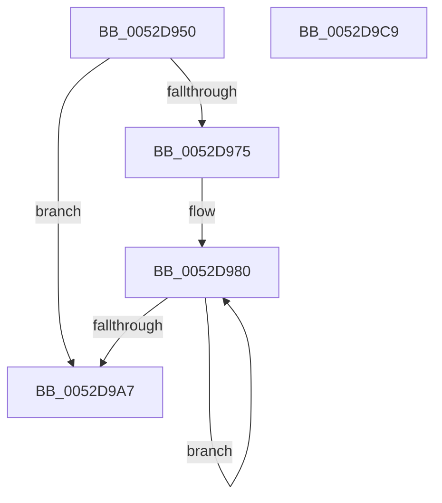

# SymCryptFdefIntShr1

- RVA: `0x0052D950`–`0x0052D9CA` (길이 `122` bytes)
- VA: `0x000000014052D950`
- 실행 섹션: `.text`
- PDB 이름 있음: `예`; PDB Function 태그: `아니요`
- unwind 정보 RVA: `0x00069588`
- 디코드: `35`개 명령, `122/122` bytes 표시
- 미해석 바이트: `0` (있으면 어셈블리에 `.byte`로 보존)

> 이 문서는 커널 이미지의 기계어와 PDB 기호를 분석해 생성했습니다. 4번과 5번은 함수 원형과 자료형을 바이너리 사용 방식에서 추정한 C 해석이며 원본 소스 복구 결과는 아닙니다.

## 1. Dependencies

- 직접 호출 지점: **0**; 고유 호출 대상: **0**
- 직접 호출자로 확인된 함수: **1**
- RIP 상대 이미지 참조: **0**

### Outgoing calls
- 직접 디코드된 call 명령이 없습니다.

### Direct callers
- [SymCryptIntShr1](SymCryptIntShr1_function_00525778.md) at `0x0052577C`

### Static image references
- 디코드된 RIP-relative 메모리 참조가 없습니다.

## 2. Other-region calls and transfers

- 다른 실행 섹션으로 향하는 call: **0**
- 별도 외부 분기/꼬리 이동을 확인하지 못했습니다.

## 3. Assembly (complete function range)

```asm
0052D950  48 89 5C 24 08                  mov qword ptr [rsp + 8], rbx
0052D955  48 89 74 24 10                  mov qword ptr [rsp + 0x10], rsi
0052D95A  48 89 7C 24 18                  mov qword ptr [rsp + 0x18], rdi
0052D95F  41 8B 78 04                     mov edi, dword ptr [r8 + 4]
0052D963  45 33 D2                        xor r10d, r10d
0052D966  4C 8B 4A 20                     mov r9, qword ptr [rdx + 0x20]
0052D96A  C1 E7 03                        shl edi, 3
0052D96D  8B F1                           mov esi, ecx
0052D96F  48 83 FF 01                     cmp rdi, 1
0052D973  76 32                           jbe 0x14052d9a7
0052D975  41 8D 5A 01                     lea ebx, [r10 + 1]
0052D979  49 2B D0                        sub rdx, r8
0052D97C  4D 8D 58 20                     lea r11, [r8 + 0x20]
0052D980  4A 8B 4C 1A 08                  mov rcx, qword ptr [rdx + r11 + 8]
0052D985  49 FF C2                        inc r10
0052D988  49 D1 E9                        shr r9, 1
0052D98B  48 8B C1                        mov rax, rcx
0052D98E  48 C1 E0 3F                     shl rax, 0x3f
0052D992  48 FF C3                        inc rbx
0052D995  49 0B C1                        or rax, r9
0052D998  4C 8B C9                        mov r9, rcx
0052D99B  49 89 03                        mov qword ptr [r11], rax
0052D99E  4D 8D 5B 08                     lea r11, [r11 + 8]
0052D9A2  48 3B DF                        cmp rbx, rdi
0052D9A5  72 D9                           jb 0x14052d980
0052D9A7  48 8B 5C 24 08                  mov rbx, qword ptr [rsp + 8]
0052D9AC  48 8B C6                        mov rax, rsi
0052D9AF  48 8B 74 24 10                  mov rsi, qword ptr [rsp + 0x10]
0052D9B4  48 8B 7C 24 18                  mov rdi, qword ptr [rsp + 0x18]
0052D9B9  48 C1 E0 3F                     shl rax, 0x3f
0052D9BD  49 D1 E9                        shr r9, 1
0052D9C0  49 0B C1                        or rax, r9
0052D9C3  4B 89 44 D0 20                  mov qword ptr [r8 + r10*8 + 0x20], rax
0052D9C8  C3                              ret
0052D9C9  CC                              int3
```

## 4. C-style interpretation (structured pseudocode)

```c
__int64 __fastcall SymCryptFdefIntShr1(int a1, __int64 a2, __int64 a3)
{
    __int64 result;
    __int64 v_r10;
    __int64 v_rbx;
    __int64 v_rdi;
    unsigned __int64 v_stack_p10;
    unsigned __int64 v_stack_p18;
    unsigned __int64 v_stack_p8;

    v_stack_p8 = v_rbx;
    v_stack_p10 = v_rsi;
    v_stack_p18 = v_rdi;
    v_r10 = 0;
    v_rdi = (unsigned int)(((unsigned int)(*(unsigned int *)(a3 + 4))) << (3));
    if (v_rdi <= 1) goto loc_0052D9A7;
    a2 = (a2) - (a3);
loc_0052D980:
    v_r10 = (v_r10) + 1;
    a4 = (*(unsigned __int64 *)(a2 + 32)) >> (1);
    result = (*(unsigned __int64 *)(a2 + a3 + 32 * 1 + 8)) << (63);
    v_rbx = (v_r10 + 1) + 1;
    result = (result) | (a4);
    *(unsigned __int64 *)(a3 + 32) = result;
    if (v_rbx < v_rdi) goto loc_0052D980;
loc_0052D9A7:
    result = ((unsigned int)(a1)) << (63);
    a4 = (*(unsigned __int64 *)(a2 + a3 + 32 * 1 + 8)) >> (1);
    result = (result) | (a4);
    *(unsigned __int64 *)(a3 + v_r10 * 8 + 32) = result;
    return result;
}
```

## 5. (Beta) C Style

```c
int64_t SymCryptFdefIntShr1(int32_t Arg1, void *Arg2, void *Arg3)
{
    uint8_t *arg2 = (uint8_t *)Arg2;
    uint8_t *arg3 = (uint8_t *)Arg3;

    int64_t result;
    int64_t local_r10;
    int64_t local_rbx;
    int64_t local_rdi;
    uint64_t v_stack_p10;
    uint64_t v_stack_p18;
    uint64_t v_stack_p8;

    v_stack_p8 = local_rbx;
    v_stack_p10 = local_rsi;
    v_stack_p18 = local_rdi;
    local_r10 = 0;
    local_rdi = (uint32_t)(((uint32_t)(*(uint32_t *)(arg3 + 0x4))) << (3));
    if (local_rdi <= 1) goto loc_0052D9A7;
    Arg2 = (Arg2) - (Arg3);
loc_0052D980:
    local_r10 = (local_r10) + 1;
    a4 = (*(uint64_t *)(arg2 + 0x20)) >> (1);
    result = (*(uint64_t *)(arg2 + arg3 + 0x20 * 1 + 0x8)) << (63);
    local_rbx = (local_r10 + 1) + 1;
    result = (result) | (a4);
    *(uint64_t *)(arg3 + 0x20) = result;
    if (local_rbx < local_rdi) goto loc_0052D980;
loc_0052D9A7:
    result = ((uint32_t)(Arg1)) << (63);
    a4 = (*(uint64_t *)(arg2 + arg3 + 0x20 * 1 + 0x8)) >> (1);
    result = (result) | (a4);
    *(uint64_t *)(arg3 + local_r10 * 8 + 0x20) = result;
    return result;
}
```

### 관측된 메모리 오프셋

구조체 형식이 확인되지 않은 접근은 인자 기준의 오프셋으로만 기록했습니다.

| 기준 인자 | 오프셋 표현 | 폭 (bit) | 접근 |
|---|---:|---:|---|
| `Arg2` | `+ 0x8 + r11*1` | `64` | `R` |
| `Arg2` | `+ 0x20` | `64` | `R` |
| `Arg3` | `+ 0x0` | `64` | `W` |
| `Arg3` | `+ 0x4` | `32` | `R` |
| `Arg3` | `+ 0x8` | `64` | `R` |
| `Arg3` | `+ 0x20` | `64` | `R` |
| `Arg3` | `+ 0x20 + r10*8` | `64` | `W` |

## 6. Execution-region graph

[열기: 2D/3D 그래프와 함수 탐색 컨트롤 패널](../../../control-panel.html?section=text&rva=0x0052D950&view=graph)

- 2D 그래프는 위에서 아래로 흐르고, 3D 그래프는 빈 공간을 드래그해 회전합니다. Shift+드래그는 이동, 휠은 확대·축소, 함수 노드 선택은 대상 보고서 이동입니다.

### Static fallback


