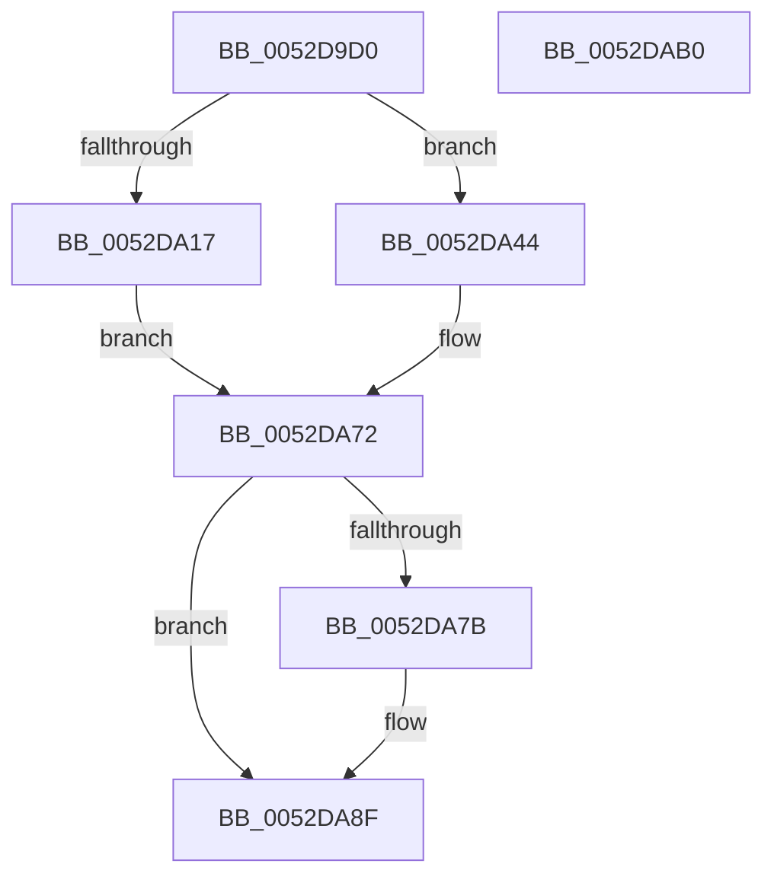

# SymCryptFdefIntSubMixedSize

- RVA: `0x0052D9D0`–`0x0052DAB1` (길이 `225` bytes)
- VA: `0x000000014052D9D0`
- 실행 섹션: `.text`
- PDB 이름 있음: `예`; PDB Function 태그: `아니요`
- unwind 정보 RVA: `0x0008A350`
- 디코드: `72`개 명령, `225/225` bytes 표시
- 미해석 바이트: `0` (있으면 어셈블리에 `.byte`로 보존)

> 이 문서는 커널 이미지의 기계어와 PDB 기호를 분석해 생성했습니다. 4번과 5번은 함수 원형과 자료형을 바이너리 사용 방식에서 추정한 C 해석이며 원본 소스 복구 결과는 아닙니다.

## 1. Dependencies

- 직접 호출 지점: **4**; 고유 호출 대상: **3**
- 직접 호출자로 확인된 함수: **1**
- RIP 상대 이미지 참조: **0**

### Outgoing calls
- `0x0052DA1A` → [SymCryptFdefRawSubAsm](../53/SymCryptFdefRawSubAsm_function_00536570.md) (function, `0x00536570`)
- `0x0052DA3A` → [SymCryptFdefRawNeg](SymCryptFdefRawNeg_function_0052E028.md) (function, `0x0052E028`)
- `0x0052DA47` → [SymCryptFdefRawSubAsm](../53/SymCryptFdefRawSubAsm_function_00536570.md) (function, `0x00536570`)
- `0x0052DA6A` → [SymCryptFdefRawSubUint32](SymCryptFdefRawSubUint32_function_0052E0D4.md) (function, `0x0052E0D4`)

### Direct callers
- [SymCryptIntSubMixedSize](SymCryptIntSubMixedSize_function_00525790.md) at `0x00525794`

### Static image references
- 디코드된 RIP-relative 메모리 참조가 없습니다.

## 2. Other-region calls and transfers

- 다른 실행 섹션으로 향하는 call: **0**
- 별도 외부 분기/꼬리 이동을 확인하지 못했습니다.

## 3. Assembly (complete function range)

```asm
0052D9D0  48 8B C4                        mov rax, rsp
0052D9D3  48 89 58 08                     mov qword ptr [rax + 8], rbx
0052D9D7  48 89 68 10                     mov qword ptr [rax + 0x10], rbp
0052D9DB  48 89 70 18                     mov qword ptr [rax + 0x18], rsi
0052D9DF  48 89 78 20                     mov qword ptr [rax + 0x20], rdi
0052D9E3  41 55                           push r13
0052D9E5  41 56                           push r14
0052D9E7  41 57                           push r15
0052D9E9  48 83 EC 20                     sub rsp, 0x20
0052D9ED  8B 69 04                        mov ebp, dword ptr [rcx + 4]
0052D9F0  49 8B F8                        mov rdi, r8
0052D9F3  8B 72 04                        mov esi, dword ptr [rdx + 4]
0052D9F6  44 8B F5                        mov r14d, ebp
0052D9F9  41 8B 58 04                     mov ebx, dword ptr [r8 + 4]
0052D9FD  4C 8B FA                        mov r15, rdx
0052DA00  4C 8B E9                        mov r13, rcx
0052DA03  41 C1 E6 04                     shl r14d, 4
0052DA07  49 83 C0 20                     add r8, 0x20
0052DA0B  48 83 C2 20                     add rdx, 0x20
0052DA0F  48 83 C1 20                     add rcx, 0x20
0052DA13  3B EE                           cmp ebp, esi
0052DA15  73 2D                           jae 0x14052da44
0052DA17  44 8B CD                        mov r9d, ebp
0052DA1A  E8 51 8B 00 00                  call 0x140536570
0052DA1F  44 8B CE                        mov r9d, esi
0052DA22  41 8B CE                        mov ecx, r14d
0052DA25  48 83 C1 08                     add rcx, 8
0052DA29  4C 8D 47 20                     lea r8, [rdi + 0x20]
0052DA2D  44 2B CD                        sub r9d, ebp
0052DA30  4F 8D 04 B0                     lea r8, [r8 + r14*4]
0052DA34  8B D0                           mov edx, eax
0052DA36  49 8D 0C 8F                     lea rcx, [r15 + rcx*4]
0052DA3A  E8 E9 05 00 00                  call 0x14052e028
0052DA3F  C1 E6 04                        shl esi, 4
0052DA42  EB 2E                           jmp 0x14052da72
0052DA44  44 8B CE                        mov r9d, esi
0052DA47  E8 24 8B 00 00                  call 0x140536570
0052DA4C  8B CE                           mov ecx, esi
0052DA4E  4C 8D 47 20                     lea r8, [rdi + 0x20]
0052DA52  C1 E1 04                        shl ecx, 4
0052DA55  2B EE                           sub ebp, esi
0052DA57  8B D1                           mov edx, ecx
0052DA59  44 8B CD                        mov r9d, ebp
0052DA5C  4D 8D 04 88                     lea r8, [r8 + rcx*4]
0052DA60  49 8D 4D 20                     lea rcx, [r13 + 0x20]
0052DA64  48 8D 0C 91                     lea rcx, [rcx + rdx*4]
0052DA68  8B D0                           mov edx, eax
0052DA6A  E8 65 06 00 00                  call 0x14052e0d4
0052DA6F  41 8B F6                        mov esi, r14d
0052DA72  C1 E3 04                        shl ebx, 4
0052DA75  8B D0                           mov edx, eax
0052DA77  3B F3                           cmp esi, ebx
0052DA79  73 14                           jae 0x14052da8f
0052DA7B  8B C6                           mov eax, esi
0052DA7D  2B DE                           sub ebx, esi
0052DA7F  8B CB                           mov ecx, ebx
0052DA81  48 8D 3C 87                     lea rdi, [rdi + rax*4]
0052DA85  8B C2                           mov eax, edx
0052DA87  48 83 C7 20                     add rdi, 0x20
0052DA8B  F7 D8                           neg eax
0052DA8D  F3 AB                           rep stosd dword ptr [rdi], eax
0052DA8F  48 8B 5C 24 40                  mov rbx, qword ptr [rsp + 0x40]
0052DA94  8B C2                           mov eax, edx
0052DA96  48 8B 6C 24 48                  mov rbp, qword ptr [rsp + 0x48]
0052DA9B  48 8B 74 24 50                  mov rsi, qword ptr [rsp + 0x50]
0052DAA0  48 8B 7C 24 58                  mov rdi, qword ptr [rsp + 0x58]
0052DAA5  48 83 C4 20                     add rsp, 0x20
0052DAA9  41 5F                           pop r15
0052DAAB  41 5E                           pop r14
0052DAAD  41 5D                           pop r13
0052DAAF  C3                              ret
0052DAB0  CC                              int3
```

## 4. C-style interpretation (structured pseudocode)

```c
__int64 __fastcall SymCryptFdefIntSubMixedSize(__int64 a1, __int64 a2, __int64 a3)
{
    __int64 result;
    __int64 v_r14;
    __int64 v_rbp;
    __int64 v_rbx;
    __int64 v_rdi;
    __int64 v_rsi;
    __int64 v_rsp;
    unsigned __int64 v_stack_p10;
    unsigned __int64 v_stack_p18;
    unsigned __int64 v_stack_p20;
    unsigned __int64 v_stack_p8;

    *(unsigned __int64 *)(v_rsp + 8) = v_rbx;
    *(unsigned __int64 *)(v_rsp + 16) = v_rbp;
    *(unsigned __int64 *)(v_rsp + 24) = v_rsi;
    *(unsigned __int64 *)(v_rsp + 32) = v_rdi;
    v_rsp = (v_rsp) - (32);
    v_r14 = (unsigned int)(((unsigned int)((unsigned int)((unsigned int)(*(unsigned int *)(a1 + 4))))) << (4));
    a3 = (a3) + (32);
    a2 = (a2) + (32);
    a1 = (a1) + (32);
    if (((unsigned int)((unsigned int)(*(unsigned int *)(a1 + 4)))) >= ((unsigned int)((unsigned int)(*(unsigned int *)(a2 + 4))))) goto loc_0052DA44;
    result = SymCryptFdefRawSubAsm(a1, a2, a3, (unsigned int)((unsigned int)((unsigned int)(*(unsigned int *)(a1 + 4)))));
    a1 = ((unsigned int)((unsigned int)(v_r14))) + (8);
    a4 = (unsigned int)(((unsigned int)((unsigned int)((unsigned int)(*(unsigned int *)(a2 + 4))))) - ((unsigned int)((unsigned int)(*(unsigned int *)(a1 + 4)))));
    result = SymCryptFdefRawNeg(a2 + a1 * 4, (unsigned int)((unsigned int)(result)), a3 + 32 + v_r14 * 4, a4);
    v_rsi = (unsigned int)(((unsigned int)(*(unsigned int *)(a2 + 4))) << (4));
    goto loc_0052DA72;
loc_0052DA44:
    result = SymCryptFdefRawSubAsm(a2 + a1 * 4, (unsigned int)((unsigned int)(result)), a3 + 32 + v_r14 * 4, (unsigned int)((unsigned int)(v_rsi)));
    a1 = (unsigned int)(((unsigned int)((unsigned int)(v_rsi))) << (4));
    v_rbp = (unsigned int)(((unsigned int)(*(unsigned int *)(a1 + 4))) - ((unsigned int)(v_rsi)));
    result = SymCryptFdefRawSubUint32(a1 + 32 + (unsigned int)((unsigned int)(a1)) * 4, (unsigned int)((unsigned int)(result)), a3 + 32 + a1 * 4, (unsigned int)((unsigned int)(v_rbp)));
loc_0052DA72:
    v_rbx = (unsigned int)(((unsigned int)(*(unsigned int *)(a3 + 4))) << (4));
    v_rdi = a3;
    if (((unsigned int)((unsigned int)((unsigned int)(v_r14)))) < ((unsigned int)(v_rbx))) {
        result = (unsigned int)((unsigned int)((unsigned int)(v_r14)));
        v_rbx = (unsigned int)((v_rbx) - ((unsigned int)((unsigned int)((unsigned int)(v_r14)))));
        a1 = (unsigned int)(v_rbx);
        v_rdi = a3 + result * 4;
        result = (unsigned int)((unsigned int)((unsigned int)(result)));
        v_rdi = (v_rdi) + (32);
        result = (unsigned int)(-(result));
    }
    v_rsp = (v_rsp) + (32);
    return (unsigned int)((unsigned int)((unsigned int)((unsigned int)(result))));
}
```

## 5. (Beta) C Style

```c
int64_t SymCryptFdefIntSubMixedSize(void *Arg1, void *Arg2, void *Arg3)
{
    uint8_t *arg1 = (uint8_t *)Arg1;
    uint8_t *arg2 = (uint8_t *)Arg2;
    uint8_t *arg3 = (uint8_t *)Arg3;

    int64_t result;
    int64_t local_r14;
    int64_t local_rbp;
    int64_t local_rbx;
    int64_t local_rdi;
    int64_t local_rsi;
    int64_t local_rsp;
    uint64_t v_stack_p10;
    uint64_t v_stack_p18;
    uint64_t v_stack_p20;
    uint64_t v_stack_p8;

    *(uint64_t *)(local_rsp + 0x8) = local_rbx;
    *(uint64_t *)(local_rsp + 0x10) = local_rbp;
    *(uint64_t *)(local_rsp + 0x18) = local_rsi;
    *(uint64_t *)(local_rsp + 0x20) = local_rdi;
    local_rsp = (local_rsp) - (32);
    local_r14 = (uint32_t)(((uint32_t)((uint32_t)((uint32_t)(*(uint32_t *)(arg1 + 0x4))))) << (4));
    Arg3 = (Arg3) + (32);
    Arg2 = (Arg2) + (32);
    Arg1 = (Arg1) + (32);
    if (((uint32_t)((uint32_t)(*(uint32_t *)(arg1 + 0x4)))) >= ((uint32_t)((uint32_t)(*(uint32_t *)(arg2 + 0x4))))) goto loc_0052DA44;
    result = SymCryptFdefRawSubAsm(Arg1, Arg2, Arg3, (uint32_t)((uint32_t)((uint32_t)(*(uint32_t *)(arg1 + 0x4)))));
    Arg1 = ((uint32_t)((uint32_t)(local_r14))) + (8);
    a4 = (uint32_t)(((uint32_t)((uint32_t)((uint32_t)(*(uint32_t *)(arg2 + 0x4))))) - ((uint32_t)((uint32_t)(*(uint32_t *)(arg1 + 0x4)))));
    result = SymCryptFdefRawNeg(Arg2 + Arg1 * 4, (uint32_t)((uint32_t)(result)), Arg3 + 32 + local_r14 * 4, a4);
    local_rsi = (uint32_t)(((uint32_t)(*(uint32_t *)(arg2 + 0x4))) << (4));
    goto loc_0052DA72;
loc_0052DA44:
    result = SymCryptFdefRawSubAsm(Arg2 + Arg1 * 4, (uint32_t)((uint32_t)(result)), Arg3 + 32 + local_r14 * 4, (uint32_t)((uint32_t)(local_rsi)));
    Arg1 = (uint32_t)(((uint32_t)((uint32_t)(local_rsi))) << (4));
    local_rbp = (uint32_t)(((uint32_t)(*(uint32_t *)(arg1 + 0x4))) - ((uint32_t)(local_rsi)));
    result = SymCryptFdefRawSubUint32(Arg1 + 32 + (uint32_t)((uint32_t)(Arg1)) * 4, (uint32_t)((uint32_t)(result)), Arg3 + 32 + Arg1 * 4, (uint32_t)((uint32_t)(local_rbp)));
loc_0052DA72:
    local_rbx = (uint32_t)(((uint32_t)(*(uint32_t *)(arg3 + 0x4))) << (4));
    local_rdi = Arg3;
    if (((uint32_t)((uint32_t)((uint32_t)(local_r14)))) < ((uint32_t)(local_rbx))) {
        result = (uint32_t)((uint32_t)((uint32_t)(local_r14)));
        local_rbx = (uint32_t)((local_rbx) - ((uint32_t)((uint32_t)((uint32_t)(local_r14)))));
        Arg1 = (uint32_t)(local_rbx);
        local_rdi = Arg3 + result * 4;
        result = (uint32_t)((uint32_t)((uint32_t)(result)));
        local_rdi = (local_rdi) + (32);
        result = (uint32_t)(-(result));
    }
    local_rsp = (local_rsp) + (32);
    return (uint32_t)((uint32_t)((uint32_t)((uint32_t)(result))));
}
```

### 관측된 메모리 오프셋

구조체 형식이 확인되지 않은 접근은 인자 기준의 오프셋으로만 기록했습니다.

| 기준 인자 | 오프셋 표현 | 폭 (bit) | 접근 |
|---|---:|---:|---|
| `Arg1` | `+ 0x0 + rdx*4` | `64` | `R` |
| `Arg1` | `+ 0x4` | `32` | `R` |
| `Arg1` | `+ 0x20` | `64` | `R` |
| `Arg2` | `+ 0x0 + rcx*4` | `64` | `R` |
| `Arg2` | `+ 0x4` | `32` | `R` |
| `Arg3` | `+ 0x0` | `32` | `W` |
| `Arg3` | `+ 0x0 + r14*4` | `64` | `R` |
| `Arg3` | `+ 0x0 + rax*4` | `64` | `R` |
| `Arg3` | `+ 0x0 + rcx*4` | `64` | `R` |
| `Arg3` | `+ 0x4` | `32` | `R` |
| `Arg3` | `+ 0x20` | `64` | `R` |

## 6. Execution-region graph

[열기: 2D/3D 그래프와 함수 탐색 컨트롤 패널](../../../control-panel.html?section=text&rva=0x0052D9D0&view=graph)

- 2D 그래프는 위에서 아래로 흐르고, 3D 그래프는 빈 공간을 드래그해 회전합니다. Shift+드래그는 이동, 휠은 확대·축소, 함수 노드 선택은 대상 보고서 이동입니다.

### Static fallback


