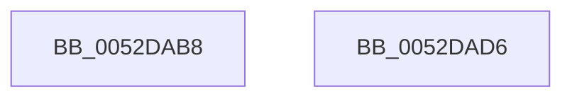

# SymCryptFdefIntSubSameSize

- RVA: `0x0052DAB8`–`0x0052DAD7` (길이 `31` bytes)
- VA: `0x000000014052DAB8`
- 실행 섹션: `.text`
- PDB 이름 있음: `예`; PDB Function 태그: `아니요`
- unwind 정보 RVA: `0x0005C788`
- 디코드: `9`개 명령, `31/31` bytes 표시
- 미해석 바이트: `0` (있으면 어셈블리에 `.byte`로 보존)

> 이 문서는 커널 이미지의 기계어와 PDB 기호를 분석해 생성했습니다. 4번과 5번은 함수 원형과 자료형을 바이너리 사용 방식에서 추정한 C 해석이며 원본 소스 복구 결과는 아닙니다.

## 1. Dependencies

- 직접 호출 지점: **1**; 고유 호출 대상: **1**
- 직접 호출자로 확인된 함수: **1**
- RIP 상대 이미지 참조: **0**

### Outgoing calls
- `0x0052DACC` → [SymCryptFdefRawSubAsm](../53/SymCryptFdefRawSubAsm_function_00536570.md) (function, `0x00536570`)

### Direct callers
- [SymCryptIntSubSameSize](SymCryptIntSubSameSize_function_005257A8.md) at `0x005257AC`

### Static image references
- 디코드된 RIP-relative 메모리 참조가 없습니다.

## 2. Other-region calls and transfers

- 다른 실행 섹션으로 향하는 call: **0**
- 별도 외부 분기/꼬리 이동을 확인하지 못했습니다.

## 3. Assembly (complete function range)

```asm
0052DAB8  48 83 EC 28                     sub rsp, 0x28
0052DABC  45 8B 48 04                     mov r9d, dword ptr [r8 + 4]
0052DAC0  48 83 C2 20                     add rdx, 0x20
0052DAC4  49 83 C0 20                     add r8, 0x20
0052DAC8  48 83 C1 20                     add rcx, 0x20
0052DACC  E8 9F 8A 00 00                  call 0x140536570
0052DAD1  48 83 C4 28                     add rsp, 0x28
0052DAD5  C3                              ret
0052DAD6  CC                              int3
```

## 4. C-style interpretation (structured pseudocode)

```c
__int64 __fastcall SymCryptFdefIntSubSameSize(__int64 a1, __int64 a2, __int64 a3)
{
    __int64 result;
    __int64 v_rsp;

    v_rsp = (v_rsp) - (40);
    a2 = (a2) + (32);
    a3 = (a3) + (32);
    a1 = (a1) + (32);
    result = SymCryptFdefRawSubAsm(a1, a2, a3, (unsigned int)(*(unsigned int *)(a3 + 4)));
    v_rsp = (v_rsp) + (40);
    return result;
}
```

## 5. (Beta) C Style

```c
int64_t SymCryptFdefIntSubSameSize(int64_t Arg1, int64_t Arg2, void *Arg3)
{
    uint8_t *arg3 = (uint8_t *)Arg3;

    int64_t result;
    int64_t local_rsp;

    local_rsp = (local_rsp) - (40);
    Arg2 = (Arg2) + (32);
    Arg3 = (Arg3) + (32);
    Arg1 = (Arg1) + (32);
    result = SymCryptFdefRawSubAsm(Arg1, Arg2, Arg3, (uint32_t)(*(uint32_t *)(arg3 + 0x4)));
    local_rsp = (local_rsp) + (40);
    return result;
}
```

### 관측된 메모리 오프셋

구조체 형식이 확인되지 않은 접근은 인자 기준의 오프셋으로만 기록했습니다.

| 기준 인자 | 오프셋 표현 | 폭 (bit) | 접근 |
|---|---:|---:|---|
| `Arg3` | `+ 0x4` | `32` | `R` |

## 6. Execution-region graph

[열기: 2D/3D 그래프와 함수 탐색 컨트롤 패널](../../../control-panel.html?section=text&rva=0x0052DAB8&view=graph)

- 2D 그래프는 위에서 아래로 흐르고, 3D 그래프는 빈 공간을 드래그해 회전합니다. Shift+드래그는 이동, 휠은 확대·축소, 함수 노드 선택은 대상 보고서 이동입니다.

### Static fallback


