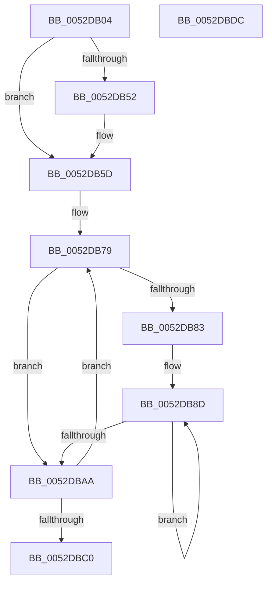

# SymCryptFdefIntToDivisor

- RVA: `0x0052DB04`–`0x0052DBDD` (길이 `217` bytes)
- VA: `0x000000014052DB04`
- 실행 섹션: `.text`
- PDB 이름 있음: `예`; PDB Function 태그: `아니요`
- unwind 정보 RVA: `0x0005C954`
- 디코드: `65`개 명령, `217/217` bytes 표시
- 미해석 바이트: `0` (있으면 어셈블리에 `.byte`로 보존)

> 이 문서는 커널 이미지의 기계어와 PDB 기호를 분석해 생성했습니다. 4번과 5번은 함수 원형과 자료형을 바이너리 사용 방식에서 추정한 C 해석이며 원본 소스 복구 결과는 아닙니다.

## 1. Dependencies

- 직접 호출 지점: **4**; 고유 호출 대상: **4**
- 직접 호출자로 확인된 함수: **1**
- RIP 상대 이미지 참조: **0**

### Outgoing calls
- `0x0052DB30` → [EmpCheckErrataList](../49/EmpCheckErrataList_function_0049E550.md) (function, `0x0049E550`)
- `0x0052DB3F` → [SymCryptFdefIntCopy](../53/SymCryptFdefIntCopy_function_00535A88.md) (function, `0x00535A88`)
- `0x0052DB47` → [SymCryptIntBitsizeOfValue](SymCryptIntBitsizeOfValue_function_005254F4.md) (function, `0x005254F4`)
- `0x0052DB58` → [SymCryptIntSetValueUint32](SymCryptIntSetValueUint32_function_00525748.md) (function, `0x00525748`)

### Direct callers
- [SymCryptIntToDivisor](SymCryptIntToDivisor_function_005257D8.md) at `0x005257F0`

### Static image references
- 디코드된 RIP-relative 메모리 참조가 없습니다.

## 2. Other-region calls and transfers

- 다른 실행 섹션으로 향하는 call: **0**
- 별도 외부 분기/꼬리 이동을 확인하지 못했습니다.

## 3. Assembly (complete function range)

```asm
0052DB04  48 89 5C 24 08                  mov qword ptr [rsp + 8], rbx
0052DB09  48 89 6C 24 10                  mov qword ptr [rsp + 0x10], rbp
0052DB0E  48 89 74 24 18                  mov qword ptr [rsp + 0x18], rsi
0052DB13  57                              push rdi
0052DB14  48 83 EC 20                     sub rsp, 0x20
0052DB18  44 8B 41 04                     mov r8d, dword ptr [rcx + 4]
0052DB1C  48 8B FA                        mov rdi, rdx
0052DB1F  48 8B 54 24 58                  mov rdx, qword ptr [rsp + 0x58]
0052DB24  48 8B D9                        mov rbx, rcx
0052DB27  48 8B 4C 24 50                  mov rcx, qword ptr [rsp + 0x50]
0052DB2C  41 C1 E0 04                     shl r8d, 4
0052DB30  E8 1B 0A F7 FF                  call 0x14049e550
0052DB35  48 8D 77 20                     lea rsi, [rdi + 0x20]
0052DB39  48 8B CB                        mov rcx, rbx
0052DB3C  48 8B D6                        mov rdx, rsi
0052DB3F  E8 44 7F 00 00                  call 0x140535a88
0052DB44  48 8B CE                        mov rcx, rsi
0052DB47  E8 A8 79 FF FF                  call 0x1405254f4
0052DB4C  8B D8                           mov ebx, eax
0052DB4E  85 C0                           test eax, eax
0052DB50  75 0B                           jne 0x14052db5d
0052DB52  48 8B D6                        mov rdx, rsi
0052DB55  8D 48 01                        lea ecx, [rax + 1]
0052DB58  E8 EB 7B FF FF                  call 0x140525748
0052DB5D  44 8D 4B 1F                     lea r9d, [rbx + 0x1f]
0052DB61  89 5F 0C                        mov dword ptr [rdi + 0xc], ebx
0052DB64  8D 6B FF                        lea ebp, [rbx - 1]
0052DB67  41 C1 E9 05                     shr r9d, 5
0052DB6B  83 E5 1F                        and ebp, 0x1f
0052DB6E  45 33 C0                        xor r8d, r8d
0052DB71  FF C5                           inc ebp
0052DB73  41 BA 00 00 00 80               mov r10d, 0x80000000
0052DB79  45 0B C2                        or r8d, r10d
0052DB7C  33 D2                           xor edx, edx
0052DB7E  45 85 C9                        test r9d, r9d
0052DB81  74 27                           je 0x14052dbaa
0052DB83  41 8B F0                        mov esi, r8d
0052DB86  4C 8D 5F 40                     lea r11, [rdi + 0x40]
0052DB8A  41 8B D9                        mov ebx, r9d
0052DB8D  41 8B 0B                        mov ecx, dword ptr [r11]
0052DB90  4D 8D 5B 04                     lea r11, [r11 + 4]
0052DB94  8B C1                           mov eax, ecx
0052DB96  48 0F AF C6                     imul rax, rsi
0052DB9A  48 03 D0                        add rdx, rax
0052DB9D  48 C1 EA 20                     shr rdx, 0x20
0052DBA1  48 03 D1                        add rdx, rcx
0052DBA4  48 83 EB 01                     sub rbx, 1
0052DBA8  75 E3                           jne 0x14052db8d
0052DBAA  48 8B CD                        mov rcx, rbp
0052DBAD  48 D3 EA                        shr rdx, cl
0052DBB0  83 E2 01                        and edx, 1
0052DBB3  F7 DA                           neg edx
0052DBB5  41 23 D2                        and edx, r10d
0052DBB8  44 33 C2                        xor r8d, edx
0052DBBB  41 D1 EA                        shr r10d, 1
0052DBBE  75 B9                           jne 0x14052db79
0052DBC0  48 8B 5C 24 30                  mov rbx, qword ptr [rsp + 0x30]
0052DBC5  48 8B 6C 24 38                  mov rbp, qword ptr [rsp + 0x38]
0052DBCA  48 8B 74 24 40                  mov rsi, qword ptr [rsp + 0x40]
0052DBCF  41 8B C0                        mov eax, r8d
0052DBD2  48 89 47 18                     mov qword ptr [rdi + 0x18], rax
0052DBD6  48 83 C4 20                     add rsp, 0x20
0052DBDA  5F                              pop rdi
0052DBDB  C3                              ret
0052DBDC  CC                              int3
```

## 4. C-style interpretation (structured pseudocode)

```c
__int64 __fastcall SymCryptFdefIntToDivisor(__int64 a1, __int64 a2, __int64 a3, __int64 a4, __int64 a5, __int64 a6)
{
    __int64 result;
    __int64 v_r10;
    __int64 v_rbp;
    __int64 v_rbx;
    __int64 v_rsp;
    unsigned __int64 v_stack_p10;
    unsigned __int64 v_stack_p18;
    unsigned __int64 v_stack_p8;

    v_stack_p8 = v_rbx;
    v_stack_p10 = v_rbp;
    v_stack_p18 = v_rsi;
    v_rsp = (v_rsp) - (32);
    a3 = (unsigned int)(((unsigned int)(*(unsigned int *)(a1 + 4))) << (4));
    result = EmpCheckErrataList(a5, a6, a3, a4);
    result = SymCryptFdefIntCopy(a1, a2 + 32, a3, a4);
    result = SymCryptIntBitsizeOfValue(a2 + 32, a2 + 32, a3, a4);
    if ((unsigned int)(result) == 0) {
        a2 = a2 + 32;
        a1 = result + 1;
        result = SymCryptIntSetValueUint32(a1, a2, a3, a4);
    }
    *(unsigned int *)(a2 + 12) = (unsigned int)((unsigned int)((unsigned int)(result)));
    a4 = (unsigned int)(((unsigned int)((unsigned int)(result)) + 31) >> (5));
    v_rbp = (unsigned int)(((unsigned int)((unsigned int)(result)) - 1) & (31));
    a3 = 0;
    v_rbp = (unsigned int)((v_rbp) + 1);
loc_0052DB79:
    a3 = (unsigned int)((a3) | ((unsigned int)((unsigned int)(0x80000000ULL))));
    a2 = 0;
    if ((unsigned int)(a4) == 0) goto loc_0052DBAA;
loc_0052DB8D:
    result = ((unsigned int)((unsigned int)((unsigned int)(*(unsigned int *)(a2 + 64))))) * ((unsigned int)((unsigned int)(a3)));
    a2 = (a2) + (result);
    a2 = (a2) >> (32);
    a2 = (a2) + ((unsigned int)(*(unsigned int *)(a2 + 64)));
    v_rbx = ((unsigned int)((unsigned int)(a4))) - (1);
    if (condition_is_not_equal) goto loc_0052DB8D;
loc_0052DBAA:
    a2 = (a2) >> ((unsigned __int8)(v_rbp));
    a2 = (unsigned int)((a2) & (1));
    a2 = (unsigned int)(-(a2));
    a2 = (unsigned int)((a2) & ((unsigned int)((unsigned int)(0x80000000ULL))));
    a3 = (unsigned int)((a3) ^ ((unsigned int)(a2)));
    v_r10 = (unsigned int)(((unsigned int)(0x80000000ULL)) >> (1));
    if (condition_is_not_equal) goto loc_0052DB79;
    *(unsigned __int64 *)(a2 + 24) = (unsigned int)((unsigned int)(a3));
    v_rsp = (v_rsp) + (32);
    return (unsigned int)((unsigned int)(a3));
}
```

## 5. (Beta) C Style

```c
int64_t SymCryptFdefIntToDivisor(void *Arg1, void *Arg2, int64_t Arg3, int64_t Arg4, int64_t Arg5, int64_t Arg6)
{
    uint8_t *arg1 = (uint8_t *)Arg1;
    uint8_t *arg2 = (uint8_t *)Arg2;

    int64_t result;
    int64_t local_r10;
    int64_t local_rbp;
    int64_t local_rbx;
    int64_t local_rsp;
    uint64_t v_stack_p10;
    uint64_t v_stack_p18;
    uint64_t v_stack_p8;

    v_stack_p8 = local_rbx;
    v_stack_p10 = local_rbp;
    v_stack_p18 = local_rsi;
    local_rsp = (local_rsp) - (32);
    Arg3 = (uint32_t)(((uint32_t)(*(uint32_t *)(arg1 + 0x4))) << (4));
    result = EmpCheckErrataList(Arg5, Arg6, Arg3, Arg4);
    result = SymCryptFdefIntCopy(Arg1, Arg2 + 32, Arg3, Arg4);
    result = SymCryptIntBitsizeOfValue(Arg2 + 32, Arg2 + 32, Arg3, Arg4);
    if ((uint32_t)(result) == 0) {
        Arg2 = Arg2 + 32;
        Arg1 = result + 1;
        result = SymCryptIntSetValueUint32(Arg1, Arg2, Arg3, Arg4);
    }
    *(uint32_t *)(arg2 + 0xC) = (uint32_t)((uint32_t)((uint32_t)(result)));
    Arg4 = (uint32_t)(((uint32_t)((uint32_t)(result)) + 31) >> (5));
    local_rbp = (uint32_t)(((uint32_t)((uint32_t)(result)) - 1) & (31));
    Arg3 = 0;
    local_rbp = (uint32_t)((local_rbp) + 1);
loc_0052DB79:
    Arg3 = (uint32_t)((Arg3) | ((uint32_t)((uint32_t)(0x80000000ULL))));
    Arg2 = 0;
    if ((uint32_t)(Arg4) == 0) goto loc_0052DBAA;
loc_0052DB8D:
    result = ((uint32_t)((uint32_t)((uint32_t)(*(uint32_t *)(arg2 + 0x40))))) * ((uint32_t)((uint32_t)(Arg3)));
    Arg2 = (Arg2) + (result);
    Arg2 = (Arg2) >> (32);
    Arg2 = (Arg2) + ((uint32_t)(*(uint32_t *)(arg2 + 0x40)));
    local_rbx = ((uint32_t)((uint32_t)(Arg4))) - (1);
    if (condition_is_not_equal) goto loc_0052DB8D;
loc_0052DBAA:
    Arg2 = (Arg2) >> ((uint8_t)(local_rbp));
    Arg2 = (uint32_t)((Arg2) & (1));
    Arg2 = (uint32_t)(-(Arg2));
    Arg2 = (uint32_t)((Arg2) & ((uint32_t)((uint32_t)(0x80000000ULL))));
    Arg3 = (uint32_t)((Arg3) ^ ((uint32_t)(Arg2)));
    local_r10 = (uint32_t)(((uint32_t)(0x80000000ULL)) >> (1));
    if (condition_is_not_equal) goto loc_0052DB79;
    *(uint64_t *)(arg2 + 0x18) = (uint32_t)((uint32_t)(Arg3));
    local_rsp = (local_rsp) + (32);
    return (uint32_t)((uint32_t)(Arg3));
}
```

### 관측된 메모리 오프셋

구조체 형식이 확인되지 않은 접근은 인자 기준의 오프셋으로만 기록했습니다.

| 기준 인자 | 오프셋 표현 | 폭 (bit) | 접근 |
|---|---:|---:|---|
| `Arg1` | `+ 0x4` | `32` | `R` |
| `Arg2` | `+ 0x0` | `32` | `R` |
| `Arg2` | `+ 0x4` | `64` | `R` |
| `Arg2` | `+ 0xC` | `32` | `W` |
| `Arg2` | `+ 0x18` | `64` | `W` |
| `Arg2` | `+ 0x20` | `64` | `R` |
| `Arg2` | `+ 0x40` | `64` | `R` |

## 6. Execution-region graph

[열기: 2D/3D 그래프와 함수 탐색 컨트롤 패널](../../../control-panel.html?section=text&rva=0x0052DB04&view=graph)

- 2D 그래프는 위에서 아래로 흐르고, 3D 그래프는 빈 공간을 드래그해 회전합니다. Shift+드래그는 이동, 휠은 확대·축소, 함수 노드 선택은 대상 보고서 이동입니다.

### Static fallback


