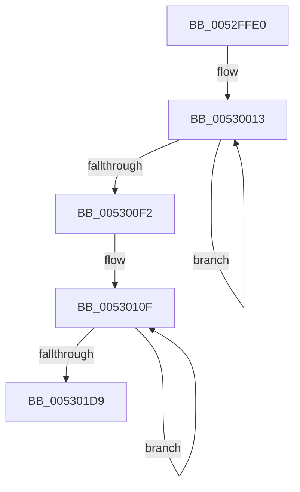

# SymCryptFdefModDivSmallPow2Mulx

- RVA: `0x0052FFE0`–`0x005301DD` (길이 `509` bytes)
- VA: `0x000000014052FFE0`
- 실행 섹션: `.text`
- PDB 이름 있음: `예`; PDB Function 태그: `아니요`
- unwind 정보 RVA: `0x000C3510`
- 디코드: `118`개 명령, `509/509` bytes 표시
- 미해석 바이트: `0` (있으면 어셈블리에 `.byte`로 보존)

> 이 문서는 커널 이미지의 기계어와 PDB 기호를 분석해 생성했습니다. 4번과 5번은 함수 원형과 자료형을 바이너리 사용 방식에서 추정한 C 해석이며 원본 소스 복구 결과는 아닙니다.

## 1. Dependencies

- 직접 호출 지점: **0**; 고유 호출 대상: **0**
- 직접 호출자로 확인된 함수: **1**
- RIP 상대 이미지 참조: **0**

### Outgoing calls
- 직접 디코드된 call 명령이 없습니다.

### Direct callers
- [SymCryptFdefModDivSmallPow2](../53/SymCryptFdefModDivSmallPow2_function_00534328.md) at `0x00534366`

### Static image references
- 디코드된 RIP-relative 메모리 참조가 없습니다.

## 2. Other-region calls and transfers

- 다른 실행 섹션으로 향하는 call: **0**
- 별도 외부 분기/꼬리 이동을 확인하지 못했습니다.

## 3. Assembly (complete function range)

```asm
0052FFE0  48 56                           push rsi
0052FFE2  57                              push rdi
0052FFE3  55                              push rbp
0052FFE4  4C 8B D2                        mov r10, rdx
0052FFE7  49 8B 3A                        mov rdi, qword ptr [r10]
0052FFEA  48 8B 51 18                     mov rdx, qword ptr [rcx + 0x18]
0052FFEE  48 0F AF D7                     imul rdx, rdi
0052FFF2  33 C0                           xor eax, eax
0052FFF4  48 C7 C7 FF FF FF FF            mov rdi, 0xffffffffffffffff
0052FFFB  41 2B C0                        sub eax, r8d
0052FFFE  C4 E2 FB F7 FF                  shrx rdi, rdi, rax
00530003  48 23 D7                        and rdx, rdi
00530006  8B 41 04                        mov eax, dword ptr [rcx + 4]
00530009  4C 8D 99 80 00 00 00            lea r11, [rcx + 0x80]
00530010  48 33 F6                        xor rsi, rsi
00530013  48 33 FF                        xor rdi, rdi
00530016  C4 C2 C3 F6 2B                  mulx rbp, rdi, qword ptr [r11]
0053001B  F3 48 0F 38 F6 FE               adox rdi, rsi
00530021  66 49 0F 38 F6 3A               adcx rdi, qword ptr [r10]
00530027  49 89 39                        mov qword ptr [r9], rdi
0053002A  C4 C2 C3 F6 73 08               mulx rsi, rdi, qword ptr [r11 + 8]
00530030  F3 48 0F 38 F6 FD               adox rdi, rbp
00530036  66 49 0F 38 F6 7A 08            adcx rdi, qword ptr [r10 + 8]
0053003D  49 89 79 08                     mov qword ptr [r9 + 8], rdi
00530041  C4 C2 C3 F6 6B 10               mulx rbp, rdi, qword ptr [r11 + 0x10]
00530047  F3 48 0F 38 F6 FE               adox rdi, rsi
0053004D  66 49 0F 38 F6 7A 10            adcx rdi, qword ptr [r10 + 0x10]
00530054  49 89 79 10                     mov qword ptr [r9 + 0x10], rdi
00530058  C4 C2 C3 F6 73 18               mulx rsi, rdi, qword ptr [r11 + 0x18]
0053005E  F3 48 0F 38 F6 FD               adox rdi, rbp
00530064  66 49 0F 38 F6 7A 18            adcx rdi, qword ptr [r10 + 0x18]
0053006B  49 89 79 18                     mov qword ptr [r9 + 0x18], rdi
0053006F  C4 C2 C3 F6 6B 20               mulx rbp, rdi, qword ptr [r11 + 0x20]
00530075  F3 48 0F 38 F6 FE               adox rdi, rsi
0053007B  66 49 0F 38 F6 7A 20            adcx rdi, qword ptr [r10 + 0x20]
00530082  49 89 79 20                     mov qword ptr [r9 + 0x20], rdi
00530086  C4 C2 C3 F6 73 28               mulx rsi, rdi, qword ptr [r11 + 0x28]
0053008C  F3 48 0F 38 F6 FD               adox rdi, rbp
00530092  66 49 0F 38 F6 7A 28            adcx rdi, qword ptr [r10 + 0x28]
00530099  49 89 79 28                     mov qword ptr [r9 + 0x28], rdi
0053009D  C4 C2 C3 F6 6B 30               mulx rbp, rdi, qword ptr [r11 + 0x30]
005300A3  F3 48 0F 38 F6 FE               adox rdi, rsi
005300A9  66 49 0F 38 F6 7A 30            adcx rdi, qword ptr [r10 + 0x30]
005300B0  49 89 79 30                     mov qword ptr [r9 + 0x30], rdi
005300B4  C4 C2 C3 F6 73 38               mulx rsi, rdi, qword ptr [r11 + 0x38]
005300BA  F3 48 0F 38 F6 FD               adox rdi, rbp
005300C0  66 49 0F 38 F6 7A 38            adcx rdi, qword ptr [r10 + 0x38]
005300C7  49 89 79 38                     mov qword ptr [r9 + 0x38], rdi
005300CB  48 C7 C5 00 00 00 00            mov rbp, 0
005300D2  F3 48 0F 38 F6 F5               adox rsi, rbp
005300D8  66 48 0F 38 F6 F5               adcx rsi, rbp
005300DE  49 83 C2 40                     add r10, 0x40
005300E2  49 83 C3 40                     add r11, 0x40
005300E6  49 83 C1 40                     add r9, 0x40
005300EA  FF C8                           dec eax
005300EC  0F 85 21 FF FF FF               jne 0x140530013
005300F2  8B 41 04                        mov eax, dword ptr [rcx + 4]
005300F5  B9 40 00 00 00                  mov ecx, 0x40
005300FA  48 33 FF                        xor rdi, rdi
005300FD  41 2B C8                        sub ecx, r8d
00530100  49 C7 C2 FF FF FF FF            mov r10, 0xffffffffffffffff
00530107  4C 0F 44 D7                     cmove r10, rdi
0053010B  49 83 E9 40                     sub r9, 0x40
0053010F  49 8B 79 38                     mov rdi, qword ptr [r9 + 0x38]
00530113  C4 E2 BB F7 EF                  shrx rbp, rdi, r8
00530118  C4 E2 F1 F7 F6                  shlx rsi, rsi, rcx
0053011D  49 23 EA                        and rbp, r10
00530120  48 0B EE                        or rbp, rsi
00530123  49 89 69 38                     mov qword ptr [r9 + 0x38], rbp
00530127  49 8B 71 30                     mov rsi, qword ptr [r9 + 0x30]
0053012B  C4 E2 BB F7 EE                  shrx rbp, rsi, r8
00530130  C4 E2 F1 F7 FF                  shlx rdi, rdi, rcx
00530135  49 23 EA                        and rbp, r10
00530138  48 0B EF                        or rbp, rdi
0053013B  49 89 69 30                     mov qword ptr [r9 + 0x30], rbp
0053013F  49 8B 79 28                     mov rdi, qword ptr [r9 + 0x28]
00530143  C4 E2 BB F7 EF                  shrx rbp, rdi, r8
00530148  C4 E2 F1 F7 F6                  shlx rsi, rsi, rcx
0053014D  49 23 EA                        and rbp, r10
00530150  48 0B EE                        or rbp, rsi
00530153  49 89 69 28                     mov qword ptr [r9 + 0x28], rbp
00530157  49 8B 71 20                     mov rsi, qword ptr [r9 + 0x20]
0053015B  C4 E2 BB F7 EE                  shrx rbp, rsi, r8
00530160  C4 E2 F1 F7 FF                  shlx rdi, rdi, rcx
00530165  49 23 EA                        and rbp, r10
00530168  48 0B EF                        or rbp, rdi
0053016B  49 89 69 20                     mov qword ptr [r9 + 0x20], rbp
0053016F  49 8B 79 18                     mov rdi, qword ptr [r9 + 0x18]
00530173  C4 E2 BB F7 EF                  shrx rbp, rdi, r8
00530178  C4 E2 F1 F7 F6                  shlx rsi, rsi, rcx
0053017D  49 23 EA                        and rbp, r10
00530180  48 0B EE                        or rbp, rsi
00530183  49 89 69 18                     mov qword ptr [r9 + 0x18], rbp
00530187  49 8B 71 10                     mov rsi, qword ptr [r9 + 0x10]
0053018B  C4 E2 BB F7 EE                  shrx rbp, rsi, r8
00530190  C4 E2 F1 F7 FF                  shlx rdi, rdi, rcx
00530195  49 23 EA                        and rbp, r10
00530198  48 0B EF                        or rbp, rdi
0053019B  49 89 69 10                     mov qword ptr [r9 + 0x10], rbp
0053019F  49 8B 79 08                     mov rdi, qword ptr [r9 + 8]
005301A3  C4 E2 BB F7 EF                  shrx rbp, rdi, r8
005301A8  C4 E2 F1 F7 F6                  shlx rsi, rsi, rcx
005301AD  49 23 EA                        and rbp, r10
005301B0  48 0B EE                        or rbp, rsi
005301B3  49 89 69 08                     mov qword ptr [r9 + 8], rbp
005301B7  49 8B 31                        mov rsi, qword ptr [r9]
005301BA  C4 E2 BB F7 EE                  shrx rbp, rsi, r8
005301BF  C4 E2 F1 F7 FF                  shlx rdi, rdi, rcx
005301C4  49 23 EA                        and rbp, r10
005301C7  48 0B EF                        or rbp, rdi
005301CA  49 89 29                        mov qword ptr [r9], rbp
005301CD  49 83 E9 40                     sub r9, 0x40
005301D1  FF C8                           dec eax
005301D3  0F 85 36 FF FF FF               jne 0x14053010f
005301D9  5D                              pop rbp
005301DA  5F                              pop rdi
005301DB  5E                              pop rsi
005301DC  C3                              ret
```

## 4. C-style interpretation (structured pseudocode)

```c
__int64 __fastcall SymCryptFdefModDivSmallPow2Mulx(__int64 a1, __int64 a2, __int64 a3, __int64 a4)
{
    __int64 result;
    __int64 v_r10;
    __int64 v_r11;
    __int64 v_rbp;
    __int64 v_rdi;
    __int64 v_rsi;

    a2 = (*(unsigned __int64 *)(a1 + 24)) * (*(unsigned __int64 *)(a2));
    result = 0;
    result = (unsigned int)((result) - ((unsigned int)(a3)));
    a2 = (a2) & (-1);
    v_rsi = 0;
loc_00530013:
    v_rdi = 0;
    *(unsigned __int64 *)(a4) = 0;
    *(unsigned __int64 *)(a4 + 8) = 0;
    *(unsigned __int64 *)(a4 + 16) = 0;
    *(unsigned __int64 *)(a4 + 24) = 0;
    *(unsigned __int64 *)(a4 + 32) = 0;
    *(unsigned __int64 *)(a4 + 40) = 0;
    *(unsigned __int64 *)(a4 + 48) = 0;
    *(unsigned __int64 *)(a4 + 56) = 0;
    v_r10 = (a2) + (64);
    v_r11 = (a1 + 128) + (64);
    a4 = (a4) + (64);
    result = (unsigned int)(((unsigned int)(*(unsigned int *)(a1 + 4))) - 1);
    if (condition_is_not_equal) goto loc_00530013;
    v_rdi = 0;
    a1 = (unsigned int)((64) - ((unsigned int)(a3)));
    v_r10 = -1;
    if (condition_is_equal) { v_r10 = 0; }
    a4 = (a4) - (64);
loc_0053010F:
    v_rbp = (0) & (v_r10);
    v_rbp = (v_rbp) | (0);
    *(unsigned __int64 *)(a4 + 56) = v_rbp;
    v_rbp = (v_rbp) & (v_r10);
    v_rbp = (v_rbp) | (*(unsigned __int64 *)(a4 + 56));
    *(unsigned __int64 *)(a4 + 48) = v_rbp;
    v_rbp = (v_rbp) & (v_r10);
    v_rbp = (v_rbp) | (*(unsigned __int64 *)(a4 + 48));
    *(unsigned __int64 *)(a4 + 40) = v_rbp;
    v_rbp = (v_rbp) & (v_r10);
    v_rbp = (v_rbp) | (*(unsigned __int64 *)(a4 + 40));
    *(unsigned __int64 *)(a4 + 32) = v_rbp;
    v_rbp = (v_rbp) & (v_r10);
    v_rbp = (v_rbp) | (*(unsigned __int64 *)(a4 + 32));
    *(unsigned __int64 *)(a4 + 24) = v_rbp;
    v_rbp = (v_rbp) & (v_r10);
    v_rbp = (v_rbp) | (*(unsigned __int64 *)(a4 + 24));
    *(unsigned __int64 *)(a4 + 16) = v_rbp;
    v_rbp = (v_rbp) & (v_r10);
    v_rbp = (v_rbp) | (*(unsigned __int64 *)(a4 + 16));
    *(unsigned __int64 *)(a4 + 8) = v_rbp;
    v_rbp = (v_rbp) & (v_r10);
    v_rbp = (v_rbp) | (*(unsigned __int64 *)(a4 + 8));
    *(unsigned __int64 *)(a4) = v_rbp;
    a4 = (a4) - (64);
    result = (unsigned int)(((unsigned int)(*(unsigned int *)(a1 + 4))) - 1);
    if (condition_is_not_equal) goto loc_0053010F;
    return result;
}
```

## 5. (Beta) C Style

```c
int64_t SymCryptFdefModDivSmallPow2Mulx(void *Arg1, void *Arg2, int64_t Arg3, void *Arg4)
{
    uint8_t *arg1 = (uint8_t *)Arg1;
    uint8_t *arg2 = (uint8_t *)Arg2;
    uint8_t *arg4 = (uint8_t *)Arg4;

    int64_t result;
    int64_t local_r10;
    int64_t local_r11;
    int64_t local_rbp;
    int64_t local_rdi;
    int64_t local_rsi;

    Arg2 = (*(uint64_t *)(arg1 + 0x18)) * (*(uint64_t *)(arg2));
    result = 0;
    result = (uint32_t)((result) - ((uint32_t)(Arg3)));
    Arg2 = (Arg2) & (-1);
    local_rsi = 0;
loc_00530013:
    local_rdi = 0;
    *(uint64_t *)(arg4) = 0;
    *(uint64_t *)(arg4 + 0x8) = 0;
    *(uint64_t *)(arg4 + 0x10) = 0;
    *(uint64_t *)(arg4 + 0x18) = 0;
    *(uint64_t *)(arg4 + 0x20) = 0;
    *(uint64_t *)(arg4 + 0x28) = 0;
    *(uint64_t *)(arg4 + 0x30) = 0;
    *(uint64_t *)(arg4 + 0x38) = 0;
    local_r10 = (Arg2) + (64);
    local_r11 = (Arg1 + 128) + (64);
    Arg4 = (Arg4) + (64);
    result = (uint32_t)(((uint32_t)(*(uint32_t *)(arg1 + 0x4))) - 1);
    if (condition_is_not_equal) goto loc_00530013;
    local_rdi = 0;
    Arg1 = (uint32_t)((64) - ((uint32_t)(Arg3)));
    local_r10 = -1;
    if (condition_is_equal) { local_r10 = 0; }
    Arg4 = (Arg4) - (64);
loc_0053010F:
    local_rbp = (0) & (local_r10);
    local_rbp = (local_rbp) | (0);
    *(uint64_t *)(arg4 + 0x38) = local_rbp;
    local_rbp = (local_rbp) & (local_r10);
    local_rbp = (local_rbp) | (*(uint64_t *)(arg4 + 0x38));
    *(uint64_t *)(arg4 + 0x30) = local_rbp;
    local_rbp = (local_rbp) & (local_r10);
    local_rbp = (local_rbp) | (*(uint64_t *)(arg4 + 0x30));
    *(uint64_t *)(arg4 + 0x28) = local_rbp;
    local_rbp = (local_rbp) & (local_r10);
    local_rbp = (local_rbp) | (*(uint64_t *)(arg4 + 0x28));
    *(uint64_t *)(arg4 + 0x20) = local_rbp;
    local_rbp = (local_rbp) & (local_r10);
    local_rbp = (local_rbp) | (*(uint64_t *)(arg4 + 0x20));
    *(uint64_t *)(arg4 + 0x18) = local_rbp;
    local_rbp = (local_rbp) & (local_r10);
    local_rbp = (local_rbp) | (*(uint64_t *)(arg4 + 0x18));
    *(uint64_t *)(arg4 + 0x10) = local_rbp;
    local_rbp = (local_rbp) & (local_r10);
    local_rbp = (local_rbp) | (*(uint64_t *)(arg4 + 0x10));
    *(uint64_t *)(arg4 + 0x8) = local_rbp;
    local_rbp = (local_rbp) & (local_r10);
    local_rbp = (local_rbp) | (*(uint64_t *)(arg4 + 0x8));
    *(uint64_t *)(arg4) = local_rbp;
    Arg4 = (Arg4) - (64);
    result = (uint32_t)(((uint32_t)(*(uint32_t *)(arg1 + 0x4))) - 1);
    if (condition_is_not_equal) goto loc_0053010F;
    return result;
}
```

### 관측된 메모리 오프셋

구조체 형식이 확인되지 않은 접근은 인자 기준의 오프셋으로만 기록했습니다.

| 기준 인자 | 오프셋 표현 | 폭 (bit) | 접근 |
|---|---:|---:|---|
| `Arg1` | `+ 0x0` | `64` | `R` |
| `Arg1` | `+ 0x4` | `32` | `R` |
| `Arg1` | `+ 0x8` | `64` | `R` |
| `Arg1` | `+ 0x10` | `64` | `R` |
| `Arg1` | `+ 0x18` | `64` | `R` |
| `Arg1` | `+ 0x20` | `64` | `R` |
| `Arg1` | `+ 0x28` | `64` | `R` |
| `Arg1` | `+ 0x30` | `64` | `R` |
| `Arg1` | `+ 0x38` | `64` | `R` |
| `Arg1` | `+ 0x80` | `64` | `R` |
| `Arg2` | `+ 0x0` | `64` | `R` |
| `Arg2` | `+ 0x8` | `64` | `R` |
| `Arg2` | `+ 0x10` | `64` | `R` |
| `Arg2` | `+ 0x18` | `64` | `R` |
| `Arg2` | `+ 0x20` | `64` | `R` |
| `Arg2` | `+ 0x28` | `64` | `R` |
| `Arg2` | `+ 0x30` | `64` | `R` |
| `Arg2` | `+ 0x38` | `64` | `R` |
| `Arg4` | `+ 0x0` | `64` | `R` |
| `Arg4` | `+ 0x0` | `64` | `W` |
| `Arg4` | `+ 0x8` | `64` | `R` |
| `Arg4` | `+ 0x8` | `64` | `W` |
| `Arg4` | `+ 0x10` | `64` | `R` |
| `Arg4` | `+ 0x10` | `64` | `W` |
| `Arg4` | `+ 0x18` | `64` | `R` |
| `Arg4` | `+ 0x18` | `64` | `W` |
| `Arg4` | `+ 0x20` | `64` | `R` |
| `Arg4` | `+ 0x20` | `64` | `W` |
| `Arg4` | `+ 0x28` | `64` | `R` |
| `Arg4` | `+ 0x28` | `64` | `W` |
| `Arg4` | `+ 0x30` | `64` | `R` |
| `Arg4` | `+ 0x30` | `64` | `W` |

추가 오프셋 2개는 표에서 생략했습니다.

## 6. Execution-region graph

[열기: 2D/3D 그래프와 함수 탐색 컨트롤 패널](../../../control-panel.html?section=text&rva=0x0052FFE0&view=graph)

- 2D 그래프는 위에서 아래로 흐르고, 3D 그래프는 빈 공간을 드래그해 회전합니다. Shift+드래그는 이동, 휠은 확대·축소, 함수 노드 선택은 대상 보고서 이동입니다.

### Static fallback


