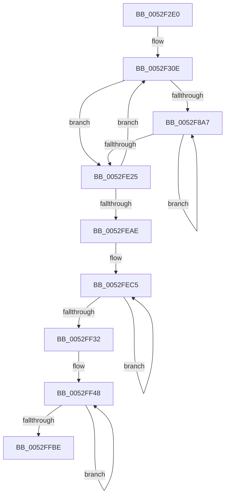

# SymCryptFdefMontgomeryReduceMulx

- RVA: `0x0052F2E0`–`0x0052FFCB` (길이 `3,307` bytes)
- VA: `0x000000014052F2E0`
- 실행 섹션: `.text`
- PDB 이름 있음: `예`; PDB Function 태그: `아니요`
- unwind 정보 RVA: `0x000C34F8`
- 디코드: `629`개 명령, `3,307/3,307` bytes 표시
- 미해석 바이트: `0` (있으면 어셈블리에 `.byte`로 보존)

> 이 문서는 커널 이미지의 기계어와 PDB 기호를 분석해 생성했습니다. 4번과 5번은 함수 원형과 자료형을 바이너리 사용 방식에서 추정한 C 해석이며 원본 소스 복구 결과는 아닙니다.

## 1. Dependencies

- 직접 호출 지점: **0**; 고유 호출 대상: **0**
- 직접 호출자로 확인된 함수: **3**
- RIP 상대 이미지 참조: **0**

### Outgoing calls
- 직접 디코드된 call 명령이 없습니다.

### Direct callers
- [SymCryptFdefModMulMontgomeryMulx](../53/SymCryptFdefModMulMontgomeryMulx_function_00534EC0.md) at `0x00534EF9`
- [SymCryptFdefModSquareMontgomeryMulx](../53/SymCryptFdefModSquareMontgomeryMulx_function_005353B0.md) at `0x005353E2`
- [SymCryptFdefMontgomeryReduce](../53/SymCryptFdefMontgomeryReduce_function_005356D0.md) at `0x00535703`

### Static image references
- 디코드된 RIP-relative 메모리 참조가 없습니다.

## 2. Other-region calls and transfers

- 다른 실행 섹션으로 향하는 call: **0**
- 별도 외부 분기/꼬리 이동을 확인하지 못했습니다.

## 3. Assembly (complete function range)

```asm
0052F2E0  48 56                           push rsi
0052F2E2  57                              push rdi
0052F2E3  55                              push rbp
0052F2E4  53                              push rbx
0052F2E5  41 54                           push r12
0052F2E7  41 55                           push r13
0052F2E9  41 56                           push r14
0052F2EB  41 57                           push r15
0052F2ED  4C 8B D2                        mov r10, rdx
0052F2F0  48 89 4C 24 48                  mov qword ptr [rsp + 0x48], rcx
0052F2F5  4C 89 54 24 50                  mov qword ptr [rsp + 0x50], r10
0052F2FA  4C 89 44 24 58                  mov qword ptr [rsp + 0x58], r8
0052F2FF  8B 41 04                        mov eax, dword ptr [rcx + 4]
0052F302  89 44 24 60                     mov dword ptr [rsp + 0x60], eax
0052F306  45 33 C9                        xor r9d, r9d
0052F309  44 89 4C 24 64                  mov dword ptr [rsp + 0x64], r9d
0052F30E  49 8B 32                        mov rsi, qword ptr [r10]
0052F311  49 8B 7A 08                     mov rdi, qword ptr [r10 + 8]
0052F315  49 8B 6A 10                     mov rbp, qword ptr [r10 + 0x10]
0052F319  49 8B 5A 18                     mov rbx, qword ptr [r10 + 0x18]
0052F31D  4D 8B 62 20                     mov r12, qword ptr [r10 + 0x20]
0052F321  4D 8B 6A 28                     mov r13, qword ptr [r10 + 0x28]
0052F325  4D 8B 72 30                     mov r14, qword ptr [r10 + 0x30]
0052F329  4D 8B 7A 38                     mov r15, qword ptr [r10 + 0x38]
0052F32D  4C 8B 41 18                     mov r8, qword ptr [rcx + 0x18]
0052F331  44 8B 49 04                     mov r9d, dword ptr [rcx + 4]
0052F335  48 8D 89 80 00 00 00            lea rcx, [rcx + 0x80]
0052F33C  48 8B D6                        mov rdx, rsi
0052F33F  49 0F AF D0                     imul rdx, r8
0052F343  48 83 C8 FF                     or rax, 0xffffffffffffffff
0052F347  66 48 0F 38 F6 F0               adcx rsi, rax
0052F34D  48 C7 C6 00 00 00 00            mov rsi, 0
0052F354  49 89 12                        mov qword ptr [r10], rdx
0052F357  C4 62 A3 F6 19                  mulx r11, r11, qword ptr [rcx]
0052F35C  F3 49 0F 38 F6 FB               adox rdi, r11
0052F362  C4 62 FB F6 59 08               mulx r11, rax, qword ptr [rcx + 8]
0052F368  66 48 0F 38 F6 F8               adcx rdi, rax
0052F36E  F3 49 0F 38 F6 EB               adox rbp, r11
0052F374  C4 62 FB F6 59 10               mulx r11, rax, qword ptr [rcx + 0x10]
0052F37A  66 48 0F 38 F6 E8               adcx rbp, rax
0052F380  F3 49 0F 38 F6 DB               adox rbx, r11
0052F386  C4 62 FB F6 59 18               mulx r11, rax, qword ptr [rcx + 0x18]
0052F38C  66 48 0F 38 F6 D8               adcx rbx, rax
0052F392  F3 4D 0F 38 F6 E3               adox r12, r11
0052F398  C4 62 FB F6 59 20               mulx r11, rax, qword ptr [rcx + 0x20]
0052F39E  66 4C 0F 38 F6 E0               adcx r12, rax
0052F3A4  F3 4D 0F 38 F6 EB               adox r13, r11
0052F3AA  C4 62 FB F6 59 28               mulx r11, rax, qword ptr [rcx + 0x28]
0052F3B0  66 4C 0F 38 F6 E8               adcx r13, rax
0052F3B6  F3 4D 0F 38 F6 F3               adox r14, r11
0052F3BC  C4 62 FB F6 59 30               mulx r11, rax, qword ptr [rcx + 0x30]
0052F3C2  66 4C 0F 38 F6 F0               adcx r14, rax
0052F3C8  F3 4D 0F 38 F6 FB               adox r15, r11
0052F3CE  C4 62 FB F6 59 38               mulx r11, rax, qword ptr [rcx + 0x38]
0052F3D4  66 4C 0F 38 F6 F8               adcx r15, rax
0052F3DA  66 48 0F 38 F6 F6               adcx rsi, rsi
0052F3E0  F3 49 0F 38 F6 F3               adox rsi, r11
0052F3E6  48 8B D7                        mov rdx, rdi
0052F3E9  49 0F AF D0                     imul rdx, r8
0052F3ED  48 83 C8 FF                     or rax, 0xffffffffffffffff
0052F3F1  66 48 0F 38 F6 F8               adcx rdi, rax
0052F3F7  48 C7 C7 00 00 00 00            mov rdi, 0
0052F3FE  49 89 52 08                     mov qword ptr [r10 + 8], rdx
0052F402  C4 62 A3 F6 19                  mulx r11, r11, qword ptr [rcx]
0052F407  F3 49 0F 38 F6 EB               adox rbp, r11
0052F40D  C4 62 FB F6 59 08               mulx r11, rax, qword ptr [rcx + 8]
0052F413  66 48 0F 38 F6 E8               adcx rbp, rax
0052F419  F3 49 0F 38 F6 DB               adox rbx, r11
0052F41F  C4 62 FB F6 59 10               mulx r11, rax, qword ptr [rcx + 0x10]
0052F425  66 48 0F 38 F6 D8               adcx rbx, rax
0052F42B  F3 4D 0F 38 F6 E3               adox r12, r11
0052F431  C4 62 FB F6 59 18               mulx r11, rax, qword ptr [rcx + 0x18]
0052F437  66 4C 0F 38 F6 E0               adcx r12, rax
0052F43D  F3 4D 0F 38 F6 EB               adox r13, r11
0052F443  C4 62 FB F6 59 20               mulx r11, rax, qword ptr [rcx + 0x20]
0052F449  66 4C 0F 38 F6 E8               adcx r13, rax
0052F44F  F3 4D 0F 38 F6 F3               adox r14, r11
0052F455  C4 62 FB F6 59 28               mulx r11, rax, qword ptr [rcx + 0x28]
0052F45B  66 4C 0F 38 F6 F0               adcx r14, rax
0052F461  F3 4D 0F 38 F6 FB               adox r15, r11
0052F467  C4 62 FB F6 59 30               mulx r11, rax, qword ptr [rcx + 0x30]
0052F46D  66 4C 0F 38 F6 F8               adcx r15, rax
0052F473  F3 49 0F 38 F6 F3               adox rsi, r11
0052F479  C4 62 FB F6 59 38               mulx r11, rax, qword ptr [rcx + 0x38]
0052F47F  66 48 0F 38 F6 F0               adcx rsi, rax
0052F485  66 48 0F 38 F6 FF               adcx rdi, rdi
0052F48B  F3 49 0F 38 F6 FB               adox rdi, r11
0052F491  48 8B D5                        mov rdx, rbp
0052F494  49 0F AF D0                     imul rdx, r8
0052F498  48 83 C8 FF                     or rax, 0xffffffffffffffff
0052F49C  66 48 0F 38 F6 E8               adcx rbp, rax
0052F4A2  48 C7 C5 00 00 00 00            mov rbp, 0
0052F4A9  49 89 52 10                     mov qword ptr [r10 + 0x10], rdx
0052F4AD  C4 62 A3 F6 19                  mulx r11, r11, qword ptr [rcx]
0052F4B2  F3 49 0F 38 F6 DB               adox rbx, r11
0052F4B8  C4 62 FB F6 59 08               mulx r11, rax, qword ptr [rcx + 8]
0052F4BE  66 48 0F 38 F6 D8               adcx rbx, rax
0052F4C4  F3 4D 0F 38 F6 E3               adox r12, r11
0052F4CA  C4 62 FB F6 59 10               mulx r11, rax, qword ptr [rcx + 0x10]
0052F4D0  66 4C 0F 38 F6 E0               adcx r12, rax
0052F4D6  F3 4D 0F 38 F6 EB               adox r13, r11
0052F4DC  C4 62 FB F6 59 18               mulx r11, rax, qword ptr [rcx + 0x18]
0052F4E2  66 4C 0F 38 F6 E8               adcx r13, rax
0052F4E8  F3 4D 0F 38 F6 F3               adox r14, r11
0052F4EE  C4 62 FB F6 59 20               mulx r11, rax, qword ptr [rcx + 0x20]
0052F4F4  66 4C 0F 38 F6 F0               adcx r14, rax
0052F4FA  F3 4D 0F 38 F6 FB               adox r15, r11
0052F500  C4 62 FB F6 59 28               mulx r11, rax, qword ptr [rcx + 0x28]
0052F506  66 4C 0F 38 F6 F8               adcx r15, rax
0052F50C  F3 49 0F 38 F6 F3               adox rsi, r11
0052F512  C4 62 FB F6 59 30               mulx r11, rax, qword ptr [rcx + 0x30]
0052F518  66 48 0F 38 F6 F0               adcx rsi, rax
0052F51E  F3 49 0F 38 F6 FB               adox rdi, r11
0052F524  C4 62 FB F6 59 38               mulx r11, rax, qword ptr [rcx + 0x38]
0052F52A  66 48 0F 38 F6 F8               adcx rdi, rax
0052F530  66 48 0F 38 F6 ED               adcx rbp, rbp
0052F536  F3 49 0F 38 F6 EB               adox rbp, r11
0052F53C  48 8B D3                        mov rdx, rbx
0052F53F  49 0F AF D0                     imul rdx, r8
0052F543  48 83 C8 FF                     or rax, 0xffffffffffffffff
0052F547  66 48 0F 38 F6 D8               adcx rbx, rax
0052F54D  48 C7 C3 00 00 00 00            mov rbx, 0
0052F554  49 89 52 18                     mov qword ptr [r10 + 0x18], rdx
0052F558  C4 62 A3 F6 19                  mulx r11, r11, qword ptr [rcx]
0052F55D  F3 4D 0F 38 F6 E3               adox r12, r11
0052F563  C4 62 FB F6 59 08               mulx r11, rax, qword ptr [rcx + 8]
0052F569  66 4C 0F 38 F6 E0               adcx r12, rax
0052F56F  F3 4D 0F 38 F6 EB               adox r13, r11
0052F575  C4 62 FB F6 59 10               mulx r11, rax, qword ptr [rcx + 0x10]
0052F57B  66 4C 0F 38 F6 E8               adcx r13, rax
0052F581  F3 4D 0F 38 F6 F3               adox r14, r11
0052F587  C4 62 FB F6 59 18               mulx r11, rax, qword ptr [rcx + 0x18]
0052F58D  66 4C 0F 38 F6 F0               adcx r14, rax
0052F593  F3 4D 0F 38 F6 FB               adox r15, r11
0052F599  C4 62 FB F6 59 20               mulx r11, rax, qword ptr [rcx + 0x20]
0052F59F  66 4C 0F 38 F6 F8               adcx r15, rax
0052F5A5  F3 49 0F 38 F6 F3               adox rsi, r11
0052F5AB  C4 62 FB F6 59 28               mulx r11, rax, qword ptr [rcx + 0x28]
0052F5B1  66 48 0F 38 F6 F0               adcx rsi, rax
0052F5B7  F3 49 0F 38 F6 FB               adox rdi, r11
0052F5BD  C4 62 FB F6 59 30               mulx r11, rax, qword ptr [rcx + 0x30]
0052F5C3  66 48 0F 38 F6 F8               adcx rdi, rax
0052F5C9  F3 49 0F 38 F6 EB               adox rbp, r11
0052F5CF  C4 62 FB F6 59 38               mulx r11, rax, qword ptr [rcx + 0x38]
0052F5D5  66 48 0F 38 F6 E8               adcx rbp, rax
0052F5DB  66 48 0F 38 F6 DB               adcx rbx, rbx
0052F5E1  F3 49 0F 38 F6 DB               adox rbx, r11
0052F5E7  49 8B D4                        mov rdx, r12
0052F5EA  49 0F AF D0                     imul rdx, r8
0052F5EE  48 83 C8 FF                     or rax, 0xffffffffffffffff
0052F5F2  66 4C 0F 38 F6 E0               adcx r12, rax
0052F5F8  49 C7 C4 00 00 00 00            mov r12, 0
0052F5FF  49 89 52 20                     mov qword ptr [r10 + 0x20], rdx
0052F603  C4 62 A3 F6 19                  mulx r11, r11, qword ptr [rcx]
0052F608  F3 4D 0F 38 F6 EB               adox r13, r11
0052F60E  C4 62 FB F6 59 08               mulx r11, rax, qword ptr [rcx + 8]
0052F614  66 4C 0F 38 F6 E8               adcx r13, rax
0052F61A  F3 4D 0F 38 F6 F3               adox r14, r11
0052F620  C4 62 FB F6 59 10               mulx r11, rax, qword ptr [rcx + 0x10]
0052F626  66 4C 0F 38 F6 F0               adcx r14, rax
0052F62C  F3 4D 0F 38 F6 FB               adox r15, r11
0052F632  C4 62 FB F6 59 18               mulx r11, rax, qword ptr [rcx + 0x18]
0052F638  66 4C 0F 38 F6 F8               adcx r15, rax
0052F63E  F3 49 0F 38 F6 F3               adox rsi, r11
0052F644  C4 62 FB F6 59 20               mulx r11, rax, qword ptr [rcx + 0x20]
0052F64A  66 48 0F 38 F6 F0               adcx rsi, rax
0052F650  F3 49 0F 38 F6 FB               adox rdi, r11
0052F656  C4 62 FB F6 59 28               mulx r11, rax, qword ptr [rcx + 0x28]
0052F65C  66 48 0F 38 F6 F8               adcx rdi, rax
0052F662  F3 49 0F 38 F6 EB               adox rbp, r11
0052F668  C4 62 FB F6 59 30               mulx r11, rax, qword ptr [rcx + 0x30]
0052F66E  66 48 0F 38 F6 E8               adcx rbp, rax
0052F674  F3 49 0F 38 F6 DB               adox rbx, r11
0052F67A  C4 62 FB F6 59 38               mulx r11, rax, qword ptr [rcx + 0x38]
0052F680  66 48 0F 38 F6 D8               adcx rbx, rax
0052F686  66 4D 0F 38 F6 E4               adcx r12, r12
0052F68C  F3 4D 0F 38 F6 E3               adox r12, r11
0052F692  49 8B D5                        mov rdx, r13
0052F695  49 0F AF D0                     imul rdx, r8
0052F699  48 83 C8 FF                     or rax, 0xffffffffffffffff
0052F69D  66 4C 0F 38 F6 E8               adcx r13, rax
0052F6A3  49 C7 C5 00 00 00 00            mov r13, 0
0052F6AA  49 89 52 28                     mov qword ptr [r10 + 0x28], rdx
0052F6AE  C4 62 A3 F6 19                  mulx r11, r11, qword ptr [rcx]
0052F6B3  F3 4D 0F 38 F6 F3               adox r14, r11
0052F6B9  C4 62 FB F6 59 08               mulx r11, rax, qword ptr [rcx + 8]
0052F6BF  66 4C 0F 38 F6 F0               adcx r14, rax
0052F6C5  F3 4D 0F 38 F6 FB               adox r15, r11
0052F6CB  C4 62 FB F6 59 10               mulx r11, rax, qword ptr [rcx + 0x10]
0052F6D1  66 4C 0F 38 F6 F8               adcx r15, rax
0052F6D7  F3 49 0F 38 F6 F3               adox rsi, r11
0052F6DD  C4 62 FB F6 59 18               mulx r11, rax, qword ptr [rcx + 0x18]
0052F6E3  66 48 0F 38 F6 F0               adcx rsi, rax
0052F6E9  F3 49 0F 38 F6 FB               adox rdi, r11
0052F6EF  C4 62 FB F6 59 20               mulx r11, rax, qword ptr [rcx + 0x20]
0052F6F5  66 48 0F 38 F6 F8               adcx rdi, rax
0052F6FB  F3 49 0F 38 F6 EB               adox rbp, r11
0052F701  C4 62 FB F6 59 28               mulx r11, rax, qword ptr [rcx + 0x28]
0052F707  66 48 0F 38 F6 E8               adcx rbp, rax
0052F70D  F3 49 0F 38 F6 DB               adox rbx, r11
0052F713  C4 62 FB F6 59 30               mulx r11, rax, qword ptr [rcx + 0x30]
0052F719  66 48 0F 38 F6 D8               adcx rbx, rax
0052F71F  F3 4D 0F 38 F6 E3               adox r12, r11
0052F725  C4 62 FB F6 59 38               mulx r11, rax, qword ptr [rcx + 0x38]
0052F72B  66 4C 0F 38 F6 E0               adcx r12, rax
0052F731  66 4D 0F 38 F6 ED               adcx r13, r13
0052F737  F3 4D 0F 38 F6 EB               adox r13, r11
0052F73D  49 8B D6                        mov rdx, r14
0052F740  49 0F AF D0                     imul rdx, r8
0052F744  48 83 C8 FF                     or rax, 0xffffffffffffffff
0052F748  66 4C 0F 38 F6 F0               adcx r14, rax
0052F74E  49 C7 C6 00 00 00 00            mov r14, 0
0052F755  49 89 52 30                     mov qword ptr [r10 + 0x30], rdx
0052F759  C4 62 A3 F6 19                  mulx r11, r11, qword ptr [rcx]
0052F75E  F3 4D 0F 38 F6 FB               adox r15, r11
0052F764  C4 62 FB F6 59 08               mulx r11, rax, qword ptr [rcx + 8]
0052F76A  66 4C 0F 38 F6 F8               adcx r15, rax
0052F770  F3 49 0F 38 F6 F3               adox rsi, r11
0052F776  C4 62 FB F6 59 10               mulx r11, rax, qword ptr [rcx + 0x10]
0052F77C  66 48 0F 38 F6 F0               adcx rsi, rax
0052F782  F3 49 0F 38 F6 FB               adox rdi, r11
0052F788  C4 62 FB F6 59 18               mulx r11, rax, qword ptr [rcx + 0x18]
0052F78E  66 48 0F 38 F6 F8               adcx rdi, rax
0052F794  F3 49 0F 38 F6 EB               adox rbp, r11
0052F79A  C4 62 FB F6 59 20               mulx r11, rax, qword ptr [rcx + 0x20]
0052F7A0  66 48 0F 38 F6 E8               adcx rbp, rax
0052F7A6  F3 49 0F 38 F6 DB               adox rbx, r11
0052F7AC  C4 62 FB F6 59 28               mulx r11, rax, qword ptr [rcx + 0x28]
0052F7B2  66 48 0F 38 F6 D8               adcx rbx, rax
0052F7B8  F3 4D 0F 38 F6 E3               adox r12, r11
0052F7BE  C4 62 FB F6 59 30               mulx r11, rax, qword ptr [rcx + 0x30]
0052F7C4  66 4C 0F 38 F6 E0               adcx r12, rax
0052F7CA  F3 4D 0F 38 F6 EB               adox r13, r11
0052F7D0  C4 62 FB F6 59 38               mulx r11, rax, qword ptr [rcx + 0x38]
0052F7D6  66 4C 0F 38 F6 E8               adcx r13, rax
0052F7DC  66 4D 0F 38 F6 F6               adcx r14, r14
0052F7E2  F3 4D 0F 38 F6 F3               adox r14, r11
0052F7E8  49 8B D7                        mov rdx, r15
0052F7EB  49 0F AF D0                     imul rdx, r8
0052F7EF  48 83 C8 FF                     or rax, 0xffffffffffffffff
0052F7F3  66 4C 0F 38 F6 F8               adcx r15, rax
0052F7F9  49 C7 C7 00 00 00 00            mov r15, 0
0052F800  49 89 52 38                     mov qword ptr [r10 + 0x38], rdx
0052F804  C4 62 A3 F6 19                  mulx r11, r11, qword ptr [rcx]
0052F809  F3 49 0F 38 F6 F3               adox rsi, r11
0052F80F  C4 62 FB F6 59 08               mulx r11, rax, qword ptr [rcx + 8]
0052F815  66 48 0F 38 F6 F0               adcx rsi, rax
0052F81B  F3 49 0F 38 F6 FB               adox rdi, r11
0052F821  C4 62 FB F6 59 10               mulx r11, rax, qword ptr [rcx + 0x10]
0052F827  66 48 0F 38 F6 F8               adcx rdi, rax
0052F82D  F3 49 0F 38 F6 EB               adox rbp, r11
0052F833  C4 62 FB F6 59 18               mulx r11, rax, qword ptr [rcx + 0x18]
0052F839  66 48 0F 38 F6 E8               adcx rbp, rax
0052F83F  F3 49 0F 38 F6 DB               adox rbx, r11
0052F845  C4 62 FB F6 59 20               mulx r11, rax, qword ptr [rcx + 0x20]
0052F84B  66 48 0F 38 F6 D8               adcx rbx, rax
0052F851  F3 4D 0F 38 F6 E3               adox r12, r11
0052F857  C4 62 FB F6 59 28               mulx r11, rax, qword ptr [rcx + 0x28]
0052F85D  66 4C 0F 38 F6 E0               adcx r12, rax
0052F863  F3 4D 0F 38 F6 EB               adox r13, r11
0052F869  C4 62 FB F6 59 30               mulx r11, rax, qword ptr [rcx + 0x30]
0052F86F  66 4C 0F 38 F6 E8               adcx r13, rax
0052F875  F3 4D 0F 38 F6 F3               adox r14, r11
0052F87B  C4 62 FB F6 59 38               mulx r11, rax, qword ptr [rcx + 0x38]
0052F881  66 4C 0F 38 F6 F0               adcx r14, rax
0052F887  66 4D 0F 38 F6 FF               adcx r15, r15
0052F88D  F3 4D 0F 38 F6 FB               adox r15, r11
0052F893  4D 8B C2                        mov r8, r10
0052F896  48 83 C1 40                     add rcx, 0x40
0052F89A  49 83 C2 40                     add r10, 0x40
0052F89E  41 FF C9                        dec r9d
0052F8A1  0F 84 7E 05 00 00               je 0x14052fe25
0052F8A7  48 33 C0                        xor rax, rax
0052F8AA  49 8B 10                        mov rdx, qword ptr [r8]
0052F8AD  F3 49 0F 38 F6 32               adox rsi, qword ptr [r10]
0052F8B3  C4 62 FB F6 19                  mulx r11, rax, qword ptr [rcx]
0052F8B8  66 48 0F 38 F6 F0               adcx rsi, rax
0052F8BE  F3 49 0F 38 F6 FB               adox rdi, r11
0052F8C4  49 89 32                        mov qword ptr [r10], rsi
0052F8C7  C4 62 FB F6 59 08               mulx r11, rax, qword ptr [rcx + 8]
0052F8CD  66 48 0F 38 F6 F8               adcx rdi, rax
0052F8D3  F3 49 0F 38 F6 EB               adox rbp, r11
0052F8D9  C4 62 FB F6 59 10               mulx r11, rax, qword ptr [rcx + 0x10]
0052F8DF  66 48 0F 38 F6 E8               adcx rbp, rax
0052F8E5  F3 49 0F 38 F6 DB               adox rbx, r11
0052F8EB  C4 62 FB F6 59 18               mulx r11, rax, qword ptr [rcx + 0x18]
0052F8F1  66 48 0F 38 F6 D8               adcx rbx, rax
0052F8F7  F3 4D 0F 38 F6 E3               adox r12, r11
0052F8FD  C4 62 FB F6 59 20               mulx r11, rax, qword ptr [rcx + 0x20]
0052F903  66 4C 0F 38 F6 E0               adcx r12, rax
0052F909  F3 4D 0F 38 F6 EB               adox r13, r11
0052F90F  C4 62 FB F6 59 28               mulx r11, rax, qword ptr [rcx + 0x28]
0052F915  66 4C 0F 38 F6 E8               adcx r13, rax
0052F91B  F3 4D 0F 38 F6 F3               adox r14, r11
0052F921  C4 62 FB F6 59 30               mulx r11, rax, qword ptr [rcx + 0x30]
0052F927  66 4C 0F 38 F6 F0               adcx r14, rax
0052F92D  F3 4D 0F 38 F6 FB               adox r15, r11
0052F933  C4 62 FB F6 59 38               mulx r11, rax, qword ptr [rcx + 0x38]
0052F939  66 4C 0F 38 F6 F8               adcx r15, rax
0052F93F  48 C7 C6 00 00 00 00            mov rsi, 0
0052F946  F3 48 0F 38 F6 F6               adox rsi, rsi
0052F94C  66 49 0F 38 F6 F3               adcx rsi, r11
0052F952  48 33 C0                        xor rax, rax
0052F955  49 8B 50 08                     mov rdx, qword ptr [r8 + 8]
0052F959  F3 49 0F 38 F6 7A 08            adox rdi, qword ptr [r10 + 8]
0052F960  C4 62 FB F6 19                  mulx r11, rax, qword ptr [rcx]
0052F965  66 48 0F 38 F6 F8               adcx rdi, rax
0052F96B  F3 49 0F 38 F6 EB               adox rbp, r11
0052F971  49 89 7A 08                     mov qword ptr [r10 + 8], rdi
0052F975  C4 62 FB F6 59 08               mulx r11, rax, qword ptr [rcx + 8]
0052F97B  66 48 0F 38 F6 E8               adcx rbp, rax
0052F981  F3 49 0F 38 F6 DB               adox rbx, r11
0052F987  C4 62 FB F6 59 10               mulx r11, rax, qword ptr [rcx + 0x10]
0052F98D  66 48 0F 38 F6 D8               adcx rbx, rax
0052F993  F3 4D 0F 38 F6 E3               adox r12, r11
0052F999  C4 62 FB F6 59 18               mulx r11, rax, qword ptr [rcx + 0x18]
0052F99F  66 4C 0F 38 F6 E0               adcx r12, rax
0052F9A5  F3 4D 0F 38 F6 EB               adox r13, r11
0052F9AB  C4 62 FB F6 59 20               mulx r11, rax, qword ptr [rcx + 0x20]
0052F9B1  66 4C 0F 38 F6 E8               adcx r13, rax
0052F9B7  F3 4D 0F 38 F6 F3               adox r14, r11
0052F9BD  C4 62 FB F6 59 28               mulx r11, rax, qword ptr [rcx + 0x28]
0052F9C3  66 4C 0F 38 F6 F0               adcx r14, rax
0052F9C9  F3 4D 0F 38 F6 FB               adox r15, r11
0052F9CF  C4 62 FB F6 59 30               mulx r11, rax, qword ptr [rcx + 0x30]
0052F9D5  66 4C 0F 38 F6 F8               adcx r15, rax
0052F9DB  F3 49 0F 38 F6 F3               adox rsi, r11
0052F9E1  C4 62 FB F6 59 38               mulx r11, rax, qword ptr [rcx + 0x38]
0052F9E7  66 48 0F 38 F6 F0               adcx rsi, rax
0052F9ED  48 C7 C7 00 00 00 00            mov rdi, 0
0052F9F4  F3 48 0F 38 F6 FF               adox rdi, rdi
0052F9FA  66 49 0F 38 F6 FB               adcx rdi, r11
0052FA00  48 33 C0                        xor rax, rax
0052FA03  49 8B 50 10                     mov rdx, qword ptr [r8 + 0x10]
0052FA07  F3 49 0F 38 F6 6A 10            adox rbp, qword ptr [r10 + 0x10]
0052FA0E  C4 62 FB F6 19                  mulx r11, rax, qword ptr [rcx]
0052FA13  66 48 0F 38 F6 E8               adcx rbp, rax
0052FA19  F3 49 0F 38 F6 DB               adox rbx, r11
0052FA1F  49 89 6A 10                     mov qword ptr [r10 + 0x10], rbp
0052FA23  C4 62 FB F6 59 08               mulx r11, rax, qword ptr [rcx + 8]
0052FA29  66 48 0F 38 F6 D8               adcx rbx, rax
0052FA2F  F3 4D 0F 38 F6 E3               adox r12, r11
0052FA35  C4 62 FB F6 59 10               mulx r11, rax, qword ptr [rcx + 0x10]
0052FA3B  66 4C 0F 38 F6 E0               adcx r12, rax
0052FA41  F3 4D 0F 38 F6 EB               adox r13, r11
0052FA47  C4 62 FB F6 59 18               mulx r11, rax, qword ptr [rcx + 0x18]
0052FA4D  66 4C 0F 38 F6 E8               adcx r13, rax
0052FA53  F3 4D 0F 38 F6 F3               adox r14, r11
0052FA59  C4 62 FB F6 59 20               mulx r11, rax, qword ptr [rcx + 0x20]
0052FA5F  66 4C 0F 38 F6 F0               adcx r14, rax
0052FA65  F3 4D 0F 38 F6 FB               adox r15, r11
0052FA6B  C4 62 FB F6 59 28               mulx r11, rax, qword ptr [rcx + 0x28]
0052FA71  66 4C 0F 38 F6 F8               adcx r15, rax
0052FA77  F3 49 0F 38 F6 F3               adox rsi, r11
0052FA7D  C4 62 FB F6 59 30               mulx r11, rax, qword ptr [rcx + 0x30]
0052FA83  66 48 0F 38 F6 F0               adcx rsi, rax
0052FA89  F3 49 0F 38 F6 FB               adox rdi, r11
0052FA8F  C4 62 FB F6 59 38               mulx r11, rax, qword ptr [rcx + 0x38]
0052FA95  66 48 0F 38 F6 F8               adcx rdi, rax
0052FA9B  48 C7 C5 00 00 00 00            mov rbp, 0
0052FAA2  F3 48 0F 38 F6 ED               adox rbp, rbp
0052FAA8  66 49 0F 38 F6 EB               adcx rbp, r11
0052FAAE  48 33 C0                        xor rax, rax
0052FAB1  49 8B 50 18                     mov rdx, qword ptr [r8 + 0x18]
0052FAB5  F3 49 0F 38 F6 5A 18            adox rbx, qword ptr [r10 + 0x18]
0052FABC  C4 62 FB F6 19                  mulx r11, rax, qword ptr [rcx]
0052FAC1  66 48 0F 38 F6 D8               adcx rbx, rax
0052FAC7  F3 4D 0F 38 F6 E3               adox r12, r11
0052FACD  49 89 5A 18                     mov qword ptr [r10 + 0x18], rbx
0052FAD1  C4 62 FB F6 59 08               mulx r11, rax, qword ptr [rcx + 8]
0052FAD7  66 4C 0F 38 F6 E0               adcx r12, rax
0052FADD  F3 4D 0F 38 F6 EB               adox r13, r11
0052FAE3  C4 62 FB F6 59 10               mulx r11, rax, qword ptr [rcx + 0x10]
0052FAE9  66 4C 0F 38 F6 E8               adcx r13, rax
0052FAEF  F3 4D 0F 38 F6 F3               adox r14, r11
0052FAF5  C4 62 FB F6 59 18               mulx r11, rax, qword ptr [rcx + 0x18]
0052FAFB  66 4C 0F 38 F6 F0               adcx r14, rax
0052FB01  F3 4D 0F 38 F6 FB               adox r15, r11
0052FB07  C4 62 FB F6 59 20               mulx r11, rax, qword ptr [rcx + 0x20]
0052FB0D  66 4C 0F 38 F6 F8               adcx r15, rax
0052FB13  F3 49 0F 38 F6 F3               adox rsi, r11
0052FB19  C4 62 FB F6 59 28               mulx r11, rax, qword ptr [rcx + 0x28]
0052FB1F  66 48 0F 38 F6 F0               adcx rsi, rax
0052FB25  F3 49 0F 38 F6 FB               adox rdi, r11
0052FB2B  C4 62 FB F6 59 30               mulx r11, rax, qword ptr [rcx + 0x30]
0052FB31  66 48 0F 38 F6 F8               adcx rdi, rax
0052FB37  F3 49 0F 38 F6 EB               adox rbp, r11
0052FB3D  C4 62 FB F6 59 38               mulx r11, rax, qword ptr [rcx + 0x38]
0052FB43  66 48 0F 38 F6 E8               adcx rbp, rax
0052FB49  48 C7 C3 00 00 00 00            mov rbx, 0
0052FB50  F3 48 0F 38 F6 DB               adox rbx, rbx
0052FB56  66 49 0F 38 F6 DB               adcx rbx, r11
0052FB5C  48 33 C0                        xor rax, rax
0052FB5F  49 8B 50 20                     mov rdx, qword ptr [r8 + 0x20]
0052FB63  F3 4D 0F 38 F6 62 20            adox r12, qword ptr [r10 + 0x20]
0052FB6A  C4 62 FB F6 19                  mulx r11, rax, qword ptr [rcx]
0052FB6F  66 4C 0F 38 F6 E0               adcx r12, rax
0052FB75  F3 4D 0F 38 F6 EB               adox r13, r11
0052FB7B  4D 89 62 20                     mov qword ptr [r10 + 0x20], r12
0052FB7F  C4 62 FB F6 59 08               mulx r11, rax, qword ptr [rcx + 8]
0052FB85  66 4C 0F 38 F6 E8               adcx r13, rax
0052FB8B  F3 4D 0F 38 F6 F3               adox r14, r11
0052FB91  C4 62 FB F6 59 10               mulx r11, rax, qword ptr [rcx + 0x10]
0052FB97  66 4C 0F 38 F6 F0               adcx r14, rax
0052FB9D  F3 4D 0F 38 F6 FB               adox r15, r11
0052FBA3  C4 62 FB F6 59 18               mulx r11, rax, qword ptr [rcx + 0x18]
0052FBA9  66 4C 0F 38 F6 F8               adcx r15, rax
0052FBAF  F3 49 0F 38 F6 F3               adox rsi, r11
0052FBB5  C4 62 FB F6 59 20               mulx r11, rax, qword ptr [rcx + 0x20]
0052FBBB  66 48 0F 38 F6 F0               adcx rsi, rax
0052FBC1  F3 49 0F 38 F6 FB               adox rdi, r11
0052FBC7  C4 62 FB F6 59 28               mulx r11, rax, qword ptr [rcx + 0x28]
0052FBCD  66 48 0F 38 F6 F8               adcx rdi, rax
0052FBD3  F3 49 0F 38 F6 EB               adox rbp, r11
0052FBD9  C4 62 FB F6 59 30               mulx r11, rax, qword ptr [rcx + 0x30]
0052FBDF  66 48 0F 38 F6 E8               adcx rbp, rax
0052FBE5  F3 49 0F 38 F6 DB               adox rbx, r11
0052FBEB  C4 62 FB F6 59 38               mulx r11, rax, qword ptr [rcx + 0x38]
0052FBF1  66 48 0F 38 F6 D8               adcx rbx, rax
0052FBF7  49 C7 C4 00 00 00 00            mov r12, 0
0052FBFE  F3 4D 0F 38 F6 E4               adox r12, r12
0052FC04  66 4D 0F 38 F6 E3               adcx r12, r11
0052FC0A  48 33 C0                        xor rax, rax
0052FC0D  49 8B 50 28                     mov rdx, qword ptr [r8 + 0x28]
0052FC11  F3 4D 0F 38 F6 6A 28            adox r13, qword ptr [r10 + 0x28]
0052FC18  C4 62 FB F6 19                  mulx r11, rax, qword ptr [rcx]
0052FC1D  66 4C 0F 38 F6 E8               adcx r13, rax
0052FC23  F3 4D 0F 38 F6 F3               adox r14, r11
0052FC29  4D 89 6A 28                     mov qword ptr [r10 + 0x28], r13
0052FC2D  C4 62 FB F6 59 08               mulx r11, rax, qword ptr [rcx + 8]
0052FC33  66 4C 0F 38 F6 F0               adcx r14, rax
0052FC39  F3 4D 0F 38 F6 FB               adox r15, r11
0052FC3F  C4 62 FB F6 59 10               mulx r11, rax, qword ptr [rcx + 0x10]
0052FC45  66 4C 0F 38 F6 F8               adcx r15, rax
0052FC4B  F3 49 0F 38 F6 F3               adox rsi, r11
0052FC51  C4 62 FB F6 59 18               mulx r11, rax, qword ptr [rcx + 0x18]
0052FC57  66 48 0F 38 F6 F0               adcx rsi, rax
0052FC5D  F3 49 0F 38 F6 FB               adox rdi, r11
0052FC63  C4 62 FB F6 59 20               mulx r11, rax, qword ptr [rcx + 0x20]
0052FC69  66 48 0F 38 F6 F8               adcx rdi, rax
0052FC6F  F3 49 0F 38 F6 EB               adox rbp, r11
0052FC75  C4 62 FB F6 59 28               mulx r11, rax, qword ptr [rcx + 0x28]
0052FC7B  66 48 0F 38 F6 E8               adcx rbp, rax
0052FC81  F3 49 0F 38 F6 DB               adox rbx, r11
0052FC87  C4 62 FB F6 59 30               mulx r11, rax, qword ptr [rcx + 0x30]
0052FC8D  66 48 0F 38 F6 D8               adcx rbx, rax
0052FC93  F3 4D 0F 38 F6 E3               adox r12, r11
0052FC99  C4 62 FB F6 59 38               mulx r11, rax, qword ptr [rcx + 0x38]
0052FC9F  66 4C 0F 38 F6 E0               adcx r12, rax
0052FCA5  49 C7 C5 00 00 00 00            mov r13, 0
0052FCAC  F3 4D 0F 38 F6 ED               adox r13, r13
0052FCB2  66 4D 0F 38 F6 EB               adcx r13, r11
0052FCB8  48 33 C0                        xor rax, rax
0052FCBB  49 8B 50 30                     mov rdx, qword ptr [r8 + 0x30]
0052FCBF  F3 4D 0F 38 F6 72 30            adox r14, qword ptr [r10 + 0x30]
0052FCC6  C4 62 FB F6 19                  mulx r11, rax, qword ptr [rcx]
0052FCCB  66 4C 0F 38 F6 F0               adcx r14, rax
0052FCD1  F3 4D 0F 38 F6 FB               adox r15, r11
0052FCD7  4D 89 72 30                     mov qword ptr [r10 + 0x30], r14
0052FCDB  C4 62 FB F6 59 08               mulx r11, rax, qword ptr [rcx + 8]
0052FCE1  66 4C 0F 38 F6 F8               adcx r15, rax
0052FCE7  F3 49 0F 38 F6 F3               adox rsi, r11
0052FCED  C4 62 FB F6 59 10               mulx r11, rax, qword ptr [rcx + 0x10]
0052FCF3  66 48 0F 38 F6 F0               adcx rsi, rax
0052FCF9  F3 49 0F 38 F6 FB               adox rdi, r11
0052FCFF  C4 62 FB F6 59 18               mulx r11, rax, qword ptr [rcx + 0x18]
0052FD05  66 48 0F 38 F6 F8               adcx rdi, rax
0052FD0B  F3 49 0F 38 F6 EB               adox rbp, r11
0052FD11  C4 62 FB F6 59 20               mulx r11, rax, qword ptr [rcx + 0x20]
0052FD17  66 48 0F 38 F6 E8               adcx rbp, rax
0052FD1D  F3 49 0F 38 F6 DB               adox rbx, r11
0052FD23  C4 62 FB F6 59 28               mulx r11, rax, qword ptr [rcx + 0x28]
0052FD29  66 48 0F 38 F6 D8               adcx rbx, rax
0052FD2F  F3 4D 0F 38 F6 E3               adox r12, r11
0052FD35  C4 62 FB F6 59 30               mulx r11, rax, qword ptr [rcx + 0x30]
0052FD3B  66 4C 0F 38 F6 E0               adcx r12, rax
0052FD41  F3 4D 0F 38 F6 EB               adox r13, r11
0052FD47  C4 62 FB F6 59 38               mulx r11, rax, qword ptr [rcx + 0x38]
0052FD4D  66 4C 0F 38 F6 E8               adcx r13, rax
0052FD53  49 C7 C6 00 00 00 00            mov r14, 0
0052FD5A  F3 4D 0F 38 F6 F6               adox r14, r14
0052FD60  66 4D 0F 38 F6 F3               adcx r14, r11
0052FD66  48 33 C0                        xor rax, rax
0052FD69  49 8B 50 38                     mov rdx, qword ptr [r8 + 0x38]
0052FD6D  F3 4D 0F 38 F6 7A 38            adox r15, qword ptr [r10 + 0x38]
0052FD74  C4 62 FB F6 19                  mulx r11, rax, qword ptr [rcx]
0052FD79  66 4C 0F 38 F6 F8               adcx r15, rax
0052FD7F  F3 49 0F 38 F6 F3               adox rsi, r11
0052FD85  4D 89 7A 38                     mov qword ptr [r10 + 0x38], r15
0052FD89  C4 62 FB F6 59 08               mulx r11, rax, qword ptr [rcx + 8]
0052FD8F  66 48 0F 38 F6 F0               adcx rsi, rax
0052FD95  F3 49 0F 38 F6 FB               adox rdi, r11
0052FD9B  C4 62 FB F6 59 10               mulx r11, rax, qword ptr [rcx + 0x10]
0052FDA1  66 48 0F 38 F6 F8               adcx rdi, rax
0052FDA7  F3 49 0F 38 F6 EB               adox rbp, r11
0052FDAD  C4 62 FB F6 59 18               mulx r11, rax, qword ptr [rcx + 0x18]
0052FDB3  66 48 0F 38 F6 E8               adcx rbp, rax
0052FDB9  F3 49 0F 38 F6 DB               adox rbx, r11
0052FDBF  C4 62 FB F6 59 20               mulx r11, rax, qword ptr [rcx + 0x20]
0052FDC5  66 48 0F 38 F6 D8               adcx rbx, rax
0052FDCB  F3 4D 0F 38 F6 E3               adox r12, r11
0052FDD1  C4 62 FB F6 59 28               mulx r11, rax, qword ptr [rcx + 0x28]
0052FDD7  66 4C 0F 38 F6 E0               adcx r12, rax
0052FDDD  F3 4D 0F 38 F6 EB               adox r13, r11
0052FDE3  C4 62 FB F6 59 30               mulx r11, rax, qword ptr [rcx + 0x30]
0052FDE9  66 4C 0F 38 F6 E8               adcx r13, rax
0052FDEF  F3 4D 0F 38 F6 F3               adox r14, r11
0052FDF5  C4 62 FB F6 59 38               mulx r11, rax, qword ptr [rcx + 0x38]
0052FDFB  66 4C 0F 38 F6 F0               adcx r14, rax
0052FE01  49 C7 C7 00 00 00 00            mov r15, 0
0052FE08  F3 4D 0F 38 F6 FF               adox r15, r15
0052FE0E  66 4D 0F 38 F6 FB               adcx r15, r11
0052FE14  48 83 C1 40                     add rcx, 0x40
0052FE18  49 83 C2 40                     add r10, 0x40
0052FE1C  41 FF C9                        dec r9d
0052FE1F  0F 85 82 FA FF FF               jne 0x14052f8a7
0052FE25  44 8B 5C 24 64                  mov r11d, dword ptr [rsp + 0x64]
0052FE2A  41 F7 DB                        neg r11d
0052FE2D  49 8B 02                        mov rax, qword ptr [r10]
0052FE30  48 13 C6                        adc rax, rsi
0052FE33  49 89 02                        mov qword ptr [r10], rax
0052FE36  4D 8B 5A 08                     mov r11, qword ptr [r10 + 8]
0052FE3A  4C 13 DF                        adc r11, rdi
0052FE3D  4D 89 5A 08                     mov qword ptr [r10 + 8], r11
0052FE41  49 8B 42 10                     mov rax, qword ptr [r10 + 0x10]
0052FE45  48 13 C5                        adc rax, rbp
0052FE48  49 89 42 10                     mov qword ptr [r10 + 0x10], rax
0052FE4C  4D 8B 5A 18                     mov r11, qword ptr [r10 + 0x18]
0052FE50  4C 13 DB                        adc r11, rbx
0052FE53  4D 89 5A 18                     mov qword ptr [r10 + 0x18], r11
0052FE57  49 8B 42 20                     mov rax, qword ptr [r10 + 0x20]
0052FE5B  49 13 C4                        adc rax, r12
0052FE5E  49 89 42 20                     mov qword ptr [r10 + 0x20], rax
0052FE62  4D 8B 5A 28                     mov r11, qword ptr [r10 + 0x28]
0052FE66  4D 13 DD                        adc r11, r13
0052FE69  4D 89 5A 28                     mov qword ptr [r10 + 0x28], r11
0052FE6D  49 8B 42 30                     mov rax, qword ptr [r10 + 0x30]
0052FE71  49 13 C6                        adc rax, r14
0052FE74  49 89 42 30                     mov qword ptr [r10 + 0x30], rax
0052FE78  4D 8B 5A 38                     mov r11, qword ptr [r10 + 0x38]
0052FE7C  4D 13 DF                        adc r11, r15
0052FE7F  4D 89 5A 38                     mov qword ptr [r10 + 0x38], r11
0052FE83  45 13 C9                        adc r9d, r9d
0052FE86  44 89 4C 24 64                  mov dword ptr [rsp + 0x64], r9d
0052FE8B  4C 8B 54 24 50                  mov r10, qword ptr [rsp + 0x50]
0052FE90  49 83 C2 40                     add r10, 0x40
0052FE94  4C 89 54 24 50                  mov qword ptr [rsp + 0x50], r10
0052FE99  48 8B 4C 24 48                  mov rcx, qword ptr [rsp + 0x48]
0052FE9E  8B 44 24 60                     mov eax, dword ptr [rsp + 0x60]
0052FEA2  FF C8                           dec eax
0052FEA4  89 44 24 60                     mov dword ptr [rsp + 0x60], eax
0052FEA8  0F 85 60 F4 FF FF               jne 0x14052f30e
0052FEAE  8B 71 04                        mov esi, dword ptr [rcx + 4]
0052FEB1  48 8D 89 80 00 00 00            lea rcx, [rcx + 0x80]
0052FEB8  4C 8B 44 24 58                  mov r8, qword ptr [rsp + 0x58]
0052FEBD  8B FE                           mov edi, esi
0052FEBF  49 8B EA                        mov rbp, r10
0052FEC2  49 8B D8                        mov rbx, r8
0052FEC5  49 8B 02                        mov rax, qword ptr [r10]
0052FEC8  48 1B 01                        sbb rax, qword ptr [rcx]
0052FECB  49 89 00                        mov qword ptr [r8], rax
0052FECE  4D 8B 5A 08                     mov r11, qword ptr [r10 + 8]
0052FED2  4C 1B 59 08                     sbb r11, qword ptr [rcx + 8]
0052FED6  4D 89 58 08                     mov qword ptr [r8 + 8], r11
0052FEDA  49 8B 42 10                     mov rax, qword ptr [r10 + 0x10]
0052FEDE  48 1B 41 10                     sbb rax, qword ptr [rcx + 0x10]
0052FEE2  49 89 40 10                     mov qword ptr [r8 + 0x10], rax
0052FEE6  4D 8B 5A 18                     mov r11, qword ptr [r10 + 0x18]
0052FEEA  4C 1B 59 18                     sbb r11, qword ptr [rcx + 0x18]
0052FEEE  4D 89 58 18                     mov qword ptr [r8 + 0x18], r11
0052FEF2  49 8B 42 20                     mov rax, qword ptr [r10 + 0x20]
0052FEF6  48 1B 41 20                     sbb rax, qword ptr [rcx + 0x20]
0052FEFA  49 89 40 20                     mov qword ptr [r8 + 0x20], rax
0052FEFE  4D 8B 5A 28                     mov r11, qword ptr [r10 + 0x28]
0052FF02  4C 1B 59 28                     sbb r11, qword ptr [rcx + 0x28]
0052FF06  4D 89 58 28                     mov qword ptr [r8 + 0x28], r11
0052FF0A  49 8B 42 30                     mov rax, qword ptr [r10 + 0x30]
0052FF0E  48 1B 41 30                     sbb rax, qword ptr [rcx + 0x30]
0052FF12  49 89 40 30                     mov qword ptr [r8 + 0x30], rax
0052FF16  4D 8B 5A 38                     mov r11, qword ptr [r10 + 0x38]
0052FF1A  4C 1B 59 38                     sbb r11, qword ptr [rcx + 0x38]
0052FF1E  4D 89 58 38                     mov qword ptr [r8 + 0x38], r11
0052FF22  4D 8D 52 40                     lea r10, [r10 + 0x40]
0052FF26  48 8D 49 40                     lea rcx, [rcx + 0x40]
0052FF2A  4D 8D 40 40                     lea r8, [r8 + 0x40]
0052FF2E  FF CE                           dec esi
0052FF30  75 93                           jne 0x14052fec5
0052FF32  41 83 D9 00                     sbb r9d, 0
0052FF36  66 41 0F 6E C1                  movd xmm0, r9d
0052FF3B  66 0F 76 C9                     pcmpeqd xmm1, xmm1
0052FF3F  66 0F 70 C0 00                  pshufd xmm0, xmm0, 0
0052FF44  66 0F EF C8                     pxor xmm1, xmm0
0052FF48  66 0F 6F 55 00                  movdqa xmm2, xmmword ptr [rbp]
0052FF4D  66 0F 6F 1B                     movdqa xmm3, xmmword ptr [rbx]
0052FF51  66 0F DB D0                     pand xmm2, xmm0
0052FF55  66 0F DB D9                     pand xmm3, xmm1
0052FF59  66 0F EB D3                     por xmm2, xmm3
0052FF5D  66 0F 7F 13                     movdqa xmmword ptr [rbx], xmm2
0052FF61  66 0F 6F 55 10                  movdqa xmm2, xmmword ptr [rbp + 0x10]
0052FF66  66 0F 6F 5B 10                  movdqa xmm3, xmmword ptr [rbx + 0x10]
0052FF6B  66 0F DB D0                     pand xmm2, xmm0
0052FF6F  66 0F DB D9                     pand xmm3, xmm1
0052FF73  66 0F EB D3                     por xmm2, xmm3
0052FF77  66 0F 7F 53 10                  movdqa xmmword ptr [rbx + 0x10], xmm2
0052FF7C  66 0F 6F 55 20                  movdqa xmm2, xmmword ptr [rbp + 0x20]
0052FF81  66 0F 6F 5B 20                  movdqa xmm3, xmmword ptr [rbx + 0x20]
0052FF86  66 0F DB D0                     pand xmm2, xmm0
0052FF8A  66 0F DB D9                     pand xmm3, xmm1
0052FF8E  66 0F EB D3                     por xmm2, xmm3
0052FF92  66 0F 7F 53 20                  movdqa xmmword ptr [rbx + 0x20], xmm2
0052FF97  66 0F 6F 55 30                  movdqa xmm2, xmmword ptr [rbp + 0x30]
0052FF9C  66 0F 6F 5B 30                  movdqa xmm3, xmmword ptr [rbx + 0x30]
0052FFA1  66 0F DB D0                     pand xmm2, xmm0
0052FFA5  66 0F DB D9                     pand xmm3, xmm1
0052FFA9  66 0F EB D3                     por xmm2, xmm3
0052FFAD  66 0F 7F 53 30                  movdqa xmmword ptr [rbx + 0x30], xmm2
0052FFB2  48 83 C5 40                     add rbp, 0x40
0052FFB6  48 83 C3 40                     add rbx, 0x40
0052FFBA  FF CF                           dec edi
0052FFBC  75 8A                           jne 0x14052ff48
0052FFBE  41 5F                           pop r15
0052FFC0  41 5E                           pop r14
0052FFC2  41 5D                           pop r13
0052FFC4  41 5C                           pop r12
0052FFC6  5B                              pop rbx
0052FFC7  5D                              pop rbp
0052FFC8  5F                              pop rdi
0052FFC9  5E                              pop rsi
0052FFCA  C3                              ret
```

## 4. C-style interpretation (structured pseudocode)

```c
__int64 __fastcall SymCryptFdefMontgomeryReduceMulx(__int64 a1, __int64 a2, __int64 a3, int a4)
{
    __int64 result;
    __int64 v_r10;
    __int64 v_r11;
    __int64 v_rbp;
    __int64 v_rbx;
    __int64 v_rdi;
    __int64 v_rsi;
    unsigned __int64 v_stack_p10;
    unsigned __int64 v_stack_p18;
    unsigned int v_stack_p20;
    unsigned int v_stack_p24;
    unsigned __int64 v_stack_p8;

    v_stack_p8 = a1;
    v_stack_p10 = a2;
    v_stack_p18 = a3;
    v_stack_p20 = (unsigned int)((unsigned int)(*(unsigned int *)(a1 + 4)));
    a4 = 0;
    v_stack_p24 = 0;
loc_0052F30E:
    a2 = (*(unsigned __int64 *)(a2)) * (*(unsigned __int64 *)(a1 + 24));
    result = ((unsigned int)(*(unsigned int *)(a1 + 4))) | (-1);
    *(unsigned __int64 *)(a2) = a2;
    a2 = (*(unsigned __int64 *)(a2 + 8)) * (*(unsigned __int64 *)(a1 + 24));
    result = (result) | (-1);
    *(unsigned __int64 *)(a2 + 8) = a2;
    a2 = (*(unsigned __int64 *)(a2 + 16)) * (*(unsigned __int64 *)(a1 + 24));
    result = (result) | (-1);
    *(unsigned __int64 *)(a2 + 16) = a2;
    a2 = (*(unsigned __int64 *)(a2 + 24)) * (*(unsigned __int64 *)(a1 + 24));
    result = (result) | (-1);
    *(unsigned __int64 *)(a2 + 24) = a2;
    a2 = (*(unsigned __int64 *)(a2 + 32)) * (*(unsigned __int64 *)(a1 + 24));
    result = (result) | (-1);
    *(unsigned __int64 *)(a2 + 32) = a2;
    a2 = (*(unsigned __int64 *)(a2 + 40)) * (*(unsigned __int64 *)(a1 + 24));
    result = (result) | (-1);
    *(unsigned __int64 *)(a2 + 40) = a2;
    a2 = (*(unsigned __int64 *)(a2 + 48)) * (*(unsigned __int64 *)(a1 + 24));
    result = (result) | (-1);
    *(unsigned __int64 *)(a2 + 48) = a2;
    a2 = (*(unsigned __int64 *)(a2 + 56)) * (*(unsigned __int64 *)(a1 + 24));
    result = (result) | (-1);
    *(unsigned __int64 *)(a2 + 56) = a2;
    a1 = (a1 + 128) + (64);
    v_r10 = (a2) + (64);
    a4 = (unsigned int)(((unsigned int)(*(unsigned int *)(a1 + 4))) - 1);
    if (condition_is_equal) goto loc_0052FE25;
loc_0052F8A7:
    result = 0;
    *(unsigned __int64 *)(v_r10) = 0;
    result = 0;
    *(unsigned __int64 *)(v_r10 + 8) = 0;
    result = 0;
    *(unsigned __int64 *)(v_r10 + 16) = 0;
    result = 0;
    *(unsigned __int64 *)(v_r10 + 24) = 0;
    result = 0;
    *(unsigned __int64 *)(v_r10 + 32) = 0;
    result = 0;
    *(unsigned __int64 *)(v_r10 + 40) = 0;
    result = 0;
    *(unsigned __int64 *)(v_r10 + 48) = 0;
    result = 0;
    *(unsigned __int64 *)(v_r10 + 56) = 0;
    a1 = (a1) + (64);
    v_r10 = (v_r10) + (64);
    a4 = (unsigned int)((a4) - 1);
    if (condition_is_not_equal) goto loc_0052F8A7;
loc_0052FE25:
    v_r11 = (unsigned int)(-((unsigned int)(v_stack_p24)));
    *(unsigned __int64 *)(v_r10) = *(unsigned __int64 *)(v_r10);
    *(unsigned __int64 *)(v_r10 + 8) = *(unsigned __int64 *)(v_r10 + 8);
    *(unsigned __int64 *)(v_r10 + 16) = *(unsigned __int64 *)(v_r10 + 16);
    *(unsigned __int64 *)(v_r10 + 24) = *(unsigned __int64 *)(v_r10 + 24);
    *(unsigned __int64 *)(v_r10 + 32) = *(unsigned __int64 *)(v_r10 + 32);
    *(unsigned __int64 *)(v_r10 + 40) = *(unsigned __int64 *)(v_r10 + 40);
    *(unsigned __int64 *)(v_r10 + 48) = *(unsigned __int64 *)(v_r10 + 48);
    *(unsigned __int64 *)(v_r10 + 56) = *(unsigned __int64 *)(v_r10 + 56);
    v_stack_p24 = a4;
    v_r10 = (v_stack_p10) + (64);
    v_stack_p10 = v_r10;
    result = (unsigned int)(((unsigned int)(v_stack_p20)) - 1);
    v_stack_p20 = (unsigned int)(result);
    if (condition_is_not_equal) goto loc_0052F30E;
loc_0052FEC5:
    *(unsigned __int64 *)(v_stack_p18) = *(unsigned __int64 *)(v_r10);
    *(unsigned __int64 *)(v_stack_p18 + 8) = *(unsigned __int64 *)(v_r10 + 8);
    *(unsigned __int64 *)(v_stack_p18 + 16) = *(unsigned __int64 *)(v_r10 + 16);
    *(unsigned __int64 *)(v_stack_p18 + 24) = *(unsigned __int64 *)(v_r10 + 24);
    *(unsigned __int64 *)(v_stack_p18 + 32) = *(unsigned __int64 *)(v_r10 + 32);
    *(unsigned __int64 *)(v_stack_p18 + 40) = *(unsigned __int64 *)(v_r10 + 40);
    *(unsigned __int64 *)(v_stack_p18 + 48) = *(unsigned __int64 *)(v_r10 + 48);
    *(unsigned __int64 *)(v_stack_p18 + 56) = *(unsigned __int64 *)(v_r10 + 56);
    v_rsi = (unsigned int)(((unsigned int)(*(unsigned int *)(v_stack_p8 + 4))) - 1);
    if (condition_is_not_equal) goto loc_0052FEC5;
loc_0052FF48:
    *(unsigned __int64 *)(v_stack_p18) = v_xmm2;
    *(unsigned __int64 *)(v_stack_p18 + 16) = v_xmm2;
    *(unsigned __int64 *)(v_stack_p18 + 32) = v_xmm2;
    *(unsigned __int64 *)(v_stack_p18 + 48) = v_xmm2;
    v_rbp = (v_r10) + (64);
    v_rbx = (v_stack_p18) + (64);
    v_rdi = (unsigned int)(((unsigned int)((unsigned int)((unsigned int)(*(unsigned int *)(v_stack_p8 + 4))))) - 1);
    if (condition_is_not_equal) goto loc_0052FF48;
    return *(unsigned __int64 *)(v_r10 + 48);
}
```

## 5. (Beta) C Style

```c
int64_t SymCryptFdefMontgomeryReduceMulx(void *Arg1, int64_t Arg2, int64_t Arg3, int32_t Arg4)
{
    uint8_t *arg1 = (uint8_t *)Arg1;

    int64_t result;
    int64_t local_r10;
    int64_t local_r11;
    int64_t local_rbp;
    int64_t local_rbx;
    int64_t local_rdi;
    int64_t local_rsi;
    uint64_t v_stack_p10;
    uint64_t v_stack_p18;
    uint32_t v_stack_p20;
    uint32_t v_stack_p24;
    uint64_t v_stack_p8;

    v_stack_p8 = Arg1;
    v_stack_p10 = Arg2;
    v_stack_p18 = Arg3;
    v_stack_p20 = (uint32_t)((uint32_t)(*(uint32_t *)(arg1 + 0x4)));
    Arg4 = 0;
    v_stack_p24 = 0;
loc_0052F30E:
    Arg2 = (*(uint64_t *)(Arg2)) * (*(uint64_t *)(arg1 + 0x18));
    result = ((uint32_t)(*(uint32_t *)(arg1 + 0x4))) | (-1);
    *(uint64_t *)(Arg2) = Arg2;
    Arg2 = (*(uint64_t *)(Arg2 + 0x8)) * (*(uint64_t *)(arg1 + 0x18));
    result = (result) | (-1);
    *(uint64_t *)(Arg2 + 0x8) = Arg2;
    Arg2 = (*(uint64_t *)(Arg2 + 0x10)) * (*(uint64_t *)(arg1 + 0x18));
    result = (result) | (-1);
    *(uint64_t *)(Arg2 + 0x10) = Arg2;
    Arg2 = (*(uint64_t *)(Arg2 + 0x18)) * (*(uint64_t *)(arg1 + 0x18));
    result = (result) | (-1);
    *(uint64_t *)(Arg2 + 0x18) = Arg2;
    Arg2 = (*(uint64_t *)(Arg2 + 0x20)) * (*(uint64_t *)(arg1 + 0x18));
    result = (result) | (-1);
    *(uint64_t *)(Arg2 + 0x20) = Arg2;
    Arg2 = (*(uint64_t *)(Arg2 + 0x28)) * (*(uint64_t *)(arg1 + 0x18));
    result = (result) | (-1);
    *(uint64_t *)(Arg2 + 0x28) = Arg2;
    Arg2 = (*(uint64_t *)(Arg2 + 0x30)) * (*(uint64_t *)(arg1 + 0x18));
    result = (result) | (-1);
    *(uint64_t *)(Arg2 + 0x30) = Arg2;
    Arg2 = (*(uint64_t *)(Arg2 + 0x38)) * (*(uint64_t *)(arg1 + 0x18));
    result = (result) | (-1);
    *(uint64_t *)(Arg2 + 0x38) = Arg2;
    Arg1 = (Arg1 + 128) + (64);
    local_r10 = (Arg2) + (64);
    Arg4 = (uint32_t)(((uint32_t)(*(uint32_t *)(arg1 + 0x4))) - 1);
    if (condition_is_equal) goto loc_0052FE25;
loc_0052F8A7:
    result = 0;
    *(uint64_t *)(local_r10) = 0;
    result = 0;
    *(uint64_t *)(local_r10 + 0x8) = 0;
    result = 0;
    *(uint64_t *)(local_r10 + 0x10) = 0;
    result = 0;
    *(uint64_t *)(local_r10 + 0x18) = 0;
    result = 0;
    *(uint64_t *)(local_r10 + 0x20) = 0;
    result = 0;
    *(uint64_t *)(local_r10 + 0x28) = 0;
    result = 0;
    *(uint64_t *)(local_r10 + 0x30) = 0;
    result = 0;
    *(uint64_t *)(local_r10 + 0x38) = 0;
    Arg1 = (Arg1) + (64);
    local_r10 = (local_r10) + (64);
    Arg4 = (uint32_t)((Arg4) - 1);
    if (condition_is_not_equal) goto loc_0052F8A7;
loc_0052FE25:
    local_r11 = (uint32_t)(-((uint32_t)(v_stack_p24)));
    *(uint64_t *)(local_r10) = *(uint64_t *)(local_r10);
    *(uint64_t *)(local_r10 + 0x8) = *(uint64_t *)(local_r10 + 0x8);
    *(uint64_t *)(local_r10 + 0x10) = *(uint64_t *)(local_r10 + 0x10);
    *(uint64_t *)(local_r10 + 0x18) = *(uint64_t *)(local_r10 + 0x18);
    *(uint64_t *)(local_r10 + 0x20) = *(uint64_t *)(local_r10 + 0x20);
    *(uint64_t *)(local_r10 + 0x28) = *(uint64_t *)(local_r10 + 0x28);
    *(uint64_t *)(local_r10 + 0x30) = *(uint64_t *)(local_r10 + 0x30);
    *(uint64_t *)(local_r10 + 0x38) = *(uint64_t *)(local_r10 + 0x38);
    v_stack_p24 = Arg4;
    local_r10 = (v_stack_p10) + (64);
    v_stack_p10 = local_r10;
    result = (uint32_t)(((uint32_t)(v_stack_p20)) - 1);
    v_stack_p20 = (uint32_t)(result);
    if (condition_is_not_equal) goto loc_0052F30E;
loc_0052FEC5:
    *(uint64_t *)(v_stack_p18) = *(uint64_t *)(local_r10);
    *(uint64_t *)(v_stack_p18 + 0x8) = *(uint64_t *)(local_r10 + 0x8);
    *(uint64_t *)(v_stack_p18 + 0x10) = *(uint64_t *)(local_r10 + 0x10);
    *(uint64_t *)(v_stack_p18 + 0x18) = *(uint64_t *)(local_r10 + 0x18);
    *(uint64_t *)(v_stack_p18 + 0x20) = *(uint64_t *)(local_r10 + 0x20);
    *(uint64_t *)(v_stack_p18 + 0x28) = *(uint64_t *)(local_r10 + 0x28);
    *(uint64_t *)(v_stack_p18 + 0x30) = *(uint64_t *)(local_r10 + 0x30);
    *(uint64_t *)(v_stack_p18 + 0x38) = *(uint64_t *)(local_r10 + 0x38);
    local_rsi = (uint32_t)(((uint32_t)(*(uint32_t *)(v_stack_p8 + 0x4))) - 1);
    if (condition_is_not_equal) goto loc_0052FEC5;
loc_0052FF48:
    *(uint64_t *)(v_stack_p18) = v_xmm2;
    *(uint64_t *)(v_stack_p18 + 0x10) = v_xmm2;
    *(uint64_t *)(v_stack_p18 + 0x20) = v_xmm2;
    *(uint64_t *)(v_stack_p18 + 0x30) = v_xmm2;
    local_rbp = (local_r10) + (64);
    local_rbx = (v_stack_p18) + (64);
    local_rdi = (uint32_t)(((uint32_t)((uint32_t)((uint32_t)(*(uint32_t *)(v_stack_p8 + 0x4))))) - 1);
    if (condition_is_not_equal) goto loc_0052FF48;
    return *(uint64_t *)(local_r10 + 0x30);
}
```

### 관측된 메모리 오프셋

구조체 형식이 확인되지 않은 접근은 인자 기준의 오프셋으로만 기록했습니다.

| 기준 인자 | 오프셋 표현 | 폭 (bit) | 접근 |
|---|---:|---:|---|
| `Arg1` | `+ 0x4` | `32` | `R` |

## 6. Execution-region graph

[열기: 2D/3D 그래프와 함수 탐색 컨트롤 패널](../../../control-panel.html?section=text&rva=0x0052F2E0&view=graph)

- 2D 그래프는 위에서 아래로 흐르고, 3D 그래프는 빈 공간을 드래그해 회전합니다. Shift+드래그는 이동, 휠은 확대·축소, 함수 노드 선택은 대상 보고서 이동입니다.

### Static fallback


