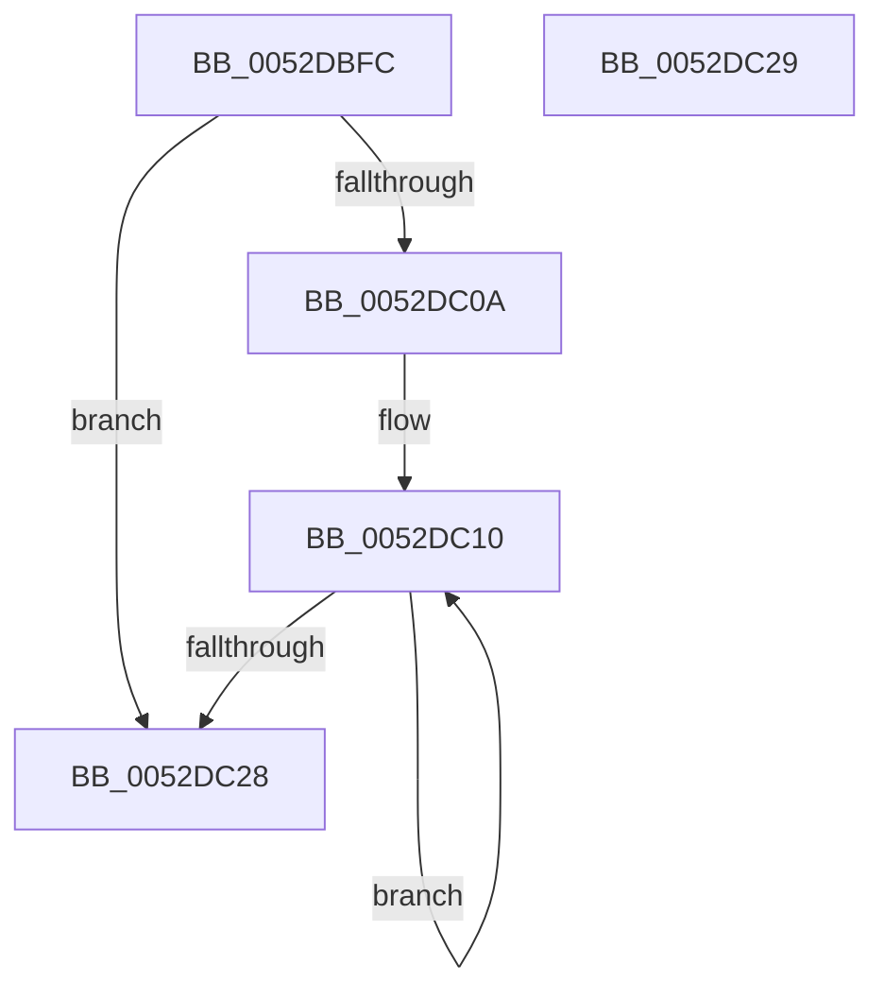

# SymCryptFdefRawAddUint32

- RVA: `0x0052DBFC`–`0x0052DC2A` (길이 `46` bytes)
- VA: `0x000000014052DBFC`
- 실행 섹션: `.text`
- PDB 이름 있음: `예`; PDB Function 태그: `아니요`
- unwind 정보 RVA: `0x000DB714`
- 디코드: `16`개 명령, `46/46` bytes 표시
- 미해석 바이트: `0` (있으면 어셈블리에 `.byte`로 보존)

> 이 문서는 커널 이미지의 기계어와 PDB 기호를 분석해 생성했습니다. 4번과 5번은 함수 원형과 자료형을 바이너리 사용 방식에서 추정한 C 해석이며 원본 소스 복구 결과는 아닙니다.

## 1. Dependencies

- 직접 호출 지점: **0**; 고유 호출 대상: **0**
- 직접 호출자로 확인된 함수: **1**
- RIP 상대 이미지 참조: **0**

### Outgoing calls
- 직접 디코드된 call 명령이 없습니다.

### Direct callers
- [SymCryptFdefModSetRandomGeneric](../53/SymCryptFdefModSetRandomGeneric_function_00535180.md) at `0x0053529F`

### Static image references
- 디코드된 RIP-relative 메모리 참조가 없습니다.

## 2. Other-region calls and transfers

- 다른 실행 섹션으로 향하는 call: **0**
- 별도 외부 분기/꼬리 이동을 확인하지 못했습니다.

## 3. Assembly (complete function range)

```asm
0052DBFC  41 C1 E1 04                     shl r9d, 4
0052DC00  4C 8B D1                        mov r10, rcx
0052DC03  8B C2                           mov eax, edx
0052DC05  45 85 C9                        test r9d, r9d
0052DC08  74 1E                           je 0x14052dc28
0052DC0A  4D 2B D0                        sub r10, r8
0052DC0D  41 8B D1                        mov edx, r9d
0052DC10  43 8B 0C 02                     mov ecx, dword ptr [r10 + r8]
0052DC14  48 03 C1                        add rax, rcx
0052DC17  41 89 00                        mov dword ptr [r8], eax
0052DC1A  4D 8D 40 04                     lea r8, [r8 + 4]
0052DC1E  48 C1 E8 20                     shr rax, 0x20
0052DC22  48 83 EA 01                     sub rdx, 1
0052DC26  75 E8                           jne 0x14052dc10
0052DC28  C3                              ret
0052DC29  CC                              int3
```

## 4. C-style interpretation (structured pseudocode)

```c
__int64 __fastcall SymCryptFdefRawAddUint32(__int64 a1, int a2, __int64 a3, int a4)
{
    __int64 result;
    __int64 v_r10;

    a4 = (unsigned int)((a4) << (4));
    if (a4 == 0) goto loc_0052DC28;
    v_r10 = (a1) - (a3);
loc_0052DC10:
    result = ((unsigned int)(a2)) + ((unsigned int)(*(unsigned int *)(v_r10 + a3 * 1)));
    *(unsigned int *)(a3) = (unsigned int)(result);
    result = (result) >> (32);
    a2 = ((unsigned int)(a4)) - (1);
    if (condition_is_not_equal) goto loc_0052DC10;
loc_0052DC28:
    return result;
}
```

## 5. (Beta) C Style

```c
int64_t SymCryptFdefRawAddUint32(void *Arg1, int32_t Arg2, void *Arg3, int32_t Arg4)
{
    uint8_t *arg1 = (uint8_t *)Arg1;
    uint8_t *arg3 = (uint8_t *)Arg3;

    int64_t result;
    int64_t local_r10;

    Arg4 = (uint32_t)((Arg4) << (4));
    if (Arg4 == 0) goto loc_0052DC28;
    local_r10 = (Arg1) - (Arg3);
loc_0052DC10:
    result = ((uint32_t)(Arg2)) + ((uint32_t)(*(uint32_t *)(local_r10 + arg3 * 1)));
    *(uint32_t *)(arg3) = (uint32_t)(result);
    result = (result) >> (32);
    Arg2 = ((uint32_t)(Arg4)) - (1);
    if (condition_is_not_equal) goto loc_0052DC10;
loc_0052DC28:
    return result;
}
```

### 관측된 메모리 오프셋

구조체 형식이 확인되지 않은 접근은 인자 기준의 오프셋으로만 기록했습니다.

| 기준 인자 | 오프셋 표현 | 폭 (bit) | 접근 |
|---|---:|---:|---|
| `Arg1` | `+ 0x0 + r8*1` | `32` | `R` |
| `Arg3` | `+ 0x0` | `32` | `W` |
| `Arg3` | `+ 0x4` | `64` | `R` |

## 6. Execution-region graph

[열기: 2D/3D 그래프와 함수 탐색 컨트롤 패널](../../../control-panel.html?section=text&rva=0x0052DBFC&view=graph)

- 2D 그래프는 위에서 아래로 흐르고, 3D 그래프는 빈 공간을 드래그해 회전합니다. Shift+드래그는 이동, 휠은 확대·축소, 함수 노드 선택은 대상 보고서 이동입니다.

### Static fallback


