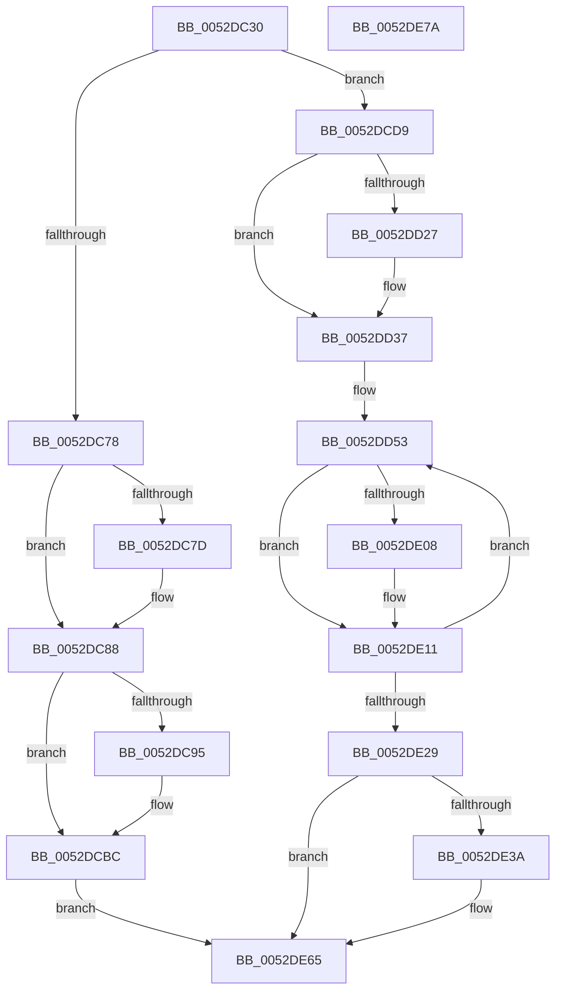

# SymCryptFdefRawDivMod

- RVA: `0x0052DC30`–`0x0052DE7B` (길이 `587` bytes)
- VA: `0x000000014052DC30`
- 실행 섹션: `.text`
- PDB 이름 있음: `예`; PDB Function 태그: `아니요`
- unwind 정보 RVA: `0x000BE7D0`
- 디코드: `162`개 명령, `587/587` bytes 표시
- 미해석 바이트: `0` (있으면 어셈블리에 `.byte`로 보존)

> 이 문서는 커널 이미지의 기계어와 PDB 기호를 분석해 생성했습니다. 4번과 5번은 함수 원형과 자료형을 바이너리 사용 방식에서 추정한 C 해석이며 원본 소스 복구 결과는 아닙니다.

## 1. Dependencies

- 직접 호출 지점: **10**; 고유 호출 대상: **5**
- 직접 호출자로 확인된 함수: **6**
- RIP 상대 이미지 참조: **0**

### Outgoing calls
- `0x0052DC83` → [SymCryptWipe](../51/SymCryptWipe_function_0051F914.md) (function, `0x0051F914`)
- `0x0052DCA6` → [memcpy](../6C/memcpy_function_006C6840.md) (function, `0x006C6840`)
- `0x0052DCB7` → [SymCryptWipe](../51/SymCryptWipe_function_0051F914.md) (function, `0x0051F914`)
- `0x0052DCCF` → [EmpCheckErrataList](../49/EmpCheckErrataList_function_0049E550.md) (function, `0x0049E550`)
- `0x0052DD00` → [memcpy](../6C/memcpy_function_006C6840.md) (function, `0x006C6840`)
- `0x0052DD32` → [SymCryptWipe](../51/SymCryptWipe_function_0051F914.md) (function, `0x0051F914`)
- `0x0052DDE5` → [SymCryptFdefRawMultSubUint32](SymCryptFdefRawMultSubUint32_function_0052DF8C.md) (function, `0x0052DF8C`)
- `0x0052DDFE` → [SymCryptFdefRawMaskedAddSubdigit](SymCryptFdefRawMaskedAddSubdigit_function_0052DEDC.md) (function, `0x0052DEDC`)
- `0x0052DE4F` → [memcpy](../6C/memcpy_function_006C6840.md) (function, `0x006C6840`)
- `0x0052DE60` → [SymCryptWipe](../51/SymCryptWipe_function_0051F914.md) (function, `0x0051F914`)

### Direct callers
- [SymCryptFdefIntDivMod](SymCryptFdefIntDivMod_function_0052D568.md) at `0x0052D5CB`
- [SymCryptFdefIntToModElement](../53/SymCryptFdefIntToModElement_function_005340BC.md) at `0x005340F9`
- [SymCryptFdefModElementSetValueGeneric](../53/SymCryptFdefModElementSetValueGeneric_function_00534638.md) at `0x005346C8`
- [SymCryptFdefModMulGeneric](../53/SymCryptFdefModMulGeneric_function_00534DA0.md) at `0x00534E34`
- [SymCryptFdefModSquareGeneric](../53/SymCryptFdefModSquareGeneric_function_005352C0.md) at `0x0053533B`
- [SymCryptFdefModulusInitMontgomeryInternal](../53/SymCryptFdefModulusInitMontgomeryInternal_function_00535600.md) at `0x00535689`

### Static image references
- 디코드된 RIP-relative 메모리 참조가 없습니다.

## 2. Other-region calls and transfers

- 다른 실행 섹션으로 향하는 call: **0**
- 별도 외부 분기/꼬리 이동을 확인하지 못했습니다.

## 3. Assembly (complete function range)

```asm
0052DC30  48 89 5C 24 08                  mov qword ptr [rsp + 8], rbx
0052DC35  55                              push rbp
0052DC36  56                              push rsi
0052DC37  57                              push rdi
0052DC38  41 54                           push r12
0052DC3A  41 55                           push r13
0052DC3C  41 56                           push r14
0052DC3E  41 57                           push r15
0052DC40  48 83 EC 30                     sub rsp, 0x30
0052DC44  41 8B 70 0C                     mov esi, dword ptr [r8 + 0xc]
0052DC48  8B FA                           mov edi, edx
0052DC4A  41 8B 68 04                     mov ebp, dword ptr [r8 + 4]
0052DC4E  48 83 C6 1F                     add rsi, 0x1f
0052DC52  C1 E7 04                        shl edi, 4
0052DC55  4D 8B F1                        mov r14, r9
0052DC58  C1 E5 06                        shl ebp, 6
0052DC5B  4D 8B E8                        mov r13, r8
0052DC5E  C1 ED 02                        shr ebp, 2
0052DC61  4C 8B E1                        mov r12, rcx
0052DC64  48 C1 EE 05                     shr rsi, 5
0052DC68  89 6C 24 20                     mov dword ptr [rsp + 0x20], ebp
0052DC6C  44 8D 3C BD 10 00 00 00         lea r15d, [rdi*4 + 0x10]
0052DC74  3B FE                           cmp edi, esi
0052DC76  73 61                           jae 0x14052dcd9
0052DC78  4D 85 C9                        test r9, r9
0052DC7B  74 0B                           je 0x14052dc88
0052DC7D  C1 E2 06                        shl edx, 6
0052DC80  49 8B C9                        mov rcx, r9
0052DC83  E8 8C 1C FF FF                  call 0x14051f914
0052DC88  48 8B B4 24 90 00 00 00         mov rsi, qword ptr [rsp + 0x90]
0052DC90  48 85 F6                        test rsi, rsi
0052DC93  74 27                           je 0x14052dcbc
0052DC95  48 8D 1C BD 00 00 00 00         lea rbx, [rdi*4]
0052DC9D  49 8B D4                        mov rdx, r12
0052DCA0  4C 8B C3                        mov r8, rbx
0052DCA3  48 8B CE                        mov rcx, rsi
0052DCA6  E8 95 8B 19 00                  call 0x1406c6840
0052DCAB  2B EF                           sub ebp, edi
0052DCAD  48 8D 0C 33                     lea rcx, [rbx + rsi]
0052DCB1  8B D5                           mov edx, ebp
0052DCB3  48 C1 E2 02                     shl rdx, 2
0052DCB7  E8 58 1C FF FF                  call 0x14051f914
0052DCBC  48 8B 94 24 A0 00 00 00         mov rdx, qword ptr [rsp + 0xa0]
0052DCC4  48 8B 8C 24 98 00 00 00         mov rcx, qword ptr [rsp + 0x98]
0052DCCC  45 8B C7                        mov r8d, r15d
0052DCCF  E8 7C 08 F7 FF                  call 0x14049e550
0052DCD4  E9 8C 01 00 00                  jmp 0x14052de65
0052DCD9  4C 8B BC 24 98 00 00 00         mov r15, qword ptr [rsp + 0x98]
0052DCE1  49 8B D4                        mov rdx, r12
0052DCE4  44 8B C7                        mov r8d, edi
0052DCE7  49 C1 E0 02                     shl r8, 2
0052DCEB  41 83 67 04 00                  and dword ptr [r15 + 4], 0
0052DCF0  49 8D 47 08                     lea rax, [r15 + 8]
0052DCF4  41 83 27 00                     and dword ptr [r15], 0
0052DCF8  48 8B C8                        mov rcx, rax
0052DCFB  48 89 44 24 28                  mov qword ptr [rsp + 0x28], rax
0052DD00  E8 3B 8B 19 00                  call 0x1406c6840
0052DD05  8D 47 03                        lea eax, [rdi + 3]
0052DD08  41 83 24 87 00                  and dword ptr [r15 + rax*4], 0
0052DD0D  8D 47 02                        lea eax, [rdi + 2]
0052DD10  41 83 24 87 00                  and dword ptr [r15 + rax*4], 0
0052DD15  2B FE                           sub edi, esi
0052DD17  41 8B 5D 0C                     mov ebx, dword ptr [r13 + 0xc]
0052DD1B  F7 DB                           neg ebx
0052DD1D  83 E3 1F                        and ebx, 0x1f
0052DD20  FF C7                           inc edi
0052DD22  4D 85 F6                        test r14, r14
0052DD25  74 10                           je 0x14052dd37
0052DD27  8D 56 FF                        lea edx, [rsi - 1]
0052DD2A  48 C1 E2 02                     shl rdx, 2
0052DD2E  49 8D 0C BE                     lea rcx, [r14 + rdi*4]
0052DD32  E8 DD 1B FF FF                  call 0x14051f914
0052DD37  BD 20 00 00 00                  mov ebp, 0x20
0052DD3C  44 8D 1C 37                     lea r11d, [rdi + rsi]
0052DD40  2B EB                           sub ebp, ebx
0052DD42  41 BA 02 00 00 00               mov r10d, 2
0052DD48  44 2B D6                        sub r10d, esi
0052DD4B  44 89 94 24 98 00 00 00         mov dword ptr [rsp + 0x98], r10d
0052DD53  45 8B 45 18                     mov r8d, dword ptr [r13 + 0x18]
0052DD57  8D 04 3E                        lea eax, [rsi + rdi]
0052DD5A  41 8B 14 87                     mov edx, dword ptr [r15 + rax*4]
0052DD5E  41 FF CB                        dec r11d
0052DD61  8B CD                           mov ecx, ebp
0052DD63  44 89 9C 24 80 00 00 00         mov dword ptr [rsp + 0x80], r11d
0052DD6B  8B C2                           mov eax, edx
0052DD6D  FF CF                           dec edi
0052DD6F  48 C1 E0 20                     shl rax, 0x20
0052DD73  47 8B 0C 9F                     mov r9d, dword ptr [r15 + r11*4]
0052DD77  4C 03 C8                        add r9, rax
0052DD7A  41 8D 43 02                     lea eax, [r11 + 2]
0052DD7E  49 D3 E9                        shr r9, cl
0052DD81  45 8B 24 87                     mov r12d, dword ptr [r15 + rax*4]
0052DD85  48 B8 00 00 00 00 01 00 00 00   movabs rax, 0x100000000
0052DD8F  49 03 C0                        add rax, r8
0052DD92  49 C1 E4 20                     shl r12, 0x20
0052DD96  4C 03 E2                        add r12, rdx
0052DD99  49 D1 E8                        shr r8, 1
0052DD9C  49 D3 EC                        shr r12, cl
0052DD9F  49 8D 55 40                     lea rdx, [r13 + 0x40]
0052DDA3  45 8B E4                        mov r12d, r12d
0052DDA6  41 8B C9                        mov ecx, r9d
0052DDA9  4C 0F AF E0                     imul r12, rax
0052DDAD  C1 E9 1F                        shr ecx, 0x1f
0052DDB0  41 8B C1                        mov eax, r9d
0052DDB3  F7 D9                           neg ecx
0052DDB5  49 23 C8                        and rcx, r8
0052DDB8  44 8B CE                        mov r9d, esi
0052DDBB  4C 03 E1                        add r12, rcx
0052DDBE  4C 03 E0                        add r12, rax
0052DDC1  49 C1 EC 20                     shr r12, 0x20
0052DDC5  41 FF C4                        inc r12d
0052DDC8  41 8B C4                        mov eax, r12d
0052DDCB  48 F7 D8                        neg rax
0052DDCE  48 C1 E8 20                     shr rax, 0x20
0052DDD2  F7 D0                           not eax
0052DDD4  44 03 E0                        add r12d, eax
0052DDD7  43 8D 04 1A                     lea eax, [r10 + r11]
0052DDDB  45 8B C4                        mov r8d, r12d
0052DDDE  49 8D 1C 87                     lea rbx, [r15 + rax*4]
0052DDE2  48 8B CB                        mov rcx, rbx
0052DDE5  E8 A2 01 00 00                  call 0x14052df8c
0052DDEA  44 8B C0                        mov r8d, eax
0052DDED  89 44 24 78                     mov dword ptr [rsp + 0x78], eax
0052DDF1  41 F7 D8                        neg r8d
0052DDF4  49 8D 55 40                     lea rdx, [r13 + 0x40]
0052DDF8  44 8B CE                        mov r9d, esi
0052DDFB  48 8B CB                        mov rcx, rbx
0052DDFE  E8 D9 00 00 00                  call 0x14052dedc
0052DE03  4D 85 F6                        test r14, r14
0052DE06  74 09                           je 0x14052de11
0052DE08  44 2B 64 24 78                  sub r12d, dword ptr [rsp + 0x78]
0052DE0D  45 89 24 BE                     mov dword ptr [r14 + rdi*4], r12d
0052DE11  44 8B 94 24 98 00 00 00         mov r10d, dword ptr [rsp + 0x98]
0052DE19  44 8B 9C 24 80 00 00 00         mov r11d, dword ptr [rsp + 0x80]
0052DE21  85 FF                           test edi, edi
0052DE23  0F 85 2A FF FF FF               jne 0x14052dd53
0052DE29  48 8B BC 24 90 00 00 00         mov rdi, qword ptr [rsp + 0x90]
0052DE31  8B 6C 24 20                     mov ebp, dword ptr [rsp + 0x20]
0052DE35  48 85 FF                        test rdi, rdi
0052DE38  74 2B                           je 0x14052de65
0052DE3A  48 8B 54 24 28                  mov rdx, qword ptr [rsp + 0x28]
0052DE3F  48 8B CF                        mov rcx, rdi
0052DE42  8B C6                           mov eax, esi
0052DE44  48 8D 1C 85 00 00 00 00         lea rbx, [rax*4]
0052DE4C  4C 8B C3                        mov r8, rbx
0052DE4F  E8 EC 89 19 00                  call 0x1406c6840
0052DE54  2B EE                           sub ebp, esi
0052DE56  48 8D 0C 3B                     lea rcx, [rbx + rdi]
0052DE5A  8B D5                           mov edx, ebp
0052DE5C  48 C1 E2 02                     shl rdx, 2
0052DE60  E8 AF 1A FF FF                  call 0x14051f914
0052DE65  48 8B 5C 24 70                  mov rbx, qword ptr [rsp + 0x70]
0052DE6A  48 83 C4 30                     add rsp, 0x30
0052DE6E  41 5F                           pop r15
0052DE70  41 5E                           pop r14
0052DE72  41 5D                           pop r13
0052DE74  41 5C                           pop r12
0052DE76  5F                              pop rdi
0052DE77  5E                              pop rsi
0052DE78  5D                              pop rbp
0052DE79  C3                              ret
0052DE7A  CC                              int3
```

## 4. C-style interpretation (structured pseudocode)

```c
__int64 __fastcall SymCryptFdefRawDivMod(__int64 a1, int a2, __int64 a3, __int64 a4, __int64 a5, unsigned int a6, __int64 a7)
{
    __int64 result;
    __int64 v_r10;
    __int64 v_r11;
    __int64 v_r12;
    __int64 v_rbp;
    __int64 v_rbx;
    __int64 v_rdi;
    __int64 v_rsi;
    __int64 v_rsp;
    unsigned __int64 v_stack_m40;
    unsigned int v_stack_m48;
    unsigned int v_stack_p10;
    unsigned int v_stack_p18;
    unsigned int v_stack_p30;
    unsigned __int64 v_stack_p8;

    v_stack_p8 = v_rbx;
    v_rsp = (v_rsp) - (48);
    v_rsi = ((unsigned int)(*(unsigned int *)(a3 + 12))) + (31);
    v_rdi = (unsigned int)(((unsigned int)(a2)) << (4));
    v_rbp = (unsigned int)(((unsigned int)(*(unsigned int *)(a3 + 4))) << (6));
    v_rbp = (unsigned int)((v_rbp) >> (2));
    v_rsi = (v_rsi) >> (5);
    v_stack_m48 = (unsigned int)(v_rbp);
    if (((unsigned int)(v_rdi)) >= ((unsigned int)(v_rsi))) goto loc_0052DCD9;
    if (a4 != 0) {
        a2 = (unsigned int)((a2) << (6));
        a1 = a4;
        result = SymCryptWipe(a1, a2, a3, a4);
    }
    if (a5 != 0) {
        v_rbx = v_rdi * 4;
        a2 = a1;
        a3 = v_rbx;
        a1 = a5;
        result = memcpy(a1, a2, a3, a4);
        v_rbp = (unsigned int)((v_rbp) - ((unsigned int)(v_rdi)));
        a1 = v_rbx + a5 * 1;
        a2 = (unsigned int)(v_rbp);
        a2 = (a2) << (2);
        result = SymCryptWipe(a1, a2, a3, a4);
    }
    result = EmpCheckErrataList(a6, a7, (unsigned int)((unsigned int)(v_rdi * 4 + 16)), a4);
    goto loc_0052DE65;
loc_0052DCD9:
    a3 = ((unsigned int)((unsigned int)(v_rdi))) << (2);
    v_stack_m40 = a6 + 8;
    result = memcpy(a6 + 8, a1, a3, a4);
    v_rdi = (unsigned int)((v_rdi) - ((unsigned int)(a5)));
    v_rbx = (unsigned int)(-((unsigned int)(*(unsigned int *)(a3 + 12))));
    v_rbx = (unsigned int)((v_rbx) & (31));
    v_rdi = (unsigned int)((v_rdi) + 1);
    result = v_rdi + 2;
    if (a4 != 0) {
        a2 = a5 - 1;
        a2 = (a2) << (2);
        a1 = a4 + v_rdi * 4;
        result = SymCryptWipe(a1, a2, a3, a4);
    }
    v_rbp = (unsigned int)((32) - ((unsigned int)(v_rbx)));
    v_r10 = (unsigned int)((2) - ((unsigned int)(a5)));
    v_stack_p30 = (unsigned int)(v_r10);
loc_0052DD53:
    v_r11 = (unsigned int)((v_rdi + a5 * 1) - 1);
    v_stack_p18 = (unsigned int)(v_r11);
    v_rdi = (unsigned int)((v_rdi) - 1);
    result = ((unsigned int)((unsigned int)((unsigned int)(*(unsigned int *)(a6 + a5 + v_rdi * 1 * 4))))) << (32);
    a4 = ((unsigned int)(*(unsigned int *)(a6 + v_r11 * 4))) + (result);
    a4 = (a4) >> ((unsigned __int8)((unsigned int)((unsigned int)(v_rbp))));
    result = (v_r11 + 2) + ((unsigned int)(*(unsigned int *)(a3 + 24)));
    v_r12 = ((unsigned int)(*(unsigned int *)(a6 + v_r11 + 2 * 4))) << (32);
    v_r12 = (v_r12) + ((unsigned int)(*(unsigned int *)(a6 + a5 + v_rdi * 1 * 4)));
    a3 = ((unsigned int)(*(unsigned int *)(a3 + 24))) >> (1);
    v_r12 = (v_r12) >> ((unsigned __int8)((unsigned int)((unsigned int)(v_rbp))));
    v_r12 = ((unsigned int)((unsigned int)(v_r12))) * (result);
    a1 = (unsigned int)(((unsigned int)((unsigned int)(a4))) >> (31));
    a1 = (unsigned int)(-(a1));
    a1 = (a1) & (a3);
    v_r12 = (v_r12) + (a1);
    v_r12 = (v_r12) + ((unsigned int)((unsigned int)(a4)));
    v_r12 = (v_r12) >> (32);
    v_r12 = (unsigned int)((v_r12) + 1);
    result = -((unsigned int)((unsigned int)(v_r12)));
    result = (result) >> (32);
    result = (unsigned int)(~(result));
    v_r12 = (unsigned int)((v_r12) + ((unsigned int)(result)));
    result = SymCryptFdefRawMultSubUint32(a6 + v_r10 + v_r11 * 1 * 4, a3 + 64, (unsigned int)((unsigned int)(v_r12)), (unsigned int)((unsigned int)(a5)));
    v_stack_p10 = (unsigned int)(result);
    a3 = (unsigned int)(-((unsigned int)((unsigned int)(result))));
    result = SymCryptFdefRawMaskedAddSubdigit(a6 + v_r10 + v_r11 * 1 * 4, a3 + 64, a3, (unsigned int)((unsigned int)(a5)));
    if (a4 != 0) {
        v_r12 = (unsigned int)((v_r12) - (v_stack_p10));
        *(unsigned int *)(a4 + v_rdi * 4) = (unsigned int)(v_r12);
    }
    if ((unsigned int)(v_rdi) != 0) goto loc_0052DD53;
    v_rbx = a6 + v_r10 + v_r11 * 1 * 4;
    v_rbp = (unsigned int)(v_stack_m48);
    if (a5 != 0) {
        a2 = v_stack_m40;
        a1 = a5;
        result = (unsigned int)(a5);
        v_rbx = result * 4;
        a3 = v_rbx;
        result = memcpy(a1, a2, a3, (unsigned int)((unsigned int)(a5)));
        v_rbp = (unsigned int)(((unsigned int)(v_stack_m48)) - ((unsigned int)(a5)));
        a1 = v_rbx + a5 * 1;
        a2 = (unsigned int)(v_rbp);
        a2 = (a2) << (2);
        result = SymCryptWipe(a1, a2, a3, (unsigned int)((unsigned int)(a5)));
    }
    v_rsp = (v_rsp) + (48);
    return result;
}
```

## 5. (Beta) C Style

```c
int64_t SymCryptFdefRawDivMod(int64_t Arg1, int32_t Arg2, void *Arg3, int64_t Arg4, int64_t Arg5, void *Arg6, int64_t Arg7)
{
    uint8_t *arg3 = (uint8_t *)Arg3;
    uint8_t *arg6 = (uint8_t *)Arg6;

    int64_t result;
    int64_t local_r10;
    int64_t local_r11;
    int64_t local_r12;
    int64_t local_rbp;
    int64_t local_rbx;
    int64_t local_rdi;
    int64_t local_rsi;
    int64_t local_rsp;
    uint64_t v_stack_m40;
    uint32_t v_stack_m48;
    uint32_t v_stack_p10;
    uint32_t v_stack_p18;
    uint32_t v_stack_p30;
    uint64_t v_stack_p8;

    v_stack_p8 = local_rbx;
    local_rsp = (local_rsp) - (48);
    local_rsi = ((uint32_t)(*(uint32_t *)(arg3 + 0xC))) + (31);
    local_rdi = (uint32_t)(((uint32_t)(Arg2)) << (4));
    local_rbp = (uint32_t)(((uint32_t)(*(uint32_t *)(arg3 + 0x4))) << (6));
    local_rbp = (uint32_t)((local_rbp) >> (2));
    local_rsi = (local_rsi) >> (5);
    v_stack_m48 = (uint32_t)(local_rbp);
    if (((uint32_t)(local_rdi)) >= ((uint32_t)(local_rsi))) goto loc_0052DCD9;
    if (Arg4 != 0) {
        Arg2 = (uint32_t)((Arg2) << (6));
        Arg1 = Arg4;
        result = SymCryptWipe(Arg1, Arg2, Arg3, Arg4);
    }
    if (Arg5 != 0) {
        local_rbx = local_rdi * 4;
        Arg2 = Arg1;
        Arg3 = local_rbx;
        Arg1 = Arg5;
        result = memcpy(Arg1, Arg2, Arg3, Arg4);
        local_rbp = (uint32_t)((local_rbp) - ((uint32_t)(local_rdi)));
        Arg1 = local_rbx + Arg5 * 1;
        Arg2 = (uint32_t)(local_rbp);
        Arg2 = (Arg2) << (2);
        result = SymCryptWipe(Arg1, Arg2, Arg3, Arg4);
    }
    result = EmpCheckErrataList(Arg6, Arg7, (uint32_t)((uint32_t)(local_rdi * 4 + 16)), Arg4);
    goto loc_0052DE65;
loc_0052DCD9:
    Arg3 = ((uint32_t)((uint32_t)(local_rdi))) << (2);
    v_stack_m40 = Arg6 + 8;
    result = memcpy(Arg6 + 8, Arg1, Arg3, Arg4);
    local_rdi = (uint32_t)((local_rdi) - ((uint32_t)(Arg5)));
    local_rbx = (uint32_t)(-((uint32_t)(*(uint32_t *)(arg3 + 0xC))));
    local_rbx = (uint32_t)((local_rbx) & (31));
    local_rdi = (uint32_t)((local_rdi) + 1);
    result = local_rdi + 2;
    if (Arg4 != 0) {
        Arg2 = Arg5 - 1;
        Arg2 = (Arg2) << (2);
        Arg1 = Arg4 + local_rdi * 4;
        result = SymCryptWipe(Arg1, Arg2, Arg3, Arg4);
    }
    local_rbp = (uint32_t)((32) - ((uint32_t)(local_rbx)));
    local_r10 = (uint32_t)((2) - ((uint32_t)(Arg5)));
    v_stack_p30 = (uint32_t)(local_r10);
loc_0052DD53:
    local_r11 = (uint32_t)((local_rdi + Arg5 * 1) - 1);
    v_stack_p18 = (uint32_t)(local_r11);
    local_rdi = (uint32_t)((local_rdi) - 1);
    result = ((uint32_t)((uint32_t)((uint32_t)(*(uint32_t *)(arg6 + Arg5 + local_rdi * 1 * 4))))) << (32);
    Arg4 = ((uint32_t)(*(uint32_t *)(arg6 + local_r11 * 4))) + (result);
    Arg4 = (Arg4) >> ((uint8_t)((uint32_t)((uint32_t)(local_rbp))));
    result = (local_r11 + 2) + ((uint32_t)(*(uint32_t *)(arg3 + 0x18)));
    local_r12 = ((uint32_t)(*(uint32_t *)(arg6 + local_r11 + 0x2 * 4))) << (32);
    local_r12 = (local_r12) + ((uint32_t)(*(uint32_t *)(arg6 + Arg5 + local_rdi * 1 * 4)));
    Arg3 = ((uint32_t)(*(uint32_t *)(arg3 + 0x18))) >> (1);
    local_r12 = (local_r12) >> ((uint8_t)((uint32_t)((uint32_t)(local_rbp))));
    local_r12 = ((uint32_t)((uint32_t)(local_r12))) * (result);
    Arg1 = (uint32_t)(((uint32_t)((uint32_t)(Arg4))) >> (31));
    Arg1 = (uint32_t)(-(Arg1));
    Arg1 = (Arg1) & (Arg3);
    local_r12 = (local_r12) + (Arg1);
    local_r12 = (local_r12) + ((uint32_t)((uint32_t)(Arg4)));
    local_r12 = (local_r12) >> (32);
    local_r12 = (uint32_t)((local_r12) + 1);
    result = -((uint32_t)((uint32_t)(local_r12)));
    result = (result) >> (32);
    result = (uint32_t)(~(result));
    local_r12 = (uint32_t)((local_r12) + ((uint32_t)(result)));
    result = SymCryptFdefRawMultSubUint32(Arg6 + local_r10 + local_r11 * 1 * 4, Arg3 + 64, (uint32_t)((uint32_t)(local_r12)), (uint32_t)((uint32_t)(Arg5)));
    v_stack_p10 = (uint32_t)(result);
    Arg3 = (uint32_t)(-((uint32_t)((uint32_t)(result))));
    result = SymCryptFdefRawMaskedAddSubdigit(Arg6 + local_r10 + local_r11 * 1 * 4, Arg3 + 64, Arg3, (uint32_t)((uint32_t)(Arg5)));
    if (Arg4 != 0) {
        local_r12 = (uint32_t)((local_r12) - (v_stack_p10));
        *(uint32_t *)(Arg4 + local_rdi * 4) = (uint32_t)(local_r12);
    }
    if ((uint32_t)(local_rdi) != 0) goto loc_0052DD53;
    local_rbx = Arg6 + local_r10 + local_r11 * 1 * 4;
    local_rbp = (uint32_t)(v_stack_m48);
    if (Arg5 != 0) {
        Arg2 = v_stack_m40;
        Arg1 = Arg5;
        result = (uint32_t)(Arg5);
        local_rbx = result * 4;
        Arg3 = local_rbx;
        result = memcpy(Arg1, Arg2, Arg3, (uint32_t)((uint32_t)(Arg5)));
        local_rbp = (uint32_t)(((uint32_t)(v_stack_m48)) - ((uint32_t)(Arg5)));
        Arg1 = local_rbx + Arg5 * 1;
        Arg2 = (uint32_t)(local_rbp);
        Arg2 = (Arg2) << (2);
        result = SymCryptWipe(Arg1, Arg2, Arg3, (uint32_t)((uint32_t)(Arg5)));
    }
    local_rsp = (local_rsp) + (48);
    return result;
}
```

### 관측된 메모리 오프셋

구조체 형식이 확인되지 않은 접근은 인자 기준의 오프셋으로만 기록했습니다.

| 기준 인자 | 오프셋 표현 | 폭 (bit) | 접근 |
|---|---:|---:|---|
| `Arg3` | `+ 0x4` | `32` | `R` |
| `Arg3` | `+ 0xC` | `32` | `R` |
| `Arg3` | `+ 0x18` | `32` | `R` |
| `Arg3` | `+ 0x40` | `64` | `R` |
| `Arg6` | `+ 0x0` | `32` | `R/W` |
| `Arg6` | `+ 0x0 + r11*4` | `32` | `R` |
| `Arg6` | `+ 0x0 + rax*4` | `32` | `R` |
| `Arg6` | `+ 0x0 + rax*4` | `32` | `R/W` |
| `Arg6` | `+ 0x0 + rax*4` | `64` | `R` |
| `Arg6` | `+ 0x4` | `32` | `R/W` |
| `Arg6` | `+ 0x8` | `64` | `R` |

## 6. Execution-region graph

[열기: 2D/3D 그래프와 함수 탐색 컨트롤 패널](../../../control-panel.html?section=text&rva=0x0052DC30&view=graph)

- 2D 그래프는 위에서 아래로 흐르고, 3D 그래프는 빈 공간을 드래그해 회전합니다. Shift+드래그는 이동, 휠은 확대·축소, 함수 노드 선택은 대상 보고서 이동입니다.

### Static fallback


