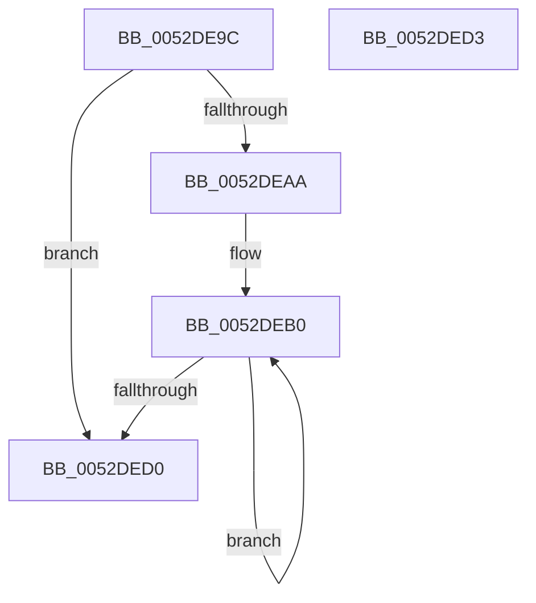

# SymCryptFdefRawIsLessThanC

- RVA: `0x0052DE9C`–`0x0052DED4` (길이 `56` bytes)
- VA: `0x000000014052DE9C`
- 실행 섹션: `.text`
- PDB 이름 있음: `예`; PDB Function 태그: `아니요`
- unwind 정보 RVA: `0x000DB714`
- 디코드: `20`개 명령, `56/56` bytes 표시
- 미해석 바이트: `0` (있으면 어셈블리에 `.byte`로 보존)

> 이 문서는 커널 이미지의 기계어와 PDB 기호를 분석해 생성했습니다. 4번과 5번은 함수 원형과 자료형을 바이너리 사용 방식에서 추정한 C 해석이며 원본 소스 복구 결과는 아닙니다.

## 1. Dependencies

- 직접 호출 지점: **0**; 고유 호출 대상: **0**
- 직접 호출자로 확인된 함수: **2**
- RIP 상대 이미지 참조: **0**

### Outgoing calls
- 직접 디코드된 call 명령이 없습니다.

### Direct callers
- [SymCryptFdefIntIsLessThan](SymCryptFdefIntIsLessThan_function_0052D7B8.md) at `0x0052D7E7`
- [SymCryptFdefIntIsLessThan](SymCryptFdefIntIsLessThan_function_0052D7B8.md) at `0x0052D7F5`
- [SymCryptFdefIntIsLessThan](SymCryptFdefIntIsLessThan_function_0052D7B8.md) at `0x0052D833`
- [SymCryptFdefRawIsLessThan](SymCryptFdefRawIsLessThan_function_0052DE84.md) at `0x0052DE88`

### Static image references
- 디코드된 RIP-relative 메모리 참조가 없습니다.

## 2. Other-region calls and transfers

- 다른 실행 섹션으로 향하는 call: **0**
- 별도 외부 분기/꼬리 이동을 확인하지 못했습니다.

## 3. Assembly (complete function range)

```asm
0052DE9C  33 C0                           xor eax, eax
0052DE9E  41 C1 E0 04                     shl r8d, 4
0052DEA2  4C 8B C9                        mov r9, rcx
0052DEA5  45 85 C0                        test r8d, r8d
0052DEA8  74 26                           je 0x14052ded0
0052DEAA  4C 2B CA                        sub r9, rdx
0052DEAD  45 8B D0                        mov r10d, r8d
0052DEB0  41 8B 0C 11                     mov ecx, dword ptr [r9 + rdx]
0052DEB4  48 2B C8                        sub rcx, rax
0052DEB7  8B 02                           mov eax, dword ptr [rdx]
0052DEB9  48 2B C8                        sub rcx, rax
0052DEBC  48 8D 52 04                     lea rdx, [rdx + 4]
0052DEC0  48 8B C1                        mov rax, rcx
0052DEC3  48 C1 E8 20                     shr rax, 0x20
0052DEC7  83 E0 01                        and eax, 1
0052DECA  49 83 EA 01                     sub r10, 1
0052DECE  75 E0                           jne 0x14052deb0
0052DED0  F7 D8                           neg eax
0052DED2  C3                              ret
0052DED3  CC                              int3
```

## 4. C-style interpretation (structured pseudocode)

```c
__int64 __fastcall SymCryptFdefRawIsLessThanC(__int64 a1, __int64 a2, int a3)
{
    __int64 result;
    __int64 v_r10;

    result = 0;
    a3 = (unsigned int)((a3) << (4));
    if (a3 == 0) goto loc_0052DED0;
    a4 = (a1) - (a2);
loc_0052DEB0:
    a1 = ((unsigned int)(*(unsigned int *)(a4 + a2 * 1))) - (0);
    a1 = (a1) - ((unsigned int)(*(unsigned int *)(a2)));
    result = (a1) >> (32);
    result = (unsigned int)((result) & (1));
    v_r10 = ((unsigned int)(a3)) - (1);
    if (condition_is_not_equal) goto loc_0052DEB0;
loc_0052DED0:
    result = (unsigned int)(-(result));
    return result;
}
```

## 5. (Beta) C Style

```c
int64_t SymCryptFdefRawIsLessThanC(void *Arg1, void *Arg2, int32_t Arg3)
{
    uint8_t *arg1 = (uint8_t *)Arg1;
    uint8_t *arg2 = (uint8_t *)Arg2;

    int64_t result;
    int64_t local_r10;

    result = 0;
    Arg3 = (uint32_t)((Arg3) << (4));
    if (Arg3 == 0) goto loc_0052DED0;
    a4 = (Arg1) - (Arg2);
loc_0052DEB0:
    Arg1 = ((uint32_t)(*(uint32_t *)(a4 + arg2 * 1))) - (0);
    Arg1 = (Arg1) - ((uint32_t)(*(uint32_t *)(arg2)));
    result = (Arg1) >> (32);
    result = (uint32_t)((result) & (1));
    local_r10 = ((uint32_t)(Arg3)) - (1);
    if (condition_is_not_equal) goto loc_0052DEB0;
loc_0052DED0:
    result = (uint32_t)(-(result));
    return result;
}
```

### 관측된 메모리 오프셋

구조체 형식이 확인되지 않은 접근은 인자 기준의 오프셋으로만 기록했습니다.

| 기준 인자 | 오프셋 표현 | 폭 (bit) | 접근 |
|---|---:|---:|---|
| `Arg1` | `+ 0x0 + rdx*1` | `32` | `R` |
| `Arg2` | `+ 0x0` | `32` | `R` |
| `Arg2` | `+ 0x4` | `64` | `R` |

## 6. Execution-region graph

[열기: 2D/3D 그래프와 함수 탐색 컨트롤 패널](../../../control-panel.html?section=text&rva=0x0052DE9C&view=graph)

- 2D 그래프는 위에서 아래로 흐르고, 3D 그래프는 빈 공간을 드래그해 회전합니다. Shift+드래그는 이동, 휠은 확대·축소, 함수 노드 선택은 대상 보고서 이동입니다.

### Static fallback


