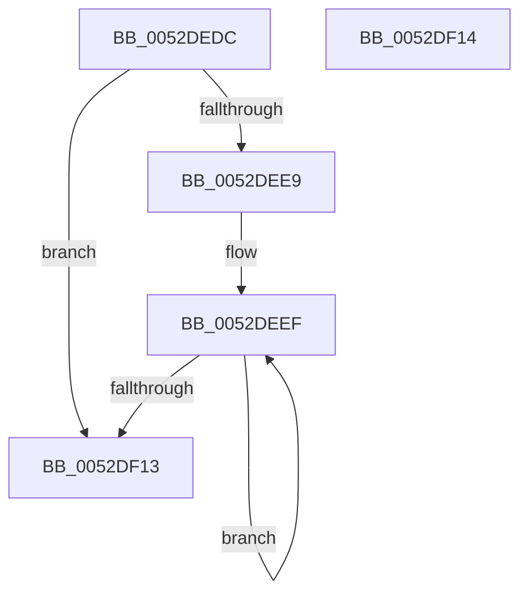

# SymCryptFdefRawMaskedAddSubdigit

- RVA: `0x0052DEDC`–`0x0052DF15` (길이 `57` bytes)
- VA: `0x000000014052DEDC`
- 실행 섹션: `.text`
- PDB 이름 있음: `예`; PDB Function 태그: `아니요`
- unwind 정보 RVA: `0x000DB714`
- 디코드: `20`개 명령, `57/57` bytes 표시
- 미해석 바이트: `0` (있으면 어셈블리에 `.byte`로 보존)

> 이 문서는 커널 이미지의 기계어와 PDB 기호를 분석해 생성했습니다. 4번과 5번은 함수 원형과 자료형을 바이너리 사용 방식에서 추정한 C 해석이며 원본 소스 복구 결과는 아닙니다.

## 1. Dependencies

- 직접 호출 지점: **0**; 고유 호출 대상: **0**
- 직접 호출자로 확인된 함수: **1**
- RIP 상대 이미지 참조: **0**

### Outgoing calls
- 직접 디코드된 call 명령이 없습니다.

### Direct callers
- [SymCryptFdefRawDivMod](SymCryptFdefRawDivMod_function_0052DC30.md) at `0x0052DDFE`

### Static image references
- 디코드된 RIP-relative 메모리 참조가 없습니다.

## 2. Other-region calls and transfers

- 다른 실행 섹션으로 향하는 call: **0**
- 별도 외부 분기/꼬리 이동을 확인하지 못했습니다.

## 3. Assembly (complete function range)

```asm
0052DEDC  33 C0                           xor eax, eax
0052DEDE  4C 8B DA                        mov r11, rdx
0052DEE1  4C 8B D1                        mov r10, rcx
0052DEE4  45 85 C9                        test r9d, r9d
0052DEE7  74 2A                           je 0x14052df13
0052DEE9  4C 2B D9                        sub r11, rcx
0052DEEC  45 8B C9                        mov r9d, r9d
0052DEEF  43 8B 14 13                     mov edx, dword ptr [r11 + r10]
0052DEF3  41 8B C8                        mov ecx, r8d
0052DEF6  48 23 D1                        and rdx, rcx
0052DEF9  41 8B 0A                        mov ecx, dword ptr [r10]
0052DEFC  48 03 C1                        add rax, rcx
0052DEFF  48 03 C2                        add rax, rdx
0052DF02  41 89 02                        mov dword ptr [r10], eax
0052DF05  4D 8D 52 04                     lea r10, [r10 + 4]
0052DF09  48 C1 E8 20                     shr rax, 0x20
0052DF0D  49 83 E9 01                     sub r9, 1
0052DF11  75 DC                           jne 0x14052deef
0052DF13  C3                              ret
0052DF14  CC                              int3
```

## 4. C-style interpretation (structured pseudocode)

```c
__int64 __fastcall SymCryptFdefRawMaskedAddSubdigit(__int64 a1, __int64 a2, int a3, int a4)
{
    __int64 result;
    __int64 v_r11;

    result = 0;
    if (a4 == 0) goto loc_0052DF13;
    v_r11 = (a2) - (a1);
loc_0052DEEF:
    a2 = ((unsigned int)(*(unsigned int *)(v_r11 + a1 * 1))) & ((unsigned int)(a3));
    result = (result) + ((unsigned int)(*(unsigned int *)(a1)));
    result = (result) + (a2);
    *(unsigned int *)(a1) = (unsigned int)(result);
    result = (result) >> (32);
    a4 = ((unsigned int)(a4)) - (1);
    if (condition_is_not_equal) goto loc_0052DEEF;
loc_0052DF13:
    return result;
}
```

## 5. (Beta) C Style

```c
int64_t SymCryptFdefRawMaskedAddSubdigit(void *Arg1, void *Arg2, int32_t Arg3, int32_t Arg4)
{
    uint8_t *arg1 = (uint8_t *)Arg1;
    uint8_t *arg2 = (uint8_t *)Arg2;

    int64_t result;
    int64_t local_r11;

    result = 0;
    if (Arg4 == 0) goto loc_0052DF13;
    local_r11 = (Arg2) - (Arg1);
loc_0052DEEF:
    Arg2 = ((uint32_t)(*(uint32_t *)(local_r11 + arg1 * 1))) & ((uint32_t)(Arg3));
    result = (result) + ((uint32_t)(*(uint32_t *)(arg1)));
    result = (result) + (Arg2);
    *(uint32_t *)(arg1) = (uint32_t)(result);
    result = (result) >> (32);
    Arg4 = ((uint32_t)(Arg4)) - (1);
    if (condition_is_not_equal) goto loc_0052DEEF;
loc_0052DF13:
    return result;
}
```

### 관측된 메모리 오프셋

구조체 형식이 확인되지 않은 접근은 인자 기준의 오프셋으로만 기록했습니다.

| 기준 인자 | 오프셋 표현 | 폭 (bit) | 접근 |
|---|---:|---:|---|
| `Arg1` | `+ 0x0` | `32` | `R` |
| `Arg1` | `+ 0x0` | `32` | `W` |
| `Arg1` | `+ 0x4` | `64` | `R` |
| `Arg2` | `+ 0x0 + r10*1` | `32` | `R` |

## 6. Execution-region graph

[열기: 2D/3D 그래프와 함수 탐색 컨트롤 패널](../../../control-panel.html?section=text&rva=0x0052DEDC&view=graph)

- 2D 그래프는 위에서 아래로 흐르고, 3D 그래프는 빈 공간을 드래그해 회전합니다. Shift+드래그는 이동, 휠은 확대·축소, 함수 노드 선택은 대상 보고서 이동입니다.

### Static fallback


