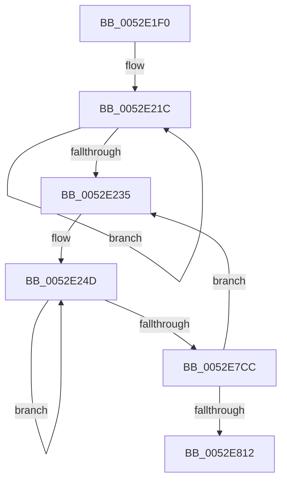

# SymCryptFdefRawMulMulx

- RVA: `0x0052E1F0`–`0x0052E81F` (길이 `1,583` bytes)
- VA: `0x000000014052E1F0`
- 실행 섹션: `.text`
- PDB 이름 있음: `예`; PDB Function 태그: `아니요`
- unwind 정보 RVA: `0x000C34F8`
- 디코드: `301`개 명령, `1,583/1,583` bytes 표시
- 미해석 바이트: `0` (있으면 어셈블리에 `.byte`로 보존)

> 이 문서는 커널 이미지의 기계어와 PDB 기호를 분석해 생성했습니다. 4번과 5번은 함수 원형과 자료형을 바이너리 사용 방식에서 추정한 C 해석이며 원본 소스 복구 결과는 아닙니다.

## 1. Dependencies

- 직접 호출 지점: **0**; 고유 호출 대상: **0**
- 직접 호출자로 확인된 함수: **2**
- RIP 상대 이미지 참조: **0**

### Outgoing calls
- 직접 디코드된 call 명령이 없습니다.

### Direct callers
- [SymCryptFdefRawMul](SymCryptFdefRawMul_function_0052DF1C.md) at `0x0052DF62`
- [SymCryptFdefModMulMontgomeryMulx](../53/SymCryptFdefModMulMontgomeryMulx_function_00534EC0.md) at `0x00534EEB`

### Static image references
- 디코드된 RIP-relative 메모리 참조가 없습니다.

## 2. Other-region calls and transfers

- 다른 실행 섹션으로 향하는 call: **0**
- 별도 외부 분기/꼬리 이동을 확인하지 못했습니다.

## 3. Assembly (complete function range)

```asm
0052E1F0  48 56                           push rsi
0052E1F2  57                              push rdi
0052E1F3  55                              push rbp
0052E1F4  53                              push rbx
0052E1F5  41 54                           push r12
0052E1F7  41 55                           push r13
0052E1F9  41 56                           push r14
0052E1FB  41 57                           push r15
0052E1FD  4C 8B D2                        mov r10, rdx
0052E200  4C 8B 5C 24 68                  mov r11, qword ptr [rsp + 0x68]
0052E205  49 C1 E1 06                     shl r9, 6
0052E209  4C 89 4C 24 48                  mov qword ptr [rsp + 0x48], r9
0052E20E  44 89 54 24 50                  mov dword ptr [rsp + 0x50], r10d
0052E213  49 8B F3                        mov rsi, r11
0052E216  0F 57 C0                        xorps xmm0, xmm0
0052E219  49 8B C1                        mov rax, r9
0052E21C  0F 29 06                        movaps xmmword ptr [rsi], xmm0
0052E21F  0F 29 46 10                     movaps xmmword ptr [rsi + 0x10], xmm0
0052E223  0F 29 46 20                     movaps xmmword ptr [rsi + 0x20], xmm0
0052E227  0F 29 46 30                     movaps xmmword ptr [rsi + 0x30], xmm0
0052E22B  48 83 C6 40                     add rsi, 0x40
0052E22F  48 83 E8 40                     sub rax, 0x40
0052E233  75 E7                           jne 0x14052e21c
0052E235  48 33 F6                        xor rsi, rsi
0052E238  48 33 FF                        xor rdi, rdi
0052E23B  48 33 ED                        xor rbp, rbp
0052E23E  48 33 DB                        xor rbx, rbx
0052E241  4D 33 E4                        xor r12, r12
0052E244  4D 33 ED                        xor r13, r13
0052E247  4D 33 F6                        xor r14, r14
0052E24A  4D 33 FF                        xor r15, r15
0052E24D  48 33 C0                        xor rax, rax
0052E250  49 8B 10                        mov rdx, qword ptr [r8]
0052E253  F3 49 0F 38 F6 33               adox rsi, qword ptr [r11]
0052E259  C4 62 FB F6 11                  mulx r10, rax, qword ptr [rcx]
0052E25E  66 48 0F 38 F6 F0               adcx rsi, rax
0052E264  F3 49 0F 38 F6 FA               adox rdi, r10
0052E26A  49 89 33                        mov qword ptr [r11], rsi
0052E26D  C4 62 FB F6 51 08               mulx r10, rax, qword ptr [rcx + 8]
0052E273  66 48 0F 38 F6 F8               adcx rdi, rax
0052E279  F3 49 0F 38 F6 EA               adox rbp, r10
0052E27F  C4 62 FB F6 51 10               mulx r10, rax, qword ptr [rcx + 0x10]
0052E285  66 48 0F 38 F6 E8               adcx rbp, rax
0052E28B  F3 49 0F 38 F6 DA               adox rbx, r10
0052E291  C4 62 FB F6 51 18               mulx r10, rax, qword ptr [rcx + 0x18]
0052E297  66 48 0F 38 F6 D8               adcx rbx, rax
0052E29D  F3 4D 0F 38 F6 E2               adox r12, r10
0052E2A3  C4 62 FB F6 51 20               mulx r10, rax, qword ptr [rcx + 0x20]
0052E2A9  66 4C 0F 38 F6 E0               adcx r12, rax
0052E2AF  F3 4D 0F 38 F6 EA               adox r13, r10
0052E2B5  C4 62 FB F6 51 28               mulx r10, rax, qword ptr [rcx + 0x28]
0052E2BB  66 4C 0F 38 F6 E8               adcx r13, rax
0052E2C1  F3 4D 0F 38 F6 F2               adox r14, r10
0052E2C7  C4 62 FB F6 51 30               mulx r10, rax, qword ptr [rcx + 0x30]
0052E2CD  66 4C 0F 38 F6 F0               adcx r14, rax
0052E2D3  F3 4D 0F 38 F6 FA               adox r15, r10
0052E2D9  C4 62 FB F6 51 38               mulx r10, rax, qword ptr [rcx + 0x38]
0052E2DF  66 4C 0F 38 F6 F8               adcx r15, rax
0052E2E5  48 C7 C6 00 00 00 00            mov rsi, 0
0052E2EC  F3 48 0F 38 F6 F6               adox rsi, rsi
0052E2F2  66 49 0F 38 F6 F2               adcx rsi, r10
0052E2F8  48 33 C0                        xor rax, rax
0052E2FB  49 8B 50 08                     mov rdx, qword ptr [r8 + 8]
0052E2FF  F3 49 0F 38 F6 7B 08            adox rdi, qword ptr [r11 + 8]
0052E306  C4 62 FB F6 11                  mulx r10, rax, qword ptr [rcx]
0052E30B  66 48 0F 38 F6 F8               adcx rdi, rax
0052E311  F3 49 0F 38 F6 EA               adox rbp, r10
0052E317  49 89 7B 08                     mov qword ptr [r11 + 8], rdi
0052E31B  C4 62 FB F6 51 08               mulx r10, rax, qword ptr [rcx + 8]
0052E321  66 48 0F 38 F6 E8               adcx rbp, rax
0052E327  F3 49 0F 38 F6 DA               adox rbx, r10
0052E32D  C4 62 FB F6 51 10               mulx r10, rax, qword ptr [rcx + 0x10]
0052E333  66 48 0F 38 F6 D8               adcx rbx, rax
0052E339  F3 4D 0F 38 F6 E2               adox r12, r10
0052E33F  C4 62 FB F6 51 18               mulx r10, rax, qword ptr [rcx + 0x18]
0052E345  66 4C 0F 38 F6 E0               adcx r12, rax
0052E34B  F3 4D 0F 38 F6 EA               adox r13, r10
0052E351  C4 62 FB F6 51 20               mulx r10, rax, qword ptr [rcx + 0x20]
0052E357  66 4C 0F 38 F6 E8               adcx r13, rax
0052E35D  F3 4D 0F 38 F6 F2               adox r14, r10
0052E363  C4 62 FB F6 51 28               mulx r10, rax, qword ptr [rcx + 0x28]
0052E369  66 4C 0F 38 F6 F0               adcx r14, rax
0052E36F  F3 4D 0F 38 F6 FA               adox r15, r10
0052E375  C4 62 FB F6 51 30               mulx r10, rax, qword ptr [rcx + 0x30]
0052E37B  66 4C 0F 38 F6 F8               adcx r15, rax
0052E381  F3 49 0F 38 F6 F2               adox rsi, r10
0052E387  C4 62 FB F6 51 38               mulx r10, rax, qword ptr [rcx + 0x38]
0052E38D  66 48 0F 38 F6 F0               adcx rsi, rax
0052E393  48 C7 C7 00 00 00 00            mov rdi, 0
0052E39A  F3 48 0F 38 F6 FF               adox rdi, rdi
0052E3A0  66 49 0F 38 F6 FA               adcx rdi, r10
0052E3A6  48 33 C0                        xor rax, rax
0052E3A9  49 8B 50 10                     mov rdx, qword ptr [r8 + 0x10]
0052E3AD  F3 49 0F 38 F6 6B 10            adox rbp, qword ptr [r11 + 0x10]
0052E3B4  C4 62 FB F6 11                  mulx r10, rax, qword ptr [rcx]
0052E3B9  66 48 0F 38 F6 E8               adcx rbp, rax
0052E3BF  F3 49 0F 38 F6 DA               adox rbx, r10
0052E3C5  49 89 6B 10                     mov qword ptr [r11 + 0x10], rbp
0052E3C9  C4 62 FB F6 51 08               mulx r10, rax, qword ptr [rcx + 8]
0052E3CF  66 48 0F 38 F6 D8               adcx rbx, rax
0052E3D5  F3 4D 0F 38 F6 E2               adox r12, r10
0052E3DB  C4 62 FB F6 51 10               mulx r10, rax, qword ptr [rcx + 0x10]
0052E3E1  66 4C 0F 38 F6 E0               adcx r12, rax
0052E3E7  F3 4D 0F 38 F6 EA               adox r13, r10
0052E3ED  C4 62 FB F6 51 18               mulx r10, rax, qword ptr [rcx + 0x18]
0052E3F3  66 4C 0F 38 F6 E8               adcx r13, rax
0052E3F9  F3 4D 0F 38 F6 F2               adox r14, r10
0052E3FF  C4 62 FB F6 51 20               mulx r10, rax, qword ptr [rcx + 0x20]
0052E405  66 4C 0F 38 F6 F0               adcx r14, rax
0052E40B  F3 4D 0F 38 F6 FA               adox r15, r10
0052E411  C4 62 FB F6 51 28               mulx r10, rax, qword ptr [rcx + 0x28]
0052E417  66 4C 0F 38 F6 F8               adcx r15, rax
0052E41D  F3 49 0F 38 F6 F2               adox rsi, r10
0052E423  C4 62 FB F6 51 30               mulx r10, rax, qword ptr [rcx + 0x30]
0052E429  66 48 0F 38 F6 F0               adcx rsi, rax
0052E42F  F3 49 0F 38 F6 FA               adox rdi, r10
0052E435  C4 62 FB F6 51 38               mulx r10, rax, qword ptr [rcx + 0x38]
0052E43B  66 48 0F 38 F6 F8               adcx rdi, rax
0052E441  48 C7 C5 00 00 00 00            mov rbp, 0
0052E448  F3 48 0F 38 F6 ED               adox rbp, rbp
0052E44E  66 49 0F 38 F6 EA               adcx rbp, r10
0052E454  48 33 C0                        xor rax, rax
0052E457  49 8B 50 18                     mov rdx, qword ptr [r8 + 0x18]
0052E45B  F3 49 0F 38 F6 5B 18            adox rbx, qword ptr [r11 + 0x18]
0052E462  C4 62 FB F6 11                  mulx r10, rax, qword ptr [rcx]
0052E467  66 48 0F 38 F6 D8               adcx rbx, rax
0052E46D  F3 4D 0F 38 F6 E2               adox r12, r10
0052E473  49 89 5B 18                     mov qword ptr [r11 + 0x18], rbx
0052E477  C4 62 FB F6 51 08               mulx r10, rax, qword ptr [rcx + 8]
0052E47D  66 4C 0F 38 F6 E0               adcx r12, rax
0052E483  F3 4D 0F 38 F6 EA               adox r13, r10
0052E489  C4 62 FB F6 51 10               mulx r10, rax, qword ptr [rcx + 0x10]
0052E48F  66 4C 0F 38 F6 E8               adcx r13, rax
0052E495  F3 4D 0F 38 F6 F2               adox r14, r10
0052E49B  C4 62 FB F6 51 18               mulx r10, rax, qword ptr [rcx + 0x18]
0052E4A1  66 4C 0F 38 F6 F0               adcx r14, rax
0052E4A7  F3 4D 0F 38 F6 FA               adox r15, r10
0052E4AD  C4 62 FB F6 51 20               mulx r10, rax, qword ptr [rcx + 0x20]
0052E4B3  66 4C 0F 38 F6 F8               adcx r15, rax
0052E4B9  F3 49 0F 38 F6 F2               adox rsi, r10
0052E4BF  C4 62 FB F6 51 28               mulx r10, rax, qword ptr [rcx + 0x28]
0052E4C5  66 48 0F 38 F6 F0               adcx rsi, rax
0052E4CB  F3 49 0F 38 F6 FA               adox rdi, r10
0052E4D1  C4 62 FB F6 51 30               mulx r10, rax, qword ptr [rcx + 0x30]
0052E4D7  66 48 0F 38 F6 F8               adcx rdi, rax
0052E4DD  F3 49 0F 38 F6 EA               adox rbp, r10
0052E4E3  C4 62 FB F6 51 38               mulx r10, rax, qword ptr [rcx + 0x38]
0052E4E9  66 48 0F 38 F6 E8               adcx rbp, rax
0052E4EF  48 C7 C3 00 00 00 00            mov rbx, 0
0052E4F6  F3 48 0F 38 F6 DB               adox rbx, rbx
0052E4FC  66 49 0F 38 F6 DA               adcx rbx, r10
0052E502  48 33 C0                        xor rax, rax
0052E505  49 8B 50 20                     mov rdx, qword ptr [r8 + 0x20]
0052E509  F3 4D 0F 38 F6 63 20            adox r12, qword ptr [r11 + 0x20]
0052E510  C4 62 FB F6 11                  mulx r10, rax, qword ptr [rcx]
0052E515  66 4C 0F 38 F6 E0               adcx r12, rax
0052E51B  F3 4D 0F 38 F6 EA               adox r13, r10
0052E521  4D 89 63 20                     mov qword ptr [r11 + 0x20], r12
0052E525  C4 62 FB F6 51 08               mulx r10, rax, qword ptr [rcx + 8]
0052E52B  66 4C 0F 38 F6 E8               adcx r13, rax
0052E531  F3 4D 0F 38 F6 F2               adox r14, r10
0052E537  C4 62 FB F6 51 10               mulx r10, rax, qword ptr [rcx + 0x10]
0052E53D  66 4C 0F 38 F6 F0               adcx r14, rax
0052E543  F3 4D 0F 38 F6 FA               adox r15, r10
0052E549  C4 62 FB F6 51 18               mulx r10, rax, qword ptr [rcx + 0x18]
0052E54F  66 4C 0F 38 F6 F8               adcx r15, rax
0052E555  F3 49 0F 38 F6 F2               adox rsi, r10
0052E55B  C4 62 FB F6 51 20               mulx r10, rax, qword ptr [rcx + 0x20]
0052E561  66 48 0F 38 F6 F0               adcx rsi, rax
0052E567  F3 49 0F 38 F6 FA               adox rdi, r10
0052E56D  C4 62 FB F6 51 28               mulx r10, rax, qword ptr [rcx + 0x28]
0052E573  66 48 0F 38 F6 F8               adcx rdi, rax
0052E579  F3 49 0F 38 F6 EA               adox rbp, r10
0052E57F  C4 62 FB F6 51 30               mulx r10, rax, qword ptr [rcx + 0x30]
0052E585  66 48 0F 38 F6 E8               adcx rbp, rax
0052E58B  F3 49 0F 38 F6 DA               adox rbx, r10
0052E591  C4 62 FB F6 51 38               mulx r10, rax, qword ptr [rcx + 0x38]
0052E597  66 48 0F 38 F6 D8               adcx rbx, rax
0052E59D  49 C7 C4 00 00 00 00            mov r12, 0
0052E5A4  F3 4D 0F 38 F6 E4               adox r12, r12
0052E5AA  66 4D 0F 38 F6 E2               adcx r12, r10
0052E5B0  48 33 C0                        xor rax, rax
0052E5B3  49 8B 50 28                     mov rdx, qword ptr [r8 + 0x28]
0052E5B7  F3 4D 0F 38 F6 6B 28            adox r13, qword ptr [r11 + 0x28]
0052E5BE  C4 62 FB F6 11                  mulx r10, rax, qword ptr [rcx]
0052E5C3  66 4C 0F 38 F6 E8               adcx r13, rax
0052E5C9  F3 4D 0F 38 F6 F2               adox r14, r10
0052E5CF  4D 89 6B 28                     mov qword ptr [r11 + 0x28], r13
0052E5D3  C4 62 FB F6 51 08               mulx r10, rax, qword ptr [rcx + 8]
0052E5D9  66 4C 0F 38 F6 F0               adcx r14, rax
0052E5DF  F3 4D 0F 38 F6 FA               adox r15, r10
0052E5E5  C4 62 FB F6 51 10               mulx r10, rax, qword ptr [rcx + 0x10]
0052E5EB  66 4C 0F 38 F6 F8               adcx r15, rax
0052E5F1  F3 49 0F 38 F6 F2               adox rsi, r10
0052E5F7  C4 62 FB F6 51 18               mulx r10, rax, qword ptr [rcx + 0x18]
0052E5FD  66 48 0F 38 F6 F0               adcx rsi, rax
0052E603  F3 49 0F 38 F6 FA               adox rdi, r10
0052E609  C4 62 FB F6 51 20               mulx r10, rax, qword ptr [rcx + 0x20]
0052E60F  66 48 0F 38 F6 F8               adcx rdi, rax
0052E615  F3 49 0F 38 F6 EA               adox rbp, r10
0052E61B  C4 62 FB F6 51 28               mulx r10, rax, qword ptr [rcx + 0x28]
0052E621  66 48 0F 38 F6 E8               adcx rbp, rax
0052E627  F3 49 0F 38 F6 DA               adox rbx, r10
0052E62D  C4 62 FB F6 51 30               mulx r10, rax, qword ptr [rcx + 0x30]
0052E633  66 48 0F 38 F6 D8               adcx rbx, rax
0052E639  F3 4D 0F 38 F6 E2               adox r12, r10
0052E63F  C4 62 FB F6 51 38               mulx r10, rax, qword ptr [rcx + 0x38]
0052E645  66 4C 0F 38 F6 E0               adcx r12, rax
0052E64B  49 C7 C5 00 00 00 00            mov r13, 0
0052E652  F3 4D 0F 38 F6 ED               adox r13, r13
0052E658  66 4D 0F 38 F6 EA               adcx r13, r10
0052E65E  48 33 C0                        xor rax, rax
0052E661  49 8B 50 30                     mov rdx, qword ptr [r8 + 0x30]
0052E665  F3 4D 0F 38 F6 73 30            adox r14, qword ptr [r11 + 0x30]
0052E66C  C4 62 FB F6 11                  mulx r10, rax, qword ptr [rcx]
0052E671  66 4C 0F 38 F6 F0               adcx r14, rax
0052E677  F3 4D 0F 38 F6 FA               adox r15, r10
0052E67D  4D 89 73 30                     mov qword ptr [r11 + 0x30], r14
0052E681  C4 62 FB F6 51 08               mulx r10, rax, qword ptr [rcx + 8]
0052E687  66 4C 0F 38 F6 F8               adcx r15, rax
0052E68D  F3 49 0F 38 F6 F2               adox rsi, r10
0052E693  C4 62 FB F6 51 10               mulx r10, rax, qword ptr [rcx + 0x10]
0052E699  66 48 0F 38 F6 F0               adcx rsi, rax
0052E69F  F3 49 0F 38 F6 FA               adox rdi, r10
0052E6A5  C4 62 FB F6 51 18               mulx r10, rax, qword ptr [rcx + 0x18]
0052E6AB  66 48 0F 38 F6 F8               adcx rdi, rax
0052E6B1  F3 49 0F 38 F6 EA               adox rbp, r10
0052E6B7  C4 62 FB F6 51 20               mulx r10, rax, qword ptr [rcx + 0x20]
0052E6BD  66 48 0F 38 F6 E8               adcx rbp, rax
0052E6C3  F3 49 0F 38 F6 DA               adox rbx, r10
0052E6C9  C4 62 FB F6 51 28               mulx r10, rax, qword ptr [rcx + 0x28]
0052E6CF  66 48 0F 38 F6 D8               adcx rbx, rax
0052E6D5  F3 4D 0F 38 F6 E2               adox r12, r10
0052E6DB  C4 62 FB F6 51 30               mulx r10, rax, qword ptr [rcx + 0x30]
0052E6E1  66 4C 0F 38 F6 E0               adcx r12, rax
0052E6E7  F3 4D 0F 38 F6 EA               adox r13, r10
0052E6ED  C4 62 FB F6 51 38               mulx r10, rax, qword ptr [rcx + 0x38]
0052E6F3  66 4C 0F 38 F6 E8               adcx r13, rax
0052E6F9  49 C7 C6 00 00 00 00            mov r14, 0
0052E700  F3 4D 0F 38 F6 F6               adox r14, r14
0052E706  66 4D 0F 38 F6 F2               adcx r14, r10
0052E70C  48 33 C0                        xor rax, rax
0052E70F  49 8B 50 38                     mov rdx, qword ptr [r8 + 0x38]
0052E713  F3 4D 0F 38 F6 7B 38            adox r15, qword ptr [r11 + 0x38]
0052E71A  C4 62 FB F6 11                  mulx r10, rax, qword ptr [rcx]
0052E71F  66 4C 0F 38 F6 F8               adcx r15, rax
0052E725  F3 49 0F 38 F6 F2               adox rsi, r10
0052E72B  4D 89 7B 38                     mov qword ptr [r11 + 0x38], r15
0052E72F  C4 62 FB F6 51 08               mulx r10, rax, qword ptr [rcx + 8]
0052E735  66 48 0F 38 F6 F0               adcx rsi, rax
0052E73B  F3 49 0F 38 F6 FA               adox rdi, r10
0052E741  C4 62 FB F6 51 10               mulx r10, rax, qword ptr [rcx + 0x10]
0052E747  66 48 0F 38 F6 F8               adcx rdi, rax
0052E74D  F3 49 0F 38 F6 EA               adox rbp, r10
0052E753  C4 62 FB F6 51 18               mulx r10, rax, qword ptr [rcx + 0x18]
0052E759  66 48 0F 38 F6 E8               adcx rbp, rax
0052E75F  F3 49 0F 38 F6 DA               adox rbx, r10
0052E765  C4 62 FB F6 51 20               mulx r10, rax, qword ptr [rcx + 0x20]
0052E76B  66 48 0F 38 F6 D8               adcx rbx, rax
0052E771  F3 4D 0F 38 F6 E2               adox r12, r10
0052E777  C4 62 FB F6 51 28               mulx r10, rax, qword ptr [rcx + 0x28]
0052E77D  66 4C 0F 38 F6 E0               adcx r12, rax
0052E783  F3 4D 0F 38 F6 EA               adox r13, r10
0052E789  C4 62 FB F6 51 30               mulx r10, rax, qword ptr [rcx + 0x30]
0052E78F  66 4C 0F 38 F6 E8               adcx r13, rax
0052E795  F3 4D 0F 38 F6 F2               adox r14, r10
0052E79B  C4 62 FB F6 51 38               mulx r10, rax, qword ptr [rcx + 0x38]
0052E7A1  66 4C 0F 38 F6 F0               adcx r14, rax
0052E7A7  49 C7 C7 00 00 00 00            mov r15, 0
0052E7AE  F3 4D 0F 38 F6 FF               adox r15, r15
0052E7B4  66 4D 0F 38 F6 FA               adcx r15, r10
0052E7BA  49 83 C0 40                     add r8, 0x40
0052E7BE  49 83 C3 40                     add r11, 0x40
0052E7C2  41 83 E9 40                     sub r9d, 0x40
0052E7C6  0F 85 81 FA FF FF               jne 0x14052e24d
0052E7CC  49 89 33                        mov qword ptr [r11], rsi
0052E7CF  49 89 7B 08                     mov qword ptr [r11 + 8], rdi
0052E7D3  49 89 6B 10                     mov qword ptr [r11 + 0x10], rbp
0052E7D7  49 89 5B 18                     mov qword ptr [r11 + 0x18], rbx
0052E7DB  4D 89 63 20                     mov qword ptr [r11 + 0x20], r12
0052E7DF  4D 89 6B 28                     mov qword ptr [r11 + 0x28], r13
0052E7E3  4D 89 73 30                     mov qword ptr [r11 + 0x30], r14
0052E7E7  4D 89 7B 38                     mov qword ptr [r11 + 0x38], r15
0052E7EB  4C 8B 4C 24 48                  mov r9, qword ptr [rsp + 0x48]
0052E7F0  4D 2B D9                        sub r11, r9
0052E7F3  49 83 C3 40                     add r11, 0x40
0052E7F7  4D 2B C1                        sub r8, r9
0052E7FA  48 83 C1 40                     add rcx, 0x40
0052E7FE  44 8B 54 24 50                  mov r10d, dword ptr [rsp + 0x50]
0052E803  41 83 EA 01                     sub r10d, 1
0052E807  44 89 54 24 50                  mov dword ptr [rsp + 0x50], r10d
0052E80C  0F 85 23 FA FF FF               jne 0x14052e235
0052E812  41 5F                           pop r15
0052E814  41 5E                           pop r14
0052E816  41 5D                           pop r13
0052E818  41 5C                           pop r12
0052E81A  5B                              pop rbx
0052E81B  5D                              pop rbp
0052E81C  5F                              pop rdi
0052E81D  5E                              pop rsi
0052E81E  C3                              ret
```

## 4. C-style interpretation (structured pseudocode)

```c
__int64 __fastcall SymCryptFdefRawMulMulx(__int64 a1, __int64 a2, __int64 a3, __int64 a4, __int64 a5)
{
    __int64 result;
    __int64 v_r10;
    __int64 v_r11;
    __int64 v_r12;
    __int64 v_r13;
    __int64 v_r14;
    __int64 v_r15;
    __int64 v_rbp;
    __int64 v_rbx;
    __int64 v_rdi;
    __int64 v_rsi;
    unsigned int v_stack_p10;
    unsigned __int64 v_stack_p8;

    a4 = (a4) << (6);
    v_stack_p8 = a4;
    v_stack_p10 = (unsigned int)(a2);
loc_0052E21C:
    *(unsigned __int64 *)(a5) = v_xmm0;
    *(unsigned __int64 *)(a5 + 16) = v_xmm0;
    *(unsigned __int64 *)(a5 + 32) = v_xmm0;
    *(unsigned __int64 *)(a5 + 48) = v_xmm0;
    v_rsi = (a5) + (64);
    result = (a4) - (64);
    if (condition_is_not_equal) goto loc_0052E21C;
loc_0052E235:
    v_rsi = 0;
    v_rdi = 0;
    v_rbp = 0;
    v_rbx = 0;
    v_r12 = 0;
    v_r13 = 0;
    v_r14 = 0;
    v_r15 = 0;
loc_0052E24D:
    result = 0;
    *(unsigned __int64 *)(a5) = 0;
    result = 0;
    *(unsigned __int64 *)(a5 + 8) = 0;
    result = 0;
    *(unsigned __int64 *)(a5 + 16) = 0;
    result = 0;
    *(unsigned __int64 *)(a5 + 24) = 0;
    result = 0;
    *(unsigned __int64 *)(a5 + 32) = 0;
    result = 0;
    *(unsigned __int64 *)(a5 + 40) = 0;
    result = 0;
    *(unsigned __int64 *)(a5 + 48) = 0;
    result = 0;
    *(unsigned __int64 *)(a5 + 56) = 0;
    a3 = (a3) + (64);
    v_r11 = (a5) + (64);
    a4 = (unsigned int)((a4) - (64));
    if (condition_is_not_equal) goto loc_0052E24D;
    *(unsigned __int64 *)(v_r11) = 0;
    *(unsigned __int64 *)(v_r11 + 8) = 0;
    *(unsigned __int64 *)(v_r11 + 16) = 0;
    *(unsigned __int64 *)(v_r11 + 24) = 0;
    *(unsigned __int64 *)(v_r11 + 32) = 0;
    *(unsigned __int64 *)(v_r11 + 40) = 0;
    *(unsigned __int64 *)(v_r11 + 48) = 0;
    *(unsigned __int64 *)(v_r11 + 56) = 0;
    v_r11 = (v_r11) - (v_stack_p8);
    v_r11 = (v_r11) + (64);
    a3 = (a3) - (v_stack_p8);
    a1 = (a1) + (64);
    v_r10 = (unsigned int)(((unsigned int)(v_stack_p10)) - (1));
    v_stack_p10 = (unsigned int)(v_r10);
    if (condition_is_not_equal) goto loc_0052E235;
    return result;
}
```

## 5. (Beta) C Style

```c
int64_t SymCryptFdefRawMulMulx(void *Arg1, int64_t Arg2, void *Arg3, int64_t Arg4, void *Arg5)
{
    uint8_t *arg1 = (uint8_t *)Arg1;
    uint8_t *arg3 = (uint8_t *)Arg3;
    uint8_t *arg5 = (uint8_t *)Arg5;

    int64_t result;
    int64_t local_r10;
    int64_t local_r11;
    int64_t local_r12;
    int64_t local_r13;
    int64_t local_r14;
    int64_t local_r15;
    int64_t local_rbp;
    int64_t local_rbx;
    int64_t local_rdi;
    int64_t local_rsi;
    uint32_t v_stack_p10;
    uint64_t v_stack_p8;

    Arg4 = (Arg4) << (6);
    v_stack_p8 = Arg4;
    v_stack_p10 = (uint32_t)(Arg2);
loc_0052E21C:
    *(uint64_t *)(arg5) = v_xmm0;
    *(uint64_t *)(arg5 + 0x10) = v_xmm0;
    *(uint64_t *)(arg5 + 0x20) = v_xmm0;
    *(uint64_t *)(arg5 + 0x30) = v_xmm0;
    local_rsi = (Arg5) + (64);
    result = (Arg4) - (64);
    if (condition_is_not_equal) goto loc_0052E21C;
loc_0052E235:
    local_rsi = 0;
    local_rdi = 0;
    local_rbp = 0;
    local_rbx = 0;
    local_r12 = 0;
    local_r13 = 0;
    local_r14 = 0;
    local_r15 = 0;
loc_0052E24D:
    result = 0;
    *(uint64_t *)(arg5) = 0;
    result = 0;
    *(uint64_t *)(arg5 + 0x8) = 0;
    result = 0;
    *(uint64_t *)(arg5 + 0x10) = 0;
    result = 0;
    *(uint64_t *)(arg5 + 0x18) = 0;
    result = 0;
    *(uint64_t *)(arg5 + 0x20) = 0;
    result = 0;
    *(uint64_t *)(arg5 + 0x28) = 0;
    result = 0;
    *(uint64_t *)(arg5 + 0x30) = 0;
    result = 0;
    *(uint64_t *)(arg5 + 0x38) = 0;
    Arg3 = (Arg3) + (64);
    local_r11 = (Arg5) + (64);
    Arg4 = (uint32_t)((Arg4) - (64));
    if (condition_is_not_equal) goto loc_0052E24D;
    *(uint64_t *)(local_r11) = 0;
    *(uint64_t *)(local_r11 + 0x8) = 0;
    *(uint64_t *)(local_r11 + 0x10) = 0;
    *(uint64_t *)(local_r11 + 0x18) = 0;
    *(uint64_t *)(local_r11 + 0x20) = 0;
    *(uint64_t *)(local_r11 + 0x28) = 0;
    *(uint64_t *)(local_r11 + 0x30) = 0;
    *(uint64_t *)(local_r11 + 0x38) = 0;
    local_r11 = (local_r11) - (v_stack_p8);
    local_r11 = (local_r11) + (64);
    Arg3 = (Arg3) - (v_stack_p8);
    Arg1 = (Arg1) + (64);
    local_r10 = (uint32_t)(((uint32_t)(v_stack_p10)) - (1));
    v_stack_p10 = (uint32_t)(local_r10);
    if (condition_is_not_equal) goto loc_0052E235;
    return result;
}
```

### 관측된 메모리 오프셋

구조체 형식이 확인되지 않은 접근은 인자 기준의 오프셋으로만 기록했습니다.

| 기준 인자 | 오프셋 표현 | 폭 (bit) | 접근 |
|---|---:|---:|---|
| `Arg1` | `+ 0x0` | `64` | `R` |
| `Arg1` | `+ 0x8` | `64` | `R` |
| `Arg1` | `+ 0x10` | `64` | `R` |
| `Arg1` | `+ 0x18` | `64` | `R` |
| `Arg1` | `+ 0x20` | `64` | `R` |
| `Arg1` | `+ 0x28` | `64` | `R` |
| `Arg1` | `+ 0x30` | `64` | `R` |
| `Arg1` | `+ 0x38` | `64` | `R` |
| `Arg3` | `+ 0x0` | `64` | `R` |
| `Arg3` | `+ 0x8` | `64` | `R` |
| `Arg3` | `+ 0x10` | `64` | `R` |
| `Arg3` | `+ 0x18` | `64` | `R` |
| `Arg3` | `+ 0x20` | `64` | `R` |
| `Arg3` | `+ 0x28` | `64` | `R` |
| `Arg3` | `+ 0x30` | `64` | `R` |
| `Arg3` | `+ 0x38` | `64` | `R` |
| `Arg5` | `+ 0x0` | `64` | `R` |
| `Arg5` | `+ 0x0` | `64` | `W` |
| `Arg5` | `+ 0x0` | `128` | `W` |
| `Arg5` | `+ 0x8` | `64` | `R` |
| `Arg5` | `+ 0x8` | `64` | `W` |
| `Arg5` | `+ 0x10` | `64` | `R` |
| `Arg5` | `+ 0x10` | `64` | `W` |
| `Arg5` | `+ 0x10` | `128` | `W` |
| `Arg5` | `+ 0x18` | `64` | `R` |
| `Arg5` | `+ 0x18` | `64` | `W` |
| `Arg5` | `+ 0x20` | `64` | `R` |
| `Arg5` | `+ 0x20` | `64` | `W` |
| `Arg5` | `+ 0x20` | `128` | `W` |
| `Arg5` | `+ 0x28` | `64` | `R` |
| `Arg5` | `+ 0x28` | `64` | `W` |
| `Arg5` | `+ 0x30` | `64` | `R` |

추가 오프셋 4개는 표에서 생략했습니다.

## 6. Execution-region graph

[열기: 2D/3D 그래프와 함수 탐색 컨트롤 패널](../../../control-panel.html?section=text&rva=0x0052E1F0&view=graph)

- 2D 그래프는 위에서 아래로 흐르고, 3D 그래프는 빈 공간을 드래그해 회전합니다. Shift+드래그는 이동, 휠은 확대·축소, 함수 노드 선택은 대상 보고서 이동입니다.

### Static fallback


