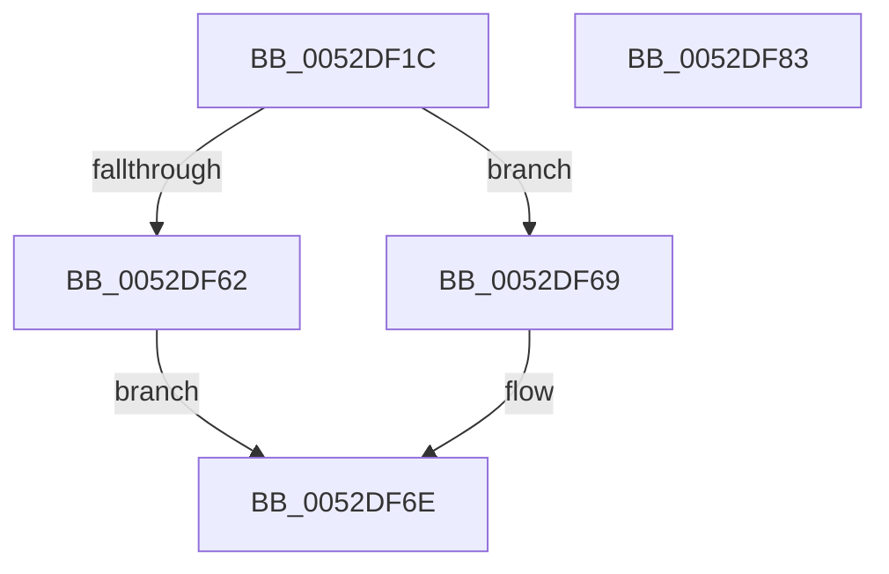

# SymCryptFdefRawMul

- RVA: `0x0052DF1C`–`0x0052DF84` (길이 `104` bytes)
- VA: `0x000000014052DF1C`
- 실행 섹션: `.text`
- PDB 이름 있음: `예`; PDB Function 태그: `아니요`
- unwind 정보 RVA: `0x00066400`
- 디코드: `29`개 명령, `104/104` bytes 표시
- 미해석 바이트: `0` (있으면 어셈블리에 `.byte`로 보존)

> 이 문서는 커널 이미지의 기계어와 PDB 기호를 분석해 생성했습니다. 4번과 5번은 함수 원형과 자료형을 바이너리 사용 방식에서 추정한 C 해석이며 원본 소스 복구 결과는 아닙니다.

## 1. Dependencies

- 직접 호출 지점: **3**; 고유 호출 대상: **3**
- 직접 호출자로 확인된 함수: **4**
- RIP 상대 이미지 참조: **1**

### Outgoing calls
- `0x0052DF3B` → [SymCryptCpuFeaturesNeverPresent](../49/SymCryptCpuFeaturesNeverPresent_function_00498CB0.md) (function, `0x00498CB0`)
- `0x0052DF62` → [SymCryptFdefRawMulMulx](SymCryptFdefRawMulMulx_function_0052E1F0.md) (function, `0x0052E1F0`)
- `0x0052DF69` → [SymCryptFdefRawMulAsm](../53/SymCryptFdefRawMulAsm_function_00536630.md) (function, `0x00536630`)

### Direct callers
- [SymCryptFdefIntMulMixedSize](SymCryptFdefIntMulMixedSize_function_0052D88C.md) at `0x0052D8E4`
- [SymCryptFdefModMulGeneric](../53/SymCryptFdefModMulGeneric_function_00534DA0.md) at `0x00534E04`
- [SymCryptFdefModMulMontgomery](../53/SymCryptFdefModMulMontgomery_function_00534E60.md) at `0x00534E8B`
- [SymCryptFdefModSetPostMontgomery](../53/SymCryptFdefModSetPostMontgomery_function_005350E0.md) at `0x0053510A`

### Static image references
- `0x0052DF40` → RVA `0x00E0A730` (`.data`; read)

## 2. Other-region calls and transfers

- 다른 실행 섹션으로 향하는 call: **0**
- 별도 외부 분기/꼬리 이동을 확인하지 못했습니다.

## 3. Assembly (complete function range)

```asm
0052DF1C  48 89 5C 24 08                  mov qword ptr [rsp + 8], rbx
0052DF21  48 89 6C 24 10                  mov qword ptr [rsp + 0x10], rbp
0052DF26  48 89 74 24 18                  mov qword ptr [rsp + 0x18], rsi
0052DF2B  57                              push rdi
0052DF2C  48 83 EC 30                     sub rsp, 0x30
0052DF30  41 8B D9                        mov ebx, r9d
0052DF33  49 8B F8                        mov rdi, r8
0052DF36  8B F2                           mov esi, edx
0052DF38  48 8B E9                        mov rbp, rcx
0052DF3B  E8 70 AD F6 FF                  call 0x140498cb0
0052DF40  0B 05 EA C7 8D 00               or eax, dword ptr [rip + 0x8dc7ea]
0052DF46  44 8B CB                        mov r9d, ebx
0052DF49  A9 81 01 00 00                  test eax, 0x181
0052DF4E  4C 8B C7                        mov r8, rdi
0052DF51  48 8B 44 24 60                  mov rax, qword ptr [rsp + 0x60]
0052DF56  8B D6                           mov edx, esi
0052DF58  48 89 44 24 20                  mov qword ptr [rsp + 0x20], rax
0052DF5D  48 8B CD                        mov rcx, rbp
0052DF60  75 07                           jne 0x14052df69
0052DF62  E8 89 02 00 00                  call 0x14052e1f0
0052DF67  EB 05                           jmp 0x14052df6e
0052DF69  E8 C2 86 00 00                  call 0x140536630
0052DF6E  48 8B 5C 24 40                  mov rbx, qword ptr [rsp + 0x40]
0052DF73  48 8B 6C 24 48                  mov rbp, qword ptr [rsp + 0x48]
0052DF78  48 8B 74 24 50                  mov rsi, qword ptr [rsp + 0x50]
0052DF7D  48 83 C4 30                     add rsp, 0x30
0052DF81  5F                              pop rdi
0052DF82  C3                              ret
0052DF83  CC                              int3
```

## 4. C-style interpretation (structured pseudocode)

```c
__int64 __fastcall SymCryptFdefRawMul(__int64 a1, int a2, __int64 a3, int a4, __int64 a5)
{
    __int64 result;
    __int64 v_rsp;
    unsigned __int64 v_stack_m18;
    unsigned __int64 v_stack_p10;
    unsigned __int64 v_stack_p18;
    unsigned __int64 v_stack_p8;

    v_stack_p8 = v_rbx;
    v_stack_p10 = v_rbp;
    v_stack_p18 = v_rsi;
    v_rsp = (v_rsp) - (48);
    result = SymCryptCpuFeaturesNeverPresent(a1, a2, a3, a4);
    result = (unsigned int)((result) | (*(unsigned int *)(v_rip + 9291754)));
    v_stack_m18 = a5;
    if ((((unsigned int)(result)) & (385)) != 0) goto loc_0052DF69;
    result = SymCryptFdefRawMulMulx(a1, (unsigned int)((unsigned int)((unsigned int)(a2))), a3, (unsigned int)((unsigned int)((unsigned int)(a4))));
    goto loc_0052DF6E;
loc_0052DF69:
    result = SymCryptFdefRawMulAsm(a1, (unsigned int)((unsigned int)((unsigned int)(a2))), a3, (unsigned int)((unsigned int)((unsigned int)(a4))));
loc_0052DF6E:
    v_rsp = (v_rsp) + (48);
    return result;
}
```

## 5. (Beta) C Style

```c
int64_t SymCryptFdefRawMul(int64_t Arg1, int32_t Arg2, int64_t Arg3, int32_t Arg4, int64_t Arg5)
{
    int64_t result;
    int64_t local_rsp;
    uint64_t v_stack_m18;
    uint64_t v_stack_p10;
    uint64_t v_stack_p18;
    uint64_t v_stack_p8;

    v_stack_p8 = local_rbx;
    v_stack_p10 = local_rbp;
    v_stack_p18 = local_rsi;
    local_rsp = (local_rsp) - (48);
    result = SymCryptCpuFeaturesNeverPresent(Arg1, Arg2, Arg3, Arg4);
    result = (uint32_t)((result) | (*(uint32_t *)(v_rip + 0x8DC7EA)));
    v_stack_m18 = Arg5;
    if ((((uint32_t)(result)) & (385)) != 0) goto loc_0052DF69;
    result = SymCryptFdefRawMulMulx(Arg1, (uint32_t)((uint32_t)((uint32_t)(Arg2))), Arg3, (uint32_t)((uint32_t)((uint32_t)(Arg4))));
    goto loc_0052DF6E;
loc_0052DF69:
    result = SymCryptFdefRawMulAsm(Arg1, (uint32_t)((uint32_t)((uint32_t)(Arg2))), Arg3, (uint32_t)((uint32_t)((uint32_t)(Arg4))));
loc_0052DF6E:
    local_rsp = (local_rsp) + (48);
    return result;
}
```

## 6. Execution-region graph

[열기: 2D/3D 그래프와 함수 탐색 컨트롤 패널](../../../control-panel.html?section=text&rva=0x0052DF1C&view=graph)

- 2D 그래프는 위에서 아래로 흐르고, 3D 그래프는 빈 공간을 드래그해 회전합니다. Shift+드래그는 이동, 휠은 확대·축소, 함수 노드 선택은 대상 보고서 이동입니다.

### Static fallback


