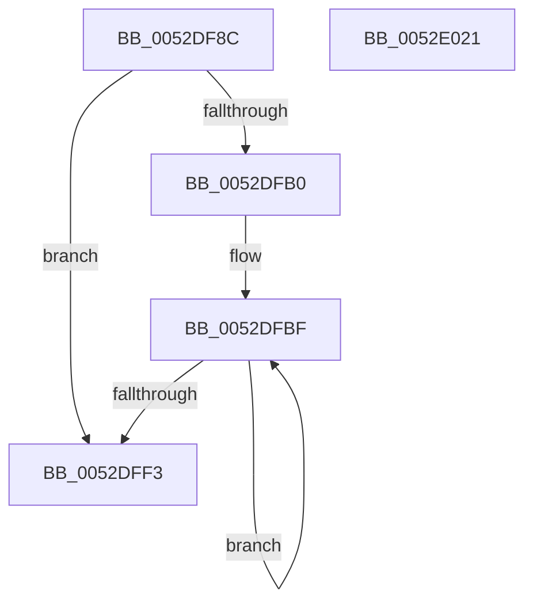

# SymCryptFdefRawMultSubUint32

- RVA: `0x0052DF8C`–`0x0052E022` (길이 `150` bytes)
- VA: `0x000000014052DF8C`
- 실행 섹션: `.text`
- PDB 이름 있음: `예`; PDB Function 태그: `아니요`
- unwind 정보 RVA: `0x000A5A38`
- 디코드: `46`개 명령, `150/150` bytes 표시
- 미해석 바이트: `0` (있으면 어셈블리에 `.byte`로 보존)

> 이 문서는 커널 이미지의 기계어와 PDB 기호를 분석해 생성했습니다. 4번과 5번은 함수 원형과 자료형을 바이너리 사용 방식에서 추정한 C 해석이며 원본 소스 복구 결과는 아닙니다.

## 1. Dependencies

- 직접 호출 지점: **0**; 고유 호출 대상: **0**
- 직접 호출자로 확인된 함수: **1**
- RIP 상대 이미지 참조: **0**

### Outgoing calls
- 직접 디코드된 call 명령이 없습니다.

### Direct callers
- [SymCryptFdefRawDivMod](SymCryptFdefRawDivMod_function_0052DC30.md) at `0x0052DDE5`

### Static image references
- 디코드된 RIP-relative 메모리 참조가 없습니다.

## 2. Other-region calls and transfers

- 다른 실행 섹션으로 향하는 call: **0**
- 별도 외부 분기/꼬리 이동을 확인하지 못했습니다.

## 3. Assembly (complete function range)

```asm
0052DF8C  48 8B C4                        mov rax, rsp
0052DF8F  48 89 58 08                     mov qword ptr [rax + 8], rbx
0052DF93  48 89 68 10                     mov qword ptr [rax + 0x10], rbp
0052DF97  48 89 70 18                     mov qword ptr [rax + 0x18], rsi
0052DF9B  48 89 78 20                     mov qword ptr [rax + 0x20], rdi
0052DF9F  45 33 D2                        xor r10d, r10d
0052DFA2  4C 8B D9                        mov r11, rcx
0052DFA5  41 8B DA                        mov ebx, r10d
0052DFA8  41 8B FA                        mov edi, r10d
0052DFAB  45 85 C9                        test r9d, r9d
0052DFAE  74 43                           je 0x14052dff3
0052DFB0  41 8B E8                        mov ebp, r8d
0052DFB3  48 2B D1                        sub rdx, rcx
0052DFB6  4C 8B C1                        mov r8, rcx
0052DFB9  41 8B F1                        mov esi, r9d
0052DFBC  41 8B F9                        mov edi, r9d
0052DFBF  42 8B 04 02                     mov eax, dword ptr [rdx + r8]
0052DFC3  41 8B 08                        mov ecx, dword ptr [r8]
0052DFC6  48 0F AF C5                     imul rax, rbp
0052DFCA  4C 03 D0                        add r10, rax
0052DFCD  41 8B C2                        mov eax, r10d
0052DFD0  48 2B C8                        sub rcx, rax
0052DFD3  49 C1 EA 20                     shr r10, 0x20
0052DFD7  8B C3                           mov eax, ebx
0052DFD9  48 2B C8                        sub rcx, rax
0052DFDC  48 8B D9                        mov rbx, rcx
0052DFDF  41 89 08                        mov dword ptr [r8], ecx
0052DFE2  48 C1 EB 20                     shr rbx, 0x20
0052DFE6  4D 8D 40 04                     lea r8, [r8 + 4]
0052DFEA  83 E3 01                        and ebx, 1
0052DFED  48 83 EE 01                     sub rsi, 1
0052DFF1  75 CC                           jne 0x14052dfbf
0052DFF3  48 8B 6C 24 10                  mov rbp, qword ptr [rsp + 0x10]
0052DFF8  48 8B 74 24 18                  mov rsi, qword ptr [rsp + 0x18]
0052DFFD  8B D7                           mov edx, edi
0052DFFF  48 8B 7C 24 20                  mov rdi, qword ptr [rsp + 0x20]
0052E004  8B CB                           mov ecx, ebx
0052E006  48 8B 5C 24 08                  mov rbx, qword ptr [rsp + 8]
0052E00B  41 8B 04 93                     mov eax, dword ptr [r11 + rdx*4]
0052E00F  48 2B C1                        sub rax, rcx
0052E012  49 2B C2                        sub rax, r10
0052E015  41 89 04 93                     mov dword ptr [r11 + rdx*4], eax
0052E019  48 C1 E8 20                     shr rax, 0x20
0052E01D  83 E0 01                        and eax, 1
0052E020  C3                              ret
0052E021  CC                              int3
```

## 4. C-style interpretation (structured pseudocode)

```c
__int64 __fastcall SymCryptFdefRawMultSubUint32(__int64 a1, __int64 a2, int a3, int a4)
{
    __int64 result;
    __int64 v_r10;
    __int64 v_rbx;
    __int64 v_rsi;
    unsigned __int64 v_stack_p10;
    unsigned __int64 v_stack_p18;
    unsigned __int64 v_stack_p20;
    unsigned __int64 v_stack_p8;

    *(unsigned __int64 *)(v_rsp + 8) = v_rbx;
    *(unsigned __int64 *)(v_rsp + 16) = v_rbp;
    *(unsigned __int64 *)(v_rsp + 24) = v_rsi;
    *(unsigned __int64 *)(v_rsp + 32) = v_rdi;
    v_r10 = 0;
    if (a4 == 0) goto loc_0052DFF3;
    a2 = (a2) - (a1);
loc_0052DFBF:
    result = ((unsigned int)(*(unsigned int *)(a2 + a1 * 1))) * ((unsigned int)(a3));
    v_r10 = (v_r10) + (result);
    a1 = ((unsigned int)(*(unsigned int *)(a1))) - ((unsigned int)((unsigned int)(v_r10)));
    v_r10 = (v_r10) >> (32);
    a1 = (a1) - (0);
    *(unsigned int *)(a1) = (unsigned int)(a1);
    v_rbx = (a1) >> (32);
    v_rbx = (unsigned int)((v_rbx) & (1));
    v_rsi = ((unsigned int)(a4)) - (1);
    if (condition_is_not_equal) goto loc_0052DFBF;
loc_0052DFF3:
    result = ((unsigned int)(*(unsigned int *)(a1 + (unsigned int)((unsigned int)((unsigned int)(a4))) * 4))) - ((unsigned int)((unsigned int)(v_rbx)));
    result = (result) - (v_r10);
    *(unsigned int *)(a1 + (unsigned int)((unsigned int)((unsigned int)(a4))) * 4) = (unsigned int)(result);
    result = (result) >> (32);
    result = (unsigned int)((result) & (1));
    return result;
}
```

## 5. (Beta) C Style

```c
int64_t SymCryptFdefRawMultSubUint32(void *Arg1, void *Arg2, int32_t Arg3, int32_t Arg4)
{
    uint8_t *arg1 = (uint8_t *)Arg1;
    uint8_t *arg2 = (uint8_t *)Arg2;

    int64_t result;
    int64_t local_r10;
    int64_t local_rbx;
    int64_t local_rsi;
    uint64_t v_stack_p10;
    uint64_t v_stack_p18;
    uint64_t v_stack_p20;
    uint64_t v_stack_p8;

    *(uint64_t *)(local_rsp + 0x8) = local_rbx;
    *(uint64_t *)(local_rsp + 0x10) = local_rbp;
    *(uint64_t *)(local_rsp + 0x18) = local_rsi;
    *(uint64_t *)(local_rsp + 0x20) = local_rdi;
    local_r10 = 0;
    if (Arg4 == 0) goto loc_0052DFF3;
    Arg2 = (Arg2) - (Arg1);
loc_0052DFBF:
    result = ((uint32_t)(*(uint32_t *)(arg2 + arg1 * 1))) * ((uint32_t)(Arg3));
    local_r10 = (local_r10) + (result);
    Arg1 = ((uint32_t)(*(uint32_t *)(arg1))) - ((uint32_t)((uint32_t)(local_r10)));
    local_r10 = (local_r10) >> (32);
    Arg1 = (Arg1) - (0);
    *(uint32_t *)(arg1) = (uint32_t)(Arg1);
    local_rbx = (Arg1) >> (32);
    local_rbx = (uint32_t)((local_rbx) & (1));
    local_rsi = ((uint32_t)(Arg4)) - (1);
    if (condition_is_not_equal) goto loc_0052DFBF;
loc_0052DFF3:
    result = ((uint32_t)(*(uint32_t *)(arg1 + (uint32_t)((uint32_t)((uint32_t)(Arg4))) * 4))) - ((uint32_t)((uint32_t)(local_rbx)));
    result = (result) - (local_r10);
    *(uint32_t *)(arg1 + (uint32_t)((uint32_t)((uint32_t)(Arg4))) * 4) = (uint32_t)(result);
    result = (result) >> (32);
    result = (uint32_t)((result) & (1));
    return result;
}
```

### 관측된 메모리 오프셋

구조체 형식이 확인되지 않은 접근은 인자 기준의 오프셋으로만 기록했습니다.

| 기준 인자 | 오프셋 표현 | 폭 (bit) | 접근 |
|---|---:|---:|---|
| `Arg1` | `+ 0x0` | `32` | `R` |
| `Arg1` | `+ 0x0` | `32` | `W` |
| `Arg1` | `+ 0x0 + rdx*4` | `32` | `R` |
| `Arg1` | `+ 0x0 + rdx*4` | `32` | `W` |
| `Arg1` | `+ 0x4` | `64` | `R` |
| `Arg2` | `+ 0x0 + r8*1` | `32` | `R` |

## 6. Execution-region graph

[열기: 2D/3D 그래프와 함수 탐색 컨트롤 패널](../../../control-panel.html?section=text&rva=0x0052DF8C&view=graph)

- 2D 그래프는 위에서 아래로 흐르고, 3D 그래프는 빈 공간을 드래그해 회전합니다. Shift+드래그는 이동, 휠은 확대·축소, 함수 노드 선택은 대상 보고서 이동입니다.

### Static fallback


