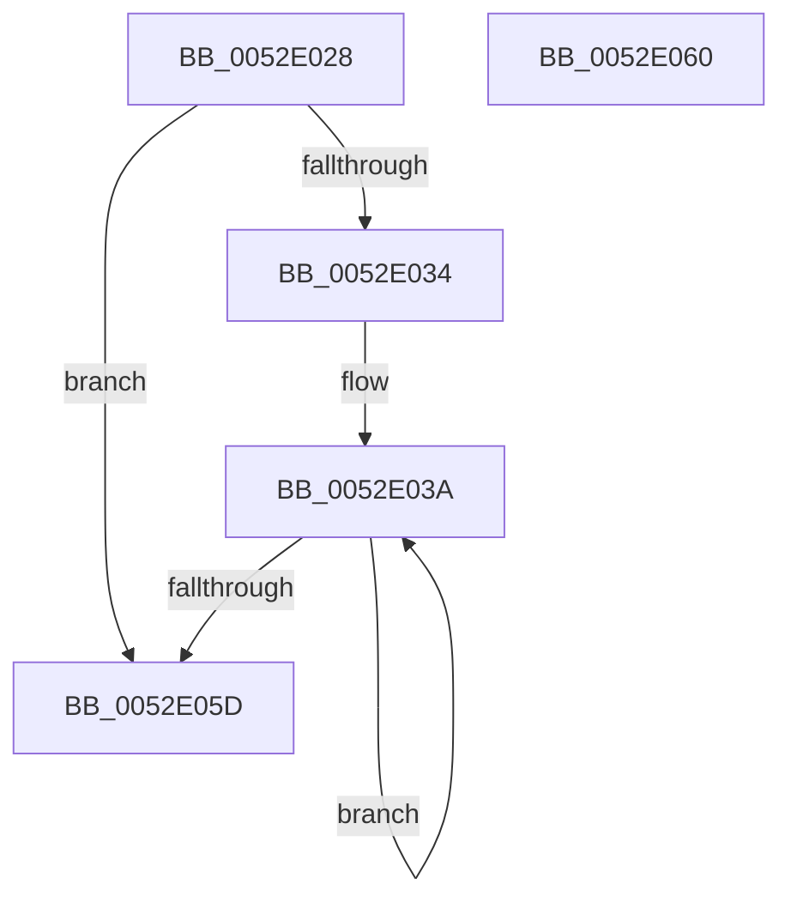

# SymCryptFdefRawNeg

- RVA: `0x0052E028`–`0x0052E061` (길이 `57` bytes)
- VA: `0x000000014052E028`
- 실행 섹션: `.text`
- PDB 이름 있음: `예`; PDB Function 태그: `아니요`
- unwind 정보 RVA: `0x000DB714`
- 디코드: `20`개 명령, `57/57` bytes 표시
- 미해석 바이트: `0` (있으면 어셈블리에 `.byte`로 보존)

> 이 문서는 커널 이미지의 기계어와 PDB 기호를 분석해 생성했습니다. 4번과 5번은 함수 원형과 자료형을 바이너리 사용 방식에서 추정한 C 해석이며 원본 소스 복구 결과는 아닙니다.

## 1. Dependencies

- 직접 호출 지점: **0**; 고유 호출 대상: **0**
- 직접 호출자로 확인된 함수: **3**
- RIP 상대 이미지 참조: **0**

### Outgoing calls
- 직접 디코드된 call 명령이 없습니다.

### Direct callers
- [SymCryptFdefIntNeg](SymCryptFdefIntNeg_function_0052D92C.md) at `0x0052D93E`
- [SymCryptFdefIntSubMixedSize](SymCryptFdefIntSubMixedSize_function_0052D9D0.md) at `0x0052DA3A`
- [SymCryptFdefModulusInitMontgomeryInternal](../53/SymCryptFdefModulusInitMontgomeryInternal_function_00535600.md) at `0x005356A4`

### Static image references
- 디코드된 RIP-relative 메모리 참조가 없습니다.

## 2. Other-region calls and transfers

- 다른 실행 섹션으로 향하는 call: **0**
- 별도 외부 분기/꼬리 이동을 확인하지 못했습니다.

## 3. Assembly (complete function range)

```asm
0052E028  41 C1 E1 04                     shl r9d, 4
0052E02C  4C 8B D1                        mov r10, rcx
0052E02F  45 85 C9                        test r9d, r9d
0052E032  74 29                           je 0x14052e05d
0052E034  4D 2B D0                        sub r10, r8
0052E037  45 8B D9                        mov r11d, r9d
0052E03A  43 8B 0C 02                     mov ecx, dword ptr [r10 + r8]
0052E03E  8B C2                           mov eax, edx
0052E040  48 03 C8                        add rcx, rax
0052E043  48 F7 D9                        neg rcx
0052E046  48 8B D1                        mov rdx, rcx
0052E049  41 89 08                        mov dword ptr [r8], ecx
0052E04C  48 C1 EA 20                     shr rdx, 0x20
0052E050  4D 8D 40 04                     lea r8, [r8 + 4]
0052E054  83 E2 01                        and edx, 1
0052E057  49 83 EB 01                     sub r11, 1
0052E05B  75 DD                           jne 0x14052e03a
0052E05D  8B C2                           mov eax, edx
0052E05F  C3                              ret
0052E060  CC                              int3
```

## 4. C-style interpretation (structured pseudocode)

```c
__int64 __fastcall SymCryptFdefRawNeg(__int64 a1, int a2, __int64 a3, int a4)
{
    __int64 v_r10;
    __int64 v_r11;

    a4 = (unsigned int)((a4) << (4));
    if (a4 == 0) goto loc_0052E05D;
    v_r10 = (a1) - (a3);
loc_0052E03A:
    a1 = ((unsigned int)(*(unsigned int *)(v_r10 + a3 * 1))) + ((unsigned int)(a2));
    a1 = -(a1);
    *(unsigned int *)(a3) = (unsigned int)(a1);
    a2 = (a1) >> (32);
    a2 = (unsigned int)((a2) & (1));
    v_r11 = ((unsigned int)(a4)) - (1);
    if (condition_is_not_equal) goto loc_0052E03A;
loc_0052E05D:
    return (unsigned int)(a2);
}
```

## 5. (Beta) C Style

```c
int64_t SymCryptFdefRawNeg(void *Arg1, int32_t Arg2, void *Arg3, int32_t Arg4)
{
    uint8_t *arg1 = (uint8_t *)Arg1;
    uint8_t *arg3 = (uint8_t *)Arg3;

    int64_t local_r10;
    int64_t local_r11;

    Arg4 = (uint32_t)((Arg4) << (4));
    if (Arg4 == 0) goto loc_0052E05D;
    local_r10 = (Arg1) - (Arg3);
loc_0052E03A:
    Arg1 = ((uint32_t)(*(uint32_t *)(local_r10 + arg3 * 1))) + ((uint32_t)(Arg2));
    Arg1 = -(Arg1);
    *(uint32_t *)(arg3) = (uint32_t)(Arg1);
    Arg2 = (Arg1) >> (32);
    Arg2 = (uint32_t)((Arg2) & (1));
    local_r11 = ((uint32_t)(Arg4)) - (1);
    if (condition_is_not_equal) goto loc_0052E03A;
loc_0052E05D:
    return (uint32_t)(Arg2);
}
```

### 관측된 메모리 오프셋

구조체 형식이 확인되지 않은 접근은 인자 기준의 오프셋으로만 기록했습니다.

| 기준 인자 | 오프셋 표현 | 폭 (bit) | 접근 |
|---|---:|---:|---|
| `Arg1` | `+ 0x0 + r8*1` | `32` | `R` |
| `Arg3` | `+ 0x0` | `32` | `W` |
| `Arg3` | `+ 0x4` | `64` | `R` |

## 6. Execution-region graph

[열기: 2D/3D 그래프와 함수 탐색 컨트롤 패널](../../../control-panel.html?section=text&rva=0x0052E028&view=graph)

- 2D 그래프는 위에서 아래로 흐르고, 3D 그래프는 빈 공간을 드래그해 회전합니다. Shift+드래그는 이동, 휠은 확대·축소, 함수 노드 선택은 대상 보고서 이동입니다.

### Static fallback


