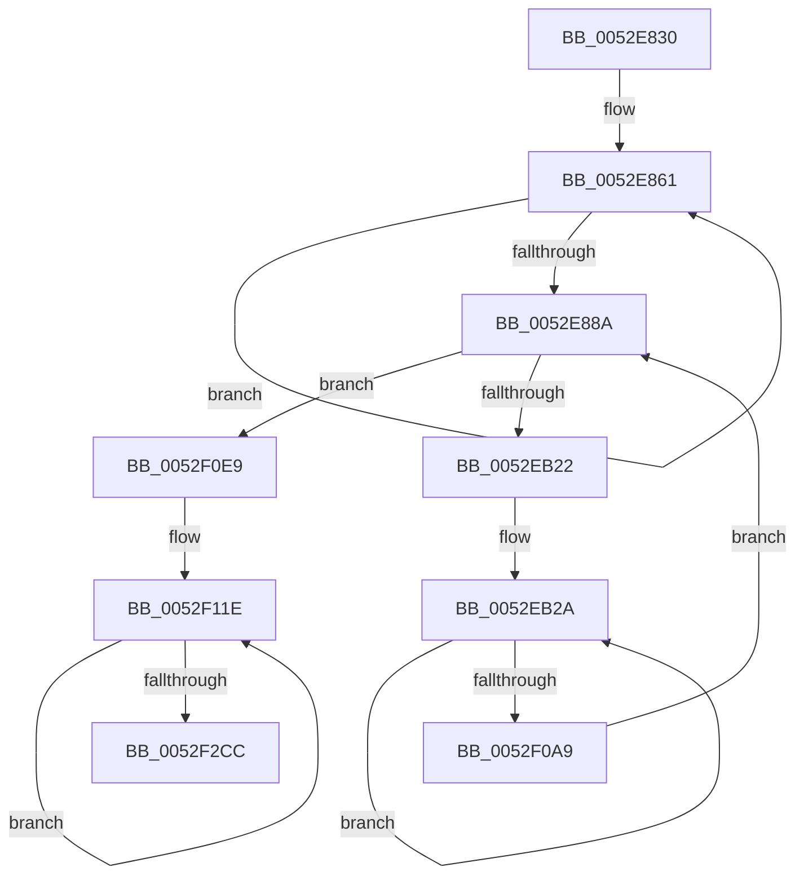

# SymCryptFdefRawSquareMulx

- RVA: `0x0052E830`–`0x0052F2D9` (길이 `2,729` bytes)
- VA: `0x000000014052E830`
- 실행 섹션: `.text`
- PDB 이름 있음: `예`; PDB Function 태그: `아니요`
- unwind 정보 RVA: `0x000C34F8`
- 디코드: `519`개 명령, `2,729/2,729` bytes 표시
- 미해석 바이트: `0` (있으면 어셈블리에 `.byte`로 보존)

> 이 문서는 커널 이미지의 기계어와 PDB 기호를 분석해 생성했습니다. 4번과 5번은 함수 원형과 자료형을 바이너리 사용 방식에서 추정한 C 해석이며 원본 소스 복구 결과는 아닙니다.

## 1. Dependencies

- 직접 호출 지점: **0**; 고유 호출 대상: **0**
- 직접 호출자로 확인된 함수: **2**
- RIP 상대 이미지 참조: **0**

### Outgoing calls
- 직접 디코드된 call 명령이 없습니다.

### Direct callers
- [SymCryptFdefRawSquare](SymCryptFdefRawSquare_function_0052E068.md) at `0x0052E099`
- [SymCryptFdefModSquareMontgomeryMulx](../53/SymCryptFdefModSquareMontgomeryMulx_function_005353B0.md) at `0x005353D4`

### Static image references
- 디코드된 RIP-relative 메모리 참조가 없습니다.

## 2. Other-region calls and transfers

- 다른 실행 섹션으로 향하는 call: **0**
- 별도 외부 분기/꼬리 이동을 확인하지 못했습니다.

## 3. Assembly (complete function range)

```asm
0052E830  48 56                           push rsi
0052E832  57                              push rdi
0052E833  55                              push rbp
0052E834  53                              push rbx
0052E835  41 54                           push r12
0052E837  41 55                           push r13
0052E839  41 56                           push r14
0052E83B  41 57                           push r15
0052E83D  4C 8B D2                        mov r10, rdx
0052E840  48 89 4C 24 48                  mov qword ptr [rsp + 0x48], rcx
0052E845  4C 89 54 24 50                  mov qword ptr [rsp + 0x50], r10
0052E84A  4C 89 44 24 58                  mov qword ptr [rsp + 0x58], r8
0052E84F  49 C1 E2 06                     shl r10, 6
0052E853  4C 89 54 24 60                  mov qword ptr [rsp + 0x60], r10
0052E858  48 33 C0                        xor rax, rax
0052E85B  4D 8B D8                        mov r11, r8
0052E85E  4D 8B CA                        mov r9, r10
0052E861  49 89 03                        mov qword ptr [r11], rax
0052E864  49 89 43 08                     mov qword ptr [r11 + 8], rax
0052E868  49 89 43 10                     mov qword ptr [r11 + 0x10], rax
0052E86C  49 89 43 18                     mov qword ptr [r11 + 0x18], rax
0052E870  49 89 43 20                     mov qword ptr [r11 + 0x20], rax
0052E874  49 89 43 28                     mov qword ptr [r11 + 0x28], rax
0052E878  49 89 43 30                     mov qword ptr [r11 + 0x30], rax
0052E87C  49 89 43 38                     mov qword ptr [r11 + 0x38], rax
0052E880  49 83 C3 40                     add r11, 0x40
0052E884  49 83 E9 40                     sub r9, 0x40
0052E888  75 D7                           jne 0x14052e861
0052E88A  48 8B 11                        mov rdx, qword ptr [rcx]
0052E88D  49 8B 78 08                     mov rdi, qword ptr [r8 + 8]
0052E891  49 8B 68 10                     mov rbp, qword ptr [r8 + 0x10]
0052E895  49 8B 58 18                     mov rbx, qword ptr [r8 + 0x18]
0052E899  4D 8B 60 20                     mov r12, qword ptr [r8 + 0x20]
0052E89D  4D 8B 68 28                     mov r13, qword ptr [r8 + 0x28]
0052E8A1  4D 8B 70 30                     mov r14, qword ptr [r8 + 0x30]
0052E8A5  4D 8B 78 38                     mov r15, qword ptr [r8 + 0x38]
0052E8A9  48 33 F6                        xor rsi, rsi
0052E8AC  C4 62 FB F6 49 08               mulx r9, rax, qword ptr [rcx + 8]
0052E8B2  66 48 0F 38 F6 F8               adcx rdi, rax
0052E8B8  F3 49 0F 38 F6 E9               adox rbp, r9
0052E8BE  C4 62 FB F6 49 10               mulx r9, rax, qword ptr [rcx + 0x10]
0052E8C4  66 48 0F 38 F6 E8               adcx rbp, rax
0052E8CA  F3 49 0F 38 F6 D9               adox rbx, r9
0052E8D0  C4 62 FB F6 49 18               mulx r9, rax, qword ptr [rcx + 0x18]
0052E8D6  66 48 0F 38 F6 D8               adcx rbx, rax
0052E8DC  F3 4D 0F 38 F6 E1               adox r12, r9
0052E8E2  C4 62 FB F6 49 20               mulx r9, rax, qword ptr [rcx + 0x20]
0052E8E8  66 4C 0F 38 F6 E0               adcx r12, rax
0052E8EE  F3 4D 0F 38 F6 E9               adox r13, r9
0052E8F4  C4 62 FB F6 49 28               mulx r9, rax, qword ptr [rcx + 0x28]
0052E8FA  66 4C 0F 38 F6 E8               adcx r13, rax
0052E900  F3 4D 0F 38 F6 F1               adox r14, r9
0052E906  C4 62 FB F6 49 30               mulx r9, rax, qword ptr [rcx + 0x30]
0052E90C  66 4C 0F 38 F6 F0               adcx r14, rax
0052E912  F3 4D 0F 38 F6 F9               adox r15, r9
0052E918  C4 62 FB F6 49 38               mulx r9, rax, qword ptr [rcx + 0x38]
0052E91E  66 4C 0F 38 F6 F8               adcx r15, rax
0052E924  49 89 78 08                     mov qword ptr [r8 + 8], rdi
0052E928  F3 48 0F 38 F6 F6               adox rsi, rsi
0052E92E  66 49 0F 38 F6 F1               adcx rsi, r9
0052E934  49 89 68 10                     mov qword ptr [r8 + 0x10], rbp
0052E938  48 8B 51 08                     mov rdx, qword ptr [rcx + 8]
0052E93C  48 33 C0                        xor rax, rax
0052E93F  C4 62 FB F6 49 10               mulx r9, rax, qword ptr [rcx + 0x10]
0052E945  66 48 0F 38 F6 D8               adcx rbx, rax
0052E94B  F3 4D 0F 38 F6 E1               adox r12, r9
0052E951  C4 62 FB F6 49 18               mulx r9, rax, qword ptr [rcx + 0x18]
0052E957  66 4C 0F 38 F6 E0               adcx r12, rax
0052E95D  F3 4D 0F 38 F6 E9               adox r13, r9
0052E963  C4 62 FB F6 49 20               mulx r9, rax, qword ptr [rcx + 0x20]
0052E969  66 4C 0F 38 F6 E8               adcx r13, rax
0052E96F  F3 4D 0F 38 F6 F1               adox r14, r9
0052E975  C4 62 FB F6 49 28               mulx r9, rax, qword ptr [rcx + 0x28]
0052E97B  66 4C 0F 38 F6 F0               adcx r14, rax
0052E981  F3 4D 0F 38 F6 F9               adox r15, r9
0052E987  C4 62 FB F6 49 30               mulx r9, rax, qword ptr [rcx + 0x30]
0052E98D  66 4C 0F 38 F6 F8               adcx r15, rax
0052E993  F3 49 0F 38 F6 F1               adox rsi, r9
0052E999  48 8B 51 38                     mov rdx, qword ptr [rcx + 0x38]
0052E99D  48 C7 C7 00 00 00 00            mov rdi, 0
0052E9A4  48 C7 C5 00 00 00 00            mov rbp, 0
0052E9AB  49 89 58 18                     mov qword ptr [r8 + 0x18], rbx
0052E9AF  C4 62 FB F6 49 08               mulx r9, rax, qword ptr [rcx + 8]
0052E9B5  66 48 0F 38 F6 F0               adcx rsi, rax
0052E9BB  F3 49 0F 38 F6 F9               adox rdi, r9
0052E9C1  C4 62 FB F6 49 10               mulx r9, rax, qword ptr [rcx + 0x10]
0052E9C7  66 48 0F 38 F6 F8               adcx rdi, rax
0052E9CD  4D 89 60 20                     mov qword ptr [r8 + 0x20], r12
0052E9D1  66 49 0F 38 F6 E9               adcx rbp, r9
0052E9D7  48 8B 51 10                     mov rdx, qword ptr [rcx + 0x10]
0052E9DB  48 33 C0                        xor rax, rax
0052E9DE  C4 62 FB F6 49 18               mulx r9, rax, qword ptr [rcx + 0x18]
0052E9E4  66 4C 0F 38 F6 E8               adcx r13, rax
0052E9EA  F3 4D 0F 38 F6 F1               adox r14, r9
0052E9F0  C4 62 FB F6 49 20               mulx r9, rax, qword ptr [rcx + 0x20]
0052E9F6  66 4C 0F 38 F6 F0               adcx r14, rax
0052E9FC  F3 4D 0F 38 F6 F9               adox r15, r9
0052EA02  C4 62 FB F6 49 28               mulx r9, rax, qword ptr [rcx + 0x28]
0052EA08  66 4C 0F 38 F6 F8               adcx r15, rax
0052EA0E  F3 49 0F 38 F6 F1               adox rsi, r9
0052EA14  C4 62 FB F6 49 30               mulx r9, rax, qword ptr [rcx + 0x30]
0052EA1A  66 48 0F 38 F6 F0               adcx rsi, rax
0052EA20  F3 49 0F 38 F6 F9               adox rdi, r9
0052EA26  48 8B 51 20                     mov rdx, qword ptr [rcx + 0x20]
0052EA2A  48 C7 C3 00 00 00 00            mov rbx, 0
0052EA31  49 C7 C4 00 00 00 00            mov r12, 0
0052EA38  C4 62 FB F6 49 28               mulx r9, rax, qword ptr [rcx + 0x28]
0052EA3E  66 48 0F 38 F6 F8               adcx rdi, rax
0052EA44  F3 49 0F 38 F6 E9               adox rbp, r9
0052EA4A  C4 62 FB F6 49 30               mulx r9, rax, qword ptr [rcx + 0x30]
0052EA50  66 48 0F 38 F6 E8               adcx rbp, rax
0052EA56  F3 49 0F 38 F6 D9               adox rbx, r9
0052EA5C  48 8B 51 28                     mov rdx, qword ptr [rcx + 0x28]
0052EA60  4D 89 68 28                     mov qword ptr [r8 + 0x28], r13
0052EA64  C4 62 FB F6 49 30               mulx r9, rax, qword ptr [rcx + 0x30]
0052EA6A  66 48 0F 38 F6 D8               adcx rbx, rax
0052EA70  66 4D 0F 38 F6 E1               adcx r12, r9
0052EA76  48 8B 51 18                     mov rdx, qword ptr [rcx + 0x18]
0052EA7A  4D 89 70 30                     mov qword ptr [r8 + 0x30], r14
0052EA7E  48 33 C0                        xor rax, rax
0052EA81  C4 62 FB F6 49 20               mulx r9, rax, qword ptr [rcx + 0x20]
0052EA87  66 4C 0F 38 F6 F8               adcx r15, rax
0052EA8D  F3 49 0F 38 F6 F1               adox rsi, r9
0052EA93  C4 62 FB F6 49 28               mulx r9, rax, qword ptr [rcx + 0x28]
0052EA99  66 48 0F 38 F6 F0               adcx rsi, rax
0052EA9F  F3 49 0F 38 F6 F9               adox rdi, r9
0052EAA5  C4 62 FB F6 49 30               mulx r9, rax, qword ptr [rcx + 0x30]
0052EAAB  66 48 0F 38 F6 F8               adcx rdi, rax
0052EAB1  F3 49 0F 38 F6 E9               adox rbp, r9
0052EAB7  C4 62 FB F6 49 38               mulx r9, rax, qword ptr [rcx + 0x38]
0052EABD  66 48 0F 38 F6 E8               adcx rbp, rax
0052EAC3  F3 49 0F 38 F6 D9               adox rbx, r9
0052EAC9  48 8B 51 38                     mov rdx, qword ptr [rcx + 0x38]
0052EACD  49 C7 C5 00 00 00 00            mov r13, 0
0052EAD4  49 C7 C6 00 00 00 00            mov r14, 0
0052EADB  4D 89 78 38                     mov qword ptr [r8 + 0x38], r15
0052EADF  C4 62 FB F6 49 20               mulx r9, rax, qword ptr [rcx + 0x20]
0052EAE5  66 48 0F 38 F6 D8               adcx rbx, rax
0052EAEB  F3 4D 0F 38 F6 E1               adox r12, r9
0052EAF1  C4 62 FB F6 49 28               mulx r9, rax, qword ptr [rcx + 0x28]
0052EAF7  66 4C 0F 38 F6 E0               adcx r12, rax
0052EAFD  F3 4D 0F 38 F6 E9               adox r13, r9
0052EB03  C4 62 FB F6 49 30               mulx r9, rax, qword ptr [rcx + 0x30]
0052EB09  66 4C 0F 38 F6 E8               adcx r13, rax
0052EB0F  66 4D 0F 38 F6 F1               adcx r14, r9
0052EB15  4D 33 FF                        xor r15, r15
0052EB18  49 83 EA 40                     sub r10, 0x40
0052EB1C  0F 84 C7 05 00 00               je 0x14052f0e9
0052EB22  4C 8D 59 40                     lea r11, [rcx + 0x40]
0052EB26  4D 8D 40 40                     lea r8, [r8 + 0x40]
0052EB2A  48 33 C0                        xor rax, rax
0052EB2D  49 8B 13                        mov rdx, qword ptr [r11]
0052EB30  F3 49 0F 38 F6 30               adox rsi, qword ptr [r8]
0052EB36  C4 62 FB F6 09                  mulx r9, rax, qword ptr [rcx]
0052EB3B  66 48 0F 38 F6 F0               adcx rsi, rax
0052EB41  F3 49 0F 38 F6 F9               adox rdi, r9
0052EB47  49 89 30                        mov qword ptr [r8], rsi
0052EB4A  C4 62 FB F6 49 08               mulx r9, rax, qword ptr [rcx + 8]
0052EB50  66 48 0F 38 F6 F8               adcx rdi, rax
0052EB56  F3 49 0F 38 F6 E9               adox rbp, r9
0052EB5C  C4 62 FB F6 49 10               mulx r9, rax, qword ptr [rcx + 0x10]
0052EB62  66 48 0F 38 F6 E8               adcx rbp, rax
0052EB68  F3 49 0F 38 F6 D9               adox rbx, r9
0052EB6E  C4 62 FB F6 49 18               mulx r9, rax, qword ptr [rcx + 0x18]
0052EB74  66 48 0F 38 F6 D8               adcx rbx, rax
0052EB7A  F3 4D 0F 38 F6 E1               adox r12, r9
0052EB80  C4 62 FB F6 49 20               mulx r9, rax, qword ptr [rcx + 0x20]
0052EB86  66 4C 0F 38 F6 E0               adcx r12, rax
0052EB8C  F3 4D 0F 38 F6 E9               adox r13, r9
0052EB92  C4 62 FB F6 49 28               mulx r9, rax, qword ptr [rcx + 0x28]
0052EB98  66 4C 0F 38 F6 E8               adcx r13, rax
0052EB9E  F3 4D 0F 38 F6 F1               adox r14, r9
0052EBA4  C4 62 FB F6 49 30               mulx r9, rax, qword ptr [rcx + 0x30]
0052EBAA  66 4C 0F 38 F6 F0               adcx r14, rax
0052EBB0  F3 4D 0F 38 F6 F9               adox r15, r9
0052EBB6  C4 62 FB F6 49 38               mulx r9, rax, qword ptr [rcx + 0x38]
0052EBBC  66 4C 0F 38 F6 F8               adcx r15, rax
0052EBC2  48 C7 C6 00 00 00 00            mov rsi, 0
0052EBC9  F3 48 0F 38 F6 F6               adox rsi, rsi
0052EBCF  66 49 0F 38 F6 F1               adcx rsi, r9
0052EBD5  48 33 C0                        xor rax, rax
0052EBD8  49 8B 53 08                     mov rdx, qword ptr [r11 + 8]
0052EBDC  F3 49 0F 38 F6 78 08            adox rdi, qword ptr [r8 + 8]
0052EBE3  C4 62 FB F6 09                  mulx r9, rax, qword ptr [rcx]
0052EBE8  66 48 0F 38 F6 F8               adcx rdi, rax
0052EBEE  F3 49 0F 38 F6 E9               adox rbp, r9
0052EBF4  49 89 78 08                     mov qword ptr [r8 + 8], rdi
0052EBF8  C4 62 FB F6 49 08               mulx r9, rax, qword ptr [rcx + 8]
0052EBFE  66 48 0F 38 F6 E8               adcx rbp, rax
0052EC04  F3 49 0F 38 F6 D9               adox rbx, r9
0052EC0A  C4 62 FB F6 49 10               mulx r9, rax, qword ptr [rcx + 0x10]
0052EC10  66 48 0F 38 F6 D8               adcx rbx, rax
0052EC16  F3 4D 0F 38 F6 E1               adox r12, r9
0052EC1C  C4 62 FB F6 49 18               mulx r9, rax, qword ptr [rcx + 0x18]
0052EC22  66 4C 0F 38 F6 E0               adcx r12, rax
0052EC28  F3 4D 0F 38 F6 E9               adox r13, r9
0052EC2E  C4 62 FB F6 49 20               mulx r9, rax, qword ptr [rcx + 0x20]
0052EC34  66 4C 0F 38 F6 E8               adcx r13, rax
0052EC3A  F3 4D 0F 38 F6 F1               adox r14, r9
0052EC40  C4 62 FB F6 49 28               mulx r9, rax, qword ptr [rcx + 0x28]
0052EC46  66 4C 0F 38 F6 F0               adcx r14, rax
0052EC4C  F3 4D 0F 38 F6 F9               adox r15, r9
0052EC52  C4 62 FB F6 49 30               mulx r9, rax, qword ptr [rcx + 0x30]
0052EC58  66 4C 0F 38 F6 F8               adcx r15, rax
0052EC5E  F3 49 0F 38 F6 F1               adox rsi, r9
0052EC64  C4 62 FB F6 49 38               mulx r9, rax, qword ptr [rcx + 0x38]
0052EC6A  66 48 0F 38 F6 F0               adcx rsi, rax
0052EC70  48 C7 C7 00 00 00 00            mov rdi, 0
0052EC77  F3 48 0F 38 F6 FF               adox rdi, rdi
0052EC7D  66 49 0F 38 F6 F9               adcx rdi, r9
0052EC83  48 33 C0                        xor rax, rax
0052EC86  49 8B 53 10                     mov rdx, qword ptr [r11 + 0x10]
0052EC8A  F3 49 0F 38 F6 68 10            adox rbp, qword ptr [r8 + 0x10]
0052EC91  C4 62 FB F6 09                  mulx r9, rax, qword ptr [rcx]
0052EC96  66 48 0F 38 F6 E8               adcx rbp, rax
0052EC9C  F3 49 0F 38 F6 D9               adox rbx, r9
0052ECA2  49 89 68 10                     mov qword ptr [r8 + 0x10], rbp
0052ECA6  C4 62 FB F6 49 08               mulx r9, rax, qword ptr [rcx + 8]
0052ECAC  66 48 0F 38 F6 D8               adcx rbx, rax
0052ECB2  F3 4D 0F 38 F6 E1               adox r12, r9
0052ECB8  C4 62 FB F6 49 10               mulx r9, rax, qword ptr [rcx + 0x10]
0052ECBE  66 4C 0F 38 F6 E0               adcx r12, rax
0052ECC4  F3 4D 0F 38 F6 E9               adox r13, r9
0052ECCA  C4 62 FB F6 49 18               mulx r9, rax, qword ptr [rcx + 0x18]
0052ECD0  66 4C 0F 38 F6 E8               adcx r13, rax
0052ECD6  F3 4D 0F 38 F6 F1               adox r14, r9
0052ECDC  C4 62 FB F6 49 20               mulx r9, rax, qword ptr [rcx + 0x20]
0052ECE2  66 4C 0F 38 F6 F0               adcx r14, rax
0052ECE8  F3 4D 0F 38 F6 F9               adox r15, r9
0052ECEE  C4 62 FB F6 49 28               mulx r9, rax, qword ptr [rcx + 0x28]
0052ECF4  66 4C 0F 38 F6 F8               adcx r15, rax
0052ECFA  F3 49 0F 38 F6 F1               adox rsi, r9
0052ED00  C4 62 FB F6 49 30               mulx r9, rax, qword ptr [rcx + 0x30]
0052ED06  66 48 0F 38 F6 F0               adcx rsi, rax
0052ED0C  F3 49 0F 38 F6 F9               adox rdi, r9
0052ED12  C4 62 FB F6 49 38               mulx r9, rax, qword ptr [rcx + 0x38]
0052ED18  66 48 0F 38 F6 F8               adcx rdi, rax
0052ED1E  48 C7 C5 00 00 00 00            mov rbp, 0
0052ED25  F3 48 0F 38 F6 ED               adox rbp, rbp
0052ED2B  66 49 0F 38 F6 E9               adcx rbp, r9
0052ED31  48 33 C0                        xor rax, rax
0052ED34  49 8B 53 18                     mov rdx, qword ptr [r11 + 0x18]
0052ED38  F3 49 0F 38 F6 58 18            adox rbx, qword ptr [r8 + 0x18]
0052ED3F  C4 62 FB F6 09                  mulx r9, rax, qword ptr [rcx]
0052ED44  66 48 0F 38 F6 D8               adcx rbx, rax
0052ED4A  F3 4D 0F 38 F6 E1               adox r12, r9
0052ED50  49 89 58 18                     mov qword ptr [r8 + 0x18], rbx
0052ED54  C4 62 FB F6 49 08               mulx r9, rax, qword ptr [rcx + 8]
0052ED5A  66 4C 0F 38 F6 E0               adcx r12, rax
0052ED60  F3 4D 0F 38 F6 E9               adox r13, r9
0052ED66  C4 62 FB F6 49 10               mulx r9, rax, qword ptr [rcx + 0x10]
0052ED6C  66 4C 0F 38 F6 E8               adcx r13, rax
0052ED72  F3 4D 0F 38 F6 F1               adox r14, r9
0052ED78  C4 62 FB F6 49 18               mulx r9, rax, qword ptr [rcx + 0x18]
0052ED7E  66 4C 0F 38 F6 F0               adcx r14, rax
0052ED84  F3 4D 0F 38 F6 F9               adox r15, r9
0052ED8A  C4 62 FB F6 49 20               mulx r9, rax, qword ptr [rcx + 0x20]
0052ED90  66 4C 0F 38 F6 F8               adcx r15, rax
0052ED96  F3 49 0F 38 F6 F1               adox rsi, r9
0052ED9C  C4 62 FB F6 49 28               mulx r9, rax, qword ptr [rcx + 0x28]
0052EDA2  66 48 0F 38 F6 F0               adcx rsi, rax
0052EDA8  F3 49 0F 38 F6 F9               adox rdi, r9
0052EDAE  C4 62 FB F6 49 30               mulx r9, rax, qword ptr [rcx + 0x30]
0052EDB4  66 48 0F 38 F6 F8               adcx rdi, rax
0052EDBA  F3 49 0F 38 F6 E9               adox rbp, r9
0052EDC0  C4 62 FB F6 49 38               mulx r9, rax, qword ptr [rcx + 0x38]
0052EDC6  66 48 0F 38 F6 E8               adcx rbp, rax
0052EDCC  48 C7 C3 00 00 00 00            mov rbx, 0
0052EDD3  F3 48 0F 38 F6 DB               adox rbx, rbx
0052EDD9  66 49 0F 38 F6 D9               adcx rbx, r9
0052EDDF  48 33 C0                        xor rax, rax
0052EDE2  49 8B 53 20                     mov rdx, qword ptr [r11 + 0x20]
0052EDE6  F3 4D 0F 38 F6 60 20            adox r12, qword ptr [r8 + 0x20]
0052EDED  C4 62 FB F6 09                  mulx r9, rax, qword ptr [rcx]
0052EDF2  66 4C 0F 38 F6 E0               adcx r12, rax
0052EDF8  F3 4D 0F 38 F6 E9               adox r13, r9
0052EDFE  4D 89 60 20                     mov qword ptr [r8 + 0x20], r12
0052EE02  C4 62 FB F6 49 08               mulx r9, rax, qword ptr [rcx + 8]
0052EE08  66 4C 0F 38 F6 E8               adcx r13, rax
0052EE0E  F3 4D 0F 38 F6 F1               adox r14, r9
0052EE14  C4 62 FB F6 49 10               mulx r9, rax, qword ptr [rcx + 0x10]
0052EE1A  66 4C 0F 38 F6 F0               adcx r14, rax
0052EE20  F3 4D 0F 38 F6 F9               adox r15, r9
0052EE26  C4 62 FB F6 49 18               mulx r9, rax, qword ptr [rcx + 0x18]
0052EE2C  66 4C 0F 38 F6 F8               adcx r15, rax
0052EE32  F3 49 0F 38 F6 F1               adox rsi, r9
0052EE38  C4 62 FB F6 49 20               mulx r9, rax, qword ptr [rcx + 0x20]
0052EE3E  66 48 0F 38 F6 F0               adcx rsi, rax
0052EE44  F3 49 0F 38 F6 F9               adox rdi, r9
0052EE4A  C4 62 FB F6 49 28               mulx r9, rax, qword ptr [rcx + 0x28]
0052EE50  66 48 0F 38 F6 F8               adcx rdi, rax
0052EE56  F3 49 0F 38 F6 E9               adox rbp, r9
0052EE5C  C4 62 FB F6 49 30               mulx r9, rax, qword ptr [rcx + 0x30]
0052EE62  66 48 0F 38 F6 E8               adcx rbp, rax
0052EE68  F3 49 0F 38 F6 D9               adox rbx, r9
0052EE6E  C4 62 FB F6 49 38               mulx r9, rax, qword ptr [rcx + 0x38]
0052EE74  66 48 0F 38 F6 D8               adcx rbx, rax
0052EE7A  49 C7 C4 00 00 00 00            mov r12, 0
0052EE81  F3 4D 0F 38 F6 E4               adox r12, r12
0052EE87  66 4D 0F 38 F6 E1               adcx r12, r9
0052EE8D  48 33 C0                        xor rax, rax
0052EE90  49 8B 53 28                     mov rdx, qword ptr [r11 + 0x28]
0052EE94  F3 4D 0F 38 F6 68 28            adox r13, qword ptr [r8 + 0x28]
0052EE9B  C4 62 FB F6 09                  mulx r9, rax, qword ptr [rcx]
0052EEA0  66 4C 0F 38 F6 E8               adcx r13, rax
0052EEA6  F3 4D 0F 38 F6 F1               adox r14, r9
0052EEAC  4D 89 68 28                     mov qword ptr [r8 + 0x28], r13
0052EEB0  C4 62 FB F6 49 08               mulx r9, rax, qword ptr [rcx + 8]
0052EEB6  66 4C 0F 38 F6 F0               adcx r14, rax
0052EEBC  F3 4D 0F 38 F6 F9               adox r15, r9
0052EEC2  C4 62 FB F6 49 10               mulx r9, rax, qword ptr [rcx + 0x10]
0052EEC8  66 4C 0F 38 F6 F8               adcx r15, rax
0052EECE  F3 49 0F 38 F6 F1               adox rsi, r9
0052EED4  C4 62 FB F6 49 18               mulx r9, rax, qword ptr [rcx + 0x18]
0052EEDA  66 48 0F 38 F6 F0               adcx rsi, rax
0052EEE0  F3 49 0F 38 F6 F9               adox rdi, r9
0052EEE6  C4 62 FB F6 49 20               mulx r9, rax, qword ptr [rcx + 0x20]
0052EEEC  66 48 0F 38 F6 F8               adcx rdi, rax
0052EEF2  F3 49 0F 38 F6 E9               adox rbp, r9
0052EEF8  C4 62 FB F6 49 28               mulx r9, rax, qword ptr [rcx + 0x28]
0052EEFE  66 48 0F 38 F6 E8               adcx rbp, rax
0052EF04  F3 49 0F 38 F6 D9               adox rbx, r9
0052EF0A  C4 62 FB F6 49 30               mulx r9, rax, qword ptr [rcx + 0x30]
0052EF10  66 48 0F 38 F6 D8               adcx rbx, rax
0052EF16  F3 4D 0F 38 F6 E1               adox r12, r9
0052EF1C  C4 62 FB F6 49 38               mulx r9, rax, qword ptr [rcx + 0x38]
0052EF22  66 4C 0F 38 F6 E0               adcx r12, rax
0052EF28  49 C7 C5 00 00 00 00            mov r13, 0
0052EF2F  F3 4D 0F 38 F6 ED               adox r13, r13
0052EF35  66 4D 0F 38 F6 E9               adcx r13, r9
0052EF3B  48 33 C0                        xor rax, rax
0052EF3E  49 8B 53 30                     mov rdx, qword ptr [r11 + 0x30]
0052EF42  F3 4D 0F 38 F6 70 30            adox r14, qword ptr [r8 + 0x30]
0052EF49  C4 62 FB F6 09                  mulx r9, rax, qword ptr [rcx]
0052EF4E  66 4C 0F 38 F6 F0               adcx r14, rax
0052EF54  F3 4D 0F 38 F6 F9               adox r15, r9
0052EF5A  4D 89 70 30                     mov qword ptr [r8 + 0x30], r14
0052EF5E  C4 62 FB F6 49 08               mulx r9, rax, qword ptr [rcx + 8]
0052EF64  66 4C 0F 38 F6 F8               adcx r15, rax
0052EF6A  F3 49 0F 38 F6 F1               adox rsi, r9
0052EF70  C4 62 FB F6 49 10               mulx r9, rax, qword ptr [rcx + 0x10]
0052EF76  66 48 0F 38 F6 F0               adcx rsi, rax
0052EF7C  F3 49 0F 38 F6 F9               adox rdi, r9
0052EF82  C4 62 FB F6 49 18               mulx r9, rax, qword ptr [rcx + 0x18]
0052EF88  66 48 0F 38 F6 F8               adcx rdi, rax
0052EF8E  F3 49 0F 38 F6 E9               adox rbp, r9
0052EF94  C4 62 FB F6 49 20               mulx r9, rax, qword ptr [rcx + 0x20]
0052EF9A  66 48 0F 38 F6 E8               adcx rbp, rax
0052EFA0  F3 49 0F 38 F6 D9               adox rbx, r9
0052EFA6  C4 62 FB F6 49 28               mulx r9, rax, qword ptr [rcx + 0x28]
0052EFAC  66 48 0F 38 F6 D8               adcx rbx, rax
0052EFB2  F3 4D 0F 38 F6 E1               adox r12, r9
0052EFB8  C4 62 FB F6 49 30               mulx r9, rax, qword ptr [rcx + 0x30]
0052EFBE  66 4C 0F 38 F6 E0               adcx r12, rax
0052EFC4  F3 4D 0F 38 F6 E9               adox r13, r9
0052EFCA  C4 62 FB F6 49 38               mulx r9, rax, qword ptr [rcx + 0x38]
0052EFD0  66 4C 0F 38 F6 E8               adcx r13, rax
0052EFD6  49 C7 C6 00 00 00 00            mov r14, 0
0052EFDD  F3 4D 0F 38 F6 F6               adox r14, r14
0052EFE3  66 4D 0F 38 F6 F1               adcx r14, r9
0052EFE9  48 33 C0                        xor rax, rax
0052EFEC  49 8B 53 38                     mov rdx, qword ptr [r11 + 0x38]
0052EFF0  F3 4D 0F 38 F6 78 38            adox r15, qword ptr [r8 + 0x38]
0052EFF7  C4 62 FB F6 09                  mulx r9, rax, qword ptr [rcx]
0052EFFC  66 4C 0F 38 F6 F8               adcx r15, rax
0052F002  F3 49 0F 38 F6 F1               adox rsi, r9
0052F008  4D 89 78 38                     mov qword ptr [r8 + 0x38], r15
0052F00C  C4 62 FB F6 49 08               mulx r9, rax, qword ptr [rcx + 8]
0052F012  66 48 0F 38 F6 F0               adcx rsi, rax
0052F018  F3 49 0F 38 F6 F9               adox rdi, r9
0052F01E  C4 62 FB F6 49 10               mulx r9, rax, qword ptr [rcx + 0x10]
0052F024  66 48 0F 38 F6 F8               adcx rdi, rax
0052F02A  F3 49 0F 38 F6 E9               adox rbp, r9
0052F030  C4 62 FB F6 49 18               mulx r9, rax, qword ptr [rcx + 0x18]
0052F036  66 48 0F 38 F6 E8               adcx rbp, rax
0052F03C  F3 49 0F 38 F6 D9               adox rbx, r9
0052F042  C4 62 FB F6 49 20               mulx r9, rax, qword ptr [rcx + 0x20]
0052F048  66 48 0F 38 F6 D8               adcx rbx, rax
0052F04E  F3 4D 0F 38 F6 E1               adox r12, r9
0052F054  C4 62 FB F6 49 28               mulx r9, rax, qword ptr [rcx + 0x28]
0052F05A  66 4C 0F 38 F6 E0               adcx r12, rax
0052F060  F3 4D 0F 38 F6 E9               adox r13, r9
0052F066  C4 62 FB F6 49 30               mulx r9, rax, qword ptr [rcx + 0x30]
0052F06C  66 4C 0F 38 F6 E8               adcx r13, rax
0052F072  F3 4D 0F 38 F6 F1               adox r14, r9
0052F078  C4 62 FB F6 49 38               mulx r9, rax, qword ptr [rcx + 0x38]
0052F07E  66 4C 0F 38 F6 F0               adcx r14, rax
0052F084  49 C7 C7 00 00 00 00            mov r15, 0
0052F08B  F3 4D 0F 38 F6 FF               adox r15, r15
0052F091  66 4D 0F 38 F6 F9               adcx r15, r9
0052F097  49 83 C0 40                     add r8, 0x40
0052F09B  49 83 C3 40                     add r11, 0x40
0052F09F  49 83 EA 40                     sub r10, 0x40
0052F0A3  0F 85 81 FA FF FF               jne 0x14052eb2a
0052F0A9  49 89 30                        mov qword ptr [r8], rsi
0052F0AC  49 89 78 08                     mov qword ptr [r8 + 8], rdi
0052F0B0  49 89 68 10                     mov qword ptr [r8 + 0x10], rbp
0052F0B4  49 89 58 18                     mov qword ptr [r8 + 0x18], rbx
0052F0B8  4D 89 60 20                     mov qword ptr [r8 + 0x20], r12
0052F0BC  4D 89 68 28                     mov qword ptr [r8 + 0x28], r13
0052F0C0  4D 89 70 30                     mov qword ptr [r8 + 0x30], r14
0052F0C4  4D 89 78 38                     mov qword ptr [r8 + 0x38], r15
0052F0C8  4C 8B 54 24 60                  mov r10, qword ptr [rsp + 0x60]
0052F0CD  48 83 C1 40                     add rcx, 0x40
0052F0D1  4D 2B C2                        sub r8, r10
0052F0D4  49 81 C0 80 00 00 00            add r8, 0x80
0052F0DB  49 83 EA 40                     sub r10, 0x40
0052F0DF  4C 89 54 24 60                  mov qword ptr [rsp + 0x60], r10
0052F0E4  E9 A1 F7 FF FF                  jmp 0x14052e88a
0052F0E9  49 89 70 40                     mov qword ptr [r8 + 0x40], rsi
0052F0ED  49 89 78 48                     mov qword ptr [r8 + 0x48], rdi
0052F0F1  49 89 68 50                     mov qword ptr [r8 + 0x50], rbp
0052F0F5  49 89 58 58                     mov qword ptr [r8 + 0x58], rbx
0052F0F9  4D 89 60 60                     mov qword ptr [r8 + 0x60], r12
0052F0FD  4D 89 68 68                     mov qword ptr [r8 + 0x68], r13
0052F101  4D 89 70 70                     mov qword ptr [r8 + 0x70], r14
0052F105  4D 89 78 78                     mov qword ptr [r8 + 0x78], r15
0052F109  48 8B 4C 24 48                  mov rcx, qword ptr [rsp + 0x48]
0052F10E  4C 8B 54 24 50                  mov r10, qword ptr [rsp + 0x50]
0052F113  4C 8B 44 24 58                  mov r8, qword ptr [rsp + 0x58]
0052F118  48 33 C0                        xor rax, rax
0052F11B  4D 33 C9                        xor r9, r9
0052F11E  48 8B 11                        mov rdx, qword ptr [rcx]
0052F121  4D 8B 18                        mov r11, qword ptr [r8]
0052F124  49 8B 70 08                     mov rsi, qword ptr [r8 + 8]
0052F128  C4 E2 C3 F6 EA                  mulx rbp, rdi, rdx
0052F12D  66 48 0F 38 F6 F8               adcx rdi, rax
0052F133  66 49 0F 38 F6 E9               adcx rbp, r9
0052F139  66 49 0F 38 F6 FB               adcx rdi, r11
0052F13F  F3 49 0F 38 F6 FB               adox rdi, r11
0052F145  66 48 0F 38 F6 EE               adcx rbp, rsi
0052F14B  F3 48 0F 38 F6 EE               adox rbp, rsi
0052F151  49 89 38                        mov qword ptr [r8], rdi
0052F154  49 89 68 08                     mov qword ptr [r8 + 8], rbp
0052F158  48 8B 51 08                     mov rdx, qword ptr [rcx + 8]
0052F15C  4D 8B 58 10                     mov r11, qword ptr [r8 + 0x10]
0052F160  49 8B 70 18                     mov rsi, qword ptr [r8 + 0x18]
0052F164  C4 E2 C3 F6 EA                  mulx rbp, rdi, rdx
0052F169  66 49 0F 38 F6 FB               adcx rdi, r11
0052F16F  F3 49 0F 38 F6 FB               adox rdi, r11
0052F175  66 48 0F 38 F6 EE               adcx rbp, rsi
0052F17B  F3 48 0F 38 F6 EE               adox rbp, rsi
0052F181  49 89 78 10                     mov qword ptr [r8 + 0x10], rdi
0052F185  49 89 68 18                     mov qword ptr [r8 + 0x18], rbp
0052F189  48 8B 51 10                     mov rdx, qword ptr [rcx + 0x10]
0052F18D  4D 8B 58 20                     mov r11, qword ptr [r8 + 0x20]
0052F191  49 8B 70 28                     mov rsi, qword ptr [r8 + 0x28]
0052F195  C4 E2 C3 F6 EA                  mulx rbp, rdi, rdx
0052F19A  66 49 0F 38 F6 FB               adcx rdi, r11
0052F1A0  F3 49 0F 38 F6 FB               adox rdi, r11
0052F1A6  66 48 0F 38 F6 EE               adcx rbp, rsi
0052F1AC  F3 48 0F 38 F6 EE               adox rbp, rsi
0052F1B2  49 89 78 20                     mov qword ptr [r8 + 0x20], rdi
0052F1B6  49 89 68 28                     mov qword ptr [r8 + 0x28], rbp
0052F1BA  48 8B 51 18                     mov rdx, qword ptr [rcx + 0x18]
0052F1BE  4D 8B 58 30                     mov r11, qword ptr [r8 + 0x30]
0052F1C2  49 8B 70 38                     mov rsi, qword ptr [r8 + 0x38]
0052F1C6  C4 E2 C3 F6 EA                  mulx rbp, rdi, rdx
0052F1CB  66 49 0F 38 F6 FB               adcx rdi, r11
0052F1D1  F3 49 0F 38 F6 FB               adox rdi, r11
0052F1D7  66 48 0F 38 F6 EE               adcx rbp, rsi
0052F1DD  F3 48 0F 38 F6 EE               adox rbp, rsi
0052F1E3  49 89 78 30                     mov qword ptr [r8 + 0x30], rdi
0052F1E7  49 89 68 38                     mov qword ptr [r8 + 0x38], rbp
0052F1EB  48 8B 51 20                     mov rdx, qword ptr [rcx + 0x20]
0052F1EF  4D 8B 58 40                     mov r11, qword ptr [r8 + 0x40]
0052F1F3  49 8B 70 48                     mov rsi, qword ptr [r8 + 0x48]
0052F1F7  C4 E2 C3 F6 EA                  mulx rbp, rdi, rdx
0052F1FC  66 49 0F 38 F6 FB               adcx rdi, r11
0052F202  F3 49 0F 38 F6 FB               adox rdi, r11
0052F208  66 48 0F 38 F6 EE               adcx rbp, rsi
0052F20E  F3 48 0F 38 F6 EE               adox rbp, rsi
0052F214  49 89 78 40                     mov qword ptr [r8 + 0x40], rdi
0052F218  49 89 68 48                     mov qword ptr [r8 + 0x48], rbp
0052F21C  48 8B 51 28                     mov rdx, qword ptr [rcx + 0x28]
0052F220  4D 8B 58 50                     mov r11, qword ptr [r8 + 0x50]
0052F224  49 8B 70 58                     mov rsi, qword ptr [r8 + 0x58]
0052F228  C4 E2 C3 F6 EA                  mulx rbp, rdi, rdx
0052F22D  66 49 0F 38 F6 FB               adcx rdi, r11
0052F233  F3 49 0F 38 F6 FB               adox rdi, r11
0052F239  66 48 0F 38 F6 EE               adcx rbp, rsi
0052F23F  F3 48 0F 38 F6 EE               adox rbp, rsi
0052F245  49 89 78 50                     mov qword ptr [r8 + 0x50], rdi
0052F249  49 89 68 58                     mov qword ptr [r8 + 0x58], rbp
0052F24D  48 8B 51 30                     mov rdx, qword ptr [rcx + 0x30]
0052F251  4D 8B 58 60                     mov r11, qword ptr [r8 + 0x60]
0052F255  49 8B 70 68                     mov rsi, qword ptr [r8 + 0x68]
0052F259  C4 E2 C3 F6 EA                  mulx rbp, rdi, rdx
0052F25E  66 49 0F 38 F6 FB               adcx rdi, r11
0052F264  F3 49 0F 38 F6 FB               adox rdi, r11
0052F26A  66 48 0F 38 F6 EE               adcx rbp, rsi
0052F270  F3 48 0F 38 F6 EE               adox rbp, rsi
0052F276  49 89 78 60                     mov qword ptr [r8 + 0x60], rdi
0052F27A  49 89 68 68                     mov qword ptr [r8 + 0x68], rbp
0052F27E  48 8B 51 38                     mov rdx, qword ptr [rcx + 0x38]
0052F282  4D 8B 58 70                     mov r11, qword ptr [r8 + 0x70]
0052F286  49 8B 70 78                     mov rsi, qword ptr [r8 + 0x78]
0052F28A  C4 E2 C3 F6 EA                  mulx rbp, rdi, rdx
0052F28F  66 49 0F 38 F6 FB               adcx rdi, r11
0052F295  F3 49 0F 38 F6 FB               adox rdi, r11
0052F29B  66 48 0F 38 F6 EE               adcx rbp, rsi
0052F2A1  F3 48 0F 38 F6 EE               adox rbp, rsi
0052F2A7  49 89 78 70                     mov qword ptr [r8 + 0x70], rdi
0052F2AB  49 89 68 78                     mov qword ptr [r8 + 0x78], rbp
0052F2AF  41 8B C1                        mov eax, r9d
0052F2B2  F3 41 0F 38 F6 C1               adox eax, r9d
0052F2B8  48 8D 49 40                     lea rcx, [rcx + 0x40]
0052F2BC  4D 8D 80 80 00 00 00            lea r8, [r8 + 0x80]
0052F2C3  49 FF CA                        dec r10
0052F2C6  0F 85 52 FE FF FF               jne 0x14052f11e
0052F2CC  41 5F                           pop r15
0052F2CE  41 5E                           pop r14
0052F2D0  41 5D                           pop r13
0052F2D2  41 5C                           pop r12
0052F2D4  5B                              pop rbx
0052F2D5  5D                              pop rbp
0052F2D6  5F                              pop rdi
0052F2D7  5E                              pop rsi
0052F2D8  C3                              ret
```

## 4. C-style interpretation (structured pseudocode)

```c
__int64 __fastcall SymCryptFdefRawSquareMulx(__int64 a1, __int64 a2, __int64 a3)
{
    __int64 result;
    __int64 v_r10;
    __int64 v_r11;
    __int64 v_r15;
    __int64 v_rsi;
    unsigned __int64 v_stack_p10;
    unsigned __int64 v_stack_p18;
    unsigned __int64 v_stack_p20;
    unsigned __int64 v_stack_p8;

    v_stack_p8 = a1;
    v_stack_p10 = a2;
    v_stack_p18 = a3;
    v_r10 = (a2) << (6);
    v_stack_p20 = v_r10;
    result = 0;
loc_0052E861:
    *(unsigned __int64 *)(a3) = 0;
    *(unsigned __int64 *)(a3 + 8) = 0;
    *(unsigned __int64 *)(a3 + 16) = 0;
    *(unsigned __int64 *)(a3 + 24) = 0;
    *(unsigned __int64 *)(a3 + 32) = 0;
    *(unsigned __int64 *)(a3 + 40) = 0;
    *(unsigned __int64 *)(a3 + 48) = 0;
    *(unsigned __int64 *)(a3 + 56) = 0;
    v_r11 = (a3) + (64);
    a4 = (v_r10) - (64);
    if (condition_is_not_equal) goto loc_0052E861;
loc_0052E88A:
    v_rsi = 0;
    *(unsigned __int64 *)(a3 + 8) = *(unsigned __int64 *)(a3 + 8);
    *(unsigned __int64 *)(a3 + 16) = *(unsigned __int64 *)(a3 + 16);
    result = 0;
    *(unsigned __int64 *)(a3 + 24) = *(unsigned __int64 *)(a3 + 24);
    *(unsigned __int64 *)(a3 + 32) = *(unsigned __int64 *)(a3 + 32);
    result = 0;
    *(unsigned __int64 *)(a3 + 40) = *(unsigned __int64 *)(a3 + 40);
    *(unsigned __int64 *)(a3 + 48) = *(unsigned __int64 *)(a3 + 48);
    result = 0;
    *(unsigned __int64 *)(a3 + 56) = *(unsigned __int64 *)(a3 + 56);
    v_r15 = 0;
    v_r10 = (v_r10) - (64);
    if (condition_is_equal) goto loc_0052F0E9;
loc_0052EB2A:
    result = 0;
    *(unsigned __int64 *)(a3 + 64) = 0;
    result = 0;
    *(unsigned __int64 *)(a3 + 64 + 8) = 0;
    result = 0;
    *(unsigned __int64 *)(a3 + 64 + 16) = 0;
    result = 0;
    *(unsigned __int64 *)(a3 + 64 + 24) = 0;
    result = 0;
    *(unsigned __int64 *)(a3 + 64 + 32) = 0;
    result = 0;
    *(unsigned __int64 *)(a3 + 64 + 40) = 0;
    result = 0;
    *(unsigned __int64 *)(a3 + 64 + 48) = 0;
    result = 0;
    *(unsigned __int64 *)(a3 + 64 + 56) = 0;
    a3 = (a3 + 64) + (64);
    v_r11 = (a1 + 64) + (64);
    v_r10 = (v_r10) - (64);
    if (condition_is_not_equal) goto loc_0052EB2A;
    *(unsigned __int64 *)(a3) = 0;
    *(unsigned __int64 *)(a3 + 8) = 0;
    *(unsigned __int64 *)(a3 + 16) = 0;
    *(unsigned __int64 *)(a3 + 24) = 0;
    *(unsigned __int64 *)(a3 + 32) = 0;
    *(unsigned __int64 *)(a3 + 40) = 0;
    *(unsigned __int64 *)(a3 + 48) = 0;
    *(unsigned __int64 *)(a3 + 56) = 0;
    a1 = (a1) + (64);
    a3 = (a3) - (v_stack_p20);
    a3 = (a3) + (128);
    v_r10 = (v_stack_p20) - (64);
    v_stack_p20 = v_r10;
    goto loc_0052E88A;
loc_0052F0E9:
    *(unsigned __int64 *)(a3 + 64) = 0;
    *(unsigned __int64 *)(a3 + 72) = 0;
    *(unsigned __int64 *)(a3 + 80) = 0;
    *(unsigned __int64 *)(a3 + 88) = 0;
    *(unsigned __int64 *)(a3 + 96) = 0;
    *(unsigned __int64 *)(a3 + 104) = 0;
    *(unsigned __int64 *)(a3 + 112) = 0;
    *(unsigned __int64 *)(a3 + 120) = 0;
    result = 0;
    a4 = 0;
loc_0052F11E:
    *(unsigned __int64 *)(v_stack_p18) = 0;
    *(unsigned __int64 *)(v_stack_p18 + 8) = 0;
    *(unsigned __int64 *)(v_stack_p18 + 16) = 0;
    *(unsigned __int64 *)(v_stack_p18 + 24) = 0;
    *(unsigned __int64 *)(v_stack_p18 + 32) = 0;
    *(unsigned __int64 *)(v_stack_p18 + 40) = 0;
    *(unsigned __int64 *)(v_stack_p18 + 48) = 0;
    *(unsigned __int64 *)(v_stack_p18 + 56) = 0;
    *(unsigned __int64 *)(v_stack_p18 + 64) = 0;
    *(unsigned __int64 *)(v_stack_p18 + 72) = 0;
    *(unsigned __int64 *)(v_stack_p18 + 80) = 0;
    *(unsigned __int64 *)(v_stack_p18 + 88) = 0;
    *(unsigned __int64 *)(v_stack_p18 + 96) = 0;
    *(unsigned __int64 *)(v_stack_p18 + 104) = 0;
    *(unsigned __int64 *)(v_stack_p18 + 112) = 0;
    *(unsigned __int64 *)(v_stack_p18 + 120) = 0;
    v_r10 = (v_stack_p10) - 1;
    if (condition_is_not_equal) goto loc_0052F11E;
    return 0;
}
```

## 5. (Beta) C Style

```c
int64_t SymCryptFdefRawSquareMulx(void *Arg1, int64_t Arg2, void *Arg3)
{
    uint8_t *arg1 = (uint8_t *)Arg1;
    uint8_t *arg3 = (uint8_t *)Arg3;

    int64_t result;
    int64_t local_r10;
    int64_t local_r11;
    int64_t local_r15;
    int64_t local_rsi;
    uint64_t v_stack_p10;
    uint64_t v_stack_p18;
    uint64_t v_stack_p20;
    uint64_t v_stack_p8;

    v_stack_p8 = Arg1;
    v_stack_p10 = Arg2;
    v_stack_p18 = Arg3;
    local_r10 = (Arg2) << (6);
    v_stack_p20 = local_r10;
    result = 0;
loc_0052E861:
    *(uint64_t *)(arg3) = 0;
    *(uint64_t *)(arg3 + 0x8) = 0;
    *(uint64_t *)(arg3 + 0x10) = 0;
    *(uint64_t *)(arg3 + 0x18) = 0;
    *(uint64_t *)(arg3 + 0x20) = 0;
    *(uint64_t *)(arg3 + 0x28) = 0;
    *(uint64_t *)(arg3 + 0x30) = 0;
    *(uint64_t *)(arg3 + 0x38) = 0;
    local_r11 = (Arg3) + (64);
    a4 = (local_r10) - (64);
    if (condition_is_not_equal) goto loc_0052E861;
loc_0052E88A:
    local_rsi = 0;
    *(uint64_t *)(arg3 + 0x8) = *(uint64_t *)(arg3 + 0x8);
    *(uint64_t *)(arg3 + 0x10) = *(uint64_t *)(arg3 + 0x10);
    result = 0;
    *(uint64_t *)(arg3 + 0x18) = *(uint64_t *)(arg3 + 0x18);
    *(uint64_t *)(arg3 + 0x20) = *(uint64_t *)(arg3 + 0x20);
    result = 0;
    *(uint64_t *)(arg3 + 0x28) = *(uint64_t *)(arg3 + 0x28);
    *(uint64_t *)(arg3 + 0x30) = *(uint64_t *)(arg3 + 0x30);
    result = 0;
    *(uint64_t *)(arg3 + 0x38) = *(uint64_t *)(arg3 + 0x38);
    local_r15 = 0;
    local_r10 = (local_r10) - (64);
    if (condition_is_equal) goto loc_0052F0E9;
loc_0052EB2A:
    result = 0;
    *(uint64_t *)(arg3 + 0x40) = 0;
    result = 0;
    *(uint64_t *)(arg3 + 0x40 + 0x8) = 0;
    result = 0;
    *(uint64_t *)(arg3 + 0x40 + 0x10) = 0;
    result = 0;
    *(uint64_t *)(arg3 + 0x40 + 0x18) = 0;
    result = 0;
    *(uint64_t *)(arg3 + 0x40 + 0x20) = 0;
    result = 0;
    *(uint64_t *)(arg3 + 0x40 + 0x28) = 0;
    result = 0;
    *(uint64_t *)(arg3 + 0x40 + 0x30) = 0;
    result = 0;
    *(uint64_t *)(arg3 + 0x40 + 0x38) = 0;
    Arg3 = (Arg3 + 64) + (64);
    local_r11 = (Arg1 + 64) + (64);
    local_r10 = (local_r10) - (64);
    if (condition_is_not_equal) goto loc_0052EB2A;
    *(uint64_t *)(arg3) = 0;
    *(uint64_t *)(arg3 + 0x8) = 0;
    *(uint64_t *)(arg3 + 0x10) = 0;
    *(uint64_t *)(arg3 + 0x18) = 0;
    *(uint64_t *)(arg3 + 0x20) = 0;
    *(uint64_t *)(arg3 + 0x28) = 0;
    *(uint64_t *)(arg3 + 0x30) = 0;
    *(uint64_t *)(arg3 + 0x38) = 0;
    Arg1 = (Arg1) + (64);
    Arg3 = (Arg3) - (v_stack_p20);
    Arg3 = (Arg3) + (128);
    local_r10 = (v_stack_p20) - (64);
    v_stack_p20 = local_r10;
    goto loc_0052E88A;
loc_0052F0E9:
    *(uint64_t *)(arg3 + 0x40) = 0;
    *(uint64_t *)(arg3 + 0x48) = 0;
    *(uint64_t *)(arg3 + 0x50) = 0;
    *(uint64_t *)(arg3 + 0x58) = 0;
    *(uint64_t *)(arg3 + 0x60) = 0;
    *(uint64_t *)(arg3 + 0x68) = 0;
    *(uint64_t *)(arg3 + 0x70) = 0;
    *(uint64_t *)(arg3 + 0x78) = 0;
    result = 0;
    a4 = 0;
loc_0052F11E:
    *(uint64_t *)(v_stack_p18) = 0;
    *(uint64_t *)(v_stack_p18 + 0x8) = 0;
    *(uint64_t *)(v_stack_p18 + 0x10) = 0;
    *(uint64_t *)(v_stack_p18 + 0x18) = 0;
    *(uint64_t *)(v_stack_p18 + 0x20) = 0;
    *(uint64_t *)(v_stack_p18 + 0x28) = 0;
    *(uint64_t *)(v_stack_p18 + 0x30) = 0;
    *(uint64_t *)(v_stack_p18 + 0x38) = 0;
    *(uint64_t *)(v_stack_p18 + 0x40) = 0;
    *(uint64_t *)(v_stack_p18 + 0x48) = 0;
    *(uint64_t *)(v_stack_p18 + 0x50) = 0;
    *(uint64_t *)(v_stack_p18 + 0x58) = 0;
    *(uint64_t *)(v_stack_p18 + 0x60) = 0;
    *(uint64_t *)(v_stack_p18 + 0x68) = 0;
    *(uint64_t *)(v_stack_p18 + 0x70) = 0;
    *(uint64_t *)(v_stack_p18 + 0x78) = 0;
    local_r10 = (v_stack_p10) - 1;
    if (condition_is_not_equal) goto loc_0052F11E;
    return 0;
}
```

### 관측된 메모리 오프셋

구조체 형식이 확인되지 않은 접근은 인자 기준의 오프셋으로만 기록했습니다.

| 기준 인자 | 오프셋 표현 | 폭 (bit) | 접근 |
|---|---:|---:|---|
| `Arg1` | `+ 0x0` | `64` | `R` |
| `Arg1` | `+ 0x8` | `64` | `R` |
| `Arg1` | `+ 0x10` | `64` | `R` |
| `Arg1` | `+ 0x18` | `64` | `R` |
| `Arg1` | `+ 0x20` | `64` | `R` |
| `Arg1` | `+ 0x28` | `64` | `R` |
| `Arg1` | `+ 0x30` | `64` | `R` |
| `Arg1` | `+ 0x38` | `64` | `R` |
| `Arg1` | `+ 0x40` | `64` | `R` |
| `Arg3` | `+ 0x0` | `64` | `R` |
| `Arg3` | `+ 0x0` | `64` | `W` |
| `Arg3` | `+ 0x8` | `64` | `R` |
| `Arg3` | `+ 0x8` | `64` | `W` |
| `Arg3` | `+ 0x10` | `64` | `R` |
| `Arg3` | `+ 0x10` | `64` | `W` |
| `Arg3` | `+ 0x18` | `64` | `R` |
| `Arg3` | `+ 0x18` | `64` | `W` |
| `Arg3` | `+ 0x20` | `64` | `R` |
| `Arg3` | `+ 0x20` | `64` | `W` |
| `Arg3` | `+ 0x28` | `64` | `R` |
| `Arg3` | `+ 0x28` | `64` | `W` |
| `Arg3` | `+ 0x30` | `64` | `R` |
| `Arg3` | `+ 0x30` | `64` | `W` |
| `Arg3` | `+ 0x38` | `64` | `R` |
| `Arg3` | `+ 0x38` | `64` | `W` |
| `Arg3` | `+ 0x40` | `64` | `R` |
| `Arg3` | `+ 0x40` | `64` | `W` |
| `Arg3` | `+ 0x48` | `64` | `W` |
| `Arg3` | `+ 0x50` | `64` | `W` |
| `Arg3` | `+ 0x58` | `64` | `W` |
| `Arg3` | `+ 0x60` | `64` | `W` |
| `Arg3` | `+ 0x68` | `64` | `W` |

추가 오프셋 2개는 표에서 생략했습니다.

## 6. Execution-region graph

[열기: 2D/3D 그래프와 함수 탐색 컨트롤 패널](../../../control-panel.html?section=text&rva=0x0052E830&view=graph)

- 2D 그래프는 위에서 아래로 흐르고, 3D 그래프는 빈 공간을 드래그해 회전합니다. Shift+드래그는 이동, 휠은 확대·축소, 함수 노드 선택은 대상 보고서 이동입니다.

### Static fallback


