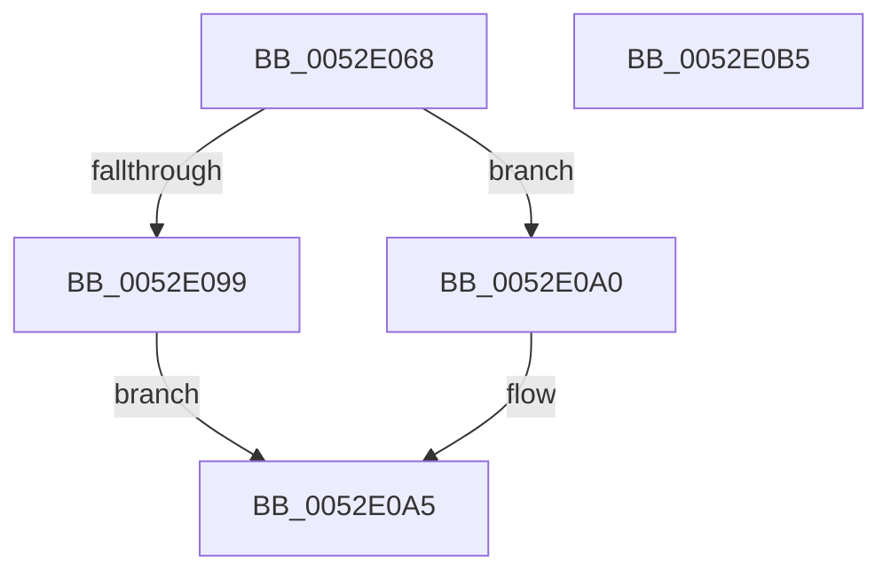

# SymCryptFdefRawSquare

- RVA: `0x0052E068`–`0x0052E0B6` (길이 `78` bytes)
- VA: `0x000000014052E068`
- 실행 섹션: `.text`
- PDB 이름 있음: `예`; PDB Function 태그: `아니요`
- unwind 정보 RVA: `0x00060BC4`
- 디코드: `23`개 명령, `78/78` bytes 표시
- 미해석 바이트: `0` (있으면 어셈블리에 `.byte`로 보존)

> 이 문서는 커널 이미지의 기계어와 PDB 기호를 분석해 생성했습니다. 4번과 5번은 함수 원형과 자료형을 바이너리 사용 방식에서 추정한 C 해석이며 원본 소스 복구 결과는 아닙니다.

## 1. Dependencies

- 직접 호출 지점: **3**; 고유 호출 대상: **3**
- 직접 호출자로 확인된 함수: **2**
- RIP 상대 이미지 참조: **1**

### Outgoing calls
- `0x0052E07F` → [SymCryptCpuFeaturesNeverPresent](../49/SymCryptCpuFeaturesNeverPresent_function_00498CB0.md) (function, `0x00498CB0`)
- `0x0052E099` → [SymCryptFdefRawSquareMulx](SymCryptFdefRawSquareMulx_function_0052E830.md) (function, `0x0052E830`)
- `0x0052E0A0` → [SymCryptFdefRawSquareAsm](../53/SymCryptFdefRawSquareAsm_function_00536860.md) (function, `0x00536860`)

### Direct callers
- [SymCryptFdefModSquareGeneric](../53/SymCryptFdefModSquareGeneric_function_005352C0.md) at `0x0053530D`
- [SymCryptFdefModSquareMontgomery](../53/SymCryptFdefModSquareMontgomery_function_00535360.md) at `0x00535384`

### Static image references
- `0x0052E084` → RVA `0x00E0A730` (`.data`; read)

## 2. Other-region calls and transfers

- 다른 실행 섹션으로 향하는 call: **0**
- 별도 외부 분기/꼬리 이동을 확인하지 못했습니다.

## 3. Assembly (complete function range)

```asm
0052E068  48 89 5C 24 08                  mov qword ptr [rsp + 8], rbx
0052E06D  48 89 74 24 10                  mov qword ptr [rsp + 0x10], rsi
0052E072  57                              push rdi
0052E073  48 83 EC 20                     sub rsp, 0x20
0052E077  49 8B D8                        mov rbx, r8
0052E07A  8B FA                           mov edi, edx
0052E07C  48 8B F1                        mov rsi, rcx
0052E07F  E8 2C AC F6 FF                  call 0x140498cb0
0052E084  0B 05 A6 C6 8D 00               or eax, dword ptr [rip + 0x8dc6a6]
0052E08A  4C 8B C3                        mov r8, rbx
0052E08D  8B D7                           mov edx, edi
0052E08F  48 8B CE                        mov rcx, rsi
0052E092  A9 81 01 00 00                  test eax, 0x181
0052E097  75 07                           jne 0x14052e0a0
0052E099  E8 92 07 00 00                  call 0x14052e830
0052E09E  EB 05                           jmp 0x14052e0a5
0052E0A0  E8 BB 87 00 00                  call 0x140536860
0052E0A5  48 8B 5C 24 30                  mov rbx, qword ptr [rsp + 0x30]
0052E0AA  48 8B 74 24 38                  mov rsi, qword ptr [rsp + 0x38]
0052E0AF  48 83 C4 20                     add rsp, 0x20
0052E0B3  5F                              pop rdi
0052E0B4  C3                              ret
0052E0B5  CC                              int3
```

## 4. C-style interpretation (structured pseudocode)

```c
__int64 __fastcall SymCryptFdefRawSquare(__int64 a1, int a2, __int64 a3)
{
    __int64 result;
    __int64 v_rsp;
    unsigned __int64 v_stack_p10;
    unsigned __int64 v_stack_p8;

    v_stack_p8 = v_rbx;
    v_stack_p10 = v_rsi;
    v_rsp = (v_rsp) - (32);
    result = SymCryptCpuFeaturesNeverPresent(a1, a2, a3, a4);
    result = (unsigned int)((result) | (*(unsigned int *)(v_rip + 9291430)));
    if ((((unsigned int)(result)) & (385)) != 0) goto loc_0052E0A0;
    result = SymCryptFdefRawSquareMulx(a1, (unsigned int)((unsigned int)((unsigned int)(a2))), a3, a4);
    goto loc_0052E0A5;
loc_0052E0A0:
    result = SymCryptFdefRawSquareAsm(a1, (unsigned int)((unsigned int)((unsigned int)(a2))), a3, a4);
loc_0052E0A5:
    v_rsp = (v_rsp) + (32);
    return result;
}
```

## 5. (Beta) C Style

```c
int64_t SymCryptFdefRawSquare(int64_t Arg1, int32_t Arg2, int64_t Arg3)
{
    int64_t result;
    int64_t local_rsp;
    uint64_t v_stack_p10;
    uint64_t v_stack_p8;

    v_stack_p8 = local_rbx;
    v_stack_p10 = local_rsi;
    local_rsp = (local_rsp) - (32);
    result = SymCryptCpuFeaturesNeverPresent(Arg1, Arg2, Arg3, a4);
    result = (uint32_t)((result) | (*(uint32_t *)(v_rip + 0x8DC6A6)));
    if ((((uint32_t)(result)) & (385)) != 0) goto loc_0052E0A0;
    result = SymCryptFdefRawSquareMulx(Arg1, (uint32_t)((uint32_t)((uint32_t)(Arg2))), Arg3, a4);
    goto loc_0052E0A5;
loc_0052E0A0:
    result = SymCryptFdefRawSquareAsm(Arg1, (uint32_t)((uint32_t)((uint32_t)(Arg2))), Arg3, a4);
loc_0052E0A5:
    local_rsp = (local_rsp) + (32);
    return result;
}
```

## 6. Execution-region graph

[열기: 2D/3D 그래프와 함수 탐색 컨트롤 패널](../../../control-panel.html?section=text&rva=0x0052E068&view=graph)

- 2D 그래프는 위에서 아래로 흐르고, 3D 그래프는 빈 공간을 드래그해 회전합니다. Shift+드래그는 이동, 휠은 확대·축소, 함수 노드 선택은 대상 보고서 이동입니다.

### Static fallback


