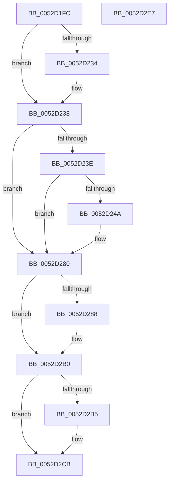

# SymCryptHashAppendInternal

- RVA: `0x0052D1FC`–`0x0052D2E8` (길이 `236` bytes)
- VA: `0x000000014052D1FC`
- 실행 섹션: `.text`
- PDB 이름 있음: `예`; PDB Function 태그: `아니요`
- unwind 정보 RVA: `0x000C34D8`
- 디코드: `77`개 명령, `236/236` bytes 표시
- 미해석 바이트: `0` (있으면 어셈블리에 `.byte`로 보존)

> 이 문서는 커널 이미지의 기계어와 PDB 기호를 분석해 생성했습니다. 4번과 5번은 함수 원형과 자료형을 바이너리 사용 방식에서 추정한 C 해석이며 원본 소스 복구 결과는 아닙니다.

## 1. Dependencies

- 직접 호출 지점: **5**; 고유 호출 대상: **3**
- 직접 호출자로 확인된 함수: **2**
- RIP 상대 이미지 참조: **1**

### Outgoing calls
- `0x0052D257` → [memcpy](../6C/memcpy_function_006C6840.md) (function, `0x006C6840`)
- `0x0052D279` → [guard_dispatch_icall](../6B/guard_dispatch_icall_function_006BAAD0.md) (function, `0x006BAAD0`)
- `0x0052D29D` → [guard_dispatch_icall](../6B/guard_dispatch_icall_function_006BAAD0.md) (function, `0x006BAAD0`)
- `0x0052D2C4` → [memcpy](../6C/memcpy_function_006C6840.md) (function, `0x006C6840`)
- `0x0052D2D5` → [_security_check_cookie](../6A/_security_check_cookie_function_006AC640.md) (function, `0x006AC640`)

### Direct callers
- [SymCryptSha1Append](SymCryptSha1Append_function_00528C70.md) at `0x00528C84`
- [SymCryptMd5Append](SymCryptMd5Append_function_00529F90.md) at `0x00529FA4`

### Static image references
- `0x0052D209` → RVA `0x00E0A740` (`.data`; read)

## 2. Other-region calls and transfers

- 다른 실행 섹션으로 향하는 call: **0**
- 별도 외부 분기/꼬리 이동을 확인하지 못했습니다.

## 3. Assembly (complete function range)

```asm
0052D1FC  40 53                           push rbx
0052D1FE  55                              push rbp
0052D1FF  56                              push rsi
0052D200  57                              push rdi
0052D201  41 56                           push r14
0052D203  41 57                           push r15
0052D205  48 83 EC 48                     sub rsp, 0x48
0052D209  48 8B 05 30 D5 8D 00            mov rax, qword ptr [rip + 0x8dd530]
0052D210  48 33 C4                        xor rax, rsp
0052D213  48 89 44 24 38                  mov qword ptr [rsp + 0x38], rax
0052D218  48 83 64 24 30 00               and qword ptr [rsp + 0x30], 0
0052D21E  49 8B D9                        mov rbx, r9
0052D221  48 01 5A 10                     add qword ptr [rdx + 0x10], rbx
0052D225  4D 8B F0                        mov r14, r8
0052D228  48 8B FA                        mov rdi, rdx
0052D22B  48 8B E9                        mov rbp, rcx
0052D22E  4C 39 4A 10                     cmp qword ptr [rdx + 0x10], r9
0052D232  73 04                           jae 0x14052d238
0052D234  48 FF 42 18                     inc qword ptr [rdx + 0x18]
0052D238  8B 32                           mov esi, dword ptr [rdx]
0052D23A  85 F6                           test esi, esi
0052D23C  74 42                           je 0x14052d280
0052D23E  44 8B 79 30                     mov r15d, dword ptr [rcx + 0x30]
0052D242  44 2B FE                        sub r15d, esi
0052D245  49 3B DF                        cmp rbx, r15
0052D248  72 36                           jb 0x14052d280
0052D24A  48 8D 4E 20                     lea rcx, [rsi + 0x20]
0052D24E  45 8B C7                        mov r8d, r15d
0052D251  48 03 CF                        add rcx, rdi
0052D254  49 8B D6                        mov rdx, r14
0052D257  E8 E4 95 19 00                  call 0x1406c6840
0052D25C  8B 4D 34                        mov ecx, dword ptr [rbp + 0x34]
0052D25F  48 8D 57 20                     lea rdx, [rdi + 0x20]
0052D263  44 8B 45 30                     mov r8d, dword ptr [rbp + 0x30]
0052D267  4C 8D 4C 24 30                  lea r9, [rsp + 0x30]
0052D26C  48 8B 45 18                     mov rax, qword ptr [rbp + 0x18]
0052D270  48 03 CF                        add rcx, rdi
0052D273  4D 03 F7                        add r14, r15
0052D276  49 2B DF                        sub rbx, r15
0052D279  E8 52 D8 18 00                  call 0x1406baad0
0052D27E  33 F6                           xor esi, esi
0052D280  8B 45 30                        mov eax, dword ptr [rbp + 0x30]
0052D283  48 3B D8                        cmp rbx, rax
0052D286  72 28                           jb 0x14052d2b0
0052D288  8B 4D 34                        mov ecx, dword ptr [rbp + 0x34]
0052D28B  4C 8D 4C 24 30                  lea r9, [rsp + 0x30]
0052D290  48 8B 45 18                     mov rax, qword ptr [rbp + 0x18]
0052D294  48 03 CF                        add rcx, rdi
0052D297  4C 8B C3                        mov r8, rbx
0052D29A  49 8B D6                        mov rdx, r14
0052D29D  E8 2E D8 18 00                  call 0x1406baad0
0052D2A2  48 8B C3                        mov rax, rbx
0052D2A5  48 8B 5C 24 30                  mov rbx, qword ptr [rsp + 0x30]
0052D2AA  48 2B C3                        sub rax, rbx
0052D2AD  4C 03 F0                        add r14, rax
0052D2B0  48 85 DB                        test rbx, rbx
0052D2B3  74 16                           je 0x14052d2cb
0052D2B5  8B CE                           mov ecx, esi
0052D2B7  4C 8B C3                        mov r8, rbx
0052D2BA  48 83 C1 20                     add rcx, 0x20
0052D2BE  49 8B D6                        mov rdx, r14
0052D2C1  48 03 CF                        add rcx, rdi
0052D2C4  E8 77 95 19 00                  call 0x1406c6840
0052D2C9  03 F3                           add esi, ebx
0052D2CB  89 37                           mov dword ptr [rdi], esi
0052D2CD  48 8B 4C 24 38                  mov rcx, qword ptr [rsp + 0x38]
0052D2D2  48 33 CC                        xor rcx, rsp
0052D2D5  E8 66 F3 17 00                  call 0x1406ac640
0052D2DA  48 83 C4 48                     add rsp, 0x48
0052D2DE  41 5F                           pop r15
0052D2E0  41 5E                           pop r14
0052D2E2  5F                              pop rdi
0052D2E3  5E                              pop rsi
0052D2E4  5D                              pop rbp
0052D2E5  5B                              pop rbx
0052D2E6  C3                              ret
0052D2E7  CC                              int3
```

## 4. C-style interpretation (structured pseudocode)

```c
__int64 __fastcall SymCryptHashAppendInternal(__int64 a1, __int64 a2, __int64 a3, __int64 a4)
{
    __int64 result;
    __int64 v_r14;
    __int64 v_r15;
    __int64 v_rbx;
    __int64 v_rsi;
    __int64 v_rsp;
    unsigned __int64 v_stack_m40;
    unsigned __int64 v_stack_m48;

    v_rsp = (v_rsp) - (72);
    result = (*(unsigned __int64 *)(v_rip + 9295152)) ^ (v_rsp);
    v_stack_m40 = result;
    if ((*(unsigned __int64 *)(a2 + 16)) < a4) {
    }
    if ((unsigned int)((unsigned int)(*(unsigned int *)(a2))) == 0) goto loc_0052D280;
    v_r15 = (unsigned int)(((unsigned int)(*(unsigned int *)(a1 + 48))) - ((unsigned int)((unsigned int)(*(unsigned int *)(a2)))));
    v_rbx = a4;
    v_rsi = (unsigned int)(*(unsigned int *)(a2));
    v_r14 = a3;
    if (a4 >= v_r15) {
        a1 = (unsigned int)(*(unsigned int *)(a2)) + 32;
        a3 = (unsigned int)(v_r15);
        a1 = (a1) + (a2);
        a2 = a3;
        result = memcpy(a1, a2, a3, a4);
        a1 = *(unsigned int *)(a1 + 52);
        a2 = a2 + 32;
        a3 = *(unsigned int *)(a1 + 48);
        a4 = v_stack_m48;
        result = *(unsigned __int64 *)(a1 + 24);
        a1 = (a1) + (a2);
        v_r14 = (a3) + (v_r15);
        v_rbx = (a4) - (v_r15);
        result = guard_dispatch_icall(a1, a2, a3, a4);
        v_rsi = 0;
    }
    result = (unsigned int)(*(unsigned int *)(a1 + 48));
    if (v_rbx >= ((unsigned int)(*(unsigned int *)(a1 + 48)))) {
        a1 = *(unsigned int *)(a1 + 52);
        a4 = v_stack_m48;
        result = *(unsigned __int64 *)(a1 + 24);
        a1 = (a1) + (a2);
        a3 = v_rbx;
        a2 = v_r14;
        result = guard_dispatch_icall(a1, a2, a3, a4);
        result = v_rbx;
        v_rbx = v_stack_m48;
        result = (result) - (v_rbx);
        v_r14 = (v_r14) + (result);
    }
    if (v_rbx != 0) {
        a1 = 0;
        a3 = v_rbx;
        a1 = (a1) + (32);
        a2 = v_r14;
        a1 = (a1) + (a2);
        result = memcpy(a1, a2, a3, a4);
        v_rsi = (unsigned int)((v_rsi) + ((unsigned int)(v_rbx)));
    }
    *(unsigned int *)(a2) = (unsigned int)(v_rsi);
    a1 = (v_stack_m40) ^ (v_rsp);
    result = _security_check_cookie(a1, a2, a3, a4);
    v_rsp = (v_rsp) + (72);
    return result;
}
```

## 5. (Beta) C Style

```c
int64_t SymCryptHashAppendInternal(void *Arg1, void *Arg2, int64_t Arg3, int64_t Arg4)
{
    uint8_t *arg1 = (uint8_t *)Arg1;
    uint8_t *arg2 = (uint8_t *)Arg2;

    int64_t result;
    int64_t local_r14;
    int64_t local_r15;
    int64_t local_rbx;
    int64_t local_rsi;
    int64_t local_rsp;
    uint64_t v_stack_m40;
    uint64_t v_stack_m48;

    local_rsp = (local_rsp) - (72);
    result = (*(uint64_t *)(v_rip + 0x8DD530)) ^ (local_rsp);
    v_stack_m40 = result;
    if ((*(uint64_t *)(arg2 + 0x10)) < Arg4) {
    }
    if ((uint32_t)((uint32_t)(*(uint32_t *)(arg2))) == 0) goto loc_0052D280;
    local_r15 = (uint32_t)(((uint32_t)(*(uint32_t *)(arg1 + 0x30))) - ((uint32_t)((uint32_t)(*(uint32_t *)(arg2)))));
    local_rbx = Arg4;
    local_rsi = (uint32_t)(*(uint32_t *)(arg2));
    local_r14 = Arg3;
    if (Arg4 >= local_r15) {
        Arg1 = (uint32_t)(*(uint32_t *)(arg2)) + 32;
        Arg3 = (uint32_t)(local_r15);
        Arg1 = (Arg1) + (Arg2);
        Arg2 = Arg3;
        result = memcpy(Arg1, Arg2, Arg3, Arg4);
        Arg1 = *(uint32_t *)(arg1 + 0x34);
        Arg2 = Arg2 + 32;
        Arg3 = *(uint32_t *)(arg1 + 0x30);
        Arg4 = v_stack_m48;
        result = *(uint64_t *)(arg1 + 0x18);
        Arg1 = (Arg1) + (Arg2);
        local_r14 = (Arg3) + (local_r15);
        local_rbx = (Arg4) - (local_r15);
        result = guard_dispatch_icall(Arg1, Arg2, Arg3, Arg4);
        local_rsi = 0;
    }
    result = (uint32_t)(*(uint32_t *)(arg1 + 0x30));
    if (local_rbx >= ((uint32_t)(*(uint32_t *)(arg1 + 0x30)))) {
        Arg1 = *(uint32_t *)(arg1 + 0x34);
        Arg4 = v_stack_m48;
        result = *(uint64_t *)(arg1 + 0x18);
        Arg1 = (Arg1) + (Arg2);
        Arg3 = local_rbx;
        Arg2 = local_r14;
        result = guard_dispatch_icall(Arg1, Arg2, Arg3, Arg4);
        result = local_rbx;
        local_rbx = v_stack_m48;
        result = (result) - (local_rbx);
        local_r14 = (local_r14) + (result);
    }
    if (local_rbx != 0) {
        Arg1 = 0;
        Arg3 = local_rbx;
        Arg1 = (Arg1) + (32);
        Arg2 = local_r14;
        Arg1 = (Arg1) + (Arg2);
        result = memcpy(Arg1, Arg2, Arg3, Arg4);
        local_rsi = (uint32_t)((local_rsi) + ((uint32_t)(local_rbx)));
    }
    *(uint32_t *)(arg2) = (uint32_t)(local_rsi);
    Arg1 = (v_stack_m40) ^ (local_rsp);
    result = _security_check_cookie(Arg1, Arg2, Arg3, Arg4);
    local_rsp = (local_rsp) + (72);
    return result;
}
```

### 관측된 메모리 오프셋

구조체 형식이 확인되지 않은 접근은 인자 기준의 오프셋으로만 기록했습니다.

| 기준 인자 | 오프셋 표현 | 폭 (bit) | 접근 |
|---|---:|---:|---|
| `Arg1` | `+ 0x18` | `64` | `R` |
| `Arg1` | `+ 0x30` | `32` | `R` |
| `Arg1` | `+ 0x34` | `32` | `R` |
| `Arg2` | `+ 0x0` | `32` | `R` |
| `Arg2` | `+ 0x0` | `32` | `W` |
| `Arg2` | `+ 0x10` | `64` | `R` |
| `Arg2` | `+ 0x10` | `64` | `R/W` |
| `Arg2` | `+ 0x18` | `64` | `R/W` |
| `Arg2` | `+ 0x20` | `64` | `R` |

## 6. Execution-region graph

[열기: 2D/3D 그래프와 함수 탐색 컨트롤 패널](../../../control-panel.html?section=text&rva=0x0052D1FC&view=graph)

- 2D 그래프는 위에서 아래로 흐르고, 3D 그래프는 빈 공간을 드래그해 회전합니다. Shift+드래그는 이동, 휠은 확대·축소, 함수 노드 선택은 대상 보고서 이동입니다.

### Static fallback


