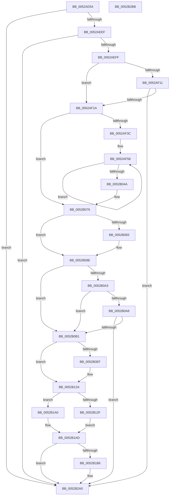

# SymCryptIntExtendedGcd

- RVA: `0x0052AD54`–`0x0052B2BC` (길이 `1,384` bytes)
- VA: `0x000000014052AD54`
- 실행 섹션: `.text`
- PDB 이름 있음: `예`; PDB Function 태그: `아니요`
- unwind 정보 RVA: `0x000C33B4`
- 디코드: `357`개 명령, `1,384/1,384` bytes 표시
- 미해석 바이트: `0` (있으면 어셈블리에 `.byte`로 보존)

> 이 문서는 커널 이미지의 기계어와 PDB 기호를 분석해 생성했습니다. 4번과 5번은 함수 원형과 자료형을 바이너리 사용 방식에서 추정한 C 해석이며 원본 소스 복구 결과는 아닙니다.

## 1. Dependencies

- 직접 호출 지점: **64**; 고유 호출 대상: **20**
- 직접 호출자로 확인된 함수: **3**
- RIP 상대 이미지 참조: **0**

### Outgoing calls
- `0x0052AD7F` → [FsRtlNumberOfRunsInBaseMcb](../45/FsRtlNumberOfRunsInBaseMcb_function_004574D0.md) (function, `0x004574D0`)
- `0x0052AD89` → [FsRtlNumberOfRunsInBaseMcb](../45/FsRtlNumberOfRunsInBaseMcb_function_004574D0.md) (function, `0x004574D0`)
- `0x0052AD97` → [FsRtlNumberOfRunsInBaseMcb](../45/FsRtlNumberOfRunsInBaseMcb_function_004574D0.md) (function, `0x004574D0`)
- `0x0052ADA1` → [SymCryptSizeofIntFromDigits](SymCryptSizeofIntFromDigits_function_00525D24.md) (function, `0x00525D24`)
- `0x0052ADAE` → [SymCryptSizeofIntFromDigits](SymCryptSizeofIntFromDigits_function_00525D24.md) (function, `0x00525D24`)
- `0x0052ADB8` → [SymCryptSizeofDivisorFromDigits](SymCryptSizeofDivisorFromDigits_function_00525D0C.md) (function, `0x00525D0C`)
- `0x0052ADCF` → [SymCryptIntCreate](SymCryptIntCreate_function_0052556C.md) (function, `0x0052556C`)
- `0x0052ADE4` → [SymCryptIntCreate](SymCryptIntCreate_function_0052556C.md) (function, `0x0052556C`)
- `0x0052ADF9` → [SymCryptIntCreate](SymCryptIntCreate_function_0052556C.md) (function, `0x0052556C`)
- `0x0052AE0E` → [SymCryptIntCreate](SymCryptIntCreate_function_0052556C.md) (function, `0x0052556C`)
- `0x0052AE23` → [SymCryptIntCreate](SymCryptIntCreate_function_0052556C.md) (function, `0x0052556C`)
- `0x0052AE38` → [SymCryptDivisorCreate](SymCryptDivisorCreate_function_00525464.md) (function, `0x00525464`)
- `0x0052AE4B` → [SymCryptIntFromDivisor](SymCryptIntFromDivisor_function_005255F0.md) (function, `0x005255F0`)
- `0x0052AE5D` → [SymCryptDivisorCreate](SymCryptDivisorCreate_function_00525464.md) (function, `0x00525464`)
- `0x0052AEA6` → [SymCryptIntCopyMixedSize](SymCryptIntCopyMixedSize_function_00525554.md) (function, `0x00525554`)
- `0x0052AEBB` → [SymCryptIntCopyMixedSize](SymCryptIntCopyMixedSize_function_00525554.md) (function, `0x00525554`)
- `0x0052AECA` → [SymCryptIntSetValueUint32](SymCryptIntSetValueUint32_function_00525748.md) (function, `0x00525748`)
- `0x0052AED6` → [SymCryptIntSetValueUint32](SymCryptIntSetValueUint32_function_00525748.md) (function, `0x00525748`)
- `0x0052AEE2` → [SymCryptIntIsEqualUint32](SymCryptIntIsEqualUint32_function_005256B0.md) (function, `0x005256B0`)
- `0x0052AEF2` → [SymCryptIntGetValueLsbits32](SymCryptIntGetValueLsbits32_function_00525668.md) (function, `0x00525668`)
- `0x0052AF1D` → [SymCryptIntBitsizeOfObject](SymCryptIntBitsizeOfObject_function_005254DC.md) (function, `0x005254DC`)
- `0x0052AF2C` → [SymCryptIntBitsizeOfObject](SymCryptIntBitsizeOfObject_function_005254DC.md) (function, `0x005254DC`)
- `0x0052AF61` → [SymCryptIntSubSameSize](SymCryptIntSubSameSize_function_005257A8.md) (function, `0x005257A8`)
- `0x0052AF6B` → [SymCryptIntGetValueLsbits32](SymCryptIntGetValueLsbits32_function_00525668.md) (function, `0x00525668`)
- `0x0052AF7E` → [SymCryptIntConditionalSwap](SymCryptIntConditionalSwap_function_00525524.md) (function, `0x00525524`)
- `0x0052AF8E` → [SymCryptIntConditionalSwap](SymCryptIntConditionalSwap_function_00525524.md) (function, `0x00525524`)
- `0x0052AF96` → [SymCryptIntGetValueLsbits32](SymCryptIntGetValueLsbits32_function_00525668.md) (function, `0x00525668`)
- `0x0052AFA9` → [SymCryptIntSubSameSize](SymCryptIntSubSameSize_function_005257A8.md) (function, `0x005257A8`)
- `0x0052AFB7` → [SymCryptIntConditionalCopy](SymCryptIntConditionalCopy_function_0052550C.md) (function, `0x0052550C`)
- `0x0052AFC7` → [SymCryptIntSubSameSize](SymCryptIntSubSameSize_function_005257A8.md) (function, `0x005257A8`)
- `0x0052AFD7` → [SymCryptIntConditionalCopy](SymCryptIntConditionalCopy_function_0052550C.md) (function, `0x0052550C`)
- `0x0052AFE5` → [SymCryptIntAddMixedSize](SymCryptIntAddMixedSize_function_00525494.md) (function, `0x00525494`)
- `0x0052AFF5` → [SymCryptIntConditionalCopy](SymCryptIntConditionalCopy_function_0052550C.md) (function, `0x0052550C`)
- `0x0052B002` → [SymCryptIntShr1](SymCryptIntShr1_function_00525778.md) (function, `0x00525778`)
- `0x0052B00A` → [SymCryptIntGetValueLsbits32](SymCryptIntGetValueLsbits32_function_00525668.md) (function, `0x00525668`)
- `0x0052B01D` → [SymCryptIntAddMixedSize](SymCryptIntAddMixedSize_function_00525494.md) (function, `0x00525494`)
- `0x0052B02D` → [SymCryptIntConditionalCopy](SymCryptIntConditionalCopy_function_0052550C.md) (function, `0x0052550C`)
- `0x0052B03C` → [SymCryptIntShr1](SymCryptIntShr1_function_00525778.md) (function, `0x00525778`)
- `0x0052B089` → [SymCryptIntCopyMixedSize](SymCryptIntCopyMixedSize_function_00525554.md) (function, `0x00525554`)
- `0x0052B0B4` → [SymCryptIntFromDivisor](SymCryptIntFromDivisor_function_005255F0.md) (function, `0x005255F0`)
- `0x0052B0C1` → [SymCryptIntCopyMixedSize](SymCryptIntCopyMixedSize_function_00525554.md) (function, `0x00525554`)
- `0x0052B0C9` → [SymCryptIntFromDivisor](SymCryptIntFromDivisor_function_005255F0.md) (function, `0x005255F0`)
- `0x0052B0E5` → [SymCryptIntToDivisor](SymCryptIntToDivisor_function_005257D8.md) (function, `0x005257D8`)
- `0x0052B10A` → [SymCryptIntMulMixedSize](SymCryptIntMulMixedSize_function_005256F8.md) (function, `0x005256F8`)
- `0x0052B125` → [SymCryptIntDivMod](SymCryptIntDivMod_function_00525584.md) (function, `0x00525584`)
- `0x0052B132` → [SymCryptIntFromDivisor](SymCryptIntFromDivisor_function_005255F0.md) (function, `0x005255F0`)
- `0x0052B155` → [SymCryptIntDivMod](SymCryptIntDivMod_function_00525584.md) (function, `0x00525584`)
- `0x0052B15D` → [SymCryptIntFromDivisor](SymCryptIntFromDivisor_function_005255F0.md) (function, `0x005255F0`)
- `0x0052B179` → [SymCryptIntToDivisor](SymCryptIntToDivisor_function_005257D8.md) (function, `0x005257D8`)
- `0x0052B199` → [SymCryptIntDivMod](SymCryptIntDivMod_function_00525584.md) (function, `0x00525584`)
- `0x0052B1B9` → [SymCryptIntFromDivisor](SymCryptIntFromDivisor_function_005255F0.md) (function, `0x005255F0`)
- `0x0052B1C4` → [SymCryptIntCopyMixedSize](SymCryptIntCopyMixedSize_function_00525554.md) (function, `0x00525554`)
- `0x0052B1CC` → [SymCryptIntFromDivisor](SymCryptIntFromDivisor_function_005255F0.md) (function, `0x005255F0`)
- `0x0052B1E8` → [SymCryptIntToDivisor](SymCryptIntToDivisor_function_005257D8.md) (function, `0x005257D8`)
- `0x0052B203` → [SymCryptIntMulMixedSize](SymCryptIntMulMixedSize_function_005256F8.md) (function, `0x005256F8`)
- `0x0052B213` → [SymCryptIntSubMixedSize](SymCryptIntSubMixedSize_function_00525790.md) (function, `0x00525790`)
- `0x0052B22E` → [SymCryptIntDivMod](SymCryptIntDivMod_function_00525584.md) (function, `0x00525584`)
- `0x0052B236` → [SymCryptIntFromDivisor](SymCryptIntFromDivisor_function_005255F0.md) (function, `0x005255F0`)
- `0x0052B246` → [SymCryptIntCopyMixedSize](SymCryptIntCopyMixedSize_function_00525554.md) (function, `0x00525554`)
- `0x0052B24E` → [SymCryptIntFromDivisor](SymCryptIntFromDivisor_function_005255F0.md) (function, `0x005255F0`)
- `0x0052B26A` → [SymCryptIntToDivisor](SymCryptIntToDivisor_function_005257D8.md) (function, `0x005257D8`)
- `0x0052B285` → [SymCryptIntDivMod](SymCryptIntDivMod_function_00525584.md) (function, `0x00525584`)
- `0x0052B28D` → [SymCryptIntFromDivisor](SymCryptIntFromDivisor_function_005255F0.md) (function, `0x005255F0`)
- `0x0052B29B` → [SymCryptIntSubMixedSize](SymCryptIntSubMixedSize_function_00525790.md) (function, `0x00525790`)

### Direct callers
- [SymCryptRsakeyCalculatePrimesFromPrivateExponent](SymCryptRsakeyCalculatePrimesFromPrivateExponent_function_00522D48.md) at `0x00523118`
- [SymCryptRsakeyCalculatePrivateFields](SymCryptRsakeyCalculatePrivateFields_function_0052326C.md) at `0x005233FA`
- [SymCryptCrtGenerateForTwoCoprimes](SymCryptCrtGenerateForTwoCoprimes_function_0052A950.md) at `0x0052AA74`

### Static image references
- 디코드된 RIP-relative 메모리 참조가 없습니다.

## 2. Other-region calls and transfers

- 다른 실행 섹션으로 향하는 call: **0**
- 별도 외부 분기/꼬리 이동을 확인하지 못했습니다.

## 3. Assembly (complete function range)

```asm
0052AD54  48 8B C4                        mov rax, rsp
0052AD57  48 89 58 18                     mov qword ptr [rax + 0x18], rbx
0052AD5B  4C 89 48 20                     mov qword ptr [rax + 0x20], r9
0052AD5F  48 89 50 10                     mov qword ptr [rax + 0x10], rdx
0052AD63  48 89 48 08                     mov qword ptr [rax + 8], rcx
0052AD67  55                              push rbp
0052AD68  56                              push rsi
0052AD69  57                              push rdi
0052AD6A  41 54                           push r12
0052AD6C  41 55                           push r13
0052AD6E  41 56                           push r14
0052AD70  41 57                           push r15
0052AD72  48 81 EC 80 00 00 00            sub rsp, 0x80
0052AD79  48 8B FA                        mov rdi, rdx
0052AD7C  48 8B F1                        mov rsi, rcx
0052AD7F  E8 4C C7 F2 FF                  call 0x1404574d0
0052AD84  48 8B CF                        mov rcx, rdi
0052AD87  8B D8                           mov ebx, eax
0052AD89  E8 42 C7 F2 FF                  call 0x1404574d0
0052AD8E  3B D8                           cmp ebx, eax
0052AD90  48 8B CE                        mov rcx, rsi
0052AD93  48 0F 46 CF                     cmovbe rcx, rdi
0052AD97  E8 34 C7 F2 FF                  call 0x1404574d0
0052AD9C  8B C8                           mov ecx, eax
0052AD9E  44 8B F8                        mov r15d, eax
0052ADA1  E8 7E AF FF FF                  call 0x140525d24
0052ADA6  43 8D 34 3F                     lea esi, [r15 + r15]
0052ADAA  8B D8                           mov ebx, eax
0052ADAC  8B CE                           mov ecx, esi
0052ADAE  E8 71 AF FF FF                  call 0x140525d24
0052ADB3  41 8B CF                        mov ecx, r15d
0052ADB6  8B F8                           mov edi, eax
0052ADB8  E8 4F AF FF FF                  call 0x140525d0c
0052ADBD  4C 8B A4 24 F8 00 00 00         mov r12, qword ptr [rsp + 0xf8]
0052ADC5  45 8B C7                        mov r8d, r15d
0052ADC8  49 8B CC                        mov rcx, r12
0052ADCB  8B E8                           mov ebp, eax
0052ADCD  8B D3                           mov edx, ebx
0052ADCF  E8 98 A7 FF FF                  call 0x14052556c
0052ADD4  4C 03 E3                        add r12, rbx
0052ADD7  48 89 44 24 58                  mov qword ptr [rsp + 0x58], rax
0052ADDC  49 8B CC                        mov rcx, r12
0052ADDF  45 8B C7                        mov r8d, r15d
0052ADE2  8B D3                           mov edx, ebx
0052ADE4  E8 83 A7 FF FF                  call 0x14052556c
0052ADE9  4C 03 E3                        add r12, rbx
0052ADEC  48 89 44 24 60                  mov qword ptr [rsp + 0x60], rax
0052ADF1  49 8B CC                        mov rcx, r12
0052ADF4  45 8B C7                        mov r8d, r15d
0052ADF7  8B D3                           mov edx, ebx
0052ADF9  E8 6E A7 FF FF                  call 0x14052556c
0052ADFE  4C 03 E3                        add r12, rbx
0052AE01  48 89 44 24 50                  mov qword ptr [rsp + 0x50], rax
0052AE06  49 8B CC                        mov rcx, r12
0052AE09  45 8B C7                        mov r8d, r15d
0052AE0C  8B D3                           mov edx, ebx
0052AE0E  E8 59 A7 FF FF                  call 0x14052556c
0052AE13  4C 03 E3                        add r12, rbx
0052AE16  48 89 44 24 38                  mov qword ptr [rsp + 0x38], rax
0052AE1B  49 8B CC                        mov rcx, r12
0052AE1E  44 8B C6                        mov r8d, esi
0052AE21  8B D7                           mov edx, edi
0052AE23  E8 44 A7 FF FF                  call 0x14052556c
0052AE28  4C 03 E7                        add r12, rdi
0052AE2B  48 89 44 24 48                  mov qword ptr [rsp + 0x48], rax
0052AE30  49 8B CC                        mov rcx, r12
0052AE33  45 8B C7                        mov r8d, r15d
0052AE36  8B D5                           mov edx, ebp
0052AE38  E8 27 A6 FF FF                  call 0x140525464
0052AE3D  48 8B C8                        mov rcx, rax
0052AE40  48 89 44 24 70                  mov qword ptr [rsp + 0x70], rax
0052AE45  4C 8B E8                        mov r13, rax
0052AE48  4C 03 E5                        add r12, rbp
0052AE4B  E8 A0 A7 FF FF                  call 0x1405255f0
0052AE50  45 8B C7                        mov r8d, r15d
0052AE53  48 89 44 24 30                  mov qword ptr [rsp + 0x30], rax
0052AE58  8B D5                           mov edx, ebp
0052AE5A  49 8B CC                        mov rcx, r12
0052AE5D  E8 02 A6 FF FF                  call 0x140525464
0052AE62  48 6B D5 FE                     imul rdx, rbp, -2
0052AE66  48 6B CB FC                     imul rcx, rbx, -4
0052AE6A  4C 03 E5                        add r12, rbp
0052AE6D  48 89 44 24 68                  mov qword ptr [rsp + 0x68], rax
0052AE72  48 8B AC 24 00 01 00 00         mov rbp, qword ptr [rsp + 0x100]
0052AE7A  48 8B F0                        mov rsi, rax
0052AE7D  48 8B 9C 24 C0 00 00 00         mov rbx, qword ptr [rsp + 0xc0]
0052AE85  4C 89 A4 24 F8 00 00 00         mov qword ptr [rsp + 0xf8], r12
0052AE8D  48 03 D1                        add rdx, rcx
0052AE90  48 8B CB                        mov rcx, rbx
0052AE93  48 2B D7                        sub rdx, rdi
0052AE96  48 03 EA                        add rbp, rdx
0052AE99  48 8B 54 24 58                  mov rdx, qword ptr [rsp + 0x58]
0052AE9E  48 89 AC 24 00 01 00 00         mov qword ptr [rsp + 0x100], rbp
0052AEA6  E8 A9 A6 FF FF                  call 0x140525554
0052AEAB  48 8B 7C 24 30                  mov rdi, qword ptr [rsp + 0x30]
0052AEB0  48 8B 8C 24 C8 00 00 00         mov rcx, qword ptr [rsp + 0xc8]
0052AEB8  48 8B D7                        mov rdx, rdi
0052AEBB  E8 94 A6 FF FF                  call 0x140525554
0052AEC0  48 8B 54 24 50                  mov rdx, qword ptr [rsp + 0x50]
0052AEC5  B9 01 00 00 00                  mov ecx, 1
0052AECA  E8 79 A8 FF FF                  call 0x140525748
0052AECF  48 8B 54 24 38                  mov rdx, qword ptr [rsp + 0x38]
0052AED4  33 C9                           xor ecx, ecx
0052AED6  E8 6D A8 FF FF                  call 0x140525748
0052AEDB  48 8B 4C 24 58                  mov rcx, qword ptr [rsp + 0x58]
0052AEE0  33 D2                           xor edx, edx
0052AEE2  E8 C9 A7 FF FF                  call 0x1405256b0
0052AEE7  85 C0                           test eax, eax
0052AEE9  0F 85 B1 03 00 00               jne 0x14052b2a0
0052AEEF  48 8B CF                        mov rcx, rdi
0052AEF2  E8 71 A7 FF FF                  call 0x140525668
0052AEF7  A8 01                           test al, 1
0052AEF9  0F 84 A1 03 00 00               je 0x14052b2a0
0052AEFF  4C 8B B4 24 F0 00 00 00         mov r14, qword ptr [rsp + 0xf0]
0052AF07  4C 8B 7C 24 48                  mov r15, qword ptr [rsp + 0x48]
0052AF0C  4D 85 F6                        test r14, r14
0052AF0F  74 09                           je 0x14052af1a
0052AF11  4D 85 FF                        test r15, r15
0052AF14  0F 84 86 03 00 00               je 0x14052b2a0
0052AF1A  48 8B CB                        mov rcx, rbx
0052AF1D  E8 BA A5 FF FF                  call 0x1405254dc
0052AF22  48 8B 8C 24 C8 00 00 00         mov rcx, qword ptr [rsp + 0xc8]
0052AF2A  8B D8                           mov ebx, eax
0052AF2C  E8 AB A5 FF FF                  call 0x1405254dc
0052AF31  8D 4B FF                        lea ecx, [rbx - 1]
0052AF34  03 C8                           add ecx, eax
0052AF36  0F 84 3A 01 00 00               je 0x14052b076
0052AF3C  4C 8B B4 24 C8 00 00 00         mov r14, qword ptr [rsp + 0xc8]
0052AF44  4C 8B FF                        mov r15, rdi
0052AF47  4C 8B 64 24 50                  mov r12, qword ptr [rsp + 0x50]
0052AF4C  8B F1                           mov esi, ecx
0052AF4E  4C 8B 6C 24 60                  mov r13, qword ptr [rsp + 0x60]
0052AF53  48 8B 6C 24 58                  mov rbp, qword ptr [rsp + 0x58]
0052AF58  4D 8B C5                        mov r8, r13
0052AF5B  49 8B D7                        mov rdx, r15
0052AF5E  48 8B CD                        mov rcx, rbp
0052AF61  E8 42 A8 FF FF                  call 0x1405257a8
0052AF66  48 8B CD                        mov rcx, rbp
0052AF69  8B D8                           mov ebx, eax
0052AF6B  E8 F8 A6 FF FF                  call 0x140525668
0052AF70  23 D8                           and ebx, eax
0052AF72  49 8B D7                        mov rdx, r15
0052AF75  83 E3 01                        and ebx, 1
0052AF78  48 8B CD                        mov rcx, rbp
0052AF7B  44 8B C3                        mov r8d, ebx
0052AF7E  E8 A1 A5 FF FF                  call 0x140525524
0052AF83  48 8B 54 24 38                  mov rdx, qword ptr [rsp + 0x38]
0052AF88  44 8B C3                        mov r8d, ebx
0052AF8B  49 8B CC                        mov rcx, r12
0052AF8E  E8 91 A5 FF FF                  call 0x140525524
0052AF93  48 8B CD                        mov rcx, rbp
0052AF96  E8 CD A6 FF FF                  call 0x140525668
0052AF9B  8B F8                           mov edi, eax
0052AF9D  4D 8B C5                        mov r8, r13
0052AFA0  49 8B D7                        mov rdx, r15
0052AFA3  48 8B CD                        mov rcx, rbp
0052AFA6  83 E7 01                        and edi, 1
0052AFA9  E8 FA A7 FF FF                  call 0x1405257a8
0052AFAE  44 8B C7                        mov r8d, edi
0052AFB1  48 8B D5                        mov rdx, rbp
0052AFB4  49 8B CD                        mov rcx, r13
0052AFB7  E8 50 A5 FF FF                  call 0x14052550c
0052AFBC  48 8B 54 24 38                  mov rdx, qword ptr [rsp + 0x38]
0052AFC1  4D 8B C5                        mov r8, r13
0052AFC4  49 8B CC                        mov rcx, r12
0052AFC7  E8 DC A7 FF FF                  call 0x1405257a8
0052AFCC  44 8B C7                        mov r8d, edi
0052AFCF  49 8B D4                        mov rdx, r12
0052AFD2  49 8B CD                        mov rcx, r13
0052AFD5  8B D8                           mov ebx, eax
0052AFD7  E8 30 A5 FF FF                  call 0x14052550c
0052AFDC  4D 8B C5                        mov r8, r13
0052AFDF  49 8B D6                        mov rdx, r14
0052AFE2  49 8B CC                        mov rcx, r12
0052AFE5  E8 AA A4 FF FF                  call 0x140525494
0052AFEA  23 DF                           and ebx, edi
0052AFEC  49 8B D4                        mov rdx, r12
0052AFEF  44 8B C3                        mov r8d, ebx
0052AFF2  49 8B CD                        mov rcx, r13
0052AFF5  E8 12 A5 FF FF                  call 0x14052550c
0052AFFA  4C 8B C5                        mov r8, rbp
0052AFFD  48 8B D5                        mov rdx, rbp
0052B000  33 C9                           xor ecx, ecx
0052B002  E8 71 A7 FF FF                  call 0x140525778
0052B007  49 8B CC                        mov rcx, r12
0052B00A  E8 59 A6 FF FF                  call 0x140525668
0052B00F  8B F8                           mov edi, eax
0052B011  4D 8B C5                        mov r8, r13
0052B014  49 8B D6                        mov rdx, r14
0052B017  49 8B CC                        mov rcx, r12
0052B01A  83 E7 01                        and edi, 1
0052B01D  E8 72 A4 FF FF                  call 0x140525494
0052B022  44 8B C7                        mov r8d, edi
0052B025  49 8B D4                        mov rdx, r12
0052B028  49 8B CD                        mov rcx, r13
0052B02B  8B D8                           mov ebx, eax
0052B02D  E8 DA A4 FF FF                  call 0x14052550c
0052B032  23 DF                           and ebx, edi
0052B034  4D 8B C4                        mov r8, r12
0052B037  8B CB                           mov ecx, ebx
0052B039  49 8B D4                        mov rdx, r12
0052B03C  E8 37 A7 FF FF                  call 0x140525778
0052B041  83 C6 FF                        add esi, -1
0052B044  0F 85 0E FF FF FF               jne 0x14052af58
0052B04A  4C 8B A4 24 F8 00 00 00         mov r12, qword ptr [rsp + 0xf8]
0052B052  48 8B 74 24 68                  mov rsi, qword ptr [rsp + 0x68]
0052B057  48 8B AC 24 00 01 00 00         mov rbp, qword ptr [rsp + 0x100]
0052B05F  4C 8B B4 24 F0 00 00 00         mov r14, qword ptr [rsp + 0xf0]
0052B067  4C 8B 6C 24 70                  mov r13, qword ptr [rsp + 0x70]
0052B06C  4C 8B 7C 24 48                  mov r15, qword ptr [rsp + 0x48]
0052B071  48 8B 7C 24 30                  mov rdi, qword ptr [rsp + 0x30]
0052B076  48 8B 84 24 D8 00 00 00         mov rax, qword ptr [rsp + 0xd8]
0052B07E  48 85 C0                        test rax, rax
0052B081  74 0B                           je 0x14052b08e
0052B083  48 8B D0                        mov rdx, rax
0052B086  48 8B CF                        mov rcx, rdi
0052B089  E8 C6 A4 FF FF                  call 0x140525554
0052B08E  48 8B 9C 24 E0 00 00 00         mov rbx, qword ptr [rsp + 0xe0]
0052B096  48 8B BC 24 E8 00 00 00         mov rdi, qword ptr [rsp + 0xe8]
0052B09E  48 85 DB                        test rbx, rbx
0052B0A1  75 0E                           jne 0x14052b0b1
0052B0A3  48 85 FF                        test rdi, rdi
0052B0A6  75 09                           jne 0x14052b0b1
0052B0A8  4D 85 F6                        test r14, r14
0052B0AB  0F 84 EF 01 00 00               je 0x14052b2a0
0052B0B1  49 8B CD                        mov rcx, r13
0052B0B4  E8 37 A5 FF FF                  call 0x1405255f0
0052B0B9  48 8B 4C 24 30                  mov rcx, qword ptr [rsp + 0x30]
0052B0BE  48 8B D0                        mov rdx, rax
0052B0C1  E8 8E A4 FF FF                  call 0x140525554
0052B0C6  49 8B CD                        mov rcx, r13
0052B0C9  E8 22 A5 FF FF                  call 0x1405255f0
0052B0CE  45 33 C9                        xor r9d, r9d
0052B0D1  48 89 6C 24 28                  mov qword ptr [rsp + 0x28], rbp
0052B0D6  48 8B C8                        mov rcx, rax
0052B0D9  4C 89 64 24 20                  mov qword ptr [rsp + 0x20], r12
0052B0DE  49 8B D5                        mov rdx, r13
0052B0E1  45 8D 41 03                     lea r8d, [r9 + 3]
0052B0E5  E8 EE A6 FF FF                  call 0x1405257d8
0052B0EA  48 85 DB                        test rbx, rbx
0052B0ED  74 3B                           je 0x14052b12a
0052B0EF  48 8B 94 24 C8 00 00 00         mov rdx, qword ptr [rsp + 0xc8]
0052B0F7  4D 8B CC                        mov r9, r12
0052B0FA  48 8B 8C 24 C0 00 00 00         mov rcx, qword ptr [rsp + 0xc0]
0052B102  4C 8B C3                        mov r8, rbx
0052B105  48 89 6C 24 20                  mov qword ptr [rsp + 0x20], rbp
0052B10A  E8 E9 A5 FF FF                  call 0x1405256f8
0052B10F  45 33 C9                        xor r9d, r9d
0052B112  48 89 6C 24 28                  mov qword ptr [rsp + 0x28], rbp
0052B117  4C 8B C3                        mov r8, rbx
0052B11A  4C 89 64 24 20                  mov qword ptr [rsp + 0x20], r12
0052B11F  49 8B D5                        mov rdx, r13
0052B122  48 8B CB                        mov rcx, rbx
0052B125  E8 5A A4 FF FF                  call 0x140525584
0052B12A  48 85 FF                        test rdi, rdi
0052B12D  74 71                           je 0x14052b1a0
0052B12F  48 8B CE                        mov rcx, rsi
0052B132  E8 B9 A4 FF FF                  call 0x1405255f0
0052B137  48 8B 9C 24 C8 00 00 00         mov rbx, qword ptr [rsp + 0xc8]
0052B13F  4C 8B C0                        mov r8, rax
0052B142  48 8B CB                        mov rcx, rbx
0052B145  48 89 6C 24 28                  mov qword ptr [rsp + 0x28], rbp
0052B14A  45 33 C9                        xor r9d, r9d
0052B14D  4C 89 64 24 20                  mov qword ptr [rsp + 0x20], r12
0052B152  49 8B D5                        mov rdx, r13
0052B155  E8 2A A4 FF FF                  call 0x140525584
0052B15A  48 8B CE                        mov rcx, rsi
0052B15D  E8 8E A4 FF FF                  call 0x1405255f0
0052B162  45 33 C9                        xor r9d, r9d
0052B165  48 89 6C 24 28                  mov qword ptr [rsp + 0x28], rbp
0052B16A  48 8B C8                        mov rcx, rax
0052B16D  4C 89 64 24 20                  mov qword ptr [rsp + 0x20], r12
0052B172  48 8B D6                        mov rdx, rsi
0052B175  45 8D 41 01                     lea r8d, [r9 + 1]
0052B179  E8 5A A6 FF FF                  call 0x1405257d8
0052B17E  4C 8B CF                        mov r9, rdi
0052B181  48 89 6C 24 28                  mov qword ptr [rsp + 0x28], rbp
0052B186  48 8B 7C 24 38                  mov rdi, qword ptr [rsp + 0x38]
0052B18B  45 33 C0                        xor r8d, r8d
0052B18E  48 8B CF                        mov rcx, rdi
0052B191  4C 89 64 24 20                  mov qword ptr [rsp + 0x20], r12
0052B196  48 8B D6                        mov rdx, rsi
0052B199  E8 E6 A3 FF FF                  call 0x140525584
0052B19E  EB 0D                           jmp 0x14052b1ad
0052B1A0  48 8B 9C 24 C8 00 00 00         mov rbx, qword ptr [rsp + 0xc8]
0052B1A8  48 8B 7C 24 38                  mov rdi, qword ptr [rsp + 0x38]
0052B1AD  4D 85 F6                        test r14, r14
0052B1B0  0F 84 EA 00 00 00               je 0x14052b2a0
0052B1B6  48 8B CE                        mov rcx, rsi
0052B1B9  E8 32 A4 FF FF                  call 0x1405255f0
0052B1BE  48 8B D0                        mov rdx, rax
0052B1C1  48 8B CB                        mov rcx, rbx
0052B1C4  E8 8B A3 FF FF                  call 0x140525554
0052B1C9  48 8B CE                        mov rcx, rsi
0052B1CC  E8 1F A4 FF FF                  call 0x1405255f0
0052B1D1  45 33 C9                        xor r9d, r9d
0052B1D4  48 89 6C 24 28                  mov qword ptr [rsp + 0x28], rbp
0052B1D9  48 8B C8                        mov rcx, rax
0052B1DC  4C 89 64 24 20                  mov qword ptr [rsp + 0x20], r12
0052B1E1  48 8B D6                        mov rdx, rsi
0052B1E4  45 8D 41 01                     lea r8d, [r9 + 1]
0052B1E8  E8 EB A5 FF FF                  call 0x1405257d8
0052B1ED  48 8B 94 24 C0 00 00 00         mov rdx, qword ptr [rsp + 0xc0]
0052B1F5  4D 8B CC                        mov r9, r12
0052B1F8  4D 8B C7                        mov r8, r15
0052B1FB  48 89 6C 24 20                  mov qword ptr [rsp + 0x20], rbp
0052B200  48 8B CF                        mov rcx, rdi
0052B203  E8 F0 A4 FF FF                  call 0x1405256f8
0052B208  48 8B 54 24 30                  mov rdx, qword ptr [rsp + 0x30]
0052B20D  4D 8B C7                        mov r8, r15
0052B210  49 8B CF                        mov rcx, r15
0052B213  E8 78 A5 FF FF                  call 0x140525790
0052B218  45 33 C9                        xor r9d, r9d
0052B21B  48 89 6C 24 28                  mov qword ptr [rsp + 0x28], rbp
0052B220  4D 8B C7                        mov r8, r15
0052B223  4C 89 64 24 20                  mov qword ptr [rsp + 0x20], r12
0052B228  48 8B D6                        mov rdx, rsi
0052B22B  49 8B CF                        mov rcx, r15
0052B22E  E8 51 A3 FF FF                  call 0x140525584
0052B233  48 8B CE                        mov rcx, rsi
0052B236  E8 B5 A3 FF FF                  call 0x1405255f0
0052B23B  48 8B 8C 24 C0 00 00 00         mov rcx, qword ptr [rsp + 0xc0]
0052B243  48 8B D0                        mov rdx, rax
0052B246  E8 09 A3 FF FF                  call 0x140525554
0052B24B  48 8B CE                        mov rcx, rsi
0052B24E  E8 9D A3 FF FF                  call 0x1405255f0
0052B253  45 33 C9                        xor r9d, r9d
0052B256  48 89 6C 24 28                  mov qword ptr [rsp + 0x28], rbp
0052B25B  48 8B C8                        mov rcx, rax
0052B25E  4C 89 64 24 20                  mov qword ptr [rsp + 0x20], r12
0052B263  48 8B D6                        mov rdx, rsi
0052B266  45 8D 41 01                     lea r8d, [r9 + 1]
0052B26A  E8 69 A5 FF FF                  call 0x1405257d8
0052B26F  4D 8B CE                        mov r9, r14
0052B272  48 89 6C 24 28                  mov qword ptr [rsp + 0x28], rbp
0052B277  45 33 C0                        xor r8d, r8d
0052B27A  4C 89 64 24 20                  mov qword ptr [rsp + 0x20], r12
0052B27F  48 8B D6                        mov rdx, rsi
0052B282  49 8B CF                        mov rcx, r15
0052B285  E8 FA A2 FF FF                  call 0x140525584
0052B28A  48 8B CE                        mov rcx, rsi
0052B28D  E8 5E A3 FF FF                  call 0x1405255f0
0052B292  48 8B C8                        mov rcx, rax
0052B295  4D 8B C6                        mov r8, r14
0052B298  49 8B D6                        mov rdx, r14
0052B29B  E8 F0 A4 FF FF                  call 0x140525790
0052B2A0  48 8B 9C 24 D0 00 00 00         mov rbx, qword ptr [rsp + 0xd0]
0052B2A8  48 81 C4 80 00 00 00            add rsp, 0x80
0052B2AF  41 5F                           pop r15
0052B2B1  41 5E                           pop r14
0052B2B3  41 5D                           pop r13
0052B2B5  41 5C                           pop r12
0052B2B7  5F                              pop rdi
0052B2B8  5E                              pop rsi
0052B2B9  5D                              pop rbp
0052B2BA  C3                              ret
0052B2BB  CC                              int3
```

## 4. C-style interpretation (structured pseudocode)

```c
__int64 __fastcall SymCryptIntExtendedGcd(__int64 a1, __int64 a2, __int64 a3, __int64 a4, __int64 a5, __int64 a6, __int64 a7, __int64 a8, __int64 a9)
{
    __int64 result;
    __int64 v_r12;
    __int64 v_rbp;
    __int64 v_rbx;
    __int64 v_rdi;
    __int64 v_rsi;
    __int64 v_rsp;
    unsigned __int64 v_stack_m48;
    unsigned __int64 v_stack_m50;
    unsigned __int64 v_stack_m58;
    unsigned __int64 v_stack_m60;
    unsigned __int64 v_stack_m68;
    unsigned __int64 v_stack_m70;
    unsigned __int64 v_stack_m80;
    unsigned __int64 v_stack_m88;
    unsigned __int64 v_stack_m90;
    unsigned __int64 v_stack_m98;
    unsigned __int64 v_stack_p10;
    unsigned __int64 v_stack_p18;
    unsigned __int64 v_stack_p20;
    unsigned __int64 v_stack_p40;
    unsigned __int64 v_stack_p48;
    unsigned __int64 v_stack_p8;

    *(unsigned __int64 *)(v_rsp + 24) = v_rbx;
    *(unsigned __int64 *)(v_rsp + 32) = a4;
    *(unsigned __int64 *)(v_rsp + 16) = a2;
    *(unsigned __int64 *)(v_rsp + 8) = a1;
    v_rsp = (v_rsp) - (128);
    result = FsRtlNumberOfRunsInBaseMcb(a1, a2, a3, a4);
    result = FsRtlNumberOfRunsInBaseMcb(a2, a2, a3, a4);
    if (((unsigned int)((unsigned int)((unsigned int)(result)))) <= ((unsigned int)(result))) { a1 = a2; }
    result = FsRtlNumberOfRunsInBaseMcb(a1, a2, a3, a4);
    result = SymCryptSizeofIntFromDigits((unsigned int)((unsigned int)(result)), a2, a3, a4);
    result = SymCryptSizeofIntFromDigits((unsigned int)((unsigned int)((unsigned int)((unsigned int)(result)) + (unsigned int)((unsigned int)(result)) * 1)), a2, a3, a4);
    result = SymCryptSizeofDivisorFromDigits((unsigned int)((unsigned int)((unsigned int)((unsigned int)(result)))), a2, a3, a4);
    result = SymCryptIntCreate(a8, (unsigned int)((unsigned int)((unsigned int)((unsigned int)(result)))), (unsigned int)((unsigned int)((unsigned int)((unsigned int)(result)))), a4);
    v_r12 = (a8) + ((unsigned int)((unsigned int)(result)));
    v_stack_m60 = result;
    result = SymCryptIntCreate(v_r12, (unsigned int)((unsigned int)((unsigned int)((unsigned int)(result)))), (unsigned int)((unsigned int)((unsigned int)((unsigned int)(result)))), a4);
    v_r12 = (v_r12) + ((unsigned int)((unsigned int)(result)));
    v_stack_m58 = result;
    result = SymCryptIntCreate(v_r12, (unsigned int)((unsigned int)((unsigned int)((unsigned int)(result)))), (unsigned int)((unsigned int)((unsigned int)((unsigned int)(result)))), a4);
    v_r12 = (v_r12) + ((unsigned int)((unsigned int)(result)));
    v_stack_m68 = result;
    result = SymCryptIntCreate(v_r12, (unsigned int)((unsigned int)((unsigned int)((unsigned int)(result)))), (unsigned int)((unsigned int)((unsigned int)((unsigned int)(result)))), a4);
    v_r12 = (v_r12) + ((unsigned int)((unsigned int)(result)));
    v_stack_m80 = result;
    result = SymCryptIntCreate(v_r12, (unsigned int)((unsigned int)((unsigned int)((unsigned int)(result)))), (unsigned int)((unsigned int)((unsigned int)((unsigned int)(result)) + (unsigned int)((unsigned int)(result)) * 1)), a4);
    v_r12 = (v_r12) + ((unsigned int)((unsigned int)(result)));
    v_stack_m70 = result;
    result = SymCryptDivisorCreate(v_r12, (unsigned int)((unsigned int)((unsigned int)((unsigned int)(result)))), (unsigned int)((unsigned int)((unsigned int)((unsigned int)(result)))), a4);
    v_stack_m48 = result;
    v_r12 = (v_r12) + ((unsigned int)((unsigned int)(result)));
    result = SymCryptIntFromDivisor(result, (unsigned int)((unsigned int)((unsigned int)((unsigned int)(result)))), (unsigned int)((unsigned int)((unsigned int)((unsigned int)(result)))), a4);
    v_stack_m88 = result;
    result = SymCryptDivisorCreate(v_r12, (unsigned int)((unsigned int)((unsigned int)((unsigned int)(result)))), (unsigned int)((unsigned int)((unsigned int)((unsigned int)(result)))), a4);
    a2 = ((unsigned int)((unsigned int)((unsigned int)((unsigned int)(result))))) * ((unsigned int)((unsigned int)(result)));
    a1 = (v_r12) * ((unsigned int)((unsigned int)(result)));
    v_r12 = (v_r12) + ((unsigned int)((unsigned int)(result)));
    v_stack_m50 = result;
    v_stack_p40 = v_r12;
    a2 = (a2) + (a1);
    a2 = (a2) - ((unsigned int)((unsigned int)(result)));
    v_rbp = (a9) + (a2);
    v_stack_p48 = v_rbp;
    result = SymCryptIntCopyMixedSize(v_stack_p8, v_stack_m60, (unsigned int)((unsigned int)((unsigned int)((unsigned int)(result)))), a4);
    result = SymCryptIntCopyMixedSize(v_stack_p10, v_stack_m88, (unsigned int)((unsigned int)((unsigned int)((unsigned int)(result)))), a4);
    result = SymCryptIntSetValueUint32(1, v_stack_m68, (unsigned int)((unsigned int)((unsigned int)((unsigned int)(result)))), a4);
    a1 = 0;
    result = SymCryptIntSetValueUint32(a1, v_stack_m80, (unsigned int)((unsigned int)((unsigned int)((unsigned int)(result)))), a4);
    a2 = 0;
    result = SymCryptIntIsEqualUint32(v_stack_m60, a2, (unsigned int)((unsigned int)((unsigned int)((unsigned int)(result)))), a4);
    if ((unsigned int)(result) != 0) goto loc_0052B2A0;
    result = SymCryptIntGetValueLsbits32(v_stack_m88, a2, (unsigned int)((unsigned int)((unsigned int)((unsigned int)(result)))), a4);
    if ((((unsigned __int8)(result)) & (1)) == 0) goto loc_0052B2A0;
    if (a7 == 0) goto loc_0052AF1A;
    if (v_stack_m70 == 0) goto loc_0052B2A0;
loc_0052AF1A:
    result = SymCryptIntBitsizeOfObject(v_stack_p8, a2, (unsigned int)((unsigned int)((unsigned int)((unsigned int)(result)))), a4);
    result = SymCryptIntBitsizeOfObject(v_stack_p10, a2, (unsigned int)((unsigned int)((unsigned int)((unsigned int)(result)))), a4);
    a1 = (unsigned int)(((unsigned int)((unsigned int)(result)) - 1) + ((unsigned int)(result)));
    if (condition_is_equal) goto loc_0052B076;
loc_0052AF58:
    result = SymCryptIntSubSameSize(v_stack_m60, v_stack_m88, v_stack_m58, a4);
    result = SymCryptIntGetValueLsbits32(v_stack_m60, v_stack_m88, v_stack_m58, a4);
    v_rbx = (unsigned int)(((unsigned int)((unsigned int)(result))) & ((unsigned int)(result)));
    v_rbx = (unsigned int)((v_rbx) & (1));
    result = SymCryptIntConditionalSwap(v_stack_m60, v_stack_m88, (unsigned int)((unsigned int)(v_rbx)), a4);
    result = SymCryptIntConditionalSwap(v_stack_m68, v_stack_m80, (unsigned int)((unsigned int)(v_rbx)), a4);
    result = SymCryptIntGetValueLsbits32(v_stack_m60, v_stack_m80, (unsigned int)((unsigned int)(v_rbx)), a4);
    v_rdi = (unsigned int)(((unsigned int)((unsigned int)(result))) & (1));
    result = SymCryptIntSubSameSize(v_stack_m60, v_stack_m88, v_stack_m58, a4);
    result = SymCryptIntConditionalCopy(v_stack_m58, v_stack_m60, (unsigned int)((unsigned int)(v_rdi)), a4);
    result = SymCryptIntSubSameSize(v_stack_m68, v_stack_m80, v_stack_m58, a4);
    result = SymCryptIntConditionalCopy(v_stack_m58, v_stack_m68, (unsigned int)((unsigned int)(v_rdi)), a4);
    result = SymCryptIntAddMixedSize(v_stack_m68, v_stack_p10, v_stack_m58, a4);
    v_rbx = (unsigned int)(((unsigned int)((unsigned int)(result))) & ((unsigned int)(v_rdi)));
    result = SymCryptIntConditionalCopy(v_stack_m58, v_stack_m68, (unsigned int)((unsigned int)(v_rbx)), a4);
    a1 = 0;
    result = SymCryptIntShr1(a1, v_stack_m60, v_stack_m60, a4);
    result = SymCryptIntGetValueLsbits32(v_stack_m68, v_stack_m60, v_stack_m60, a4);
    v_rdi = (unsigned int)(((unsigned int)((unsigned int)(result))) & (1));
    result = SymCryptIntAddMixedSize(v_stack_m68, v_stack_p10, v_stack_m58, a4);
    result = SymCryptIntConditionalCopy(v_stack_m58, v_stack_m68, (unsigned int)((unsigned int)(v_rdi)), a4);
    v_rbx = (unsigned int)(((unsigned int)((unsigned int)(result))) & ((unsigned int)(v_rdi)));
    result = SymCryptIntShr1((unsigned int)((unsigned int)(v_rbx)), v_stack_m68, v_stack_m68, a4);
    v_rsi = (unsigned int)(((unsigned int)((unsigned int)(a1))) + (-1));
    if (condition_is_not_equal) goto loc_0052AF58;
loc_0052B076:
    result = v_stack_p20;
    if (v_stack_p20 != 0) {
        a2 = v_stack_p20;
        a1 = v_stack_m88;
        result = SymCryptIntCopyMixedSize(a1, a2, v_stack_m68, a4);
    }
    if (a5 != 0) goto loc_0052B0B1;
    if (a6 != 0) goto loc_0052B0B1;
    if (a7 == 0) goto loc_0052B2A0;
loc_0052B0B1:
    result = SymCryptIntFromDivisor(v_stack_m48, a2, v_stack_m68, a4);
    result = SymCryptIntCopyMixedSize(v_stack_m88, result, v_stack_m68, a4);
    result = SymCryptIntFromDivisor(v_stack_m48, result, v_stack_m68, a4);
    a4 = 0;
    v_stack_m90 = a9;
    v_stack_m98 = a8;
    result = SymCryptIntToDivisor(result, v_stack_m48, a4 + 3, a4);
    if (a5 != 0) {
        a2 = v_stack_p10;
        a4 = a8;
        a1 = v_stack_p8;
        a3 = a5;
        v_stack_m98 = a9;
        result = SymCryptIntMulMixedSize(a1, a2, a3, a4);
        a4 = 0;
        v_stack_m90 = a9;
        a3 = a5;
        v_stack_m98 = a8;
        a2 = v_stack_m48;
        a1 = a5;
        result = SymCryptIntDivMod(a1, a2, a3, a4);
    }
    if (a6 == 0) goto loc_0052B1A0;
    result = SymCryptIntFromDivisor(v_stack_m50, a2, a3, a4);
    v_stack_m90 = a9;
    a4 = 0;
    v_stack_m98 = a8;
    result = SymCryptIntDivMod(v_stack_p10, v_stack_m48, result, a4);
    result = SymCryptIntFromDivisor(v_stack_m50, v_stack_m48, result, a4);
    a4 = 0;
    v_stack_m90 = a9;
    v_stack_m98 = a8;
    result = SymCryptIntToDivisor(result, v_stack_m50, a4 + 1, a4);
    v_stack_m90 = a9;
    a3 = 0;
    v_stack_m98 = a8;
    result = SymCryptIntDivMod(v_stack_m80, v_stack_m50, a3, a6);
    goto loc_0052B1AD;
loc_0052B1A0:
loc_0052B1AD:
    if (a7 != 0) {
        a1 = v_stack_m50;
        result = SymCryptIntFromDivisor(a1, v_stack_m50, a3, a6);
        a2 = result;
        a1 = v_stack_p10;
        result = SymCryptIntCopyMixedSize(a1, a2, a3, a6);
        a1 = v_stack_m50;
        result = SymCryptIntFromDivisor(a1, a2, a3, a6);
        a4 = 0;
        v_stack_m90 = a9;
        a1 = result;
        v_stack_m98 = a8;
        a2 = v_stack_m50;
        a3 = a4 + 1;
        result = SymCryptIntToDivisor(a1, a2, a3, a4);
        a2 = v_stack_p8;
        a4 = a8;
        a3 = v_stack_m70;
        v_stack_m98 = a9;
        a1 = v_stack_m80;
        result = SymCryptIntMulMixedSize(a1, a2, a3, a4);
        a2 = v_stack_m88;
        a3 = v_stack_m70;
        a1 = v_stack_m70;
        result = SymCryptIntSubMixedSize(a1, a2, a3, a4);
        a4 = 0;
        v_stack_m90 = a9;
        a3 = v_stack_m70;
        v_stack_m98 = a8;
        a2 = v_stack_m50;
        a1 = v_stack_m70;
        result = SymCryptIntDivMod(a1, a2, a3, a4);
        a1 = v_stack_m50;
        result = SymCryptIntFromDivisor(a1, a2, a3, a4);
        a1 = v_stack_p8;
        a2 = result;
        result = SymCryptIntCopyMixedSize(a1, a2, a3, a4);
        a1 = v_stack_m50;
        result = SymCryptIntFromDivisor(a1, a2, a3, a4);
        a4 = 0;
        v_stack_m90 = a9;
        a1 = result;
        v_stack_m98 = a8;
        a2 = v_stack_m50;
        a3 = a4 + 1;
        result = SymCryptIntToDivisor(a1, a2, a3, a4);
        a4 = a7;
        v_stack_m90 = a9;
        a3 = 0;
        v_stack_m98 = a8;
        a2 = v_stack_m50;
        a1 = v_stack_m70;
        result = SymCryptIntDivMod(a1, a2, a3, a4);
        a1 = v_stack_m50;
        result = SymCryptIntFromDivisor(a1, a2, a3, a4);
        a1 = result;
        a3 = a7;
        a2 = a7;
        result = SymCryptIntSubMixedSize(a1, a2, a3, a4);
    }
    v_rsp = (v_rsp) + (128);
    return result;
}
```

## 5. (Beta) C Style

```c
int64_t SymCryptIntExtendedGcd(int64_t Arg1, int64_t Arg2, int64_t Arg3, int64_t Arg4, int64_t Arg5, int64_t Arg6, int64_t Arg7, int64_t Arg8, int64_t Arg9)
{
    int64_t result;
    int64_t local_r12;
    int64_t local_rbp;
    int64_t local_rbx;
    int64_t local_rdi;
    int64_t local_rsi;
    int64_t local_rsp;
    uint64_t v_stack_m48;
    uint64_t v_stack_m50;
    uint64_t v_stack_m58;
    uint64_t v_stack_m60;
    uint64_t v_stack_m68;
    uint64_t v_stack_m70;
    uint64_t v_stack_m80;
    uint64_t v_stack_m88;
    uint64_t v_stack_m90;
    uint64_t v_stack_m98;
    uint64_t v_stack_p10;
    uint64_t v_stack_p18;
    uint64_t v_stack_p20;
    uint64_t v_stack_p40;
    uint64_t v_stack_p48;
    uint64_t v_stack_p8;

    *(uint64_t *)(local_rsp + 0x18) = local_rbx;
    *(uint64_t *)(local_rsp + 0x20) = Arg4;
    *(uint64_t *)(local_rsp + 0x10) = Arg2;
    *(uint64_t *)(local_rsp + 0x8) = Arg1;
    local_rsp = (local_rsp) - (128);
    result = FsRtlNumberOfRunsInBaseMcb(Arg1, Arg2, Arg3, Arg4);
    result = FsRtlNumberOfRunsInBaseMcb(Arg2, Arg2, Arg3, Arg4);
    if (((uint32_t)((uint32_t)((uint32_t)(result)))) <= ((uint32_t)(result))) { Arg1 = Arg2; }
    result = FsRtlNumberOfRunsInBaseMcb(Arg1, Arg2, Arg3, Arg4);
    result = SymCryptSizeofIntFromDigits((uint32_t)((uint32_t)(result)), Arg2, Arg3, Arg4);
    result = SymCryptSizeofIntFromDigits((uint32_t)((uint32_t)((uint32_t)((uint32_t)(result)) + (uint32_t)((uint32_t)(result)) * 1)), Arg2, Arg3, Arg4);
    result = SymCryptSizeofDivisorFromDigits((uint32_t)((uint32_t)((uint32_t)((uint32_t)(result)))), Arg2, Arg3, Arg4);
    result = SymCryptIntCreate(Arg8, (uint32_t)((uint32_t)((uint32_t)((uint32_t)(result)))), (uint32_t)((uint32_t)((uint32_t)((uint32_t)(result)))), Arg4);
    local_r12 = (Arg8) + ((uint32_t)((uint32_t)(result)));
    v_stack_m60 = result;
    result = SymCryptIntCreate(local_r12, (uint32_t)((uint32_t)((uint32_t)((uint32_t)(result)))), (uint32_t)((uint32_t)((uint32_t)((uint32_t)(result)))), Arg4);
    local_r12 = (local_r12) + ((uint32_t)((uint32_t)(result)));
    v_stack_m58 = result;
    result = SymCryptIntCreate(local_r12, (uint32_t)((uint32_t)((uint32_t)((uint32_t)(result)))), (uint32_t)((uint32_t)((uint32_t)((uint32_t)(result)))), Arg4);
    local_r12 = (local_r12) + ((uint32_t)((uint32_t)(result)));
    v_stack_m68 = result;
    result = SymCryptIntCreate(local_r12, (uint32_t)((uint32_t)((uint32_t)((uint32_t)(result)))), (uint32_t)((uint32_t)((uint32_t)((uint32_t)(result)))), Arg4);
    local_r12 = (local_r12) + ((uint32_t)((uint32_t)(result)));
    v_stack_m80 = result;
    result = SymCryptIntCreate(local_r12, (uint32_t)((uint32_t)((uint32_t)((uint32_t)(result)))), (uint32_t)((uint32_t)((uint32_t)((uint32_t)(result)) + (uint32_t)((uint32_t)(result)) * 1)), Arg4);
    local_r12 = (local_r12) + ((uint32_t)((uint32_t)(result)));
    v_stack_m70 = result;
    result = SymCryptDivisorCreate(local_r12, (uint32_t)((uint32_t)((uint32_t)((uint32_t)(result)))), (uint32_t)((uint32_t)((uint32_t)((uint32_t)(result)))), Arg4);
    v_stack_m48 = result;
    local_r12 = (local_r12) + ((uint32_t)((uint32_t)(result)));
    result = SymCryptIntFromDivisor(result, (uint32_t)((uint32_t)((uint32_t)((uint32_t)(result)))), (uint32_t)((uint32_t)((uint32_t)((uint32_t)(result)))), Arg4);
    v_stack_m88 = result;
    result = SymCryptDivisorCreate(local_r12, (uint32_t)((uint32_t)((uint32_t)((uint32_t)(result)))), (uint32_t)((uint32_t)((uint32_t)((uint32_t)(result)))), Arg4);
    Arg2 = ((uint32_t)((uint32_t)((uint32_t)((uint32_t)(result))))) * ((uint32_t)((uint32_t)(result)));
    Arg1 = (local_r12) * ((uint32_t)((uint32_t)(result)));
    local_r12 = (local_r12) + ((uint32_t)((uint32_t)(result)));
    v_stack_m50 = result;
    v_stack_p40 = local_r12;
    Arg2 = (Arg2) + (Arg1);
    Arg2 = (Arg2) - ((uint32_t)((uint32_t)(result)));
    local_rbp = (Arg9) + (Arg2);
    v_stack_p48 = local_rbp;
    result = SymCryptIntCopyMixedSize(v_stack_p8, v_stack_m60, (uint32_t)((uint32_t)((uint32_t)((uint32_t)(result)))), Arg4);
    result = SymCryptIntCopyMixedSize(v_stack_p10, v_stack_m88, (uint32_t)((uint32_t)((uint32_t)((uint32_t)(result)))), Arg4);
    result = SymCryptIntSetValueUint32(1, v_stack_m68, (uint32_t)((uint32_t)((uint32_t)((uint32_t)(result)))), Arg4);
    Arg1 = 0;
    result = SymCryptIntSetValueUint32(Arg1, v_stack_m80, (uint32_t)((uint32_t)((uint32_t)((uint32_t)(result)))), Arg4);
    Arg2 = 0;
    result = SymCryptIntIsEqualUint32(v_stack_m60, Arg2, (uint32_t)((uint32_t)((uint32_t)((uint32_t)(result)))), Arg4);
    if ((uint32_t)(result) != 0) goto loc_0052B2A0;
    result = SymCryptIntGetValueLsbits32(v_stack_m88, Arg2, (uint32_t)((uint32_t)((uint32_t)((uint32_t)(result)))), Arg4);
    if ((((uint8_t)(result)) & (1)) == 0) goto loc_0052B2A0;
    if (Arg7 == 0) goto loc_0052AF1A;
    if (v_stack_m70 == 0) goto loc_0052B2A0;
loc_0052AF1A:
    result = SymCryptIntBitsizeOfObject(v_stack_p8, Arg2, (uint32_t)((uint32_t)((uint32_t)((uint32_t)(result)))), Arg4);
    result = SymCryptIntBitsizeOfObject(v_stack_p10, Arg2, (uint32_t)((uint32_t)((uint32_t)((uint32_t)(result)))), Arg4);
    Arg1 = (uint32_t)(((uint32_t)((uint32_t)(result)) - 1) + ((uint32_t)(result)));
    if (condition_is_equal) goto loc_0052B076;
loc_0052AF58:
    result = SymCryptIntSubSameSize(v_stack_m60, v_stack_m88, v_stack_m58, Arg4);
    result = SymCryptIntGetValueLsbits32(v_stack_m60, v_stack_m88, v_stack_m58, Arg4);
    local_rbx = (uint32_t)(((uint32_t)((uint32_t)(result))) & ((uint32_t)(result)));
    local_rbx = (uint32_t)((local_rbx) & (1));
    result = SymCryptIntConditionalSwap(v_stack_m60, v_stack_m88, (uint32_t)((uint32_t)(local_rbx)), Arg4);
    result = SymCryptIntConditionalSwap(v_stack_m68, v_stack_m80, (uint32_t)((uint32_t)(local_rbx)), Arg4);
    result = SymCryptIntGetValueLsbits32(v_stack_m60, v_stack_m80, (uint32_t)((uint32_t)(local_rbx)), Arg4);
    local_rdi = (uint32_t)(((uint32_t)((uint32_t)(result))) & (1));
    result = SymCryptIntSubSameSize(v_stack_m60, v_stack_m88, v_stack_m58, Arg4);
    result = SymCryptIntConditionalCopy(v_stack_m58, v_stack_m60, (uint32_t)((uint32_t)(local_rdi)), Arg4);
    result = SymCryptIntSubSameSize(v_stack_m68, v_stack_m80, v_stack_m58, Arg4);
    result = SymCryptIntConditionalCopy(v_stack_m58, v_stack_m68, (uint32_t)((uint32_t)(local_rdi)), Arg4);
    result = SymCryptIntAddMixedSize(v_stack_m68, v_stack_p10, v_stack_m58, Arg4);
    local_rbx = (uint32_t)(((uint32_t)((uint32_t)(result))) & ((uint32_t)(local_rdi)));
    result = SymCryptIntConditionalCopy(v_stack_m58, v_stack_m68, (uint32_t)((uint32_t)(local_rbx)), Arg4);
    Arg1 = 0;
    result = SymCryptIntShr1(Arg1, v_stack_m60, v_stack_m60, Arg4);
    result = SymCryptIntGetValueLsbits32(v_stack_m68, v_stack_m60, v_stack_m60, Arg4);
    local_rdi = (uint32_t)(((uint32_t)((uint32_t)(result))) & (1));
    result = SymCryptIntAddMixedSize(v_stack_m68, v_stack_p10, v_stack_m58, Arg4);
    result = SymCryptIntConditionalCopy(v_stack_m58, v_stack_m68, (uint32_t)((uint32_t)(local_rdi)), Arg4);
    local_rbx = (uint32_t)(((uint32_t)((uint32_t)(result))) & ((uint32_t)(local_rdi)));
    result = SymCryptIntShr1((uint32_t)((uint32_t)(local_rbx)), v_stack_m68, v_stack_m68, Arg4);
    local_rsi = (uint32_t)(((uint32_t)((uint32_t)(Arg1))) + (-1));
    if (condition_is_not_equal) goto loc_0052AF58;
loc_0052B076:
    result = v_stack_p20;
    if (v_stack_p20 != 0) {
        Arg2 = v_stack_p20;
        Arg1 = v_stack_m88;
        result = SymCryptIntCopyMixedSize(Arg1, Arg2, v_stack_m68, Arg4);
    }
    if (Arg5 != 0) goto loc_0052B0B1;
    if (Arg6 != 0) goto loc_0052B0B1;
    if (Arg7 == 0) goto loc_0052B2A0;
loc_0052B0B1:
    result = SymCryptIntFromDivisor(v_stack_m48, Arg2, v_stack_m68, Arg4);
    result = SymCryptIntCopyMixedSize(v_stack_m88, result, v_stack_m68, Arg4);
    result = SymCryptIntFromDivisor(v_stack_m48, result, v_stack_m68, Arg4);
    Arg4 = 0;
    v_stack_m90 = Arg9;
    v_stack_m98 = Arg8;
    result = SymCryptIntToDivisor(result, v_stack_m48, Arg4 + 3, Arg4);
    if (Arg5 != 0) {
        Arg2 = v_stack_p10;
        Arg4 = Arg8;
        Arg1 = v_stack_p8;
        Arg3 = Arg5;
        v_stack_m98 = Arg9;
        result = SymCryptIntMulMixedSize(Arg1, Arg2, Arg3, Arg4);
        Arg4 = 0;
        v_stack_m90 = Arg9;
        Arg3 = Arg5;
        v_stack_m98 = Arg8;
        Arg2 = v_stack_m48;
        Arg1 = Arg5;
        result = SymCryptIntDivMod(Arg1, Arg2, Arg3, Arg4);
    }
    if (Arg6 == 0) goto loc_0052B1A0;
    result = SymCryptIntFromDivisor(v_stack_m50, Arg2, Arg3, Arg4);
    v_stack_m90 = Arg9;
    Arg4 = 0;
    v_stack_m98 = Arg8;
    result = SymCryptIntDivMod(v_stack_p10, v_stack_m48, result, Arg4);
    result = SymCryptIntFromDivisor(v_stack_m50, v_stack_m48, result, Arg4);
    Arg4 = 0;
    v_stack_m90 = Arg9;
    v_stack_m98 = Arg8;
    result = SymCryptIntToDivisor(result, v_stack_m50, Arg4 + 1, Arg4);
    v_stack_m90 = Arg9;
    Arg3 = 0;
    v_stack_m98 = Arg8;
    result = SymCryptIntDivMod(v_stack_m80, v_stack_m50, Arg3, Arg6);
    goto loc_0052B1AD;
loc_0052B1A0:
loc_0052B1AD:
    if (Arg7 != 0) {
        Arg1 = v_stack_m50;
        result = SymCryptIntFromDivisor(Arg1, v_stack_m50, Arg3, Arg6);
        Arg2 = result;
        Arg1 = v_stack_p10;
        result = SymCryptIntCopyMixedSize(Arg1, Arg2, Arg3, Arg6);
        Arg1 = v_stack_m50;
        result = SymCryptIntFromDivisor(Arg1, Arg2, Arg3, Arg6);
        Arg4 = 0;
        v_stack_m90 = Arg9;
        Arg1 = result;
        v_stack_m98 = Arg8;
        Arg2 = v_stack_m50;
        Arg3 = Arg4 + 1;
        result = SymCryptIntToDivisor(Arg1, Arg2, Arg3, Arg4);
        Arg2 = v_stack_p8;
        Arg4 = Arg8;
        Arg3 = v_stack_m70;
        v_stack_m98 = Arg9;
        Arg1 = v_stack_m80;
        result = SymCryptIntMulMixedSize(Arg1, Arg2, Arg3, Arg4);
        Arg2 = v_stack_m88;
        Arg3 = v_stack_m70;
        Arg1 = v_stack_m70;
        result = SymCryptIntSubMixedSize(Arg1, Arg2, Arg3, Arg4);
        Arg4 = 0;
        v_stack_m90 = Arg9;
        Arg3 = v_stack_m70;
        v_stack_m98 = Arg8;
        Arg2 = v_stack_m50;
        Arg1 = v_stack_m70;
        result = SymCryptIntDivMod(Arg1, Arg2, Arg3, Arg4);
        Arg1 = v_stack_m50;
        result = SymCryptIntFromDivisor(Arg1, Arg2, Arg3, Arg4);
        Arg1 = v_stack_p8;
        Arg2 = result;
        result = SymCryptIntCopyMixedSize(Arg1, Arg2, Arg3, Arg4);
        Arg1 = v_stack_m50;
        result = SymCryptIntFromDivisor(Arg1, Arg2, Arg3, Arg4);
        Arg4 = 0;
        v_stack_m90 = Arg9;
        Arg1 = result;
        v_stack_m98 = Arg8;
        Arg2 = v_stack_m50;
        Arg3 = Arg4 + 1;
        result = SymCryptIntToDivisor(Arg1, Arg2, Arg3, Arg4);
        Arg4 = Arg7;
        v_stack_m90 = Arg9;
        Arg3 = 0;
        v_stack_m98 = Arg8;
        Arg2 = v_stack_m50;
        Arg1 = v_stack_m70;
        result = SymCryptIntDivMod(Arg1, Arg2, Arg3, Arg4);
        Arg1 = v_stack_m50;
        result = SymCryptIntFromDivisor(Arg1, Arg2, Arg3, Arg4);
        Arg1 = result;
        Arg3 = Arg7;
        Arg2 = Arg7;
        result = SymCryptIntSubMixedSize(Arg1, Arg2, Arg3, Arg4);
    }
    local_rsp = (local_rsp) + (128);
    return result;
}
```

## 6. Execution-region graph

[열기: 2D/3D 그래프와 함수 탐색 컨트롤 패널](../../../control-panel.html?section=text&rva=0x0052AD54&view=graph)

- 2D 그래프는 위에서 아래로 흐르고, 3D 그래프는 빈 공간을 드래그해 회전합니다. Shift+드래그는 이동, 휠은 확대·축소, 함수 노드 선택은 대상 보고서 이동입니다.

### Static fallback


