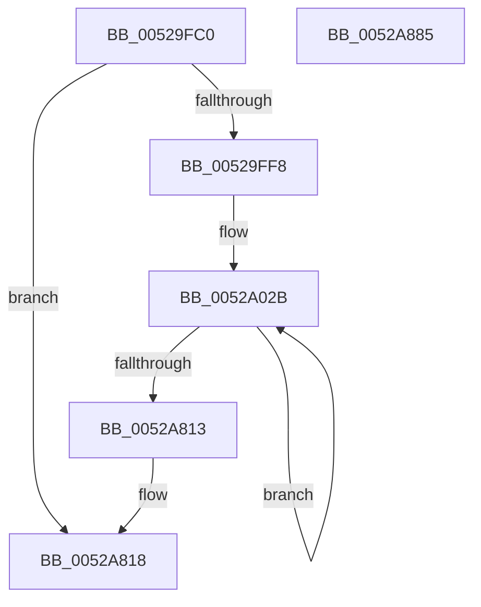

# SymCryptMd5AppendBlocks

- RVA: `0x00529FC0`–`0x0052A886` (길이 `2,246` bytes)
- VA: `0x0000000140529FC0`
- 실행 섹션: `.text`
- PDB 이름 있음: `예`; PDB Function 태그: `아니요`
- unwind 정보 RVA: `0x000C3378`
- 디코드: `674`개 명령, `2,246/2,246` bytes 표시
- 미해석 바이트: `0` (있으면 어셈블리에 `.byte`로 보존)

> 이 문서는 커널 이미지의 기계어와 PDB 기호를 분석해 생성했습니다. 4번과 5번은 함수 원형과 자료형을 바이너리 사용 방식에서 추정한 C 해석이며 원본 소스 복구 결과는 아닙니다.

## 1. Dependencies

- 직접 호출 지점: **0**; 고유 호출 대상: **0**
- 직접 호출자로 확인된 함수: **0**
- RIP 상대 이미지 참조: **0**

### Outgoing calls
- 직접 디코드된 call 명령이 없습니다.

### Direct callers
- 이 함수 시작 RVA로 연결되는 직접 call은 확인되지 않았습니다. 간접 호출은 완전히 역산할 수 없습니다.

### Static image references
- 디코드된 RIP-relative 메모리 참조가 없습니다.

## 2. Other-region calls and transfers

- 다른 실행 섹션으로 향하는 call: **0**
- 별도 외부 분기/꼬리 이동을 확인하지 못했습니다.

## 3. Assembly (complete function range)

```asm
00529FC0  48 89 5C 24 18                  mov qword ptr [rsp + 0x18], rbx
00529FC5  55                              push rbp
00529FC6  56                              push rsi
00529FC7  57                              push rdi
00529FC8  41 54                           push r12
00529FCA  41 55                           push r13
00529FCC  41 56                           push r14
00529FCE  41 57                           push r15
00529FD0  48 81 EC B0 00 00 00            sub rsp, 0xb0
00529FD7  8B 79 0C                        mov edi, dword ptr [rcx + 0xc]
00529FDA  8B 59 08                        mov ebx, dword ptr [rcx + 8]
00529FDD  44 8B 51 04                     mov r10d, dword ptr [rcx + 4]
00529FE1  4C 89 4C 24 58                  mov qword ptr [rsp + 0x58], r9
00529FE6  44 8B 09                        mov r9d, dword ptr [rcx]
00529FE9  48 89 4C 24 40                  mov qword ptr [rsp + 0x40], rcx
00529FEE  49 83 F8 40                     cmp r8, 0x40
00529FF2  0F 82 20 08 00 00               jb 0x14052a818
00529FF8  49 8B C0                        mov rax, r8
00529FFB  44 89 4C 24 28                  mov dword ptr [rsp + 0x28], r9d
0052A000  48 C1 E8 06                     shr rax, 6
0052A004  48 8D 6A 08                     lea rbp, [rdx + 8]
0052A008  48 89 44 24 38                  mov qword ptr [rsp + 0x38], rax
0052A00D  48 6B C0 C0                     imul rax, rax, -0x40
0052A011  89 7C 24 2C                     mov dword ptr [rsp + 0x2c], edi
0052A015  4C 03 C0                        add r8, rax
0052A018  89 5C 24 50                     mov dword ptr [rsp + 0x50], ebx
0052A01C  4C 89 44 24 48                  mov qword ptr [rsp + 0x48], r8
0052A021  44 89 54 24 24                  mov dword ptr [rsp + 0x24], r10d
0052A026  48 89 6C 24 30                  mov qword ptr [rsp + 0x30], rbp
0052A02B  8B 4D F8                        mov ecx, dword ptr [rbp - 8]
0052A02E  8B C3                           mov eax, ebx
0052A030  33 C7                           xor eax, edi
0052A032  8B 55 00                        mov edx, dword ptr [rbp]
0052A035  41 23 C2                        and eax, r10d
0052A038  44 8B 45 04                     mov r8d, dword ptr [rbp + 4]
0052A03C  33 C7                           xor eax, edi
0052A03E  44 8B 6D 0C                     mov r13d, dword ptr [rbp + 0xc]
0052A042  44 8B 75 14                     mov r14d, dword ptr [rbp + 0x14]
0052A046  89 4C 24 18                     mov dword ptr [rsp + 0x18], ecx
0052A04A  81 C1 78 A4 6A D7               add ecx, 0xd76aa478
0052A050  03 C1                           add eax, ecx
0052A052  89 54 24 10                     mov dword ptr [rsp + 0x10], edx
0052A056  44 03 C8                        add r9d, eax
0052A059  8B 4D FC                        mov ecx, dword ptr [rbp - 4]
0052A05C  89 0C 24                        mov dword ptr [rsp], ecx
0052A05F  41 8B C2                        mov eax, r10d
0052A062  33 C3                           xor eax, ebx
0052A064  41 C1 C1 07                     rol r9d, 7
0052A068  45 03 CA                        add r9d, r10d
0052A06B  44 89 44 24 1C                  mov dword ptr [rsp + 0x1c], r8d
0052A070  41 23 C1                        and eax, r9d
0052A073  33 C3                           xor eax, ebx
0052A075  05 56 B7 C7 E8                  add eax, 0xe8c7b756
0052A07A  03 C8                           add ecx, eax
0052A07C  41 8B C1                        mov eax, r9d
0052A07F  41 33 C2                        xor eax, r10d
0052A082  03 CF                           add ecx, edi
0052A084  C1 C1 0C                        rol ecx, 0xc
0052A087  41 03 C9                        add ecx, r9d
0052A08A  23 C1                           and eax, ecx
0052A08C  41 33 C2                        xor eax, r10d
0052A08F  41 81 C2 EE CE BD C1            add r10d, 0xc1bdceee
0052A096  05 DB 70 20 24                  add eax, 0x242070db
0052A09B  03 D0                           add edx, eax
0052A09D  41 8B C1                        mov eax, r9d
0052A0A0  33 C1                           xor eax, ecx
0052A0A2  03 D3                           add edx, ebx
0052A0A4  C1 C2 11                        rol edx, 0x11
0052A0A7  03 D1                           add edx, ecx
0052A0A9  23 C2                           and eax, edx
0052A0AB  41 33 C1                        xor eax, r9d
0052A0AE  44 03 C0                        add r8d, eax
0052A0B1  8B C1                           mov eax, ecx
0052A0B3  33 C2                           xor eax, edx
0052A0B5  45 03 C2                        add r8d, r10d
0052A0B8  44 8B 55 08                     mov r10d, dword ptr [rbp + 8]
0052A0BC  41 C1 C0 16                     rol r8d, 0x16
0052A0C0  44 03 C2                        add r8d, edx
0052A0C3  44 89 54 24 08                  mov dword ptr [rsp + 8], r10d
0052A0C8  41 23 C0                        and eax, r8d
0052A0CB  33 C1                           xor eax, ecx
0052A0CD  05 AF 0F 7C F5                  add eax, 0xf57c0faf
0052A0D2  44 03 C8                        add r9d, eax
0052A0D5  41 8B C0                        mov eax, r8d
0052A0D8  33 C2                           xor eax, edx
0052A0DA  45 03 CA                        add r9d, r10d
0052A0DD  44 8B 55 10                     mov r10d, dword ptr [rbp + 0x10]
0052A0E1  41 C1 C1 07                     rol r9d, 7
0052A0E5  45 03 C8                        add r9d, r8d
0052A0E8  44 89 54 24 04                  mov dword ptr [rsp + 4], r10d
0052A0ED  41 23 C1                        and eax, r9d
0052A0F0  33 C2                           xor eax, edx
0052A0F2  05 2A C6 87 47                  add eax, 0x4787c62a
0052A0F7  03 C8                           add ecx, eax
0052A0F9  41 8B C0                        mov eax, r8d
0052A0FC  41 33 C1                        xor eax, r9d
0052A0FF  41 03 CD                        add ecx, r13d
0052A102  C1 C1 0C                        rol ecx, 0xc
0052A105  41 03 C9                        add ecx, r9d
0052A108  23 C1                           and eax, ecx
0052A10A  41 33 C0                        xor eax, r8d
0052A10D  05 13 46 30 A8                  add eax, 0xa8304613
0052A112  03 D0                           add edx, eax
0052A114  8B C1                           mov eax, ecx
0052A116  41 03 D2                        add edx, r10d
0052A119  41 33 C1                        xor eax, r9d
0052A11C  C1 C2 11                        rol edx, 0x11
0052A11F  03 D1                           add edx, ecx
0052A121  23 C2                           and eax, edx
0052A123  41 33 C1                        xor eax, r9d
0052A126  8B 5D 18                        mov ebx, dword ptr [rbp + 0x18]
0052A129  41 81 C1 D8 98 80 69            add r9d, 0x698098d8
0052A130  44 8B 7D 20                     mov r15d, dword ptr [rbp + 0x20]
0052A134  05 01 95 46 FD                  add eax, 0xfd469501
0052A139  8B 75 28                        mov esi, dword ptr [rbp + 0x28]
0052A13C  44 03 C0                        add r8d, eax
0052A13F  44 8B 65 2C                     mov r12d, dword ptr [rbp + 0x2c]
0052A143  44 8B D2                        mov r10d, edx
0052A146  8B 7D 30                        mov edi, dword ptr [rbp + 0x30]
0052A149  44 33 D1                        xor r10d, ecx
0052A14C  45 03 C6                        add r8d, r14d
0052A14F  89 5C 24 20                     mov dword ptr [rsp + 0x20], ebx
0052A153  41 C1 C0 16                     rol r8d, 0x16
0052A157  44 03 C2                        add r8d, edx
0052A15A  45 23 D0                        and r10d, r8d
0052A15D  45 8B D8                        mov r11d, r8d
0052A160  44 33 DA                        xor r11d, edx
0052A163  44 33 D1                        xor r10d, ecx
0052A166  45 03 D1                        add r10d, r9d
0052A169  81 C1 AF F7 44 8B               add ecx, 0x8b44f7af
0052A16F  44 8B 4D 1C                     mov r9d, dword ptr [rbp + 0x1c]
0052A173  44 03 D3                        add r10d, ebx
0052A176  44 89 4C 24 14                  mov dword ptr [rsp + 0x14], r9d
0052A17B  41 C1 C2 07                     rol r10d, 7
0052A17F  45 03 D0                        add r10d, r8d
0052A182  45 23 DA                        and r11d, r10d
0052A185  44 33 DA                        xor r11d, edx
0052A188  81 C2 B1 5B FF FF               add edx, 0xffff5bb1
0052A18E  44 03 D9                        add r11d, ecx
0052A191  8B 4D 24                        mov ecx, dword ptr [rbp + 0x24]
0052A194  8B 6D 34                        mov ebp, dword ptr [rbp + 0x34]
0052A197  45 03 D9                        add r11d, r9d
0052A19A  89 4C 24 0C                     mov dword ptr [rsp + 0xc], ecx
0052A19E  45 8B CA                        mov r9d, r10d
0052A1A1  45 33 C8                        xor r9d, r8d
0052A1A4  41 C1 C3 0C                     rol r11d, 0xc
0052A1A8  45 03 DA                        add r11d, r10d
0052A1AB  45 23 CB                        and r9d, r11d
0052A1AE  41 8B C3                        mov eax, r11d
0052A1B1  45 33 C8                        xor r9d, r8d
0052A1B4  41 33 C2                        xor eax, r10d
0052A1B7  44 03 CA                        add r9d, edx
0052A1BA  45 03 CF                        add r9d, r15d
0052A1BD  41 C1 C1 11                     rol r9d, 0x11
0052A1C1  45 03 CB                        add r9d, r11d
0052A1C4  41 23 C1                        and eax, r9d
0052A1C7  41 33 C2                        xor eax, r10d
0052A1CA  05 BE D7 5C 89                  add eax, 0x895cd7be
0052A1CF  44 03 C0                        add r8d, eax
0052A1D2  44 03 C1                        add r8d, ecx
0052A1D5  41 8B C9                        mov ecx, r9d
0052A1D8  41 33 CB                        xor ecx, r11d
0052A1DB  41 C1 C0 16                     rol r8d, 0x16
0052A1DF  45 03 C1                        add r8d, r9d
0052A1E2  41 23 C8                        and ecx, r8d
0052A1E5  41 8B D0                        mov edx, r8d
0052A1E8  41 33 D1                        xor edx, r9d
0052A1EB  41 33 CB                        xor ecx, r11d
0052A1EE  81 C1 22 11 90 6B               add ecx, 0x6b901122
0052A1F4  41 03 CA                        add ecx, r10d
0052A1F7  03 CE                           add ecx, esi
0052A1F9  C1 C1 07                        rol ecx, 7
0052A1FC  41 03 C8                        add ecx, r8d
0052A1FF  23 D1                           and edx, ecx
0052A201  8B C1                           mov eax, ecx
0052A203  41 33 D1                        xor edx, r9d
0052A206  41 33 C0                        xor eax, r8d
0052A209  81 C2 93 71 98 FD               add edx, 0xfd987193
0052A20F  41 03 D3                        add edx, r11d
0052A212  41 03 D4                        add edx, r12d
0052A215  C1 C2 0C                        rol edx, 0xc
0052A218  03 D1                           add edx, ecx
0052A21A  23 C2                           and eax, edx
0052A21C  41 33 C0                        xor eax, r8d
0052A21F  05 8E 43 79 A6                  add eax, 0xa679438e
0052A224  44 03 C8                        add r9d, eax
0052A227  8B C2                           mov eax, edx
0052A229  44 03 CF                        add r9d, edi
0052A22C  41 C1 C1 11                     rol r9d, 0x11
0052A230  44 03 CA                        add r9d, edx
0052A233  33 C1                           xor eax, ecx
0052A235  41 23 C1                        and eax, r9d
0052A238  33 C1                           xor eax, ecx
0052A23A  05 21 08 B4 49                  add eax, 0x49b40821
0052A23F  44 03 C0                        add r8d, eax
0052A242  44 03 C5                        add r8d, ebp
0052A245  41 C1 C0 16                     rol r8d, 0x16
0052A249  45 03 C1                        add r8d, r9d
0052A24C  41 8B C0                        mov eax, r8d
0052A24F  41 33 C1                        xor eax, r9d
0052A252  23 C2                           and eax, edx
0052A254  41 33 C1                        xor eax, r9d
0052A257  03 C1                           add eax, ecx
0052A259  8B 0C 24                        mov ecx, dword ptr [rsp]
0052A25C  81 C1 62 25 1E F6               add ecx, 0xf61e2562
0052A262  03 C8                           add ecx, eax
0052A264  C1 C1 05                        rol ecx, 5
0052A267  41 03 C8                        add ecx, r8d
0052A26A  8B C1                           mov eax, ecx
0052A26C  41 33 C0                        xor eax, r8d
0052A26F  41 23 C1                        and eax, r9d
0052A272  41 33 C0                        xor eax, r8d
0052A275  03 C2                           add eax, edx
0052A277  8B 54 24 04                     mov edx, dword ptr [rsp + 4]
0052A27B  81 C2 40 B3 40 C0               add edx, 0xc040b340
0052A281  03 D0                           add edx, eax
0052A283  C1 C2 09                        rol edx, 9
0052A286  03 D1                           add edx, ecx
0052A288  8B C2                           mov eax, edx
0052A28A  33 C1                           xor eax, ecx
0052A28C  41 23 C0                        and eax, r8d
0052A28F  33 C1                           xor eax, ecx
0052A291  41 03 C1                        add eax, r9d
0052A294  44 8B 4C 24 0C                  mov r9d, dword ptr [rsp + 0xc]
0052A299  41 81 C1 51 5A 5E 26            add r9d, 0x265e5a51
0052A2A0  44 03 C8                        add r9d, eax
0052A2A3  8B C2                           mov eax, edx
0052A2A5  41 C1 C1 0E                     rol r9d, 0xe
0052A2A9  44 03 CA                        add r9d, edx
0052A2AC  41 33 C1                        xor eax, r9d
0052A2AF  23 C1                           and eax, ecx
0052A2B1  33 C2                           xor eax, edx
0052A2B3  41 03 C0                        add eax, r8d
0052A2B6  44 8B 44 24 18                  mov r8d, dword ptr [rsp + 0x18]
0052A2BB  41 81 C0 AA C7 B6 E9            add r8d, 0xe9b6c7aa
0052A2C2  44 03 C0                        add r8d, eax
0052A2C5  41 C1 C0 14                     rol r8d, 0x14
0052A2C9  45 03 C1                        add r8d, r9d
0052A2CC  41 8B C0                        mov eax, r8d
0052A2CF  41 33 C1                        xor eax, r9d
0052A2D2  23 C2                           and eax, edx
0052A2D4  41 33 C1                        xor eax, r9d
0052A2D7  05 5D 10 2F D6                  add eax, 0xd62f105d
0052A2DC  03 C8                           add ecx, eax
0052A2DE  41 03 CD                        add ecx, r13d
0052A2E1  C1 C1 05                        rol ecx, 5
0052A2E4  41 03 C8                        add ecx, r8d
0052A2E7  8B C1                           mov eax, ecx
0052A2E9  41 33 C0                        xor eax, r8d
0052A2EC  41 23 C1                        and eax, r9d
0052A2EF  41 33 C0                        xor eax, r8d
0052A2F2  05 53 14 44 02                  add eax, 0x2441453
0052A2F7  03 D0                           add edx, eax
0052A2F9  41 03 D7                        add edx, r15d
0052A2FC  C1 C2 09                        rol edx, 9
0052A2FF  03 D1                           add edx, ecx
0052A301  8B C2                           mov eax, edx
0052A303  33 C1                           xor eax, ecx
0052A305  41 23 C0                        and eax, r8d
0052A308  33 C1                           xor eax, ecx
0052A30A  05 81 E6 A1 D8                  add eax, 0xd8a1e681
0052A30F  03 C5                           add eax, ebp
0052A311  44 03 C8                        add r9d, eax
0052A314  41 C1 C1 0E                     rol r9d, 0xe
0052A318  44 03 CA                        add r9d, edx
0052A31B  41 8B C1                        mov eax, r9d
0052A31E  33 C2                           xor eax, edx
0052A320  23 C1                           and eax, ecx
0052A322  33 C2                           xor eax, edx
0052A324  05 C8 FB D3 E7                  add eax, 0xe7d3fbc8
0052A329  03 44 24 08                     add eax, dword ptr [rsp + 8]
0052A32D  44 03 C0                        add r8d, eax
0052A330  41 C1 C0 14                     rol r8d, 0x14
0052A334  45 03 C1                        add r8d, r9d
0052A337  41 8B C0                        mov eax, r8d
0052A33A  41 33 C1                        xor eax, r9d
0052A33D  23 C2                           and eax, edx
0052A33F  41 33 C1                        xor eax, r9d
0052A342  05 E6 CD E1 21                  add eax, 0x21e1cde6
0052A347  03 44 24 14                     add eax, dword ptr [rsp + 0x14]
0052A34B  03 C8                           add ecx, eax
0052A34D  C1 C1 05                        rol ecx, 5
0052A350  41 03 C8                        add ecx, r8d
0052A353  8B C1                           mov eax, ecx
0052A355  41 33 C0                        xor eax, r8d
0052A358  41 23 C1                        and eax, r9d
0052A35B  41 33 C0                        xor eax, r8d
0052A35E  44 8D 99 05 E9 E3 A9            lea r11d, [rcx - 0x561c16fb]
0052A365  05 D6 07 37 C3                  add eax, 0xc33707d6
0052A36A  03 C7                           add eax, edi
0052A36C  03 D0                           add edx, eax
0052A36E  C1 C2 09                        rol edx, 9
0052A371  03 D1                           add edx, ecx
0052A373  8B C2                           mov eax, edx
0052A375  33 C1                           xor eax, ecx
0052A377  41 23 C0                        and eax, r8d
0052A37A  33 C1                           xor eax, ecx
0052A37C  44 8D 92 F8 A3 EF FC            lea r10d, [rdx - 0x3105c08]
0052A383  05 87 0D D5 F4                  add eax, 0xf4d50d87
0052A388  03 44 24 1C                     add eax, dword ptr [rsp + 0x1c]
0052A38C  44 03 C8                        add r9d, eax
0052A38F  41 C1 C1 0E                     rol r9d, 0xe
0052A393  44 03 CA                        add r9d, edx
0052A396  41 8B C1                        mov eax, r9d
0052A399  33 C2                           xor eax, edx
0052A39B  23 C1                           and eax, ecx
0052A39D  33 C2                           xor eax, edx
0052A39F  05 ED 14 5A 45                  add eax, 0x455a14ed
0052A3A4  03 C3                           add eax, ebx
0052A3A6  41 8D 99 D9 02 6F 67            lea ebx, [r9 + 0x676f02d9]
0052A3AD  44 03 C0                        add r8d, eax
0052A3B0  41 C1 C0 14                     rol r8d, 0x14
0052A3B4  45 03 C1                        add r8d, r9d
0052A3B7  41 8B C0                        mov eax, r8d
0052A3BA  41 33 C1                        xor eax, r9d
0052A3BD  23 C2                           and eax, edx
0052A3BF  41 33 C1                        xor eax, r9d
0052A3C2  41 03 C4                        add eax, r12d
0052A3C5  44 03 D8                        add r11d, eax
0052A3C8  41 C1 C3 05                     rol r11d, 5
0052A3CC  45 03 D8                        add r11d, r8d
0052A3CF  41 8B C3                        mov eax, r11d
0052A3D2  41 33 C0                        xor eax, r8d
0052A3D5  41 23 C1                        and eax, r9d
0052A3D8  45 8D 88 8A 4C 2A 8D            lea r9d, [r8 - 0x72d5b376]
0052A3DF  41 33 C0                        xor eax, r8d
0052A3E2  03 44 24 10                     add eax, dword ptr [rsp + 0x10]
0052A3E6  44 03 D0                        add r10d, eax
0052A3E9  41 C1 C2 09                     rol r10d, 9
0052A3ED  45 03 D3                        add r10d, r11d
0052A3F0  41 8B C2                        mov eax, r10d
0052A3F3  41 8B D2                        mov edx, r10d
0052A3F6  41 33 C3                        xor eax, r11d
0052A3F9  41 23 C0                        and eax, r8d
0052A3FC  41 33 C3                        xor eax, r11d
0052A3FF  41 03 C6                        add eax, r14d
0052A402  03 D8                           add ebx, eax
0052A404  41 8B C2                        mov eax, r10d
0052A407  C1 C3 0E                        rol ebx, 0xe
0052A40A  41 03 DA                        add ebx, r10d
0052A40D  33 C3                           xor eax, ebx
0052A40F  41 23 C3                        and eax, r11d
0052A412  41 33 C2                        xor eax, r10d
0052A415  03 C6                           add eax, esi
0052A417  44 03 C8                        add r9d, eax
0052A41A  41 C1 C1 14                     rol r9d, 0x14
0052A41E  44 03 CB                        add r9d, ebx
0052A421  41 8B C9                        mov ecx, r9d
0052A424  33 CB                           xor ecx, ebx
0052A426  33 D1                           xor edx, ecx
0052A428  81 C2 42 39 FA FF               add edx, 0xfffa3942
0052A42E  41 03 D5                        add edx, r13d
0052A431  41 03 D3                        add edx, r11d
0052A434  44 8B 5C 24 18                  mov r11d, dword ptr [rsp + 0x18]
0052A439  41 81 C2 81 F6 71 87            add r10d, 0x8771f681
0052A440  C1 C2 04                        rol edx, 4
0052A443  41 03 D1                        add edx, r9d
0052A446  33 CA                           xor ecx, edx
0052A448  03 4C 24 20                     add ecx, dword ptr [rsp + 0x20]
0052A44C  41 03 CA                        add ecx, r10d
0052A44F  44 8B 14 24                     mov r10d, dword ptr [rsp]
0052A453  C1 C1 0B                        rol ecx, 0xb
0052A456  41 81 C2 44 EA BE A4            add r10d, 0xa4beea44
0052A45D  03 CA                           add ecx, edx
0052A45F  44 8B C1                        mov r8d, ecx
0052A462  45 33 C1                        xor r8d, r9d
0052A465  44 33 C2                        xor r8d, edx
0052A468  41 81 C0 22 61 9D 6D            add r8d, 0x6d9d6122
0052A46F  44 03 44 24 0C                  add r8d, dword ptr [rsp + 0xc]
0052A474  44 03 C3                        add r8d, ebx
0052A477  41 C1 C0 10                     rol r8d, 0x10
0052A47B  44 03 C1                        add r8d, ecx
0052A47E  41 8B C0                        mov eax, r8d
0052A481  33 C1                           xor eax, ecx
0052A483  33 C2                           xor eax, edx
0052A485  05 0C 38 E5 FD                  add eax, 0xfde5380c
0052A48A  44 03 C8                        add r9d, eax
0052A48D  41 8B C0                        mov eax, r8d
0052A490  33 C1                           xor eax, ecx
0052A492  44 03 CF                        add r9d, edi
0052A495  41 C1 C1 17                     rol r9d, 0x17
0052A499  45 03 C8                        add r9d, r8d
0052A49C  41 33 C1                        xor eax, r9d
0052A49F  03 C2                           add eax, edx
0052A4A1  41 8B D1                        mov edx, r9d
0052A4A4  44 03 D0                        add r10d, eax
0052A4A7  41 8B C0                        mov eax, r8d
0052A4AA  41 33 C1                        xor eax, r9d
0052A4AD  41 C1 C2 04                     rol r10d, 4
0052A4B1  41 81 C0 60 4B BB F6            add r8d, 0xf6bb4b60
0052A4B8  45 03 D1                        add r10d, r9d
0052A4BB  41 33 C2                        xor eax, r10d
0052A4BE  03 C1                           add eax, ecx
0052A4C0  8B 4C 24 08                     mov ecx, dword ptr [rsp + 8]
0052A4C4  81 C1 A9 CF DE 4B               add ecx, 0x4bdecfa9
0052A4CA  03 C8                           add ecx, eax
0052A4CC  C1 C1 0B                        rol ecx, 0xb
0052A4CF  41 03 CA                        add ecx, r10d
0052A4D2  33 D1                           xor edx, ecx
0052A4D4  41 33 D2                        xor edx, r10d
0052A4D7  41 03 D0                        add edx, r8d
0052A4DA  41 03 D6                        add edx, r14d
0052A4DD  C1 C2 10                        rol edx, 0x10
0052A4E0  03 D1                           add edx, ecx
0052A4E2  44 8B C2                        mov r8d, edx
0052A4E5  8B C2                           mov eax, edx
0052A4E7  33 C1                           xor eax, ecx
0052A4E9  44 33 C1                        xor r8d, ecx
0052A4EC  45 33 C2                        xor r8d, r10d
0052A4EF  41 81 C0 70 BC BF BE            add r8d, 0xbebfbc70
0052A4F6  45 03 C1                        add r8d, r9d
0052A4F9  45 03 C7                        add r8d, r15d
0052A4FC  41 C1 C0 17                     rol r8d, 0x17
0052A500  44 03 C2                        add r8d, edx
0052A503  41 33 C0                        xor eax, r8d
0052A506  05 C6 7E 9B 28                  add eax, 0x289b7ec6
0052A50B  44 03 D0                        add r10d, eax
0052A50E  8B C2                           mov eax, edx
0052A510  45 03 D4                        add r10d, r12d
0052A513  41 C1 C2 04                     rol r10d, 4
0052A517  45 03 D0                        add r10d, r8d
0052A51A  41 33 C2                        xor eax, r10d
0052A51D  41 33 C0                        xor eax, r8d
0052A520  03 C1                           add eax, ecx
0052A522  41 8D 8B FA 27 A1 EA            lea ecx, [r11 - 0x155ed806]
0052A529  03 C8                           add ecx, eax
0052A52B  C1 C1 0B                        rol ecx, 0xb
0052A52E  41 03 CA                        add ecx, r10d
0052A531  8B C1                           mov eax, ecx
0052A533  41 33 C2                        xor eax, r10d
0052A536  41 33 C0                        xor eax, r8d
0052A539  05 85 30 EF D4                  add eax, 0xd4ef3085
0052A53E  03 44 24 1C                     add eax, dword ptr [rsp + 0x1c]
0052A542  03 D0                           add edx, eax
0052A544  44 8B 4C 24 04                  mov r9d, dword ptr [rsp + 4]
0052A549  C1 C2 10                        rol edx, 0x10
0052A54C  41 81 C1 05 1D 88 04            add r9d, 0x4881d05
0052A553  03 D1                           add edx, ecx
0052A555  8B C2                           mov eax, edx
0052A557  33 C1                           xor eax, ecx
0052A559  41 33 C2                        xor eax, r10d
0052A55C  41 03 C0                        add eax, r8d
0052A55F  44 8B 44 24 14                  mov r8d, dword ptr [rsp + 0x14]
0052A564  44 03 C8                        add r9d, eax
0052A567  41 81 C0 39 D0 D4 D9            add r8d, 0xd9d4d039
0052A56E  8B C2                           mov eax, edx
0052A570  41 C1 C1 17                     rol r9d, 0x17
0052A574  33 C1                           xor eax, ecx
0052A576  44 03 CA                        add r9d, edx
0052A579  41 33 C1                        xor eax, r9d
0052A57C  41 03 C2                        add eax, r10d
0052A57F  44 03 C0                        add r8d, eax
0052A582  41 8B C1                        mov eax, r9d
0052A585  41 C1 C0 04                     rol r8d, 4
0052A589  45 03 C1                        add r8d, r9d
0052A58C  41 33 C0                        xor eax, r8d
0052A58F  33 C2                           xor eax, edx
0052A591  05 E5 99 DB E6                  add eax, 0xe6db99e5
0052A596  03 C8                           add ecx, eax
0052A598  41 8B C1                        mov eax, r9d
0052A59B  41 33 C0                        xor eax, r8d
0052A59E  03 CE                           add ecx, esi
0052A5A0  C1 C1 0B                        rol ecx, 0xb
0052A5A3  41 03 C8                        add ecx, r8d
0052A5A6  33 C1                           xor eax, ecx
0052A5A8  05 F8 7C A2 1F                  add eax, 0x1fa27cf8
0052A5AD  03 D0                           add edx, eax
0052A5AF  03 D5                           add edx, ebp
0052A5B1  C1 C2 10                        rol edx, 0x10
0052A5B4  03 D1                           add edx, ecx
0052A5B6  8B C2                           mov eax, edx
0052A5B8  44 8B D2                        mov r10d, edx
0052A5BB  33 C1                           xor eax, ecx
0052A5BD  41 F7 D2                        not r10d
0052A5C0  41 33 C0                        xor eax, r8d
0052A5C3  05 65 56 AC C4                  add eax, 0xc4ac5665
0052A5C8  03 44 24 10                     add eax, dword ptr [rsp + 0x10]
0052A5CC  44 03 C8                        add r9d, eax
0052A5CF  8B C1                           mov eax, ecx
0052A5D1  81 C1 97 FF 2A 43               add ecx, 0x432aff97
0052A5D7  41 C1 C1 17                     rol r9d, 0x17
0052A5DB  44 03 CA                        add r9d, edx
0052A5DE  F7 D0                           not eax
0052A5E0  41 0B C1                        or eax, r9d
0052A5E3  33 C2                           xor eax, edx
0052A5E5  81 C2 A7 23 94 AB               add edx, 0xab9423a7
0052A5EB  41 03 C0                        add eax, r8d
0052A5EE  45 8D 83 44 22 29 F4            lea r8d, [r11 - 0xbd6ddbc]
0052A5F5  44 03 C0                        add r8d, eax
0052A5F8  45 8B D9                        mov r11d, r9d
0052A5FB  41 F7 D3                        not r11d
0052A5FE  41 C1 C0 06                     rol r8d, 6
0052A602  45 03 C1                        add r8d, r9d
0052A605  45 0B D0                        or r10d, r8d
0052A608  45 33 D1                        xor r10d, r9d
0052A60B  41 81 C1 39 A0 93 FC            add r9d, 0xfc93a039
0052A612  44 03 D1                        add r10d, ecx
0052A615  41 8B C8                        mov ecx, r8d
0052A618  F7 D1                           not ecx
0052A61A  45 03 D6                        add r10d, r14d
0052A61D  41 C1 C2 0A                     rol r10d, 0xa
0052A621  45 03 D0                        add r10d, r8d
0052A624  45 0B DA                        or r11d, r10d
0052A627  45 33 D8                        xor r11d, r8d
0052A62A  44 03 DA                        add r11d, edx
0052A62D  41 8B D2                        mov edx, r10d
0052A630  44 03 DF                        add r11d, edi
0052A633  41 C1 C3 0F                     rol r11d, 0xf
0052A637  45 03 DA                        add r11d, r10d
0052A63A  41 0B CB                        or ecx, r11d
0052A63D  41 33 CA                        xor ecx, r10d
0052A640  41 03 C9                        add ecx, r9d
0052A643  41 03 CD                        add ecx, r13d
0052A646  C1 C1 15                        rol ecx, 0x15
0052A649  41 03 CB                        add ecx, r11d
0052A64C  41 81 C0 C3 59 5B 65            add r8d, 0x655b59c3
0052A653  F7 D2                           not edx
0052A655  0B D1                           or edx, ecx
0052A657  44 8B C9                        mov r9d, ecx
0052A65A  41 33 D3                        xor edx, r11d
0052A65D  41 F7 D1                        not r9d
0052A660  41 03 D0                        add edx, r8d
0052A663  45 8B C3                        mov r8d, r11d
0052A666  41 F7 D0                        not r8d
0052A669  03 D6                           add edx, esi
0052A66B  C1 C2 06                        rol edx, 6
0052A66E  03 D1                           add edx, ecx
0052A670  44 0B C2                        or r8d, edx
0052A673  8B C2                           mov eax, edx
0052A675  F7 D0                           not eax
0052A677  44 33 C1                        xor r8d, ecx
0052A67A  41 81 C0 92 CC 0C 8F            add r8d, 0x8f0ccc92
0052A681  44 03 44 24 1C                  add r8d, dword ptr [rsp + 0x1c]
0052A686  45 03 C2                        add r8d, r10d
0052A689  44 8B 54 24 08                  mov r10d, dword ptr [rsp + 8]
0052A68E  41 C1 C0 0A                     rol r8d, 0xa
0052A692  44 03 C2                        add r8d, edx
0052A695  45 0B C8                        or r9d, r8d
0052A698  44 33 CA                        xor r9d, edx
0052A69B  41 81 C1 7D F4 EF FF            add r9d, 0xffeff47d
0052A6A2  45 03 CF                        add r9d, r15d
0052A6A5  45 03 CB                        add r9d, r11d
0052A6A8  41 C1 C1 0F                     rol r9d, 0xf
0052A6AC  45 03 C8                        add r9d, r8d
0052A6AF  41 0B C1                        or eax, r9d
0052A6B2  41 33 C0                        xor eax, r8d
0052A6B5  03 C1                           add eax, ecx
0052A6B7  8B 0C 24                        mov ecx, dword ptr [rsp]
0052A6BA  81 C1 D1 5D 84 85               add ecx, 0x85845dd1
0052A6C0  03 C8                           add ecx, eax
0052A6C2  41 8B C0                        mov eax, r8d
0052A6C5  F7 D0                           not eax
0052A6C7  C1 C1 15                        rol ecx, 0x15
0052A6CA  41 03 C9                        add ecx, r9d
0052A6CD  0B C1                           or eax, ecx
0052A6CF  41 33 C1                        xor eax, r9d
0052A6D2  03 C2                           add eax, edx
0052A6D4  8B 54 24 20                     mov edx, dword ptr [rsp + 0x20]
0052A6D8  81 C2 4F 7E A8 6F               add edx, 0x6fa87e4f
0052A6DE  03 D0                           add edx, eax
0052A6E0  41 8B C1                        mov eax, r9d
0052A6E3  F7 D0                           not eax
0052A6E5  C1 C2 06                        rol edx, 6
0052A6E8  03 D1                           add edx, ecx
0052A6EA  0B C2                           or eax, edx
0052A6EC  44 8B DA                        mov r11d, edx
0052A6EF  33 C1                           xor eax, ecx
0052A6F1  41 F7 D3                        not r11d
0052A6F4  05 E0 E6 2C FE                  add eax, 0xfe2ce6e0
0052A6F9  44 03 C0                        add r8d, eax
0052A6FC  8B C1                           mov eax, ecx
0052A6FE  F7 D0                           not eax
0052A700  44 03 C5                        add r8d, ebp
0052A703  41 C1 C0 0A                     rol r8d, 0xa
0052A707  81 C1 A1 11 08 4E               add ecx, 0x4e0811a1
0052A70D  44 03 C2                        add r8d, edx
0052A710  41 0B C0                        or eax, r8d
0052A713  33 C2                           xor eax, edx
0052A715  41 03 C1                        add eax, r9d
0052A718  44 8B 4C 24 04                  mov r9d, dword ptr [rsp + 4]
0052A71D  41 81 C1 14 43 01 A3            add r9d, 0xa3014314
0052A724  44 03 C8                        add r9d, eax
0052A727  41 8B C0                        mov eax, r8d
0052A72A  F7 D0                           not eax
0052A72C  41 C1 C1 0F                     rol r9d, 0xf
0052A730  45 03 C8                        add r9d, r8d
0052A733  45 0B D9                        or r11d, r9d
0052A736  45 33 D8                        xor r11d, r8d
0052A739  44 03 D9                        add r11d, ecx
0052A73C  45 03 DC                        add r11d, r12d
0052A73F  41 C1 C3 15                     rol r11d, 0x15
0052A743  45 03 D9                        add r11d, r9d
0052A746  41 0B C3                        or eax, r11d
0052A749  41 33 C1                        xor eax, r9d
0052A74C  03 C2                           add eax, edx
0052A74E  41 81 C2 82 7E 53 F7            add r10d, 0xf7537e82
0052A755  8B 7C 24 2C                     mov edi, dword ptr [rsp + 0x2c]
0052A759  41 8D 89 BB D2 D7 2A            lea ecx, [r9 + 0x2ad7d2bb]
0052A760  8B 5C 24 50                     mov ebx, dword ptr [rsp + 0x50]
0052A764  41 8D 90 35 F2 3A BD            lea edx, [r8 - 0x42c50dcb]
0052A76B  4C 8B 44 24 40                  mov r8, qword ptr [rsp + 0x40]
0052A770  44 03 D0                        add r10d, eax
0052A773  48 8B 6C 24 30                  mov rbp, qword ptr [rsp + 0x30]
0052A778  41 8B C1                        mov eax, r9d
0052A77B  44 8B 4C 24 28                  mov r9d, dword ptr [rsp + 0x28]
0052A780  F7 D0                           not eax
0052A782  41 C1 C2 06                     rol r10d, 6
0052A786  48 83 C5 40                     add rbp, 0x40
0052A78A  45 03 D3                        add r10d, r11d
0052A78D  48 89 6C 24 30                  mov qword ptr [rsp + 0x30], rbp
0052A792  41 0B C2                        or eax, r10d
0052A795  45 03 CA                        add r9d, r10d
0052A798  41 33 C3                        xor eax, r11d
0052A79B  45 89 08                        mov dword ptr [r8], r9d
0052A79E  03 44 24 0C                     add eax, dword ptr [rsp + 0xc]
0052A7A2  03 D0                           add edx, eax
0052A7A4  44 89 4C 24 28                  mov dword ptr [rsp + 0x28], r9d
0052A7A9  C1 C2 0A                        rol edx, 0xa
0052A7AC  41 8B C3                        mov eax, r11d
0052A7AF  41 03 D2                        add edx, r10d
0052A7B2  F7 D0                           not eax
0052A7B4  0B C2                           or eax, edx
0052A7B6  03 FA                           add edi, edx
0052A7B8  41 33 C2                        xor eax, r10d
0052A7BB  41 89 78 0C                     mov dword ptr [r8 + 0xc], edi
0052A7BF  03 44 24 10                     add eax, dword ptr [rsp + 0x10]
0052A7C3  41 F7 D2                        not r10d
0052A7C6  03 C8                           add ecx, eax
0052A7C8  89 7C 24 2C                     mov dword ptr [rsp + 0x2c], edi
0052A7CC  8B 44 24 14                     mov eax, dword ptr [rsp + 0x14]
0052A7D0  05 91 D3 86 EB                  add eax, 0xeb86d391
0052A7D5  C1 C1 0F                        rol ecx, 0xf
0052A7D8  03 CA                           add ecx, edx
0052A7DA  44 0B D1                        or r10d, ecx
0052A7DD  03 D9                           add ebx, ecx
0052A7DF  44 33 D2                        xor r10d, edx
0052A7E2  41 89 58 08                     mov dword ptr [r8 + 8], ebx
0052A7E6  45 03 D3                        add r10d, r11d
0052A7E9  89 5C 24 50                     mov dword ptr [rsp + 0x50], ebx
0052A7ED  44 03 D0                        add r10d, eax
0052A7F0  41 C1 C2 15                     rol r10d, 0x15
0052A7F4  44 03 54 24 24                  add r10d, dword ptr [rsp + 0x24]
0052A7F9  44 03 D1                        add r10d, ecx
0052A7FC  48 83 6C 24 38 01               sub qword ptr [rsp + 0x38], 1
0052A802  41 8B C2                        mov eax, r10d
0052A805  89 44 24 24                     mov dword ptr [rsp + 0x24], eax
0052A809  41 89 40 04                     mov dword ptr [r8 + 4], eax
0052A80D  0F 85 18 F8 FF FF               jne 0x14052a02b
0052A813  4C 8B 44 24 48                  mov r8, qword ptr [rsp + 0x48]
0052A818  48 8B 44 24 58                  mov rax, qword ptr [rsp + 0x58]
0052A81D  48 8B 9C 24 00 01 00 00         mov rbx, qword ptr [rsp + 0x100]
0052A825  4C 89 00                        mov qword ptr [rax], r8
0052A828  33 C0                           xor eax, eax
0052A82A  48 89 44 24 58                  mov qword ptr [rsp + 0x58], rax
0052A82F  48 89 44 24 60                  mov qword ptr [rsp + 0x60], rax
0052A834  48 89 44 24 70                  mov qword ptr [rsp + 0x70], rax
0052A839  48 89 44 24 78                  mov qword ptr [rsp + 0x78], rax
0052A83E  48 89 84 24 80 00 00 00         mov qword ptr [rsp + 0x80], rax
0052A846  48 89 84 24 88 00 00 00         mov qword ptr [rsp + 0x88], rax
0052A84E  48 89 84 24 90 00 00 00         mov qword ptr [rsp + 0x90], rax
0052A856  48 89 84 24 98 00 00 00         mov qword ptr [rsp + 0x98], rax
0052A85E  48 89 84 24 A0 00 00 00         mov qword ptr [rsp + 0xa0], rax
0052A866  48 89 84 24 A8 00 00 00         mov qword ptr [rsp + 0xa8], rax
0052A86E  89 44 24 50                     mov dword ptr [rsp + 0x50], eax
0052A872  48 81 C4 B0 00 00 00            add rsp, 0xb0
0052A879  41 5F                           pop r15
0052A87B  41 5E                           pop r14
0052A87D  41 5D                           pop r13
0052A87F  41 5C                           pop r12
0052A881  5F                              pop rdi
0052A882  5E                              pop rsi
0052A883  5D                              pop rbp
0052A884  C3                              ret
0052A885  CC                              int3
```

## 4. C-style interpretation (structured pseudocode)

```c
__int64 __fastcall SymCryptMd5AppendBlocks(__int64 a1, __int64 a2, __int64 a3, __int64 a4)
{
    __int64 result;
    __int64 v_r10;
    __int64 v_r11;
    __int64 v_rbp;
    __int64 v_rbx;
    __int64 v_rdi;
    __int64 v_rsp;
    unsigned __int64 v_stack_m40;
    unsigned __int64 v_stack_m48;
    unsigned __int64 v_stack_m50;
    unsigned __int64 v_stack_m58;
    unsigned __int64 v_stack_m60;
    unsigned __int64 v_stack_m68;
    unsigned __int64 v_stack_m70;
    unsigned __int64 v_stack_m78;
    unsigned __int64 v_stack_m88;
    unsigned __int64 v_stack_m90;
    unsigned int v_stack_m98;
    unsigned __int64 v_stack_mA0;
    unsigned __int64 v_stack_mA8;
    unsigned __int64 v_stack_mB0;
    unsigned __int64 v_stack_mB8;
    unsigned int v_stack_mBC;
    unsigned int v_stack_mC0;
    unsigned int v_stack_mC4;
    unsigned int v_stack_mC8;
    unsigned int v_stack_mCC;
    unsigned int v_stack_mD0;
    unsigned int v_stack_mD4;
    unsigned int v_stack_mD8;
    unsigned int v_stack_mDC;
    unsigned int v_stack_mE0;
    unsigned int v_stack_mE4;
    unsigned int v_stack_mE8;
    unsigned __int64 v_stack_p18;

    v_stack_p18 = v_rbx;
    v_rsp = (v_rsp) - (176);
    v_stack_m90 = a4;
    v_stack_mA8 = a1;
    if (a3 < 64) goto loc_0052A818;
    v_stack_mC0 = (unsigned int)((unsigned int)(*(unsigned int *)(a1)));
    result = (a3) >> (6);
    v_stack_mB0 = result;
    result = (result) * (result);
    v_stack_mBC = (unsigned int)((unsigned int)(*(unsigned int *)(a1 + 12)));
    a3 = (a3) + (result);
    v_stack_m98 = (unsigned int)((unsigned int)(*(unsigned int *)(a1 + 8)));
    v_stack_mA0 = a3;
    v_stack_mC4 = (unsigned int)((unsigned int)(*(unsigned int *)(a1 + 4)));
    v_stack_mB8 = a2 + 8;
loc_0052A02B:
    result = (unsigned int)(((unsigned int)((unsigned int)((unsigned int)(*(unsigned int *)(a1 + 8))))) ^ ((unsigned int)((unsigned int)(*(unsigned int *)(a1 + 12)))));
    result = (unsigned int)((result) & ((unsigned int)((unsigned int)(*(unsigned int *)(a1 + 4)))));
    result = (unsigned int)((result) ^ ((unsigned int)((unsigned int)(*(unsigned int *)(a1 + 12)))));
    v_stack_mD0 = (unsigned int)((unsigned int)(*(unsigned int *)(a2 + 8 - 8)));
    a1 = (unsigned int)(((unsigned int)(*(unsigned int *)(a2 + 8 - 8))) + (0xD76AA478ULL));
    result = (unsigned int)((result) + ((unsigned int)(a1)));
    v_stack_mD8 = (unsigned int)((unsigned int)(*(unsigned int *)(a2 + 8)));
    a4 = (unsigned int)(((unsigned int)(*(unsigned int *)(a1))) + ((unsigned int)(result)));
    v_stack_mE8 = (unsigned int)((unsigned int)(*(unsigned int *)(a2 + 8 - 4)));
    result = (unsigned int)(((unsigned int)((unsigned int)((unsigned int)(*(unsigned int *)(a1 + 4))))) ^ ((unsigned int)((unsigned int)(*(unsigned int *)(a1 + 8)))));
    a4 = (unsigned int)((a4) + ((unsigned int)((unsigned int)(*(unsigned int *)(a1 + 4)))));
    v_stack_mCC = (unsigned int)((unsigned int)(*(unsigned int *)(a2 + 8 + 4)));
    result = (unsigned int)((result) & ((unsigned int)(a4)));
    result = (unsigned int)((result) ^ ((unsigned int)((unsigned int)(*(unsigned int *)(a1 + 8)))));
    result = (unsigned int)((result) + (0xE8C7B756ULL));
    a1 = (unsigned int)(((unsigned int)(*(unsigned int *)(a2 + 8 - 4))) + ((unsigned int)(result)));
    result = (unsigned int)(((unsigned int)((unsigned int)(a4))) ^ ((unsigned int)((unsigned int)(*(unsigned int *)(a1 + 4)))));
    a1 = (unsigned int)((a1) + ((unsigned int)((unsigned int)(*(unsigned int *)(a1 + 12)))));
    a1 = (unsigned int)((a1) + ((unsigned int)(a4)));
    result = (unsigned int)((result) & ((unsigned int)(a1)));
    result = (unsigned int)((result) ^ ((unsigned int)((unsigned int)(*(unsigned int *)(a1 + 4)))));
    v_r10 = (unsigned int)(((unsigned int)(*(unsigned int *)(a1 + 4))) + (0xC1BDCEEEULL));
    result = (unsigned int)((result) + (0x242070DBULL));
    a2 = (unsigned int)(((unsigned int)(*(unsigned int *)(a2 + 8))) + ((unsigned int)(result)));
    result = (unsigned int)(((unsigned int)((unsigned int)(a4))) ^ ((unsigned int)(a1)));
    a2 = (unsigned int)((a2) + ((unsigned int)((unsigned int)(*(unsigned int *)(a1 + 8)))));
    a2 = (unsigned int)((a2) + ((unsigned int)(a1)));
    result = (unsigned int)((result) & ((unsigned int)(a2)));
    result = (unsigned int)((result) ^ ((unsigned int)(a4)));
    a3 = (unsigned int)(((unsigned int)(*(unsigned int *)(a2 + 8 + 4))) + ((unsigned int)(result)));
    result = (unsigned int)(((unsigned int)((unsigned int)(a1))) ^ ((unsigned int)(a2)));
    a3 = (unsigned int)((a3) + ((unsigned int)(v_r10)));
    a3 = (unsigned int)((a3) + ((unsigned int)(a2)));
    v_stack_mE0 = (unsigned int)((unsigned int)(*(unsigned int *)(a2 + 8 + 8)));
    result = (unsigned int)((result) & ((unsigned int)(a3)));
    result = (unsigned int)((result) ^ ((unsigned int)(a1)));
    result = (unsigned int)((result) + (0xF57C0FAFULL));
    a4 = (unsigned int)((a4) + ((unsigned int)(result)));
    result = (unsigned int)(((unsigned int)((unsigned int)(a3))) ^ ((unsigned int)(a2)));
    a4 = (unsigned int)((a4) + ((unsigned int)((unsigned int)(*(unsigned int *)(a2 + 8 + 8)))));
    a4 = (unsigned int)((a4) + ((unsigned int)(a3)));
    v_stack_mE4 = (unsigned int)((unsigned int)(*(unsigned int *)(a2 + 8 + 16)));
    result = (unsigned int)((result) & ((unsigned int)(a4)));
    result = (unsigned int)((result) ^ ((unsigned int)(a2)));
    result = (unsigned int)((result) + (0x4787C62AULL));
    a1 = (unsigned int)((a1) + ((unsigned int)(result)));
    result = (unsigned int)(((unsigned int)((unsigned int)(a3))) ^ ((unsigned int)(a4)));
    a1 = (unsigned int)((a1) + ((unsigned int)((unsigned int)(*(unsigned int *)(a2 + 8 + 12)))));
    a1 = (unsigned int)((a1) + ((unsigned int)(a4)));
    result = (unsigned int)((result) & ((unsigned int)(a1)));
    result = (unsigned int)((result) ^ ((unsigned int)(a3)));
    result = (unsigned int)((result) + (0xA8304613ULL));
    a2 = (unsigned int)((a2) + ((unsigned int)(result)));
    a2 = (unsigned int)((a2) + ((unsigned int)((unsigned int)(*(unsigned int *)(a2 + 8 + 16)))));
    result = (unsigned int)(((unsigned int)((unsigned int)(a1))) ^ ((unsigned int)(a4)));
    a2 = (unsigned int)((a2) + ((unsigned int)(a1)));
    result = (unsigned int)((result) & ((unsigned int)(a2)));
    result = (unsigned int)((result) ^ ((unsigned int)(a4)));
    a4 = (unsigned int)((a4) + (0x698098D8ULL));
    result = (unsigned int)((result) + (0xFD469501ULL));
    a3 = (unsigned int)((a3) + ((unsigned int)(result)));
    v_r10 = (unsigned int)(((unsigned int)((unsigned int)(a2))) ^ ((unsigned int)(a1)));
    a3 = (unsigned int)((a3) + ((unsigned int)((unsigned int)(*(unsigned int *)(a2 + 8 + 20)))));
    v_stack_mC8 = (unsigned int)((unsigned int)(*(unsigned int *)(a2 + 8 + 24)));
    a3 = (unsigned int)((a3) + ((unsigned int)(a2)));
    v_r10 = (unsigned int)((v_r10) & ((unsigned int)(a3)));
    v_r11 = (unsigned int)(((unsigned int)((unsigned int)(a3))) ^ ((unsigned int)(a2)));
    v_r10 = (unsigned int)((v_r10) ^ ((unsigned int)(a1)));
    v_r10 = (unsigned int)((v_r10) + ((unsigned int)(a4)));
    a1 = (unsigned int)((a1) + (0x8B44F7AFULL));
    v_r10 = (unsigned int)((v_r10) + ((unsigned int)((unsigned int)(*(unsigned int *)(a2 + 8 + 24)))));
    v_stack_mD4 = (unsigned int)((unsigned int)(*(unsigned int *)(a2 + 8 + 28)));
    v_r10 = (unsigned int)((v_r10) + ((unsigned int)(a3)));
    v_r11 = (unsigned int)((v_r11) & ((unsigned int)(v_r10)));
    v_r11 = (unsigned int)((v_r11) ^ ((unsigned int)(a2)));
    a2 = (unsigned int)((a2) + (0xFFFF5BB1ULL));
    v_r11 = (unsigned int)((v_r11) + ((unsigned int)(a1)));
    v_r11 = (unsigned int)((v_r11) + ((unsigned int)((unsigned int)(*(unsigned int *)(a2 + 8 + 28)))));
    v_stack_mDC = (unsigned int)((unsigned int)(*(unsigned int *)(a2 + 8 + 36)));
    a4 = (unsigned int)(((unsigned int)((unsigned int)(v_r10))) ^ ((unsigned int)(a3)));
    v_r11 = (unsigned int)((v_r11) + ((unsigned int)(v_r10)));
    a4 = (unsigned int)((a4) & ((unsigned int)(v_r11)));
    a4 = (unsigned int)((a4) ^ ((unsigned int)(a3)));
    result = (unsigned int)(((unsigned int)((unsigned int)(v_r11))) ^ ((unsigned int)(v_r10)));
    a4 = (unsigned int)((a4) + ((unsigned int)(a2)));
    a4 = (unsigned int)((a4) + ((unsigned int)((unsigned int)(*(unsigned int *)(a2 + 8 + 32)))));
    a4 = (unsigned int)((a4) + ((unsigned int)(v_r11)));
    result = (unsigned int)((result) & ((unsigned int)(a4)));
    result = (unsigned int)((result) ^ ((unsigned int)(v_r10)));
    result = (unsigned int)((result) + (0x895CD7BEULL));
    a3 = (unsigned int)((a3) + ((unsigned int)(result)));
    a3 = (unsigned int)((a3) + ((unsigned int)((unsigned int)(*(unsigned int *)(a2 + 8 + 36)))));
    a1 = (unsigned int)(((unsigned int)((unsigned int)(a4))) ^ ((unsigned int)(v_r11)));
    a3 = (unsigned int)((a3) + ((unsigned int)(a4)));
    a1 = (unsigned int)((a1) & ((unsigned int)(a3)));
    a2 = (unsigned int)(((unsigned int)((unsigned int)(a3))) ^ ((unsigned int)(a4)));
    a1 = (unsigned int)((a1) ^ ((unsigned int)(v_r11)));
    a1 = (unsigned int)((a1) + (0x6B901122ULL));
    a1 = (unsigned int)((a1) + ((unsigned int)(v_r10)));
    a1 = (unsigned int)((a1) + ((unsigned int)((unsigned int)(*(unsigned int *)(a2 + 8 + 40)))));
    a1 = (unsigned int)((a1) + ((unsigned int)(a3)));
    a2 = (unsigned int)((a2) & ((unsigned int)(a1)));
    a2 = (unsigned int)((a2) ^ ((unsigned int)(a4)));
    result = (unsigned int)(((unsigned int)((unsigned int)(a1))) ^ ((unsigned int)(a3)));
    a2 = (unsigned int)((a2) + (0xFD987193ULL));
    a2 = (unsigned int)((a2) + ((unsigned int)(v_r11)));
    a2 = (unsigned int)((a2) + ((unsigned int)((unsigned int)(*(unsigned int *)(a2 + 8 + 44)))));
    a2 = (unsigned int)((a2) + ((unsigned int)(a1)));
    result = (unsigned int)((result) & ((unsigned int)(a2)));
    result = (unsigned int)((result) ^ ((unsigned int)(a3)));
    result = (unsigned int)((result) + (0xA679438EULL));
    a4 = (unsigned int)((a4) + ((unsigned int)(result)));
    a4 = (unsigned int)((a4) + ((unsigned int)((unsigned int)(*(unsigned int *)(a2 + 8 + 48)))));
    a4 = (unsigned int)((a4) + ((unsigned int)(a2)));
    result = (unsigned int)(((unsigned int)((unsigned int)(a2))) ^ ((unsigned int)(a1)));
    result = (unsigned int)((result) & ((unsigned int)(a4)));
    result = (unsigned int)((result) ^ ((unsigned int)(a1)));
    result = (unsigned int)((result) + (0x49B40821ULL));
    a3 = (unsigned int)((a3) + ((unsigned int)(result)));
    a3 = (unsigned int)((a3) + ((unsigned int)((unsigned int)(*(unsigned int *)(a2 + 8 + 52)))));
    a3 = (unsigned int)((a3) + ((unsigned int)(a4)));
    result = (unsigned int)(((unsigned int)((unsigned int)(a3))) ^ ((unsigned int)(a4)));
    result = (unsigned int)((result) & ((unsigned int)(a2)));
    result = (unsigned int)((result) ^ ((unsigned int)(a4)));
    result = (unsigned int)((result) + ((unsigned int)(a1)));
    a1 = (unsigned int)(((unsigned int)(v_stack_mE8)) + (0xF61E2562ULL));
    a1 = (unsigned int)((a1) + ((unsigned int)(result)));
    a1 = (unsigned int)((a1) + ((unsigned int)(a3)));
    result = (unsigned int)(((unsigned int)((unsigned int)(a1))) ^ ((unsigned int)(a3)));
    result = (unsigned int)((result) & ((unsigned int)(a4)));
    result = (unsigned int)((result) ^ ((unsigned int)(a3)));
    result = (unsigned int)((result) + ((unsigned int)(a2)));
    a2 = (unsigned int)(((unsigned int)(v_stack_mE4)) + (0xC040B340ULL));
    a2 = (unsigned int)((a2) + ((unsigned int)(result)));
    a2 = (unsigned int)((a2) + ((unsigned int)(a1)));
    result = (unsigned int)(((unsigned int)((unsigned int)(a2))) ^ ((unsigned int)(a1)));
    result = (unsigned int)((result) & ((unsigned int)(a3)));
    result = (unsigned int)((result) ^ ((unsigned int)(a1)));
    result = (unsigned int)((result) + ((unsigned int)(a4)));
    a4 = (unsigned int)(((unsigned int)(v_stack_mDC)) + (0x265E5A51ULL));
    a4 = (unsigned int)((a4) + ((unsigned int)(result)));
    a4 = (unsigned int)((a4) + ((unsigned int)(a2)));
    result = (unsigned int)(((unsigned int)((unsigned int)(a2))) ^ ((unsigned int)(a4)));
    result = (unsigned int)((result) & ((unsigned int)(a1)));
    result = (unsigned int)((result) ^ ((unsigned int)(a2)));
    result = (unsigned int)((result) + ((unsigned int)(a3)));
    a3 = (unsigned int)(((unsigned int)(v_stack_mD0)) + (0xE9B6C7AAULL));
    a3 = (unsigned int)((a3) + ((unsigned int)(result)));
    a3 = (unsigned int)((a3) + ((unsigned int)(a4)));
    result = (unsigned int)(((unsigned int)((unsigned int)(a3))) ^ ((unsigned int)(a4)));
    result = (unsigned int)((result) & ((unsigned int)(a2)));
    result = (unsigned int)((result) ^ ((unsigned int)(a4)));
    result = (unsigned int)((result) + (0xD62F105DULL));
    a1 = (unsigned int)((a1) + ((unsigned int)(result)));
    a1 = (unsigned int)((a1) + ((unsigned int)((unsigned int)(*(unsigned int *)(a2 + 8 + 12)))));
    a1 = (unsigned int)((a1) + ((unsigned int)(a3)));
    result = (unsigned int)(((unsigned int)((unsigned int)(a1))) ^ ((unsigned int)(a3)));
    result = (unsigned int)((result) & ((unsigned int)(a4)));
    result = (unsigned int)((result) ^ ((unsigned int)(a3)));
    result = (unsigned int)((result) + (0x2441453ULL));
    a2 = (unsigned int)((a2) + ((unsigned int)(result)));
    a2 = (unsigned int)((a2) + ((unsigned int)((unsigned int)(*(unsigned int *)(a2 + 8 + 32)))));
    a2 = (unsigned int)((a2) + ((unsigned int)(a1)));
    result = (unsigned int)(((unsigned int)((unsigned int)(a2))) ^ ((unsigned int)(a1)));
    result = (unsigned int)((result) & ((unsigned int)(a3)));
    result = (unsigned int)((result) ^ ((unsigned int)(a1)));
    result = (unsigned int)((result) + (0xD8A1E681ULL));
    result = (unsigned int)((result) + ((unsigned int)((unsigned int)(*(unsigned int *)(a2 + 8 + 52)))));
    a4 = (unsigned int)((a4) + ((unsigned int)(result)));
    a4 = (unsigned int)((a4) + ((unsigned int)(a2)));
    result = (unsigned int)(((unsigned int)((unsigned int)(a4))) ^ ((unsigned int)(a2)));
    result = (unsigned int)((result) & ((unsigned int)(a1)));
    result = (unsigned int)((result) ^ ((unsigned int)(a2)));
    result = (unsigned int)((result) + (0xE7D3FBC8ULL));
    result = (unsigned int)((result) + (v_stack_mE0));
    a3 = (unsigned int)((a3) + ((unsigned int)(result)));
    a3 = (unsigned int)((a3) + ((unsigned int)(a4)));
    result = (unsigned int)(((unsigned int)((unsigned int)(a3))) ^ ((unsigned int)(a4)));
    result = (unsigned int)((result) & ((unsigned int)(a2)));
    result = (unsigned int)((result) ^ ((unsigned int)(a4)));
    result = (unsigned int)((result) + (0x21E1CDE6ULL));
    result = (unsigned int)((result) + (v_stack_mD4));
    a1 = (unsigned int)((a1) + ((unsigned int)(result)));
    a1 = (unsigned int)((a1) + ((unsigned int)(a3)));
    result = (unsigned int)(((unsigned int)((unsigned int)(a1))) ^ ((unsigned int)(a3)));
    result = (unsigned int)((result) & ((unsigned int)(a4)));
    result = (unsigned int)((result) ^ ((unsigned int)(a3)));
    result = (unsigned int)((result) + (0xC33707D6ULL));
    result = (unsigned int)((result) + ((unsigned int)((unsigned int)(*(unsigned int *)(a2 + 8 + 48)))));
    a2 = (unsigned int)((a2) + ((unsigned int)(result)));
    a2 = (unsigned int)((a2) + ((unsigned int)(a1)));
    result = (unsigned int)(((unsigned int)((unsigned int)(a2))) ^ ((unsigned int)(a1)));
    result = (unsigned int)((result) & ((unsigned int)(a3)));
    result = (unsigned int)((result) ^ ((unsigned int)(a1)));
    result = (unsigned int)((result) + (0xF4D50D87ULL));
    result = (unsigned int)((result) + (v_stack_mCC));
    a4 = (unsigned int)((a4) + ((unsigned int)(result)));
    a4 = (unsigned int)((a4) + ((unsigned int)(a2)));
    result = (unsigned int)(((unsigned int)((unsigned int)(a4))) ^ ((unsigned int)(a2)));
    result = (unsigned int)((result) & ((unsigned int)(a1)));
    result = (unsigned int)((result) ^ ((unsigned int)(a2)));
    result = (unsigned int)((result) + (0x455A14EDULL));
    result = (unsigned int)((result) + ((unsigned int)((unsigned int)(*(unsigned int *)(a2 + 8 + 24)))));
    a3 = (unsigned int)((a3) + ((unsigned int)(result)));
    a3 = (unsigned int)((a3) + ((unsigned int)(a4)));
    result = (unsigned int)(((unsigned int)((unsigned int)(a3))) ^ ((unsigned int)(a4)));
    result = (unsigned int)((result) & ((unsigned int)(a2)));
    result = (unsigned int)((result) ^ ((unsigned int)(a4)));
    result = (unsigned int)((result) + ((unsigned int)((unsigned int)(*(unsigned int *)(a2 + 8 + 44)))));
    v_r11 = (unsigned int)((a1 - 1444681467) + ((unsigned int)(result)));
    v_r11 = (unsigned int)((v_r11) + ((unsigned int)(a3)));
    result = (unsigned int)(((unsigned int)((unsigned int)(v_r11))) ^ ((unsigned int)(a3)));
    result = (unsigned int)((result) & ((unsigned int)(a4)));
    result = (unsigned int)((result) ^ ((unsigned int)(a3)));
    result = (unsigned int)((result) + (v_stack_mD8));
    v_r10 = (unsigned int)((a2 - 51403784) + ((unsigned int)(result)));
    v_r10 = (unsigned int)((v_r10) + ((unsigned int)(v_r11)));
    result = (unsigned int)(((unsigned int)((unsigned int)(v_r10))) ^ ((unsigned int)(v_r11)));
    result = (unsigned int)((result) & ((unsigned int)(a3)));
    result = (unsigned int)((result) ^ ((unsigned int)(v_r11)));
    result = (unsigned int)((result) + ((unsigned int)((unsigned int)(*(unsigned int *)(a2 + 8 + 20)))));
    v_rbx = (unsigned int)((a4 + 1735328473) + ((unsigned int)(result)));
    v_rbx = (unsigned int)((v_rbx) + ((unsigned int)(v_r10)));
    result = (unsigned int)(((unsigned int)((unsigned int)(v_r10))) ^ ((unsigned int)(v_rbx)));
    result = (unsigned int)((result) & ((unsigned int)(v_r11)));
    result = (unsigned int)((result) ^ ((unsigned int)(v_r10)));
    result = (unsigned int)((result) + ((unsigned int)((unsigned int)(*(unsigned int *)(a2 + 8 + 40)))));
    a4 = (unsigned int)((a3 - 1926607734) + ((unsigned int)(result)));
    a4 = (unsigned int)((a4) + ((unsigned int)(v_rbx)));
    a1 = (unsigned int)(((unsigned int)((unsigned int)(a4))) ^ ((unsigned int)(v_rbx)));
    a2 = (unsigned int)(((unsigned int)((unsigned int)(v_r10))) ^ ((unsigned int)(a1)));
    a2 = (unsigned int)((a2) + (0xFFFA3942ULL));
    a2 = (unsigned int)((a2) + ((unsigned int)((unsigned int)(*(unsigned int *)(a2 + 8 + 12)))));
    a2 = (unsigned int)((a2) + ((unsigned int)(v_r11)));
    v_r10 = (unsigned int)((v_r10) + (0x8771F681ULL));
    a2 = (unsigned int)((a2) + ((unsigned int)(a4)));
    a1 = (unsigned int)((a1) ^ ((unsigned int)(a2)));
    a1 = (unsigned int)((a1) + (v_stack_mC8));
    a1 = (unsigned int)((a1) + ((unsigned int)(v_r10)));
    v_r10 = (unsigned int)(((unsigned int)(v_stack_mE8)) + (0xA4BEEA44ULL));
    a1 = (unsigned int)((a1) + ((unsigned int)(a2)));
    a3 = (unsigned int)(((unsigned int)((unsigned int)(a1))) ^ ((unsigned int)(a4)));
    a3 = (unsigned int)((a3) ^ ((unsigned int)(a2)));
    a3 = (unsigned int)((a3) + (0x6D9D6122ULL));
    a3 = (unsigned int)((a3) + (v_stack_mDC));
    a3 = (unsigned int)((a3) + ((unsigned int)(v_rbx)));
    a3 = (unsigned int)((a3) + ((unsigned int)(a1)));
    result = (unsigned int)(((unsigned int)((unsigned int)(a3))) ^ ((unsigned int)(a1)));
    result = (unsigned int)((result) ^ ((unsigned int)(a2)));
    result = (unsigned int)((result) + (0xFDE5380CULL));
    a4 = (unsigned int)((a4) + ((unsigned int)(result)));
    result = (unsigned int)(((unsigned int)((unsigned int)(a3))) ^ ((unsigned int)(a1)));
    a4 = (unsigned int)((a4) + ((unsigned int)((unsigned int)(*(unsigned int *)(a2 + 8 + 48)))));
    a4 = (unsigned int)((a4) + ((unsigned int)(a3)));
    result = (unsigned int)((result) ^ ((unsigned int)(a4)));
    result = (unsigned int)((result) + ((unsigned int)(a2)));
    v_r10 = (unsigned int)((v_r10) + ((unsigned int)(result)));
    result = (unsigned int)(((unsigned int)((unsigned int)(a3))) ^ ((unsigned int)(a4)));
    a3 = (unsigned int)((a3) + (0xF6BB4B60ULL));
    v_r10 = (unsigned int)((v_r10) + ((unsigned int)(a4)));
    result = (unsigned int)((result) ^ ((unsigned int)(v_r10)));
    result = (unsigned int)((result) + ((unsigned int)(a1)));
    a1 = (unsigned int)(((unsigned int)(v_stack_mE0)) + (0x4BDECFA9ULL));
    a1 = (unsigned int)((a1) + ((unsigned int)(result)));
    a1 = (unsigned int)((a1) + ((unsigned int)(v_r10)));
    a2 = (unsigned int)(((unsigned int)((unsigned int)(a4))) ^ ((unsigned int)(a1)));
    a2 = (unsigned int)((a2) ^ ((unsigned int)(v_r10)));
    a2 = (unsigned int)((a2) + ((unsigned int)(a3)));
    a2 = (unsigned int)((a2) + ((unsigned int)((unsigned int)(*(unsigned int *)(a2 + 8 + 20)))));
    a2 = (unsigned int)((a2) + ((unsigned int)(a1)));
    result = (unsigned int)(((unsigned int)((unsigned int)(a2))) ^ ((unsigned int)(a1)));
    a3 = (unsigned int)(((unsigned int)((unsigned int)(a2))) ^ ((unsigned int)(a1)));
    a3 = (unsigned int)((a3) ^ ((unsigned int)(v_r10)));
    a3 = (unsigned int)((a3) + (0xBEBFBC70ULL));
    a3 = (unsigned int)((a3) + ((unsigned int)(a4)));
    a3 = (unsigned int)((a3) + ((unsigned int)((unsigned int)(*(unsigned int *)(a2 + 8 + 32)))));
    a3 = (unsigned int)((a3) + ((unsigned int)(a2)));
    result = (unsigned int)((result) ^ ((unsigned int)(a3)));
    result = (unsigned int)((result) + (0x289B7EC6ULL));
    v_r10 = (unsigned int)((v_r10) + ((unsigned int)(result)));
    v_r10 = (unsigned int)((v_r10) + ((unsigned int)((unsigned int)(*(unsigned int *)(a2 + 8 + 44)))));
    v_r10 = (unsigned int)((v_r10) + ((unsigned int)(a3)));
    result = (unsigned int)(((unsigned int)((unsigned int)(a2))) ^ ((unsigned int)(v_r10)));
    result = (unsigned int)((result) ^ ((unsigned int)(a3)));
    result = (unsigned int)((result) + ((unsigned int)(a1)));
    a1 = (unsigned int)(((unsigned int)(v_stack_mD0) - 358537222) + ((unsigned int)(result)));
    a1 = (unsigned int)((a1) + ((unsigned int)(v_r10)));
    result = (unsigned int)(((unsigned int)((unsigned int)(a1))) ^ ((unsigned int)(v_r10)));
    result = (unsigned int)((result) ^ ((unsigned int)(a3)));
    result = (unsigned int)((result) + (0xD4EF3085ULL));
    result = (unsigned int)((result) + (v_stack_mCC));
    a2 = (unsigned int)((a2) + ((unsigned int)(result)));
    a4 = (unsigned int)(((unsigned int)(v_stack_mE4)) + (0x4881D05ULL));
    a2 = (unsigned int)((a2) + ((unsigned int)(a1)));
    result = (unsigned int)(((unsigned int)((unsigned int)(a2))) ^ ((unsigned int)(a1)));
    result = (unsigned int)((result) ^ ((unsigned int)(v_r10)));
    result = (unsigned int)((result) + ((unsigned int)(a3)));
    a4 = (unsigned int)((a4) + ((unsigned int)(result)));
    a3 = (unsigned int)(((unsigned int)(v_stack_mD4)) + (0xD9D4D039ULL));
    result = (unsigned int)(((unsigned int)((unsigned int)(a2))) ^ ((unsigned int)(a1)));
    a4 = (unsigned int)((a4) + ((unsigned int)(a2)));
    result = (unsigned int)((result) ^ ((unsigned int)(a4)));
    result = (unsigned int)((result) + ((unsigned int)(v_r10)));
    a3 = (unsigned int)((a3) + ((unsigned int)(result)));
    a3 = (unsigned int)((a3) + ((unsigned int)(a4)));
    result = (unsigned int)(((unsigned int)((unsigned int)(a4))) ^ ((unsigned int)(a3)));
    result = (unsigned int)((result) ^ ((unsigned int)(a2)));
    result = (unsigned int)((result) + (0xE6DB99E5ULL));
    a1 = (unsigned int)((a1) + ((unsigned int)(result)));
    result = (unsigned int)(((unsigned int)((unsigned int)(a4))) ^ ((unsigned int)(a3)));
    a1 = (unsigned int)((a1) + ((unsigned int)((unsigned int)(*(unsigned int *)(a2 + 8 + 40)))));
    a1 = (unsigned int)((a1) + ((unsigned int)(a3)));
    result = (unsigned int)((result) ^ ((unsigned int)(a1)));
    result = (unsigned int)((result) + (0x1FA27CF8ULL));
    a2 = (unsigned int)((a2) + ((unsigned int)(result)));
    a2 = (unsigned int)((a2) + ((unsigned int)((unsigned int)(*(unsigned int *)(a2 + 8 + 52)))));
    a2 = (unsigned int)((a2) + ((unsigned int)(a1)));
    result = (unsigned int)(((unsigned int)((unsigned int)(a2))) ^ ((unsigned int)(a1)));
    v_r10 = (unsigned int)(~((unsigned int)((unsigned int)(a2))));
    result = (unsigned int)((result) ^ ((unsigned int)(a3)));
    result = (unsigned int)((result) + (0xC4AC5665ULL));
    result = (unsigned int)((result) + (v_stack_mD8));
    a4 = (unsigned int)((a4) + ((unsigned int)(result)));
    a1 = (unsigned int)((a1) + (0x432AFF97ULL));
    a4 = (unsigned int)((a4) + ((unsigned int)(a2)));
    result = (unsigned int)(~((unsigned int)((unsigned int)(a1))));
    result = (unsigned int)((result) | ((unsigned int)(a4)));
    result = (unsigned int)((result) ^ ((unsigned int)(a2)));
    a2 = (unsigned int)((a2) + (0xAB9423A7ULL));
    result = (unsigned int)((result) + ((unsigned int)(a3)));
    a3 = (unsigned int)(((unsigned int)(v_stack_mD0) - 198630844) + ((unsigned int)(result)));
    v_r11 = (unsigned int)(~((unsigned int)((unsigned int)(a4))));
    a3 = (unsigned int)((a3) + ((unsigned int)(a4)));
    v_r10 = (unsigned int)((v_r10) | ((unsigned int)(a3)));
    v_r10 = (unsigned int)((v_r10) ^ ((unsigned int)(a4)));
    a4 = (unsigned int)((a4) + (0xFC93A039ULL));
    v_r10 = (unsigned int)((v_r10) + ((unsigned int)(a1)));
    a1 = (unsigned int)(~((unsigned int)((unsigned int)(a3))));
    v_r10 = (unsigned int)((v_r10) + ((unsigned int)((unsigned int)(*(unsigned int *)(a2 + 8 + 20)))));
    v_r10 = (unsigned int)((v_r10) + ((unsigned int)(a3)));
    v_r11 = (unsigned int)((v_r11) | ((unsigned int)(v_r10)));
    v_r11 = (unsigned int)((v_r11) ^ ((unsigned int)(a3)));
    v_r11 = (unsigned int)((v_r11) + ((unsigned int)(a2)));
    v_r11 = (unsigned int)((v_r11) + ((unsigned int)((unsigned int)(*(unsigned int *)(a2 + 8 + 48)))));
    v_r11 = (unsigned int)((v_r11) + ((unsigned int)(v_r10)));
    a1 = (unsigned int)((a1) | ((unsigned int)(v_r11)));
    a1 = (unsigned int)((a1) ^ ((unsigned int)(v_r10)));
    a1 = (unsigned int)((a1) + ((unsigned int)(a4)));
    a1 = (unsigned int)((a1) + ((unsigned int)((unsigned int)(*(unsigned int *)(a2 + 8 + 12)))));
    a1 = (unsigned int)((a1) + ((unsigned int)(v_r11)));
    a3 = (unsigned int)((a3) + (0x655B59C3ULL));
    a2 = (unsigned int)(~((unsigned int)((unsigned int)(v_r10))));
    a2 = (unsigned int)((a2) | ((unsigned int)(a1)));
    a2 = (unsigned int)((a2) ^ ((unsigned int)(v_r11)));
    a4 = (unsigned int)(~((unsigned int)((unsigned int)(a1))));
    a2 = (unsigned int)((a2) + ((unsigned int)(a3)));
    a3 = (unsigned int)(~((unsigned int)((unsigned int)(v_r11))));
    a2 = (unsigned int)((a2) + ((unsigned int)((unsigned int)(*(unsigned int *)(a2 + 8 + 40)))));
    a2 = (unsigned int)((a2) + ((unsigned int)(a1)));
    a3 = (unsigned int)((a3) | ((unsigned int)(a2)));
    result = (unsigned int)(~((unsigned int)((unsigned int)(a2))));
    a3 = (unsigned int)((a3) ^ ((unsigned int)(a1)));
    a3 = (unsigned int)((a3) + (0x8F0CCC92ULL));
    a3 = (unsigned int)((a3) + (v_stack_mCC));
    a3 = (unsigned int)((a3) + ((unsigned int)(v_r10)));
    a3 = (unsigned int)((a3) + ((unsigned int)(a2)));
    a4 = (unsigned int)((a4) | ((unsigned int)(a3)));
    a4 = (unsigned int)((a4) ^ ((unsigned int)(a2)));
    a4 = (unsigned int)((a4) + (0xFFEFF47DULL));
    a4 = (unsigned int)((a4) + ((unsigned int)((unsigned int)(*(unsigned int *)(a2 + 8 + 32)))));
    a4 = (unsigned int)((a4) + ((unsigned int)(v_r11)));
    a4 = (unsigned int)((a4) + ((unsigned int)(a3)));
    result = (unsigned int)((result) | ((unsigned int)(a4)));
    result = (unsigned int)((result) ^ ((unsigned int)(a3)));
    result = (unsigned int)((result) + ((unsigned int)(a1)));
    a1 = (unsigned int)(((unsigned int)(v_stack_mE8)) + (0x85845DD1ULL));
    a1 = (unsigned int)((a1) + ((unsigned int)(result)));
    result = (unsigned int)(~((unsigned int)((unsigned int)(a3))));
    a1 = (unsigned int)((a1) + ((unsigned int)(a4)));
    result = (unsigned int)((result) | ((unsigned int)(a1)));
    result = (unsigned int)((result) ^ ((unsigned int)(a4)));
    result = (unsigned int)((result) + ((unsigned int)(a2)));
    a2 = (unsigned int)(((unsigned int)(v_stack_mC8)) + (0x6FA87E4FULL));
    a2 = (unsigned int)((a2) + ((unsigned int)(result)));
    result = (unsigned int)(~((unsigned int)((unsigned int)(a4))));
    a2 = (unsigned int)((a2) + ((unsigned int)(a1)));
    result = (unsigned int)((result) | ((unsigned int)(a2)));
    result = (unsigned int)((result) ^ ((unsigned int)(a1)));
    v_r11 = (unsigned int)(~((unsigned int)((unsigned int)(a2))));
    result = (unsigned int)((result) + (0xFE2CE6E0ULL));
    a3 = (unsigned int)((a3) + ((unsigned int)(result)));
    result = (unsigned int)(~((unsigned int)((unsigned int)(a1))));
    a3 = (unsigned int)((a3) + ((unsigned int)((unsigned int)(*(unsigned int *)(a2 + 8 + 52)))));
    a1 = (unsigned int)((a1) + (0x4E0811A1ULL));
    a3 = (unsigned int)((a3) + ((unsigned int)(a2)));
    result = (unsigned int)((result) | ((unsigned int)(a3)));
    result = (unsigned int)((result) ^ ((unsigned int)(a2)));
    result = (unsigned int)((result) + ((unsigned int)(a4)));
    a4 = (unsigned int)(((unsigned int)(v_stack_mE4)) + (0xA3014314ULL));
    a4 = (unsigned int)((a4) + ((unsigned int)(result)));
    result = (unsigned int)(~((unsigned int)((unsigned int)(a3))));
    a4 = (unsigned int)((a4) + ((unsigned int)(a3)));
    v_r11 = (unsigned int)((v_r11) | ((unsigned int)(a4)));
    v_r11 = (unsigned int)((v_r11) ^ ((unsigned int)(a3)));
    v_r11 = (unsigned int)((v_r11) + ((unsigned int)(a1)));
    v_r11 = (unsigned int)((v_r11) + ((unsigned int)((unsigned int)(*(unsigned int *)(a2 + 8 + 44)))));
    v_r11 = (unsigned int)((v_r11) + ((unsigned int)(a4)));
    result = (unsigned int)((result) | ((unsigned int)(v_r11)));
    result = (unsigned int)((result) ^ ((unsigned int)(a4)));
    result = (unsigned int)((result) + ((unsigned int)(a2)));
    v_r10 = (unsigned int)(((unsigned int)(v_stack_mE0)) + (0xF7537E82ULL));
    v_r10 = (unsigned int)((v_r10) + ((unsigned int)(result)));
    result = (unsigned int)(~((unsigned int)((unsigned int)(a4))));
    v_rbp = (v_stack_mB8) + (64);
    v_r10 = (unsigned int)((v_r10) + ((unsigned int)(v_r11)));
    v_stack_mB8 = v_rbp;
    result = (unsigned int)((result) | ((unsigned int)(v_r10)));
    a4 = (unsigned int)(((unsigned int)(v_stack_mC0)) + ((unsigned int)(v_r10)));
    result = (unsigned int)((result) ^ ((unsigned int)(v_r11)));
    *(unsigned int *)(v_stack_mA8) = (unsigned int)(a4);
    result = (unsigned int)((result) + (v_stack_mDC));
    a2 = (unsigned int)((a3 - 1120210379) + ((unsigned int)(result)));
    v_stack_mC0 = (unsigned int)(a4);
    a2 = (unsigned int)((a2) + ((unsigned int)(v_r10)));
    result = (unsigned int)(~((unsigned int)((unsigned int)(v_r11))));
    result = (unsigned int)((result) | ((unsigned int)(a2)));
    v_rdi = (unsigned int)(((unsigned int)(v_stack_mBC)) + ((unsigned int)(a2)));
    result = (unsigned int)((result) ^ ((unsigned int)(v_r10)));
    *(unsigned int *)(v_stack_mA8 + 12) = (unsigned int)(v_rdi);
    result = (unsigned int)((result) + (v_stack_mD8));
    v_r10 = (unsigned int)(~(v_r10));
    a1 = (unsigned int)((a4 + 718787259) + ((unsigned int)(result)));
    v_stack_mBC = (unsigned int)(v_rdi);
    result = (unsigned int)(((unsigned int)(v_stack_mD4)) + (0xEB86D391ULL));
    a1 = (unsigned int)((a1) + ((unsigned int)(a2)));
    v_r10 = (unsigned int)((v_r10) | ((unsigned int)(a1)));
    v_rbx = (unsigned int)(((unsigned int)(v_stack_m98)) + ((unsigned int)(a1)));
    v_r10 = (unsigned int)((v_r10) ^ ((unsigned int)(a2)));
    *(unsigned int *)(v_stack_mA8 + 8) = (unsigned int)(v_rbx);
    v_r10 = (unsigned int)((v_r10) + ((unsigned int)(v_r11)));
    v_stack_m98 = (unsigned int)(v_rbx);
    v_r10 = (unsigned int)((v_r10) + ((unsigned int)(result)));
    v_r10 = (unsigned int)((v_r10) + (v_stack_mC4));
    v_r10 = (unsigned int)((v_r10) + ((unsigned int)(a1)));
    v_stack_mC4 = (unsigned int)((unsigned int)((unsigned int)(v_r10)));
    *(unsigned int *)(v_stack_mA8 + 4) = (unsigned int)((unsigned int)((unsigned int)(v_r10)));
    if (condition_is_not_equal) goto loc_0052A02B;
loc_0052A818:
    *(unsigned __int64 *)(v_stack_m90) = v_stack_mA0;
    result = 0;
    v_stack_m90 = 0;
    v_stack_m88 = 0;
    v_stack_m78 = 0;
    v_stack_m70 = 0;
    v_stack_m68 = 0;
    v_stack_m60 = 0;
    v_stack_m58 = 0;
    v_stack_m50 = 0;
    v_stack_m48 = 0;
    v_stack_m40 = 0;
    v_stack_m98 = 0;
    v_rsp = (v_rsp) + (176);
    return result;
}
```

## 5. (Beta) C Style

```c
int64_t SymCryptMd5AppendBlocks(void *Arg1, void *Arg2, int64_t Arg3, int64_t Arg4)
{
    uint8_t *arg1 = (uint8_t *)Arg1;
    uint8_t *arg2 = (uint8_t *)Arg2;

    int64_t result;
    int64_t local_r10;
    int64_t local_r11;
    int64_t local_rbp;
    int64_t local_rbx;
    int64_t local_rdi;
    int64_t local_rsp;
    uint64_t v_stack_m40;
    uint64_t v_stack_m48;
    uint64_t v_stack_m50;
    uint64_t v_stack_m58;
    uint64_t v_stack_m60;
    uint64_t v_stack_m68;
    uint64_t v_stack_m70;
    uint64_t v_stack_m78;
    uint64_t v_stack_m88;
    uint64_t v_stack_m90;
    uint32_t v_stack_m98;
    uint64_t v_stack_mA0;
    uint64_t v_stack_mA8;
    uint64_t v_stack_mB0;
    uint64_t v_stack_mB8;
    uint32_t v_stack_mBC;
    uint32_t v_stack_mC0;
    uint32_t v_stack_mC4;
    uint32_t v_stack_mC8;
    uint32_t v_stack_mCC;
    uint32_t v_stack_mD0;
    uint32_t v_stack_mD4;
    uint32_t v_stack_mD8;
    uint32_t v_stack_mDC;
    uint32_t v_stack_mE0;
    uint32_t v_stack_mE4;
    uint32_t v_stack_mE8;
    uint64_t v_stack_p18;

    v_stack_p18 = local_rbx;
    local_rsp = (local_rsp) - (176);
    v_stack_m90 = Arg4;
    v_stack_mA8 = Arg1;
    if (Arg3 < 64) goto loc_0052A818;
    v_stack_mC0 = (uint32_t)((uint32_t)(*(uint32_t *)(arg1)));
    result = (Arg3) >> (6);
    v_stack_mB0 = result;
    result = (result) * (result);
    v_stack_mBC = (uint32_t)((uint32_t)(*(uint32_t *)(arg1 + 0xC)));
    Arg3 = (Arg3) + (result);
    v_stack_m98 = (uint32_t)((uint32_t)(*(uint32_t *)(arg1 + 0x8)));
    v_stack_mA0 = Arg3;
    v_stack_mC4 = (uint32_t)((uint32_t)(*(uint32_t *)(arg1 + 0x4)));
    v_stack_mB8 = Arg2 + 8;
loc_0052A02B:
    result = (uint32_t)(((uint32_t)((uint32_t)((uint32_t)(*(uint32_t *)(arg1 + 0x8))))) ^ ((uint32_t)((uint32_t)(*(uint32_t *)(arg1 + 0xC)))));
    result = (uint32_t)((result) & ((uint32_t)((uint32_t)(*(uint32_t *)(arg1 + 0x4)))));
    result = (uint32_t)((result) ^ ((uint32_t)((uint32_t)(*(uint32_t *)(arg1 + 0xC)))));
    v_stack_mD0 = (uint32_t)((uint32_t)(*(uint32_t *)(arg2 + 0x8 - 0x8)));
    Arg1 = (uint32_t)(((uint32_t)(*(uint32_t *)(arg2 + 0x8 - 0x8))) + (0xD76AA478ULL));
    result = (uint32_t)((result) + ((uint32_t)(Arg1)));
    v_stack_mD8 = (uint32_t)((uint32_t)(*(uint32_t *)(arg2 + 0x8)));
    Arg4 = (uint32_t)(((uint32_t)(*(uint32_t *)(arg1))) + ((uint32_t)(result)));
    v_stack_mE8 = (uint32_t)((uint32_t)(*(uint32_t *)(arg2 + 0x8 - 0x4)));
    result = (uint32_t)(((uint32_t)((uint32_t)((uint32_t)(*(uint32_t *)(arg1 + 0x4))))) ^ ((uint32_t)((uint32_t)(*(uint32_t *)(arg1 + 0x8)))));
    Arg4 = (uint32_t)((Arg4) + ((uint32_t)((uint32_t)(*(uint32_t *)(arg1 + 0x4)))));
    v_stack_mCC = (uint32_t)((uint32_t)(*(uint32_t *)(arg2 + 0x8 + 0x4)));
    result = (uint32_t)((result) & ((uint32_t)(Arg4)));
    result = (uint32_t)((result) ^ ((uint32_t)((uint32_t)(*(uint32_t *)(arg1 + 0x8)))));
    result = (uint32_t)((result) + (0xE8C7B756ULL));
    Arg1 = (uint32_t)(((uint32_t)(*(uint32_t *)(arg2 + 0x8 - 0x4))) + ((uint32_t)(result)));
    result = (uint32_t)(((uint32_t)((uint32_t)(Arg4))) ^ ((uint32_t)((uint32_t)(*(uint32_t *)(arg1 + 0x4)))));
    Arg1 = (uint32_t)((Arg1) + ((uint32_t)((uint32_t)(*(uint32_t *)(arg1 + 0xC)))));
    Arg1 = (uint32_t)((Arg1) + ((uint32_t)(Arg4)));
    result = (uint32_t)((result) & ((uint32_t)(Arg1)));
    result = (uint32_t)((result) ^ ((uint32_t)((uint32_t)(*(uint32_t *)(arg1 + 0x4)))));
    local_r10 = (uint32_t)(((uint32_t)(*(uint32_t *)(arg1 + 0x4))) + (0xC1BDCEEEULL));
    result = (uint32_t)((result) + (0x242070DBULL));
    Arg2 = (uint32_t)(((uint32_t)(*(uint32_t *)(arg2 + 0x8))) + ((uint32_t)(result)));
    result = (uint32_t)(((uint32_t)((uint32_t)(Arg4))) ^ ((uint32_t)(Arg1)));
    Arg2 = (uint32_t)((Arg2) + ((uint32_t)((uint32_t)(*(uint32_t *)(arg1 + 0x8)))));
    Arg2 = (uint32_t)((Arg2) + ((uint32_t)(Arg1)));
    result = (uint32_t)((result) & ((uint32_t)(Arg2)));
    result = (uint32_t)((result) ^ ((uint32_t)(Arg4)));
    Arg3 = (uint32_t)(((uint32_t)(*(uint32_t *)(arg2 + 0x8 + 0x4))) + ((uint32_t)(result)));
    result = (uint32_t)(((uint32_t)((uint32_t)(Arg1))) ^ ((uint32_t)(Arg2)));
    Arg3 = (uint32_t)((Arg3) + ((uint32_t)(local_r10)));
    Arg3 = (uint32_t)((Arg3) + ((uint32_t)(Arg2)));
    v_stack_mE0 = (uint32_t)((uint32_t)(*(uint32_t *)(arg2 + 0x8 + 0x8)));
    result = (uint32_t)((result) & ((uint32_t)(Arg3)));
    result = (uint32_t)((result) ^ ((uint32_t)(Arg1)));
    result = (uint32_t)((result) + (0xF57C0FAFULL));
    Arg4 = (uint32_t)((Arg4) + ((uint32_t)(result)));
    result = (uint32_t)(((uint32_t)((uint32_t)(Arg3))) ^ ((uint32_t)(Arg2)));
    Arg4 = (uint32_t)((Arg4) + ((uint32_t)((uint32_t)(*(uint32_t *)(arg2 + 0x8 + 0x8)))));
    Arg4 = (uint32_t)((Arg4) + ((uint32_t)(Arg3)));
    v_stack_mE4 = (uint32_t)((uint32_t)(*(uint32_t *)(arg2 + 0x8 + 0x10)));
    result = (uint32_t)((result) & ((uint32_t)(Arg4)));
    result = (uint32_t)((result) ^ ((uint32_t)(Arg2)));
    result = (uint32_t)((result) + (0x4787C62AULL));
    Arg1 = (uint32_t)((Arg1) + ((uint32_t)(result)));
    result = (uint32_t)(((uint32_t)((uint32_t)(Arg3))) ^ ((uint32_t)(Arg4)));
    Arg1 = (uint32_t)((Arg1) + ((uint32_t)((uint32_t)(*(uint32_t *)(arg2 + 0x8 + 0xC)))));
    Arg1 = (uint32_t)((Arg1) + ((uint32_t)(Arg4)));
    result = (uint32_t)((result) & ((uint32_t)(Arg1)));
    result = (uint32_t)((result) ^ ((uint32_t)(Arg3)));
    result = (uint32_t)((result) + (0xA8304613ULL));
    Arg2 = (uint32_t)((Arg2) + ((uint32_t)(result)));
    Arg2 = (uint32_t)((Arg2) + ((uint32_t)((uint32_t)(*(uint32_t *)(arg2 + 0x8 + 0x10)))));
    result = (uint32_t)(((uint32_t)((uint32_t)(Arg1))) ^ ((uint32_t)(Arg4)));
    Arg2 = (uint32_t)((Arg2) + ((uint32_t)(Arg1)));
    result = (uint32_t)((result) & ((uint32_t)(Arg2)));
    result = (uint32_t)((result) ^ ((uint32_t)(Arg4)));
    Arg4 = (uint32_t)((Arg4) + (0x698098D8ULL));
    result = (uint32_t)((result) + (0xFD469501ULL));
    Arg3 = (uint32_t)((Arg3) + ((uint32_t)(result)));
    local_r10 = (uint32_t)(((uint32_t)((uint32_t)(Arg2))) ^ ((uint32_t)(Arg1)));
    Arg3 = (uint32_t)((Arg3) + ((uint32_t)((uint32_t)(*(uint32_t *)(arg2 + 0x8 + 0x14)))));
    v_stack_mC8 = (uint32_t)((uint32_t)(*(uint32_t *)(arg2 + 0x8 + 0x18)));
    Arg3 = (uint32_t)((Arg3) + ((uint32_t)(Arg2)));
    local_r10 = (uint32_t)((local_r10) & ((uint32_t)(Arg3)));
    local_r11 = (uint32_t)(((uint32_t)((uint32_t)(Arg3))) ^ ((uint32_t)(Arg2)));
    local_r10 = (uint32_t)((local_r10) ^ ((uint32_t)(Arg1)));
    local_r10 = (uint32_t)((local_r10) + ((uint32_t)(Arg4)));
    Arg1 = (uint32_t)((Arg1) + (0x8B44F7AFULL));
    local_r10 = (uint32_t)((local_r10) + ((uint32_t)((uint32_t)(*(uint32_t *)(arg2 + 0x8 + 0x18)))));
    v_stack_mD4 = (uint32_t)((uint32_t)(*(uint32_t *)(arg2 + 0x8 + 0x1C)));
    local_r10 = (uint32_t)((local_r10) + ((uint32_t)(Arg3)));
    local_r11 = (uint32_t)((local_r11) & ((uint32_t)(local_r10)));
    local_r11 = (uint32_t)((local_r11) ^ ((uint32_t)(Arg2)));
    Arg2 = (uint32_t)((Arg2) + (0xFFFF5BB1ULL));
    local_r11 = (uint32_t)((local_r11) + ((uint32_t)(Arg1)));
    local_r11 = (uint32_t)((local_r11) + ((uint32_t)((uint32_t)(*(uint32_t *)(arg2 + 0x8 + 0x1C)))));
    v_stack_mDC = (uint32_t)((uint32_t)(*(uint32_t *)(arg2 + 0x8 + 0x24)));
    Arg4 = (uint32_t)(((uint32_t)((uint32_t)(local_r10))) ^ ((uint32_t)(Arg3)));
    local_r11 = (uint32_t)((local_r11) + ((uint32_t)(local_r10)));
    Arg4 = (uint32_t)((Arg4) & ((uint32_t)(local_r11)));
    Arg4 = (uint32_t)((Arg4) ^ ((uint32_t)(Arg3)));
    result = (uint32_t)(((uint32_t)((uint32_t)(local_r11))) ^ ((uint32_t)(local_r10)));
    Arg4 = (uint32_t)((Arg4) + ((uint32_t)(Arg2)));
    Arg4 = (uint32_t)((Arg4) + ((uint32_t)((uint32_t)(*(uint32_t *)(arg2 + 0x8 + 0x20)))));
    Arg4 = (uint32_t)((Arg4) + ((uint32_t)(local_r11)));
    result = (uint32_t)((result) & ((uint32_t)(Arg4)));
    result = (uint32_t)((result) ^ ((uint32_t)(local_r10)));
    result = (uint32_t)((result) + (0x895CD7BEULL));
    Arg3 = (uint32_t)((Arg3) + ((uint32_t)(result)));
    Arg3 = (uint32_t)((Arg3) + ((uint32_t)((uint32_t)(*(uint32_t *)(arg2 + 0x8 + 0x24)))));
    Arg1 = (uint32_t)(((uint32_t)((uint32_t)(Arg4))) ^ ((uint32_t)(local_r11)));
    Arg3 = (uint32_t)((Arg3) + ((uint32_t)(Arg4)));
    Arg1 = (uint32_t)((Arg1) & ((uint32_t)(Arg3)));
    Arg2 = (uint32_t)(((uint32_t)((uint32_t)(Arg3))) ^ ((uint32_t)(Arg4)));
    Arg1 = (uint32_t)((Arg1) ^ ((uint32_t)(local_r11)));
    Arg1 = (uint32_t)((Arg1) + (0x6B901122ULL));
    Arg1 = (uint32_t)((Arg1) + ((uint32_t)(local_r10)));
    Arg1 = (uint32_t)((Arg1) + ((uint32_t)((uint32_t)(*(uint32_t *)(arg2 + 0x8 + 0x28)))));
    Arg1 = (uint32_t)((Arg1) + ((uint32_t)(Arg3)));
    Arg2 = (uint32_t)((Arg2) & ((uint32_t)(Arg1)));
    Arg2 = (uint32_t)((Arg2) ^ ((uint32_t)(Arg4)));
    result = (uint32_t)(((uint32_t)((uint32_t)(Arg1))) ^ ((uint32_t)(Arg3)));
    Arg2 = (uint32_t)((Arg2) + (0xFD987193ULL));
    Arg2 = (uint32_t)((Arg2) + ((uint32_t)(local_r11)));
    Arg2 = (uint32_t)((Arg2) + ((uint32_t)((uint32_t)(*(uint32_t *)(arg2 + 0x8 + 0x2C)))));
    Arg2 = (uint32_t)((Arg2) + ((uint32_t)(Arg1)));
    result = (uint32_t)((result) & ((uint32_t)(Arg2)));
    result = (uint32_t)((result) ^ ((uint32_t)(Arg3)));
    result = (uint32_t)((result) + (0xA679438EULL));
    Arg4 = (uint32_t)((Arg4) + ((uint32_t)(result)));
    Arg4 = (uint32_t)((Arg4) + ((uint32_t)((uint32_t)(*(uint32_t *)(arg2 + 0x8 + 0x30)))));
    Arg4 = (uint32_t)((Arg4) + ((uint32_t)(Arg2)));
    result = (uint32_t)(((uint32_t)((uint32_t)(Arg2))) ^ ((uint32_t)(Arg1)));
    result = (uint32_t)((result) & ((uint32_t)(Arg4)));
    result = (uint32_t)((result) ^ ((uint32_t)(Arg1)));
    result = (uint32_t)((result) + (0x49B40821ULL));
    Arg3 = (uint32_t)((Arg3) + ((uint32_t)(result)));
    Arg3 = (uint32_t)((Arg3) + ((uint32_t)((uint32_t)(*(uint32_t *)(arg2 + 0x8 + 0x34)))));
    Arg3 = (uint32_t)((Arg3) + ((uint32_t)(Arg4)));
    result = (uint32_t)(((uint32_t)((uint32_t)(Arg3))) ^ ((uint32_t)(Arg4)));
    result = (uint32_t)((result) & ((uint32_t)(Arg2)));
    result = (uint32_t)((result) ^ ((uint32_t)(Arg4)));
    result = (uint32_t)((result) + ((uint32_t)(Arg1)));
    Arg1 = (uint32_t)(((uint32_t)(v_stack_mE8)) + (0xF61E2562ULL));
    Arg1 = (uint32_t)((Arg1) + ((uint32_t)(result)));
    Arg1 = (uint32_t)((Arg1) + ((uint32_t)(Arg3)));
    result = (uint32_t)(((uint32_t)((uint32_t)(Arg1))) ^ ((uint32_t)(Arg3)));
    result = (uint32_t)((result) & ((uint32_t)(Arg4)));
    result = (uint32_t)((result) ^ ((uint32_t)(Arg3)));
    result = (uint32_t)((result) + ((uint32_t)(Arg2)));
    Arg2 = (uint32_t)(((uint32_t)(v_stack_mE4)) + (0xC040B340ULL));
    Arg2 = (uint32_t)((Arg2) + ((uint32_t)(result)));
    Arg2 = (uint32_t)((Arg2) + ((uint32_t)(Arg1)));
    result = (uint32_t)(((uint32_t)((uint32_t)(Arg2))) ^ ((uint32_t)(Arg1)));
    result = (uint32_t)((result) & ((uint32_t)(Arg3)));
    result = (uint32_t)((result) ^ ((uint32_t)(Arg1)));
    result = (uint32_t)((result) + ((uint32_t)(Arg4)));
    Arg4 = (uint32_t)(((uint32_t)(v_stack_mDC)) + (0x265E5A51ULL));
    Arg4 = (uint32_t)((Arg4) + ((uint32_t)(result)));
    Arg4 = (uint32_t)((Arg4) + ((uint32_t)(Arg2)));
    result = (uint32_t)(((uint32_t)((uint32_t)(Arg2))) ^ ((uint32_t)(Arg4)));
    result = (uint32_t)((result) & ((uint32_t)(Arg1)));
    result = (uint32_t)((result) ^ ((uint32_t)(Arg2)));
    result = (uint32_t)((result) + ((uint32_t)(Arg3)));
    Arg3 = (uint32_t)(((uint32_t)(v_stack_mD0)) + (0xE9B6C7AAULL));
    Arg3 = (uint32_t)((Arg3) + ((uint32_t)(result)));
    Arg3 = (uint32_t)((Arg3) + ((uint32_t)(Arg4)));
    result = (uint32_t)(((uint32_t)((uint32_t)(Arg3))) ^ ((uint32_t)(Arg4)));
    result = (uint32_t)((result) & ((uint32_t)(Arg2)));
    result = (uint32_t)((result) ^ ((uint32_t)(Arg4)));
    result = (uint32_t)((result) + (0xD62F105DULL));
    Arg1 = (uint32_t)((Arg1) + ((uint32_t)(result)));
    Arg1 = (uint32_t)((Arg1) + ((uint32_t)((uint32_t)(*(uint32_t *)(arg2 + 0x8 + 0xC)))));
    Arg1 = (uint32_t)((Arg1) + ((uint32_t)(Arg3)));
    result = (uint32_t)(((uint32_t)((uint32_t)(Arg1))) ^ ((uint32_t)(Arg3)));
    result = (uint32_t)((result) & ((uint32_t)(Arg4)));
    result = (uint32_t)((result) ^ ((uint32_t)(Arg3)));
    result = (uint32_t)((result) + (0x2441453ULL));
    Arg2 = (uint32_t)((Arg2) + ((uint32_t)(result)));
    Arg2 = (uint32_t)((Arg2) + ((uint32_t)((uint32_t)(*(uint32_t *)(arg2 + 0x8 + 0x20)))));
    Arg2 = (uint32_t)((Arg2) + ((uint32_t)(Arg1)));
    result = (uint32_t)(((uint32_t)((uint32_t)(Arg2))) ^ ((uint32_t)(Arg1)));
    result = (uint32_t)((result) & ((uint32_t)(Arg3)));
    result = (uint32_t)((result) ^ ((uint32_t)(Arg1)));
    result = (uint32_t)((result) + (0xD8A1E681ULL));
    result = (uint32_t)((result) + ((uint32_t)((uint32_t)(*(uint32_t *)(arg2 + 0x8 + 0x34)))));
    Arg4 = (uint32_t)((Arg4) + ((uint32_t)(result)));
    Arg4 = (uint32_t)((Arg4) + ((uint32_t)(Arg2)));
    result = (uint32_t)(((uint32_t)((uint32_t)(Arg4))) ^ ((uint32_t)(Arg2)));
    result = (uint32_t)((result) & ((uint32_t)(Arg1)));
    result = (uint32_t)((result) ^ ((uint32_t)(Arg2)));
    result = (uint32_t)((result) + (0xE7D3FBC8ULL));
    result = (uint32_t)((result) + (v_stack_mE0));
    Arg3 = (uint32_t)((Arg3) + ((uint32_t)(result)));
    Arg3 = (uint32_t)((Arg3) + ((uint32_t)(Arg4)));
    result = (uint32_t)(((uint32_t)((uint32_t)(Arg3))) ^ ((uint32_t)(Arg4)));
    result = (uint32_t)((result) & ((uint32_t)(Arg2)));
    result = (uint32_t)((result) ^ ((uint32_t)(Arg4)));
    result = (uint32_t)((result) + (0x21E1CDE6ULL));
    result = (uint32_t)((result) + (v_stack_mD4));
    Arg1 = (uint32_t)((Arg1) + ((uint32_t)(result)));
    Arg1 = (uint32_t)((Arg1) + ((uint32_t)(Arg3)));
    result = (uint32_t)(((uint32_t)((uint32_t)(Arg1))) ^ ((uint32_t)(Arg3)));
    result = (uint32_t)((result) & ((uint32_t)(Arg4)));
    result = (uint32_t)((result) ^ ((uint32_t)(Arg3)));
    result = (uint32_t)((result) + (0xC33707D6ULL));
    result = (uint32_t)((result) + ((uint32_t)((uint32_t)(*(uint32_t *)(arg2 + 0x8 + 0x30)))));
    Arg2 = (uint32_t)((Arg2) + ((uint32_t)(result)));
    Arg2 = (uint32_t)((Arg2) + ((uint32_t)(Arg1)));
    result = (uint32_t)(((uint32_t)((uint32_t)(Arg2))) ^ ((uint32_t)(Arg1)));
    result = (uint32_t)((result) & ((uint32_t)(Arg3)));
    result = (uint32_t)((result) ^ ((uint32_t)(Arg1)));
    result = (uint32_t)((result) + (0xF4D50D87ULL));
    result = (uint32_t)((result) + (v_stack_mCC));
    Arg4 = (uint32_t)((Arg4) + ((uint32_t)(result)));
    Arg4 = (uint32_t)((Arg4) + ((uint32_t)(Arg2)));
    result = (uint32_t)(((uint32_t)((uint32_t)(Arg4))) ^ ((uint32_t)(Arg2)));
    result = (uint32_t)((result) & ((uint32_t)(Arg1)));
    result = (uint32_t)((result) ^ ((uint32_t)(Arg2)));
    result = (uint32_t)((result) + (0x455A14EDULL));
    result = (uint32_t)((result) + ((uint32_t)((uint32_t)(*(uint32_t *)(arg2 + 0x8 + 0x18)))));
    Arg3 = (uint32_t)((Arg3) + ((uint32_t)(result)));
    Arg3 = (uint32_t)((Arg3) + ((uint32_t)(Arg4)));
    result = (uint32_t)(((uint32_t)((uint32_t)(Arg3))) ^ ((uint32_t)(Arg4)));
    result = (uint32_t)((result) & ((uint32_t)(Arg2)));
    result = (uint32_t)((result) ^ ((uint32_t)(Arg4)));
    result = (uint32_t)((result) + ((uint32_t)((uint32_t)(*(uint32_t *)(arg2 + 0x8 + 0x2C)))));
    local_r11 = (uint32_t)((Arg1 - 1444681467) + ((uint32_t)(result)));
    local_r11 = (uint32_t)((local_r11) + ((uint32_t)(Arg3)));
    result = (uint32_t)(((uint32_t)((uint32_t)(local_r11))) ^ ((uint32_t)(Arg3)));
    result = (uint32_t)((result) & ((uint32_t)(Arg4)));
    result = (uint32_t)((result) ^ ((uint32_t)(Arg3)));
    result = (uint32_t)((result) + (v_stack_mD8));
    local_r10 = (uint32_t)((Arg2 - 51403784) + ((uint32_t)(result)));
    local_r10 = (uint32_t)((local_r10) + ((uint32_t)(local_r11)));
    result = (uint32_t)(((uint32_t)((uint32_t)(local_r10))) ^ ((uint32_t)(local_r11)));
    result = (uint32_t)((result) & ((uint32_t)(Arg3)));
    result = (uint32_t)((result) ^ ((uint32_t)(local_r11)));
    result = (uint32_t)((result) + ((uint32_t)((uint32_t)(*(uint32_t *)(arg2 + 0x8 + 0x14)))));
    local_rbx = (uint32_t)((Arg4 + 1735328473) + ((uint32_t)(result)));
    local_rbx = (uint32_t)((local_rbx) + ((uint32_t)(local_r10)));
    result = (uint32_t)(((uint32_t)((uint32_t)(local_r10))) ^ ((uint32_t)(local_rbx)));
    result = (uint32_t)((result) & ((uint32_t)(local_r11)));
    result = (uint32_t)((result) ^ ((uint32_t)(local_r10)));
    result = (uint32_t)((result) + ((uint32_t)((uint32_t)(*(uint32_t *)(arg2 + 0x8 + 0x28)))));
    Arg4 = (uint32_t)((Arg3 - 1926607734) + ((uint32_t)(result)));
    Arg4 = (uint32_t)((Arg4) + ((uint32_t)(local_rbx)));
    Arg1 = (uint32_t)(((uint32_t)((uint32_t)(Arg4))) ^ ((uint32_t)(local_rbx)));
    Arg2 = (uint32_t)(((uint32_t)((uint32_t)(local_r10))) ^ ((uint32_t)(Arg1)));
    Arg2 = (uint32_t)((Arg2) + (0xFFFA3942ULL));
    Arg2 = (uint32_t)((Arg2) + ((uint32_t)((uint32_t)(*(uint32_t *)(arg2 + 0x8 + 0xC)))));
    Arg2 = (uint32_t)((Arg2) + ((uint32_t)(local_r11)));
    local_r10 = (uint32_t)((local_r10) + (0x8771F681ULL));
    Arg2 = (uint32_t)((Arg2) + ((uint32_t)(Arg4)));
    Arg1 = (uint32_t)((Arg1) ^ ((uint32_t)(Arg2)));
    Arg1 = (uint32_t)((Arg1) + (v_stack_mC8));
    Arg1 = (uint32_t)((Arg1) + ((uint32_t)(local_r10)));
    local_r10 = (uint32_t)(((uint32_t)(v_stack_mE8)) + (0xA4BEEA44ULL));
    Arg1 = (uint32_t)((Arg1) + ((uint32_t)(Arg2)));
    Arg3 = (uint32_t)(((uint32_t)((uint32_t)(Arg1))) ^ ((uint32_t)(Arg4)));
    Arg3 = (uint32_t)((Arg3) ^ ((uint32_t)(Arg2)));
    Arg3 = (uint32_t)((Arg3) + (0x6D9D6122ULL));
    Arg3 = (uint32_t)((Arg3) + (v_stack_mDC));
    Arg3 = (uint32_t)((Arg3) + ((uint32_t)(local_rbx)));
    Arg3 = (uint32_t)((Arg3) + ((uint32_t)(Arg1)));
    result = (uint32_t)(((uint32_t)((uint32_t)(Arg3))) ^ ((uint32_t)(Arg1)));
    result = (uint32_t)((result) ^ ((uint32_t)(Arg2)));
    result = (uint32_t)((result) + (0xFDE5380CULL));
    Arg4 = (uint32_t)((Arg4) + ((uint32_t)(result)));
    result = (uint32_t)(((uint32_t)((uint32_t)(Arg3))) ^ ((uint32_t)(Arg1)));
    Arg4 = (uint32_t)((Arg4) + ((uint32_t)((uint32_t)(*(uint32_t *)(arg2 + 0x8 + 0x30)))));
    Arg4 = (uint32_t)((Arg4) + ((uint32_t)(Arg3)));
    result = (uint32_t)((result) ^ ((uint32_t)(Arg4)));
    result = (uint32_t)((result) + ((uint32_t)(Arg2)));
    local_r10 = (uint32_t)((local_r10) + ((uint32_t)(result)));
    result = (uint32_t)(((uint32_t)((uint32_t)(Arg3))) ^ ((uint32_t)(Arg4)));
    Arg3 = (uint32_t)((Arg3) + (0xF6BB4B60ULL));
    local_r10 = (uint32_t)((local_r10) + ((uint32_t)(Arg4)));
    result = (uint32_t)((result) ^ ((uint32_t)(local_r10)));
    result = (uint32_t)((result) + ((uint32_t)(Arg1)));
    Arg1 = (uint32_t)(((uint32_t)(v_stack_mE0)) + (0x4BDECFA9ULL));
    Arg1 = (uint32_t)((Arg1) + ((uint32_t)(result)));
    Arg1 = (uint32_t)((Arg1) + ((uint32_t)(local_r10)));
    Arg2 = (uint32_t)(((uint32_t)((uint32_t)(Arg4))) ^ ((uint32_t)(Arg1)));
    Arg2 = (uint32_t)((Arg2) ^ ((uint32_t)(local_r10)));
    Arg2 = (uint32_t)((Arg2) + ((uint32_t)(Arg3)));
    Arg2 = (uint32_t)((Arg2) + ((uint32_t)((uint32_t)(*(uint32_t *)(arg2 + 0x8 + 0x14)))));
    Arg2 = (uint32_t)((Arg2) + ((uint32_t)(Arg1)));
    result = (uint32_t)(((uint32_t)((uint32_t)(Arg2))) ^ ((uint32_t)(Arg1)));
    Arg3 = (uint32_t)(((uint32_t)((uint32_t)(Arg2))) ^ ((uint32_t)(Arg1)));
    Arg3 = (uint32_t)((Arg3) ^ ((uint32_t)(local_r10)));
    Arg3 = (uint32_t)((Arg3) + (0xBEBFBC70ULL));
    Arg3 = (uint32_t)((Arg3) + ((uint32_t)(Arg4)));
    Arg3 = (uint32_t)((Arg3) + ((uint32_t)((uint32_t)(*(uint32_t *)(arg2 + 0x8 + 0x20)))));
    Arg3 = (uint32_t)((Arg3) + ((uint32_t)(Arg2)));
    result = (uint32_t)((result) ^ ((uint32_t)(Arg3)));
    result = (uint32_t)((result) + (0x289B7EC6ULL));
    local_r10 = (uint32_t)((local_r10) + ((uint32_t)(result)));
    local_r10 = (uint32_t)((local_r10) + ((uint32_t)((uint32_t)(*(uint32_t *)(arg2 + 0x8 + 0x2C)))));
    local_r10 = (uint32_t)((local_r10) + ((uint32_t)(Arg3)));
    result = (uint32_t)(((uint32_t)((uint32_t)(Arg2))) ^ ((uint32_t)(local_r10)));
    result = (uint32_t)((result) ^ ((uint32_t)(Arg3)));
    result = (uint32_t)((result) + ((uint32_t)(Arg1)));
    Arg1 = (uint32_t)(((uint32_t)(v_stack_mD0) - 358537222) + ((uint32_t)(result)));
    Arg1 = (uint32_t)((Arg1) + ((uint32_t)(local_r10)));
    result = (uint32_t)(((uint32_t)((uint32_t)(Arg1))) ^ ((uint32_t)(local_r10)));
    result = (uint32_t)((result) ^ ((uint32_t)(Arg3)));
    result = (uint32_t)((result) + (0xD4EF3085ULL));
    result = (uint32_t)((result) + (v_stack_mCC));
    Arg2 = (uint32_t)((Arg2) + ((uint32_t)(result)));
    Arg4 = (uint32_t)(((uint32_t)(v_stack_mE4)) + (0x4881D05ULL));
    Arg2 = (uint32_t)((Arg2) + ((uint32_t)(Arg1)));
    result = (uint32_t)(((uint32_t)((uint32_t)(Arg2))) ^ ((uint32_t)(Arg1)));
    result = (uint32_t)((result) ^ ((uint32_t)(local_r10)));
    result = (uint32_t)((result) + ((uint32_t)(Arg3)));
    Arg4 = (uint32_t)((Arg4) + ((uint32_t)(result)));
    Arg3 = (uint32_t)(((uint32_t)(v_stack_mD4)) + (0xD9D4D039ULL));
    result = (uint32_t)(((uint32_t)((uint32_t)(Arg2))) ^ ((uint32_t)(Arg1)));
    Arg4 = (uint32_t)((Arg4) + ((uint32_t)(Arg2)));
    result = (uint32_t)((result) ^ ((uint32_t)(Arg4)));
    result = (uint32_t)((result) + ((uint32_t)(local_r10)));
    Arg3 = (uint32_t)((Arg3) + ((uint32_t)(result)));
    Arg3 = (uint32_t)((Arg3) + ((uint32_t)(Arg4)));
    result = (uint32_t)(((uint32_t)((uint32_t)(Arg4))) ^ ((uint32_t)(Arg3)));
    result = (uint32_t)((result) ^ ((uint32_t)(Arg2)));
    result = (uint32_t)((result) + (0xE6DB99E5ULL));
    Arg1 = (uint32_t)((Arg1) + ((uint32_t)(result)));
    result = (uint32_t)(((uint32_t)((uint32_t)(Arg4))) ^ ((uint32_t)(Arg3)));
    Arg1 = (uint32_t)((Arg1) + ((uint32_t)((uint32_t)(*(uint32_t *)(arg2 + 0x8 + 0x28)))));
    Arg1 = (uint32_t)((Arg1) + ((uint32_t)(Arg3)));
    result = (uint32_t)((result) ^ ((uint32_t)(Arg1)));
    result = (uint32_t)((result) + (0x1FA27CF8ULL));
    Arg2 = (uint32_t)((Arg2) + ((uint32_t)(result)));
    Arg2 = (uint32_t)((Arg2) + ((uint32_t)((uint32_t)(*(uint32_t *)(arg2 + 0x8 + 0x34)))));
    Arg2 = (uint32_t)((Arg2) + ((uint32_t)(Arg1)));
    result = (uint32_t)(((uint32_t)((uint32_t)(Arg2))) ^ ((uint32_t)(Arg1)));
    local_r10 = (uint32_t)(~((uint32_t)((uint32_t)(Arg2))));
    result = (uint32_t)((result) ^ ((uint32_t)(Arg3)));
    result = (uint32_t)((result) + (0xC4AC5665ULL));
    result = (uint32_t)((result) + (v_stack_mD8));
    Arg4 = (uint32_t)((Arg4) + ((uint32_t)(result)));
    Arg1 = (uint32_t)((Arg1) + (0x432AFF97ULL));
    Arg4 = (uint32_t)((Arg4) + ((uint32_t)(Arg2)));
    result = (uint32_t)(~((uint32_t)((uint32_t)(Arg1))));
    result = (uint32_t)((result) | ((uint32_t)(Arg4)));
    result = (uint32_t)((result) ^ ((uint32_t)(Arg2)));
    Arg2 = (uint32_t)((Arg2) + (0xAB9423A7ULL));
    result = (uint32_t)((result) + ((uint32_t)(Arg3)));
    Arg3 = (uint32_t)(((uint32_t)(v_stack_mD0) - 198630844) + ((uint32_t)(result)));
    local_r11 = (uint32_t)(~((uint32_t)((uint32_t)(Arg4))));
    Arg3 = (uint32_t)((Arg3) + ((uint32_t)(Arg4)));
    local_r10 = (uint32_t)((local_r10) | ((uint32_t)(Arg3)));
    local_r10 = (uint32_t)((local_r10) ^ ((uint32_t)(Arg4)));
    Arg4 = (uint32_t)((Arg4) + (0xFC93A039ULL));
    local_r10 = (uint32_t)((local_r10) + ((uint32_t)(Arg1)));
    Arg1 = (uint32_t)(~((uint32_t)((uint32_t)(Arg3))));
    local_r10 = (uint32_t)((local_r10) + ((uint32_t)((uint32_t)(*(uint32_t *)(arg2 + 0x8 + 0x14)))));
    local_r10 = (uint32_t)((local_r10) + ((uint32_t)(Arg3)));
    local_r11 = (uint32_t)((local_r11) | ((uint32_t)(local_r10)));
    local_r11 = (uint32_t)((local_r11) ^ ((uint32_t)(Arg3)));
    local_r11 = (uint32_t)((local_r11) + ((uint32_t)(Arg2)));
    local_r11 = (uint32_t)((local_r11) + ((uint32_t)((uint32_t)(*(uint32_t *)(arg2 + 0x8 + 0x30)))));
    local_r11 = (uint32_t)((local_r11) + ((uint32_t)(local_r10)));
    Arg1 = (uint32_t)((Arg1) | ((uint32_t)(local_r11)));
    Arg1 = (uint32_t)((Arg1) ^ ((uint32_t)(local_r10)));
    Arg1 = (uint32_t)((Arg1) + ((uint32_t)(Arg4)));
    Arg1 = (uint32_t)((Arg1) + ((uint32_t)((uint32_t)(*(uint32_t *)(arg2 + 0x8 + 0xC)))));
    Arg1 = (uint32_t)((Arg1) + ((uint32_t)(local_r11)));
    Arg3 = (uint32_t)((Arg3) + (0x655B59C3ULL));
    Arg2 = (uint32_t)(~((uint32_t)((uint32_t)(local_r10))));
    Arg2 = (uint32_t)((Arg2) | ((uint32_t)(Arg1)));
    Arg2 = (uint32_t)((Arg2) ^ ((uint32_t)(local_r11)));
    Arg4 = (uint32_t)(~((uint32_t)((uint32_t)(Arg1))));
    Arg2 = (uint32_t)((Arg2) + ((uint32_t)(Arg3)));
    Arg3 = (uint32_t)(~((uint32_t)((uint32_t)(local_r11))));
    Arg2 = (uint32_t)((Arg2) + ((uint32_t)((uint32_t)(*(uint32_t *)(arg2 + 0x8 + 0x28)))));
    Arg2 = (uint32_t)((Arg2) + ((uint32_t)(Arg1)));
    Arg3 = (uint32_t)((Arg3) | ((uint32_t)(Arg2)));
    result = (uint32_t)(~((uint32_t)((uint32_t)(Arg2))));
    Arg3 = (uint32_t)((Arg3) ^ ((uint32_t)(Arg1)));
    Arg3 = (uint32_t)((Arg3) + (0x8F0CCC92ULL));
    Arg3 = (uint32_t)((Arg3) + (v_stack_mCC));
    Arg3 = (uint32_t)((Arg3) + ((uint32_t)(local_r10)));
    Arg3 = (uint32_t)((Arg3) + ((uint32_t)(Arg2)));
    Arg4 = (uint32_t)((Arg4) | ((uint32_t)(Arg3)));
    Arg4 = (uint32_t)((Arg4) ^ ((uint32_t)(Arg2)));
    Arg4 = (uint32_t)((Arg4) + (0xFFEFF47DULL));
    Arg4 = (uint32_t)((Arg4) + ((uint32_t)((uint32_t)(*(uint32_t *)(arg2 + 0x8 + 0x20)))));
    Arg4 = (uint32_t)((Arg4) + ((uint32_t)(local_r11)));
    Arg4 = (uint32_t)((Arg4) + ((uint32_t)(Arg3)));
    result = (uint32_t)((result) | ((uint32_t)(Arg4)));
    result = (uint32_t)((result) ^ ((uint32_t)(Arg3)));
    result = (uint32_t)((result) + ((uint32_t)(Arg1)));
    Arg1 = (uint32_t)(((uint32_t)(v_stack_mE8)) + (0x85845DD1ULL));
    Arg1 = (uint32_t)((Arg1) + ((uint32_t)(result)));
    result = (uint32_t)(~((uint32_t)((uint32_t)(Arg3))));
    Arg1 = (uint32_t)((Arg1) + ((uint32_t)(Arg4)));
    result = (uint32_t)((result) | ((uint32_t)(Arg1)));
    result = (uint32_t)((result) ^ ((uint32_t)(Arg4)));
    result = (uint32_t)((result) + ((uint32_t)(Arg2)));
    Arg2 = (uint32_t)(((uint32_t)(v_stack_mC8)) + (0x6FA87E4FULL));
    Arg2 = (uint32_t)((Arg2) + ((uint32_t)(result)));
    result = (uint32_t)(~((uint32_t)((uint32_t)(Arg4))));
    Arg2 = (uint32_t)((Arg2) + ((uint32_t)(Arg1)));
    result = (uint32_t)((result) | ((uint32_t)(Arg2)));
    result = (uint32_t)((result) ^ ((uint32_t)(Arg1)));
    local_r11 = (uint32_t)(~((uint32_t)((uint32_t)(Arg2))));
    result = (uint32_t)((result) + (0xFE2CE6E0ULL));
    Arg3 = (uint32_t)((Arg3) + ((uint32_t)(result)));
    result = (uint32_t)(~((uint32_t)((uint32_t)(Arg1))));
    Arg3 = (uint32_t)((Arg3) + ((uint32_t)((uint32_t)(*(uint32_t *)(arg2 + 0x8 + 0x34)))));
    Arg1 = (uint32_t)((Arg1) + (0x4E0811A1ULL));
    Arg3 = (uint32_t)((Arg3) + ((uint32_t)(Arg2)));
    result = (uint32_t)((result) | ((uint32_t)(Arg3)));
    result = (uint32_t)((result) ^ ((uint32_t)(Arg2)));
    result = (uint32_t)((result) + ((uint32_t)(Arg4)));
    Arg4 = (uint32_t)(((uint32_t)(v_stack_mE4)) + (0xA3014314ULL));
    Arg4 = (uint32_t)((Arg4) + ((uint32_t)(result)));
    result = (uint32_t)(~((uint32_t)((uint32_t)(Arg3))));
    Arg4 = (uint32_t)((Arg4) + ((uint32_t)(Arg3)));
    local_r11 = (uint32_t)((local_r11) | ((uint32_t)(Arg4)));
    local_r11 = (uint32_t)((local_r11) ^ ((uint32_t)(Arg3)));
    local_r11 = (uint32_t)((local_r11) + ((uint32_t)(Arg1)));
    local_r11 = (uint32_t)((local_r11) + ((uint32_t)((uint32_t)(*(uint32_t *)(arg2 + 0x8 + 0x2C)))));
    local_r11 = (uint32_t)((local_r11) + ((uint32_t)(Arg4)));
    result = (uint32_t)((result) | ((uint32_t)(local_r11)));
    result = (uint32_t)((result) ^ ((uint32_t)(Arg4)));
    result = (uint32_t)((result) + ((uint32_t)(Arg2)));
    local_r10 = (uint32_t)(((uint32_t)(v_stack_mE0)) + (0xF7537E82ULL));
    local_r10 = (uint32_t)((local_r10) + ((uint32_t)(result)));
    result = (uint32_t)(~((uint32_t)((uint32_t)(Arg4))));
    local_rbp = (v_stack_mB8) + (64);
    local_r10 = (uint32_t)((local_r10) + ((uint32_t)(local_r11)));
    v_stack_mB8 = local_rbp;
    result = (uint32_t)((result) | ((uint32_t)(local_r10)));
    Arg4 = (uint32_t)(((uint32_t)(v_stack_mC0)) + ((uint32_t)(local_r10)));
    result = (uint32_t)((result) ^ ((uint32_t)(local_r11)));
    *(uint32_t *)(v_stack_mA8) = (uint32_t)(Arg4);
    result = (uint32_t)((result) + (v_stack_mDC));
    Arg2 = (uint32_t)((Arg3 - 1120210379) + ((uint32_t)(result)));
    v_stack_mC0 = (uint32_t)(Arg4);
    Arg2 = (uint32_t)((Arg2) + ((uint32_t)(local_r10)));
    result = (uint32_t)(~((uint32_t)((uint32_t)(local_r11))));
    result = (uint32_t)((result) | ((uint32_t)(Arg2)));
    local_rdi = (uint32_t)(((uint32_t)(v_stack_mBC)) + ((uint32_t)(Arg2)));
    result = (uint32_t)((result) ^ ((uint32_t)(local_r10)));
    *(uint32_t *)(v_stack_mA8 + 0xC) = (uint32_t)(local_rdi);
    result = (uint32_t)((result) + (v_stack_mD8));
    local_r10 = (uint32_t)(~(local_r10));
    Arg1 = (uint32_t)((Arg4 + 718787259) + ((uint32_t)(result)));
    v_stack_mBC = (uint32_t)(local_rdi);
    result = (uint32_t)(((uint32_t)(v_stack_mD4)) + (0xEB86D391ULL));
    Arg1 = (uint32_t)((Arg1) + ((uint32_t)(Arg2)));
    local_r10 = (uint32_t)((local_r10) | ((uint32_t)(Arg1)));
    local_rbx = (uint32_t)(((uint32_t)(v_stack_m98)) + ((uint32_t)(Arg1)));
    local_r10 = (uint32_t)((local_r10) ^ ((uint32_t)(Arg2)));
    *(uint32_t *)(v_stack_mA8 + 0x8) = (uint32_t)(local_rbx);
    local_r10 = (uint32_t)((local_r10) + ((uint32_t)(local_r11)));
    v_stack_m98 = (uint32_t)(local_rbx);
    local_r10 = (uint32_t)((local_r10) + ((uint32_t)(result)));
    local_r10 = (uint32_t)((local_r10) + (v_stack_mC4));
    local_r10 = (uint32_t)((local_r10) + ((uint32_t)(Arg1)));
    v_stack_mC4 = (uint32_t)((uint32_t)((uint32_t)(local_r10)));
    *(uint32_t *)(v_stack_mA8 + 0x4) = (uint32_t)((uint32_t)((uint32_t)(local_r10)));
    if (condition_is_not_equal) goto loc_0052A02B;
loc_0052A818:
    *(uint64_t *)(v_stack_m90) = v_stack_mA0;
    result = 0;
    v_stack_m90 = 0;
    v_stack_m88 = 0;
    v_stack_m78 = 0;
    v_stack_m70 = 0;
    v_stack_m68 = 0;
    v_stack_m60 = 0;
    v_stack_m58 = 0;
    v_stack_m50 = 0;
    v_stack_m48 = 0;
    v_stack_m40 = 0;
    v_stack_m98 = 0;
    local_rsp = (local_rsp) + (176);
    return result;
}
```

### 관측된 메모리 오프셋

구조체 형식이 확인되지 않은 접근은 인자 기준의 오프셋으로만 기록했습니다.

| 기준 인자 | 오프셋 표현 | 폭 (bit) | 접근 |
|---|---:|---:|---|
| `Arg1` | `+ 0x0` | `32` | `R` |
| `Arg1` | `+ 0x4` | `32` | `R` |
| `Arg1` | `+ 0x8` | `32` | `R` |
| `Arg1` | `+ 0xC` | `32` | `R` |
| `Arg2` | `+ 0x8` | `64` | `R` |

## 6. Execution-region graph

[열기: 2D/3D 그래프와 함수 탐색 컨트롤 패널](../../../control-panel.html?section=text&rva=0x00529FC0&view=graph)

- 2D 그래프는 위에서 아래로 흐르고, 3D 그래프는 빈 공간을 드래그해 회전합니다. Shift+드래그는 이동, 휠은 확대·축소, 함수 노드 선택은 대상 보고서 이동입니다.

### Static fallback


