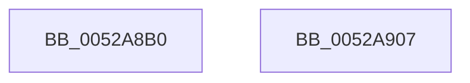

# SymCryptMd5Result

- RVA: `0x0052A8B0`–`0x0052A908` (길이 `88` bytes)
- VA: `0x000000014052A8B0`
- 실행 섹션: `.text`
- PDB 이름 있음: `예`; PDB Function 태그: `아니요`
- unwind 정보 RVA: `0x0005CAAC`
- 디코드: `24`개 명령, `88/88` bytes 표시
- 미해석 바이트: `0` (있으면 어셈블리에 `.byte`로 보존)

> 이 문서는 커널 이미지의 기계어와 PDB 기호를 분석해 생성했습니다. 4번과 5번은 함수 원형과 자료형을 바이너리 사용 방식에서 추정한 C 해석이며 원본 소스 복구 결과는 아닙니다.

## 1. Dependencies

- 직접 호출 지점: **2**; 고유 호출 대상: **2**
- 직접 호출자로 확인된 함수: **1**
- RIP 상대 이미지 참조: **2**

### Outgoing calls
- `0x0052A8CA` → [SymCryptHashCommonPaddingMd4Style](SymCryptHashCommonPaddingMd4Style_function_0052D2F0.md) (function, `0x0052D2F0`)
- `0x0052A8DF` → [SymCryptWipe](../51/SymCryptWipe_function_0051F914.md) (function, `0x0051F914`)

### Direct callers
- [HashpFinalizeHash](../../page/84/HashpFinalizeHash_function_00841F34.md) at `0x00841F8C`

### Static image references
- `0x0052A8C3` → RVA `0x00006C40` (`.rdata`; read)
- `0x0052A8F5` → RVA `0x000203E8` (`.rdata`; read)

## 2. Other-region calls and transfers

- 다른 실행 섹션으로 향하는 call: **0**
- 별도 외부 분기/꼬리 이동을 확인하지 못했습니다.

## 3. Assembly (complete function range)

```asm
0052A8B0  48 89 5C 24 08                  mov qword ptr [rsp + 8], rbx
0052A8B5  57                              push rdi
0052A8B6  48 83 EC 20                     sub rsp, 0x20
0052A8BA  48 8B DA                        mov rbx, rdx
0052A8BD  48 8B F9                        mov rdi, rcx
0052A8C0  48 8B D1                        mov rdx, rcx
0052A8C3  48 8D 0D 76 C3 AD FF            lea rcx, [rip - 0x523c8a]
0052A8CA  E8 21 2A 00 00                  call 0x14052d2f0
0052A8CF  0F 10 47 60                     movups xmm0, xmmword ptr [rdi + 0x60]
0052A8D3  BA 70 00 00 00                  mov edx, 0x70
0052A8D8  48 8B CF                        mov rcx, rdi
0052A8DB  F3 0F 7F 03                     movdqu xmmword ptr [rbx], xmm0
0052A8DF  E8 30 50 FF FF                  call 0x14051f914
0052A8E4  48 8B 5C 24 30                  mov rbx, qword ptr [rsp + 0x30]
0052A8E9  33 C0                           xor eax, eax
0052A8EB  48 89 47 10                     mov qword ptr [rdi + 0x10], rax
0052A8EF  48 89 47 18                     mov qword ptr [rdi + 0x18], rax
0052A8F3  89 07                           mov dword ptr [rdi], eax
0052A8F5  0F 10 05 EC 5A AF FF            movups xmm0, xmmword ptr [rip - 0x50a514]
0052A8FC  F3 0F 7F 47 60                  movdqu xmmword ptr [rdi + 0x60], xmm0
0052A901  48 83 C4 20                     add rsp, 0x20
0052A905  5F                              pop rdi
0052A906  C3                              ret
0052A907  CC                              int3
```

## 4. C-style interpretation (structured pseudocode)

```c
__int64 __fastcall SymCryptMd5Result(__int64 a1, __int64 a2)
{
    __int64 result;
    __int64 v_rsp;
    unsigned __int64 v_stack_p8;

    v_stack_p8 = v_rbx;
    v_rsp = (v_rsp) - (32);
    result = SymCryptHashCommonPaddingMd4Style(v_rip - 5389450, a1, a3, a4);
    *(unsigned __int64 *)(a2) = v_xmm0;
    result = SymCryptWipe(a1, 112, a3, a4);
    result = 0;
    *(unsigned __int64 *)(a1 + 16) = 0;
    *(unsigned __int64 *)(a1 + 24) = 0;
    *(unsigned int *)(a1) = 0;
    *(unsigned __int64 *)(a1 + 96) = v_xmm0;
    v_rsp = (v_rsp) + (32);
    return result;
}
```

## 5. (Beta) C Style

```c
int64_t SymCryptMd5Result(void *Arg1, void *Arg2)
{
    uint8_t *arg1 = (uint8_t *)Arg1;
    uint8_t *arg2 = (uint8_t *)Arg2;

    int64_t result;
    int64_t local_rsp;
    uint64_t v_stack_p8;

    v_stack_p8 = local_rbx;
    local_rsp = (local_rsp) - (32);
    result = SymCryptHashCommonPaddingMd4Style(v_rip - 5389450, Arg1, a3, a4);
    *(uint64_t *)(arg2) = v_xmm0;
    result = SymCryptWipe(Arg1, 112, a3, a4);
    result = 0;
    *(uint64_t *)(arg1 + 0x10) = 0;
    *(uint64_t *)(arg1 + 0x18) = 0;
    *(uint32_t *)(arg1) = 0;
    *(uint64_t *)(arg1 + 0x60) = v_xmm0;
    local_rsp = (local_rsp) + (32);
    return result;
}
```

### 관측된 메모리 오프셋

구조체 형식이 확인되지 않은 접근은 인자 기준의 오프셋으로만 기록했습니다.

| 기준 인자 | 오프셋 표현 | 폭 (bit) | 접근 |
|---|---:|---:|---|
| `Arg1` | `+ 0x0` | `32` | `W` |
| `Arg1` | `+ 0x10` | `64` | `W` |
| `Arg1` | `+ 0x18` | `64` | `W` |
| `Arg1` | `+ 0x60` | `128` | `R` |
| `Arg1` | `+ 0x60` | `128` | `W` |
| `Arg2` | `+ 0x0` | `128` | `W` |

## 6. Execution-region graph

[열기: 2D/3D 그래프와 함수 탐색 컨트롤 패널](../../../control-panel.html?section=text&rva=0x0052A8B0&view=graph)

- 2D 그래프는 위에서 아래로 흐르고, 3D 그래프는 빈 공간을 드래그해 회전합니다. Shift+드래그는 이동, 휠은 확대·축소, 함수 노드 선택은 대상 보고서 이동입니다.

### Static fallback


