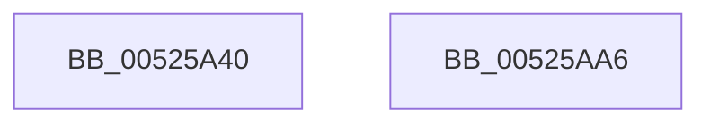

# SymCryptModElementSetValueUint32

- RVA: `0x00525A40`–`0x00525AA7` (길이 `103` bytes)
- VA: `0x0000000140525A40`
- 실행 섹션: `.text`
- PDB 이름 있음: `예`; PDB Function 태그: `아니요`
- unwind 정보 RVA: `0x0009B270`
- 디코드: `29`개 명령, `103/103` bytes 표시
- 미해석 바이트: `0` (있으면 어셈블리에 `.byte`로 보존)

> 이 문서는 커널 이미지의 기계어와 PDB 기호를 분석해 생성했습니다. 4번과 5번은 함수 원형과 자료형을 바이너리 사용 방식에서 추정한 C 해석이며 원본 소스 복구 결과는 아닙니다.

## 1. Dependencies

- 직접 호출 지점: **2**; 고유 호출 대상: **2**
- 직접 호출자로 확인된 함수: **8**
- RIP 상대 이미지 참조: **1**

### Outgoing calls
- `0x00525A67` → [SymCryptFdefModElementSetValueUint32Generic](../53/SymCryptFdefModElementSetValueUint32Generic_function_005347C0.md) (function, `0x005347C0`)
- `0x00525A8B` → `indirect target` (indirect, 간접 대상)

### Direct callers
- [SymCryptRsakeyCalculatePrimesFromPrivateExponent](SymCryptRsakeyCalculatePrimesFromPrivateExponent_function_00522D48.md) at `0x00522F87`
- [SymCryptEcurveInitialize](SymCryptEcurveInitialize_function_005241A4.md) at `0x00524634`
- [SymCryptEcpointTransform](SymCryptEcpointTransform_function_0052C9E8.md) at `0x0052CB3F`
- [SymCryptEcpointTransform](SymCryptEcpointTransform_function_0052C9E8.md) at `0x0052CB8D`
- [SymCryptEcpointTransform](SymCryptEcpointTransform_function_0052C9E8.md) at `0x0052CE98`
- [SymCryptModExpSquareAndMultiply32](../53/SymCryptModExpSquareAndMultiply32_function_0053605C.md) at `0x005360E9`
- [SymCryptModExpSquareAndMultiply32](../53/SymCryptModExpSquareAndMultiply32_function_0053605C.md) at `0x005360F3`
- [SymCryptModExpWindowed](../53/SymCryptModExpWindowed_function_00536188.md) at `0x005362BD`
- [SymCryptShortWeierstrassSetZero](../53/SymCryptShortWeierstrassSetZero_function_00539620.md) at `0x0053965F`
- [SymCryptShortWeierstrassSetZero](../53/SymCryptShortWeierstrassSetZero_function_00539620.md) at `0x0053967E`
- [SymCryptShortWeierstrassSetZero](../53/SymCryptShortWeierstrassSetZero_function_00539620.md) at `0x005396A0`
- [SymCryptTwistedEdwardsSetZero](../53/SymCryptTwistedEdwardsSetZero_function_0053A4F0.md) at `0x0053A52C`
- [SymCryptTwistedEdwardsSetZero](../53/SymCryptTwistedEdwardsSetZero_function_0053A4F0.md) at `0x0053A548`
- [SymCryptTwistedEdwardsSetZero](../53/SymCryptTwistedEdwardsSetZero_function_0053A4F0.md) at `0x0053A568`
- [SymCryptTwistedEdwardsSetZero](../53/SymCryptTwistedEdwardsSetZero_function_0053A4F0.md) at `0x0053A584`
- [SymCryptMontgomeryPointScalarMul](../53/SymCryptMontgomeryPointScalarMul_function_0053AB50.md) at `0x0053AD37`
- [SymCryptMontgomeryPointScalarMul](../53/SymCryptMontgomeryPointScalarMul_function_0053AB50.md) at `0x0053AD51`

### Static image references
- `0x00525A6F` → RVA `0x00006800` (`.rdata`; read)

## 2. Other-region calls and transfers

- 다른 실행 섹션으로 향하는 call: **0**
- 별도 외부 분기/꼬리 이동을 확인하지 못했습니다.

## 3. Assembly (complete function range)

```asm
00525A40  48 8B C4                        mov rax, rsp
00525A43  48 89 58 08                     mov qword ptr [rax + 8], rbx
00525A47  48 89 70 10                     mov qword ptr [rax + 0x10], rsi
00525A4B  48 89 78 18                     mov qword ptr [rax + 0x18], rdi
00525A4F  41 56                           push r14
00525A51  48 83 EC 30                     sub rsp, 0x30
00525A55  48 8B 5C 24 60                  mov rbx, qword ptr [rsp + 0x60]
00525A5A  49 8B F9                        mov rdi, r9
00525A5D  48 89 58 E8                     mov qword ptr [rax - 0x18], rbx
00525A61  49 8B F0                        mov rsi, r8
00525A64  4C 8B F2                        mov r14, rdx
00525A67  E8 54 ED 00 00                  call 0x1405347c0
00525A6C  41 8B 06                        mov eax, dword ptr [r14]
00525A6F  48 8D 0D 8A 0D AE FF            lea rcx, [rip - 0x51f276]
00525A76  25 80 03 00 00                  and eax, 0x380
00525A7B  4C 8B CB                        mov r9, rbx
00525A7E  4C 8B C7                        mov r8, rdi
00525A81  48 8B D6                        mov rdx, rsi
00525A84  48 8B 04 08                     mov rax, qword ptr [rax + rcx]
00525A88  49 8B CE                        mov rcx, r14
00525A8B  FF D0                           call rax
00525A8D  0F 1F 00                        nop dword ptr [rax]
00525A90  48 8B 5C 24 40                  mov rbx, qword ptr [rsp + 0x40]
00525A95  48 8B 74 24 48                  mov rsi, qword ptr [rsp + 0x48]
00525A9A  48 8B 7C 24 50                  mov rdi, qword ptr [rsp + 0x50]
00525A9F  48 83 C4 30                     add rsp, 0x30
00525AA3  41 5E                           pop r14
00525AA5  C3                              ret
00525AA6  CC                              int3
```

## 4. C-style interpretation (structured pseudocode)

```c
__int64 __fastcall SymCryptModElementSetValueUint32(__int64 a1, __int64 a2, __int64 a3, __int64 a4, __int64 a5)
{
    __int64 result;
    __int64 v_rsp;
    unsigned __int64 v_stack_p10;
    unsigned __int64 v_stack_p18;
    unsigned __int64 v_stack_p8;

    *(unsigned __int64 *)(v_rsp + 8) = v_rbx;
    *(unsigned __int64 *)(v_rsp + 16) = v_rsi;
    *(unsigned __int64 *)(v_rsp + 24) = v_rdi;
    v_rsp = (v_rsp) - (48);
    *(unsigned __int64 *)(v_rsp - 24) = a5;
    result = SymCryptFdefModElementSetValueUint32Generic(a1, a2, a3, a4);
    result = (unsigned int)(((unsigned int)(*(unsigned int *)(a2))) & (896));
    result = kernel_indirect_call(a2, a3, a4, a5);
    v_rsp = (v_rsp) + (48);
    return result;
}
```

## 5. (Beta) C Style

```c
int64_t SymCryptModElementSetValueUint32(int64_t Arg1, void *Arg2, int64_t Arg3, int64_t Arg4, int64_t Arg5)
{
    uint8_t *arg2 = (uint8_t *)Arg2;

    int64_t result;
    int64_t local_rsp;
    uint64_t v_stack_p10;
    uint64_t v_stack_p18;
    uint64_t v_stack_p8;

    *(uint64_t *)(local_rsp + 0x8) = local_rbx;
    *(uint64_t *)(local_rsp + 0x10) = local_rsi;
    *(uint64_t *)(local_rsp + 0x18) = local_rdi;
    local_rsp = (local_rsp) - (48);
    *(uint64_t *)(local_rsp - 0x18) = Arg5;
    result = SymCryptFdefModElementSetValueUint32Generic(Arg1, Arg2, Arg3, Arg4);
    result = (uint32_t)(((uint32_t)(*(uint32_t *)(arg2))) & (896));
    result = kernel_indirect_call(Arg2, Arg3, Arg4, Arg5);
    local_rsp = (local_rsp) + (48);
    return result;
}
```

### 관측된 메모리 오프셋

구조체 형식이 확인되지 않은 접근은 인자 기준의 오프셋으로만 기록했습니다.

| 기준 인자 | 오프셋 표현 | 폭 (bit) | 접근 |
|---|---:|---:|---|
| `Arg2` | `+ 0x0` | `32` | `R` |

## 6. Execution-region graph

[열기: 2D/3D 그래프와 함수 탐색 컨트롤 패널](../../../control-panel.html?section=text&rva=0x00525A40&view=graph)

- 2D 그래프는 위에서 아래로 흐르고, 3D 그래프는 빈 공간을 드래그해 회전합니다. Shift+드래그는 이동, 휠은 확대·축소, 함수 노드 선택은 대상 보고서 이동입니다.

### Static fallback


