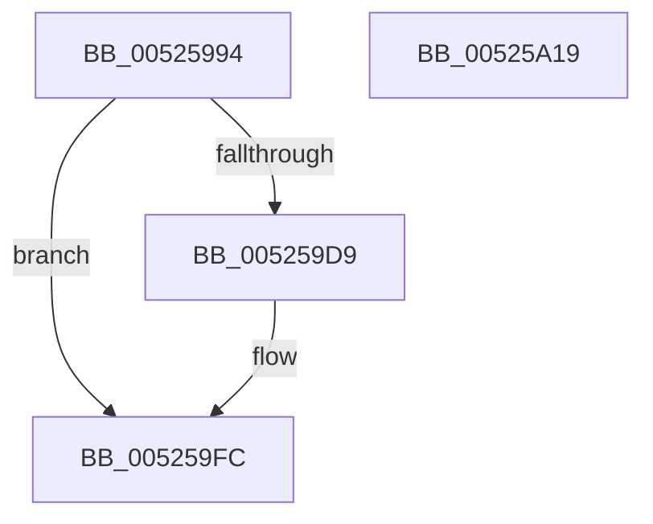

# SymCryptModElementSetValue

- RVA: `0x00525994`–`0x00525A1A` (길이 `134` bytes)
- VA: `0x0000000140525994`
- 실행 섹션: `.text`
- PDB 이름 있음: `예`; PDB Function 태그: `아니요`
- unwind 정보 RVA: `0x00060130`
- 디코드: `37`개 명령, `134/134` bytes 표시
- 미해석 바이트: `0` (있으면 어셈블리에 `.byte`로 보존)

> 이 문서는 커널 이미지의 기계어와 PDB 기호를 분석해 생성했습니다. 4번과 5번은 함수 원형과 자료형을 바이너리 사용 방식에서 추정한 C 해석이며 원본 소스 복구 결과는 아닙니다.

## 1. Dependencies

- 직접 호출 지점: **2**; 고유 호출 대상: **2**
- 직접 호출자로 확인된 함수: **4**
- RIP 상대 이미지 참조: **1**

### Outgoing calls
- `0x005259CE` → [SymCryptFdefModElementSetValueGeneric](../53/SymCryptFdefModElementSetValueGeneric_function_00534638.md) (function, `0x00534638`)
- `0x005259F7` → `indirect target` (indirect, 간접 대상)

### Direct callers
- [SymCryptEcurveInitialize](SymCryptEcurveInitialize_function_005241A4.md) at `0x00524310`
- [SymCryptEcurveInitialize](SymCryptEcurveInitialize_function_005241A4.md) at `0x005243BA`
- [SymCryptEcDsaSignEx](SymCryptEcDsaSignEx_function_00525D6C.md) at `0x0052616C`
- [SymCryptRsaCoreEnc](SymCryptRsaCoreEnc_function_00526F04.md) at `0x00526FBD`
- [SymCryptEcpointSetValue](SymCryptEcpointSetValue_function_0052C7E0.md) at `0x0052C95B`

### Static image references
- `0x005259DB` → RVA `0x00006800` (`.rdata`; read)

## 2. Other-region calls and transfers

- 다른 실행 섹션으로 향하는 call: **0**
- 별도 외부 분기/꼬리 이동을 확인하지 못했습니다.

## 3. Assembly (complete function range)

```asm
00525994  48 8B C4                        mov rax, rsp
00525997  48 89 58 08                     mov qword ptr [rax + 8], rbx
0052599B  48 89 68 10                     mov qword ptr [rax + 0x10], rbp
0052599F  48 89 70 18                     mov qword ptr [rax + 0x18], rsi
005259A3  48 89 78 20                     mov qword ptr [rax + 0x20], rdi
005259A7  41 56                           push r14
005259A9  48 83 EC 40                     sub rsp, 0x40
005259AD  48 8B B4 24 80 00 00 00         mov rsi, qword ptr [rsp + 0x80]
005259B5  49 8B F9                        mov rdi, r9
005259B8  48 8B 6C 24 78                  mov rbp, qword ptr [rsp + 0x78]
005259BD  4C 8B 74 24 70                  mov r14, qword ptr [rsp + 0x70]
005259C2  48 89 70 E8                     mov qword ptr [rax - 0x18], rsi
005259C6  48 89 68 E0                     mov qword ptr [rax - 0x20], rbp
005259CA  4C 89 70 D8                     mov qword ptr [rax - 0x28], r14
005259CE  E8 65 EC 00 00                  call 0x140534638
005259D3  8B D8                           mov ebx, eax
005259D5  85 C0                           test eax, eax
005259D7  75 23                           jne 0x1405259fc
005259D9  8B 07                           mov eax, dword ptr [rdi]
005259DB  48 8D 0D 1E 0E AE FF            lea rcx, [rip - 0x51f1e2]
005259E2  25 80 03 00 00                  and eax, 0x380
005259E7  4C 8B CE                        mov r9, rsi
005259EA  4C 8B C5                        mov r8, rbp
005259ED  49 8B D6                        mov rdx, r14
005259F0  48 8B 04 08                     mov rax, qword ptr [rax + rcx]
005259F4  48 8B CF                        mov rcx, rdi
005259F7  FF D0                           call rax
005259F9  0F 1F 00                        nop dword ptr [rax]
005259FC  48 8B 6C 24 58                  mov rbp, qword ptr [rsp + 0x58]
00525A01  8B C3                           mov eax, ebx
00525A03  48 8B 5C 24 50                  mov rbx, qword ptr [rsp + 0x50]
00525A08  48 8B 74 24 60                  mov rsi, qword ptr [rsp + 0x60]
00525A0D  48 8B 7C 24 68                  mov rdi, qword ptr [rsp + 0x68]
00525A12  48 83 C4 40                     add rsp, 0x40
00525A16  41 5E                           pop r14
00525A18  C3                              ret
00525A19  CC                              int3
```

## 4. C-style interpretation (structured pseudocode)

```c
__int64 __fastcall SymCryptModElementSetValue(__int64 a1, __int64 a2, __int64 a3, __int64 a4, __int64 a5, __int64 a6, __int64 a7)
{
    __int64 result;
    __int64 v_rsp;
    unsigned __int64 v_stack_p10;
    unsigned __int64 v_stack_p18;
    unsigned __int64 v_stack_p20;
    unsigned __int64 v_stack_p8;

    *(unsigned __int64 *)(v_rsp + 8) = v_rbx;
    *(unsigned __int64 *)(v_rsp + 16) = v_rbp;
    *(unsigned __int64 *)(v_rsp + 24) = v_rsi;
    *(unsigned __int64 *)(v_rsp + 32) = v_rdi;
    v_rsp = (v_rsp) - (64);
    *(unsigned __int64 *)(v_rsp - 24) = a7;
    *(unsigned __int64 *)(v_rsp - 32) = a6;
    *(unsigned __int64 *)(v_rsp - 40) = a5;
    result = SymCryptFdefModElementSetValueGeneric(a1, a2, a3, a4);
    if ((unsigned int)(result) == 0) {
        result = *(unsigned int *)(a4);
        a1 = v_rip - 5370338;
        result = (unsigned int)((result) & (896));
        a4 = a7;
        a3 = a6;
        a2 = a5;
        result = *(unsigned __int64 *)(result + a1 * 1);
        a1 = a4;
        result = kernel_indirect_call(a1, a2, a3, a4);
    }
    v_rsp = (v_rsp) + (64);
    return (unsigned int)((unsigned int)((unsigned int)((unsigned int)(result))));
}
```

## 5. (Beta) C Style

```c
int64_t SymCryptModElementSetValue(int64_t Arg1, int64_t Arg2, int64_t Arg3, void *Arg4, int64_t Arg5, int64_t Arg6, int64_t Arg7)
{
    uint8_t *arg4 = (uint8_t *)Arg4;

    int64_t result;
    int64_t local_rsp;
    uint64_t v_stack_p10;
    uint64_t v_stack_p18;
    uint64_t v_stack_p20;
    uint64_t v_stack_p8;

    *(uint64_t *)(local_rsp + 0x8) = local_rbx;
    *(uint64_t *)(local_rsp + 0x10) = local_rbp;
    *(uint64_t *)(local_rsp + 0x18) = local_rsi;
    *(uint64_t *)(local_rsp + 0x20) = local_rdi;
    local_rsp = (local_rsp) - (64);
    *(uint64_t *)(local_rsp - 0x18) = Arg7;
    *(uint64_t *)(local_rsp - 0x20) = Arg6;
    *(uint64_t *)(local_rsp - 0x28) = Arg5;
    result = SymCryptFdefModElementSetValueGeneric(Arg1, Arg2, Arg3, Arg4);
    if ((uint32_t)(result) == 0) {
        result = *(uint32_t *)(arg4);
        Arg1 = v_rip - 5370338;
        result = (uint32_t)((result) & (896));
        Arg4 = Arg7;
        Arg3 = Arg6;
        Arg2 = Arg5;
        result = *(uint64_t *)(result + Arg1 * 1);
        Arg1 = Arg4;
        result = kernel_indirect_call(Arg1, Arg2, Arg3, Arg4);
    }
    local_rsp = (local_rsp) + (64);
    return (uint32_t)((uint32_t)((uint32_t)((uint32_t)(result))));
}
```

### 관측된 메모리 오프셋

구조체 형식이 확인되지 않은 접근은 인자 기준의 오프셋으로만 기록했습니다.

| 기준 인자 | 오프셋 표현 | 폭 (bit) | 접근 |
|---|---:|---:|---|
| `Arg4` | `+ 0x0` | `32` | `R` |

## 6. Execution-region graph

[열기: 2D/3D 그래프와 함수 탐색 컨트롤 패널](../../../control-panel.html?section=text&rva=0x00525994&view=graph)

- 2D 그래프는 위에서 아래로 흐르고, 3D 그래프는 빈 공간을 드래그해 회전합니다. Shift+드래그는 이동, 휠은 확대·축소, 함수 노드 선택은 대상 보고서 이동입니다.

### Static fallback


