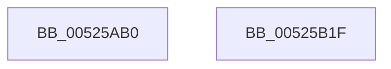

# SymCryptModElementToInt

- RVA: `0x00525AB0`–`0x00525B20` (길이 `112` bytes)
- VA: `0x0000000140525AB0`
- 실행 섹션: `.text`
- PDB 이름 있음: `예`; PDB Function 태그: `아니요`
- unwind 정보 RVA: `0x0009B270`
- 디코드: `31`개 명령, `112/112` bytes 표시
- 미해석 바이트: `0` (있으면 어셈블리에 `.byte`로 보존)

> 이 문서는 커널 이미지의 기계어와 PDB 기호를 분석해 생성했습니다. 4번과 5번은 함수 원형과 자료형을 바이너리 사용 방식에서 추정한 C 해석이며 원본 소스 복구 결과는 아닙니다.

## 1. Dependencies

- 직접 호출 지점: **2**; 고유 호출 대상: **2**
- 직접 호출자로 확인된 함수: **6**
- RIP 상대 이미지 참조: **1**

### Outgoing calls
- `0x00525AEE` → `indirect target` (indirect, 간접 대상)
- `0x00525B04` → [SymCryptFdefModElementToIntGeneric](../53/SymCryptFdefModElementToIntGeneric_function_00534844.md) (function, `0x00534844`)

### Direct callers
- [SymCryptRsakeyCalculatePrimesFromPrivateExponent](SymCryptRsakeyCalculatePrimesFromPrivateExponent_function_00522D48.md) at `0x005230D1`
- [SymCryptEckeySetValue](SymCryptEckeySetValue_function_00524C34.md) at `0x00524EB4`
- [SymCryptEcDsaVerify](SymCryptEcDsaVerify_function_00526400.md) at `0x0052683B`
- [SymCryptEcDsaVerify](SymCryptEcDsaVerify_function_00526400.md) at `0x0052685D`
- [SymCryptRsaCoreDecCrt](SymCryptRsaCoreDecCrt_function_005269C4.md) at `0x00526D17`
- [SymCryptCrtSolve](SymCryptCrtSolve_function_0052AB54.md) at `0x0052AC5A`
- [SymCryptCrtSolve](SymCryptCrtSolve_function_0052AB54.md) at `0x0052ACCD`
- [SymCryptCrtSolve](SymCryptCrtSolve_function_0052AB54.md) at `0x0052AD1E`
- [SymCryptEcpointGenericSetRandom](SymCryptEcpointGenericSetRandom_function_0052B850.md) at `0x0052B8D9`

### Static image references
- `0x00525ACF` → RVA `0x00006808` (`.rdata`; read)

## 2. Other-region calls and transfers

- 다른 실행 섹션으로 향하는 call: **0**
- 별도 외부 분기/꼬리 이동을 확인하지 못했습니다.

## 3. Assembly (complete function range)

```asm
00525AB0  48 89 5C 24 08                  mov qword ptr [rsp + 8], rbx
00525AB5  48 89 74 24 10                  mov qword ptr [rsp + 0x10], rsi
00525ABA  48 89 7C 24 18                  mov qword ptr [rsp + 0x18], rdi
00525ABF  41 56                           push r14
00525AC1  48 83 EC 30                     sub rsp, 0x30
00525AC5  8B 01                           mov eax, dword ptr [rcx]
00525AC7  4C 8B F1                        mov r14, rcx
00525ACA  48 8B 5C 24 60                  mov rbx, qword ptr [rsp + 0x60]
00525ACF  48 8D 0D 32 0D AE FF            lea rcx, [rip - 0x51f2ce]
00525AD6  49 8B F9                        mov rdi, r9
00525AD9  25 80 03 00 00                  and eax, 0x380
00525ADE  49 8B F0                        mov rsi, r8
00525AE1  4C 8B CB                        mov r9, rbx
00525AE4  4C 8B C7                        mov r8, rdi
00525AE7  48 8B 04 08                     mov rax, qword ptr [rax + rcx]
00525AEB  49 8B CE                        mov rcx, r14
00525AEE  FF D0                           call rax
00525AF0  0F 1F 00                        nop dword ptr [rax]
00525AF3  4C 8B CF                        mov r9, rdi
00525AF6  48 89 5C 24 20                  mov qword ptr [rsp + 0x20], rbx
00525AFB  4C 8B C6                        mov r8, rsi
00525AFE  48 8B D0                        mov rdx, rax
00525B01  49 8B CE                        mov rcx, r14
00525B04  E8 3B ED 00 00                  call 0x140534844
00525B09  48 8B 5C 24 40                  mov rbx, qword ptr [rsp + 0x40]
00525B0E  48 8B 74 24 48                  mov rsi, qword ptr [rsp + 0x48]
00525B13  48 8B 7C 24 50                  mov rdi, qword ptr [rsp + 0x50]
00525B18  48 83 C4 30                     add rsp, 0x30
00525B1C  41 5E                           pop r14
00525B1E  C3                              ret
00525B1F  CC                              int3
```

## 4. C-style interpretation (structured pseudocode)

```c
__int64 __fastcall SymCryptModElementToInt(__int64 a1, __int64 a2, __int64 a3, __int64 a4, __int64 a5)
{
    __int64 result;
    __int64 v_rsp;
    unsigned __int64 v_stack_m18;
    unsigned __int64 v_stack_p10;
    unsigned __int64 v_stack_p18;
    unsigned __int64 v_stack_p8;

    v_stack_p8 = v_rbx;
    v_stack_p10 = v_rsi;
    v_stack_p18 = v_rdi;
    v_rsp = (v_rsp) - (48);
    result = (unsigned int)(((unsigned int)(*(unsigned int *)(a1))) & (896));
    result = kernel_indirect_call(a1, a2, a4, a5);
    v_stack_m18 = a5;
    result = SymCryptFdefModElementToIntGeneric(a1, result, a3, a4);
    v_rsp = (v_rsp) + (48);
    return result;
}
```

## 5. (Beta) C Style

```c
int64_t SymCryptModElementToInt(void *Arg1, int64_t Arg2, int64_t Arg3, int64_t Arg4, int64_t Arg5)
{
    uint8_t *arg1 = (uint8_t *)Arg1;

    int64_t result;
    int64_t local_rsp;
    uint64_t v_stack_m18;
    uint64_t v_stack_p10;
    uint64_t v_stack_p18;
    uint64_t v_stack_p8;

    v_stack_p8 = local_rbx;
    v_stack_p10 = local_rsi;
    v_stack_p18 = local_rdi;
    local_rsp = (local_rsp) - (48);
    result = (uint32_t)(((uint32_t)(*(uint32_t *)(arg1))) & (896));
    result = kernel_indirect_call(Arg1, Arg2, Arg4, Arg5);
    v_stack_m18 = Arg5;
    result = SymCryptFdefModElementToIntGeneric(Arg1, result, Arg3, Arg4);
    local_rsp = (local_rsp) + (48);
    return result;
}
```

### 관측된 메모리 오프셋

구조체 형식이 확인되지 않은 접근은 인자 기준의 오프셋으로만 기록했습니다.

| 기준 인자 | 오프셋 표현 | 폭 (bit) | 접근 |
|---|---:|---:|---|
| `Arg1` | `+ 0x0` | `32` | `R` |

## 6. Execution-region graph

[열기: 2D/3D 그래프와 함수 탐색 컨트롤 패널](../../../control-panel.html?section=text&rva=0x00525AB0&view=graph)

- 2D 그래프는 위에서 아래로 흐르고, 3D 그래프는 빈 공간을 드래그해 회전합니다. Shift+드래그는 이동, 휠은 확대·축소, 함수 노드 선택은 대상 보고서 이동입니다.

### Static fallback


