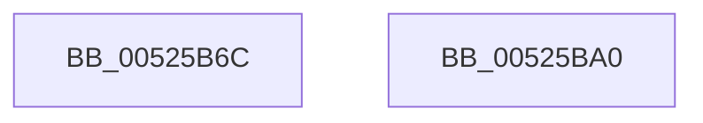

# SymCryptModInv

- RVA: `0x00525B6C`–`0x00525BA1` (길이 `53` bytes)
- VA: `0x0000000140525B6C`
- 실행 섹션: `.text`
- PDB 이름 있음: `예`; PDB Function 태그: `아니요`
- unwind 정보 RVA: `0x0005D2F4`
- 디코드: `14`개 명령, `53/53` bytes 표시
- 미해석 바이트: `0` (있으면 어셈블리에 `.byte`로 보존)

> 이 문서는 커널 이미지의 기계어와 PDB 기호를 분석해 생성했습니다. 4번과 5번은 함수 원형과 자료형을 바이너리 사용 방식에서 추정한 C 해석이며 원본 소스 복구 결과는 아닙니다.

## 1. Dependencies

- 직접 호출 지점: **1**; 고유 호출 대상: **1**
- 직접 호출자로 확인된 함수: **3**
- RIP 상대 이미지 참조: **1**

### Outgoing calls
- `0x00525B96` → `indirect target` (indirect, 간접 대상)

### Direct callers
- [SymCryptEcDsaSignEx](SymCryptEcDsaSignEx_function_00525D6C.md) at `0x005260DB`
- [SymCryptEcDsaVerify](SymCryptEcDsaVerify_function_00526400.md) at `0x0052678D`
- [SymCryptEcpointTransform](SymCryptEcpointTransform_function_0052C9E8.md) at `0x0052CC68`
- [SymCryptEcpointTransform](SymCryptEcpointTransform_function_0052C9E8.md) at `0x0052CD6A`
- [SymCryptEcpointTransform](SymCryptEcpointTransform_function_0052C9E8.md) at `0x0052CE4B`

### Static image references
- `0x00525B72` → RVA `0x000067F8` (`.rdata`; read)

## 2. Other-region calls and transfers

- 다른 실행 섹션으로 향하는 call: **0**
- 별도 외부 분기/꼬리 이동을 확인하지 못했습니다.

## 3. Assembly (complete function range)

```asm
00525B6C  48 83 EC 38                     sub rsp, 0x38
00525B70  8B 01                           mov eax, dword ptr [rcx]
00525B72  4C 8D 15 7F 0C AE FF            lea r10, [rip - 0x51f381]
00525B79  25 80 03 00 00                  and eax, 0x380
00525B7E  4A 8B 04 10                     mov rax, qword ptr [rax + r10]
00525B82  4C 8B 54 24 68                  mov r10, qword ptr [rsp + 0x68]
00525B87  4C 89 54 24 28                  mov qword ptr [rsp + 0x28], r10
00525B8C  4C 8B 54 24 60                  mov r10, qword ptr [rsp + 0x60]
00525B91  4C 89 54 24 20                  mov qword ptr [rsp + 0x20], r10
00525B96  FF D0                           call rax
00525B98  0F 1F 00                        nop dword ptr [rax]
00525B9B  48 83 C4 38                     add rsp, 0x38
00525B9F  C3                              ret
00525BA0  CC                              int3
```

## 4. C-style interpretation (structured pseudocode)

```c
__int64 __fastcall SymCryptModInv(__int64 a1, __int64 a2, __int64 a3, __int64 a4, __int64 a5, __int64 a6)
{
    __int64 result;
    __int64 v_rsp;
    unsigned __int64 v_stack_m10;
    unsigned __int64 v_stack_m18;

    v_rsp = (v_rsp) - (56);
    result = (unsigned int)(((unsigned int)(*(unsigned int *)(a1))) & (896));
    v_stack_m10 = a6;
    v_stack_m18 = a5;
    result = kernel_indirect_call(a1, a2, a3, a4);
    v_rsp = (v_rsp) + (56);
    return result;
}
```

## 5. (Beta) C Style

```c
int64_t SymCryptModInv(void *Arg1, int64_t Arg2, int64_t Arg3, int64_t Arg4, int64_t Arg5, int64_t Arg6)
{
    uint8_t *arg1 = (uint8_t *)Arg1;

    int64_t result;
    int64_t local_rsp;
    uint64_t v_stack_m10;
    uint64_t v_stack_m18;

    local_rsp = (local_rsp) - (56);
    result = (uint32_t)(((uint32_t)(*(uint32_t *)(arg1))) & (896));
    v_stack_m10 = Arg6;
    v_stack_m18 = Arg5;
    result = kernel_indirect_call(Arg1, Arg2, Arg3, Arg4);
    local_rsp = (local_rsp) + (56);
    return result;
}
```

### 관측된 메모리 오프셋

구조체 형식이 확인되지 않은 접근은 인자 기준의 오프셋으로만 기록했습니다.

| 기준 인자 | 오프셋 표현 | 폭 (bit) | 접근 |
|---|---:|---:|---|
| `Arg1` | `+ 0x0` | `32` | `R` |

## 6. Execution-region graph

[열기: 2D/3D 그래프와 함수 탐색 컨트롤 패널](../../../control-panel.html?section=text&rva=0x00525B6C&view=graph)

- 2D 그래프는 위에서 아래로 흐르고, 3D 그래프는 빈 공간을 드래그해 회전합니다. Shift+드래그는 이동, 휠은 확대·축소, 함수 노드 선택은 대상 보고서 이동입니다.

### Static fallback


