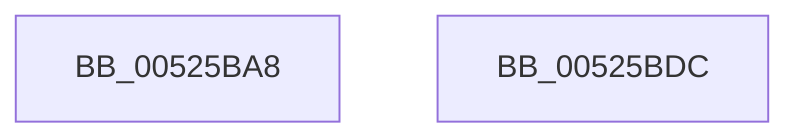

# SymCryptModMul

- RVA: `0x00525BA8`–`0x00525BDD` (길이 `53` bytes)
- VA: `0x0000000140525BA8`
- 실행 섹션: `.text`
- PDB 이름 있음: `예`; PDB Function 태그: `아니요`
- unwind 정보 RVA: `0x0005D2F4`
- 디코드: `14`개 명령, `53/53` bytes 표시
- 미해석 바이트: `0` (있으면 어셈블리에 `.byte`로 보존)

> 이 문서는 커널 이미지의 기계어와 PDB 기호를 분석해 생성했습니다. 4번과 5번은 함수 원형과 자료형을 바이너리 사용 방식에서 추정한 C 해석이며 원본 소스 복구 결과는 아닙니다.

## 1. Dependencies

- 직접 호출 지점: **1**; 고유 호출 대상: **1**
- 직접 호출자로 확인된 함수: **19**
- RIP 상대 이미지 참조: **1**

### Outgoing calls
- `0x00525BD2` → `indirect target` (indirect, 간접 대상)

### Direct callers
- [SymCryptEcDsaSignEx](SymCryptEcDsaSignEx_function_00525D6C.md) at `0x005261DF`
- [SymCryptEcDsaSignEx](SymCryptEcDsaSignEx_function_00525D6C.md) at `0x00526221`
- [SymCryptEcDsaVerify](SymCryptEcDsaVerify_function_00526400.md) at `0x005267F5`
- [SymCryptEcDsaVerify](SymCryptEcDsaVerify_function_00526400.md) at `0x00526819`
- [SymCryptCrtSolve](SymCryptCrtSolve_function_0052AB54.md) at `0x0052ACB7`
- [SymCryptEcpointTransform](SymCryptEcpointTransform_function_0052C9E8.md) at `0x0052CBBD`
- [SymCryptEcpointTransform](SymCryptEcpointTransform_function_0052C9E8.md) at `0x0052CC98`
- [SymCryptEcpointTransform](SymCryptEcpointTransform_function_0052C9E8.md) at `0x0052CCB9`
- [SymCryptEcpointTransform](SymCryptEcpointTransform_function_0052C9E8.md) at `0x0052CCE3`
- [SymCryptEcpointTransform](SymCryptEcpointTransform_function_0052C9E8.md) at `0x0052CD95`
- [SymCryptEcpointTransform](SymCryptEcpointTransform_function_0052C9E8.md) at `0x0052CDC8`
- [SymCryptEcpointTransform](SymCryptEcpointTransform_function_0052C9E8.md) at `0x0052CE72`
- [SymCryptFdefModInvGeneric](../53/SymCryptFdefModInvGeneric_function_005348C0.md) at `0x00534A1C`
- [SymCryptFdefModInvGeneric](../53/SymCryptFdefModInvGeneric_function_005348C0.md) at `0x00534C06`
- [SymCryptFdefModInvGeneric](../53/SymCryptFdefModInvGeneric_function_005348C0.md) at `0x00534C2F`
- [SymCryptModExpSquareAndMultiply32](../53/SymCryptModExpSquareAndMultiply32_function_0053605C.md) at `0x00536124`
- [SymCryptModExpSquareAndMultiply32](../53/SymCryptModExpSquareAndMultiply32_function_0053605C.md) at `0x0053615C`
- [SymCryptModExpWindowed](../53/SymCryptModExpWindowed_function_00536188.md) at `0x0053632D`
- [SymCryptModExpWindowed](../53/SymCryptModExpWindowed_function_00536188.md) at `0x00536413`
- [SymCryptShortWeierstrassAddDiffNonZero](../53/SymCryptShortWeierstrassAddDiffNonZero_function_00537D80.md) at `0x00537E98`
- [SymCryptShortWeierstrassAddDiffNonZero](../53/SymCryptShortWeierstrassAddDiffNonZero_function_00537D80.md) at `0x00537ED4`
- [SymCryptShortWeierstrassAddDiffNonZero](../53/SymCryptShortWeierstrassAddDiffNonZero_function_00537D80.md) at `0x00537EF9`
- [SymCryptShortWeierstrassAddDiffNonZero](../53/SymCryptShortWeierstrassAddDiffNonZero_function_00537D80.md) at `0x00537F57`
- [SymCryptShortWeierstrassAddDiffNonZero](../53/SymCryptShortWeierstrassAddDiffNonZero_function_00537D80.md) at `0x00537F76`
- [SymCryptShortWeierstrassAddDiffNonZero](../53/SymCryptShortWeierstrassAddDiffNonZero_function_00537D80.md) at `0x00537F94`
- [SymCryptShortWeierstrassAddDiffNonZero](../53/SymCryptShortWeierstrassAddDiffNonZero_function_00537D80.md) at `0x00537FB2`
- [SymCryptShortWeierstrassAddDiffNonZero](../53/SymCryptShortWeierstrassAddDiffNonZero_function_00537D80.md) at `0x00537FD1`
- [SymCryptShortWeierstrassAddDiffNonZero](../53/SymCryptShortWeierstrassAddDiffNonZero_function_00537D80.md) at `0x00538040`
- [SymCryptShortWeierstrassAddDiffNonZero](../53/SymCryptShortWeierstrassAddDiffNonZero_function_00537D80.md) at `0x0053805D`
- [SymCryptShortWeierstrassAddDiffNonZero](../53/SymCryptShortWeierstrassAddDiffNonZero_function_00537D80.md) at `0x00538107`
- [SymCryptShortWeierstrassAddDiffNonZero](../53/SymCryptShortWeierstrassAddDiffNonZero_function_00537D80.md) at `0x00538122`
- [SymCryptShortWeierstrassAddSideChannelUnsafe](../53/SymCryptShortWeierstrassAddSideChannelUnsafe_function_00538188.md) at `0x005382C7`
- [SymCryptShortWeierstrassAddSideChannelUnsafe](../53/SymCryptShortWeierstrassAddSideChannelUnsafe_function_00538188.md) at `0x00538300`
- [SymCryptShortWeierstrassAddSideChannelUnsafe](../53/SymCryptShortWeierstrassAddSideChannelUnsafe_function_00538188.md) at `0x00538321`
- [SymCryptShortWeierstrassAddSideChannelUnsafe](../53/SymCryptShortWeierstrassAddSideChannelUnsafe_function_00538188.md) at `0x0053835A`
- [SymCryptShortWeierstrassAddSideChannelUnsafe](../53/SymCryptShortWeierstrassAddSideChannelUnsafe_function_00538188.md) at `0x00538377`
- [SymCryptShortWeierstrassAddSideChannelUnsafe](../53/SymCryptShortWeierstrassAddSideChannelUnsafe_function_00538188.md) at `0x00538393`
- [SymCryptShortWeierstrassAddSideChannelUnsafe](../53/SymCryptShortWeierstrassAddSideChannelUnsafe_function_00538188.md) at `0x005384EE`
- [SymCryptShortWeierstrassAddSideChannelUnsafe](../53/SymCryptShortWeierstrassAddSideChannelUnsafe_function_00538188.md) at `0x005385CF`
- [SymCryptShortWeierstrassAddSideChannelUnsafe](../53/SymCryptShortWeierstrassAddSideChannelUnsafe_function_00538188.md) at `0x0053876B`
- [SymCryptShortWeierstrassAddSideChannelUnsafe](../53/SymCryptShortWeierstrassAddSideChannelUnsafe_function_00538188.md) at `0x005387D8`
- [SymCryptShortWeierstrassAddSideChannelUnsafe](../53/SymCryptShortWeierstrassAddSideChannelUnsafe_function_00538188.md) at `0x005387F3`
- [SymCryptShortWeierstrassAddSideChannelUnsafe](../53/SymCryptShortWeierstrassAddSideChannelUnsafe_function_00538188.md) at `0x00538893`
- [SymCryptShortWeierstrassAddSideChannelUnsafe](../53/SymCryptShortWeierstrassAddSideChannelUnsafe_function_00538188.md) at `0x005388B1`
- [SymCryptShortWeierstrassDouble](../53/SymCryptShortWeierstrassDouble_function_00538960.md) at `0x00538A7F`
- [SymCryptShortWeierstrassDouble](../53/SymCryptShortWeierstrassDouble_function_00538960.md) at `0x00538A9A`
- [SymCryptShortWeierstrassDouble](../53/SymCryptShortWeierstrassDouble_function_00538960.md) at `0x00538AD0`
- [SymCryptShortWeierstrassDouble](../53/SymCryptShortWeierstrassDouble_function_00538960.md) at `0x00538AED`
- [SymCryptShortWeierstrassDouble](../53/SymCryptShortWeierstrassDouble_function_00538960.md) at `0x00538B3F`
- [SymCryptShortWeierstrassDouble](../53/SymCryptShortWeierstrassDouble_function_00538960.md) at `0x00538C17`
- [SymCryptShortWeierstrassDoubleSpecializedAm3](../53/SymCryptShortWeierstrassDoubleSpecializedAm3_function_00538C70.md) at `0x00538D82`
- [SymCryptShortWeierstrassDoubleSpecializedAm3](../53/SymCryptShortWeierstrassDoubleSpecializedAm3_function_00538C70.md) at `0x00538DA1`
- [SymCryptShortWeierstrassDoubleSpecializedAm3](../53/SymCryptShortWeierstrassDoubleSpecializedAm3_function_00538C70.md) at `0x00538DF9`
- [SymCryptShortWeierstrassDoubleSpecializedAm3](../53/SymCryptShortWeierstrassDoubleSpecializedAm3_function_00538C70.md) at `0x00538E33`
- [SymCryptShortWeierstrassDoubleSpecializedAm3](../53/SymCryptShortWeierstrassDoubleSpecializedAm3_function_00538C70.md) at `0x00538E4E`
- [SymCryptShortWeierstrassDoubleSpecializedAm3](../53/SymCryptShortWeierstrassDoubleSpecializedAm3_function_00538C70.md) at `0x00538F06`
- [SymCryptShortWeierstrassIsEqual](../53/SymCryptShortWeierstrassIsEqual_function_005390D0.md) at `0x005391DA`
- [SymCryptShortWeierstrassIsEqual](../53/SymCryptShortWeierstrassIsEqual_function_005390D0.md) at `0x00539200`
- [SymCryptShortWeierstrassIsEqual](../53/SymCryptShortWeierstrassIsEqual_function_005390D0.md) at `0x00539234`
- [SymCryptShortWeierstrassIsEqual](../53/SymCryptShortWeierstrassIsEqual_function_005390D0.md) at `0x00539257`
- [SymCryptShortWeierstrassIsEqual](../53/SymCryptShortWeierstrassIsEqual_function_005390D0.md) at `0x00539282`
- [SymCryptShortWeierstrassIsEqual](../53/SymCryptShortWeierstrassIsEqual_function_005390D0.md) at `0x005392AB`
- [SymCryptShortWeierstrassOnCurve](../53/SymCryptShortWeierstrassOnCurve_function_00539420.md) at `0x005394E9`
- [SymCryptShortWeierstrassOnCurve](../53/SymCryptShortWeierstrassOnCurve_function_00539420.md) at `0x00539508`
- [SymCryptShortWeierstrassOnCurve](../53/SymCryptShortWeierstrassOnCurve_function_00539420.md) at `0x00539523`
- [SymCryptShortWeierstrassOnCurve](../53/SymCryptShortWeierstrassOnCurve_function_00539420.md) at `0x00539542`
- [SymCryptShortWeierstrassOnCurve](../53/SymCryptShortWeierstrassOnCurve_function_00539420.md) at `0x0053958E`
- [SymCryptTwistedEdwardsAdd](../53/SymCryptTwistedEdwardsAdd_function_005396D0.md) at `0x005397D3`
- [SymCryptTwistedEdwardsAdd](../53/SymCryptTwistedEdwardsAdd_function_005396D0.md) at `0x005397FF`
- [SymCryptTwistedEdwardsAdd](../53/SymCryptTwistedEdwardsAdd_function_005396D0.md) at `0x0053983E`
- [SymCryptTwistedEdwardsAdd](../53/SymCryptTwistedEdwardsAdd_function_005396D0.md) at `0x00539869`
- [SymCryptTwistedEdwardsAdd](../53/SymCryptTwistedEdwardsAdd_function_005396D0.md) at `0x005398A8`
- [SymCryptTwistedEdwardsAdd](../53/SymCryptTwistedEdwardsAdd_function_005396D0.md) at `0x00539929`
- [SymCryptTwistedEdwardsAdd](../53/SymCryptTwistedEdwardsAdd_function_005396D0.md) at `0x005399D3`
- [SymCryptTwistedEdwardsAdd](../53/SymCryptTwistedEdwardsAdd_function_005396D0.md) at `0x00539A1C`
- [SymCryptTwistedEdwardsAdd](../53/SymCryptTwistedEdwardsAdd_function_005396D0.md) at `0x00539A40`
- [SymCryptTwistedEdwardsAdd](../53/SymCryptTwistedEdwardsAdd_function_005396D0.md) at `0x00539A64`
- [SymCryptTwistedEdwardsAdd](../53/SymCryptTwistedEdwardsAdd_function_005396D0.md) at `0x00539A85`
- [SymCryptTwistedEdwardsDouble](../53/SymCryptTwistedEdwardsDouble_function_00539AF0.md) at `0x00539C61`
- [SymCryptTwistedEdwardsDouble](../53/SymCryptTwistedEdwardsDouble_function_00539AF0.md) at `0x00539D91`
- [SymCryptTwistedEdwardsDouble](../53/SymCryptTwistedEdwardsDouble_function_00539AF0.md) at `0x00539DB5`
- [SymCryptTwistedEdwardsDouble](../53/SymCryptTwistedEdwardsDouble_function_00539AF0.md) at `0x00539DE4`
- [SymCryptTwistedEdwardsDouble](../53/SymCryptTwistedEdwardsDouble_function_00539AF0.md) at `0x00539E05`
- [SymCryptTwistedEdwardsIsEqual](../53/SymCryptTwistedEdwardsIsEqual_function_00539FC0.md) at `0x0053A087`
- [SymCryptTwistedEdwardsIsEqual](../53/SymCryptTwistedEdwardsIsEqual_function_00539FC0.md) at `0x0053A0A9`
- [SymCryptTwistedEdwardsIsEqual](../53/SymCryptTwistedEdwardsIsEqual_function_00539FC0.md) at `0x0053A11B`
- [SymCryptTwistedEdwardsIsEqual](../53/SymCryptTwistedEdwardsIsEqual_function_00539FC0.md) at `0x0053A14A`
- [SymCryptTwistedEdwardsOnCurve](../53/SymCryptTwistedEdwardsOnCurve_function_0053A310.md) at `0x0053A411`
- [SymCryptTwistedEdwardsOnCurve](../53/SymCryptTwistedEdwardsOnCurve_function_0053A310.md) at `0x0053A447`
- [SymCryptTwistedEdwardsOnCurve](../53/SymCryptTwistedEdwardsOnCurve_function_0053A310.md) at `0x0053A462`
- [SymCryptTwistedEdwardsOnCurve](../53/SymCryptTwistedEdwardsOnCurve_function_0053A310.md) at `0x0053A481`
- [SymCryptTwistedEdwardsOnCurve](../53/SymCryptTwistedEdwardsOnCurve_function_0053A310.md) at `0x0053A49C`
- [SymCryptMontgomeryDoubleAndAdd](../53/SymCryptMontgomeryDoubleAndAdd_function_0053A5AC.md) at `0x0053A6A4`
- [SymCryptMontgomeryDoubleAndAdd](../53/SymCryptMontgomeryDoubleAndAdd_function_0053A5AC.md) at `0x0053A6C7`
- [SymCryptMontgomeryDoubleAndAdd](../53/SymCryptMontgomeryDoubleAndAdd_function_0053A5AC.md) at `0x0053A743`
- [SymCryptMontgomeryDoubleAndAdd](../53/SymCryptMontgomeryDoubleAndAdd_function_0053A5AC.md) at `0x0053A766`
- [SymCryptMontgomeryDoubleAndAdd](../53/SymCryptMontgomeryDoubleAndAdd_function_0053A5AC.md) at `0x0053A79C`
- [SymCryptMontgomeryDoubleAndAdd](../53/SymCryptMontgomeryDoubleAndAdd_function_0053A5AC.md) at `0x0053A818`
- [SymCryptMontgomeryDoubleAndAdd](../53/SymCryptMontgomeryDoubleAndAdd_function_0053A5AC.md) at `0x0053A84B`
- [SymCryptMontgomeryIsEqual](../53/SymCryptMontgomeryIsEqual_function_0053AA10.md) at `0x0053AAB8`
- [SymCryptMontgomeryIsEqual](../53/SymCryptMontgomeryIsEqual_function_0053AA10.md) at `0x0053AADB`

### Static image references
- `0x00525BAE` → RVA `0x000067E8` (`.rdata`; read)

## 2. Other-region calls and transfers

- 다른 실행 섹션으로 향하는 call: **0**
- 별도 외부 분기/꼬리 이동을 확인하지 못했습니다.

## 3. Assembly (complete function range)

```asm
00525BA8  48 83 EC 38                     sub rsp, 0x38
00525BAC  8B 01                           mov eax, dword ptr [rcx]
00525BAE  4C 8D 15 33 0C AE FF            lea r10, [rip - 0x51f3cd]
00525BB5  25 80 03 00 00                  and eax, 0x380
00525BBA  4A 8B 04 10                     mov rax, qword ptr [rax + r10]
00525BBE  4C 8B 54 24 68                  mov r10, qword ptr [rsp + 0x68]
00525BC3  4C 89 54 24 28                  mov qword ptr [rsp + 0x28], r10
00525BC8  4C 8B 54 24 60                  mov r10, qword ptr [rsp + 0x60]
00525BCD  4C 89 54 24 20                  mov qword ptr [rsp + 0x20], r10
00525BD2  FF D0                           call rax
00525BD4  0F 1F 00                        nop dword ptr [rax]
00525BD7  48 83 C4 38                     add rsp, 0x38
00525BDB  C3                              ret
00525BDC  CC                              int3
```

## 4. C-style interpretation (structured pseudocode)

```c
__int64 __fastcall SymCryptModMul(__int64 a1, __int64 a2, __int64 a3, __int64 a4, __int64 a5, __int64 a6)
{
    __int64 result;
    __int64 v_rsp;
    unsigned __int64 v_stack_m10;
    unsigned __int64 v_stack_m18;

    v_rsp = (v_rsp) - (56);
    result = (unsigned int)(((unsigned int)(*(unsigned int *)(a1))) & (896));
    v_stack_m10 = a6;
    v_stack_m18 = a5;
    result = kernel_indirect_call(a1, a2, a3, a4);
    v_rsp = (v_rsp) + (56);
    return result;
}
```

## 5. (Beta) C Style

```c
int64_t SymCryptModMul(void *Arg1, int64_t Arg2, int64_t Arg3, int64_t Arg4, int64_t Arg5, int64_t Arg6)
{
    uint8_t *arg1 = (uint8_t *)Arg1;

    int64_t result;
    int64_t local_rsp;
    uint64_t v_stack_m10;
    uint64_t v_stack_m18;

    local_rsp = (local_rsp) - (56);
    result = (uint32_t)(((uint32_t)(*(uint32_t *)(arg1))) & (896));
    v_stack_m10 = Arg6;
    v_stack_m18 = Arg5;
    result = kernel_indirect_call(Arg1, Arg2, Arg3, Arg4);
    local_rsp = (local_rsp) + (56);
    return result;
}
```

### 관측된 메모리 오프셋

구조체 형식이 확인되지 않은 접근은 인자 기준의 오프셋으로만 기록했습니다.

| 기준 인자 | 오프셋 표현 | 폭 (bit) | 접근 |
|---|---:|---:|---|
| `Arg1` | `+ 0x0` | `32` | `R` |

## 6. Execution-region graph

[열기: 2D/3D 그래프와 함수 탐색 컨트롤 패널](../../../control-panel.html?section=text&rva=0x00525BA8&view=graph)

- 2D 그래프는 위에서 아래로 흐르고, 3D 그래프는 빈 공간을 드래그해 회전합니다. Shift+드래그는 이동, 휠은 확대·축소, 함수 노드 선택은 대상 보고서 이동입니다.

### Static fallback


