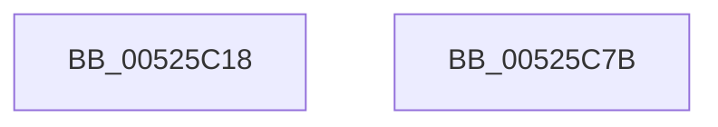

# SymCryptModSetRandom

- RVA: `0x00525C18`–`0x00525C7C` (길이 `100` bytes)
- VA: `0x0000000140525C18`
- 실행 섹션: `.text`
- PDB 이름 있음: `예`; PDB Function 태그: `아니요`
- unwind 정보 RVA: `0x00066400`
- 디코드: `29`개 명령, `100/100` bytes 표시
- 미해석 바이트: `0` (있으면 어셈블리에 `.byte`로 보존)

> 이 문서는 커널 이미지의 기계어와 PDB 기호를 분석해 생성했습니다. 4번과 5번은 함수 원형과 자료형을 바이너리 사용 방식에서 추정한 C 해석이며 원본 소스 복구 결과는 아닙니다.

## 1. Dependencies

- 직접 호출 지점: **2**; 고유 호출 대상: **2**
- 직접 호출자로 확인된 함수: **3**
- RIP 상대 이미지 참조: **1**

### Outgoing calls
- `0x00525C3E` → [SymCryptFdefModSetRandomGeneric](../53/SymCryptFdefModSetRandomGeneric_function_00535180.md) (function, `0x00535180`)
- `0x00525C61` → `indirect target` (indirect, 간접 대상)

### Direct callers
- [SymCryptRsakeyCalculatePrimesFromPrivateExponent](SymCryptRsakeyCalculatePrimesFromPrivateExponent_function_00522D48.md) at `0x00522FC8`
- [SymCryptEcpointGenericSetRandom](SymCryptEcpointGenericSetRandom_function_0052B850.md) at `0x0052B8B4`
- [SymCryptFdefModInvGeneric](../53/SymCryptFdefModInvGeneric_function_005348C0.md) at `0x005349F8`

### Static image references
- `0x00525C45` → RVA `0x00006800` (`.rdata`; read)

## 2. Other-region calls and transfers

- 다른 실행 섹션으로 향하는 call: **0**
- 별도 외부 분기/꼬리 이동을 확인하지 못했습니다.

## 3. Assembly (complete function range)

```asm
00525C18  48 8B C4                        mov rax, rsp
00525C1B  48 89 58 08                     mov qword ptr [rax + 8], rbx
00525C1F  48 89 68 10                     mov qword ptr [rax + 0x10], rbp
00525C23  48 89 70 18                     mov qword ptr [rax + 0x18], rsi
00525C27  57                              push rdi
00525C28  48 83 EC 30                     sub rsp, 0x30
00525C2C  48 8B 5C 24 60                  mov rbx, qword ptr [rsp + 0x60]
00525C31  49 8B E9                        mov rbp, r9
00525C34  48 89 58 E8                     mov qword ptr [rax - 0x18], rbx
00525C38  48 8B FA                        mov rdi, rdx
00525C3B  48 8B F1                        mov rsi, rcx
00525C3E  E8 3D F5 00 00                  call 0x140535180
00525C43  8B 06                           mov eax, dword ptr [rsi]
00525C45  48 8D 0D B4 0B AE FF            lea rcx, [rip - 0x51f44c]
00525C4C  25 80 03 00 00                  and eax, 0x380
00525C51  4C 8B CB                        mov r9, rbx
00525C54  4C 8B C5                        mov r8, rbp
00525C57  48 8B D7                        mov rdx, rdi
00525C5A  48 8B 04 08                     mov rax, qword ptr [rax + rcx]
00525C5E  48 8B CE                        mov rcx, rsi
00525C61  FF D0                           call rax
00525C63  0F 1F 00                        nop dword ptr [rax]
00525C66  48 8B 5C 24 40                  mov rbx, qword ptr [rsp + 0x40]
00525C6B  48 8B 6C 24 48                  mov rbp, qword ptr [rsp + 0x48]
00525C70  48 8B 74 24 50                  mov rsi, qword ptr [rsp + 0x50]
00525C75  48 83 C4 30                     add rsp, 0x30
00525C79  5F                              pop rdi
00525C7A  C3                              ret
00525C7B  CC                              int3
```

## 4. C-style interpretation (structured pseudocode)

```c
__int64 __fastcall SymCryptModSetRandom(__int64 a1, __int64 a2, __int64 a3, __int64 a4, __int64 a5)
{
    __int64 result;
    __int64 v_rsp;
    unsigned __int64 v_stack_p10;
    unsigned __int64 v_stack_p18;
    unsigned __int64 v_stack_p8;

    *(unsigned __int64 *)(v_rsp + 8) = v_rbx;
    *(unsigned __int64 *)(v_rsp + 16) = v_rbp;
    *(unsigned __int64 *)(v_rsp + 24) = v_rsi;
    v_rsp = (v_rsp) - (48);
    *(unsigned __int64 *)(v_rsp - 24) = a5;
    result = SymCryptFdefModSetRandomGeneric(a1, a2, a3, a4);
    result = (unsigned int)(((unsigned int)(*(unsigned int *)(a1))) & (896));
    result = kernel_indirect_call(a1, a2, a4, a5);
    v_rsp = (v_rsp) + (48);
    return result;
}
```

## 5. (Beta) C Style

```c
int64_t SymCryptModSetRandom(void *Arg1, int64_t Arg2, int64_t Arg3, int64_t Arg4, int64_t Arg5)
{
    uint8_t *arg1 = (uint8_t *)Arg1;

    int64_t result;
    int64_t local_rsp;
    uint64_t v_stack_p10;
    uint64_t v_stack_p18;
    uint64_t v_stack_p8;

    *(uint64_t *)(local_rsp + 0x8) = local_rbx;
    *(uint64_t *)(local_rsp + 0x10) = local_rbp;
    *(uint64_t *)(local_rsp + 0x18) = local_rsi;
    local_rsp = (local_rsp) - (48);
    *(uint64_t *)(local_rsp - 0x18) = Arg5;
    result = SymCryptFdefModSetRandomGeneric(Arg1, Arg2, Arg3, Arg4);
    result = (uint32_t)(((uint32_t)(*(uint32_t *)(arg1))) & (896));
    result = kernel_indirect_call(Arg1, Arg2, Arg4, Arg5);
    local_rsp = (local_rsp) + (48);
    return result;
}
```

### 관측된 메모리 오프셋

구조체 형식이 확인되지 않은 접근은 인자 기준의 오프셋으로만 기록했습니다.

| 기준 인자 | 오프셋 표현 | 폭 (bit) | 접근 |
|---|---:|---:|---|
| `Arg1` | `+ 0x0` | `32` | `R` |

## 6. Execution-region graph

[열기: 2D/3D 그래프와 함수 탐색 컨트롤 패널](../../../control-panel.html?section=text&rva=0x00525C18&view=graph)

- 2D 그래프는 위에서 아래로 흐르고, 3D 그래프는 빈 공간을 드래그해 회전합니다. Shift+드래그는 이동, 휠은 확대·축소, 함수 노드 선택은 대상 보고서 이동입니다.

### Static fallback


