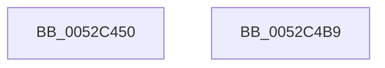

# SymCryptOfflinePrecomputation

- RVA: `0x0052C450`–`0x0052C4BA` (길이 `106` bytes)
- VA: `0x000000014052C450`
- 실행 섹션: `.text`
- PDB 이름 있음: `예`; PDB Function 태그: `아니요`
- unwind 정보 RVA: `0x00066400`
- 디코드: `30`개 명령, `106/106` bytes 표시
- 미해석 바이트: `0` (있으면 어셈블리에 `.byte`로 보존)

> 이 문서는 커널 이미지의 기계어와 PDB 기호를 분석해 생성했습니다. 4번과 5번은 함수 원형과 자료형을 바이너리 사용 방식에서 추정한 C 해석이며 원본 소스 복구 결과는 아닙니다.

## 1. Dependencies

- 직접 호출 지점: **3**; 고유 호출 대상: **3**
- 직접 호출자로 확인된 함수: **1**
- RIP 상대 이미지 참조: **0**

### Outgoing calls
- `0x0052C46D` → [SymCryptSizeofEcpointFromCurve](SymCryptSizeofEcpointFromCurve_function_0052CEF0.md) (function, `0x0052CEF0`)
- `0x0052C47C` → [SymCryptEcpointCreate](SymCryptEcpointCreate_function_0052C5A0.md) (function, `0x0052C5A0`)
- `0x0052C49F` → [SymCryptPrecomputation](SymCryptPrecomputation_function_0052C4C0.md) (function, `0x0052C4C0`)

### Direct callers
- [SymCryptEcurveInitialize](SymCryptEcurveInitialize_function_005241A4.md) at `0x005245E9`

### Static image references
- 디코드된 RIP-relative 메모리 참조가 없습니다.

## 2. Other-region calls and transfers

- 다른 실행 섹션으로 향하는 call: **0**
- 별도 외부 분기/꼬리 이동을 확인하지 못했습니다.

## 3. Assembly (complete function range)

```asm
0052C450  48 89 5C 24 08                  mov qword ptr [rsp + 8], rbx
0052C455  48 89 6C 24 10                  mov qword ptr [rsp + 0x10], rbp
0052C45A  48 89 74 24 18                  mov qword ptr [rsp + 0x18], rsi
0052C45F  57                              push rdi
0052C460  48 83 EC 30                     sub rsp, 0x30
0052C464  49 8B F0                        mov rsi, r8
0052C467  48 8B FA                        mov rdi, rdx
0052C46A  48 8B E9                        mov rbp, rcx
0052C46D  E8 7E 0A 00 00                  call 0x14052cef0
0052C472  4C 8B C5                        mov r8, rbp
0052C475  8B D0                           mov edx, eax
0052C477  48 8B CF                        mov rcx, rdi
0052C47A  8B D8                           mov ebx, eax
0052C47C  E8 1F 01 00 00                  call 0x14052c5a0
0052C481  48 8D 14 3B                     lea rdx, [rbx + rdi]
0052C485  48 2B F3                        sub rsi, rbx
0052C488  48 89 74 24 28                  mov qword ptr [rsp + 0x28], rsi
0052C48D  4C 8D 45 68                     lea r8, [rbp + 0x68]
0052C491  48 89 54 24 20                  mov qword ptr [rsp + 0x20], rdx
0052C496  4C 8B C8                        mov r9, rax
0052C499  8B 55 5C                        mov edx, dword ptr [rbp + 0x5c]
0052C49C  48 8B CD                        mov rcx, rbp
0052C49F  E8 1C 00 00 00                  call 0x14052c4c0
0052C4A4  48 8B 5C 24 40                  mov rbx, qword ptr [rsp + 0x40]
0052C4A9  48 8B 6C 24 48                  mov rbp, qword ptr [rsp + 0x48]
0052C4AE  48 8B 74 24 50                  mov rsi, qword ptr [rsp + 0x50]
0052C4B3  48 83 C4 30                     add rsp, 0x30
0052C4B7  5F                              pop rdi
0052C4B8  C3                              ret
0052C4B9  CC                              int3
```

## 4. C-style interpretation (structured pseudocode)

```c
__int64 __fastcall SymCryptOfflinePrecomputation(__int64 a1, __int64 a2, __int64 a3)
{
    __int64 result;
    __int64 v_rsi;
    __int64 v_rsp;
    unsigned __int64 v_stack_m10;
    unsigned __int64 v_stack_m18;
    unsigned __int64 v_stack_p10;
    unsigned __int64 v_stack_p18;
    unsigned __int64 v_stack_p8;

    v_stack_p8 = v_rbx;
    v_stack_p10 = v_rbp;
    v_stack_p18 = v_rsi;
    v_rsp = (v_rsp) - (48);
    result = SymCryptSizeofEcpointFromCurve(a1, a2, a3, a4);
    result = SymCryptEcpointCreate(a2, (unsigned int)((unsigned int)(result)), a1, a4);
    v_rsi = (a3) - ((unsigned int)((unsigned int)(result)));
    v_stack_m10 = v_rsi;
    v_stack_m18 = (unsigned int)((unsigned int)(result)) + a2 * 1;
    result = SymCryptPrecomputation(a1, (unsigned int)(*(unsigned int *)(a1 + 92)), a1 + 104, result);
    v_rsp = (v_rsp) + (48);
    return result;
}
```

## 5. (Beta) C Style

```c
int64_t SymCryptOfflinePrecomputation(void *Arg1, int64_t Arg2, int64_t Arg3)
{
    uint8_t *arg1 = (uint8_t *)Arg1;

    int64_t result;
    int64_t local_rsi;
    int64_t local_rsp;
    uint64_t v_stack_m10;
    uint64_t v_stack_m18;
    uint64_t v_stack_p10;
    uint64_t v_stack_p18;
    uint64_t v_stack_p8;

    v_stack_p8 = local_rbx;
    v_stack_p10 = local_rbp;
    v_stack_p18 = local_rsi;
    local_rsp = (local_rsp) - (48);
    result = SymCryptSizeofEcpointFromCurve(Arg1, Arg2, Arg3, a4);
    result = SymCryptEcpointCreate(Arg2, (uint32_t)((uint32_t)(result)), Arg1, a4);
    local_rsi = (Arg3) - ((uint32_t)((uint32_t)(result)));
    v_stack_m10 = local_rsi;
    v_stack_m18 = (uint32_t)((uint32_t)(result)) + Arg2 * 1;
    result = SymCryptPrecomputation(Arg1, (uint32_t)(*(uint32_t *)(arg1 + 0x5C)), Arg1 + 104, result);
    local_rsp = (local_rsp) + (48);
    return result;
}
```

### 관측된 메모리 오프셋

구조체 형식이 확인되지 않은 접근은 인자 기준의 오프셋으로만 기록했습니다.

| 기준 인자 | 오프셋 표현 | 폭 (bit) | 접근 |
|---|---:|---:|---|
| `Arg1` | `+ 0x5C` | `32` | `R` |
| `Arg1` | `+ 0x68` | `64` | `R` |

## 6. Execution-region graph

[열기: 2D/3D 그래프와 함수 탐색 컨트롤 패널](../../../control-panel.html?section=text&rva=0x0052C450&view=graph)

- 2D 그래프는 위에서 아래로 흐르고, 3D 그래프는 빈 공간을 드래그해 회전합니다. Shift+드래그는 이동, 휠은 확대·축소, 함수 노드 선택은 대상 보고서 이동입니다.

### Static fallback


