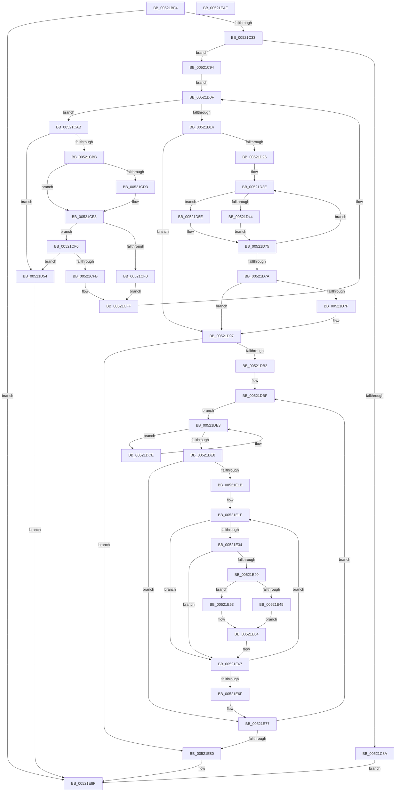

# SymCryptParallelHashProcess

- RVA: `0x00521BF4`–`0x00521EB0` (길이 `700` bytes)
- VA: `0x0000000140521BF4`
- 실행 섹션: `.text`
- PDB 이름 있음: `예`; PDB Function 태그: `아니요`
- unwind 정보 RVA: `0x000C397C`
- 디코드: `192`개 명령, `700/700` bytes 표시
- 미해석 바이트: `0` (있으면 어셈블리에 `.byte`로 보존)

> 이 문서는 커널 이미지의 기계어와 PDB 기호를 분석해 생성했습니다. 4번과 5번은 함수 원형과 자료형을 바이너리 사용 방식에서 추정한 C 해석이며 원본 소스 복구 결과는 아닙니다.

## 1. Dependencies

- 직접 호출 지점: **6**; 고유 호출 대상: **5**
- 직접 호출자로 확인된 함수: **1**
- RIP 상대 이미지 참조: **1**

### Outgoing calls
- `0x00521C99` → [memset](../6C/memset_function_006C6C40.md) (function, `0x006C6C40`)
- `0x00521D3B` → [SymCryptParallelHashSetNextWork](SymCryptParallelHashSetNextWork_function_00522038.md) (function, `0x00522038`)
- `0x00521D92` → [qsort](../50/qsort_function_005009F0.md) (function, `0x005009F0`)
- `0x00521E0E` → [guard_dispatch_icall](../6B/guard_dispatch_icall_function_006BAAD0.md) (function, `0x006BAAD0`)
- `0x00521E37` → [SymCryptParallelHashSetNextWork](SymCryptParallelHashSetNextWork_function_00522038.md) (function, `0x00522038`)
- `0x00521E8A` → [SymCryptWipe](../51/SymCryptWipe_function_0051F914.md) (function, `0x0051F914`)

### Direct callers
- [SymCryptParallelSha256Process](../51/SymCryptParallelSha256Process_function_0051EF68.md) at `0x0051EFF8`
- [SymCryptParallelSha256Process](../51/SymCryptParallelSha256Process_function_0051EF68.md) at `0x0051F05A`

### Static image references
- `0x00521D7F` → RVA `0x00522210` (`compareRequestSize`; read)

## 2. Other-region calls and transfers

- 다른 실행 섹션으로 향하는 call: **0**
- 별도 외부 분기/꼬리 이동을 확인하지 못했습니다.

## 3. Assembly (complete function range)

```asm
00521BF4  48 8B C4                        mov rax, rsp
00521BF7  48 89 58 10                     mov qword ptr [rax + 0x10], rbx
00521BFB  48 89 68 18                     mov qword ptr [rax + 0x18], rbp
00521BFF  48 89 70 20                     mov qword ptr [rax + 0x20], rsi
00521C03  48 89 48 08                     mov qword ptr [rax + 8], rcx
00521C07  57                              push rdi
00521C08  41 54                           push r12
00521C0A  41 55                           push r13
00521C0C  41 56                           push r14
00521C0E  41 57                           push r15
00521C10  48 83 EC 40                     sub rsp, 0x40
00521C14  48 8B B4 24 90 00 00 00         mov rsi, qword ptr [rsp + 0x90]
00521C1C  33 DB                           xor ebx, ebx
00521C1E  4D 8B E1                        mov r12, r9
00521C21  4D 8B F8                        mov r15, r8
00521C24  4C 8B EA                        mov r13, rdx
00521C27  48 8B C1                        mov rax, rcx
00521C2A  48 85 F6                        test rsi, rsi
00521C2D  0F 84 5C 02 00 00               je 0x140521e8f
00521C33  48 8B 09                        mov rcx, qword ptr [rcx]
00521C36  4F 8D 04 40                     lea r8, [r8 + r8*2]
00521C3A  4C 8B 94 24 98 00 00 00         mov r10, qword ptr [rsp + 0x98]
00521C42  8B 40 08                        mov eax, dword ptr [rax + 8]
00521C45  48 89 8C 24 90 00 00 00         mov qword ptr [rsp + 0x90], rcx
00521C4D  4A 8D 0C FD 1F 00 00 00         lea rcx, [r15*8 + 0x1f]
00521C55  49 C1 E0 04                     shl r8, 4
00521C59  49 8D 6A 0F                     lea rbp, [r10 + 0xf]
00521C5D  48 89 44 24 30                  mov qword ptr [rsp + 0x30], rax
00521C62  48 83 E5 F0                     and rbp, 0xfffffffffffffff0
00521C66  4D 8D 34 28                     lea r14, [r8 + rbp]
00521C6A  49 03 CE                        add rcx, r14
00521C6D  48 83 E1 E0                     and rcx, 0xffffffffffffffe0
00521C71  48 89 4C 24 38                  mov qword ptr [rsp + 0x38], rcx
00521C76  48 8D 14 08                     lea rdx, [rax + rcx]
00521C7A  48 8B 8C 24 A0 00 00 00         mov rcx, qword ptr [rsp + 0xa0]
00521C82  49 03 CA                        add rcx, r10
00521C85  48 3B D1                        cmp rdx, rcx
00521C88  76 0A                           jbe 0x140521c94
00521C8A  BB 0D 80 00 00                  mov ebx, 0x800d
00521C8F  E9 FB 01 00 00                  jmp 0x140521e8f
00521C94  33 D2                           xor edx, edx
00521C96  48 8B CD                        mov rcx, rbp
00521C99  E8 A2 4F 1A 00                  call 0x1406c6c40
00521C9E  48 8D 04 B6                     lea rax, [rsi + rsi*4]
00521CA2  48 8B FB                        mov rdi, rbx
00521CA5  49 8D 14 C4                     lea rdx, [r12 + rax*8]
00521CA9  EB 64                           jmp 0x140521d0f
00521CAB  48 83 EA 28                     sub rdx, 0x28
00521CAF  4C 8B 02                        mov r8, qword ptr [rdx]
00521CB2  4D 3B C7                        cmp r8, r15
00521CB5  0F 83 99 00 00 00               jae 0x140521d54
00521CBB  4C 8B 8C 24 90 00 00 00         mov r9, qword ptr [rsp + 0x90]
00521CC3  4B 8D 0C 40                     lea rcx, [r8 + r8*2]
00521CC7  48 C1 E1 04                     shl rcx, 4
00521CCB  48 03 CD                        add rcx, rbp
00521CCE  48 39 19                        cmp qword ptr [rcx], rbx
00521CD1  75 15                           jne 0x140521ce8
00521CD3  41 8B 41 28                     mov eax, dword ptr [r9 + 0x28]
00521CD7  49 0F AF C0                     imul rax, r8
00521CDB  49 03 C5                        add rax, r13
00521CDE  48 89 01                        mov qword ptr [rcx], rax
00521CE1  49 89 0C FE                     mov qword ptr [r14 + rdi*8], rcx
00521CE5  48 FF C7                        inc rdi
00521CE8  8B 42 08                        mov eax, dword ptr [rdx + 8]
00521CEB  83 F8 01                        cmp eax, 1
00521CEE  75 06                           jne 0x140521cf6
00521CF0  48 8B 42 18                     mov rax, qword ptr [rdx + 0x18]
00521CF4  EB 09                           jmp 0x140521cff
00521CF6  83 F8 02                        cmp eax, 2
00521CF9  75 59                           jne 0x140521d54
00521CFB  41 8B 41 30                     mov eax, dword ptr [r9 + 0x30]
00521CFF  48 01 41 10                     add qword ptr [rcx + 0x10], rax
00521D03  48 8B 41 18                     mov rax, qword ptr [rcx + 0x18]
00521D07  48 89 42 20                     mov qword ptr [rdx + 0x20], rax
00521D0B  48 89 51 18                     mov qword ptr [rcx + 0x18], rdx
00521D0F  49 3B D4                        cmp rdx, r12
00521D12  77 97                           ja 0x140521cab
00521D14  49 8B 06                        mov rax, qword ptr [r14]
00521D17  41 B4 01                        mov r12b, 1
00521D1A  48 8B F3                        mov rsi, rbx
00521D1D  4C 8B 68 10                     mov r13, qword ptr [rax + 0x10]
00521D21  48 85 FF                        test rdi, rdi
00521D24  74 71                           je 0x140521d97
00521D26  4D 8D 7E F8                     lea r15, [r14 - 8]
00521D2A  4D 8D 3C FF                     lea r15, [r15 + rdi*8]
00521D2E  48 8B 4C 24 70                  mov rcx, qword ptr [rsp + 0x70]
00521D33  49 8D 2C F6                     lea rbp, [r14 + rsi*8]
00521D37  48 8B 55 00                     mov rdx, qword ptr [rbp]
00521D3B  E8 F8 02 00 00                  call 0x140522038
00521D40  84 C0                           test al, al
00521D42  75 1A                           jne 0x140521d5e
00521D44  49 8B 07                        mov rax, qword ptr [r15]
00521D47  48 FF CF                        dec rdi
00521D4A  48 89 45 00                     mov qword ptr [rbp], rax
00521D4E  49 83 EF 08                     sub r15, 8
00521D52  EB 21                           jmp 0x140521d75
00521D54  BB 0E 80 00 00                  mov ebx, 0x800e
00521D59  E9 31 01 00 00                  jmp 0x140521e8f
00521D5E  48 8B 4D 00                     mov rcx, qword ptr [rbp]
00521D62  48 FF C6                        inc rsi
00521D65  41 0F B6 C4                     movzx eax, r12b
00521D69  8B D3                           mov edx, ebx
00521D6B  4C 39 69 10                     cmp qword ptr [rcx + 0x10], r13
00521D6F  0F 44 D0                        cmove edx, eax
00521D72  44 8A E2                        mov r12b, dl
00521D75  48 3B F7                        cmp rsi, rdi
00521D78  72 B4                           jb 0x140521d2e
00521D7A  45 84 E4                        test r12b, r12b
00521D7D  75 18                           jne 0x140521d97
00521D7F  4C 8D 0D 8A 04 00 00            lea r9, [rip + 0x48a]
00521D86  41 B8 08 00 00 00               mov r8d, 8
00521D8C  48 8B D7                        mov rdx, rdi
00521D8F  49 8B CE                        mov rcx, r14
00521D92  E8 59 EC FD FF                  call 0x1405009f0
00521D97  8B B4 24 A8 00 00 00            mov esi, dword ptr [rsp + 0xa8]
00521D9E  48 3B FE                        cmp rdi, rsi
00521DA1  48 0F 42 F7                     cmovb rsi, rdi
00521DA5  4D 8D 24 F6                     lea r12, [r14 + rsi*8]
00521DA9  48 85 FF                        test rdi, rdi
00521DAC  0F 84 CE 00 00 00               je 0x140521e80
00521DB2  4C 8B 6C 24 70                  mov r13, qword ptr [rsp + 0x70]
00521DB7  4C 8B BC 24 90 00 00 00         mov r15, qword ptr [rsp + 0x90]
00521DBF  49 8B 06                        mov rax, qword ptr [r14]
00521DC2  41 B8 01 00 00 00               mov r8d, 1
00521DC8  48 8B 50 28                     mov rdx, qword ptr [rax + 0x28]
00521DCC  EB 15                           jmp 0x140521de3
00521DCE  4B 8B 04 C6                     mov rax, qword ptr [r14 + r8*8]
00521DD2  48 8B 48 28                     mov rcx, qword ptr [rax + 0x28]
00521DD6  48 3B D1                        cmp rdx, rcx
00521DD9  48 0F 42 CA                     cmovb rcx, rdx
00521DDD  49 FF C0                        inc r8
00521DE0  48 8B D1                        mov rdx, rcx
00521DE3  4C 3B C6                        cmp r8, rsi
00521DE6  72 E6                           jb 0x140521dce
00521DE8  45 8B 47 30                     mov r8d, dword ptr [r15 + 0x30]
00521DEC  48 8B 4C 24 30                  mov rcx, qword ptr [rsp + 0x30]
00521DF1  41 FF C8                        dec r8d
00521DF4  49 8B 45 28                     mov rax, qword ptr [r13 + 0x28]
00521DF8  49 F7 D0                        not r8
00521DFB  4C 8B 4C 24 38                  mov r9, qword ptr [rsp + 0x38]
00521E00  4C 23 C2                        and r8, rdx
00521E03  48 89 4C 24 20                  mov qword ptr [rsp + 0x20], rcx
00521E08  48 8B D6                        mov rdx, rsi
00521E0B  49 8B CE                        mov rcx, r14
00521E0E  E8 BD 8C 19 00                  call 0x1406baad0
00521E13  48 8B EB                        mov rbp, rbx
00521E16  48 85 F6                        test rsi, rsi
00521E19  74 5C                           je 0x140521e77
00521E1B  4D 8D 3C F6                     lea r15, [r14 + rsi*8]
00521E1F  48 8B 84 24 90 00 00 00         mov rax, qword ptr [rsp + 0x90]
00521E27  49 8B 14 EE                     mov rdx, qword ptr [r14 + rbp*8]
00521E2B  8B 40 30                        mov eax, dword ptr [rax + 0x30]
00521E2E  48 39 42 28                     cmp qword ptr [rdx + 0x28], rax
00521E32  73 33                           jae 0x140521e67
00521E34  49 8B CD                        mov rcx, r13
00521E37  E8 FC 01 00 00                  call 0x140522038
00521E3C  84 C0                           test al, al
00521E3E  75 27                           jne 0x140521e67
00521E40  48 3B FE                        cmp rdi, rsi
00521E43  76 0E                           jbe 0x140521e53
00521E45  49 8B 04 24                     mov rax, qword ptr [r12]
00521E49  49 83 C4 08                     add r12, 8
00521E4D  49 89 04 EE                     mov qword ptr [r14 + rbp*8], rax
00521E51  EB 11                           jmp 0x140521e64
00521E53  49 83 EF 08                     sub r15, 8
00521E57  48 FF CE                        dec rsi
00521E5A  49 8B 07                        mov rax, qword ptr [r15]
00521E5D  49 89 04 EE                     mov qword ptr [r14 + rbp*8], rax
00521E61  48 FF CD                        dec rbp
00521E64  48 FF CF                        dec rdi
00521E67  48 FF C5                        inc rbp
00521E6A  48 3B EE                        cmp rbp, rsi
00521E6D  72 B0                           jb 0x140521e1f
00521E6F  4C 8B BC 24 90 00 00 00         mov r15, qword ptr [rsp + 0x90]
00521E77  48 85 FF                        test rdi, rdi
00521E7A  0F 85 3F FF FF FF               jne 0x140521dbf
00521E80  48 8B 54 24 30                  mov rdx, qword ptr [rsp + 0x30]
00521E85  48 8B 4C 24 38                  mov rcx, qword ptr [rsp + 0x38]
00521E8A  E8 85 DA FF FF                  call 0x14051f914
00521E8F  4C 8D 5C 24 40                  lea r11, [rsp + 0x40]
00521E94  8B C3                           mov eax, ebx
00521E96  49 8B 5B 38                     mov rbx, qword ptr [r11 + 0x38]
00521E9A  49 8B 6B 40                     mov rbp, qword ptr [r11 + 0x40]
00521E9E  49 8B 73 48                     mov rsi, qword ptr [r11 + 0x48]
00521EA2  49 8B E3                        mov rsp, r11
00521EA5  41 5F                           pop r15
00521EA7  41 5E                           pop r14
00521EA9  41 5D                           pop r13
00521EAB  41 5C                           pop r12
00521EAD  5F                              pop rdi
00521EAE  C3                              ret
00521EAF  CC                              int3
```

## 4. C-style interpretation (structured pseudocode)

```c
__int64 __fastcall SymCryptParallelHashProcess(__int64 a1, __int64 a2, __int64 a3, __int64 a4, __int64 a5, __int64 a6, __int64 a7, unsigned int a8)
{
    __int64 result;
    __int64 v_r12;
    __int64 v_r15;
    __int64 v_rbp;
    __int64 v_rbx;
    __int64 v_rdi;
    __int64 v_rsi;
    __int64 v_rsp;
    unsigned __int64 v_stack_m28;
    unsigned __int64 v_stack_m30;
    unsigned __int64 v_stack_m38;
    unsigned __int64 v_stack_m48;
    unsigned __int64 v_stack_p28;
    unsigned __int64 v_stack_p8;

    *(unsigned __int64 *)(v_rsp + 16) = v_rbx;
    *(unsigned __int64 *)(v_rsp + 24) = v_rbp;
    *(unsigned __int64 *)(v_rsp + 32) = v_rsi;
    *(unsigned __int64 *)(v_rsp + 8) = a1;
    v_rsp = (v_rsp) - (64);
    v_rbx = 0;
    if (a5 == 0) goto loc_00521E8F;
    v_stack_p28 = *(unsigned __int64 *)(a1);
    a3 = (a3 + a3 * 2) << (4);
    v_stack_m38 = (unsigned int)(*(unsigned int *)(a1 + 8));
    v_rbp = (a6 + 15) & (-16);
    a1 = (a3 * 8 + 31) + (a3 + v_rbp * 1);
    a1 = (a1) & (-32);
    v_stack_m30 = a1;
    a1 = (a7) + (a6);
    if (((unsigned int)(*(unsigned int *)(a1 + 8)) + a1 * 1) <= a1) goto loc_00521C94;
    goto loc_00521E8F;
loc_00521C94:
    a2 = 0;
    result = memset(v_rbp, a2, a3, a4);
    goto loc_00521D0F;
loc_00521CAB:
    a2 = (a4 + a5 + a5 * 4 * 8) - (40);
    if ((*(unsigned __int64 *)(a2)) >= a3) goto loc_00521D54;
    a1 = (*(unsigned __int64 *)(a2) + *(unsigned __int64 *)(a2) * 2) << (4);
    a1 = (a1) + (v_rbp);
    result = a5 + a5 * 4;
    v_rdi = (unsigned int)(0x800DULL);
    if ((*(unsigned __int64 *)(a1)) == ((unsigned int)(0x800DULL))) {
        result = *(unsigned int *)(a5 + 40);
        result = (result) * (*(unsigned __int64 *)(a2));
        result = (result) + (a2);
        *(unsigned __int64 *)(a1) = result;
        *(unsigned __int64 *)(a3 + v_rbp * 1 + (unsigned int)(0x800DULL) * 8) = a1;
        v_rdi = ((unsigned int)(0x800DULL)) + 1;
    }
    if (((unsigned int)((unsigned int)(*(unsigned int *)(a2 + 8)))) != 1) goto loc_00521CF6;
    goto loc_00521CFF;
loc_00521CF6:
    if (((unsigned int)(*(unsigned __int64 *)(a2 + 24))) != 2) goto loc_00521D54;
loc_00521CFF:
    *(unsigned __int64 *)(a2 + 32) = *(unsigned __int64 *)(a1 + 24);
    *(unsigned __int64 *)(a1 + 24) = a2;
loc_00521D0F:
    if (a2 > a4) goto loc_00521CAB;
    if (v_rdi == 0) goto loc_00521D97;
loc_00521D2E:
    result = SymCryptParallelHashSetNextWork(v_stack_p8, *(unsigned __int64 *)(a3 + v_rbp * 1 + (unsigned int)(0x800DULL) * 8), *(unsigned __int64 *)(a2), a5);
    if ((unsigned __int8)(result) != 0) goto loc_00521D5E;
    v_rdi = (v_rdi) - 1;
    *(unsigned __int64 *)(a3 + v_rbp * 1 + (unsigned int)(0x800DULL) * 8) = *(unsigned __int64 *)(a3 + v_rbp * 1 - 8 + v_rdi * 8);
    v_r15 = (a3 + v_rbp * 1 - 8 + v_rdi * 8) - (8);
    goto loc_00521D75;
loc_00521D54:
    goto loc_00521E8F;
loc_00521D5E:
    v_rsi = ((unsigned int)(0x800DULL)) + 1;
    a2 = (unsigned int)((unsigned int)((unsigned int)(0x800EULL)));
    if ((*(unsigned __int64 *)(*(unsigned __int64 *)(a3 + v_rbp * 1 + (unsigned int)(0x800DULL) * 8) + 16)) == (*(unsigned __int64 *)(*(unsigned __int64 *)(a3 + v_rbp * 1) + 16))) { a2 = 1; }
loc_00521D75:
    if (v_rsi < v_rdi) goto loc_00521D2E;
    result = 1;
    if ((unsigned __int8)((unsigned __int8)(a2)) == 0) {
        a4 = v_rip + 1162;
        a3 = 8;
        a2 = v_rdi;
        a1 = a3 + v_rbp * 1;
        result = qsort(a1, a2, a3, a4);
    }
    v_rsi = (unsigned int)(a8);
    if (v_rdi < ((unsigned int)(a8))) { v_rsi = v_rdi; }
    if (v_rdi == 0) goto loc_00521E80;
loc_00521DBF:
    goto loc_00521DE3;
loc_00521DCE:
    a1 = *(unsigned __int64 *)(*(unsigned __int64 *)(a3 + v_rbp * 1 + 1 * 8) + 40);
    if ((*(unsigned __int64 *)(*(unsigned __int64 *)(a3 + v_rbp * 1) + 40)) < (*(unsigned __int64 *)(*(unsigned __int64 *)(a3 + v_rbp * 1 + 1 * 8) + 40))) { a1 = *(unsigned __int64 *)(*(unsigned __int64 *)(a3 + v_rbp * 1) + 40); }
    a3 = (1) + 1;
loc_00521DE3:
    if (a3 < v_rsi) goto loc_00521DCE;
    a3 = (unsigned int)(((unsigned int)(*(unsigned int *)(a5 + 48))) - 1);
    a3 = ~(a3);
    a3 = (a3) & (a1);
    v_stack_m48 = v_stack_m38;
    result = guard_dispatch_icall(a3 + v_rbp * 1, v_rsi, a3, v_stack_m30);
    if (v_rsi == 0) goto loc_00521E77;
loc_00521E1F:
    if ((*(unsigned __int64 *)(*(unsigned __int64 *)(a3 + v_rbp * 1 + (unsigned int)(0x800EULL) * 8) + 40)) >= ((unsigned int)(*(unsigned int *)(a5 + 48)))) goto loc_00521E67;
    result = SymCryptParallelHashSetNextWork(v_stack_p8, *(unsigned __int64 *)(a3 + v_rbp * 1 + (unsigned int)(0x800EULL) * 8), a3, v_stack_m30);
    if ((unsigned __int8)(result) != 0) goto loc_00521E67;
    if (v_rdi <= v_rsi) goto loc_00521E53;
    v_r12 = (a3 + v_rbp * 1 + v_rsi * 8) + (8);
    *(unsigned __int64 *)(a3 + v_rbp * 1 + (unsigned int)(0x800EULL) * 8) = *(unsigned __int64 *)(a3 + v_rbp * 1 + v_rsi * 8);
    goto loc_00521E64;
loc_00521E53:
    v_r15 = (a3 + v_rbp * 1 + v_rsi * 8) - (8);
    v_rsi = (v_rsi) - 1;
    *(unsigned __int64 *)(a3 + v_rbp * 1 + (unsigned int)(0x800EULL) * 8) = *(unsigned __int64 *)(v_r15);
    v_rbp = ((unsigned int)(0x800EULL)) - 1;
loc_00521E64:
    v_rdi = (v_rdi) - 1;
loc_00521E67:
    v_rbp = (v_rbp) + 1;
    if (v_rbp < v_rsi) goto loc_00521E1F;
loc_00521E77:
    if (v_rdi != 0) goto loc_00521DBF;
loc_00521E80:
    result = SymCryptWipe(v_stack_m30, v_stack_m38, a3, v_stack_m30);
loc_00521E8F:
    return (unsigned int)((unsigned int)((unsigned int)(0x800EULL)));
}
```

## 5. (Beta) C Style

```c
int64_t SymCryptParallelHashProcess(void *Arg1, int64_t Arg2, void *Arg3, void *Arg4, void *Arg5, void *Arg6, int64_t Arg7, uint32_t Arg8)
{
    uint8_t *arg1 = (uint8_t *)Arg1;
    uint8_t *arg3 = (uint8_t *)Arg3;
    uint8_t *arg4 = (uint8_t *)Arg4;
    uint8_t *arg5 = (uint8_t *)Arg5;
    uint8_t *arg6 = (uint8_t *)Arg6;

    int64_t result;
    int64_t local_r12;
    int64_t local_r15;
    int64_t local_rbp;
    int64_t local_rbx;
    int64_t local_rdi;
    int64_t local_rsi;
    int64_t local_rsp;
    uint64_t v_stack_m28;
    uint64_t v_stack_m30;
    uint64_t v_stack_m38;
    uint64_t v_stack_m48;
    uint64_t v_stack_p28;
    uint64_t v_stack_p8;

    *(uint64_t *)(local_rsp + 0x10) = local_rbx;
    *(uint64_t *)(local_rsp + 0x18) = local_rbp;
    *(uint64_t *)(local_rsp + 0x20) = local_rsi;
    *(void **)(local_rsp + 0x8) = Arg1;
    local_rsp = (local_rsp) - (64);
    local_rbx = 0;
    if (Arg5 == NULL) goto loc_00521E8F;
    v_stack_p28 = *(uint64_t *)(arg1);
    Arg3 = (Arg3 + Arg3 * 2) << (4);
    v_stack_m38 = (uint32_t)(*(uint32_t *)(arg1 + 0x8));
    local_rbp = (Arg6 + 15) & (-16);
    Arg1 = (Arg3 * 8 + 31) + (Arg3 + local_rbp * 1);
    Arg1 = (Arg1) & (-32);
    v_stack_m30 = Arg1;
    Arg1 = (Arg7) + (Arg6);
    if (((uint32_t)(*(uint32_t *)(arg1 + 0x8)) + Arg1 * 1) <= Arg1) goto loc_00521C94;
    goto loc_00521E8F;
loc_00521C94:
    Arg2 = 0;
    result = memset(local_rbp, Arg2, Arg3, Arg4);
    goto loc_00521D0F;
loc_00521CAB:
    Arg2 = (Arg4 + Arg5 + Arg5 * 4 * 8) - (40);
    if ((*(uint64_t *)(Arg2)) >= Arg3) goto loc_00521D54;
    Arg1 = (*(uint64_t *)(Arg2) + *(uint64_t *)(Arg2) * 2) << (4);
    Arg1 = (Arg1) + (local_rbp);
    result = Arg5 + Arg5 * 4;
    local_rdi = (uint32_t)(0x800DULL);
    if ((*(uint64_t *)(arg1)) == ((uint32_t)(0x800DULL))) {
        result = *(uint32_t *)(arg5 + 0x28);
        result = (result) * (*(uint64_t *)(Arg2));
        result = (result) + (Arg2);
        *(uint64_t *)(arg1) = result;
        *(void **)(arg3 + local_rbp * 1 + (uint32_t)(0x800DULL) * 8) = Arg1;
        local_rdi = ((uint32_t)(0x800DULL)) + 1;
    }
    if (((uint32_t)((uint32_t)(*(uint32_t *)(Arg2 + 0x8)))) != 1) goto loc_00521CF6;
    goto loc_00521CFF;
loc_00521CF6:
    if (((uint32_t)(*(uint64_t *)(Arg2 + 0x18))) != 2) goto loc_00521D54;
loc_00521CFF:
    *(uint64_t *)(Arg2 + 0x20) = *(uint64_t *)(arg1 + 0x18);
    *(uint64_t *)(arg1 + 0x18) = Arg2;
loc_00521D0F:
    if (Arg2 > Arg4) goto loc_00521CAB;
    if (local_rdi == 0) goto loc_00521D97;
loc_00521D2E:
    result = SymCryptParallelHashSetNextWork(v_stack_p8, *(uint64_t *)(arg3 + local_rbp * 1 + (uint32_t)(0x800DULL) * 8), *(uint64_t *)(Arg2), Arg5);
    if ((uint8_t)(result) != 0) goto loc_00521D5E;
    local_rdi = (local_rdi) - 1;
    *(uint64_t *)(arg3 + local_rbp * 1 + (uint32_t)(0x800DULL) * 8) = *(uint64_t *)(arg3 + local_rbp * 1 - 0x8 + local_rdi * 8);
    local_r15 = (Arg3 + local_rbp * 1 - 8 + local_rdi * 8) - (8);
    goto loc_00521D75;
loc_00521D54:
    goto loc_00521E8F;
loc_00521D5E:
    local_rsi = ((uint32_t)(0x800DULL)) + 1;
    Arg2 = (uint32_t)((uint32_t)((uint32_t)(0x800EULL)));
    if ((*(uint64_t *)(*(uint64_t *)(arg3 + local_rbp * 1 + (uint32_t)(0x800DULL) * 8) + 0x10)) == (*(uint64_t *)(*(uint64_t *)(arg3 + local_rbp * 1) + 0x10))) { Arg2 = 1; }
loc_00521D75:
    if (local_rsi < local_rdi) goto loc_00521D2E;
    result = 1;
    if ((uint8_t)((uint8_t)(Arg2)) == 0) {
        Arg4 = v_rip + 1162;
        Arg3 = 8;
        Arg2 = local_rdi;
        Arg1 = Arg3 + local_rbp * 1;
        result = qsort(Arg1, Arg2, Arg3, Arg4);
    }
    local_rsi = (uint32_t)(Arg8);
    if (local_rdi < ((uint32_t)(Arg8))) { local_rsi = local_rdi; }
    if (local_rdi == 0) goto loc_00521E80;
loc_00521DBF:
    goto loc_00521DE3;
loc_00521DCE:
    Arg1 = *(uint64_t *)(*(uint64_t *)(arg3 + local_rbp * 1 + 0x1 * 8) + 0x28);
    if ((*(uint64_t *)(*(uint64_t *)(arg3 + local_rbp * 1) + 0x28)) < (*(uint64_t *)(*(uint64_t *)(arg3 + local_rbp * 1 + 0x1 * 8) + 0x28))) { Arg1 = *(uint64_t *)(*(uint64_t *)(arg3 + local_rbp * 1) + 0x28); }
    Arg3 = (1) + 1;
loc_00521DE3:
    if (Arg3 < local_rsi) goto loc_00521DCE;
    Arg3 = (uint32_t)(((uint32_t)(*(uint32_t *)(arg5 + 0x30))) - 1);
    Arg3 = ~(Arg3);
    Arg3 = (Arg3) & (Arg1);
    v_stack_m48 = v_stack_m38;
    result = guard_dispatch_icall(Arg3 + local_rbp * 1, local_rsi, Arg3, v_stack_m30);
    if (local_rsi == 0) goto loc_00521E77;
loc_00521E1F:
    if ((*(uint64_t *)(*(uint64_t *)(arg3 + local_rbp * 1 + (uint32_t)(0x800EULL) * 8) + 0x28)) >= ((uint32_t)(*(uint32_t *)(arg5 + 0x30)))) goto loc_00521E67;
    result = SymCryptParallelHashSetNextWork(v_stack_p8, *(uint64_t *)(arg3 + local_rbp * 1 + (uint32_t)(0x800EULL) * 8), Arg3, v_stack_m30);
    if ((uint8_t)(result) != 0) goto loc_00521E67;
    if (local_rdi <= local_rsi) goto loc_00521E53;
    local_r12 = (Arg3 + local_rbp * 1 + local_rsi * 8) + (8);
    *(uint64_t *)(arg3 + local_rbp * 1 + (uint32_t)(0x800EULL) * 8) = *(uint64_t *)(arg3 + local_rbp * 1 + local_rsi * 8);
    goto loc_00521E64;
loc_00521E53:
    local_r15 = (Arg3 + local_rbp * 1 + local_rsi * 8) - (8);
    local_rsi = (local_rsi) - 1;
    *(uint64_t *)(arg3 + local_rbp * 1 + (uint32_t)(0x800EULL) * 8) = *(uint64_t *)(local_r15);
    local_rbp = ((uint32_t)(0x800EULL)) - 1;
loc_00521E64:
    local_rdi = (local_rdi) - 1;
loc_00521E67:
    local_rbp = (local_rbp) + 1;
    if (local_rbp < local_rsi) goto loc_00521E1F;
loc_00521E77:
    if (local_rdi != 0) goto loc_00521DBF;
loc_00521E80:
    result = SymCryptWipe(v_stack_m30, v_stack_m38, Arg3, v_stack_m30);
loc_00521E8F:
    return (uint32_t)((uint32_t)((uint32_t)(0x800EULL)));
}
```

### 관측된 메모리 오프셋

구조체 형식이 확인되지 않은 접근은 인자 기준의 오프셋으로만 기록했습니다.

| 기준 인자 | 오프셋 표현 | 폭 (bit) | 접근 |
|---|---:|---:|---|
| `Arg1` | `+ 0x0` | `64` | `R` |
| `Arg1` | `+ 0x8` | `32` | `R` |
| `Arg3` | `+ 0x0 + r8*2` | `64` | `R` |
| `Arg4` | `+ 0x0 + rax*8` | `64` | `R` |
| `Arg5` | `+ 0x28` | `32` | `R` |
| `Arg5` | `+ 0x30` | `32` | `R` |
| `Arg6` | `+ 0xF` | `64` | `R` |

## 6. Execution-region graph

[열기: 2D/3D 그래프와 함수 탐색 컨트롤 패널](../../../control-panel.html?section=text&rva=0x00521BF4&view=graph)

- 2D 그래프는 위에서 아래로 흐르고, 3D 그래프는 빈 공간을 드래그해 회전합니다. Shift+드래그는 이동, 휠은 확대·축소, 함수 노드 선택은 대상 보고서 이동입니다.

### Static fallback


