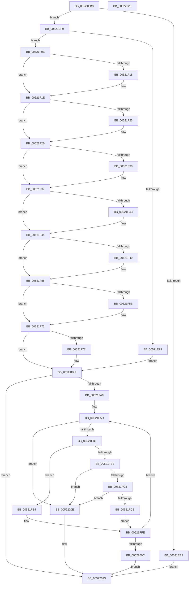

# SymCryptParallelHashProcess_serial

- RVA: `0x00521EB8`–`0x0052202F` (길이 `375` bytes)
- VA: `0x0000000140521EB8`
- 실행 섹션: `.text`
- PDB 이름 있음: `예`; PDB Function 태그: `아니요`
- unwind 정보 RVA: `0x00060300`
- 디코드: `108`개 명령, `375/375` bytes 표시
- 미해석 바이트: `0` (있으면 어셈블리에 `.byte`로 보존)

> 이 문서는 커널 이미지의 기계어와 PDB 기호를 분석해 생성했습니다. 4번과 5번은 함수 원형과 자료형을 바이너리 사용 방식에서 추정한 C 해석이며 원본 소스 복구 결과는 아닙니다.

## 1. Dependencies

- 직접 호출 지점: **3**; 고유 호출 대상: **2**
- 직접 호출자로 확인된 함수: **1**
- RIP 상대 이미지 참조: **0**

### Outgoing calls
- `0x00521F04` → [SymCryptWipe](../51/SymCryptWipe_function_0051F914.md) (function, `0x0051F914`)
- `0x00521FDD` → [guard_dispatch_icall](../6B/guard_dispatch_icall_function_006BAAD0.md) (function, `0x006BAAD0`)
- `0x00521FF9` → [guard_dispatch_icall](../6B/guard_dispatch_icall_function_006BAAD0.md) (function, `0x006BAAD0`)

### Direct callers
- [SymCryptParallelSha256Process](../51/SymCryptParallelSha256Process_function_0051EF68.md) at `0x0051F094`

### Static image references
- 디코드된 RIP-relative 메모리 참조가 없습니다.

## 2. Other-region calls and transfers

- 다른 실행 섹션으로 향하는 call: **0**
- 별도 외부 분기/꼬리 이동을 확인하지 못했습니다.

## 3. Assembly (complete function range)

```asm
00521EB8  48 89 5C 24 08                  mov qword ptr [rsp + 8], rbx
00521EBD  48 89 6C 24 10                  mov qword ptr [rsp + 0x10], rbp
00521EC2  48 89 74 24 18                  mov qword ptr [rsp + 0x18], rsi
00521EC7  57                              push rdi
00521EC8  41 56                           push r14
00521ECA  41 57                           push r15
00521ECC  48 83 EC 20                     sub rsp, 0x20
00521ED0  48 8B 29                        mov rbp, qword ptr [rcx]
00521ED3  4C 8B FA                        mov r15, rdx
00521ED6  8B 51 08                        mov edx, dword ptr [rcx + 8]
00521ED9  33 DB                           xor ebx, ebx
00521EDB  49 6B C0 38                     imul rax, r8, 0x38
00521EDF  49 8B F9                        mov rdi, r9
00521EE2  4D 8B F0                        mov r14, r8
00521EE5  48 03 D0                        add rdx, rax
00521EE8  48 39 54 24 70                  cmp qword ptr [rsp + 0x70], rdx
00521EED  73 0A                           jae 0x140521ef9
00521EEF  BB 0D 80 00 00                  mov ebx, 0x800d
00521EF4  E9 1A 01 00 00                  jmp 0x140522013
00521EF9  48 83 FA 40                     cmp rdx, 0x40
00521EFD  76 0F                           jbe 0x140521f0e
00521EFF  48 8B 4C 24 68                  mov rcx, qword ptr [rsp + 0x68]
00521F04  E8 0B DA FF FF                  call 0x14051f914
00521F09  E9 91 00 00 00                  jmp 0x140521f9f
00521F0E  48 8B 44 24 68                  mov rax, qword ptr [rsp + 0x68]
00521F13  F6 C2 01                        test dl, 1
00521F16  74 06                           je 0x140521f1e
00521F18  48 FF CA                        dec rdx
00521F1B  88 1C 02                        mov byte ptr [rdx + rax], bl
00521F1E  F6 C2 02                        test dl, 2
00521F21  74 08                           je 0x140521f2b
00521F23  48 83 EA 02                     sub rdx, 2
00521F27  66 89 1C 02                     mov word ptr [rdx + rax], bx
00521F2B  F6 C2 04                        test dl, 4
00521F2E  74 07                           je 0x140521f37
00521F30  48 83 EA 04                     sub rdx, 4
00521F34  89 1C 02                        mov dword ptr [rdx + rax], ebx
00521F37  F6 C2 08                        test dl, 8
00521F3A  74 08                           je 0x140521f44
00521F3C  48 83 EA 08                     sub rdx, 8
00521F40  48 89 1C 02                     mov qword ptr [rdx + rax], rbx
00521F44  F6 C2 10                        test dl, 0x10
00521F47  74 0D                           je 0x140521f56
00521F49  48 83 EA 10                     sub rdx, 0x10
00521F4D  48 89 1C 02                     mov qword ptr [rdx + rax], rbx
00521F51  48 89 5C 02 08                  mov qword ptr [rdx + rax + 8], rbx
00521F56  F6 C2 20                        test dl, 0x20
00521F59  74 17                           je 0x140521f72
00521F5B  48 83 EA 20                     sub rdx, 0x20
00521F5F  48 89 1C 02                     mov qword ptr [rdx + rax], rbx
00521F63  48 89 5C 02 08                  mov qword ptr [rdx + rax + 8], rbx
00521F68  48 89 5C 02 10                  mov qword ptr [rdx + rax + 0x10], rbx
00521F6D  48 89 5C 02 18                  mov qword ptr [rdx + rax + 0x18], rbx
00521F72  F6 C2 40                        test dl, 0x40
00521F75  74 28                           je 0x140521f9f
00521F77  48 89 5C 02 C0                  mov qword ptr [rdx + rax - 0x40], rbx
00521F7C  48 89 5C 02 C8                  mov qword ptr [rdx + rax - 0x38], rbx
00521F81  48 89 5C 02 D0                  mov qword ptr [rdx + rax - 0x30], rbx
00521F86  48 89 5C 02 D8                  mov qword ptr [rdx + rax - 0x28], rbx
00521F8B  48 89 5C 02 E0                  mov qword ptr [rdx + rax - 0x20], rbx
00521F90  48 89 5C 02 E8                  mov qword ptr [rdx + rax - 0x18], rbx
00521F95  48 89 5C 02 F0                  mov qword ptr [rdx + rax - 0x10], rbx
00521F9A  48 89 5C 02 F8                  mov qword ptr [rdx + rax - 8], rbx
00521F9F  48 8B F3                        mov rsi, rbx
00521FA2  48 39 5C 24 60                  cmp qword ptr [rsp + 0x60], rbx
00521FA7  76 6A                           jbe 0x140522013
00521FA9  48 83 C7 18                     add rdi, 0x18
00521FAD  48 8B 57 E8                     mov rdx, qword ptr [rdi - 0x18]
00521FB1  49 3B D6                        cmp rdx, r14
00521FB4  73 58                           jae 0x14052200e
00521FB6  8B 4F F0                        mov ecx, dword ptr [rdi - 0x10]
00521FB9  83 E9 01                        sub ecx, 1
00521FBC  74 26                           je 0x140521fe4
00521FBE  83 F9 01                        cmp ecx, 1
00521FC1  75 4B                           jne 0x14052200e
00521FC3  8B 45 2C                        mov eax, dword ptr [rbp + 0x2c]
00521FC6  48 39 07                        cmp qword ptr [rdi], rax
00521FC9  75 43                           jne 0x14052200e
00521FCB  8B 4D 28                        mov ecx, dword ptr [rbp + 0x28]
00521FCE  48 8B 45 10                     mov rax, qword ptr [rbp + 0x10]
00521FD2  48 0F AF CA                     imul rcx, rdx
00521FD6  48 8B 57 F8                     mov rdx, qword ptr [rdi - 8]
00521FDA  49 03 CF                        add rcx, r15
00521FDD  E8 EE 8A 19 00                  call 0x1406baad0
00521FE2  EB 1A                           jmp 0x140521ffe
00521FE4  8B 4D 28                        mov ecx, dword ptr [rbp + 0x28]
00521FE7  48 8B 45 08                     mov rax, qword ptr [rbp + 8]
00521FEB  4C 8B 07                        mov r8, qword ptr [rdi]
00521FEE  48 0F AF CA                     imul rcx, rdx
00521FF2  48 8B 57 F8                     mov rdx, qword ptr [rdi - 8]
00521FF6  49 03 CF                        add rcx, r15
00521FF9  E8 D2 8A 19 00                  call 0x1406baad0
00521FFE  48 83 C7 28                     add rdi, 0x28
00522002  48 FF C6                        inc rsi
00522005  48 3B 74 24 60                  cmp rsi, qword ptr [rsp + 0x60]
0052200A  72 A1                           jb 0x140521fad
0052200C  EB 05                           jmp 0x140522013
0052200E  BB 0E 80 00 00                  mov ebx, 0x800e
00522013  48 8B 6C 24 48                  mov rbp, qword ptr [rsp + 0x48]
00522018  8B C3                           mov eax, ebx
0052201A  48 8B 5C 24 40                  mov rbx, qword ptr [rsp + 0x40]
0052201F  48 8B 74 24 50                  mov rsi, qword ptr [rsp + 0x50]
00522024  48 83 C4 20                     add rsp, 0x20
00522028  41 5F                           pop r15
0052202A  41 5E                           pop r14
0052202C  5F                              pop rdi
0052202D  C3                              ret
0052202E  CC                              int3
```

## 4. C-style interpretation (structured pseudocode)

```c
__int64 __fastcall SymCryptParallelHashProcess_serial(__int64 a1, __int64 a2, __int64 a3, __int64 a4, __int64 a5, __int64 a6, __int64 a7)
{
    __int64 result;
    __int64 v_rbx;
    __int64 v_rdi;
    __int64 v_rsi;
    __int64 v_rsp;
    unsigned __int64 v_stack_p10;
    unsigned __int64 v_stack_p18;
    unsigned __int64 v_stack_p8;

    v_stack_p8 = v_rbx;
    v_stack_p10 = v_rbp;
    v_stack_p18 = v_rsi;
    v_rsp = (v_rsp) - (32);
    v_rbx = 0;
    result = (result) * (a3);
    a2 = ((unsigned int)(*(unsigned int *)(a1 + 8))) + (result);
    if (a7 >= a2) goto loc_00521EF9;
    goto loc_00522013;
loc_00521EF9:
    if (a2 <= 64) goto loc_00521F0E;
    result = SymCryptWipe(a6, a2, a3, a4);
    goto loc_00521F9F;
loc_00521F0E:
    if ((((unsigned __int8)(a2)) & (1)) != 0) {
        a2 = (a2) - 1;
        *(unsigned __int8 *)(a2 + a6 * 1) = (unsigned __int8)((unsigned int)(0x800DULL));
    }
    if ((((unsigned __int8)(a2)) & (2)) != 0) {
        a2 = (a2) - (2);
        *(unsigned __int16 *)(a2 + a6 * 1) = (unsigned __int16)((unsigned int)(0x800DULL));
    }
    if ((((unsigned __int8)(a2)) & (4)) != 0) {
        a2 = (a2) - (4);
        *(unsigned int *)(a2 + a6 * 1) = (unsigned int)((unsigned int)(0x800DULL));
    }
    if ((((unsigned __int8)(a2)) & (8)) != 0) {
        a2 = (a2) - (8);
        *(unsigned __int64 *)(a2 + a6 * 1) = (unsigned int)(0x800DULL);
    }
    if ((((unsigned __int8)(a2)) & (16)) != 0) {
        a2 = (a2) - (16);
        *(unsigned __int64 *)(a2 + a6 * 1) = (unsigned int)(0x800DULL);
        *(unsigned __int64 *)(a2 + a6 * 1 + 8) = (unsigned int)(0x800DULL);
    }
    if ((((unsigned __int8)(a2)) & (32)) != 0) {
        a2 = (a2) - (32);
        *(unsigned __int64 *)(a2 + a6 * 1) = (unsigned int)(0x800DULL);
        *(unsigned __int64 *)(a2 + a6 * 1 + 8) = (unsigned int)(0x800DULL);
        *(unsigned __int64 *)(a2 + a6 * 1 + 16) = (unsigned int)(0x800DULL);
        *(unsigned __int64 *)(a2 + a6 * 1 + 24) = (unsigned int)(0x800DULL);
    }
    if ((((unsigned __int8)(a2)) & (64)) != 0) {
        *(unsigned __int64 *)(a2 + a6 * 1 - 64) = (unsigned int)(0x800DULL);
        *(unsigned __int64 *)(a2 + a6 * 1 - 56) = (unsigned int)(0x800DULL);
        *(unsigned __int64 *)(a2 + a6 * 1 - 48) = (unsigned int)(0x800DULL);
        *(unsigned __int64 *)(a2 + a6 * 1 - 40) = (unsigned int)(0x800DULL);
        *(unsigned __int64 *)(a2 + a6 * 1 - 32) = (unsigned int)(0x800DULL);
        *(unsigned __int64 *)(a2 + a6 * 1 - 24) = (unsigned int)(0x800DULL);
        *(unsigned __int64 *)(a2 + a6 * 1 - 16) = (unsigned int)(0x800DULL);
        *(unsigned __int64 *)(a2 + a6 * 1 - 8) = (unsigned int)(0x800DULL);
    }
    if (a5 <= ((unsigned int)(0x800DULL))) goto loc_00522013;
    v_rdi = (a4) + (24);
loc_00521FAD:
    if ((*(unsigned __int64 *)(v_rdi - 24)) >= a3) goto loc_0052200E;
    a1 = (unsigned int)(((unsigned int)(*(unsigned int *)(v_rdi - 16))) - (1));
    if (condition_is_equal) goto loc_00521FE4;
    if (((unsigned int)(a1)) != 1) goto loc_0052200E;
    if ((*(unsigned __int64 *)(v_rdi)) != ((unsigned int)(*(unsigned int *)(*(unsigned __int64 *)(a1) + 44)))) goto loc_0052200E;
    a1 = ((unsigned int)(*(unsigned int *)(*(unsigned __int64 *)(a1) + 40))) * (*(unsigned __int64 *)(v_rdi - 24));
    a1 = (a1) + (a2);
    result = guard_dispatch_icall(a1, *(unsigned __int64 *)(v_rdi - 8), a3, a4);
    goto loc_00521FFE;
loc_00521FE4:
    a1 = ((unsigned int)(*(unsigned int *)(*(unsigned __int64 *)(a1) + 40))) * (*(unsigned __int64 *)(v_rdi - 8));
    a1 = (a1) + (a2);
    result = guard_dispatch_icall(a1, *(unsigned __int64 *)(v_rdi - 8), *(unsigned __int64 *)(v_rdi), a4);
loc_00521FFE:
    v_rdi = (v_rdi) + (40);
    v_rsi = ((unsigned int)(0x800DULL)) + 1;
    if (v_rsi < a5) goto loc_00521FAD;
    goto loc_00522013;
loc_0052200E:
loc_00522013:
    v_rsp = (v_rsp) + (32);
    return (unsigned int)((unsigned int)((unsigned int)(0x800EULL)));
}
```

## 5. (Beta) C Style

```c
int64_t SymCryptParallelHashProcess_serial(void *Arg1, int64_t Arg2, int64_t Arg3, void *Arg4, int64_t Arg5, int64_t Arg6, int64_t Arg7)
{
    uint8_t *arg1 = (uint8_t *)Arg1;
    uint8_t *arg4 = (uint8_t *)Arg4;

    int64_t result;
    int64_t local_rbx;
    int64_t local_rdi;
    int64_t local_rsi;
    int64_t local_rsp;
    uint64_t v_stack_p10;
    uint64_t v_stack_p18;
    uint64_t v_stack_p8;

    v_stack_p8 = local_rbx;
    v_stack_p10 = local_rbp;
    v_stack_p18 = local_rsi;
    local_rsp = (local_rsp) - (32);
    local_rbx = 0;
    result = (result) * (Arg3);
    Arg2 = ((uint32_t)(*(uint32_t *)(arg1 + 0x8))) + (result);
    if (Arg7 >= Arg2) goto loc_00521EF9;
    goto loc_00522013;
loc_00521EF9:
    if (Arg2 <= 64) goto loc_00521F0E;
    result = SymCryptWipe(Arg6, Arg2, Arg3, Arg4);
    goto loc_00521F9F;
loc_00521F0E:
    if ((((uint8_t)(Arg2)) & (1)) != 0) {
        Arg2 = (Arg2) - 1;
        *(uint8_t *)(Arg2 + Arg6 * 1) = (uint8_t)((uint32_t)(0x800DULL));
    }
    if ((((uint8_t)(Arg2)) & (2)) != 0) {
        Arg2 = (Arg2) - (2);
        *(uint16_t *)(Arg2 + Arg6 * 1) = (uint16_t)((uint32_t)(0x800DULL));
    }
    if ((((uint8_t)(Arg2)) & (4)) != 0) {
        Arg2 = (Arg2) - (4);
        *(uint32_t *)(Arg2 + Arg6 * 1) = (uint32_t)((uint32_t)(0x800DULL));
    }
    if ((((uint8_t)(Arg2)) & (8)) != 0) {
        Arg2 = (Arg2) - (8);
        *(uint64_t *)(Arg2 + Arg6 * 1) = (uint32_t)(0x800DULL);
    }
    if ((((uint8_t)(Arg2)) & (16)) != 0) {
        Arg2 = (Arg2) - (16);
        *(uint64_t *)(Arg2 + Arg6 * 1) = (uint32_t)(0x800DULL);
        *(uint64_t *)(Arg2 + Arg6 * 1 + 0x8) = (uint32_t)(0x800DULL);
    }
    if ((((uint8_t)(Arg2)) & (32)) != 0) {
        Arg2 = (Arg2) - (32);
        *(uint64_t *)(Arg2 + Arg6 * 1) = (uint32_t)(0x800DULL);
        *(uint64_t *)(Arg2 + Arg6 * 1 + 0x8) = (uint32_t)(0x800DULL);
        *(uint64_t *)(Arg2 + Arg6 * 1 + 0x10) = (uint32_t)(0x800DULL);
        *(uint64_t *)(Arg2 + Arg6 * 1 + 0x18) = (uint32_t)(0x800DULL);
    }
    if ((((uint8_t)(Arg2)) & (64)) != 0) {
        *(uint64_t *)(Arg2 + Arg6 * 1 - 0x40) = (uint32_t)(0x800DULL);
        *(uint64_t *)(Arg2 + Arg6 * 1 - 0x38) = (uint32_t)(0x800DULL);
        *(uint64_t *)(Arg2 + Arg6 * 1 - 0x30) = (uint32_t)(0x800DULL);
        *(uint64_t *)(Arg2 + Arg6 * 1 - 0x28) = (uint32_t)(0x800DULL);
        *(uint64_t *)(Arg2 + Arg6 * 1 - 0x20) = (uint32_t)(0x800DULL);
        *(uint64_t *)(Arg2 + Arg6 * 1 - 0x18) = (uint32_t)(0x800DULL);
        *(uint64_t *)(Arg2 + Arg6 * 1 - 0x10) = (uint32_t)(0x800DULL);
        *(uint64_t *)(Arg2 + Arg6 * 1 - 0x8) = (uint32_t)(0x800DULL);
    }
    if (Arg5 <= ((uint32_t)(0x800DULL))) goto loc_00522013;
    local_rdi = (Arg4) + (24);
loc_00521FAD:
    if ((*(uint64_t *)(local_rdi - 0x18)) >= Arg3) goto loc_0052200E;
    Arg1 = (uint32_t)(((uint32_t)(*(uint32_t *)(local_rdi - 0x10))) - (1));
    if (condition_is_equal) goto loc_00521FE4;
    if (((uint32_t)(Arg1)) != 1) goto loc_0052200E;
    if ((*(uint64_t *)(local_rdi)) != ((uint32_t)(*(uint32_t *)(*(uint64_t *)(arg1) + 0x2C)))) goto loc_0052200E;
    Arg1 = ((uint32_t)(*(uint32_t *)(*(uint64_t *)(arg1) + 0x28))) * (*(uint64_t *)(local_rdi - 0x18));
    Arg1 = (Arg1) + (Arg2);
    result = guard_dispatch_icall(Arg1, *(uint64_t *)(local_rdi - 0x8), Arg3, Arg4);
    goto loc_00521FFE;
loc_00521FE4:
    Arg1 = ((uint32_t)(*(uint32_t *)(*(uint64_t *)(arg1) + 0x28))) * (*(uint64_t *)(local_rdi - 0x8));
    Arg1 = (Arg1) + (Arg2);
    result = guard_dispatch_icall(Arg1, *(uint64_t *)(local_rdi - 0x8), *(uint64_t *)(local_rdi), Arg4);
loc_00521FFE:
    local_rdi = (local_rdi) + (40);
    local_rsi = ((uint32_t)(0x800DULL)) + 1;
    if (local_rsi < Arg5) goto loc_00521FAD;
    goto loc_00522013;
loc_0052200E:
loc_00522013:
    local_rsp = (local_rsp) + (32);
    return (uint32_t)((uint32_t)((uint32_t)(0x800EULL)));
}
```

### 관측된 메모리 오프셋

구조체 형식이 확인되지 않은 접근은 인자 기준의 오프셋으로만 기록했습니다.

| 기준 인자 | 오프셋 표현 | 폭 (bit) | 접근 |
|---|---:|---:|---|
| `Arg1` | `+ 0x0` | `64` | `R` |
| `Arg1` | `+ 0x8` | `32` | `R` |
| `Arg4` | `- 0x18` | `64` | `R` |
| `Arg4` | `- 0x10` | `32` | `R` |
| `Arg4` | `- 0x8` | `64` | `R` |
| `Arg4` | `+ 0x0` | `64` | `R` |

## 6. Execution-region graph

[열기: 2D/3D 그래프와 함수 탐색 컨트롤 패널](../../../control-panel.html?section=text&rva=0x00521EB8&view=graph)

- 2D 그래프는 위에서 아래로 흐르고, 3D 그래프는 빈 공간을 드래그해 회전합니다. Shift+드래그는 이동, 휠은 확대·축소, 함수 노드 선택은 대상 보고서 이동입니다.

### Static fallback


