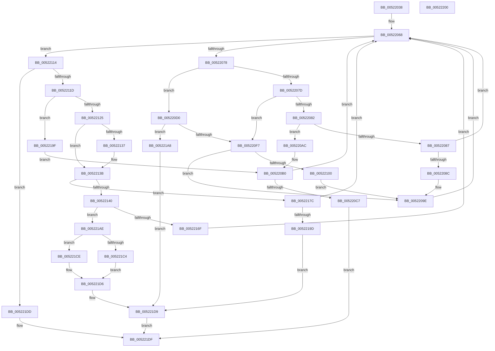

# SymCryptParallelHashSetNextWork

- RVA: `0x00522038`–`0x00522201` (길이 `457` bytes)
- VA: `0x0000000140522038`
- 실행 섹션: `.text`
- PDB 이름 있음: `예`; PDB Function 태그: `아니요`
- unwind 정보 RVA: `0x000C317C`
- 디코드: `135`개 명령, `457/457` bytes 표시
- 미해석 바이트: `0` (있으면 어셈블리에 `.byte`로 보존)

> 이 문서는 커널 이미지의 기계어와 PDB 기호를 분석해 생성했습니다. 4번과 5번은 함수 원형과 자료형을 바이너리 사용 방식에서 추정한 C 해석이며 원본 소스 복구 결과는 아닙니다.

## 1. Dependencies

- 직접 호출 지점: **5**; 고유 호출 대상: **3**
- 직접 호출자로 확인된 함수: **1**
- RIP 상대 이미지 참조: **1**

### Outgoing calls
- `0x00522099` → [guard_dispatch_icall](../6B/guard_dispatch_icall_function_006BAAD0.md) (function, `0x006BAAD0`)
- `0x005220BE` → [guard_dispatch_icall](../6B/guard_dispatch_icall_function_006BAAD0.md) (function, `0x006BAAD0`)
- `0x00522108` → [memcpy](../6C/memcpy_function_006C6840.md) (function, `0x006C6840`)
- `0x00522160` → [memcpy](../6C/memcpy_function_006C6840.md) (function, `0x006C6840`)
- `0x005221E7` → [_security_check_cookie](../6A/_security_check_cookie_function_006AC640.md) (function, `0x006AC640`)

### Direct callers
- [SymCryptParallelHashProcess](SymCryptParallelHashProcess_function_00521BF4.md) at `0x00521D3B`
- [SymCryptParallelHashProcess](SymCryptParallelHashProcess_function_00521BF4.md) at `0x00521E37`

### Static image references
- `0x00522048` → RVA `0x00E0A740` (`.data`; read)

## 2. Other-region calls and transfers

- 다른 실행 섹션으로 향하는 call: **0**
- 별도 외부 분기/꼬리 이동을 확인하지 못했습니다.

## 3. Assembly (complete function range)

```asm
00522038  48 89 5C 24 18                  mov qword ptr [rsp + 0x18], rbx
0052203D  55                              push rbp
0052203E  56                              push rsi
0052203F  57                              push rdi
00522040  41 56                           push r14
00522042  41 57                           push r15
00522044  48 83 EC 40                     sub rsp, 0x40
00522048  48 8B 05 F1 86 8E 00            mov rax, qword ptr [rip + 0x8e86f1]
0052204F  48 33 C4                        xor rax, rsp
00522052  48 89 44 24 38                  mov qword ptr [rsp + 0x38], rax
00522057  48 8B 32                        mov rsi, qword ptr [rdx]
0052205A  48 8B DA                        mov rbx, rdx
0052205D  4C 8B 39                        mov r15, qword ptr [rcx]
00522060  4C 8B F1                        mov r14, rcx
00522063  C6 44 24 30 00                  mov byte ptr [rsp + 0x30], 0
00522068  0F B6 4B 08                     movzx ecx, byte ptr [rbx + 8]
0052206C  48 8B 7B 18                     mov rdi, qword ptr [rbx + 0x18]
00522070  85 C9                           test ecx, ecx
00522072  0F 84 9C 00 00 00               je 0x140522114
00522078  83 E9 01                        sub ecx, 1
0052207B  74 53                           je 0x1405220d0
0052207D  83 E9 01                        sub ecx, 1
00522080  74 75                           je 0x1405220f7
00522082  83 E9 01                        sub ecx, 1
00522085  74 25                           je 0x1405220ac
00522087  83 F9 01                        cmp ecx, 1
0052208A  75 DC                           jne 0x140522068
0052208C  49 8B 46 20                     mov rax, qword ptr [r14 + 0x20]
00522090  4C 8B C7                        mov r8, rdi
00522093  48 8B D6                        mov rdx, rsi
00522096  49 8B CE                        mov rcx, r14
00522099  E8 32 8A 19 00                  call 0x1406baad0
0052209E  48 8B 47 20                     mov rax, qword ptr [rdi + 0x20]
005220A2  48 89 43 18                     mov qword ptr [rbx + 0x18], rax
005220A6  C6 43 08 00                     mov byte ptr [rbx + 8], 0
005220AA  EB BC                           jmp 0x140522068
005220AC  49 8B 46 18                     mov rax, qword ptr [r14 + 0x18]
005220B0  4C 8D 4C 24 30                  lea r9, [rsp + 0x30]
005220B5  4C 8B C3                        mov r8, rbx
005220B8  48 8B D6                        mov rdx, rsi
005220BB  49 8B CE                        mov rcx, r14
005220BE  E8 0D 8A 19 00                  call 0x1406baad0
005220C3  84 C0                           test al, al
005220C5  74 A1                           je 0x140522068
005220C7  8A 44 24 30                     mov al, byte ptr [rsp + 0x30]
005220CB  E9 0F 01 00 00                  jmp 0x1405221df
005220D0  48 8B 4F 10                     mov rcx, qword ptr [rdi + 0x10]
005220D4  0F B6 53 09                     movzx edx, byte ptr [rbx + 9]
005220D8  48 03 CA                        add rcx, rdx
005220DB  48 89 4B 20                     mov qword ptr [rbx + 0x20], rcx
005220DF  48 8B 4F 18                     mov rcx, qword ptr [rdi + 0x18]
005220E3  48 2B CA                        sub rcx, rdx
005220E6  48 89 4B 28                     mov qword ptr [rbx + 0x28], rcx
005220EA  41 8B 47 30                     mov eax, dword ptr [r15 + 0x30]
005220EE  48 3B C8                        cmp rcx, rax
005220F1  0F 83 B1 00 00 00               jae 0x1405221a8
005220F7  4C 8B 43 28                     mov r8, qword ptr [rbx + 0x28]
005220FB  4D 85 C0                        test r8, r8
005220FE  74 9E                           je 0x14052209e
00522100  48 8B 53 20                     mov rdx, qword ptr [rbx + 0x20]
00522104  48 8D 4E 20                     lea rcx, [rsi + 0x20]
00522108  E8 33 47 1A 00                  call 0x1406c6840
0052210D  8B 43 28                        mov eax, dword ptr [rbx + 0x28]
00522110  89 06                           mov dword ptr [rsi], eax
00522112  EB 8A                           jmp 0x14052209e
00522114  48 85 FF                        test rdi, rdi
00522117  0F 84 C0 00 00 00               je 0x1405221dd
0052211D  83 7F 08 01                     cmp dword ptr [rdi + 8], 1
00522121  8B 0E                           mov ecx, dword ptr [rsi]
00522123  75 7A                           jne 0x14052219f
00522125  48 8B 47 18                     mov rax, qword ptr [rdi + 0x18]
00522129  48 01 46 10                     add qword ptr [rsi + 0x10], rax
0052212D  48 8B 46 10                     mov rax, qword ptr [rsi + 0x10]
00522131  48 3B 47 18                     cmp rax, qword ptr [rdi + 0x18]
00522135  73 04                           jae 0x14052213b
00522137  48 FF 46 18                     inc qword ptr [rsi + 0x18]
0052213B  48 85 C9                        test rcx, rcx
0052213E  74 3C                           je 0x14052217c
00522140  48 8B 47 18                     mov rax, qword ptr [rdi + 0x18]
00522144  41 8B 6F 30                     mov ebp, dword ptr [r15 + 0x30]
00522148  48 8B 57 10                     mov rdx, qword ptr [rdi + 0x10]
0052214C  48 2B E9                        sub rbp, rcx
0052214F  48 3B E8                        cmp rbp, rax
00522152  48 0F 43 E8                     cmovae rbp, rax
00522156  48 83 C1 20                     add rcx, 0x20
0052215A  48 03 CE                        add rcx, rsi
0052215D  4C 8B C5                        mov r8, rbp
00522160  E8 DB 46 1A 00                  call 0x1406c6840
00522165  01 2E                           add dword ptr [rsi], ebp
00522167  8B 06                           mov eax, dword ptr [rsi]
00522169  41 3B 47 30                     cmp eax, dword ptr [r15 + 0x30]
0052216D  74 3F                           je 0x1405221ae
0052216F  48 8B 47 20                     mov rax, qword ptr [rdi + 0x20]
00522173  48 89 43 18                     mov qword ptr [rbx + 0x18], rax
00522177  E9 EC FE FF FF                  jmp 0x140522068
0052217C  48 8B 47 10                     mov rax, qword ptr [rdi + 0x10]
00522180  48 89 43 20                     mov qword ptr [rbx + 0x20], rax
00522184  48 8B 4F 18                     mov rcx, qword ptr [rdi + 0x18]
00522188  48 89 4B 28                     mov qword ptr [rbx + 0x28], rcx
0052218C  C6 43 08 02                     mov byte ptr [rbx + 8], 2
00522190  41 8B 47 30                     mov eax, dword ptr [r15 + 0x30]
00522194  48 3B C8                        cmp rcx, rax
00522197  0F 82 CB FE FF FF               jb 0x140522068
0052219D  EB 3A                           jmp 0x1405221d9
0052219F  49 8B 46 10                     mov rax, qword ptr [r14 + 0x10]
005221A3  E9 08 FF FF FF                  jmp 0x1405220b0
005221A8  C6 43 08 02                     mov byte ptr [rbx + 8], 2
005221AC  EB 2B                           jmp 0x1405221d9
005221AE  48 8D 46 20                     lea rax, [rsi + 0x20]
005221B2  48 89 43 20                     mov qword ptr [rbx + 0x20], rax
005221B6  41 8B 47 30                     mov eax, dword ptr [r15 + 0x30]
005221BA  48 89 43 28                     mov qword ptr [rbx + 0x28], rax
005221BE  48 3B 6F 18                     cmp rbp, qword ptr [rdi + 0x18]
005221C2  75 0A                           jne 0x1405221ce
005221C4  48 8B 47 20                     mov rax, qword ptr [rdi + 0x20]
005221C8  48 89 43 18                     mov qword ptr [rbx + 0x18], rax
005221CC  EB 08                           jmp 0x1405221d6
005221CE  C6 43 08 01                     mov byte ptr [rbx + 8], 1
005221D2  40 88 6B 09                     mov byte ptr [rbx + 9], bpl
005221D6  83 26 00                        and dword ptr [rsi], 0
005221D9  B0 01                           mov al, 1
005221DB  EB 02                           jmp 0x1405221df
005221DD  32 C0                           xor al, al
005221DF  48 8B 4C 24 38                  mov rcx, qword ptr [rsp + 0x38]
005221E4  48 33 CC                        xor rcx, rsp
005221E7  E8 54 A4 18 00                  call 0x1406ac640
005221EC  48 8B 9C 24 80 00 00 00         mov rbx, qword ptr [rsp + 0x80]
005221F4  48 83 C4 40                     add rsp, 0x40
005221F8  41 5F                           pop r15
005221FA  41 5E                           pop r14
005221FC  5F                              pop rdi
005221FD  5E                              pop rsi
005221FE  5D                              pop rbp
005221FF  C3                              ret
00522200  CC                              int3
```

## 4. C-style interpretation (structured pseudocode)

```c
__int64 __fastcall SymCryptParallelHashSetNextWork(__int64 a1, __int64 a2)
{
    __int64 result;
    __int64 v_rbp;
    __int64 v_rsp;
    unsigned __int64 v_stack_m30;
    unsigned __int8 v_stack_m38;
    unsigned __int64 v_stack_p18;

    v_stack_p18 = v_rbx;
    v_rsp = (v_rsp) - (64);
    result = (*(unsigned __int64 *)(v_rip + 9340657)) ^ (v_rsp);
    v_stack_m30 = result;
    v_stack_m38 = 0;
loc_00522068:
    if ((unsigned int)(*(unsigned __int8 *)(a2 + 8)) == 0) goto loc_00522114;
    a1 = (unsigned int)((*(unsigned __int8 *)(a2 + 8)) - (1));
    if (condition_is_equal) goto loc_005220D0;
    a1 = (unsigned int)((a1) - (1));
    if (condition_is_equal) goto loc_005220F7;
    a1 = (unsigned int)((a1) - (1));
    if (condition_is_equal) goto loc_005220AC;
    if (((unsigned int)(a1)) != 1) goto loc_00522068;
    result = guard_dispatch_icall(a1, *(unsigned __int64 *)(a2), *(unsigned __int64 *)(a2 + 24), a4);
loc_0052209E:
    *(unsigned __int64 *)(a2 + 24) = *(unsigned __int64 *)(*(unsigned __int64 *)(a2 + 24) + 32);
    *(unsigned __int8 *)(a2 + 8) = 0;
    goto loc_00522068;
loc_005220AC:
loc_005220B0:
    result = guard_dispatch_icall(a1, *(unsigned __int64 *)(a2), a2, v_stack_m38);
    if ((unsigned __int8)(result) == 0) goto loc_00522068;
    goto loc_005221DF;
loc_005220D0:
    a1 = (*(unsigned __int64 *)(*(unsigned __int64 *)(a2 + 24) + 16)) + (*(unsigned __int8 *)(a2 + 9));
    *(unsigned __int64 *)(a2 + 32) = a1;
    a1 = (*(unsigned __int64 *)(*(unsigned __int64 *)(a2 + 24) + 24)) - (*(unsigned __int8 *)(a2 + 9));
    *(unsigned __int64 *)(a2 + 40) = a1;
    if (a1 >= ((unsigned int)(*(unsigned int *)(*(unsigned __int64 *)(a1) + 48)))) goto loc_005221A8;
loc_005220F7:
    if (*(unsigned __int64 *)(a2 + 40) == 0) goto loc_0052209E;
    result = memcpy(*(unsigned __int64 *)(a2) + 32, *(unsigned __int64 *)(a2 + 32), *(unsigned __int64 *)(a2 + 40), v_stack_m38);
    *(unsigned int *)(*(unsigned __int64 *)(a2)) = (unsigned int)((unsigned int)(*(unsigned int *)(a2 + 40)));
    goto loc_0052209E;
loc_00522114:
    if (*(unsigned __int64 *)(a2 + 24) == 0) goto loc_005221DD;
    if ((*(unsigned int *)(*(unsigned __int64 *)(a2 + 24) + 8)) != 1) goto loc_0052219F;
    if ((*(unsigned __int64 *)(*(unsigned __int64 *)(a2) + 16)) < (*(unsigned __int64 *)(*(unsigned __int64 *)(a2 + 24) + 24))) {
    }
    if ((unsigned int)(*(unsigned int *)(*(unsigned __int64 *)(a2))) == 0) goto loc_0052217C;
    v_rbp = ((unsigned int)(*(unsigned int *)(*(unsigned __int64 *)(a1) + 48))) - ((unsigned int)(*(unsigned int *)(*(unsigned __int64 *)(a2))));
    if (v_rbp >= (*(unsigned __int64 *)(*(unsigned __int64 *)(a2 + 24) + 24))) { v_rbp = *(unsigned __int64 *)(*(unsigned __int64 *)(a2 + 24) + 24); }
    a1 = ((unsigned int)(*(unsigned int *)(*(unsigned __int64 *)(a2)))) + (32);
    a1 = (a1) + (*(unsigned __int64 *)(a2));
    result = memcpy(a1, *(unsigned __int64 *)(*(unsigned __int64 *)(a2 + 24) + 16), v_rbp, v_stack_m38);
    if (((unsigned int)((unsigned int)(*(unsigned int *)(*(unsigned __int64 *)(a2))))) == (*(unsigned int *)(*(unsigned __int64 *)(a1) + 48))) goto loc_005221AE;
    *(unsigned __int64 *)(a2 + 24) = *(unsigned __int64 *)(*(unsigned __int64 *)(a2 + 24) + 32);
    goto loc_00522068;
loc_0052217C:
    *(unsigned __int64 *)(a2 + 32) = *(unsigned __int64 *)(*(unsigned __int64 *)(a2 + 24) + 16);
    *(unsigned __int64 *)(a2 + 40) = *(unsigned __int64 *)(*(unsigned __int64 *)(a2 + 24) + 24);
    *(unsigned __int8 *)(a2 + 8) = 2;
    if ((*(unsigned __int64 *)(*(unsigned __int64 *)(a2 + 24) + 24)) < ((unsigned int)(*(unsigned int *)(*(unsigned __int64 *)(a1) + 48)))) goto loc_00522068;
    goto loc_005221D9;
loc_0052219F:
    goto loc_005220B0;
loc_005221A8:
    *(unsigned __int8 *)(a2 + 8) = 2;
    goto loc_005221D9;
loc_005221AE:
    *(unsigned __int64 *)(a2 + 32) = *(unsigned __int64 *)(a2) + 32;
    *(unsigned __int64 *)(a2 + 40) = (unsigned int)(*(unsigned int *)(*(unsigned __int64 *)(a1) + 48));
    if (v_rbp != (*(unsigned __int64 *)(*(unsigned __int64 *)(a2 + 24) + 24))) goto loc_005221CE;
    *(unsigned __int64 *)(a2 + 24) = *(unsigned __int64 *)(*(unsigned __int64 *)(a2 + 24) + 32);
    goto loc_005221D6;
loc_005221CE:
    *(unsigned __int8 *)(a2 + 8) = 1;
    *(unsigned __int8 *)(a2 + 9) = (unsigned __int8)(v_rbp);
loc_005221D6:
loc_005221D9:
    goto loc_005221DF;
loc_005221DD:
    result = 0;
loc_005221DF:
    a1 = (v_stack_m30) ^ (v_rsp);
    result = _security_check_cookie(a1, *(unsigned __int64 *)(*(unsigned __int64 *)(a2 + 24) + 16), v_rbp, v_stack_m38);
    v_rsp = (v_rsp) + (64);
    return result;
}
```

## 5. (Beta) C Style

```c
int64_t SymCryptParallelHashSetNextWork(void *Arg1, void *Arg2)
{
    uint8_t *arg1 = (uint8_t *)Arg1;
    uint8_t *arg2 = (uint8_t *)Arg2;

    int64_t result;
    int64_t local_rbp;
    int64_t local_rsp;
    uint64_t v_stack_m30;
    uint8_t v_stack_m38;
    uint64_t v_stack_p18;

    v_stack_p18 = local_rbx;
    local_rsp = (local_rsp) - (64);
    result = (*(uint64_t *)(v_rip + 0x8E86F1)) ^ (local_rsp);
    v_stack_m30 = result;
    v_stack_m38 = 0;
loc_00522068:
    if ((uint32_t)(*(uint8_t *)(arg2 + 0x8)) == 0) goto loc_00522114;
    Arg1 = (uint32_t)((*(uint8_t *)(arg2 + 0x8)) - (1));
    if (condition_is_equal) goto loc_005220D0;
    Arg1 = (uint32_t)((Arg1) - (1));
    if (condition_is_equal) goto loc_005220F7;
    Arg1 = (uint32_t)((Arg1) - (1));
    if (condition_is_equal) goto loc_005220AC;
    if (((uint32_t)(Arg1)) != 1) goto loc_00522068;
    result = guard_dispatch_icall(Arg1, *(uint64_t *)(arg2), *(uint64_t *)(arg2 + 0x18), a4);
loc_0052209E:
    *(uint64_t *)(arg2 + 0x18) = *(uint64_t *)(*(uint64_t *)(arg2 + 0x18) + 0x20);
    *(uint8_t *)(arg2 + 0x8) = 0;
    goto loc_00522068;
loc_005220AC:
loc_005220B0:
    result = guard_dispatch_icall(Arg1, *(uint64_t *)(arg2), Arg2, v_stack_m38);
    if ((uint8_t)(result) == 0) goto loc_00522068;
    goto loc_005221DF;
loc_005220D0:
    Arg1 = (*(uint64_t *)(*(uint64_t *)(arg2 + 0x18) + 0x10)) + (*(uint8_t *)(arg2 + 0x9));
    *(void **)(arg2 + 0x20) = Arg1;
    Arg1 = (*(uint64_t *)(*(uint64_t *)(arg2 + 0x18) + 0x18)) - (*(uint8_t *)(arg2 + 0x9));
    *(void **)(arg2 + 0x28) = Arg1;
    if (Arg1 >= ((uint32_t)(*(uint32_t *)(*(uint64_t *)(arg1) + 0x30)))) goto loc_005221A8;
loc_005220F7:
    if (*(uint64_t *)(arg2 + 0x28) == 0) goto loc_0052209E;
    result = memcpy(*(uint64_t *)(arg2) + 32, *(uint64_t *)(arg2 + 0x20), *(uint64_t *)(arg2 + 0x28), v_stack_m38);
    *(uint32_t *)(*(uint64_t *)(arg2)) = (uint32_t)((uint32_t)(*(uint32_t *)(arg2 + 0x28)));
    goto loc_0052209E;
loc_00522114:
    if (*(uint64_t *)(arg2 + 0x18) == 0) goto loc_005221DD;
    if ((*(uint32_t *)(*(uint64_t *)(arg2 + 0x18) + 0x8)) != 1) goto loc_0052219F;
    if ((*(uint64_t *)(*(uint64_t *)(arg2) + 0x10)) < (*(uint64_t *)(*(uint64_t *)(arg2 + 0x18) + 0x18))) {
    }
    if ((uint32_t)(*(uint32_t *)(*(uint64_t *)(arg2))) == 0) goto loc_0052217C;
    local_rbp = ((uint32_t)(*(uint32_t *)(*(uint64_t *)(arg1) + 0x30))) - ((uint32_t)(*(uint32_t *)(*(uint64_t *)(arg2))));
    if (local_rbp >= (*(uint64_t *)(*(uint64_t *)(arg2 + 0x18) + 0x18))) { local_rbp = *(uint64_t *)(*(uint64_t *)(arg2 + 0x18) + 0x18); }
    Arg1 = ((uint32_t)(*(uint32_t *)(*(uint64_t *)(arg2)))) + (32);
    Arg1 = (Arg1) + (*(uint64_t *)(arg2));
    result = memcpy(Arg1, *(uint64_t *)(*(uint64_t *)(arg2 + 0x18) + 0x10), local_rbp, v_stack_m38);
    if (((uint32_t)((uint32_t)(*(uint32_t *)(*(uint64_t *)(arg2))))) == (*(uint32_t *)(*(uint64_t *)(arg1) + 0x30))) goto loc_005221AE;
    *(uint64_t *)(arg2 + 0x18) = *(uint64_t *)(*(uint64_t *)(arg2 + 0x18) + 0x20);
    goto loc_00522068;
loc_0052217C:
    *(uint64_t *)(arg2 + 0x20) = *(uint64_t *)(*(uint64_t *)(arg2 + 0x18) + 0x10);
    *(uint64_t *)(arg2 + 0x28) = *(uint64_t *)(*(uint64_t *)(arg2 + 0x18) + 0x18);
    *(uint8_t *)(arg2 + 0x8) = 2;
    if ((*(uint64_t *)(*(uint64_t *)(arg2 + 0x18) + 0x18)) < ((uint32_t)(*(uint32_t *)(*(uint64_t *)(arg1) + 0x30)))) goto loc_00522068;
    goto loc_005221D9;
loc_0052219F:
    goto loc_005220B0;
loc_005221A8:
    *(uint8_t *)(arg2 + 0x8) = 2;
    goto loc_005221D9;
loc_005221AE:
    *(uint64_t *)(arg2 + 0x20) = *(uint64_t *)(arg2) + 32;
    *(uint64_t *)(arg2 + 0x28) = (uint32_t)(*(uint32_t *)(*(uint64_t *)(arg1) + 0x30));
    if (local_rbp != (*(uint64_t *)(*(uint64_t *)(arg2 + 0x18) + 0x18))) goto loc_005221CE;
    *(uint64_t *)(arg2 + 0x18) = *(uint64_t *)(*(uint64_t *)(arg2 + 0x18) + 0x20);
    goto loc_005221D6;
loc_005221CE:
    *(uint8_t *)(arg2 + 0x8) = 1;
    *(uint8_t *)(arg2 + 0x9) = (uint8_t)(local_rbp);
loc_005221D6:
loc_005221D9:
    goto loc_005221DF;
loc_005221DD:
    result = 0;
loc_005221DF:
    Arg1 = (v_stack_m30) ^ (local_rsp);
    result = _security_check_cookie(Arg1, *(uint64_t *)(*(uint64_t *)(arg2 + 0x18) + 0x10), local_rbp, v_stack_m38);
    local_rsp = (local_rsp) + (64);
    return result;
}
```

### 관측된 메모리 오프셋

구조체 형식이 확인되지 않은 접근은 인자 기준의 오프셋으로만 기록했습니다.

| 기준 인자 | 오프셋 표현 | 폭 (bit) | 접근 |
|---|---:|---:|---|
| `Arg1` | `+ 0x0` | `64` | `R` |
| `Arg1` | `+ 0x10` | `64` | `R` |
| `Arg1` | `+ 0x18` | `64` | `R` |
| `Arg1` | `+ 0x20` | `64` | `R` |
| `Arg2` | `+ 0x0` | `64` | `R` |
| `Arg2` | `+ 0x8` | `8` | `R` |
| `Arg2` | `+ 0x8` | `8` | `W` |
| `Arg2` | `+ 0x9` | `8` | `R` |
| `Arg2` | `+ 0x9` | `8` | `W` |
| `Arg2` | `+ 0x18` | `64` | `R` |
| `Arg2` | `+ 0x18` | `64` | `W` |
| `Arg2` | `+ 0x20` | `64` | `R` |
| `Arg2` | `+ 0x20` | `64` | `W` |
| `Arg2` | `+ 0x28` | `32` | `R` |
| `Arg2` | `+ 0x28` | `64` | `R` |
| `Arg2` | `+ 0x28` | `64` | `W` |

## 6. Execution-region graph

[열기: 2D/3D 그래프와 함수 탐색 컨트롤 패널](../../../control-panel.html?section=text&rva=0x00522038&view=graph)

- 2D 그래프는 위에서 아래로 흐르고, 3D 그래프는 빈 공간을 드래그해 회전합니다. Shift+드래그는 이동, 휠은 확대·축소, 함수 노드 선택은 대상 보고서 이동입니다.

### Static fallback


