# SymCryptParallelSha256AppendBlocks_ymm

- RVA: `0x00522234`–`0x00522BF4` (길이 `2,496` bytes)
- VA: `0x0000000140522234`
- 실행 섹션: `.text`
- PDB 이름 있음: `예`; PDB Function 태그: `아니요`
- unwind 정보 RVA: `0x000C319C`
- 디코드: `483`개 명령, `2,496/2,496` bytes 표시
- 미해석 바이트: `0` (있으면 어셈블리에 `.byte`로 보존)

> 이 문서는 커널 이미지의 기계어와 PDB 기호를 분석해 생성했습니다. 4번과 5번은 함수 원형과 자료형을 바이너리 사용 방식에서 추정한 C 해석이며 원본 소스 복구 결과는 아닙니다.

## 1. Dependencies

- 직접 호출 지점: **0**; 고유 호출 대상: **0**
- 직접 호출자로 확인된 함수: **1**
- RIP 상대 이미지 참조: **3**

### Outgoing calls
- 직접 디코드된 call 명령이 없습니다.

### Direct callers
- [SymCryptParallelSha256Append](../51/SymCryptParallelSha256Append_function_0051E450.md) at `0x0051E51B`

### Static image references
- `0x00522299` → RVA `0x0001FB00` (`.rdata`; read)
- `0x005226D8` → RVA `0x0001F908` (`.rdata`; read)
- `0x00522A02` → RVA `0x0001FA08` (`.rdata`; read)

## 2. Other-region calls and transfers

- 다른 실행 섹션으로 향하는 call: **0**
- 별도 외부 분기/꼬리 이동을 확인하지 못했습니다.

## 3. Assembly (complete function range)

```asm
00522234  48 8B C4                        mov rax, rsp
00522237  48 89 58 08                     mov qword ptr [rax + 8], rbx
0052223B  48 89 70 10                     mov qword ptr [rax + 0x10], rsi
0052223F  48 89 78 18                     mov qword ptr [rax + 0x18], rdi
00522243  55                              push rbp
00522244  48 81 EC 80 02 00 00            sub rsp, 0x280
0052224B  0F 29 70 E8                     movaps xmmword ptr [rax - 0x18], xmm6
0052224F  0F 29 78 D8                     movaps xmmword ptr [rax - 0x28], xmm7
00522253  44 0F 29 40 C8                  movaps xmmword ptr [rax - 0x38], xmm8
00522258  44 0F 29 48 B8                  movaps xmmword ptr [rax - 0x48], xmm9
0052225D  44 0F 29 50 A8                  movaps xmmword ptr [rax - 0x58], xmm10
00522262  44 0F 29 58 98                  movaps xmmword ptr [rax - 0x68], xmm11
00522267  44 0F 29 60 88                  movaps xmmword ptr [rax - 0x78], xmm12
0052226C  44 0F 29 A8 78 FF FF FF         movaps xmmword ptr [rax - 0x88], xmm13
00522274  44 0F 29 B0 68 FF FF FF         movaps xmmword ptr [rax - 0x98], xmm14
0052227C  44 0F 29 B8 58 FF FF FF         movaps xmmword ptr [rax - 0xa8], xmm15
00522284  48 8D 6C 24 20                  lea rbp, [rsp + 0x20]
00522289  48 83 E5 E0                     and rbp, 0xffffffffffffffe0
0052228D  48 8B 01                        mov rax, qword ptr [rcx]
00522290  0F 57 C0                        xorps xmm0, xmm0
00522293  0F 57 C9                        xorps xmm1, xmm1
00522296  4D 8B D0                        mov r10, r8
00522299  C5 7E 6F 2D 5F D8 AF FF         vmovdqu ymm13, ymmword ptr [rip - 0x5027a1]
005222A1  C5 F8 11 45 20                  vmovups xmmword ptr [rbp + 0x20], xmm0
005222A6  C5 FE 6F 38                     vmovdqu ymm7, ymmword ptr [rax]
005222AA  48 8B 41 08                     mov rax, qword ptr [rcx + 8]
005222AE  C5 F8 11 45 30                  vmovups xmmword ptr [rbp + 0x30], xmm0
005222B3  C5 F8 11 4D 00                  vmovups xmmword ptr [rbp], xmm1
005222B8  C5 FE 6F 00                     vmovdqu ymm0, ymmword ptr [rax]
005222BC  48 8B 41 10                     mov rax, qword ptr [rcx + 0x10]
005222C0  C5 C5 62 E8                     vpunpckldq ymm5, ymm7, ymm0
005222C4  C5 C5 6A F8                     vpunpckhdq ymm7, ymm7, ymm0
005222C8  C5 F8 11 4D 10                  vmovups xmmword ptr [rbp + 0x10], xmm1
005222CD  C5 FE 6F 30                     vmovdqu ymm6, ymmword ptr [rax]
005222D1  48 8B 41 18                     mov rax, qword ptr [rcx + 0x18]
005222D5  C5 FE 6F 18                     vmovdqu ymm3, ymmword ptr [rax]
005222D9  48 8B 41 20                     mov rax, qword ptr [rcx + 0x20]
005222DD  C5 CD 62 C3                     vpunpckldq ymm0, ymm6, ymm3
005222E1  C5 CD 6A DB                     vpunpckhdq ymm3, ymm6, ymm3
005222E5  C5 45 6C D3                     vpunpcklqdq ymm10, ymm7, ymm3
005222E9  C5 7E 6F 00                     vmovdqu ymm8, ymmword ptr [rax]
005222ED  48 8B 41 28                     mov rax, qword ptr [rcx + 0x28]
005222F1  C5 55 6C C8                     vpunpcklqdq ymm9, ymm5, ymm0
005222F5  C5 C5 6D FB                     vpunpckhqdq ymm7, ymm7, ymm3
005222F9  C5 D5 6D E8                     vpunpckhqdq ymm5, ymm5, ymm0
005222FD  C5 FE 6F 08                     vmovdqu ymm1, ymmword ptr [rax]
00522301  48 8B 41 30                     mov rax, qword ptr [rcx + 0x30]
00522305  C5 BD 62 F1                     vpunpckldq ymm6, ymm8, ymm1
00522309  C5 3D 6A C1                     vpunpckhdq ymm8, ymm8, ymm1
0052230D  C5 FE 6F 20                     vmovdqu ymm4, ymmword ptr [rax]
00522311  48 8B 41 38                     mov rax, qword ptr [rcx + 0x38]
00522315  C5 FE 6F 10                     vmovdqu ymm2, ymmword ptr [rax]
00522319  C5 DD 62 CA                     vpunpckldq ymm1, ymm4, ymm2
0052231D  C5 DD 6A E2                     vpunpckhdq ymm4, ymm4, ymm2
00522321  C5 CD 6D D1                     vpunpckhqdq ymm2, ymm6, ymm1
00522325  C5 BD 6C DC                     vpunpcklqdq ymm3, ymm8, ymm4
00522329  C4 63 2D 46 DB 20               vperm2i128 ymm11, ymm10, ymm3, 0x20
0052232F  C4 41 7E 7F 99 20 01 00 00      vmovdqu ymmword ptr [r9 + 0x120], ymm11
00522338  C5 CD 6C C1                     vpunpcklqdq ymm0, ymm6, ymm1
0052233C  C5 BD 6D CC                     vpunpckhqdq ymm1, ymm8, ymm4
00522340  C4 E3 35 46 F0 20               vperm2i128 ymm6, ymm9, ymm0, 0x20
00522346  C4 C1 7E 7F B1 60 01 00 00      vmovdqu ymmword ptr [r9 + 0x160], ymm6
0052234F  C4 E3 2D 46 DB 31               vperm2i128 ymm3, ymm10, ymm3, 0x31
00522355  C4 C1 7E 7F 99 A0 00 00 00      vmovdqu ymmword ptr [r9 + 0xa0], ymm3
0052235E  C4 63 55 46 C2 20               vperm2i128 ymm8, ymm5, ymm2, 0x20
00522364  C4 41 7E 7F 81 40 01 00 00      vmovdqu ymmword ptr [r9 + 0x140], ymm8
0052236D  C4 63 45 46 E1 20               vperm2i128 ymm12, ymm7, ymm1, 0x20
00522373  C4 41 7E 7F A1 00 01 00 00      vmovdqu ymmword ptr [r9 + 0x100], ymm12
0052237C  C4 63 45 46 D1 31               vperm2i128 ymm10, ymm7, ymm1, 0x31
00522382  C4 41 7E 7F 91 80 00 00 00      vmovdqu ymmword ptr [r9 + 0x80], ymm10
0052238B  C4 63 35 46 C8 31               vperm2i128 ymm9, ymm9, ymm0, 0x31
00522391  C4 41 7E 7F 89 E0 00 00 00      vmovdqu ymmword ptr [r9 + 0xe0], ymm9
0052239A  C4 63 55 46 F2 31               vperm2i128 ymm14, ymm5, ymm2, 0x31
005223A0  C4 41 7E 7F B1 C0 00 00 00      vmovdqu ymmword ptr [r9 + 0xc0], ymm14
005223A9  C4 41 7E 7F 21                  vmovdqu ymmword ptr [r9], ymm12
005223AE  C4 41 7E 7F 59 20               vmovdqu ymmword ptr [r9 + 0x20], ymm11
005223B4  C4 41 7E 7F 41 40               vmovdqu ymmword ptr [r9 + 0x40], ymm8
005223BA  C4 C1 7E 7F 71 60               vmovdqu ymmword ptr [r9 + 0x60], ymm6
005223C0  49 83 F8 40                     cmp r8, 0x40
005223C4  0F 82 1E 07 00 00               jb 0x140522ae8
005223CA  4D 8D 99 E0 00 00 00            lea r11, [r9 + 0xe0]
005223D1  49 C1 EA 06                     shr r10, 6
005223D5  4D 8D 81 C0 01 00 00            lea r8, [r9 + 0x1c0]
005223DC  BB 02 00 00 00                  mov ebx, 2
005223E1  48 8B 02                        mov rax, qword ptr [rdx]
005223E4  C5 FE 6F 00                     vmovdqu ymm0, ymmword ptr [rax]
005223E8  48 83 C0 20                     add rax, 0x20
005223EC  48 89 02                        mov qword ptr [rdx], rax
005223EF  48 8B 42 08                     mov rax, qword ptr [rdx + 8]
005223F3  C4 42 7D 00 CD                  vpshufb ymm9, ymm0, ymm13
005223F8  C5 FE 6F 00                     vmovdqu ymm0, ymmword ptr [rax]
005223FC  48 83 C0 20                     add rax, 0x20
00522400  48 89 42 08                     mov qword ptr [rdx + 8], rax
00522404  48 8B 42 10                     mov rax, qword ptr [rdx + 0x10]
00522408  C4 C2 7D 00 F5                  vpshufb ymm6, ymm0, ymm13
0052240D  C5 B5 62 E6                     vpunpckldq ymm4, ymm9, ymm6
00522411  C5 B5 6A F6                     vpunpckhdq ymm6, ymm9, ymm6
00522415  C5 FE 6F 00                     vmovdqu ymm0, ymmword ptr [rax]
00522419  48 83 C0 20                     add rax, 0x20
0052241D  48 89 42 10                     mov qword ptr [rdx + 0x10], rax
00522421  48 8B 42 18                     mov rax, qword ptr [rdx + 0x18]
00522425  C4 C2 7D 00 ED                  vpshufb ymm5, ymm0, ymm13
0052242A  C5 FE 6F 00                     vmovdqu ymm0, ymmword ptr [rax]
0052242E  48 83 C0 20                     add rax, 0x20
00522432  48 89 42 18                     mov qword ptr [rdx + 0x18], rax
00522436  48 8B 42 20                     mov rax, qword ptr [rdx + 0x20]
0052243A  C4 C2 7D 00 D5                  vpshufb ymm2, ymm0, ymm13
0052243F  C5 FE 6F 00                     vmovdqu ymm0, ymmword ptr [rax]
00522443  C4 C2 7D 00 FD                  vpshufb ymm7, ymm0, ymm13
00522448  48 83 C0 20                     add rax, 0x20
0052244C  48 89 42 20                     mov qword ptr [rdx + 0x20], rax
00522450  48 8B 42 28                     mov rax, qword ptr [rdx + 0x28]
00522454  C5 FE 6F 00                     vmovdqu ymm0, ymmword ptr [rax]
00522458  C4 C2 7D 00 CD                  vpshufb ymm1, ymm0, ymm13
0052245D  48 83 C0 20                     add rax, 0x20
00522461  48 89 42 28                     mov qword ptr [rdx + 0x28], rax
00522465  48 8B 42 30                     mov rax, qword ptr [rdx + 0x30]
00522469  C5 FE 6F 00                     vmovdqu ymm0, ymmword ptr [rax]
0052246D  C4 42 7D 00 C5                  vpshufb ymm8, ymm0, ymm13
00522472  48 83 C0 20                     add rax, 0x20
00522476  48 89 42 30                     mov qword ptr [rdx + 0x30], rax
0052247A  48 8B 42 38                     mov rax, qword ptr [rdx + 0x38]
0052247E  C5 FE 6F 00                     vmovdqu ymm0, ymmword ptr [rax]
00522482  C4 C2 7D 00 DD                  vpshufb ymm3, ymm0, ymm13
00522487  C5 D5 62 C2                     vpunpckldq ymm0, ymm5, ymm2
0052248B  C5 5D 6D C8                     vpunpckhqdq ymm9, ymm4, ymm0
0052248F  C5 D5 6A D2                     vpunpckhdq ymm2, ymm5, ymm2
00522493  C5 C5 62 E9                     vpunpckldq ymm5, ymm7, ymm1
00522497  C5 C5 6A F9                     vpunpckhdq ymm7, ymm7, ymm1
0052249B  C5 BD 62 CB                     vpunpckldq ymm1, ymm8, ymm3
0052249F  C5 4D 6C D2                     vpunpcklqdq ymm10, ymm6, ymm2
005224A3  C5 BD 6A DB                     vpunpckhdq ymm3, ymm8, ymm3
005224A7  C5 5D 6C C0                     vpunpcklqdq ymm8, ymm4, ymm0
005224AB  C5 D5 6C E1                     vpunpcklqdq ymm4, ymm5, ymm1
005224AF  C5 CD 6D F2                     vpunpckhqdq ymm6, ymm6, ymm2
005224B3  C5 D5 6D D1                     vpunpckhqdq ymm2, ymm5, ymm1
005224B7  C5 C5 6C EB                     vpunpcklqdq ymm5, ymm7, ymm3
005224BB  48 83 C0 20                     add rax, 0x20
005224BF  48 89 42 38                     mov qword ptr [rdx + 0x38], rax
005224C3  C4 E3 3D 46 C4 20               vperm2i128 ymm0, ymm8, ymm4, 0x20
005224C9  C4 C1 7E 7F 40 C0               vmovdqu ymmword ptr [r8 - 0x40], ymm0
005224CF  C4 E3 35 46 CA 20               vperm2i128 ymm1, ymm9, ymm2, 0x20
005224D5  C4 C1 7E 7F 48 E0               vmovdqu ymmword ptr [r8 - 0x20], ymm1
005224DB  C5 C5 6D DB                     vpunpckhqdq ymm3, ymm7, ymm3
005224DF  C4 E3 2D 46 C5 20               vperm2i128 ymm0, ymm10, ymm5, 0x20
005224E5  C4 C1 7E 7F 00                  vmovdqu ymmword ptr [r8], ymm0
005224EA  4D 8D 80 00 01 00 00            lea r8, [r8 + 0x100]
005224F1  C4 E3 4D 46 CB 20               vperm2i128 ymm1, ymm6, ymm3, 0x20
005224F7  C4 C1 7E 7F 88 20 FF FF FF      vmovdqu ymmword ptr [r8 - 0xe0], ymm1
00522500  C4 E3 3D 46 C4 31               vperm2i128 ymm0, ymm8, ymm4, 0x31
00522506  C4 E3 35 46 CA 31               vperm2i128 ymm1, ymm9, ymm2, 0x31
0052250C  C4 C1 7E 7F 80 40 FF FF FF      vmovdqu ymmword ptr [r8 - 0xc0], ymm0
00522515  C4 C1 7E 7F 88 60 FF FF FF      vmovdqu ymmword ptr [r8 - 0xa0], ymm1
0052251E  C4 E3 2D 46 C5 31               vperm2i128 ymm0, ymm10, ymm5, 0x31
00522524  C4 E3 4D 46 CB 31               vperm2i128 ymm1, ymm6, ymm3, 0x31
0052252A  C4 C1 7E 7F 40 80               vmovdqu ymmword ptr [r8 - 0x80], ymm0
00522530  C4 C1 7E 7F 48 A0               vmovdqu ymmword ptr [r8 - 0x60], ymm1
00522536  48 83 EB 01                     sub rbx, 1
0052253A  0F 85 A1 FE FF FF               jne 0x1405223e1
00522540  C4 41 7E 6F 81 40 03 00 00      vmovdqu ymm8, ymmword ptr [r9 + 0x340]
00522549  C4 41 7E 6F 89 60 03 00 00      vmovdqu ymm9, ymmword ptr [r9 + 0x360]
00522552  C4 41 7E 6F 91 80 01 00 00      vmovdqu ymm10, ymmword ptr [r9 + 0x180]
0052255B  C5 7E 7F 4D 20                  vmovdqu ymmword ptr [rbp + 0x20], ymm9
00522560  C5 7E 7F 55 00                  vmovdqu ymmword ptr [rbp], ymm10
00522565  C4 41 7E 6F D8                  vmovdqu ymm11, ymm8
0052256A  C4 41 7E 6F E0                  vmovdqu ymm12, ymm8
0052256F  C4 41 7E 6F F0                  vmovdqu ymm14, ymm8
00522574  C4 41 7E 6F F8                  vmovdqu ymm15, ymm8
00522579  C4 41 7E 6F E9                  vmovdqu ymm13, ymm9
0052257E  49 8D 81 A0 02 00 00            lea rax, [r9 + 0x2a0]
00522585  44 8D 43 18                     lea r8d, [rbx + 0x18]
00522589  C5 FE 6F B8 00 FF FF FF         vmovdqu ymm7, ymmword ptr [rax - 0x100]
00522591  C4 C1 55 72 D0 0A               vpsrld ymm5, ymm8, 0xa
00522597  C5 FD 72 F7 19                  vpslld ymm0, ymm7, 0x19
0052259C  C5 DD 72 D7 03                  vpsrld ymm4, ymm7, 3
005225A1  C5 F5 72 D7 07                  vpsrld ymm1, ymm7, 7
005225A6  C5 FD EF C9                     vpxor ymm1, ymm0, ymm1
005225AA  C4 C1 7D 72 F6 0F               vpslld ymm0, ymm14, 0xf
005225B0  C5 ED 72 F7 0E                  vpslld ymm2, ymm7, 0xe
005225B5  C5 F5 EF D2                     vpxor ymm2, ymm1, ymm2
005225B9  C4 C1 75 72 D7 11               vpsrld ymm1, ymm15, 0x11
005225BF  C5 FD EF C9                     vpxor ymm1, ymm0, ymm1
005225C3  C5 E5 72 D7 12                  vpsrld ymm3, ymm7, 0x12
005225C8  C5 ED EF DB                     vpxor ymm3, ymm2, ymm3
005225CC  C5 E5 EF F4                     vpxor ymm6, ymm3, ymm4
005225D0  C4 C1 5D 72 D3 13               vpsrld ymm4, ymm11, 0x13
005225D6  C4 C1 6D 72 F4 0D               vpslld ymm2, ymm12, 0xd
005225DC  C5 F5 EF D2                     vpxor ymm2, ymm1, ymm2
005225E0  C5 ED EF DC                     vpxor ymm3, ymm2, ymm4
005225E4  C5 E5 EF C5                     vpxor ymm0, ymm3, ymm5
005225E8  C4 C1 7D FE CA                  vpaddd ymm1, ymm0, ymm10
005225ED  C5 F5 FE 10                     vpaddd ymm2, ymm1, ymmword ptr [rax]
005225F1  C5 7E 6F 90 20 FF FF FF         vmovdqu ymm10, ymmword ptr [rax - 0xe0]
005225F9  48 8D 40 40                     lea rax, [rax + 0x40]
005225FD  C5 6D FE C6                     vpaddd ymm8, ymm2, ymm6
00522601  C4 C1 7D 72 F2 19               vpslld ymm0, ymm10, 0x19
00522607  C4 C1 5D 72 D2 03               vpsrld ymm4, ymm10, 3
0052260D  C4 C1 55 72 D1 0A               vpsrld ymm5, ymm9, 0xa
00522613  C4 C1 75 72 D2 07               vpsrld ymm1, ymm10, 7
00522619  C5 FD EF C9                     vpxor ymm1, ymm0, ymm1
0052261D  C4 C1 7D 72 D1 11               vpsrld ymm0, ymm9, 0x11
00522623  C4 C1 6D 72 F2 0E               vpslld ymm2, ymm10, 0xe
00522629  C5 F5 EF D2                     vpxor ymm2, ymm1, ymm2
0052262D  C4 C1 75 72 F1 0F               vpslld ymm1, ymm9, 0xf
00522633  C5 FD EF C9                     vpxor ymm1, ymm0, ymm1
00522637  C4 C1 65 72 D2 12               vpsrld ymm3, ymm10, 0x12
0052263D  C5 ED EF DB                     vpxor ymm3, ymm2, ymm3
00522641  C5 E5 EF F4                     vpxor ymm6, ymm3, ymm4
00522645  C4 C1 6D 72 F1 0D               vpslld ymm2, ymm9, 0xd
0052264B  C5 F5 EF D2                     vpxor ymm2, ymm1, ymm2
0052264F  C4 C1 5D 72 D5 13               vpsrld ymm4, ymm13, 0x13
00522655  C5 ED EF DC                     vpxor ymm3, ymm2, ymm4
00522659  C5 E5 EF C5                     vpxor ymm0, ymm3, ymm5
0052265D  C5 FD FE CF                     vpaddd ymm1, ymm0, ymm7
00522661  C5 F5 FE 50 E0                  vpaddd ymm2, ymm1, ymmword ptr [rax - 0x20]
00522666  C5 6D FE CE                     vpaddd ymm9, ymm2, ymm6
0052266A  C5 7E 7F 88 C0 00 00 00         vmovdqu ymmword ptr [rax + 0xc0], ymm9
00522672  C5 7E 7F 80 A0 00 00 00         vmovdqu ymmword ptr [rax + 0xa0], ymm8
0052267A  C4 41 7E 6F D8                  vmovdqu ymm11, ymm8
0052267F  C4 41 7E 6F E0                  vmovdqu ymm12, ymm8
00522684  C4 41 7E 6F F0                  vmovdqu ymm14, ymm8
00522689  C4 41 7E 6F F8                  vmovdqu ymm15, ymm8
0052268E  C4 41 7E 6F E9                  vmovdqu ymm13, ymm9
00522693  49 83 E8 01                     sub r8, 1
00522697  0F 85 EC FE FF FF               jne 0x140522589
0052269D  C4 41 7E 6F 1B                  vmovdqu ymm11, ymmword ptr [r11]
005226A2  C4 41 7E 6F A1 60 01 00 00      vmovdqu ymm12, ymmword ptr [r9 + 0x160]
005226AB  C4 41 7E 6F B1 40 01 00 00      vmovdqu ymm14, ymmword ptr [r9 + 0x140]
005226B4  C4 41 7E 6F B9 20 01 00 00      vmovdqu ymm15, ymmword ptr [r9 + 0x120]
005226BD  C4 41 7E 6F 89 00 01 00 00      vmovdqu ymm9, ymmword ptr [r9 + 0x100]
005226C6  C5 7E 6F 2D 32 D4 AF FF         vmovdqu ymm13, ymmword ptr [rip - 0x502bce]
005226CE  C5 7E 7F 55 00                  vmovdqu ymmword ptr [rbp], ymm10
005226D3  C5 7E 7F 5D 00                  vmovdqu ymmword ptr [rbp], ymm11
005226D8  48 8D 1D 29 D2 AF FF            lea rbx, [rip - 0x502dd7]
005226DF  4D 8B C3                        mov r8, r11
005226E2  C4 41 7E 6F 40 C0               vmovdqu ymm8, ymmword ptr [r8 - 0x40]
005226E8  C4 41 7E 6F 50 E0               vmovdqu ymm10, ymmword ptr [r8 - 0x20]
005226EE  C4 E2 7D 18 7B F8               vbroadcastss ymm7, dword ptr [rbx - 8]
005226F4  C4 C1 2D EF C0                  vpxor ymm0, ymm10, ymm8
005226F9  C4 C1 7D DB CB                  vpand ymm1, ymm0, ymm11
005226FE  C4 C1 75 EF F0                  vpxor ymm6, ymm1, ymm8
00522703  C4 C1 7D 72 F3 1A               vpslld ymm0, ymm11, 0x1a
00522709  C4 C1 5D 72 F3 07               vpslld ymm4, ymm11, 7
0052270F  C4 C1 55 72 D3 19               vpsrld ymm5, ymm11, 0x19
00522715  C4 C1 75 72 D3 06               vpsrld ymm1, ymm11, 6
0052271B  C5 FD EF C9                     vpxor ymm1, ymm0, ymm1
0052271F  C4 C1 6D 72 F3 15               vpslld ymm2, ymm11, 0x15
00522725  C5 F5 EF D2                     vpxor ymm2, ymm1, ymm2
00522729  C4 C1 65 72 D3 0B               vpsrld ymm3, ymm11, 0xb
0052272F  C5 ED EF DB                     vpxor ymm3, ymm2, ymm3
00522733  C5 E5 EF C4                     vpxor ymm0, ymm3, ymm4
00522737  C5 FD EF CD                     vpxor ymm1, ymm0, ymm5
0052273B  C4 C1 75 FE 90 A0 00 00 00      vpaddd ymm2, ymm1, ymmword ptr [r8 + 0xa0]
00522744  C4 C1 6D FE 58 A0               vpaddd ymm3, ymm2, ymmword ptr [r8 - 0x60]
0052274A  C5 E5 FE C6                     vpaddd ymm0, ymm3, ymm6
0052274E  C5 FD FE FF                     vpaddd ymm7, ymm0, ymm7
00522752  C4 41 45 FE D9                  vpaddd ymm11, ymm7, ymm9
00522757  C4 C1 0D EB C4                  vpor ymm0, ymm14, ymm12
0052275C  C4 C1 7D DB CF                  vpand ymm1, ymm0, ymm15
00522761  C4 C1 0D DB D4                  vpand ymm2, ymm14, ymm12
00522766  C5 F5 EB F2                     vpor ymm6, ymm1, ymm2
0052276A  C4 C1 7D 72 F4 1E               vpslld ymm0, ymm12, 0x1e
00522770  C4 C1 5D 72 F4 0A               vpslld ymm4, ymm12, 0xa
00522776  C4 C1 55 72 D4 16               vpsrld ymm5, ymm12, 0x16
0052277C  C4 41 7E 7F 58 20               vmovdqu ymmword ptr [r8 + 0x20], ymm11
00522782  C4 C1 75 72 D4 02               vpsrld ymm1, ymm12, 2
00522788  C5 FD EF C9                     vpxor ymm1, ymm0, ymm1
0052278C  C4 C1 6D 72 F4 13               vpslld ymm2, ymm12, 0x13
00522792  C5 F5 EF D2                     vpxor ymm2, ymm1, ymm2
00522796  C4 C1 65 72 D4 0D               vpsrld ymm3, ymm12, 0xd
0052279C  C5 ED EF DB                     vpxor ymm3, ymm2, ymm3
005227A0  C5 E5 EF C4                     vpxor ymm0, ymm3, ymm4
005227A4  C5 FD EF CD                     vpxor ymm1, ymm0, ymm5
005227A8  C5 AD EF 45 00                  vpxor ymm0, ymm10, ymmword ptr [rbp]
005227AD  C5 F5 FE D7                     vpaddd ymm2, ymm1, ymm7
005227B1  C4 E2 7D 18 7B FC               vbroadcastss ymm7, dword ptr [rbx - 4]
005227B7  C5 ED FE DE                     vpaddd ymm3, ymm2, ymm6
005227BB  C4 C1 7D DB CB                  vpand ymm1, ymm0, ymm11
005227C0  C4 C1 75 EF F2                  vpxor ymm6, ymm1, ymm10
005227C5  C5 FE 7F 5D 20                  vmovdqu ymmword ptr [rbp + 0x20], ymm3
005227CA  C4 C1 7D 72 F3 1A               vpslld ymm0, ymm11, 0x1a
005227D0  C4 C1 5D 72 F3 07               vpslld ymm4, ymm11, 7
005227D6  C4 C1 55 72 D3 19               vpsrld ymm5, ymm11, 0x19
005227DC  C4 C1 75 72 D3 06               vpsrld ymm1, ymm11, 6
005227E2  C5 FD EF C9                     vpxor ymm1, ymm0, ymm1
005227E6  C4 C1 6D 72 F3 15               vpslld ymm2, ymm11, 0x15
005227EC  C5 F5 EF D2                     vpxor ymm2, ymm1, ymm2
005227F0  C4 C1 65 72 D3 0B               vpsrld ymm3, ymm11, 0xb
005227F6  C5 ED EF DB                     vpxor ymm3, ymm2, ymm3
005227FA  C5 E5 EF C4                     vpxor ymm0, ymm3, ymm4
005227FE  C5 FD EF CD                     vpxor ymm1, ymm0, ymm5
00522802  C4 C1 75 FE 90 C0 00 00 00      vpaddd ymm2, ymm1, ymmword ptr [r8 + 0xc0]
0052280B  C4 C1 6D FE D8                  vpaddd ymm3, ymm2, ymm8
00522810  C5 7E 6F 45 20                  vmovdqu ymm8, ymmword ptr [rbp + 0x20]
00522815  C5 E5 FE C6                     vpaddd ymm0, ymm3, ymm6
00522819  C5 FD FE FF                     vpaddd ymm7, ymm0, ymm7
0052281D  C4 41 45 FE CF                  vpaddd ymm9, ymm7, ymm15
00522822  C4 C1 1D EB C0                  vpor ymm0, ymm12, ymm8
00522827  C4 C1 7D DB CE                  vpand ymm1, ymm0, ymm14
0052282C  C4 C1 1D DB D0                  vpand ymm2, ymm12, ymm8
00522831  C5 F5 EB F2                     vpor ymm6, ymm1, ymm2
00522835  C4 C1 7D 72 F0 1E               vpslld ymm0, ymm8, 0x1e
0052283B  C4 C1 75 72 D0 02               vpsrld ymm1, ymm8, 2
00522841  C5 FD EF C9                     vpxor ymm1, ymm0, ymm1
00522845  C4 C1 6D 72 F0 13               vpslld ymm2, ymm8, 0x13
0052284B  C5 F5 EF D2                     vpxor ymm2, ymm1, ymm2
0052284F  C4 C1 65 72 D0 0D               vpsrld ymm3, ymm8, 0xd
00522855  C5 ED EF DB                     vpxor ymm3, ymm2, ymm3
00522859  C4 C1 5D 72 F0 0A               vpslld ymm4, ymm8, 0xa
0052285F  C5 E5 EF C4                     vpxor ymm0, ymm3, ymm4
00522863  C4 C1 55 72 D0 16               vpsrld ymm5, ymm8, 0x16
00522869  C5 FD EF CD                     vpxor ymm1, ymm0, ymm5
0052286D  C5 F5 FE D7                     vpaddd ymm2, ymm1, ymm7
00522871  C4 41 7E 7F 48 40               vmovdqu ymmword ptr [r8 + 0x40], ymm9
00522877  C4 E2 7D 18 3B                  vbroadcastss ymm7, dword ptr [rbx]
0052287C  C5 6D FE FE                     vpaddd ymm15, ymm2, ymm6
00522880  C5 A5 EF 45 00                  vpxor ymm0, ymm11, ymmword ptr [rbp]
00522885  C4 C1 7D DB C9                  vpand ymm1, ymm0, ymm9
0052288A  C5 F5 EF 75 00                  vpxor ymm6, ymm1, ymmword ptr [rbp]
0052288F  C4 C1 7D 72 F1 1A               vpslld ymm0, ymm9, 0x1a
00522895  C4 C1 5D 72 F1 07               vpslld ymm4, ymm9, 7
0052289B  C4 C1 55 72 D1 19               vpsrld ymm5, ymm9, 0x19
005228A1  C4 C1 75 72 D1 06               vpsrld ymm1, ymm9, 6
005228A7  C5 FD EF C9                     vpxor ymm1, ymm0, ymm1
005228AB  C4 C1 6D 72 F1 15               vpslld ymm2, ymm9, 0x15
005228B1  C5 F5 EF D2                     vpxor ymm2, ymm1, ymm2
005228B5  C4 C1 65 72 D1 0B               vpsrld ymm3, ymm9, 0xb
005228BB  C5 ED EF DB                     vpxor ymm3, ymm2, ymm3
005228BF  C5 E5 EF C4                     vpxor ymm0, ymm3, ymm4
005228C3  C5 FD EF CD                     vpxor ymm1, ymm0, ymm5
005228C7  C4 C1 75 FE 90 E0 00 00 00      vpaddd ymm2, ymm1, ymmword ptr [r8 + 0xe0]
005228D0  C4 C1 6D FE DA                  vpaddd ymm3, ymm2, ymm10
005228D5  C5 85 DB 55 20                  vpand ymm2, ymm15, ymmword ptr [rbp + 0x20]
005228DA  C5 E5 FE C6                     vpaddd ymm0, ymm3, ymm6
005228DE  C5 FD FE FF                     vpaddd ymm7, ymm0, ymm7
005228E2  C5 85 EB 45 20                  vpor ymm0, ymm15, ymmword ptr [rbp + 0x20]
005228E7  C4 C1 7D DB CC                  vpand ymm1, ymm0, ymm12
005228EC  C5 F5 EB F2                     vpor ymm6, ymm1, ymm2
005228F0  C4 41 45 FE C6                  vpaddd ymm8, ymm7, ymm14
005228F5  C4 C1 7D 72 F7 1E               vpslld ymm0, ymm15, 0x1e
005228FB  C4 C1 5D 72 F7 0A               vpslld ymm4, ymm15, 0xa
00522901  C4 C1 55 72 D7 16               vpsrld ymm5, ymm15, 0x16
00522907  C4 41 7E 7F 40 60               vmovdqu ymmword ptr [r8 + 0x60], ymm8
0052290D  C4 C1 75 72 D7 02               vpsrld ymm1, ymm15, 2
00522913  C5 FD EF C9                     vpxor ymm1, ymm0, ymm1
00522917  C4 C1 6D 72 F7 13               vpslld ymm2, ymm15, 0x13
0052291D  C5 F5 EF D2                     vpxor ymm2, ymm1, ymm2
00522921  C4 C1 65 72 D7 0D               vpsrld ymm3, ymm15, 0xd
00522927  C5 ED EF DB                     vpxor ymm3, ymm2, ymm3
0052292B  C5 E5 EF C4                     vpxor ymm0, ymm3, ymm4
0052292F  C5 FD EF CD                     vpxor ymm1, ymm0, ymm5
00522933  C5 F5 FE D7                     vpaddd ymm2, ymm1, ymm7
00522937  C4 E2 7D 18 7B 04               vbroadcastss ymm7, dword ptr [rbx + 4]
0052293D  C5 6D FE F6                     vpaddd ymm14, ymm2, ymm6
00522941  C4 C1 35 EF C3                  vpxor ymm0, ymm9, ymm11
00522946  C5 7E 6F 4D 20                  vmovdqu ymm9, ymmword ptr [rbp + 0x20]
0052294B  C4 C1 7D DB C8                  vpand ymm1, ymm0, ymm8
00522950  C4 C1 75 EF F3                  vpxor ymm6, ymm1, ymm11
00522955  C4 C1 7D 72 F0 1A               vpslld ymm0, ymm8, 0x1a
0052295B  C4 C1 5D 72 F0 07               vpslld ymm4, ymm8, 7
00522961  C4 C1 55 72 D0 19               vpsrld ymm5, ymm8, 0x19
00522967  C4 C1 75 72 D0 06               vpsrld ymm1, ymm8, 6
0052296D  C5 FD EF C9                     vpxor ymm1, ymm0, ymm1
00522971  C4 C1 6D 72 F0 15               vpslld ymm2, ymm8, 0x15
00522977  C5 F5 EF D2                     vpxor ymm2, ymm1, ymm2
0052297B  C4 C1 65 72 D0 0B               vpsrld ymm3, ymm8, 0xb
00522981  C5 ED EF DB                     vpxor ymm3, ymm2, ymm3
00522985  C5 E5 EF C4                     vpxor ymm0, ymm3, ymm4
00522989  C5 FD EF CD                     vpxor ymm1, ymm0, ymm5
0052298D  C4 C1 75 FE 90 00 01 00 00      vpaddd ymm2, ymm1, ymmword ptr [r8 + 0x100]
00522996  C5 ED FE 5D 00                  vpaddd ymm3, ymm2, ymmword ptr [rbp]
0052299B  C5 E5 FE C6                     vpaddd ymm0, ymm3, ymm6
0052299F  C5 FD FE FF                     vpaddd ymm7, ymm0, ymm7
005229A3  C4 41 45 FE DC                  vpaddd ymm11, ymm7, ymm12
005229A8  C4 C1 05 EB C6                  vpor ymm0, ymm15, ymm14
005229AD  C4 C1 7D DB C9                  vpand ymm1, ymm0, ymm9
005229B2  C4 C1 05 DB D6                  vpand ymm2, ymm15, ymm14
005229B7  C5 F5 EB F2                     vpor ymm6, ymm1, ymm2
005229BB  C4 C1 7D 72 F6 1E               vpslld ymm0, ymm14, 0x1e
005229C1  C4 C1 75 72 D6 02               vpsrld ymm1, ymm14, 2
005229C7  C5 FD EF C9                     vpxor ymm1, ymm0, ymm1
005229CB  C4 C1 6D 72 F6 13               vpslld ymm2, ymm14, 0x13
005229D1  C5 F5 EF D2                     vpxor ymm2, ymm1, ymm2
005229D5  C4 C1 65 72 D6 0D               vpsrld ymm3, ymm14, 0xd
005229DB  C5 ED EF DB                     vpxor ymm3, ymm2, ymm3
005229DF  C4 C1 5D 72 F6 0A               vpslld ymm4, ymm14, 0xa
005229E5  C5 E5 EF C4                     vpxor ymm0, ymm3, ymm4
005229E9  C4 C1 55 72 D6 16               vpsrld ymm5, ymm14, 0x16
005229EF  C5 FD EF CD                     vpxor ymm1, ymm0, ymm5
005229F3  C5 F5 FE D7                     vpaddd ymm2, ymm1, ymm7
005229F7  4D 8D 80 80 00 00 00            lea r8, [r8 + 0x80]
005229FE  48 83 C3 10                     add rbx, 0x10
00522A02  48 8D 05 FF CF AF FF            lea rax, [rip - 0x503001]
00522A09  C5 6D FE E6                     vpaddd ymm12, ymm2, ymm6
00522A0D  C5 7E 7F 5D 00                  vmovdqu ymmword ptr [rbp], ymm11
00522A12  C4 41 7E 7F 18                  vmovdqu ymmword ptr [r8], ymm11
00522A17  48 3B D8                        cmp rbx, rax
00522A1A  0F 8C C2 FC FF FF               jl 0x1405226e2
00522A20  C4 C1 1D FE 71 60               vpaddd ymm6, ymm12, ymmword ptr [r9 + 0x60]
00522A26  C4 C1 7E 7F B1 60 01 00 00      vmovdqu ymmword ptr [r9 + 0x160], ymm6
00522A2F  C4 41 0D FE 41 40               vpaddd ymm8, ymm14, ymmword ptr [r9 + 0x40]
00522A35  C4 C1 7E 7F 71 60               vmovdqu ymmword ptr [r9 + 0x60], ymm6
00522A3B  C4 41 7E 7F 81 40 01 00 00      vmovdqu ymmword ptr [r9 + 0x140], ymm8
00522A44  C4 41 05 FE 59 20               vpaddd ymm11, ymm15, ymmword ptr [r9 + 0x20]
00522A4A  C4 41 7E 7F 41 40               vmovdqu ymmword ptr [r9 + 0x40], ymm8
00522A50  C4 41 7E 7F 99 20 01 00 00      vmovdqu ymmword ptr [r9 + 0x120], ymm11
00522A59  C4 41 35 FE 21                  vpaddd ymm12, ymm9, ymmword ptr [r9]
00522A5E  C4 41 7E 7F 59 20               vmovdqu ymmword ptr [r9 + 0x20], ymm11
00522A64  C4 41 7E 7F A1 00 01 00 00      vmovdqu ymmword ptr [r9 + 0x100], ymm12
00522A6D  C4 41 7E 7F 21                  vmovdqu ymmword ptr [r9], ymm12
00522A72  C4 C1 7E 6F 81 E0 08 00 00      vmovdqu ymm0, ymmword ptr [r9 + 0x8e0]
00522A7B  C4 41 7D FE 89 E0 00 00 00      vpaddd ymm9, ymm0, ymmword ptr [r9 + 0xe0]
00522A84  C4 C1 7E 6F 81 C0 00 00 00      vmovdqu ymm0, ymmword ptr [r9 + 0xc0]
00522A8D  C4 41 7E 7F 89 E0 00 00 00      vmovdqu ymmword ptr [r9 + 0xe0], ymm9
00522A96  C4 41 7D FE B1 C0 08 00 00      vpaddd ymm14, ymm0, ymmword ptr [r9 + 0x8c0]
00522A9F  C4 41 7E 7F B1 C0 00 00 00      vmovdqu ymmword ptr [r9 + 0xc0], ymm14
00522AA8  C4 C1 7E 6F 81 A0 08 00 00      vmovdqu ymm0, ymmword ptr [r9 + 0x8a0]
00522AB1  C4 C1 7D FE 99 A0 00 00 00      vpaddd ymm3, ymm0, ymmword ptr [r9 + 0xa0]
00522ABA  C4 C1 7E 7F 99 A0 00 00 00      vmovdqu ymmword ptr [r9 + 0xa0], ymm3
00522AC3  C4 C1 7E 6F 81 80 08 00 00      vmovdqu ymm0, ymmword ptr [r9 + 0x880]
00522ACC  C4 41 7D FE 91 80 00 00 00      vpaddd ymm10, ymm0, ymmword ptr [r9 + 0x80]
00522AD5  C4 41 7E 7F 91 80 00 00 00      vmovdqu ymmword ptr [r9 + 0x80], ymm10
00522ADE  49 83 EA 01                     sub r10, 1
00522AE2  0F 85 ED F8 FF FF               jne 0x1405223d5
00522AE8  48 8B 01                        mov rax, qword ptr [rcx]
00522AEB  C4 C1 4D 62 E0                  vpunpckldq ymm4, ymm6, ymm8
00522AF0  C4 C1 65 62 CA                  vpunpckldq ymm1, ymm3, ymm10
00522AF5  C4 C1 25 62 C4                  vpunpckldq ymm0, ymm11, ymm12
00522AFA  C4 C1 65 6A DA                  vpunpckhdq ymm3, ymm3, ymm10
00522AFF  C5 5D 6C D0                     vpunpcklqdq ymm10, ymm4, ymm0
00522B03  C4 C1 25 6A D4                  vpunpckhdq ymm2, ymm11, ymm12
00522B08  C5 5D 6D D8                     vpunpckhqdq ymm11, ymm4, ymm0
00522B0C  C4 C1 35 62 EE                  vpunpckldq ymm5, ymm9, ymm14
00522B11  C5 D5 6C C1                     vpunpcklqdq ymm0, ymm5, ymm1
00522B15  C4 C1 35 6A FE                  vpunpckhdq ymm7, ymm9, ymm14
00522B1A  C4 C1 4D 6A F0                  vpunpckhdq ymm6, ymm6, ymm8
00522B1F  C5 4D 6C E2                     vpunpcklqdq ymm12, ymm6, ymm2
00522B23  C5 4D 6D EA                     vpunpckhqdq ymm13, ymm6, ymm2
00522B27  C5 D5 6D D1                     vpunpckhqdq ymm2, ymm5, ymm1
00522B2B  C5 C5 6D F3                     vpunpckhqdq ymm6, ymm7, ymm3
00522B2F  C5 C5 6C E3                     vpunpcklqdq ymm4, ymm7, ymm3
00522B33  C4 63 2D 46 C8 20               vperm2i128 ymm9, ymm10, ymm0, 0x20
00522B39  C5 7E 7F 08                     vmovdqu ymmword ptr [rax], ymm9
00522B3D  48 8B 41 08                     mov rax, qword ptr [rcx + 8]
00522B41  C4 63 25 46 C2 20               vperm2i128 ymm8, ymm11, ymm2, 0x20
00522B47  C4 E3 2D 46 D8 31               vperm2i128 ymm3, ymm10, ymm0, 0x31
00522B4D  C4 E3 1D 46 FC 20               vperm2i128 ymm7, ymm12, ymm4, 0x20
00522B53  C5 7E 7F 00                     vmovdqu ymmword ptr [rax], ymm8
00522B57  48 8B 41 10                     mov rax, qword ptr [rcx + 0x10]
00522B5B  C4 E3 15 46 EE 20               vperm2i128 ymm5, ymm13, ymm6, 0x20
00522B61  C4 E3 25 46 D2 31               vperm2i128 ymm2, ymm11, ymm2, 0x31
00522B67  C4 E3 1D 46 CC 31               vperm2i128 ymm1, ymm12, ymm4, 0x31
00522B6D  C5 FE 7F 38                     vmovdqu ymmword ptr [rax], ymm7
00522B71  48 8B 41 18                     mov rax, qword ptr [rcx + 0x18]
00522B75  C4 E3 15 46 C6 31               vperm2i128 ymm0, ymm13, ymm6, 0x31
00522B7B  C5 FE 7F 28                     vmovdqu ymmword ptr [rax], ymm5
00522B7F  48 8B 41 20                     mov rax, qword ptr [rcx + 0x20]
00522B83  C5 FE 7F 18                     vmovdqu ymmword ptr [rax], ymm3
00522B87  48 8B 41 28                     mov rax, qword ptr [rcx + 0x28]
00522B8B  C5 FE 7F 10                     vmovdqu ymmword ptr [rax], ymm2
00522B8F  48 8B 41 30                     mov rax, qword ptr [rcx + 0x30]
00522B93  C5 FE 7F 08                     vmovdqu ymmword ptr [rax], ymm1
00522B97  48 8B 41 38                     mov rax, qword ptr [rcx + 0x38]
00522B9B  C5 FE 7F 00                     vmovdqu ymmword ptr [rax], ymm0
00522B9F  C5 F8 77                        vzeroupper
00522BA2  4C 8D 9C 24 80 02 00 00         lea r11, [rsp + 0x280]
00522BAA  49 8B 5B 10                     mov rbx, qword ptr [r11 + 0x10]
00522BAE  49 8B 73 18                     mov rsi, qword ptr [r11 + 0x18]
00522BB2  49 8B 7B 20                     mov rdi, qword ptr [r11 + 0x20]
00522BB6  41 0F 28 73 F0                  movaps xmm6, xmmword ptr [r11 - 0x10]
00522BBB  41 0F 28 7B E0                  movaps xmm7, xmmword ptr [r11 - 0x20]
00522BC0  45 0F 28 43 D0                  movaps xmm8, xmmword ptr [r11 - 0x30]
00522BC5  45 0F 28 4B C0                  movaps xmm9, xmmword ptr [r11 - 0x40]
00522BCA  45 0F 28 53 B0                  movaps xmm10, xmmword ptr [r11 - 0x50]
00522BCF  45 0F 28 5B A0                  movaps xmm11, xmmword ptr [r11 - 0x60]
00522BD4  45 0F 28 63 90                  movaps xmm12, xmmword ptr [r11 - 0x70]
00522BD9  45 0F 28 6B 80                  movaps xmm13, xmmword ptr [r11 - 0x80]
00522BDE  45 0F 28 B3 70 FF FF FF         movaps xmm14, xmmword ptr [r11 - 0x90]
00522BE6  45 0F 28 BB 60 FF FF FF         movaps xmm15, xmmword ptr [r11 - 0xa0]
00522BEE  49 8B E3                        mov rsp, r11
00522BF1  5D                              pop rbp
00522BF2  C3                              ret
00522BF3  CC                              int3
```

## 4. C-style interpretation (structured pseudocode)

```c
__int64 __fastcall SymCryptParallelSha256AppendBlocks_ymm(__int64 a1, __int64 a2, __int64 a3, __int64 a4)
{
    __int64 result;
    __int64 v_r10;
    __int64 v_rbp;
    __int64 v_rbx;
    __int64 v_rsp;
    unsigned __int64 v_stack_m238;
    unsigned __int64 v_stack_m248;
    unsigned __int64 v_stack_m258;
    unsigned __int64 v_stack_m268;
    unsigned __int64 v_stack_m8;

    *(unsigned __int64 *)(v_rsp + 8) = v_rbx;
    *(unsigned __int64 *)(v_rsp + 16) = v_rsi;
    *(unsigned __int64 *)(v_rsp + 24) = v_rdi;
    v_rsp = (v_rsp) - (640);
    *(unsigned __int64 *)(v_rsp - 24) = v_xmm6;
    *(unsigned __int64 *)(v_rsp - 40) = v_xmm7;
    *(unsigned __int64 *)(v_rsp - 56) = v_xmm8;
    *(unsigned __int64 *)(v_rsp - 72) = v_xmm9;
    *(unsigned __int64 *)(v_rsp - 88) = v_xmm10;
    *(unsigned __int64 *)(v_rsp - 104) = v_xmm11;
    *(unsigned __int64 *)(v_rsp - 120) = v_xmm12;
    *(unsigned __int64 *)(v_rsp - 136) = v_xmm13;
    *(unsigned __int64 *)(v_rsp - 152) = v_xmm14;
    *(unsigned __int64 *)(v_rsp - 168) = v_xmm15;
    v_rbp = (v_stack_m268) & (-32);
    if (a3 < 64) goto loc_00522AE8;
    v_r10 = (a3) >> (6);
loc_005223D5:
loc_005223E1:
    result = (*(unsigned __int64 *)(a2)) + (32);
    *(unsigned __int64 *)(a2) = result;
    result = (*(unsigned __int64 *)(a2 + 8)) + (32);
    *(unsigned __int64 *)(a2 + 8) = result;
    result = (*(unsigned __int64 *)(a2 + 16)) + (32);
    *(unsigned __int64 *)(a2 + 16) = result;
    result = (*(unsigned __int64 *)(a2 + 24)) + (32);
    *(unsigned __int64 *)(a2 + 24) = result;
    result = (*(unsigned __int64 *)(a2 + 32)) + (32);
    *(unsigned __int64 *)(a2 + 32) = result;
    result = (*(unsigned __int64 *)(a2 + 40)) + (32);
    *(unsigned __int64 *)(a2 + 40) = result;
    result = (*(unsigned __int64 *)(a2 + 48)) + (32);
    *(unsigned __int64 *)(a2 + 48) = result;
    result = (*(unsigned __int64 *)(a2 + 56)) + (32);
    *(unsigned __int64 *)(a2 + 56) = result;
    v_rbx = (2) - (1);
    if (condition_is_not_equal) goto loc_005223E1;
loc_00522589:
    a3 = (v_rbx + 24) - (1);
    if (condition_is_not_equal) goto loc_00522589;
loc_005226E2:
    v_rbx = (v_rip - 5254615) + (16);
    if (v_rbx < (v_rip - 5255169)) goto loc_005226E2;
    v_r10 = (v_r10) - (1);
    if (condition_is_not_equal) goto loc_005223D5;
loc_00522AE8:
    return *(unsigned __int64 *)(a1 + 56);
}
```

## 5. (Beta) C Style

```c
int64_t SymCryptParallelSha256AppendBlocks_ymm(void *Arg1, void *Arg2, int64_t Arg3, void *Arg4)
{
    uint8_t *arg1 = (uint8_t *)Arg1;
    uint8_t *arg2 = (uint8_t *)Arg2;
    uint8_t *arg4 = (uint8_t *)Arg4;

    int64_t result;
    int64_t local_r10;
    int64_t local_rbp;
    int64_t local_rbx;
    int64_t local_rsp;
    uint64_t v_stack_m238;
    uint64_t v_stack_m248;
    uint64_t v_stack_m258;
    uint64_t v_stack_m268;
    uint64_t v_stack_m8;

    *(uint64_t *)(local_rsp + 0x8) = local_rbx;
    *(uint64_t *)(local_rsp + 0x10) = local_rsi;
    *(uint64_t *)(local_rsp + 0x18) = local_rdi;
    local_rsp = (local_rsp) - (640);
    *(uint64_t *)(local_rsp - 0x18) = v_xmm6;
    *(uint64_t *)(local_rsp - 0x28) = v_xmm7;
    *(uint64_t *)(local_rsp - 0x38) = v_xmm8;
    *(uint64_t *)(local_rsp - 0x48) = v_xmm9;
    *(uint64_t *)(local_rsp - 0x58) = v_xmm10;
    *(uint64_t *)(local_rsp - 0x68) = v_xmm11;
    *(uint64_t *)(local_rsp - 0x78) = v_xmm12;
    *(uint64_t *)(local_rsp - 0x88) = v_xmm13;
    *(uint64_t *)(local_rsp - 0x98) = v_xmm14;
    *(uint64_t *)(local_rsp - 0xA8) = v_xmm15;
    local_rbp = (v_stack_m268) & (-32);
    if (Arg3 < 64) goto loc_00522AE8;
    local_r10 = (Arg3) >> (6);
loc_005223D5:
loc_005223E1:
    result = (*(uint64_t *)(arg2)) + (32);
    *(uint64_t *)(arg2) = result;
    result = (*(uint64_t *)(arg2 + 0x8)) + (32);
    *(uint64_t *)(arg2 + 0x8) = result;
    result = (*(uint64_t *)(arg2 + 0x10)) + (32);
    *(uint64_t *)(arg2 + 0x10) = result;
    result = (*(uint64_t *)(arg2 + 0x18)) + (32);
    *(uint64_t *)(arg2 + 0x18) = result;
    result = (*(uint64_t *)(arg2 + 0x20)) + (32);
    *(uint64_t *)(arg2 + 0x20) = result;
    result = (*(uint64_t *)(arg2 + 0x28)) + (32);
    *(uint64_t *)(arg2 + 0x28) = result;
    result = (*(uint64_t *)(arg2 + 0x30)) + (32);
    *(uint64_t *)(arg2 + 0x30) = result;
    result = (*(uint64_t *)(arg2 + 0x38)) + (32);
    *(uint64_t *)(arg2 + 0x38) = result;
    local_rbx = (2) - (1);
    if (condition_is_not_equal) goto loc_005223E1;
loc_00522589:
    Arg3 = (local_rbx + 24) - (1);
    if (condition_is_not_equal) goto loc_00522589;
loc_005226E2:
    local_rbx = (v_rip - 5254615) + (16);
    if (local_rbx < (v_rip - 5255169)) goto loc_005226E2;
    local_r10 = (local_r10) - (1);
    if (condition_is_not_equal) goto loc_005223D5;
loc_00522AE8:
    return *(uint64_t *)(arg1 + 0x38);
}
```

### 관측된 메모리 오프셋

구조체 형식이 확인되지 않은 접근은 인자 기준의 오프셋으로만 기록했습니다.

| 기준 인자 | 오프셋 표현 | 폭 (bit) | 접근 |
|---|---:|---:|---|
| `Arg1` | `+ 0x0` | `64` | `R` |
| `Arg1` | `+ 0x8` | `64` | `R` |
| `Arg1` | `+ 0x10` | `64` | `R` |
| `Arg1` | `+ 0x18` | `64` | `R` |
| `Arg1` | `+ 0x20` | `64` | `R` |
| `Arg1` | `+ 0x28` | `64` | `R` |
| `Arg1` | `+ 0x30` | `64` | `R` |
| `Arg1` | `+ 0x38` | `64` | `R` |
| `Arg2` | `+ 0x0` | `64` | `R` |
| `Arg2` | `+ 0x0` | `64` | `W` |
| `Arg2` | `+ 0x8` | `64` | `R` |
| `Arg2` | `+ 0x8` | `64` | `W` |
| `Arg2` | `+ 0x10` | `64` | `R` |
| `Arg2` | `+ 0x10` | `64` | `W` |
| `Arg2` | `+ 0x18` | `64` | `R` |
| `Arg2` | `+ 0x18` | `64` | `W` |
| `Arg2` | `+ 0x20` | `64` | `R` |
| `Arg2` | `+ 0x20` | `64` | `W` |
| `Arg2` | `+ 0x28` | `64` | `R` |
| `Arg2` | `+ 0x28` | `64` | `W` |
| `Arg2` | `+ 0x30` | `64` | `R` |
| `Arg2` | `+ 0x30` | `64` | `W` |
| `Arg2` | `+ 0x38` | `64` | `R` |
| `Arg2` | `+ 0x38` | `64` | `W` |
| `Arg4` | `- 0x100` | `256` | `R` |
| `Arg4` | `- 0xE0` | `256` | `R` |
| `Arg4` | `- 0xC0` | `256` | `R` |
| `Arg4` | `- 0xA0` | `256` | `R` |
| `Arg4` | `- 0x80` | `256` | `R` |
| `Arg4` | `- 0x60` | `256` | `R` |
| `Arg4` | `- 0x40` | `256` | `R` |
| `Arg4` | `- 0x20` | `256` | `R` |

추가 오프셋 25개는 표에서 생략했습니다.

## 6. Execution-region graph

[열기: 2D/3D 그래프와 함수 탐색 컨트롤 패널](../../../control-panel.html?section=text&rva=0x00522234&view=graph)

- 2D 그래프는 위에서 아래로 흐르고, 3D 그래프는 빈 공간을 드래그해 회전합니다. Shift+드래그는 이동, 휠은 확대·축소, 함수 노드 선택은 대상 보고서 이동입니다.

### Static fallback

```mermaid
flowchart TD
  bb_00522234[BB_00522234]
  bb_005223CA[BB_005223CA]
  bb_005223D5[BB_005223D5]
  bb_005223E1[BB_005223E1]
  bb_00522540[BB_00522540]
  bb_00522589[BB_00522589]
  bb_0052269D[BB_0052269D]
  bb_005226E2[BB_005226E2]
  bb_00522A20[BB_00522A20]
  bb_00522AE8[BB_00522AE8]
  bb_00522BF3[BB_00522BF3]
  bb_00522234 -->|branch| bb_00522AE8
  bb_00522234 -->|fallthrough| bb_005223CA
  bb_005223CA -->|flow| bb_005223D5
  bb_005223D5 -->|flow| bb_005223E1
  bb_005223E1 -->|branch| bb_005223E1
  bb_005223E1 -->|fallthrough| bb_00522540
  bb_00522540 -->|flow| bb_00522589
  bb_00522589 -->|branch| bb_00522589
  bb_00522589 -->|fallthrough| bb_0052269D
  bb_0052269D -->|flow| bb_005226E2
  bb_005226E2 -->|branch| bb_005226E2
  bb_005226E2 -->|fallthrough| bb_00522A20
  bb_00522A20 -->|branch| bb_005223D5
  bb_00522A20 -->|fallthrough| bb_00522AE8
```


