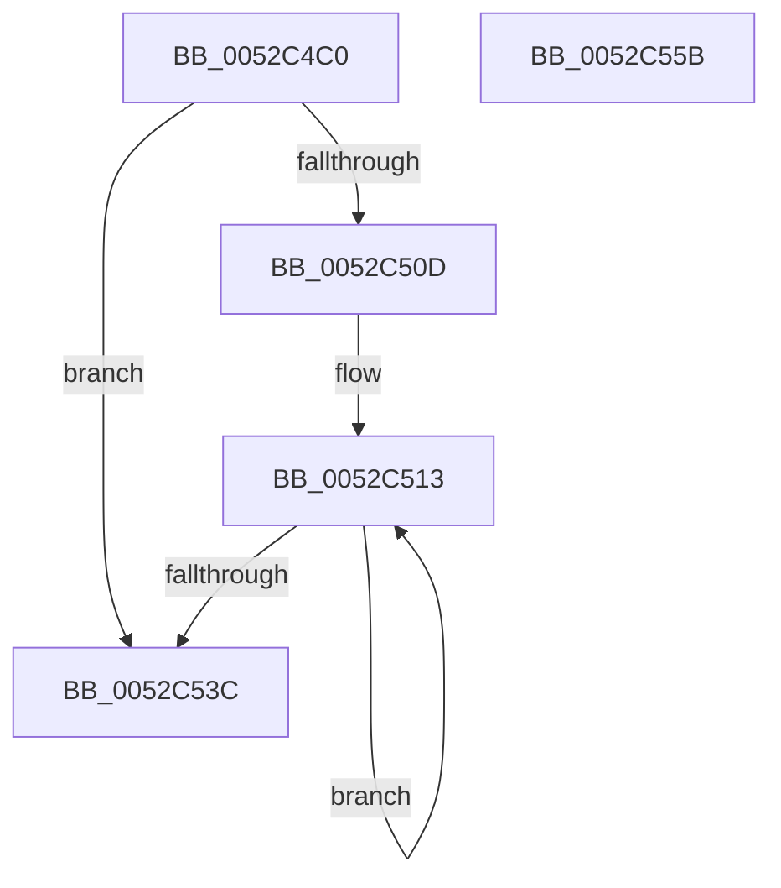

# SymCryptPrecomputation

- RVA: `0x0052C4C0`–`0x0052C55C` (길이 `156` bytes)
- VA: `0x000000014052C4C0`
- 실행 섹션: `.text`
- PDB 이름 있음: `예`; PDB Function 태그: `아니요`
- unwind 정보 RVA: `0x000847EC`
- 디코드: `46`개 명령, `156/156` bytes 표시
- 미해석 바이트: `0` (있으면 어셈블리에 `.byte`로 보존)

> 이 문서는 커널 이미지의 기계어와 PDB 기호를 분석해 생성했습니다. 4번과 5번은 함수 원형과 자료형을 바이너리 사용 방식에서 추정한 C 해석이며 원본 소스 복구 결과는 아닙니다.

## 1. Dependencies

- 직접 호출 지점: **2**; 고유 호출 대상: **2**
- 직접 호출자로 확인된 함수: **3**
- RIP 상대 이미지 참조: **0**

### Outgoing calls
- `0x0052C503` → [SymCryptEcpointDouble](SymCryptEcpointDouble_function_0052CFA8.md) (function, `0x0052CFA8`)
- `0x0052C529` → [SymCryptEcpointAddDiffNonZero](SymCryptEcpointAddDiffNonZero_function_0052CF68.md) (function, `0x0052CF68`)

### Direct callers
- [SymCryptEcpointMultiScalarMulWnafWithInterleaving](SymCryptEcpointMultiScalarMulWnafWithInterleaving_function_0052B920.md) at `0x0052BC46`
- [SymCryptEcpointScalarMulFixedWindow](SymCryptEcpointScalarMulFixedWindow_function_0052BE30.md) at `0x0052C13B`
- [SymCryptOfflinePrecomputation](SymCryptOfflinePrecomputation_function_0052C450.md) at `0x0052C49F`

### Static image references
- 디코드된 RIP-relative 메모리 참조가 없습니다.

## 2. Other-region calls and transfers

- 다른 실행 섹션으로 향하는 call: **0**
- 별도 외부 분기/꼬리 이동을 확인하지 못했습니다.

## 3. Assembly (complete function range)

```asm
0052C4C0  48 8B C4                        mov rax, rsp
0052C4C3  48 89 58 08                     mov qword ptr [rax + 8], rbx
0052C4C7  48 89 68 10                     mov qword ptr [rax + 0x10], rbp
0052C4CB  48 89 70 18                     mov qword ptr [rax + 0x18], rsi
0052C4CF  48 89 78 20                     mov qword ptr [rax + 0x20], rdi
0052C4D3  41 54                           push r12
0052C4D5  41 56                           push r14
0052C4D7  41 57                           push r15
0052C4D9  48 83 EC 30                     sub rsp, 0x30
0052C4DD  4C 8B 7C 24 78                  mov r15, qword ptr [rsp + 0x78]
0052C4E2  49 8B D8                        mov rbx, r8
0052C4E5  4C 8B 64 24 70                  mov r12, qword ptr [rsp + 0x70]
0052C4EA  49 8B E9                        mov rbp, r9
0052C4ED  8B F2                           mov esi, edx
0052C4EF  4C 89 78 E0                     mov qword ptr [rax - 0x20], r15
0052C4F3  45 33 C9                        xor r9d, r9d
0052C4F6  4C 89 60 D8                     mov qword ptr [rax - 0x28], r12
0052C4FA  48 8B 13                        mov rdx, qword ptr [rbx]
0052C4FD  4C 8B C5                        mov r8, rbp
0052C500  4C 8B F1                        mov r14, rcx
0052C503  E8 A0 0A 00 00                  call 0x14052cfa8
0052C508  83 FE 01                        cmp esi, 1
0052C50B  76 2F                           jbe 0x14052c53c
0052C50D  48 8D 7B 08                     lea rdi, [rbx + 8]
0052C511  FF CE                           dec esi
0052C513  4C 8B 0F                        mov r9, qword ptr [rdi]
0052C516  48 8B D5                        mov rdx, rbp
0052C519  4C 8B 03                        mov r8, qword ptr [rbx]
0052C51C  49 8B CE                        mov rcx, r14
0052C51F  4C 89 7C 24 28                  mov qword ptr [rsp + 0x28], r15
0052C524  4C 89 64 24 20                  mov qword ptr [rsp + 0x20], r12
0052C529  E8 3A 0A 00 00                  call 0x14052cf68
0052C52E  48 8D 5B 08                     lea rbx, [rbx + 8]
0052C532  48 8D 7F 08                     lea rdi, [rdi + 8]
0052C536  48 83 EE 01                     sub rsi, 1
0052C53A  75 D7                           jne 0x14052c513
0052C53C  48 8B 5C 24 50                  mov rbx, qword ptr [rsp + 0x50]
0052C541  48 8B 6C 24 58                  mov rbp, qword ptr [rsp + 0x58]
0052C546  48 8B 74 24 60                  mov rsi, qword ptr [rsp + 0x60]
0052C54B  48 8B 7C 24 68                  mov rdi, qword ptr [rsp + 0x68]
0052C550  48 83 C4 30                     add rsp, 0x30
0052C554  41 5F                           pop r15
0052C556  41 5E                           pop r14
0052C558  41 5C                           pop r12
0052C55A  C3                              ret
0052C55B  CC                              int3
```

## 4. C-style interpretation (structured pseudocode)

```c
__int64 __fastcall SymCryptPrecomputation(__int64 a1, int a2, __int64 a3, __int64 a4, __int64 a5, __int64 a6)
{
    __int64 result;
    __int64 v_rsi;
    __int64 v_rsp;
    unsigned __int64 v_stack_m20;
    unsigned __int64 v_stack_m28;
    unsigned __int64 v_stack_p10;
    unsigned __int64 v_stack_p18;
    unsigned __int64 v_stack_p20;
    unsigned __int64 v_stack_p8;

    *(unsigned __int64 *)(v_rsp + 8) = v_rbx;
    *(unsigned __int64 *)(v_rsp + 16) = v_rbp;
    *(unsigned __int64 *)(v_rsp + 24) = v_rsi;
    *(unsigned __int64 *)(v_rsp + 32) = v_rdi;
    v_rsp = (v_rsp) - (48);
    *(unsigned __int64 *)(v_rsp - 32) = a6;
    a4 = 0;
    *(unsigned __int64 *)(v_rsp - 40) = a5;
    result = SymCryptEcpointDouble(a1, *(unsigned __int64 *)(a3), 0, a4);
    if (((unsigned int)((unsigned int)(a2))) <= 1) goto loc_0052C53C;
    v_rsi = (unsigned int)(((unsigned int)(a2)) - 1);
loc_0052C513:
    v_stack_m20 = a6;
    v_stack_m28 = a5;
    result = SymCryptEcpointAddDiffNonZero(a1, 0, *(unsigned __int64 *)(a3), *(unsigned __int64 *)(a3 + 8));
    v_rsi = (v_rsi) - (1);
    if (condition_is_not_equal) goto loc_0052C513;
loc_0052C53C:
    v_rsp = (v_rsp) + (48);
    return result;
}
```

## 5. (Beta) C Style

```c
int64_t SymCryptPrecomputation(int64_t Arg1, int32_t Arg2, void *Arg3, int64_t Arg4, int64_t Arg5, int64_t Arg6)
{
    uint8_t *arg3 = (uint8_t *)Arg3;

    int64_t result;
    int64_t local_rsi;
    int64_t local_rsp;
    uint64_t v_stack_m20;
    uint64_t v_stack_m28;
    uint64_t v_stack_p10;
    uint64_t v_stack_p18;
    uint64_t v_stack_p20;
    uint64_t v_stack_p8;

    *(uint64_t *)(local_rsp + 0x8) = local_rbx;
    *(uint64_t *)(local_rsp + 0x10) = local_rbp;
    *(uint64_t *)(local_rsp + 0x18) = local_rsi;
    *(uint64_t *)(local_rsp + 0x20) = local_rdi;
    local_rsp = (local_rsp) - (48);
    *(uint64_t *)(local_rsp - 0x20) = Arg6;
    Arg4 = 0;
    *(uint64_t *)(local_rsp - 0x28) = Arg5;
    result = SymCryptEcpointDouble(Arg1, *(uint64_t *)(arg3), 0, Arg4);
    if (((uint32_t)((uint32_t)(Arg2))) <= 1) goto loc_0052C53C;
    local_rsi = (uint32_t)(((uint32_t)(Arg2)) - 1);
loc_0052C513:
    v_stack_m20 = Arg6;
    v_stack_m28 = Arg5;
    result = SymCryptEcpointAddDiffNonZero(Arg1, 0, *(uint64_t *)(arg3), *(uint64_t *)(arg3 + 0x8));
    local_rsi = (local_rsi) - (1);
    if (condition_is_not_equal) goto loc_0052C513;
loc_0052C53C:
    local_rsp = (local_rsp) + (48);
    return result;
}
```

### 관측된 메모리 오프셋

구조체 형식이 확인되지 않은 접근은 인자 기준의 오프셋으로만 기록했습니다.

| 기준 인자 | 오프셋 표현 | 폭 (bit) | 접근 |
|---|---:|---:|---|
| `Arg3` | `+ 0x0` | `64` | `R` |
| `Arg3` | `+ 0x8` | `64` | `R` |

## 6. Execution-region graph

[열기: 2D/3D 그래프와 함수 탐색 컨트롤 패널](../../../control-panel.html?section=text&rva=0x0052C4C0&view=graph)

- 2D 그래프는 위에서 아래로 흐르고, 3D 그래프는 빈 공간을 드래그해 회전합니다. Shift+드래그는 이동, 휠은 확대·축소, 함수 노드 선택은 대상 보고서 이동입니다.

### Static fallback


