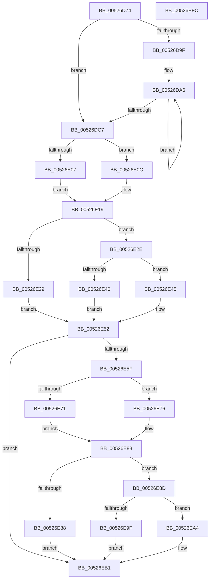

# SymCryptRsaCoreDecCrtScratchSpace

- RVA: `0x00526D74`–`0x00526EFD` (길이 `393` bytes)
- VA: `0x0000000140526D74`
- 실행 섹션: `.text`
- PDB 이름 있음: `예`; PDB Function 태그: `아니요`
- unwind 정보 RVA: `0x0005E6B4`
- 디코드: `129`개 명령, `393/393` bytes 표시
- 미해석 바이트: `0` (있으면 어셈블리에 `.byte`로 보존)

> 이 문서는 커널 이미지의 기계어와 PDB 기호를 분석해 생성했습니다. 4번과 5번은 함수 원형과 자료형을 바이너리 사용 방식에서 추정한 C 해석이며 원본 소스 복구 결과는 아닙니다.

## 1. Dependencies

- 직접 호출 지점: **2**; 고유 호출 대상: **1**
- 직접 호출자로 확인된 함수: **1**
- RIP 상대 이미지 참조: **0**

### Outgoing calls
- `0x00526EB3` → [SymCryptSizeofIntFromDigits](SymCryptSizeofIntFromDigits_function_00525D24.md) (function, `0x00525D24`)
- `0x00526EBE` → [SymCryptSizeofIntFromDigits](SymCryptSizeofIntFromDigits_function_00525D24.md) (function, `0x00525D24`)

### Direct callers
- [SymCryptRsaPkcs1Sign](SymCryptRsaPkcs1Sign_function_005271A0.md) at `0x00527217`

### Static image references
- 디코드된 RIP-relative 메모리 참조가 없습니다.

## 2. Other-region calls and transfers

- 다른 실행 섹션으로 향하는 call: **0**
- 별도 외부 분기/꼬리 이동을 확인하지 못했습니다.

## 3. Assembly (complete function range)

```asm
00526D74  48 8B C4                        mov rax, rsp
00526D77  48 89 58 08                     mov qword ptr [rax + 8], rbx
00526D7B  48 89 68 10                     mov qword ptr [rax + 0x10], rbp
00526D7F  48 89 70 18                     mov qword ptr [rax + 0x18], rsi
00526D83  48 89 78 20                     mov qword ptr [rax + 0x20], rdi
00526D87  41 56                           push r14
00526D89  48 83 EC 20                     sub rsp, 0x20
00526D8D  8B 41 1C                        mov eax, dword ptr [rcx + 0x1c]
00526D90  33 ED                           xor ebp, ebp
00526D92  48 8B F1                        mov rsi, rcx
00526D95  41 BE FF 01 00 00               mov r14d, 0x1ff
00526D9B  85 C0                           test eax, eax
00526D9D  74 28                           je 0x140526dc7
00526D9F  48 8D 51 20                     lea rdx, [rcx + 0x20]
00526DA3  44 8B C0                        mov r8d, eax
00526DA6  8B 02                           mov eax, dword ptr [rdx]
00526DA8  8B C8                           mov ecx, eax
00526DAA  41 23 CE                        and ecx, r14d
00526DAD  C1 E8 09                        shr eax, 9
00526DB0  41 03 CE                        add ecx, r14d
00526DB3  48 8D 52 04                     lea rdx, [rdx + 4]
00526DB7  C1 E9 09                        shr ecx, 9
00526DBA  03 C8                           add ecx, eax
00526DBC  C1 E1 06                        shl ecx, 6
00526DBF  03 E9                           add ebp, ecx
00526DC1  49 83 E8 01                     sub r8, 1
00526DC5  75 DF                           jne 0x140526da6
00526DC7  8B 56 30                        mov edx, dword ptr [rsi + 0x30]
00526DCA  44 8B C2                        mov r8d, edx
00526DCD  8B 5E 14                        mov ebx, dword ptr [rsi + 0x14]
00526DD0  8B C2                           mov eax, edx
00526DD2  C1 E0 06                        shl eax, 6
00526DD5  44 8B CA                        mov r9d, edx
00526DD8  C1 E2 07                        shl edx, 7
00526DDB  48 83 EA 80                     sub rdx, -0x80
00526DDF  41 C1 E0 08                     shl r8d, 8
00526DE3  41 83 C0 40                     add r8d, 0x40
00526DE7  41 C1 E1 05                     shl r9d, 5
00526DEB  8D 4B 01                        lea ecx, [rbx + 1]
00526DEE  C1 E1 06                        shl ecx, 6
00526DF1  48 8D 14 42                     lea rdx, [rdx + rax*2]
00526DF5  45 3B C1                        cmp r8d, r9d
00526DF8  41 8B C0                        mov eax, r8d
00526DFB  41 0F 46 C1                     cmovbe eax, r9d
00526DFF  48 03 C2                        add rax, rdx
00526E02  48 3B C8                        cmp rcx, rax
00526E05  76 05                           jbe 0x140526e0c
00526E07  44 8B D1                        mov r10d, ecx
00526E0A  EB 0D                           jmp 0x140526e19
00526E0C  45 3B C1                        cmp r8d, r9d
00526E0F  45 8B D0                        mov r10d, r8d
00526E12  45 0F 46 D1                     cmovbe r10d, r9d
00526E16  4C 03 D2                        add r10, rdx
00526E19  44 69 DB 80 11 00 00            imul r11d, ebx, 0x1180
00526E20  41 83 C3 40                     add r11d, 0x40
00526E24  4D 3B DA                        cmp r11, r10
00526E27  76 05                           jbe 0x140526e2e
00526E29  45 8B D3                        mov r10d, r11d
00526E2C  EB 24                           jmp 0x140526e52
00526E2E  45 3B C1                        cmp r8d, r9d
00526E31  41 8B C0                        mov eax, r8d
00526E34  41 0F 46 C1                     cmovbe eax, r9d
00526E38  48 03 C2                        add rax, rdx
00526E3B  48 3B C8                        cmp rcx, rax
00526E3E  76 05                           jbe 0x140526e45
00526E40  4C 8B D1                        mov r10, rcx
00526E43  EB 0D                           jmp 0x140526e52
00526E45  45 3B C1                        cmp r8d, r9d
00526E48  45 8B D0                        mov r10d, r8d
00526E4B  45 0F 46 D1                     cmovbe r10d, r9d
00526E4F  4C 03 D2                        add r10, rdx
00526E52  8B FB                           mov edi, ebx
00526E54  C1 E7 08                        shl edi, 8
00526E57  83 C7 40                        add edi, 0x40
00526E5A  49 3B FA                        cmp rdi, r10
00526E5D  77 52                           ja 0x140526eb1
00526E5F  45 3B C1                        cmp r8d, r9d
00526E62  41 8B C0                        mov eax, r8d
00526E65  41 0F 46 C1                     cmovbe eax, r9d
00526E69  48 03 C2                        add rax, rdx
00526E6C  48 3B C8                        cmp rcx, rax
00526E6F  76 05                           jbe 0x140526e76
00526E71  48 8B C1                        mov rax, rcx
00526E74  EB 0D                           jmp 0x140526e83
00526E76  45 3B C1                        cmp r8d, r9d
00526E79  41 8B C0                        mov eax, r8d
00526E7C  41 0F 46 C1                     cmovbe eax, r9d
00526E80  48 03 C2                        add rax, rdx
00526E83  4C 3B D8                        cmp r11, rax
00526E86  76 05                           jbe 0x140526e8d
00526E88  49 8B FB                        mov rdi, r11
00526E8B  EB 24                           jmp 0x140526eb1
00526E8D  45 3B C1                        cmp r8d, r9d
00526E90  41 8B C0                        mov eax, r8d
00526E93  41 0F 46 C1                     cmovbe eax, r9d
00526E97  48 03 C2                        add rax, rdx
00526E9A  48 3B C8                        cmp rcx, rax
00526E9D  76 05                           jbe 0x140526ea4
00526E9F  48 8B F9                        mov rdi, rcx
00526EA2  EB 0D                           jmp 0x140526eb1
00526EA4  45 3B C1                        cmp r8d, r9d
00526EA7  45 0F 46 C1                     cmovbe r8d, r9d
00526EAB  41 8B F8                        mov edi, r8d
00526EAE  48 03 FA                        add rdi, rdx
00526EB1  8B CB                           mov ecx, ebx
00526EB3  E8 6C EE FF FF                  call 0x140525d24
00526EB8  8B 4E 30                        mov ecx, dword ptr [rsi + 0x30]
00526EBB  8D 1C 40                        lea ebx, [rax + rax*2]
00526EBE  E8 61 EE FF FF                  call 0x140525d24
00526EC3  8B 4E 10                        mov ecx, dword ptr [rsi + 0x10]
00526EC6  03 C3                           add eax, ebx
00526EC8  48 8B 5C 24 30                  mov rbx, qword ptr [rsp + 0x30]
00526ECD  8B D1                           mov edx, ecx
00526ECF  48 8B 74 24 40                  mov rsi, qword ptr [rsp + 0x40]
00526ED4  41 23 D6                        and edx, r14d
00526ED7  41 03 D6                        add edx, r14d
00526EDA  C1 E9 09                        shr ecx, 9
00526EDD  C1 EA 09                        shr edx, 9
00526EE0  03 D1                           add edx, ecx
00526EE2  C1 E2 06                        shl edx, 6
00526EE5  03 C2                           add eax, edx
00526EE7  03 C7                           add eax, edi
00526EE9  48 8B 7C 24 48                  mov rdi, qword ptr [rsp + 0x48]
00526EEE  03 C5                           add eax, ebp
00526EF0  48 8B 6C 24 38                  mov rbp, qword ptr [rsp + 0x38]
00526EF5  48 83 C4 20                     add rsp, 0x20
00526EF9  41 5E                           pop r14
00526EFB  C3                              ret
00526EFC  CC                              int3
```

## 4. C-style interpretation (structured pseudocode)

```c
__int64 __fastcall SymCryptRsaCoreDecCrtScratchSpace(__int64 a1)
{
    __int64 result;
    __int64 v_r10;
    __int64 v_r11;
    __int64 v_rbp;
    __int64 v_rdi;
    __int64 v_rsp;
    unsigned __int64 v_stack_p10;
    unsigned __int64 v_stack_p18;
    unsigned __int64 v_stack_p20;
    unsigned __int64 v_stack_p8;

    *(unsigned __int64 *)(v_rsp + 8) = v_rbx;
    *(unsigned __int64 *)(v_rsp + 16) = v_rbp;
    *(unsigned __int64 *)(v_rsp + 24) = v_rsi;
    *(unsigned __int64 *)(v_rsp + 32) = v_rdi;
    v_rsp = (v_rsp) - (32);
    v_rbp = 0;
    if ((unsigned int)((unsigned int)(*(unsigned int *)(a1 + 28))) == 0) goto loc_00526DC7;
loc_00526DA6:
    a1 = (unsigned int)(((unsigned int)((unsigned int)((unsigned int)(*(unsigned int *)(a1 + 32))))) & (511));
    result = (unsigned int)(((unsigned int)(*(unsigned int *)(a1 + 32))) >> (9));
    a1 = (unsigned int)((a1) + (511));
    a1 = (unsigned int)((a1) >> (9));
    a1 = (unsigned int)((a1) + ((unsigned int)(result)));
    a1 = (unsigned int)((a1) << (6));
    v_rbp = (unsigned int)((v_rbp) + ((unsigned int)(a1)));
    a3 = ((unsigned int)((unsigned int)((unsigned int)(*(unsigned int *)(a1 + 28))))) - (1);
    if (condition_is_not_equal) goto loc_00526DA6;
loc_00526DC7:
    result = (unsigned int)(((unsigned int)((unsigned int)((unsigned int)(*(unsigned int *)(a1 + 48))))) << (6));
    a2 = (unsigned int)(((unsigned int)(*(unsigned int *)(a1 + 48))) << (7));
    a2 = (a2) - (-128);
    a3 = (unsigned int)(((unsigned int)((unsigned int)((unsigned int)(*(unsigned int *)(a1 + 48))))) << (8));
    a3 = (unsigned int)((a3) + (64));
    a4 = (unsigned int)(((unsigned int)((unsigned int)((unsigned int)(*(unsigned int *)(a1 + 48))))) << (5));
    a1 = (unsigned int)(((unsigned int)(*(unsigned int *)(a1 + 20)) + 1) << (6));
    result = (unsigned int)((unsigned int)(a3));
    if (((unsigned int)(a3)) <= ((unsigned int)(a4))) { result = (unsigned int)(a4); }
    result = (result) + (a2 + result * 2);
    if (a1 <= result) goto loc_00526E0C;
    goto loc_00526E19;
loc_00526E0C:
    v_r10 = (unsigned int)((unsigned int)(a3));
    if (((unsigned int)(a3)) <= ((unsigned int)(a4))) { v_r10 = (unsigned int)(a4); }
    v_r10 = (v_r10) + (a2 + result * 2);
loc_00526E19:
    v_r11 = (unsigned int)((v_r11) * ((unsigned int)((unsigned int)(*(unsigned int *)(a1 + 20)))));
    v_r11 = (unsigned int)((v_r11) + (64));
    if (v_r11 <= v_r10) goto loc_00526E2E;
    goto loc_00526E52;
loc_00526E2E:
    result = (unsigned int)((unsigned int)(a3));
    if (((unsigned int)(a3)) <= ((unsigned int)(a4))) { result = (unsigned int)(a4); }
    result = (result) + (a2 + result * 2);
    if (a1 <= result) goto loc_00526E45;
    goto loc_00526E52;
loc_00526E45:
    v_r10 = (unsigned int)((unsigned int)(a3));
    if (((unsigned int)(a3)) <= ((unsigned int)(a4))) { v_r10 = (unsigned int)(a4); }
    v_r10 = (v_r10) + (a2 + result * 2);
loc_00526E52:
    v_rdi = (unsigned int)(((unsigned int)((unsigned int)((unsigned int)(*(unsigned int *)(a1 + 20))))) << (8));
    v_rdi = (unsigned int)((v_rdi) + (64));
    if (v_rdi > v_r10) goto loc_00526EB1;
    result = (unsigned int)((unsigned int)(a3));
    if (((unsigned int)(a3)) <= ((unsigned int)(a4))) { result = (unsigned int)(a4); }
    result = (result) + (a2 + result * 2);
    if (a1 <= result) goto loc_00526E76;
    goto loc_00526E83;
loc_00526E76:
    result = (unsigned int)((unsigned int)(a3));
    if (((unsigned int)(a3)) <= ((unsigned int)(a4))) { result = (unsigned int)(a4); }
    result = (result) + (a2 + result * 2);
loc_00526E83:
    if (v_r11 <= result) goto loc_00526E8D;
    goto loc_00526EB1;
loc_00526E8D:
    result = (unsigned int)((unsigned int)(a3));
    if (((unsigned int)(a3)) <= ((unsigned int)(a4))) { result = (unsigned int)(a4); }
    result = (result) + (a2 + result * 2);
    if (a1 <= result) goto loc_00526EA4;
    goto loc_00526EB1;
loc_00526EA4:
    if (((unsigned int)(a3)) <= ((unsigned int)(a4))) { a3 = (unsigned int)(a4); }
    v_rdi = ((unsigned int)((unsigned int)(a3))) + (a2 + result * 2);
loc_00526EB1:
    result = SymCryptSizeofIntFromDigits((unsigned int)((unsigned int)((unsigned int)(*(unsigned int *)(a1 + 20)))), a2 + result * 2, a3, a4);
    result = SymCryptSizeofIntFromDigits((unsigned int)(*(unsigned int *)(a1 + 48)), a2 + result * 2, a3, a4);
    result = (unsigned int)((result) + ((unsigned int)(result + result * 2)));
    a2 = (unsigned int)(((unsigned int)((unsigned int)((unsigned int)(*(unsigned int *)(a1 + 16))))) & (511));
    a2 = (unsigned int)((a2) + (511));
    a1 = (unsigned int)(((unsigned int)(*(unsigned int *)(a1 + 16))) >> (9));
    a2 = (unsigned int)((a2) >> (9));
    a2 = (unsigned int)((a2) + ((unsigned int)(a1)));
    a2 = (unsigned int)((a2) << (6));
    result = (unsigned int)((result) + ((unsigned int)(a2)));
    result = (unsigned int)((result) + ((unsigned int)(v_rdi)));
    result = (unsigned int)((result) + ((unsigned int)(v_rbp)));
    v_rsp = (v_rsp) + (32);
    return result;
}
```

## 5. (Beta) C Style

```c
int64_t SymCryptRsaCoreDecCrtScratchSpace(void *Arg1)
{
    uint8_t *arg1 = (uint8_t *)Arg1;

    int64_t result;
    int64_t local_r10;
    int64_t local_r11;
    int64_t local_rbp;
    int64_t local_rdi;
    int64_t local_rsp;
    uint64_t v_stack_p10;
    uint64_t v_stack_p18;
    uint64_t v_stack_p20;
    uint64_t v_stack_p8;

    *(uint64_t *)(local_rsp + 0x8) = local_rbx;
    *(uint64_t *)(local_rsp + 0x10) = local_rbp;
    *(uint64_t *)(local_rsp + 0x18) = local_rsi;
    *(uint64_t *)(local_rsp + 0x20) = local_rdi;
    local_rsp = (local_rsp) - (32);
    local_rbp = 0;
    if ((uint32_t)((uint32_t)(*(uint32_t *)(arg1 + 0x1C))) == 0) goto loc_00526DC7;
loc_00526DA6:
    Arg1 = (uint32_t)(((uint32_t)((uint32_t)((uint32_t)(*(uint32_t *)(arg1 + 0x20))))) & (511));
    result = (uint32_t)(((uint32_t)(*(uint32_t *)(arg1 + 0x20))) >> (9));
    Arg1 = (uint32_t)((Arg1) + (511));
    Arg1 = (uint32_t)((Arg1) >> (9));
    Arg1 = (uint32_t)((Arg1) + ((uint32_t)(result)));
    Arg1 = (uint32_t)((Arg1) << (6));
    local_rbp = (uint32_t)((local_rbp) + ((uint32_t)(Arg1)));
    a3 = ((uint32_t)((uint32_t)((uint32_t)(*(uint32_t *)(arg1 + 0x1C))))) - (1);
    if (condition_is_not_equal) goto loc_00526DA6;
loc_00526DC7:
    result = (uint32_t)(((uint32_t)((uint32_t)((uint32_t)(*(uint32_t *)(arg1 + 0x30))))) << (6));
    a2 = (uint32_t)(((uint32_t)(*(uint32_t *)(arg1 + 0x30))) << (7));
    a2 = (a2) - (-128);
    a3 = (uint32_t)(((uint32_t)((uint32_t)((uint32_t)(*(uint32_t *)(arg1 + 0x30))))) << (8));
    a3 = (uint32_t)((a3) + (64));
    a4 = (uint32_t)(((uint32_t)((uint32_t)((uint32_t)(*(uint32_t *)(arg1 + 0x30))))) << (5));
    Arg1 = (uint32_t)(((uint32_t)(*(uint32_t *)(arg1 + 0x14)) + 1) << (6));
    result = (uint32_t)((uint32_t)(a3));
    if (((uint32_t)(a3)) <= ((uint32_t)(a4))) { result = (uint32_t)(a4); }
    result = (result) + (a2 + result * 2);
    if (Arg1 <= result) goto loc_00526E0C;
    goto loc_00526E19;
loc_00526E0C:
    local_r10 = (uint32_t)((uint32_t)(a3));
    if (((uint32_t)(a3)) <= ((uint32_t)(a4))) { local_r10 = (uint32_t)(a4); }
    local_r10 = (local_r10) + (a2 + result * 2);
loc_00526E19:
    local_r11 = (uint32_t)((local_r11) * ((uint32_t)((uint32_t)(*(uint32_t *)(arg1 + 0x14)))));
    local_r11 = (uint32_t)((local_r11) + (64));
    if (local_r11 <= local_r10) goto loc_00526E2E;
    goto loc_00526E52;
loc_00526E2E:
    result = (uint32_t)((uint32_t)(a3));
    if (((uint32_t)(a3)) <= ((uint32_t)(a4))) { result = (uint32_t)(a4); }
    result = (result) + (a2 + result * 2);
    if (Arg1 <= result) goto loc_00526E45;
    goto loc_00526E52;
loc_00526E45:
    local_r10 = (uint32_t)((uint32_t)(a3));
    if (((uint32_t)(a3)) <= ((uint32_t)(a4))) { local_r10 = (uint32_t)(a4); }
    local_r10 = (local_r10) + (a2 + result * 2);
loc_00526E52:
    local_rdi = (uint32_t)(((uint32_t)((uint32_t)((uint32_t)(*(uint32_t *)(arg1 + 0x14))))) << (8));
    local_rdi = (uint32_t)((local_rdi) + (64));
    if (local_rdi > local_r10) goto loc_00526EB1;
    result = (uint32_t)((uint32_t)(a3));
    if (((uint32_t)(a3)) <= ((uint32_t)(a4))) { result = (uint32_t)(a4); }
    result = (result) + (a2 + result * 2);
    if (Arg1 <= result) goto loc_00526E76;
    goto loc_00526E83;
loc_00526E76:
    result = (uint32_t)((uint32_t)(a3));
    if (((uint32_t)(a3)) <= ((uint32_t)(a4))) { result = (uint32_t)(a4); }
    result = (result) + (a2 + result * 2);
loc_00526E83:
    if (local_r11 <= result) goto loc_00526E8D;
    goto loc_00526EB1;
loc_00526E8D:
    result = (uint32_t)((uint32_t)(a3));
    if (((uint32_t)(a3)) <= ((uint32_t)(a4))) { result = (uint32_t)(a4); }
    result = (result) + (a2 + result * 2);
    if (Arg1 <= result) goto loc_00526EA4;
    goto loc_00526EB1;
loc_00526EA4:
    if (((uint32_t)(a3)) <= ((uint32_t)(a4))) { a3 = (uint32_t)(a4); }
    local_rdi = ((uint32_t)((uint32_t)(a3))) + (a2 + result * 2);
loc_00526EB1:
    result = SymCryptSizeofIntFromDigits((uint32_t)((uint32_t)((uint32_t)(*(uint32_t *)(arg1 + 0x14)))), a2 + result * 2, a3, a4);
    result = SymCryptSizeofIntFromDigits((uint32_t)(*(uint32_t *)(arg1 + 0x30)), a2 + result * 2, a3, a4);
    result = (uint32_t)((result) + ((uint32_t)(result + result * 2)));
    a2 = (uint32_t)(((uint32_t)((uint32_t)((uint32_t)(*(uint32_t *)(arg1 + 0x10))))) & (511));
    a2 = (uint32_t)((a2) + (511));
    Arg1 = (uint32_t)(((uint32_t)(*(uint32_t *)(arg1 + 0x10))) >> (9));
    a2 = (uint32_t)((a2) >> (9));
    a2 = (uint32_t)((a2) + ((uint32_t)(Arg1)));
    a2 = (uint32_t)((a2) << (6));
    result = (uint32_t)((result) + ((uint32_t)(a2)));
    result = (uint32_t)((result) + ((uint32_t)(local_rdi)));
    result = (uint32_t)((result) + ((uint32_t)(local_rbp)));
    local_rsp = (local_rsp) + (32);
    return result;
}
```

### 관측된 메모리 오프셋

구조체 형식이 확인되지 않은 접근은 인자 기준의 오프셋으로만 기록했습니다.

| 기준 인자 | 오프셋 표현 | 폭 (bit) | 접근 |
|---|---:|---:|---|
| `Arg1` | `+ 0x0` | `32` | `R` |
| `Arg1` | `+ 0x4` | `64` | `R` |
| `Arg1` | `+ 0x10` | `32` | `R` |
| `Arg1` | `+ 0x14` | `32` | `R` |
| `Arg1` | `+ 0x1C` | `32` | `R` |
| `Arg1` | `+ 0x20` | `64` | `R` |
| `Arg1` | `+ 0x30` | `32` | `R` |

## 6. Execution-region graph

[열기: 2D/3D 그래프와 함수 탐색 컨트롤 패널](../../../control-panel.html?section=text&rva=0x00526D74&view=graph)

- 2D 그래프는 위에서 아래로 흐르고, 3D 그래프는 빈 공간을 드래그해 회전합니다. Shift+드래그는 이동, 휠은 확대·축소, 함수 노드 선택은 대상 보고서 이동입니다.

### Static fallback


