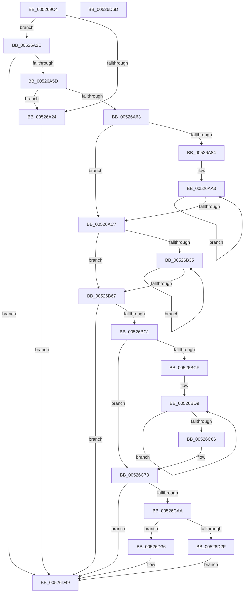

# SymCryptRsaCoreDecCrt

- RVA: `0x005269C4`–`0x00526D6E` (길이 `938` bytes)
- VA: `0x00000001405269C4`
- 실행 섹션: `.text`
- PDB 이름 있음: `예`; PDB Function 태그: `아니요`
- unwind 정보 RVA: `0x000C32CC`
- 디코드: `229`개 명령, `938/938` bytes 표시
- 미해석 바이트: `0` (있으면 어셈블리에 `.byte`로 보존)

> 이 문서는 커널 이미지의 기계어와 PDB 기호를 분석해 생성했습니다. 4번과 5번은 함수 원형과 자료형을 바이너리 사용 방식에서 추정한 C 해석이며 원본 소스 복구 결과는 아닙니다.

## 1. Dependencies

- 직접 호출 지점: **24**; 고유 호출 대상: **17**
- 직접 호출자로 확인된 함수: **1**
- RIP 상대 이미지 참조: **1**

### Outgoing calls
- `0x00526A50` → [SymCryptRsaCoreVerifyInput](SymCryptRsaCoreVerifyInput_function_005270DC.md) (function, `0x005270DC`)
- `0x00526A66` → [SymCryptSizeofIntFromDigits](SymCryptSizeofIntFromDigits_function_00525D24.md) (function, `0x00525D24`)
- `0x00526A74` → [SymCryptSizeofIntFromDigits](SymCryptSizeofIntFromDigits_function_00525D24.md) (function, `0x00525D24`)
- `0x00526ACB` → [SymCryptSizeofModElementFromModulus](SymCryptSizeofModElementFromModulus_function_00525D3C.md) (function, `0x00525D3C`)
- `0x00526ADE` → [SymCryptIntCreate](SymCryptIntCreate_function_0052556C.md) (function, `0x0052556C`)
- `0x00526AFE` → [SymCryptIntCreate](SymCryptIntCreate_function_0052556C.md) (function, `0x0052556C`)
- `0x00526B18` → [SymCryptIntCreate](SymCryptIntCreate_function_0052556C.md) (function, `0x0052556C`)
- `0x00526B43` → [SymCryptModElementCreate](SymCryptModElementCreate_function_00525900.md) (function, `0x00525900`)
- `0x00526B71` → [SymCryptIntCreate](SymCryptIntCreate_function_0052556C.md) (function, `0x0052556C`)
- `0x00526B8F` → [SymCryptModElementCreate](SymCryptModElementCreate_function_00525900.md) (function, `0x00525900`)
- `0x00526BB4` → [SymCryptIntSetValue](SymCryptIntSetValue_function_00525730.md) (function, `0x00525730`)
- `0x00526BE1` → [SymCryptDivisorFromModulus](SymCryptDivisorFromModulus_function_0052547C.md) (function, `0x0052547C`)
- `0x00526BFC` → [SymCryptIntDivMod](SymCryptIntDivMod_function_00525584.md) (function, `0x00525584`)
- `0x00526C1C` → [SymCryptIntToModElement](SymCryptIntToModElement_function_00525804.md) (function, `0x00525804`)
- `0x00526C52` → [SymCryptModExp](SymCryptModExp_function_00525B28.md) (function, `0x00525B28`)
- `0x00526C9D` → [SymCryptCrtSolve](SymCryptCrtSolve_function_0052AB54.md) (function, `0x0052AB54`)
- `0x00526CBC` → [SymCryptIntToModElement](SymCryptIntToModElement_function_00525804.md) (function, `0x00525804`)
- `0x00526CCD` → [SymCryptIntSetValueUint64](SymCryptIntSetValueUint64_function_00525760.md) (function, `0x00525760`)
- `0x00526CD5` → [SymCryptIntBitsizeOfValue](SymCryptIntBitsizeOfValue_function_005254F4.md) (function, `0x005254F4`)
- `0x00526CFE` → [SymCryptModExp](SymCryptModExp_function_00525B28.md) (function, `0x00525B28`)
- `0x00526D17` → [SymCryptModElementToInt](SymCryptModElementToInt_function_00525AB0.md) (function, `0x00525AB0`)
- `0x00526D26` → [SymCryptIntIsEqual](SymCryptIntIsEqual_function_00525698.md) (function, `0x00525698`)
- `0x00526D44` → [SymCryptIntGetValue](SymCryptIntGetValue_function_00525650.md) (function, `0x00525650`)
- `0x00526D54` → [_security_check_cookie](../6A/_security_check_cookie_function_006AC640.md) (function, `0x006AC640`)

### Direct callers
- [SymCryptRsaPkcs1Sign](SymCryptRsaPkcs1Sign_function_005271A0.md) at `0x005272AB`

### Static image references
- `0x005269DA` → RVA `0x00E0A740` (`.data`; read)

## 2. Other-region calls and transfers

- 다른 실행 섹션으로 향하는 call: **0**
- 별도 외부 분기/꼬리 이동을 확인하지 못했습니다.

## 3. Assembly (complete function range)

```asm
005269C4  4C 8B DC                        mov r11, rsp
005269C7  53                              push rbx
005269C8  55                              push rbp
005269C9  56                              push rsi
005269CA  57                              push rdi
005269CB  41 54                           push r12
005269CD  41 55                           push r13
005269CF  41 56                           push r14
005269D1  41 57                           push r15
005269D3  48 81 EC A8 00 00 00            sub rsp, 0xa8
005269DA  48 8B 05 5F 3D 8E 00            mov rax, qword ptr [rip + 0x8e3d5f]
005269E1  48 33 C4                        xor rax, rsp
005269E4  48 89 84 24 98 00 00 00         mov qword ptr [rsp + 0x98], rax
005269EC  49 83 63 98 00                  and qword ptr [r11 - 0x68], 0
005269F1  48 8B F9                        mov rdi, rcx
005269F4  48 8B 8C 24 18 01 00 00         mov rcx, qword ptr [rsp + 0x118]
005269FC  0F 57 C0                        xorps xmm0, xmm0
005269FF  48 8B 9C 24 28 01 00 00         mov rbx, qword ptr [rsp + 0x128]
00526A07  45 8B F9                        mov r15d, r9d
00526A0A  4C 89 44 24 60                  mov qword ptr [rsp + 0x60], r8
00526A0F  80 7F 08 00                     cmp byte ptr [rdi + 8], 0
00526A13  48 89 54 24 68                  mov qword ptr [rsp + 0x68], rdx
00526A18  48 89 4C 24 78                  mov qword ptr [rsp + 0x78], rcx
00526A1D  41 0F 11 43 A0                  movups xmmword ptr [r11 - 0x60], xmm0
00526A22  75 0A                           jne 0x140526a2e
00526A24  B8 0E 80 00 00                  mov eax, 0x800e
00526A29  E9 1B 03 00 00                  jmp 0x140526d49
00526A2E  48 8B B4 24 30 01 00 00         mov rsi, qword ptr [rsp + 0x130]
00526A36  48 8B CF                        mov rcx, rdi
00526A39  4C 8B AC 24 20 01 00 00         mov r13, qword ptr [rsp + 0x120]
00526A41  48 89 74 24 30                  mov qword ptr [rsp + 0x30], rsi
00526A46  48 89 5C 24 28                  mov qword ptr [rsp + 0x28], rbx
00526A4B  4C 89 6C 24 20                  mov qword ptr [rsp + 0x20], r13
00526A50  E8 87 06 00 00                  call 0x1405270dc
00526A55  85 C0                           test eax, eax
00526A57  0F 85 EC 02 00 00               jne 0x140526d49
00526A5D  83 7F 1C 02                     cmp dword ptr [rdi + 0x1c], 2
00526A61  77 C1                           ja 0x140526a24
00526A63  8B 4F 14                        mov ecx, dword ptr [rdi + 0x14]
00526A66  E8 B9 F2 FF FF                  call 0x140525d24
00526A6B  8B 4F 30                        mov ecx, dword ptr [rdi + 0x30]
00526A6E  8B E8                           mov ebp, eax
00526A70  89 6C 24 48                     mov dword ptr [rsp + 0x48], ebp
00526A74  E8 AB F2 FF FF                  call 0x140525d24
00526A79  8B 4F 1C                        mov ecx, dword ptr [rdi + 0x1c]
00526A7C  89 44 24 40                     mov dword ptr [rsp + 0x40], eax
00526A80  85 C9                           test ecx, ecx
00526A82  74 43                           je 0x140526ac7
00526A84  48 8D 84 24 80 00 00 00         lea rax, [rsp + 0x80]
00526A8C  4C 8B C7                        mov r8, rdi
00526A8F  4C 2B C0                        sub r8, rax
00526A92  48 8D 94 24 80 00 00 00         lea rdx, [rsp + 0x80]
00526A9A  44 8B C9                        mov r9d, ecx
00526A9D  41 BA FF 01 00 00               mov r10d, 0x1ff
00526AA3  41 8B 44 10 20                  mov eax, dword ptr [r8 + rdx + 0x20]
00526AA8  8B C8                           mov ecx, eax
00526AAA  41 23 CA                        and ecx, r10d
00526AAD  C1 E8 09                        shr eax, 9
00526AB0  41 03 CA                        add ecx, r10d
00526AB3  C1 E9 09                        shr ecx, 9
00526AB6  03 C8                           add ecx, eax
00526AB8  C1 E1 06                        shl ecx, 6
00526ABB  89 0A                           mov dword ptr [rdx], ecx
00526ABD  48 8D 52 04                     lea rdx, [rdx + 4]
00526AC1  49 83 E9 01                     sub r9, 1
00526AC5  75 DC                           jne 0x140526aa3
00526AC7  48 8B 4F 78                     mov rcx, qword ptr [rdi + 0x78]
00526ACB  E8 6C F2 FF FF                  call 0x140525d3c
00526AD0  44 8B 47 14                     mov r8d, dword ptr [rdi + 0x14]
00526AD4  48 8B D6                        mov rdx, rsi
00526AD7  48 8B CB                        mov rcx, rbx
00526ADA  89 44 24 4C                     mov dword ptr [rsp + 0x4c], eax
00526ADE  E8 89 EA FF FF                  call 0x14052556c
00526AE3  44 8B 47 14                     mov r8d, dword ptr [rdi + 0x14]
00526AE7  4C 8B F5                        mov r14, rbp
00526AEA  49 2B F6                        sub rsi, r14
00526AED  48 89 44 24 70                  mov qword ptr [rsp + 0x70], rax
00526AF2  48 03 EB                        add rbp, rbx
00526AF5  48 8B D6                        mov rdx, rsi
00526AF8  48 8B CD                        mov rcx, rbp
00526AFB  4C 8B E0                        mov r12, rax
00526AFE  E8 69 EA FF FF                  call 0x14052556c
00526B03  44 8B 47 30                     mov r8d, dword ptr [rdi + 0x30]
00526B07  49 03 EE                        add rbp, r14
00526B0A  49 2B F6                        sub rsi, r14
00526B0D  48 89 44 24 50                  mov qword ptr [rsp + 0x50], rax
00526B12  48 8B D6                        mov rdx, rsi
00526B15  48 8B CD                        mov rcx, rbp
00526B18  E8 4F EA FF FF                  call 0x14052556c
00526B1D  8B 4C 24 40                     mov ecx, dword ptr [rsp + 0x40]
00526B21  45 33 F6                        xor r14d, r14d
00526B24  48 03 E9                        add rbp, rcx
00526B27  48 89 44 24 58                  mov qword ptr [rsp + 0x58], rax
00526B2C  48 2B F1                        sub rsi, rcx
00526B2F  44 39 77 1C                     cmp dword ptr [rdi + 0x1c], r14d
00526B33  76 32                           jbe 0x140526b67
00526B35  4E 8B 84 F7 80 00 00 00         mov r8, qword ptr [rdi + r14*8 + 0x80]
00526B3D  48 8B D6                        mov rdx, rsi
00526B40  48 8B CD                        mov rcx, rbp
00526B43  E8 B8 ED FF FF                  call 0x140525900
00526B48  4A 89 84 F4 88 00 00 00         mov qword ptr [rsp + r14*8 + 0x88], rax
00526B50  42 8B 84 B4 80 00 00 00         mov eax, dword ptr [rsp + r14*4 + 0x80]
00526B58  41 FF C6                        inc r14d
00526B5B  48 03 E8                        add rbp, rax
00526B5E  48 2B F0                        sub rsi, rax
00526B61  44 3B 77 1C                     cmp r14d, dword ptr [rdi + 0x1c]
00526B65  72 CE                           jb 0x140526b35
00526B67  44 8B 47 14                     mov r8d, dword ptr [rdi + 0x14]
00526B6B  48 8B D6                        mov rdx, rsi
00526B6E  48 8B CD                        mov rcx, rbp
00526B71  E8 F6 E9 FF FF                  call 0x14052556c
00526B76  4C 8B 47 78                     mov r8, qword ptr [rdi + 0x78]
00526B7A  48 89 44 24 40                  mov qword ptr [rsp + 0x40], rax
00526B7F  8B 44 24 48                     mov eax, dword ptr [rsp + 0x48]
00526B83  48 03 E8                        add rbp, rax
00526B86  48 2B F0                        sub rsi, rax
00526B89  48 8B D6                        mov rdx, rsi
00526B8C  48 8B CD                        mov rcx, rbp
00526B8F  E8 6C ED FF FF                  call 0x140525900
00526B94  44 8B 44 24 4C                  mov r8d, dword ptr [rsp + 0x4c]
00526B99  48 8B D8                        mov rbx, rax
00526B9C  4C 8B 4C 24 50                  mov r9, qword ptr [rsp + 0x50]
00526BA1  49 03 E8                        add rbp, r8
00526BA4  48 8B 54 24 60                  mov rdx, qword ptr [rsp + 0x60]
00526BA9  49 2B F0                        sub rsi, r8
00526BAC  48 8B 4C 24 68                  mov rcx, qword ptr [rsp + 0x68]
00526BB1  45 8B C7                        mov r8d, r15d
00526BB4  E8 77 EB FF FF                  call 0x140525730
00526BB9  85 C0                           test eax, eax
00526BBB  0F 85 88 01 00 00               jne 0x140526d49
00526BC1  8B 4F 1C                        mov ecx, dword ptr [rdi + 0x1c]
00526BC4  45 33 F6                        xor r14d, r14d
00526BC7  85 C9                           test ecx, ecx
00526BC9  0F 84 A4 00 00 00               je 0x140526c73
00526BCF  4C 8B 6C 24 58                  mov r13, qword ptr [rsp + 0x58]
00526BD4  4C 8B 64 24 50                  mov r12, qword ptr [rsp + 0x50]
00526BD9  4A 8B 8C F7 80 00 00 00         mov rcx, qword ptr [rdi + r14*8 + 0x80]
00526BE1  E8 96 E8 FF FF                  call 0x14052547c
00526BE6  48 8B D0                        mov rdx, rax
00526BE9  48 89 74 24 28                  mov qword ptr [rsp + 0x28], rsi
00526BEE  4D 8B CD                        mov r9, r13
00526BF1  48 89 6C 24 20                  mov qword ptr [rsp + 0x20], rbp
00526BF6  45 33 C0                        xor r8d, r8d
00526BF9  49 8B CC                        mov rcx, r12
00526BFC  E8 83 E9 FF FF                  call 0x140525584
00526C01  4E 8B 84 F4 88 00 00 00         mov r8, qword ptr [rsp + r14*8 + 0x88]
00526C09  4C 8B CD                        mov r9, rbp
00526C0C  4A 8B 94 F7 80 00 00 00         mov rdx, qword ptr [rdi + r14*8 + 0x80]
00526C14  49 8B CD                        mov rcx, r13
00526C17  48 89 74 24 20                  mov qword ptr [rsp + 0x20], rsi
00526C1C  E8 E3 EB FF FF                  call 0x140525804
00526C21  4A 8B 94 F4 88 00 00 00         mov rdx, qword ptr [rsp + r14*8 + 0x88]
00526C29  46 8B 4C B7 20                  mov r9d, dword ptr [rdi + r14*4 + 0x20]
00526C2E  4E 8B 84 F7 A8 00 00 00         mov r8, qword ptr [rdi + r14*8 + 0xa8]
00526C36  4A 8B 8C F7 80 00 00 00         mov rcx, qword ptr [rdi + r14*8 + 0x80]
00526C3E  48 89 74 24 38                  mov qword ptr [rsp + 0x38], rsi
00526C43  48 89 6C 24 30                  mov qword ptr [rsp + 0x30], rbp
00526C48  48 89 54 24 28                  mov qword ptr [rsp + 0x28], rdx
00526C4D  83 64 24 20 00                  and dword ptr [rsp + 0x20], 0
00526C52  E8 D1 EE FF FF                  call 0x140525b28
00526C57  8B 4F 1C                        mov ecx, dword ptr [rdi + 0x1c]
00526C5A  41 FF C6                        inc r14d
00526C5D  44 3B F1                        cmp r14d, ecx
00526C60  0F 82 73 FF FF FF               jb 0x140526bd9
00526C66  4C 8B 64 24 70                  mov r12, qword ptr [rsp + 0x70]
00526C6B  4C 8B AC 24 20 01 00 00         mov r13, qword ptr [rsp + 0x120]
00526C73  48 89 74 24 38                  mov qword ptr [rsp + 0x38], rsi
00526C78  4C 8D 87 90 00 00 00            lea r8, [rdi + 0x90]
00526C7F  48 89 6C 24 30                  mov qword ptr [rsp + 0x30], rbp
00526C84  48 8D 97 80 00 00 00            lea rdx, [rdi + 0x80]
00526C8B  4C 89 64 24 28                  mov qword ptr [rsp + 0x28], r12
00526C90  4C 8D 8C 24 88 00 00 00         lea r9, [rsp + 0x88]
00526C98  83 64 24 20 00                  and dword ptr [rsp + 0x20], 0
00526C9D  E8 B2 3E 00 00                  call 0x14052ab54
00526CA2  85 C0                           test eax, eax
00526CA4  0F 85 9F 00 00 00               jne 0x140526d49
00526CAA  48 8B 57 78                     mov rdx, qword ptr [rdi + 0x78]
00526CAE  4C 8B CD                        mov r9, rbp
00526CB1  4C 8B C3                        mov r8, rbx
00526CB4  48 89 74 24 20                  mov qword ptr [rsp + 0x20], rsi
00526CB9  49 8B CC                        mov rcx, r12
00526CBC  E8 43 EB FF FF                  call 0x140525804
00526CC1  4C 8B 74 24 58                  mov r14, qword ptr [rsp + 0x58]
00526CC6  48 8B 4F 38                     mov rcx, qword ptr [rdi + 0x38]
00526CCA  49 8B D6                        mov rdx, r14
00526CCD  E8 8E EA FF FF                  call 0x140525760
00526CD2  49 8B CE                        mov rcx, r14
00526CD5  E8 1A E8 FF FF                  call 0x1405254f4
00526CDA  48 8B 4F 78                     mov rcx, qword ptr [rdi + 0x78]
00526CDE  44 8B C8                        mov r9d, eax
00526CE1  48 89 74 24 38                  mov qword ptr [rsp + 0x38], rsi
00526CE6  4D 8B C6                        mov r8, r14
00526CE9  48 89 6C 24 30                  mov qword ptr [rsp + 0x30], rbp
00526CEE  48 8B D3                        mov rdx, rbx
00526CF1  48 89 5C 24 28                  mov qword ptr [rsp + 0x28], rbx
00526CF6  C7 44 24 20 01 00 00 00         mov dword ptr [rsp + 0x20], 1
00526CFE  E8 25 EE FF FF                  call 0x140525b28
00526D03  4C 8B 44 24 40                  mov r8, qword ptr [rsp + 0x40]
00526D08  4C 8B CD                        mov r9, rbp
00526D0B  48 8B 4F 78                     mov rcx, qword ptr [rdi + 0x78]
00526D0F  48 8B D3                        mov rdx, rbx
00526D12  48 89 74 24 20                  mov qword ptr [rsp + 0x20], rsi
00526D17  E8 94 ED FF FF                  call 0x140525ab0
00526D1C  48 8B 54 24 40                  mov rdx, qword ptr [rsp + 0x40]
00526D21  48 8B 4C 24 50                  mov rcx, qword ptr [rsp + 0x50]
00526D26  E8 6D E9 FF FF                  call 0x140525698
00526D2B  85 C0                           test eax, eax
00526D2D  75 07                           jne 0x140526d36
00526D2F  B8 0A 80 00 00                  mov eax, 0x800a
00526D34  EB 13                           jmp 0x140526d49
00526D36  48 8B 54 24 78                  mov rdx, qword ptr [rsp + 0x78]
00526D3B  45 8B CF                        mov r9d, r15d
00526D3E  4D 8B C5                        mov r8, r13
00526D41  49 8B CC                        mov rcx, r12
00526D44  E8 07 E9 FF FF                  call 0x140525650
00526D49  48 8B 8C 24 98 00 00 00         mov rcx, qword ptr [rsp + 0x98]
00526D51  48 33 CC                        xor rcx, rsp
00526D54  E8 E7 58 18 00                  call 0x1406ac640
00526D59  48 81 C4 A8 00 00 00            add rsp, 0xa8
00526D60  41 5F                           pop r15
00526D62  41 5E                           pop r14
00526D64  41 5D                           pop r13
00526D66  41 5C                           pop r12
00526D68  5F                              pop rdi
00526D69  5E                              pop rsi
00526D6A  5D                              pop rbp
00526D6B  5B                              pop rbx
00526D6C  C3                              ret
00526D6D  CC                              int3
```

## 4. C-style interpretation (structured pseudocode)

```c
__int64 __fastcall SymCryptRsaCoreDecCrt(__int64 a1, __int64 a2, __int64 a3, int a4, __int64 a5, __int64 a6, __int64 a7, __int64 a8, __int64 a9)
{
    __int64 result;
    __int64 v_r14;
    __int64 v_rbp;
    __int64 v_rsi;
    __int64 v_rsp;
    unsigned __int64 v_stack_m50;
    unsigned __int64 v_stack_m60;
    unsigned __int64 v_stack_m68;
    unsigned __int64 v_stack_m70;
    unsigned __int64 v_stack_m78;
    unsigned __int64 v_stack_m80;
    unsigned __int64 v_stack_m88;
    unsigned __int64 v_stack_m90;
    unsigned __int64 v_stack_m98;
    unsigned int v_stack_m9C;
    unsigned int v_stack_mA0;
    unsigned int v_stack_mA8;
    unsigned __int64 v_stack_mB0;
    unsigned __int64 v_stack_mB8;
    unsigned __int64 v_stack_mC0;
    unsigned __int64 v_stack_mC8;

    v_rsp = (v_rsp) - (168);
    result = (*(unsigned __int64 *)(v_rip + 9321823)) ^ (v_rsp);
    v_stack_m50 = result;
    v_stack_m88 = a3;
    v_stack_m80 = a2;
    v_stack_m70 = a6;
    *(unsigned __int64 *)(v_rsp - 96) = v_xmm0;
    if ((*(unsigned __int8 *)(a1 + 8)) != 0) goto loc_00526A2E;
loc_00526A24:
    goto loc_00526D49;
loc_00526A2E:
    v_stack_mB8 = a9;
    v_stack_mC0 = a8;
    v_stack_mC8 = a7;
    result = SymCryptRsaCoreVerifyInput(a1, a2, a3, a4);
    if ((unsigned int)(result) != 0) goto loc_00526D49;
    if ((*(unsigned int *)(a1 + 28)) > 2) goto loc_00526A24;
    result = SymCryptSizeofIntFromDigits((unsigned int)(*(unsigned int *)(a1 + 20)), a2, a3, a4);
    v_stack_mA0 = (unsigned int)((unsigned int)((unsigned int)(result)));
    result = SymCryptSizeofIntFromDigits((unsigned int)(*(unsigned int *)(a1 + 48)), a2, a3, a4);
    v_stack_mA8 = (unsigned int)(result);
    if ((unsigned int)((unsigned int)(*(unsigned int *)(a1 + 28))) == 0) goto loc_00526AC7;
    a3 = (a1) - (v_stack_m68);
loc_00526AA3:
    a1 = (unsigned int)(((unsigned int)((unsigned int)((unsigned int)(*(unsigned int *)(a3 + v_stack_m68 * 1 + 32))))) & (511));
    result = (unsigned int)(((unsigned int)(*(unsigned int *)(a3 + v_stack_m68 * 1 + 32))) >> (9));
    a1 = (unsigned int)((a1) + (511));
    a1 = (unsigned int)((a1) >> (9));
    a1 = (unsigned int)((a1) + ((unsigned int)(result)));
    a1 = (unsigned int)((a1) << (6));
    *(unsigned int *)(v_stack_m68) = (unsigned int)(a1);
    a4 = ((unsigned int)((unsigned int)((unsigned int)(*(unsigned int *)(a1 + 28))))) - (1);
    if (condition_is_not_equal) goto loc_00526AA3;
loc_00526AC7:
    result = SymCryptSizeofModElementFromModulus(*(unsigned __int64 *)(a1 + 120), v_stack_m68 + 4, a3, a4);
    v_stack_m9C = (unsigned int)(result);
    result = SymCryptIntCreate(a8, a9, (unsigned int)(*(unsigned int *)(a1 + 20)), a4);
    v_rsi = (a9) - ((unsigned int)((unsigned int)(result)));
    v_stack_m78 = result;
    v_rbp = ((unsigned int)((unsigned int)(result))) + (a8);
    result = SymCryptIntCreate(v_rbp, v_rsi, (unsigned int)(*(unsigned int *)(a1 + 20)), a4);
    v_rbp = (v_rbp) + ((unsigned int)((unsigned int)(result)));
    v_rsi = (v_rsi) - ((unsigned int)((unsigned int)(result)));
    v_stack_m98 = result;
    result = SymCryptIntCreate(v_rbp, v_rsi, (unsigned int)(*(unsigned int *)(a1 + 48)), a4);
    v_r14 = 0;
    v_rbp = (v_rbp) + ((unsigned int)(v_stack_mA8));
    v_stack_m90 = result;
    v_rsi = (v_rsi) - ((unsigned int)(v_stack_mA8));
    if ((*(unsigned int *)(a1 + 28)) <= 0) goto loc_00526B67;
loc_00526B35:
    result = SymCryptModElementCreate(v_rbp, v_rsi, *(unsigned __int64 *)(a1 + v_r14 * 8 + 128), a4);
    *(unsigned __int64 *)(v_rsp + v_r14 * 8 + 136) = result;
    v_r14 = (unsigned int)((v_r14) + 1);
    v_rbp = (v_rbp) + ((unsigned int)(*(unsigned int *)(v_rsp + v_r14 * 4 + 128)));
    v_rsi = (v_rsi) - ((unsigned int)(*(unsigned int *)(v_rsp + v_r14 * 4 + 128)));
    if (((unsigned int)(v_r14)) < (*(unsigned int *)(a1 + 28))) goto loc_00526B35;
loc_00526B67:
    result = SymCryptIntCreate(v_rbp, v_rsi, (unsigned int)(*(unsigned int *)(a1 + 20)), a4);
    v_stack_mA8 = result;
    v_rbp = (v_rbp) + ((unsigned int)(v_stack_mA0));
    v_rsi = (v_rsi) - ((unsigned int)(v_stack_mA0));
    result = SymCryptModElementCreate(v_rbp, v_rsi, *(unsigned __int64 *)(a1 + 120), a4);
    v_rbp = (v_rbp) + ((unsigned int)(v_stack_m9C));
    v_rsi = (v_rsi) - ((unsigned int)(v_stack_m9C));
    result = SymCryptIntSetValue(v_stack_m80, v_stack_m88, (unsigned int)((unsigned int)((unsigned int)(a4))), v_stack_m98);
    if ((unsigned int)(result) != 0) goto loc_00526D49;
    v_r14 = 0;
    if ((unsigned int)((unsigned int)(*(unsigned int *)(a1 + 28))) == 0) goto loc_00526C73;
loc_00526BD9:
    result = SymCryptDivisorFromModulus(*(unsigned __int64 *)(a1 + v_r14 * 8 + 128), v_stack_m88, (unsigned int)((unsigned int)((unsigned int)(a4))), v_stack_m98);
    v_stack_mC0 = v_rsi;
    v_stack_mC8 = v_rbp;
    a3 = 0;
    result = SymCryptIntDivMod(v_stack_m98, result, a3, v_stack_m90);
    v_stack_mC8 = v_rsi;
    result = SymCryptIntToModElement(v_stack_m90, *(unsigned __int64 *)(a1 + v_r14 * 8 + 128), *(unsigned __int64 *)(v_rsp + v_r14 * 8 + 136), v_rbp);
    v_stack_mB0 = v_rsi;
    v_stack_mB8 = v_rbp;
    v_stack_mC0 = *(unsigned __int64 *)(v_rsp + v_r14 * 8 + 136);
    result = SymCryptModExp(*(unsigned __int64 *)(a1 + v_r14 * 8 + 128), *(unsigned __int64 *)(v_rsp + v_r14 * 8 + 136), *(unsigned __int64 *)(a1 + v_r14 * 8 + 168), (unsigned int)(*(unsigned int *)(a1 + v_r14 * 4 + 32)));
    v_r14 = (unsigned int)((v_r14) + 1);
    if (((unsigned int)(v_r14)) < ((unsigned int)((unsigned int)(*(unsigned int *)(a1 + 28))))) goto loc_00526BD9;
loc_00526C73:
    v_stack_mB0 = v_rsi;
    v_stack_mB8 = v_rbp;
    v_stack_mC0 = v_stack_m78;
    result = SymCryptCrtSolve((unsigned int)(*(unsigned int *)(a1 + 28)), a1 + 128, a1 + 144, v_stack_m60);
    if ((unsigned int)(result) != 0) goto loc_00526D49;
    v_stack_mC8 = v_rsi;
    result = SymCryptIntToModElement(v_stack_m78, *(unsigned __int64 *)(a1 + 120), result, v_rbp);
    result = SymCryptIntSetValueUint64(*(unsigned __int64 *)(a1 + 56), v_stack_m90, result, v_rbp);
    result = SymCryptIntBitsizeOfValue(v_stack_m90, v_stack_m90, result, v_rbp);
    v_stack_mB0 = v_rsi;
    v_stack_mB8 = v_rbp;
    v_stack_mC0 = result;
    v_stack_mC8 = 1;
    result = SymCryptModExp(*(unsigned __int64 *)(a1 + 120), result, v_stack_m90, (unsigned int)((unsigned int)(result)));
    v_stack_mC8 = v_rsi;
    result = SymCryptModElementToInt(*(unsigned __int64 *)(a1 + 120), result, v_stack_mA8, v_rbp);
    result = SymCryptIntIsEqual(v_stack_m98, v_stack_mA8, v_stack_mA8, v_rbp);
    if ((unsigned int)(result) != 0) goto loc_00526D36;
    goto loc_00526D49;
loc_00526D36:
    result = SymCryptIntGetValue(v_stack_m78, v_stack_m70, a7, (unsigned int)((unsigned int)((unsigned int)(a4))));
loc_00526D49:
    a1 = (v_stack_m50) ^ (v_rsp);
    result = _security_check_cookie(a1, v_stack_m70, a7, (unsigned int)((unsigned int)((unsigned int)(a4))));
    v_rsp = (v_rsp) + (168);
    return result;
}
```

## 5. (Beta) C Style

```c
int64_t SymCryptRsaCoreDecCrt(void *Arg1, int64_t Arg2, int64_t Arg3, int32_t Arg4, uint64_t Arg5, int64_t Arg6, int64_t Arg7, int64_t Arg8, int64_t Arg9)
{
    uint8_t *arg1 = (uint8_t *)Arg1;

    int64_t result;
    int64_t local_r14;
    int64_t local_rbp;
    int64_t local_rsi;
    int64_t local_rsp;
    uint64_t v_stack_m50;
    uint64_t v_stack_m60;
    uint64_t v_stack_m68;
    uint64_t v_stack_m70;
    uint64_t v_stack_m78;
    uint64_t v_stack_m80;
    uint64_t v_stack_m88;
    uint64_t v_stack_m90;
    uint64_t v_stack_m98;
    uint32_t v_stack_m9C;
    uint32_t v_stack_mA0;
    uint32_t v_stack_mA8;
    uint64_t v_stack_mB0;
    uint64_t v_stack_mB8;
    uint64_t v_stack_mC0;
    uint64_t v_stack_mC8;

    local_rsp = (local_rsp) - (168);
    result = (*(uint64_t *)(v_rip + 0x8E3D5F)) ^ (local_rsp);
    v_stack_m50 = result;
    v_stack_m88 = Arg3;
    v_stack_m80 = Arg2;
    v_stack_m70 = Arg6;
    *(uint64_t *)(local_rsp - 0x60) = v_xmm0;
    if ((*(uint8_t *)(arg1 + 0x8)) != 0) goto loc_00526A2E;
loc_00526A24:
    goto loc_00526D49;
loc_00526A2E:
    v_stack_mB8 = Arg9;
    v_stack_mC0 = Arg8;
    v_stack_mC8 = Arg7;
    result = SymCryptRsaCoreVerifyInput(Arg1, Arg2, Arg3, Arg4);
    if ((uint32_t)(result) != 0) goto loc_00526D49;
    if ((*(uint32_t *)(arg1 + 0x1C)) > 2) goto loc_00526A24;
    result = SymCryptSizeofIntFromDigits((uint32_t)(*(uint32_t *)(arg1 + 0x14)), Arg2, Arg3, Arg4);
    v_stack_mA0 = (uint32_t)((uint32_t)((uint32_t)(result)));
    result = SymCryptSizeofIntFromDigits((uint32_t)(*(uint32_t *)(arg1 + 0x30)), Arg2, Arg3, Arg4);
    v_stack_mA8 = (uint32_t)(result);
    if ((uint32_t)((uint32_t)(*(uint32_t *)(arg1 + 0x1C))) == 0) goto loc_00526AC7;
    Arg3 = (Arg1) - (v_stack_m68);
loc_00526AA3:
    Arg1 = (uint32_t)(((uint32_t)((uint32_t)((uint32_t)(*(uint32_t *)(Arg3 + v_stack_m68 * 1 + 0x20))))) & (511));
    result = (uint32_t)(((uint32_t)(*(uint32_t *)(Arg3 + v_stack_m68 * 1 + 0x20))) >> (9));
    Arg1 = (uint32_t)((Arg1) + (511));
    Arg1 = (uint32_t)((Arg1) >> (9));
    Arg1 = (uint32_t)((Arg1) + ((uint32_t)(result)));
    Arg1 = (uint32_t)((Arg1) << (6));
    *(uint32_t *)(v_stack_m68) = (uint32_t)(Arg1);
    Arg4 = ((uint32_t)((uint32_t)((uint32_t)(*(uint32_t *)(arg1 + 0x1C))))) - (1);
    if (condition_is_not_equal) goto loc_00526AA3;
loc_00526AC7:
    result = SymCryptSizeofModElementFromModulus(*(uint64_t *)(arg1 + 0x78), v_stack_m68 + 4, Arg3, Arg4);
    v_stack_m9C = (uint32_t)(result);
    result = SymCryptIntCreate(Arg8, Arg9, (uint32_t)(*(uint32_t *)(arg1 + 0x14)), Arg4);
    local_rsi = (Arg9) - ((uint32_t)((uint32_t)(result)));
    v_stack_m78 = result;
    local_rbp = ((uint32_t)((uint32_t)(result))) + (Arg8);
    result = SymCryptIntCreate(local_rbp, local_rsi, (uint32_t)(*(uint32_t *)(arg1 + 0x14)), Arg4);
    local_rbp = (local_rbp) + ((uint32_t)((uint32_t)(result)));
    local_rsi = (local_rsi) - ((uint32_t)((uint32_t)(result)));
    v_stack_m98 = result;
    result = SymCryptIntCreate(local_rbp, local_rsi, (uint32_t)(*(uint32_t *)(arg1 + 0x30)), Arg4);
    local_r14 = 0;
    local_rbp = (local_rbp) + ((uint32_t)(v_stack_mA8));
    v_stack_m90 = result;
    local_rsi = (local_rsi) - ((uint32_t)(v_stack_mA8));
    if ((*(uint32_t *)(arg1 + 0x1C)) <= 0) goto loc_00526B67;
loc_00526B35:
    result = SymCryptModElementCreate(local_rbp, local_rsi, *(uint64_t *)(arg1 + local_r14 * 8 + 0x80), Arg4);
    *(uint64_t *)(local_rsp + local_r14 * 8 + 0x88) = result;
    local_r14 = (uint32_t)((local_r14) + 1);
    local_rbp = (local_rbp) + ((uint32_t)(*(uint32_t *)(local_rsp + local_r14 * 4 + 0x80)));
    local_rsi = (local_rsi) - ((uint32_t)(*(uint32_t *)(local_rsp + local_r14 * 4 + 0x80)));
    if (((uint32_t)(local_r14)) < (*(uint32_t *)(arg1 + 0x1C))) goto loc_00526B35;
loc_00526B67:
    result = SymCryptIntCreate(local_rbp, local_rsi, (uint32_t)(*(uint32_t *)(arg1 + 0x14)), Arg4);
    v_stack_mA8 = result;
    local_rbp = (local_rbp) + ((uint32_t)(v_stack_mA0));
    local_rsi = (local_rsi) - ((uint32_t)(v_stack_mA0));
    result = SymCryptModElementCreate(local_rbp, local_rsi, *(uint64_t *)(arg1 + 0x78), Arg4);
    local_rbp = (local_rbp) + ((uint32_t)(v_stack_m9C));
    local_rsi = (local_rsi) - ((uint32_t)(v_stack_m9C));
    result = SymCryptIntSetValue(v_stack_m80, v_stack_m88, (uint32_t)((uint32_t)((uint32_t)(Arg4))), v_stack_m98);
    if ((uint32_t)(result) != 0) goto loc_00526D49;
    local_r14 = 0;
    if ((uint32_t)((uint32_t)(*(uint32_t *)(arg1 + 0x1C))) == 0) goto loc_00526C73;
loc_00526BD9:
    result = SymCryptDivisorFromModulus(*(uint64_t *)(arg1 + local_r14 * 8 + 0x80), v_stack_m88, (uint32_t)((uint32_t)((uint32_t)(Arg4))), v_stack_m98);
    v_stack_mC0 = local_rsi;
    v_stack_mC8 = local_rbp;
    Arg3 = 0;
    result = SymCryptIntDivMod(v_stack_m98, result, Arg3, v_stack_m90);
    v_stack_mC8 = local_rsi;
    result = SymCryptIntToModElement(v_stack_m90, *(uint64_t *)(arg1 + local_r14 * 8 + 0x80), *(uint64_t *)(local_rsp + local_r14 * 8 + 0x88), local_rbp);
    v_stack_mB0 = local_rsi;
    v_stack_mB8 = local_rbp;
    v_stack_mC0 = *(uint64_t *)(local_rsp + local_r14 * 8 + 0x88);
    result = SymCryptModExp(*(uint64_t *)(arg1 + local_r14 * 8 + 0x80), *(uint64_t *)(local_rsp + local_r14 * 8 + 0x88), *(uint64_t *)(arg1 + local_r14 * 8 + 0xA8), (uint32_t)(*(uint32_t *)(arg1 + local_r14 * 4 + 0x20)));
    local_r14 = (uint32_t)((local_r14) + 1);
    if (((uint32_t)(local_r14)) < ((uint32_t)((uint32_t)(*(uint32_t *)(arg1 + 0x1C))))) goto loc_00526BD9;
loc_00526C73:
    v_stack_mB0 = local_rsi;
    v_stack_mB8 = local_rbp;
    v_stack_mC0 = v_stack_m78;
    result = SymCryptCrtSolve((uint32_t)(*(uint32_t *)(arg1 + 0x1C)), Arg1 + 128, Arg1 + 144, v_stack_m60);
    if ((uint32_t)(result) != 0) goto loc_00526D49;
    v_stack_mC8 = local_rsi;
    result = SymCryptIntToModElement(v_stack_m78, *(uint64_t *)(arg1 + 0x78), result, local_rbp);
    result = SymCryptIntSetValueUint64(*(uint64_t *)(arg1 + 0x38), v_stack_m90, result, local_rbp);
    result = SymCryptIntBitsizeOfValue(v_stack_m90, v_stack_m90, result, local_rbp);
    v_stack_mB0 = local_rsi;
    v_stack_mB8 = local_rbp;
    v_stack_mC0 = result;
    v_stack_mC8 = 1;
    result = SymCryptModExp(*(uint64_t *)(arg1 + 0x78), result, v_stack_m90, (uint32_t)((uint32_t)(result)));
    v_stack_mC8 = local_rsi;
    result = SymCryptModElementToInt(*(uint64_t *)(arg1 + 0x78), result, v_stack_mA8, local_rbp);
    result = SymCryptIntIsEqual(v_stack_m98, v_stack_mA8, v_stack_mA8, local_rbp);
    if ((uint32_t)(result) != 0) goto loc_00526D36;
    goto loc_00526D49;
loc_00526D36:
    result = SymCryptIntGetValue(v_stack_m78, v_stack_m70, Arg7, (uint32_t)((uint32_t)((uint32_t)(Arg4))));
loc_00526D49:
    Arg1 = (v_stack_m50) ^ (local_rsp);
    result = _security_check_cookie(Arg1, v_stack_m70, Arg7, (uint32_t)((uint32_t)((uint32_t)(Arg4))));
    local_rsp = (local_rsp) + (168);
    return result;
}
```

### 관측된 메모리 오프셋

구조체 형식이 확인되지 않은 접근은 인자 기준의 오프셋으로만 기록했습니다.

| 기준 인자 | 오프셋 표현 | 폭 (bit) | 접근 |
|---|---:|---:|---|
| `Arg1` | `+ 0x8` | `8` | `R` |
| `Arg1` | `+ 0x14` | `32` | `R` |
| `Arg1` | `+ 0x1C` | `32` | `R` |
| `Arg1` | `+ 0x20 + r14*4` | `32` | `R` |
| `Arg1` | `+ 0x20 + rdx*1` | `32` | `R` |
| `Arg1` | `+ 0x30` | `32` | `R` |
| `Arg1` | `+ 0x38` | `64` | `R` |
| `Arg1` | `+ 0x78` | `64` | `R` |
| `Arg1` | `+ 0x80` | `64` | `R` |
| `Arg1` | `+ 0x80 + r14*8` | `64` | `R` |
| `Arg1` | `+ 0x90` | `64` | `R` |
| `Arg1` | `+ 0xA8 + r14*8` | `64` | `R` |

## 6. Execution-region graph

[열기: 2D/3D 그래프와 함수 탐색 컨트롤 패널](../../../control-panel.html?section=text&rva=0x005269C4&view=graph)

- 2D 그래프는 위에서 아래로 흐르고, 3D 그래프는 빈 공간을 드래그해 회전합니다. Shift+드래그는 이동, 휠은 확대·축소, 함수 노드 선택은 대상 보고서 이동입니다.

### Static fallback


