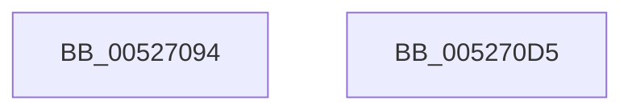

# SymCryptRsaCoreEncScratchSpace

- RVA: `0x00527094`–`0x005270D6` (길이 `66` bytes)
- VA: `0x0000000140527094`
- 실행 섹션: `.text`
- PDB 이름 있음: `예`; PDB Function 태그: `아니요`
- unwind 정보 RVA: `0x0005CF00`
- 디코드: `21`개 명령, `66/66` bytes 표시
- 미해석 바이트: `0` (있으면 어셈블리에 `.byte`로 보존)

> 이 문서는 커널 이미지의 기계어와 PDB 기호를 분석해 생성했습니다. 4번과 5번은 함수 원형과 자료형을 바이너리 사용 방식에서 추정한 C 해석이며 원본 소스 복구 결과는 아닙니다.

## 1. Dependencies

- 직접 호출 지점: **1**; 고유 호출 대상: **1**
- 직접 호출자로 확인된 함수: **1**
- RIP 상대 이미지 참조: **0**

### Outgoing calls
- `0x005270A1` → [SymCryptSizeofModElementFromModulus](SymCryptSizeofModElementFromModulus_function_00525D3C.md) (function, `0x00525D3C`)

### Direct callers
- [SymCryptRsaPkcs1Verify](SymCryptRsaPkcs1Verify_function_005272FC.md) at `0x0052735A`
- [SymCryptRsaPkcs1Verify](SymCryptRsaPkcs1Verify_function_005272FC.md) at `0x00527369`

### Static image references
- 디코드된 RIP-relative 메모리 참조가 없습니다.

## 2. Other-region calls and transfers

- 다른 실행 섹션으로 향하는 call: **0**
- 별도 외부 분기/꼬리 이동을 확인하지 못했습니다.

## 3. Assembly (complete function range)

```asm
00527094  40 53                           push rbx
00527096  48 83 EC 20                     sub rsp, 0x20
0052709A  8B 59 14                        mov ebx, dword ptr [rcx + 0x14]
0052709D  48 8B 49 78                     mov rcx, qword ptr [rcx + 0x78]
005270A1  E8 96 EC FF FF                  call 0x140525d3c
005270A6  69 D3 80 11 00 00               imul edx, ebx, 0x1180
005270AC  8B CB                           mov ecx, ebx
005270AE  C1 E1 08                        shl ecx, 8
005270B1  83 C1 40                        add ecx, 0x40
005270B4  83 C2 40                        add edx, 0x40
005270B7  3B D1                           cmp edx, ecx
005270B9  1B C9                           sbb ecx, ecx
005270BB  83 C0 40                        add eax, 0x40
005270BE  81 E1 80 EF FF FF               and ecx, 0xffffef80
005270C4  81 C1 80 11 00 00               add ecx, 0x1180
005270CA  0F AF CB                        imul ecx, ebx
005270CD  03 C1                           add eax, ecx
005270CF  48 83 C4 20                     add rsp, 0x20
005270D3  5B                              pop rbx
005270D4  C3                              ret
005270D5  CC                              int3
```

## 4. C-style interpretation (structured pseudocode)

```c
__int64 __fastcall SymCryptRsaCoreEncScratchSpace(__int64 a1)
{
    __int64 result;
    __int64 v_rsp;

    v_rsp = (v_rsp) - (32);
    result = SymCryptSizeofModElementFromModulus(*(unsigned __int64 *)(a1 + 120), a2, a3, a4);
    a2 = (unsigned int)((a2) * ((unsigned int)((unsigned int)(*(unsigned int *)(a1 + 20)))));
    a1 = (unsigned int)(((unsigned int)((unsigned int)((unsigned int)(*(unsigned int *)(a1 + 20))))) << (8));
    a1 = (unsigned int)((a1) + (64));
    a2 = (unsigned int)((a2) + (64));
    result = (unsigned int)((result) + (64));
    a1 = (unsigned int)((a1) & (0xFFFFEF80ULL));
    a1 = (unsigned int)((a1) + (0x1180ULL));
    a1 = (unsigned int)((a1) * ((unsigned int)((unsigned int)(*(unsigned int *)(a1 + 20)))));
    result = (unsigned int)((result) + ((unsigned int)(a1)));
    v_rsp = (v_rsp) + (32);
    return result;
}
```

## 5. (Beta) C Style

```c
int64_t SymCryptRsaCoreEncScratchSpace(void *Arg1)
{
    uint8_t *arg1 = (uint8_t *)Arg1;

    int64_t result;
    int64_t local_rsp;

    local_rsp = (local_rsp) - (32);
    result = SymCryptSizeofModElementFromModulus(*(uint64_t *)(arg1 + 0x78), a2, a3, a4);
    a2 = (uint32_t)((a2) * ((uint32_t)((uint32_t)(*(uint32_t *)(arg1 + 0x14)))));
    Arg1 = (uint32_t)(((uint32_t)((uint32_t)((uint32_t)(*(uint32_t *)(arg1 + 0x14))))) << (8));
    Arg1 = (uint32_t)((Arg1) + (64));
    a2 = (uint32_t)((a2) + (64));
    result = (uint32_t)((result) + (64));
    Arg1 = (uint32_t)((Arg1) & (0xFFFFEF80ULL));
    Arg1 = (uint32_t)((Arg1) + (0x1180ULL));
    Arg1 = (uint32_t)((Arg1) * ((uint32_t)((uint32_t)(*(uint32_t *)(arg1 + 0x14)))));
    result = (uint32_t)((result) + ((uint32_t)(Arg1)));
    local_rsp = (local_rsp) + (32);
    return result;
}
```

### 관측된 메모리 오프셋

구조체 형식이 확인되지 않은 접근은 인자 기준의 오프셋으로만 기록했습니다.

| 기준 인자 | 오프셋 표현 | 폭 (bit) | 접근 |
|---|---:|---:|---|
| `Arg1` | `+ 0x14` | `32` | `R` |
| `Arg1` | `+ 0x78` | `64` | `R` |

## 6. Execution-region graph

[열기: 2D/3D 그래프와 함수 탐색 컨트롤 패널](../../../control-panel.html?section=text&rva=0x00527094&view=graph)

- 2D 그래프는 위에서 아래로 흐르고, 3D 그래프는 빈 공간을 드래그해 회전합니다. Shift+드래그는 이동, 휠은 확대·축소, 함수 노드 선택은 대상 보고서 이동입니다.

### Static fallback


