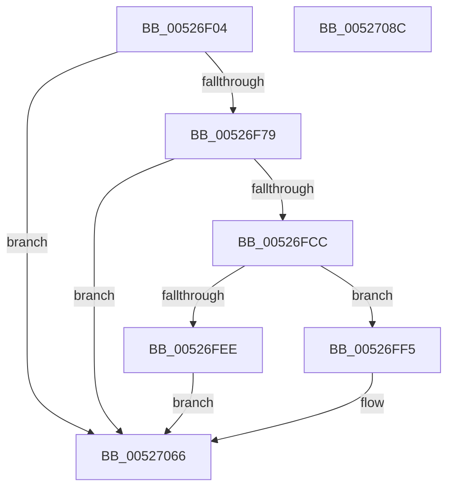

# SymCryptRsaCoreEnc

- RVA: `0x00526F04`–`0x0052708D` (길이 `393` bytes)
- VA: `0x0000000140526F04`
- 실행 섹션: `.text`
- PDB 이름 있음: `예`; PDB Function 태그: `아니요`
- unwind 정보 RVA: `0x000C32F0`
- 디코드: `102`개 명령, `393/393` bytes 표시
- 미해석 바이트: `0` (있으면 어셈블리에 `.byte`로 보존)

> 이 문서는 커널 이미지의 기계어와 PDB 기호를 분석해 생성했습니다. 4번과 5번은 함수 원형과 자료형을 바이너리 사용 방식에서 추정한 C 해석이며 원본 소스 복구 결과는 아닙니다.

## 1. Dependencies

- 직접 호출 지점: **11**; 고유 호출 대상: **11**
- 직접 호출자로 확인된 함수: **1**
- RIP 상대 이미지 참조: **1**

### Outgoing calls
- `0x00526F6A` → [SymCryptRsaCoreVerifyInput](SymCryptRsaCoreVerifyInput_function_005270DC.md) (function, `0x005270DC`)
- `0x00526F7D` → [SymCryptSizeofModElementFromModulus](SymCryptSizeofModElementFromModulus_function_00525D3C.md) (function, `0x00525D3C`)
- `0x00526F8D` → [SymCryptModElementCreate](SymCryptModElementCreate_function_00525900.md) (function, `0x00525900`)
- `0x00526FBD` → [SymCryptModElementSetValue](SymCryptModElementSetValue_function_00525994.md) (function, `0x00525994`)
- `0x00526FE1` → [SymCryptIntCreate](SymCryptIntCreate_function_0052556C.md) (function, `0x0052556C`)
- `0x00526FFC` → [SymCryptIntSetValueUint64](SymCryptIntSetValueUint64_function_00525760.md) (function, `0x00525760`)
- `0x00527004` → [SymCryptIntBitsizeOfValue](SymCryptIntBitsizeOfValue_function_005254F4.md) (function, `0x005254F4`)
- `0x0052702F` → [SymCryptModExp](SymCryptModExp_function_00525B28.md) (function, `0x00525B28`)
- `0x00527057` → [SymCryptModElementGetValue](SymCryptModElementGetValue_function_00525918.md) (function, `0x00525918`)
- `0x00527061` → [SymCryptIntWipe](SymCryptIntWipe_function_00525850.md) (function, `0x00525850`)
- `0x00527073` → [_security_check_cookie](../6A/_security_check_cookie_function_006AC640.md) (function, `0x006AC640`)

### Direct callers
- [SymCryptRsaPkcs1Verify](SymCryptRsaPkcs1Verify_function_005272FC.md) at `0x005273D2`

### Static image references
- `0x00526F18` → RVA `0x00E0A740` (`.data`; read)

## 2. Other-region calls and transfers

- 다른 실행 섹션으로 향하는 call: **0**
- 별도 외부 분기/꼬리 이동을 확인하지 못했습니다.

## 3. Assembly (complete function range)

```asm
00526F04  40 53                           push rbx
00526F06  55                              push rbp
00526F07  56                              push rsi
00526F08  57                              push rdi
00526F09  41 54                           push r12
00526F0B  41 55                           push r13
00526F0D  41 56                           push r14
00526F0F  41 57                           push r15
00526F11  48 81 EC 08 01 00 00            sub rsp, 0x108
00526F18  48 8B 05 21 38 8E 00            mov rax, qword ptr [rip + 0x8e3821]
00526F1F  48 33 C4                        xor rax, rsp
00526F22  48 89 84 24 F0 00 00 00         mov qword ptr [rsp + 0xf0], rax
00526F2A  48 8B 84 24 78 01 00 00         mov rax, qword ptr [rsp + 0x178]
00526F32  45 8B F1                        mov r14d, r9d
00526F35  48 8B AC 24 90 01 00 00         mov rbp, qword ptr [rsp + 0x190]
00526F3D  4D 8B E8                        mov r13, r8
00526F40  48 8B BC 24 88 01 00 00         mov rdi, qword ptr [rsp + 0x188]
00526F48  4C 8B E2                        mov r12, rdx
00526F4B  48 89 44 24 48                  mov qword ptr [rsp + 0x48], rax
00526F50  48 8B F1                        mov rsi, rcx
00526F53  48 8B 84 24 80 01 00 00         mov rax, qword ptr [rsp + 0x180]
00526F5B  48 89 6C 24 30                  mov qword ptr [rsp + 0x30], rbp
00526F60  48 89 7C 24 28                  mov qword ptr [rsp + 0x28], rdi
00526F65  48 89 44 24 20                  mov qword ptr [rsp + 0x20], rax
00526F6A  E8 6D 01 00 00                  call 0x1405270dc
00526F6F  8B D8                           mov ebx, eax
00526F71  85 C0                           test eax, eax
00526F73  0F 85 ED 00 00 00               jne 0x140527066
00526F79  48 8B 4E 78                     mov rcx, qword ptr [rsi + 0x78]
00526F7D  E8 BA ED FF FF                  call 0x140525d3c
00526F82  4C 8B 46 78                     mov r8, qword ptr [rsi + 0x78]
00526F86  48 8B CF                        mov rcx, rdi
00526F89  8B D0                           mov edx, eax
00526F8B  8B D8                           mov ebx, eax
00526F8D  E8 6E E9 FF FF                  call 0x140525900
00526F92  4C 8B 4E 78                     mov r9, qword ptr [rsi + 0x78]
00526F96  4C 8B F8                        mov r15, rax
00526F99  48 8D 04 3B                     lea rax, [rbx + rdi]
00526F9D  48 2B EB                        sub rbp, rbx
00526FA0  48 89 6C 24 30                  mov qword ptr [rsp + 0x30], rbp
00526FA5  45 8B C6                        mov r8d, r14d
00526FA8  48 89 44 24 28                  mov qword ptr [rsp + 0x28], rax
00526FAD  49 8B D5                        mov rdx, r13
00526FB0  49 8B CC                        mov rcx, r12
00526FB3  4C 89 7C 24 20                  mov qword ptr [rsp + 0x20], r15
00526FB8  48 89 44 24 40                  mov qword ptr [rsp + 0x40], rax
00526FBD  E8 D2 E9 FF FF                  call 0x140525994
00526FC2  8B D8                           mov ebx, eax
00526FC4  85 C0                           test eax, eax
00526FC6  0F 85 9A 00 00 00               jne 0x140527066
00526FCC  44 8D 60 01                     lea r12d, [rax + 1]
00526FD0  48 8D 4C 24 6F                  lea rcx, [rsp + 0x6f]
00526FD5  45 8B C4                        mov r8d, r12d
00526FD8  48 83 E1 E0                     and rcx, 0xffffffffffffffe0
00526FDC  41 8D 54 24 7F                  lea edx, [r12 + 0x7f]
00526FE1  E8 86 E5 FF FF                  call 0x14052556c
00526FE6  48 8B F8                        mov rdi, rax
00526FE9  48 85 C0                        test rax, rax
00526FEC  75 07                           jne 0x140526ff5
00526FEE  BB 0A 80 00 00                  mov ebx, 0x800a
00526FF3  EB 71                           jmp 0x140527066
00526FF5  48 8B 4E 38                     mov rcx, qword ptr [rsi + 0x38]
00526FF9  48 8B D7                        mov rdx, rdi
00526FFC  E8 5F E7 FF FF                  call 0x140525760
00527001  48 8B CF                        mov rcx, rdi
00527004  E8 EB E4 FF FF                  call 0x1405254f4
00527009  48 8B 5C 24 40                  mov rbx, qword ptr [rsp + 0x40]
0052700E  44 8B C8                        mov r9d, eax
00527011  48 8B 4E 78                     mov rcx, qword ptr [rsi + 0x78]
00527015  4C 8B C7                        mov r8, rdi
00527018  48 89 6C 24 38                  mov qword ptr [rsp + 0x38], rbp
0052701D  49 8B D7                        mov rdx, r15
00527020  48 89 5C 24 30                  mov qword ptr [rsp + 0x30], rbx
00527025  4C 89 7C 24 28                  mov qword ptr [rsp + 0x28], r15
0052702A  44 89 64 24 20                  mov dword ptr [rsp + 0x20], r12d
0052702F  E8 F4 EA FF FF                  call 0x140525b28
00527034  4C 8B 8C 24 80 01 00 00         mov r9, qword ptr [rsp + 0x180]
0052703C  49 8B D7                        mov rdx, r15
0052703F  4C 8B 44 24 48                  mov r8, qword ptr [rsp + 0x48]
00527044  48 8B 4E 78                     mov rcx, qword ptr [rsi + 0x78]
00527048  48 89 6C 24 30                  mov qword ptr [rsp + 0x30], rbp
0052704D  48 89 5C 24 28                  mov qword ptr [rsp + 0x28], rbx
00527052  44 89 74 24 20                  mov dword ptr [rsp + 0x20], r14d
00527057  E8 BC E8 FF FF                  call 0x140525918
0052705C  8B D8                           mov ebx, eax
0052705E  48 8B CF                        mov rcx, rdi
00527061  E8 EA E7 FF FF                  call 0x140525850
00527066  8B C3                           mov eax, ebx
00527068  48 8B 8C 24 F0 00 00 00         mov rcx, qword ptr [rsp + 0xf0]
00527070  48 33 CC                        xor rcx, rsp
00527073  E8 C8 55 18 00                  call 0x1406ac640
00527078  48 81 C4 08 01 00 00            add rsp, 0x108
0052707F  41 5F                           pop r15
00527081  41 5E                           pop r14
00527083  41 5D                           pop r13
00527085  41 5C                           pop r12
00527087  5F                              pop rdi
00527088  5E                              pop rsi
00527089  5D                              pop rbp
0052708A  5B                              pop rbx
0052708B  C3                              ret
0052708C  CC                              int3
```

## 4. C-style interpretation (structured pseudocode)

```c
__int64 __fastcall SymCryptRsaCoreEnc(__int64 a1, __int64 a2, __int64 a3, int a4, __int64 a5, __int64 a6, __int64 a7, __int64 a8, __int64 a9)
{
    __int64 result;
    __int64 v_rbp;
    __int64 v_rsp;
    unsigned __int64 v_stack_m100;
    unsigned __int64 v_stack_m108;
    unsigned __int64 v_stack_m110;
    unsigned __int64 v_stack_m118;
    unsigned __int64 v_stack_m120;
    unsigned __int64 v_stack_m128;
    unsigned __int64 v_stack_m58;
    unsigned __int64 v_stack_mD9;

    v_rsp = (v_rsp) - (264);
    result = (*(unsigned __int64 *)(v_rip + 9320481)) ^ (v_rsp);
    v_stack_m58 = result;
    v_stack_m100 = a6;
    v_stack_m118 = a9;
    v_stack_m120 = a8;
    v_stack_m128 = a7;
    result = SymCryptRsaCoreVerifyInput(a1, a2, a3, a4);
    if ((unsigned int)(result) != 0) goto loc_00527066;
    result = SymCryptSizeofModElementFromModulus(*(unsigned __int64 *)(a1 + 120), a2, a3, a4);
    result = SymCryptModElementCreate(a8, (unsigned int)((unsigned int)(result)), *(unsigned __int64 *)(a1 + 120), a4);
    v_rbp = (a9) - ((unsigned int)((unsigned int)(result)));
    v_stack_m118 = v_rbp;
    v_stack_m120 = (unsigned int)((unsigned int)(result)) + a8 * 1;
    v_stack_m128 = result;
    v_stack_m108 = (unsigned int)((unsigned int)(result)) + a8 * 1;
    result = SymCryptModElementSetValue(a2, a3, (unsigned int)((unsigned int)((unsigned int)(a4))), *(unsigned __int64 *)(a1 + 120));
    if ((unsigned int)(result) != 0) goto loc_00527066;
    a1 = (v_stack_mD9) & (-32);
    result = SymCryptIntCreate(a1, result + 1 + 127, (unsigned int)((unsigned int)(result + 1)), *(unsigned __int64 *)(a1 + 120));
    if (result != 0) goto loc_00526FF5;
    goto loc_00527066;
loc_00526FF5:
    result = SymCryptIntSetValueUint64(*(unsigned __int64 *)(a1 + 56), result, (unsigned int)((unsigned int)(result + 1)), *(unsigned __int64 *)(a1 + 120));
    result = SymCryptIntBitsizeOfValue(result, result, (unsigned int)((unsigned int)(result + 1)), *(unsigned __int64 *)(a1 + 120));
    v_stack_m110 = v_rbp;
    v_stack_m118 = v_stack_m108;
    v_stack_m120 = result;
    v_stack_m128 = (unsigned int)(result + 1);
    result = SymCryptModExp(*(unsigned __int64 *)(a1 + 120), result, result, (unsigned int)((unsigned int)(result)));
    v_stack_m118 = v_rbp;
    v_stack_m120 = v_stack_m108;
    v_stack_m128 = (unsigned int)((unsigned int)(a4));
    result = SymCryptModElementGetValue(*(unsigned __int64 *)(a1 + 120), result, v_stack_m100, a7);
    result = SymCryptIntWipe(result, result, v_stack_m100, a7);
loc_00527066:
    a1 = (v_stack_m58) ^ (v_rsp);
    result = _security_check_cookie(a1, result, v_stack_m100, a7);
    v_rsp = (v_rsp) + (264);
    return result;
}
```

## 5. (Beta) C Style

```c
int64_t SymCryptRsaCoreEnc(void *Arg1, int64_t Arg2, int64_t Arg3, int32_t Arg4, uint64_t Arg5, int64_t Arg6, int64_t Arg7, int64_t Arg8, int64_t Arg9)
{
    uint8_t *arg1 = (uint8_t *)Arg1;

    int64_t result;
    int64_t local_rbp;
    int64_t local_rsp;
    uint64_t v_stack_m100;
    uint64_t v_stack_m108;
    uint64_t v_stack_m110;
    uint64_t v_stack_m118;
    uint64_t v_stack_m120;
    uint64_t v_stack_m128;
    uint64_t v_stack_m58;
    uint64_t v_stack_mD9;

    local_rsp = (local_rsp) - (264);
    result = (*(uint64_t *)(v_rip + 0x8E3821)) ^ (local_rsp);
    v_stack_m58 = result;
    v_stack_m100 = Arg6;
    v_stack_m118 = Arg9;
    v_stack_m120 = Arg8;
    v_stack_m128 = Arg7;
    result = SymCryptRsaCoreVerifyInput(Arg1, Arg2, Arg3, Arg4);
    if ((uint32_t)(result) != 0) goto loc_00527066;
    result = SymCryptSizeofModElementFromModulus(*(uint64_t *)(arg1 + 0x78), Arg2, Arg3, Arg4);
    result = SymCryptModElementCreate(Arg8, (uint32_t)((uint32_t)(result)), *(uint64_t *)(arg1 + 0x78), Arg4);
    local_rbp = (Arg9) - ((uint32_t)((uint32_t)(result)));
    v_stack_m118 = local_rbp;
    v_stack_m120 = (uint32_t)((uint32_t)(result)) + Arg8 * 1;
    v_stack_m128 = result;
    v_stack_m108 = (uint32_t)((uint32_t)(result)) + Arg8 * 1;
    result = SymCryptModElementSetValue(Arg2, Arg3, (uint32_t)((uint32_t)((uint32_t)(Arg4))), *(uint64_t *)(arg1 + 0x78));
    if ((uint32_t)(result) != 0) goto loc_00527066;
    Arg1 = (v_stack_mD9) & (-32);
    result = SymCryptIntCreate(Arg1, result + 1 + 127, (uint32_t)((uint32_t)(result + 1)), *(uint64_t *)(arg1 + 0x78));
    if (result != 0) goto loc_00526FF5;
    goto loc_00527066;
loc_00526FF5:
    result = SymCryptIntSetValueUint64(*(uint64_t *)(arg1 + 0x38), result, (uint32_t)((uint32_t)(result + 1)), *(uint64_t *)(arg1 + 0x78));
    result = SymCryptIntBitsizeOfValue(result, result, (uint32_t)((uint32_t)(result + 1)), *(uint64_t *)(arg1 + 0x78));
    v_stack_m110 = local_rbp;
    v_stack_m118 = v_stack_m108;
    v_stack_m120 = result;
    v_stack_m128 = (uint32_t)(result + 1);
    result = SymCryptModExp(*(uint64_t *)(arg1 + 0x78), result, result, (uint32_t)((uint32_t)(result)));
    v_stack_m118 = local_rbp;
    v_stack_m120 = v_stack_m108;
    v_stack_m128 = (uint32_t)((uint32_t)(Arg4));
    result = SymCryptModElementGetValue(*(uint64_t *)(arg1 + 0x78), result, v_stack_m100, Arg7);
    result = SymCryptIntWipe(result, result, v_stack_m100, Arg7);
loc_00527066:
    Arg1 = (v_stack_m58) ^ (local_rsp);
    result = _security_check_cookie(Arg1, result, v_stack_m100, Arg7);
    local_rsp = (local_rsp) + (264);
    return result;
}
```

### 관측된 메모리 오프셋

구조체 형식이 확인되지 않은 접근은 인자 기준의 오프셋으로만 기록했습니다.

| 기준 인자 | 오프셋 표현 | 폭 (bit) | 접근 |
|---|---:|---:|---|
| `Arg1` | `+ 0x38` | `64` | `R` |
| `Arg1` | `+ 0x78` | `64` | `R` |

## 6. Execution-region graph

[열기: 2D/3D 그래프와 함수 탐색 컨트롤 패널](../../../control-panel.html?section=text&rva=0x00526F04&view=graph)

- 2D 그래프는 위에서 아래로 흐르고, 3D 그래프는 빈 공간을 드래그해 회전합니다. Shift+드래그는 이동, 휠은 확대·축소, 함수 노드 선택은 대상 보고서 이동입니다.

### Static fallback


