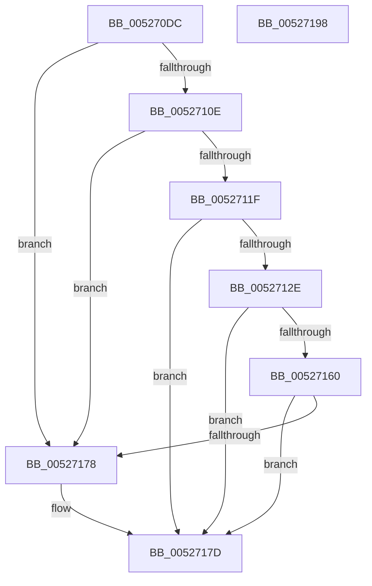

# SymCryptRsaCoreVerifyInput

- RVA: `0x005270DC`–`0x00527199` (길이 `189` bytes)
- VA: `0x00000001405270DC`
- 실행 섹션: `.text`
- PDB 이름 있음: `예`; PDB Function 태그: `아니요`
- unwind 정보 RVA: `0x00060300`
- 디코드: `59`개 명령, `189/189` bytes 표시
- 미해석 바이트: `0` (있으면 어셈블리에 `.byte`로 보존)

> 이 문서는 커널 이미지의 기계어와 PDB 기호를 분석해 생성했습니다. 4번과 5번은 함수 원형과 자료형을 바이너리 사용 방식에서 추정한 C 해석이며 원본 소스 복구 결과는 아닙니다.

## 1. Dependencies

- 직접 호출 지점: **8**; 고유 호출 대상: **6**
- 직접 호출자로 확인된 함수: **2**
- RIP 상대 이미지 참조: **0**

### Outgoing calls
- `0x00527102` → [SymCryptRsakeySizeofModulus](SymCryptRsakeySizeofModulus_function_00523FB8.md) (function, `0x00523FB8`)
- `0x00527111` → [SymCryptRsakeySizeofModulus](SymCryptRsakeySizeofModulus_function_00523FB8.md) (function, `0x00523FB8`)
- `0x00527122` → [SymCryptRsakeySizeofModulus](SymCryptRsakeySizeofModulus_function_00523FB8.md) (function, `0x00523FB8`)
- `0x00527131` → [SymCryptSizeofIntFromDigits](SymCryptSizeofIntFromDigits_function_00525D24.md) (function, `0x00525D24`)
- `0x00527141` → [SymCryptIntCreate](SymCryptIntCreate_function_0052556C.md) (function, `0x0052556C`)
- `0x00527155` → [SymCryptIntSetValue](SymCryptIntSetValue_function_00525730.md) (function, `0x00525730`)
- `0x00527164` → [SymCryptIntFromModulus](SymCryptIntFromModulus_function_00525608.md) (function, `0x00525608`)
- `0x0052716F` → [SymCryptIntIsLessThan](SymCryptIntIsLessThan_function_005256C8.md) (function, `0x005256C8`)

### Direct callers
- [SymCryptRsaCoreDecCrt](SymCryptRsaCoreDecCrt_function_005269C4.md) at `0x00526A50`
- [SymCryptRsaCoreEnc](SymCryptRsaCoreEnc_function_00526F04.md) at `0x00526F6A`

### Static image references
- 디코드된 RIP-relative 메모리 참조가 없습니다.

## 2. Other-region calls and transfers

- 다른 실행 섹션으로 향하는 call: **0**
- 별도 외부 분기/꼬리 이동을 확인하지 못했습니다.

## 3. Assembly (complete function range)

```asm
005270DC  48 89 5C 24 08                  mov qword ptr [rsp + 8], rbx
005270E1  48 89 6C 24 10                  mov qword ptr [rsp + 0x10], rbp
005270E6  48 89 74 24 18                  mov qword ptr [rsp + 0x18], rsi
005270EB  57                              push rdi
005270EC  41 56                           push r14
005270EE  41 57                           push r15
005270F0  48 83 EC 20                     sub rsp, 0x20
005270F4  45 8B F1                        mov r14d, r9d
005270F7  49 8B F0                        mov rsi, r8
005270FA  4C 8B FA                        mov r15, rdx
005270FD  48 8B F9                        mov rdi, rcx
00527100  33 DB                           xor ebx, ebx
00527102  E8 B1 CE FF FF                  call 0x140523fb8
00527107  8B C0                           mov eax, eax
00527109  48 3B F0                        cmp rsi, rax
0052710C  77 6A                           ja 0x140527178
0052710E  48 8B CF                        mov rcx, rdi
00527111  E8 A2 CE FF FF                  call 0x140523fb8
00527116  8B C0                           mov eax, eax
00527118  48 39 44 24 60                  cmp qword ptr [rsp + 0x60], rax
0052711D  72 59                           jb 0x140527178
0052711F  48 8B CF                        mov rcx, rdi
00527122  E8 91 CE FF FF                  call 0x140523fb8
00527127  8B C0                           mov eax, eax
00527129  48 3B F0                        cmp rsi, rax
0052712C  75 4F                           jne 0x14052717d
0052712E  8B 4F 14                        mov ecx, dword ptr [rdi + 0x14]
00527131  E8 EE EB FF FF                  call 0x140525d24
00527136  44 8B 47 14                     mov r8d, dword ptr [rdi + 0x14]
0052713A  48 8B 4C 24 68                  mov rcx, qword ptr [rsp + 0x68]
0052713F  8B D0                           mov edx, eax
00527141  E8 26 E4 FF FF                  call 0x14052556c
00527146  4C 8B C8                        mov r9, rax
00527149  45 8B C6                        mov r8d, r14d
0052714C  48 8B D6                        mov rdx, rsi
0052714F  49 8B CF                        mov rcx, r15
00527152  48 8B E8                        mov rbp, rax
00527155  E8 D6 E5 FF FF                  call 0x140525730
0052715A  8B D8                           mov ebx, eax
0052715C  85 C0                           test eax, eax
0052715E  75 1D                           jne 0x14052717d
00527160  48 8B 4F 78                     mov rcx, qword ptr [rdi + 0x78]
00527164  E8 9F E4 FF FF                  call 0x140525608
00527169  48 8B D0                        mov rdx, rax
0052716C  48 8B CD                        mov rcx, rbp
0052716F  E8 54 E5 FF FF                  call 0x1405256c8
00527174  85 C0                           test eax, eax
00527176  75 05                           jne 0x14052717d
00527178  BB 0E 80 00 00                  mov ebx, 0x800e
0052717D  48 8B 6C 24 48                  mov rbp, qword ptr [rsp + 0x48]
00527182  8B C3                           mov eax, ebx
00527184  48 8B 5C 24 40                  mov rbx, qword ptr [rsp + 0x40]
00527189  48 8B 74 24 50                  mov rsi, qword ptr [rsp + 0x50]
0052718E  48 83 C4 20                     add rsp, 0x20
00527192  41 5F                           pop r15
00527194  41 5E                           pop r14
00527196  5F                              pop rdi
00527197  C3                              ret
00527198  CC                              int3
```

## 4. C-style interpretation (structured pseudocode)

```c
__int64 __fastcall SymCryptRsaCoreVerifyInput(__int64 a1, __int64 a2, __int64 a3, int a4, __int64 a5, __int64 a6)
{
    __int64 result;
    __int64 v_rbx;
    __int64 v_rsp;
    unsigned __int64 v_stack_p10;
    unsigned __int64 v_stack_p18;
    unsigned __int64 v_stack_p8;

    v_stack_p8 = v_rbx;
    v_stack_p10 = v_rbp;
    v_stack_p18 = v_rsi;
    v_rsp = (v_rsp) - (32);
    v_rbx = 0;
    result = SymCryptRsakeySizeofModulus(a1, a2, a3, a4);
    if (a3 > ((unsigned int)((unsigned int)(result)))) goto loc_00527178;
    result = SymCryptRsakeySizeofModulus(a1, a2, a3, a4);
    if (a5 < ((unsigned int)((unsigned int)(result)))) goto loc_00527178;
    result = SymCryptRsakeySizeofModulus(a1, a2, a3, a4);
    if (a3 != ((unsigned int)((unsigned int)(result)))) goto loc_0052717D;
    result = SymCryptSizeofIntFromDigits((unsigned int)(*(unsigned int *)(a1 + 20)), a2, a3, a4);
    result = SymCryptIntCreate(a6, (unsigned int)((unsigned int)(result)), (unsigned int)(*(unsigned int *)(a1 + 20)), a4);
    result = SymCryptIntSetValue(a2, a3, (unsigned int)((unsigned int)((unsigned int)(a4))), result);
    if ((unsigned int)(result) != 0) goto loc_0052717D;
    result = SymCryptIntFromModulus(*(unsigned __int64 *)(a1 + 120), a3, (unsigned int)((unsigned int)((unsigned int)(a4))), result);
    result = SymCryptIntIsLessThan(result, result, (unsigned int)((unsigned int)((unsigned int)(a4))), result);
    v_rbx = (unsigned int)((unsigned int)(result));
    if ((unsigned int)(result) == 0) {
        v_rbx = 0x800EULL;
    }
    v_rsp = (v_rsp) + (32);
    return (unsigned int)((unsigned int)(v_rbx));
}
```

## 5. (Beta) C Style

```c
int64_t SymCryptRsaCoreVerifyInput(void *Arg1, int64_t Arg2, int64_t Arg3, int32_t Arg4, int64_t Arg5, int64_t Arg6)
{
    uint8_t *arg1 = (uint8_t *)Arg1;

    int64_t result;
    int64_t local_rbx;
    int64_t local_rsp;
    uint64_t v_stack_p10;
    uint64_t v_stack_p18;
    uint64_t v_stack_p8;

    v_stack_p8 = local_rbx;
    v_stack_p10 = local_rbp;
    v_stack_p18 = local_rsi;
    local_rsp = (local_rsp) - (32);
    local_rbx = 0;
    result = SymCryptRsakeySizeofModulus(Arg1, Arg2, Arg3, Arg4);
    if (Arg3 > ((uint32_t)((uint32_t)(result)))) goto loc_00527178;
    result = SymCryptRsakeySizeofModulus(Arg1, Arg2, Arg3, Arg4);
    if (Arg5 < ((uint32_t)((uint32_t)(result)))) goto loc_00527178;
    result = SymCryptRsakeySizeofModulus(Arg1, Arg2, Arg3, Arg4);
    if (Arg3 != ((uint32_t)((uint32_t)(result)))) goto loc_0052717D;
    result = SymCryptSizeofIntFromDigits((uint32_t)(*(uint32_t *)(arg1 + 0x14)), Arg2, Arg3, Arg4);
    result = SymCryptIntCreate(Arg6, (uint32_t)((uint32_t)(result)), (uint32_t)(*(uint32_t *)(arg1 + 0x14)), Arg4);
    result = SymCryptIntSetValue(Arg2, Arg3, (uint32_t)((uint32_t)((uint32_t)(Arg4))), result);
    if ((uint32_t)(result) != 0) goto loc_0052717D;
    result = SymCryptIntFromModulus(*(uint64_t *)(arg1 + 0x78), Arg3, (uint32_t)((uint32_t)((uint32_t)(Arg4))), result);
    result = SymCryptIntIsLessThan(result, result, (uint32_t)((uint32_t)((uint32_t)(Arg4))), result);
    local_rbx = (uint32_t)((uint32_t)(result));
    if ((uint32_t)(result) == 0) {
        local_rbx = 0x800EULL;
    }
    local_rsp = (local_rsp) + (32);
    return (uint32_t)((uint32_t)(local_rbx));
}
```

### 관측된 메모리 오프셋

구조체 형식이 확인되지 않은 접근은 인자 기준의 오프셋으로만 기록했습니다.

| 기준 인자 | 오프셋 표현 | 폭 (bit) | 접근 |
|---|---:|---:|---|
| `Arg1` | `+ 0x14` | `32` | `R` |
| `Arg1` | `+ 0x78` | `64` | `R` |

## 6. Execution-region graph

[열기: 2D/3D 그래프와 함수 탐색 컨트롤 패널](../../../control-panel.html?section=text&rva=0x005270DC&view=graph)

- 2D 그래프는 위에서 아래로 흐르고, 3D 그래프는 빈 공간을 드래그해 회전합니다. Shift+드래그는 이동, 휠은 확대·축소, 함수 노드 선택은 대상 보고서 이동입니다.

### Static fallback


