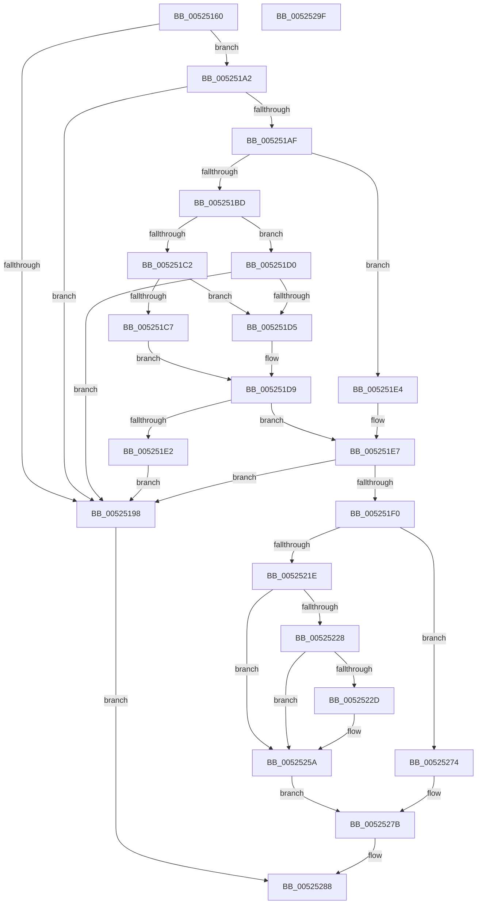

# SymCryptRsaPkcs1ApplySignaturePadding

- RVA: `0x00525160`–`0x005252A0` (길이 `320` bytes)
- VA: `0x0000000140525160`
- 실행 섹션: `.text`
- PDB 이름 있음: `예`; PDB Function 태그: `아니요`
- unwind 정보 RVA: `0x00075D80`
- 디코드: `94`개 명령, `320/320` bytes 표시
- 미해석 바이트: `0` (있으면 어셈블리에 `.byte`로 보존)

> 이 문서는 커널 이미지의 기계어와 PDB 기호를 분석해 생성했습니다. 4번과 5번은 함수 원형과 자료형을 바이너리 사용 방식에서 추정한 C 해석이며 원본 소스 복구 결과는 아닙니다.

## 1. Dependencies

- 직접 호출 지점: **3**; 고유 호출 대상: **2**
- 직접 호출자로 확인된 함수: **2**
- RIP 상대 이미지 참조: **0**

### Outgoing calls
- `0x00525214` → [memset](../6C/memset_function_006C6C40.md) (function, `0x006C6C40`)
- `0x00525255` → [memcpy](../6C/memcpy_function_006C6840.md) (function, `0x006C6840`)
- `0x00525283` → [memcpy](../6C/memcpy_function_006C6840.md) (function, `0x006C6840`)

### Direct callers
- [SymCryptRsaPkcs1CheckSignaturePadding](SymCryptRsaPkcs1CheckSignaturePadding_function_005252A8.md) at `0x00525308`
- [SymCryptRsaPkcs1Sign](SymCryptRsaPkcs1Sign_function_005271A0.md) at `0x0052726B`

### Static image references
- 디코드된 RIP-relative 메모리 참조가 없습니다.

## 2. Other-region calls and transfers

- 다른 실행 섹션으로 향하는 call: **0**
- 별도 외부 분기/꼬리 이동을 확인하지 못했습니다.

## 3. Assembly (complete function range)

```asm
00525160  48 89 5C 24 10                  mov qword ptr [rsp + 0x10], rbx
00525165  4C 89 44 24 18                  mov qword ptr [rsp + 0x18], r8
0052516A  48 89 4C 24 08                  mov qword ptr [rsp + 8], rcx
0052516F  55                              push rbp
00525170  56                              push rsi
00525171  57                              push rdi
00525172  41 54                           push r12
00525174  41 55                           push r13
00525176  41 56                           push r14
00525178  41 57                           push r15
0052517A  48 83 EC 20                     sub rsp, 0x20
0052517E  44 8B A4 24 80 00 00 00         mov r12d, dword ptr [rsp + 0x80]
00525186  4D 8B F9                        mov r15, r9
00525189  49 8B C0                        mov rax, r8
0052518C  48 8B EA                        mov rbp, rdx
0052518F  41 F7 C4 FE FF FF FF            test r12d, 0xfffffffe
00525196  74 0A                           je 0x1405251a2
00525198  BB 0E 80 00 00                  mov ebx, 0x800e
0052519D  E9 E6 00 00 00                  jmp 0x140525288
005251A2  48 8B BC 24 90 00 00 00         mov rdi, qword ptr [rsp + 0x90]
005251AA  48 3B EF                        cmp rbp, rdi
005251AD  73 E9                           jae 0x140525198
005251AF  33 DB                           xor ebx, ebx
005251B1  41 F6 D4                        not r12b
005251B4  44 8D 6B 01                     lea r13d, [rbx + 1]
005251B8  45 22 E5                        and r12b, r13b
005251BB  74 27                           je 0x1405251e4
005251BD  48 85 C0                        test rax, rax
005251C0  74 0E                           je 0x1405251d0
005251C2  4D 85 FF                        test r15, r15
005251C5  74 0E                           je 0x1405251d5
005251C7  4C 8D 72 06                     lea r14, [rdx + 6]
005251CB  4D 03 F7                        add r14, r15
005251CE  EB 09                           jmp 0x1405251d9
005251D0  4D 85 FF                        test r15, r15
005251D3  75 C3                           jne 0x140525198
005251D5  4C 8D 72 02                     lea r14, [rdx + 2]
005251D9  49 81 FE 80 00 00 00            cmp r14, 0x80
005251E0  76 05                           jbe 0x1405251e7
005251E2  EB B4                           jmp 0x140525198
005251E4  4C 8B F5                        mov r14, rbp
005251E7  49 8D 46 0B                     lea rax, [r14 + 0xb]
005251EB  48 3B C7                        cmp rax, rdi
005251EE  77 A8                           ja 0x140525198
005251F0  48 8B B4 24 88 00 00 00         mov rsi, qword ptr [rsp + 0x88]
005251F8  49 2B FE                        sub rdi, r14
005251FB  48 83 EF 03                     sub rdi, 3
005251FF  BA FF 00 00 00                  mov edx, 0xff
00525204  4C 8B C7                        mov r8, rdi
00525207  66 C7 06 00 01                  mov word ptr [rsi], 0x100
0052520C  48 8D 4E 02                     lea rcx, [rsi + 2]
00525210  88 5C 37 02                     mov byte ptr [rdi + rsi + 2], bl
00525214  E8 27 1A 1A 00                  call 0x1406c6c40
00525219  45 84 E4                        test r12b, r12b
0052521C  74 56                           je 0x140525274
0052521E  48 8B 54 24 70                  mov rdx, qword ptr [rsp + 0x70]
00525223  48 85 D2                        test rdx, rdx
00525226  74 32                           je 0x14052525a
00525228  4D 85 FF                        test r15, r15
0052522B  74 2D                           je 0x14052525a
0052522D  41 80 EE 02                     sub r14b, 2
00525231  C6 44 37 03 30                  mov byte ptr [rdi + rsi + 3], 0x30
00525236  48 8D 4E 07                     lea rcx, [rsi + 7]
0052523A  44 88 74 37 04                  mov byte ptr [rdi + rsi + 4], r14b
0052523F  48 03 CF                        add rcx, rdi
00525242  C6 44 37 05 30                  mov byte ptr [rdi + rsi + 5], 0x30
00525247  4D 8B C7                        mov r8, r15
0052524A  44 88 7C 37 06                  mov byte ptr [rdi + rsi + 6], r15b
0052524F  41 BD 05 00 00 00               mov r13d, 5
00525255  E8 E6 15 1A 00                  call 0x1406c6840
0052525A  4A 8D 04 2F                     lea rax, [rdi + r13]
0052525E  49 03 C7                        add rax, r15
00525261  48 8D 4E 04                     lea rcx, [rsi + 4]
00525265  48 03 C8                        add rcx, rax
00525268  C6 44 30 02 04                  mov byte ptr [rax + rsi + 2], 4
0052526D  40 88 6C 30 03                  mov byte ptr [rax + rsi + 3], bpl
00525272  EB 07                           jmp 0x14052527b
00525274  48 8D 4E 03                     lea rcx, [rsi + 3]
00525278  48 03 CF                        add rcx, rdi
0052527B  48 8B 54 24 60                  mov rdx, qword ptr [rsp + 0x60]
00525280  4C 8B C5                        mov r8, rbp
00525283  E8 B8 15 1A 00                  call 0x1406c6840
00525288  8B C3                           mov eax, ebx
0052528A  48 8B 5C 24 68                  mov rbx, qword ptr [rsp + 0x68]
0052528F  48 83 C4 20                     add rsp, 0x20
00525293  41 5F                           pop r15
00525295  41 5E                           pop r14
00525297  41 5D                           pop r13
00525299  41 5C                           pop r12
0052529B  5F                              pop rdi
0052529C  5E                              pop rsi
0052529D  5D                              pop rbp
0052529E  C3                              ret
0052529F  CC                              int3
```

## 4. C-style interpretation (structured pseudocode)

```c
__int64 __fastcall SymCryptRsaPkcs1ApplySignaturePadding(__int64 a1, __int64 a2, __int64 a3, __int64 a4, unsigned int a5, __int64 a6, __int64 a7)
{
    __int64 result;
    __int64 v_r12;
    __int64 v_r13;
    __int64 v_r14;
    __int64 v_rbx;
    __int64 v_rdi;
    __int64 v_rsp;
    unsigned __int64 v_stack_p10;
    unsigned __int64 v_stack_p18;
    unsigned __int64 v_stack_p8;

    v_stack_p10 = v_rbx;
    v_stack_p18 = a3;
    v_stack_p8 = a1;
    v_rsp = (v_rsp) - (32);
    if ((((unsigned int)((unsigned int)(a5))) & (0xFFFFFFFEULL)) == 0) goto loc_005251A2;
loc_00525198:
    goto loc_00525288;
loc_005251A2:
    if (a2 >= a7) goto loc_00525198;
    v_rbx = 0;
    v_r12 = (unsigned __int8)(~((unsigned int)(a5)));
    v_r12 = (unsigned __int8)((v_r12) & ((unsigned __int8)(v_rbx + 1)));
    if (condition_is_equal) goto loc_005251E4;
    if (a3 == 0) goto loc_005251D0;
    if (a4 == 0) goto loc_005251D5;
    v_r14 = (a2 + 6) + (a4);
    goto loc_005251D9;
loc_005251D0:
    if (a4 != 0) goto loc_00525198;
loc_005251D5:
loc_005251D9:
    if ((a2 + 2) <= 128) goto loc_005251E7;
    goto loc_00525198;
loc_005251E4:
loc_005251E7:
    if ((a2 + 11) > a7) goto loc_00525198;
    v_rdi = (a7) - (a2);
    v_rdi = (v_rdi) - (3);
    *(unsigned __int16 *)(a6) = 256;
    *(unsigned __int8 *)(v_rdi + a6 * 1 + 2) = 0;
    result = memset(a6 + 2, 255, v_rdi, a4);
    if ((unsigned __int8)(v_r12) == 0) goto loc_00525274;
    if (v_stack_p18 == 0) goto loc_0052525A;
    v_r13 = v_rbx + 1;
    v_r14 = a2;
    if (a4 != 0) {
        v_r14 = (unsigned __int8)((a2) - (2));
        *(unsigned __int8 *)(v_rdi + a6 * 1 + 3) = 48;
        a1 = a6 + 7;
        *(unsigned __int8 *)(v_rdi + a6 * 1 + 4) = (unsigned __int8)(v_r14);
        a1 = (a1) + (v_rdi);
        *(unsigned __int8 *)(v_rdi + a6 * 1 + 5) = 48;
        a3 = a4;
        *(unsigned __int8 *)(v_rdi + a6 * 1 + 6) = (unsigned __int8)(a4);
        v_r13 = 5;
        result = memcpy(a1, v_stack_p18, a3, a4);
    }
    result = (v_rdi + v_r13 * 1) + (a4);
    a1 = (a6 + 4) + (result);
    *(unsigned __int8 *)(result + a6 * 1 + 2) = 4;
    *(unsigned __int8 *)(result + a6 * 1 + 3) = (unsigned __int8)(a2);
    goto loc_0052527B;
loc_00525274:
    a1 = (a6 + 3) + (v_rdi);
loc_0052527B:
    result = memcpy(a1, v_stack_p8, a2, a4);
loc_00525288:
    v_rsp = (v_rsp) + (32);
    return 0;
}
```

## 5. (Beta) C Style

```c
int64_t SymCryptRsaPkcs1ApplySignaturePadding(int64_t Arg1, void *Arg2, int64_t Arg3, int64_t Arg4, uint32_t Arg5, void *Arg6, void *Arg7)
{
    uint8_t *arg2 = (uint8_t *)Arg2;
    uint8_t *arg6 = (uint8_t *)Arg6;
    uint8_t *arg7 = (uint8_t *)Arg7;

    int64_t result;
    int64_t local_r12;
    int64_t local_r13;
    int64_t local_r14;
    int64_t local_rbx;
    int64_t local_rdi;
    int64_t local_rsp;
    uint64_t v_stack_p10;
    uint64_t v_stack_p18;
    uint64_t v_stack_p8;

    v_stack_p10 = local_rbx;
    v_stack_p18 = Arg3;
    v_stack_p8 = Arg1;
    local_rsp = (local_rsp) - (32);
    if ((((uint32_t)((uint32_t)(Arg5))) & (0xFFFFFFFEULL)) == 0) goto loc_005251A2;
loc_00525198:
    goto loc_00525288;
loc_005251A2:
    if (Arg2 >= Arg7) goto loc_00525198;
    local_rbx = 0;
    local_r12 = (uint8_t)(~((uint32_t)(Arg5)));
    local_r12 = (uint8_t)((local_r12) & ((uint8_t)(local_rbx + 1)));
    if (condition_is_equal) goto loc_005251E4;
    if (Arg3 == 0) goto loc_005251D0;
    if (Arg4 == 0) goto loc_005251D5;
    local_r14 = (Arg2 + 6) + (Arg4);
    goto loc_005251D9;
loc_005251D0:
    if (Arg4 != 0) goto loc_00525198;
loc_005251D5:
loc_005251D9:
    if ((Arg2 + 2) <= 128) goto loc_005251E7;
    goto loc_00525198;
loc_005251E4:
loc_005251E7:
    if ((Arg2 + 11) > Arg7) goto loc_00525198;
    local_rdi = (Arg7) - (Arg2);
    local_rdi = (local_rdi) - (3);
    *(uint16_t *)(arg6) = 256;
    *(uint8_t *)(local_rdi + arg6 * 1 + 0x2) = 0;
    result = memset(Arg6 + 2, 255, local_rdi, Arg4);
    if ((uint8_t)(local_r12) == 0) goto loc_00525274;
    if (v_stack_p18 == 0) goto loc_0052525A;
    local_r13 = local_rbx + 1;
    local_r14 = Arg2;
    if (Arg4 != 0) {
        local_r14 = (uint8_t)((Arg2) - (2));
        *(uint8_t *)(local_rdi + arg6 * 1 + 0x3) = 48;
        Arg1 = Arg6 + 7;
        *(uint8_t *)(local_rdi + arg6 * 1 + 0x4) = (uint8_t)(local_r14);
        Arg1 = (Arg1) + (local_rdi);
        *(uint8_t *)(local_rdi + arg6 * 1 + 0x5) = 48;
        Arg3 = Arg4;
        *(uint8_t *)(local_rdi + arg6 * 1 + 0x6) = (uint8_t)(Arg4);
        local_r13 = 5;
        result = memcpy(Arg1, v_stack_p18, Arg3, Arg4);
    }
    result = (local_rdi + local_r13 * 1) + (Arg4);
    Arg1 = (Arg6 + 4) + (result);
    *(uint8_t *)(result + arg6 * 1 + 0x2) = 4;
    *(uint8_t *)(result + arg6 * 1 + 0x3) = (uint8_t)(Arg2);
    goto loc_0052527B;
loc_00525274:
    Arg1 = (Arg6 + 3) + (local_rdi);
loc_0052527B:
    result = memcpy(Arg1, v_stack_p8, Arg2, Arg4);
loc_00525288:
    local_rsp = (local_rsp) + (32);
    return 0;
}
```

### 관측된 메모리 오프셋

구조체 형식이 확인되지 않은 접근은 인자 기준의 오프셋으로만 기록했습니다.

| 기준 인자 | 오프셋 표현 | 폭 (bit) | 접근 |
|---|---:|---:|---|
| `Arg2` | `+ 0x2` | `64` | `R` |
| `Arg2` | `+ 0x6` | `64` | `R` |
| `Arg6` | `+ 0x0` | `16` | `W` |
| `Arg6` | `+ 0x2` | `64` | `R` |
| `Arg6` | `+ 0x3` | `64` | `R` |
| `Arg6` | `+ 0x4` | `64` | `R` |
| `Arg6` | `+ 0x7` | `64` | `R` |
| `Arg7` | `+ 0x0 + r13*1` | `64` | `R` |
| `Arg7` | `+ 0x2 + rsi*1` | `8` | `W` |
| `Arg7` | `+ 0x3 + rsi*1` | `8` | `W` |
| `Arg7` | `+ 0x4 + rsi*1` | `8` | `W` |
| `Arg7` | `+ 0x5 + rsi*1` | `8` | `W` |
| `Arg7` | `+ 0x6 + rsi*1` | `8` | `W` |

## 6. Execution-region graph

[열기: 2D/3D 그래프와 함수 탐색 컨트롤 패널](../../../control-panel.html?section=text&rva=0x00525160&view=graph)

- 2D 그래프는 위에서 아래로 흐르고, 3D 그래프는 빈 공간을 드래그해 회전합니다. Shift+드래그는 이동, 휠은 확대·축소, 함수 노드 선택은 대상 보고서 이동입니다.

### Static fallback


