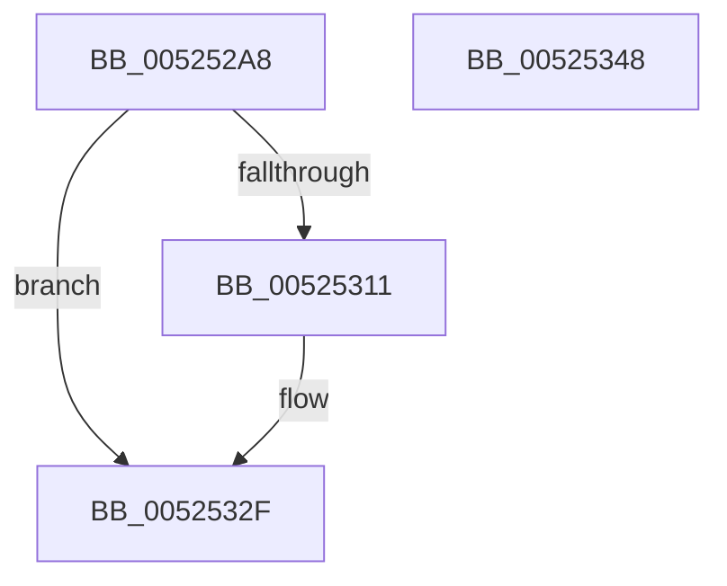

# SymCryptRsaPkcs1CheckSignaturePadding

- RVA: `0x005252A8`–`0x00525349` (길이 `161` bytes)
- VA: `0x00000001405252A8`
- 실행 섹션: `.text`
- PDB 이름 있음: `예`; PDB Function 태그: `아니요`
- unwind 정보 RVA: `0x00093E28`
- 디코드: `44`개 명령, `161/161` bytes 표시
- 미해석 바이트: `0` (있으면 어셈블리에 `.byte`로 보존)

> 이 문서는 커널 이미지의 기계어와 PDB 기호를 분석해 생성했습니다. 4번과 5번은 함수 원형과 자료형을 바이너리 사용 방식에서 추정한 C 해석이며 원본 소스 복구 결과는 아닙니다.

## 1. Dependencies

- 직접 호출 지점: **3**; 고유 호출 대상: **3**
- 직접 호출자로 확인된 함수: **1**
- RIP 상대 이미지 참조: **0**

### Outgoing calls
- `0x005252E2` → [SymCryptWipe](../51/SymCryptWipe_function_0051F914.md) (function, `0x0051F914`)
- `0x00525308` → [SymCryptRsaPkcs1ApplySignaturePadding](SymCryptRsaPkcs1ApplySignaturePadding_function_00525160.md) (function, `0x00525160`)
- `0x0052531F` → [SymCryptEqual](SymCryptEqual_function_0052D3B4.md) (function, `0x0052D3B4`)

### Direct callers
- [SymCryptRsaPkcs1VerifySignaturePadding](SymCryptRsaPkcs1VerifySignaturePadding_function_00525350.md) at `0x005253DD`
- [SymCryptRsaPkcs1VerifySignaturePadding](SymCryptRsaPkcs1VerifySignaturePadding_function_00525350.md) at `0x00525420`

### Static image references
- 디코드된 RIP-relative 메모리 참조가 없습니다.

## 2. Other-region calls and transfers

- 다른 실행 섹션으로 향하는 call: **0**
- 별도 외부 분기/꼬리 이동을 확인하지 못했습니다.

## 3. Assembly (complete function range)

```asm
005252A8  48 89 5C 24 08                  mov qword ptr [rsp + 8], rbx
005252AD  48 89 6C 24 10                  mov qword ptr [rsp + 0x10], rbp
005252B2  48 89 74 24 18                  mov qword ptr [rsp + 0x18], rsi
005252B7  57                              push rdi
005252B8  41 56                           push r14
005252BA  41 57                           push r15
005252BC  48 83 EC 40                     sub rsp, 0x40
005252C0  4C 8B B4 24 98 00 00 00         mov r14, qword ptr [rsp + 0x98]
005252C8  48 8B F2                        mov rsi, rdx
005252CB  4C 8B BC 24 90 00 00 00         mov r15, qword ptr [rsp + 0x90]
005252D3  48 8B E9                        mov rbp, rcx
005252D6  49 8B D6                        mov rdx, r14
005252D9  49 8B CF                        mov rcx, r15
005252DC  49 8B D9                        mov rbx, r9
005252DF  49 8B F8                        mov rdi, r8
005252E2  E8 2D A6 FF FF                  call 0x14051f914
005252E7  8B 84 24 88 00 00 00            mov eax, dword ptr [rsp + 0x88]
005252EE  4C 8B CB                        mov r9, rbx
005252F1  4C 89 74 24 30                  mov qword ptr [rsp + 0x30], r14
005252F6  4C 8B C7                        mov r8, rdi
005252F9  4C 89 7C 24 28                  mov qword ptr [rsp + 0x28], r15
005252FE  48 8B D6                        mov rdx, rsi
00525301  48 8B CD                        mov rcx, rbp
00525304  89 44 24 20                     mov dword ptr [rsp + 0x20], eax
00525308  E8 53 FE FF FF                  call 0x140525160
0052530D  85 C0                           test eax, eax
0052530F  75 1E                           jne 0x14052532f
00525311  48 8B 94 24 80 00 00 00         mov rdx, qword ptr [rsp + 0x80]
00525319  4D 8B C6                        mov r8, r14
0052531C  49 8B CF                        mov rcx, r15
0052531F  E8 90 80 00 00                  call 0x14052d3b4
00525324  F6 D8                           neg al
00525326  1B C0                           sbb eax, eax
00525328  F7 D0                           not eax
0052532A  25 10 80 00 00                  and eax, 0x8010
0052532F  48 8B 5C 24 60                  mov rbx, qword ptr [rsp + 0x60]
00525334  48 8B 6C 24 68                  mov rbp, qword ptr [rsp + 0x68]
00525339  48 8B 74 24 70                  mov rsi, qword ptr [rsp + 0x70]
0052533E  48 83 C4 40                     add rsp, 0x40
00525342  41 5F                           pop r15
00525344  41 5E                           pop r14
00525346  5F                              pop rdi
00525347  C3                              ret
00525348  CC                              int3
```

## 4. C-style interpretation (structured pseudocode)

```c
__int64 __fastcall SymCryptRsaPkcs1CheckSignaturePadding(__int64 a1, __int64 a2, __int64 a3, __int64 a4, __int64 a5, unsigned int a6, __int64 a7, __int64 a8)
{
    __int64 result;
    __int64 v_rsp;
    unsigned __int64 v_stack_m28;
    unsigned __int64 v_stack_m30;
    unsigned int v_stack_m38;
    unsigned __int64 v_stack_p10;
    unsigned __int64 v_stack_p18;
    unsigned __int64 v_stack_p8;

    v_stack_p8 = v_rbx;
    v_stack_p10 = v_rbp;
    v_stack_p18 = v_rsi;
    v_rsp = (v_rsp) - (64);
    result = SymCryptWipe(a7, a8, a3, a4);
    v_stack_m28 = a8;
    v_stack_m30 = a7;
    v_stack_m38 = (unsigned int)((unsigned int)(a6));
    result = SymCryptRsaPkcs1ApplySignaturePadding(a1, a2, a3, a4);
    if ((unsigned int)(result) == 0) {
        a2 = a5;
        a3 = a8;
        a1 = a7;
        result = SymCryptEqual(a1, a2, a3, a4);
        result = (unsigned __int8)(-(result));
        result = (unsigned int)(~(result));
        result = (unsigned int)((result) & (0x8010ULL));
    }
    v_rsp = (v_rsp) + (64);
    return result;
}
```

## 5. (Beta) C Style

```c
int64_t SymCryptRsaPkcs1CheckSignaturePadding(int64_t Arg1, int64_t Arg2, int64_t Arg3, int64_t Arg4, int64_t Arg5, uint32_t Arg6, int64_t Arg7, int64_t Arg8)
{
    int64_t result;
    int64_t local_rsp;
    uint64_t v_stack_m28;
    uint64_t v_stack_m30;
    uint32_t v_stack_m38;
    uint64_t v_stack_p10;
    uint64_t v_stack_p18;
    uint64_t v_stack_p8;

    v_stack_p8 = local_rbx;
    v_stack_p10 = local_rbp;
    v_stack_p18 = local_rsi;
    local_rsp = (local_rsp) - (64);
    result = SymCryptWipe(Arg7, Arg8, Arg3, Arg4);
    v_stack_m28 = Arg8;
    v_stack_m30 = Arg7;
    v_stack_m38 = (uint32_t)((uint32_t)(Arg6));
    result = SymCryptRsaPkcs1ApplySignaturePadding(Arg1, Arg2, Arg3, Arg4);
    if ((uint32_t)(result) == 0) {
        Arg2 = Arg5;
        Arg3 = Arg8;
        Arg1 = Arg7;
        result = SymCryptEqual(Arg1, Arg2, Arg3, Arg4);
        result = (uint8_t)(-(result));
        result = (uint32_t)(~(result));
        result = (uint32_t)((result) & (0x8010ULL));
    }
    local_rsp = (local_rsp) + (64);
    return result;
}
```

## 6. Execution-region graph

[열기: 2D/3D 그래프와 함수 탐색 컨트롤 패널](../../../control-panel.html?section=text&rva=0x005252A8&view=graph)

- 2D 그래프는 위에서 아래로 흐르고, 3D 그래프는 빈 공간을 드래그해 회전합니다. Shift+드래그는 이동, 휠은 확대·축소, 함수 노드 선택은 대상 보고서 이동입니다.

### Static fallback


