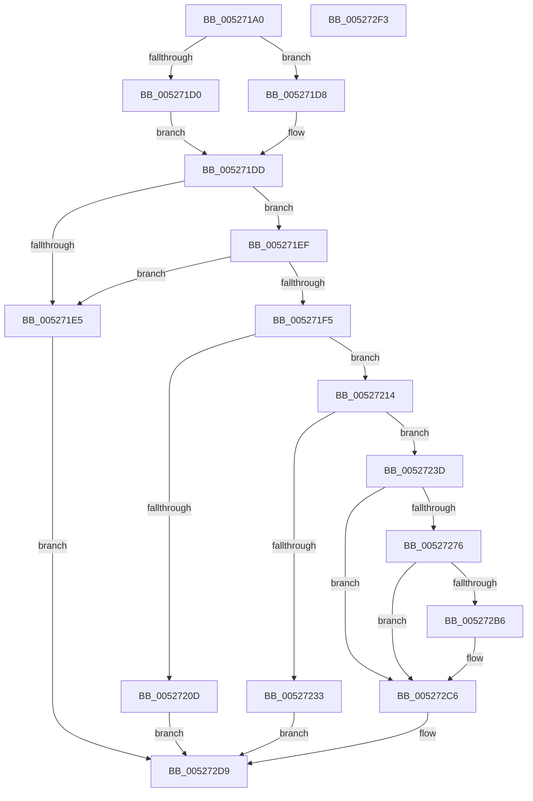

# SymCryptRsaPkcs1Sign

- RVA: `0x005271A0`–`0x005272F4` (길이 `340` bytes)
- VA: `0x00000001405271A0`
- 실행 섹션: `.text`
- PDB 이름 있음: `예`; PDB Function 태그: `아니요`
- unwind 정보 RVA: `0x00086C3C`
- 디코드: `94`개 명령, `340/340` bytes 표시
- 미해석 바이트: `0` (있으면 어셈블리에 `.byte`로 보존)

> 이 문서는 커널 이미지의 기계어와 PDB 기호를 분석해 생성했습니다. 4번과 5번은 함수 원형과 자료형을 바이너리 사용 방식에서 추정한 C 해석이며 원본 소스 복구 결과는 아닙니다.

## 1. Dependencies

- 직접 호출 지점: **7**; 고유 호출 대상: **7**
- 직접 호출자로 확인된 함수: **1**
- RIP 상대 이미지 참조: **0**

### Outgoing calls
- `0x005271C4` → [SymCryptRsakeySizeofModulus](SymCryptRsakeySizeofModulus_function_00523FB8.md) (function, `0x00523FB8`)
- `0x00527217` → [SymCryptRsaCoreDecCrtScratchSpace](SymCryptRsaCoreDecCrtScratchSpace_function_00526D74.md) (function, `0x00526D74`)
- `0x00527226` → [SymCryptCallbackAlloc](../6A/SymCryptCallbackAlloc_function_006AC530.md) (function, `0x006AC530`)
- `0x0052726B` → [SymCryptRsaPkcs1ApplySignaturePadding](SymCryptRsaPkcs1ApplySignaturePadding_function_00525160.md) (function, `0x00525160`)
- `0x005272AB` → [SymCryptRsaCoreDecCrt](SymCryptRsaCoreDecCrt_function_005269C4.md) (function, `0x005269C4`)
- `0x005272CC` → [SymCryptWipe](../51/SymCryptWipe_function_0051F914.md) (function, `0x0051F914`)
- `0x005272D4` → [SymCryptCallbackFree](../6A/SymCryptCallbackFree_function_006AC568.md) (function, `0x006AC568`)

### Direct callers
- [SymCryptRsaSelftest](SymCryptRsaSelftest_function_0052B638.md) at `0x0052B77A`

### Static image references
- 디코드된 RIP-relative 메모리 참조가 없습니다.

## 2. Other-region calls and transfers

- 다른 실행 섹션으로 향하는 call: **0**
- 별도 외부 분기/꼬리 이동을 확인하지 못했습니다.

## 3. Assembly (complete function range)

```asm
005271A0  48 89 5C 24 08                  mov qword ptr [rsp + 8], rbx
005271A5  4C 89 44 24 18                  mov qword ptr [rsp + 0x18], r8
005271AA  48 89 54 24 10                  mov qword ptr [rsp + 0x10], rdx
005271AF  55                              push rbp
005271B0  56                              push rsi
005271B1  57                              push rdi
005271B2  41 54                           push r12
005271B4  41 55                           push r13
005271B6  41 56                           push r14
005271B8  41 57                           push r15
005271BA  48 83 EC 50                     sub rsp, 0x50
005271BE  49 8B D9                        mov rbx, r9
005271C1  48 8B F9                        mov rdi, rcx
005271C4  E8 EF CD FF FF                  call 0x140523fb8
005271C9  8B E8                           mov ebp, eax
005271CB  48 85 DB                        test rbx, rbx
005271CE  74 08                           je 0x1405271d8
005271D0  4C 8B 6B 08                     mov r13, qword ptr [rbx + 8]
005271D4  8B 1B                           mov ebx, dword ptr [rbx]
005271D6  EB 05                           jmp 0x1405271dd
005271D8  45 33 ED                        xor r13d, r13d
005271DB  33 DB                           xor ebx, ebx
005271DD  F7 07 00 10 00 00               test dword ptr [rdi], 0x1000
005271E3  75 0A                           jne 0x1405271ef
005271E5  BB 0E 80 00 00                  mov ebx, 0x800e
005271EA  E9 EA 00 00 00                  jmp 0x1405272d9
005271EF  80 7F 08 00                     cmp byte ptr [rdi + 8], 0
005271F3  74 F0                           je 0x1405271e5
005271F5  48 8B 84 24 D8 00 00 00         mov rax, qword ptr [rsp + 0xd8]
005271FD  4C 8B B4 24 C8 00 00 00         mov r14, qword ptr [rsp + 0xc8]
00527205  48 89 28                        mov qword ptr [rax], rbp
00527208  4D 85 F6                        test r14, r14
0052720B  75 07                           jne 0x140527214
0052720D  33 DB                           xor ebx, ebx
0052720F  E9 C5 00 00 00                  jmp 0x1405272d9
00527214  48 8B CF                        mov rcx, rdi
00527217  E8 58 FB FF FF                  call 0x140526d74
0052721C  44 8B E0                        mov r12d, eax
0052721F  4D 8D 3C 2C                     lea r15, [r12 + rbp]
00527223  49 8B CF                        mov rcx, r15
00527226  E8 05 53 18 00                  call 0x1406ac530
0052722B  48 8B F0                        mov rsi, rax
0052722E  48 85 C0                        test rax, rax
00527231  75 0A                           jne 0x14052723d
00527233  BB 0F 80 00 00                  mov ebx, 0x800f
00527238  E9 9C 00 00 00                  jmp 0x1405272d9
0052723D  48 8B 94 24 A0 00 00 00         mov rdx, qword ptr [rsp + 0xa0]
00527245  49 03 C4                        add rax, r12
00527248  48 8B 8C 24 98 00 00 00         mov rcx, qword ptr [rsp + 0x98]
00527250  4D 8B C5                        mov r8, r13
00527253  48 89 6C 24 30                  mov qword ptr [rsp + 0x30], rbp
00527258  48 89 44 24 28                  mov qword ptr [rsp + 0x28], rax
0052725D  8B 84 24 B8 00 00 00            mov eax, dword ptr [rsp + 0xb8]
00527264  44 8B CB                        mov r9d, ebx
00527267  89 44 24 20                     mov dword ptr [rsp + 0x20], eax
0052726B  E8 F0 DE FF FF                  call 0x140525160
00527270  8B D8                           mov ebx, eax
00527272  85 C0                           test eax, eax
00527274  75 50                           jne 0x1405272c6
00527276  48 8B 84 24 D0 00 00 00         mov rax, qword ptr [rsp + 0xd0]
0052727E  44 8D 4B 02                     lea r9d, [rbx + 2]
00527282  4C 89 64 24 40                  mov qword ptr [rsp + 0x40], r12
00527287  49 8D 14 34                     lea rdx, [r12 + rsi]
0052728B  48 89 74 24 38                  mov qword ptr [rsp + 0x38], rsi
00527290  4C 8B C5                        mov r8, rbp
00527293  48 89 44 24 30                  mov qword ptr [rsp + 0x30], rax
00527298  48 8B CF                        mov rcx, rdi
0052729B  8B 84 24 B8 00 00 00            mov eax, dword ptr [rsp + 0xb8]
005272A2  4C 89 74 24 28                  mov qword ptr [rsp + 0x28], r14
005272A7  89 44 24 20                     mov dword ptr [rsp + 0x20], eax
005272AB  E8 14 F7 FF FF                  call 0x1405269c4
005272B0  8B D8                           mov ebx, eax
005272B2  85 C0                           test eax, eax
005272B4  75 10                           jne 0x1405272c6
005272B6  83 BC 24 C0 00 00 00 01         cmp dword ptr [rsp + 0xc0], 1
005272BE  B8 0B 80 00 00                  mov eax, 0x800b
005272C3  0F 44 D8                        cmove ebx, eax
005272C6  49 8B D7                        mov rdx, r15
005272C9  48 8B CE                        mov rcx, rsi
005272CC  E8 43 86 FF FF                  call 0x14051f914
005272D1  48 8B CE                        mov rcx, rsi
005272D4  E8 8F 52 18 00                  call 0x1406ac568
005272D9  8B C3                           mov eax, ebx
005272DB  48 8B 9C 24 90 00 00 00         mov rbx, qword ptr [rsp + 0x90]
005272E3  48 83 C4 50                     add rsp, 0x50
005272E7  41 5F                           pop r15
005272E9  41 5E                           pop r14
005272EB  41 5D                           pop r13
005272ED  41 5C                           pop r12
005272EF  5F                              pop rdi
005272F0  5E                              pop rsi
005272F1  5D                              pop rbp
005272F2  C3                              ret
005272F3  CC                              int3
```

## 4. C-style interpretation (structured pseudocode)

```c
__int64 __fastcall SymCryptRsaPkcs1Sign(__int64 a1, __int64 a2, __int64 a3, __int64 a4, __int64 a5, unsigned int a6, unsigned int a7, __int64 a8, __int64 a9, __int64 a10)
{
    __int64 result;
    __int64 v_r13;
    __int64 v_rbx;
    __int64 v_rsp;
    unsigned __int64 v_stack_m48;
    unsigned __int64 v_stack_m50;
    unsigned __int64 v_stack_m58;
    unsigned __int64 v_stack_m60;
    unsigned int v_stack_m68;
    unsigned __int64 v_stack_p10;
    unsigned __int64 v_stack_p18;
    unsigned __int64 v_stack_p8;

    v_stack_p8 = v_rbx;
    v_stack_p18 = a3;
    v_stack_p10 = a2;
    v_rsp = (v_rsp) - (80);
    result = SymCryptRsakeySizeofModulus(a1, a2, a3, a4);
    if (a4 == 0) goto loc_005271D8;
    goto loc_005271DD;
loc_005271D8:
    v_r13 = 0;
    v_rbx = 0;
loc_005271DD:
    if (((*(unsigned int *)(a1)) & (0x1000ULL)) != 0) goto loc_005271EF;
loc_005271E5:
    goto loc_005272D9;
loc_005271EF:
    if ((*(unsigned __int8 *)(a1 + 8)) == 0) goto loc_005271E5;
    *(unsigned __int64 *)(a10) = (unsigned int)((unsigned int)(result));
    if (a8 != 0) goto loc_00527214;
    v_rbx = 0;
    goto loc_005272D9;
loc_00527214:
    result = SymCryptRsaCoreDecCrtScratchSpace(a1, a2, a3, a4);
    result = SymCryptCallbackAlloc((unsigned int)((unsigned int)(result)) + (unsigned int)((unsigned int)(result)) * 1, a2, a3, a4);
    if (result != 0) goto loc_0052723D;
    goto loc_005272D9;
loc_0052723D:
    result = (result) + ((unsigned int)((unsigned int)(result)));
    v_stack_m58 = (unsigned int)((unsigned int)(result));
    v_stack_m60 = result;
    v_stack_m68 = (unsigned int)((unsigned int)(a6));
    result = SymCryptRsaPkcs1ApplySignaturePadding(v_stack_p10, v_stack_p18, 0, (unsigned int)((unsigned int)((unsigned int)(0x800FULL))));
    if ((unsigned int)(result) != 0) goto loc_005272C6;
    v_stack_m48 = (unsigned int)((unsigned int)(result));
    v_stack_m50 = result;
    v_stack_m58 = a9;
    v_stack_m60 = a8;
    v_stack_m68 = (unsigned int)((unsigned int)(a6));
    result = SymCryptRsaCoreDecCrt(a1, (unsigned int)((unsigned int)(result)) + result * 1, (unsigned int)((unsigned int)(result)), (unsigned int)((unsigned int)(result)) + 2);
    v_rbx = (unsigned int)((unsigned int)(result));
    if ((unsigned int)(result) == 0) {
        result = 0x800BULL;
        v_rbx = (unsigned int)((unsigned int)(result));
        if (a7 == 1) { v_rbx = (unsigned int)(result); }
    }
    result = SymCryptWipe(result, (unsigned int)((unsigned int)(result)) + (unsigned int)((unsigned int)(result)) * 1, (unsigned int)((unsigned int)(result)), (unsigned int)((unsigned int)(result)) + 2);
    result = SymCryptCallbackFree(result, (unsigned int)((unsigned int)(result)) + (unsigned int)((unsigned int)(result)) * 1, (unsigned int)((unsigned int)(result)), (unsigned int)((unsigned int)(result)) + 2);
loc_005272D9:
    v_rsp = (v_rsp) + (80);
    return (unsigned int)((unsigned int)(v_rbx));
}
```

## 5. (Beta) C Style

```c
int64_t SymCryptRsaPkcs1Sign(void *Arg1, int64_t Arg2, int64_t Arg3, int64_t Arg4, uint64_t Arg5, uint32_t Arg6, uint32_t Arg7, int64_t Arg8, int64_t Arg9, void *Arg10)
{
    uint8_t *arg1 = (uint8_t *)Arg1;
    uint8_t *arg10 = (uint8_t *)Arg10;

    int64_t result;
    int64_t local_r13;
    int64_t local_rbx;
    int64_t local_rsp;
    uint64_t v_stack_m48;
    uint64_t v_stack_m50;
    uint64_t v_stack_m58;
    uint64_t v_stack_m60;
    uint32_t v_stack_m68;
    uint64_t v_stack_p10;
    uint64_t v_stack_p18;
    uint64_t v_stack_p8;

    v_stack_p8 = local_rbx;
    v_stack_p18 = Arg3;
    v_stack_p10 = Arg2;
    local_rsp = (local_rsp) - (80);
    result = SymCryptRsakeySizeofModulus(Arg1, Arg2, Arg3, Arg4);
    if (Arg4 == 0) goto loc_005271D8;
    goto loc_005271DD;
loc_005271D8:
    local_r13 = 0;
    local_rbx = 0;
loc_005271DD:
    if (((*(uint32_t *)(arg1)) & (0x1000ULL)) != 0) goto loc_005271EF;
loc_005271E5:
    goto loc_005272D9;
loc_005271EF:
    if ((*(uint8_t *)(arg1 + 0x8)) == 0) goto loc_005271E5;
    *(uint64_t *)(arg10) = (uint32_t)((uint32_t)(result));
    if (Arg8 != 0) goto loc_00527214;
    local_rbx = 0;
    goto loc_005272D9;
loc_00527214:
    result = SymCryptRsaCoreDecCrtScratchSpace(Arg1, Arg2, Arg3, Arg4);
    result = SymCryptCallbackAlloc((uint32_t)((uint32_t)(result)) + (uint32_t)((uint32_t)(result)) * 1, Arg2, Arg3, Arg4);
    if (result != 0) goto loc_0052723D;
    goto loc_005272D9;
loc_0052723D:
    result = (result) + ((uint32_t)((uint32_t)(result)));
    v_stack_m58 = (uint32_t)((uint32_t)(result));
    v_stack_m60 = result;
    v_stack_m68 = (uint32_t)((uint32_t)(Arg6));
    result = SymCryptRsaPkcs1ApplySignaturePadding(v_stack_p10, v_stack_p18, 0, (uint32_t)((uint32_t)((uint32_t)(0x800FULL))));
    if ((uint32_t)(result) != 0) goto loc_005272C6;
    v_stack_m48 = (uint32_t)((uint32_t)(result));
    v_stack_m50 = result;
    v_stack_m58 = Arg9;
    v_stack_m60 = Arg8;
    v_stack_m68 = (uint32_t)((uint32_t)(Arg6));
    result = SymCryptRsaCoreDecCrt(Arg1, (uint32_t)((uint32_t)(result)) + result * 1, (uint32_t)((uint32_t)(result)), (uint32_t)((uint32_t)(result)) + 2);
    local_rbx = (uint32_t)((uint32_t)(result));
    if ((uint32_t)(result) == 0) {
        result = 0x800BULL;
        local_rbx = (uint32_t)((uint32_t)(result));
        if (Arg7 == 1) { local_rbx = (uint32_t)(result); }
    }
    result = SymCryptWipe(result, (uint32_t)((uint32_t)(result)) + (uint32_t)((uint32_t)(result)) * 1, (uint32_t)((uint32_t)(result)), (uint32_t)((uint32_t)(result)) + 2);
    result = SymCryptCallbackFree(result, (uint32_t)((uint32_t)(result)) + (uint32_t)((uint32_t)(result)) * 1, (uint32_t)((uint32_t)(result)), (uint32_t)((uint32_t)(result)) + 2);
loc_005272D9:
    local_rsp = (local_rsp) + (80);
    return (uint32_t)((uint32_t)(local_rbx));
}
```

### 관측된 메모리 오프셋

구조체 형식이 확인되지 않은 접근은 인자 기준의 오프셋으로만 기록했습니다.

| 기준 인자 | 오프셋 표현 | 폭 (bit) | 접근 |
|---|---:|---:|---|
| `Arg1` | `+ 0x0` | `32` | `R` |
| `Arg1` | `+ 0x8` | `8` | `R` |
| `Arg10` | `+ 0x0` | `64` | `W` |

## 6. Execution-region graph

[열기: 2D/3D 그래프와 함수 탐색 컨트롤 패널](../../../control-panel.html?section=text&rva=0x005271A0&view=graph)

- 2D 그래프는 위에서 아래로 흐르고, 3D 그래프는 빈 공간을 드래그해 회전합니다. Shift+드래그는 이동, 휠은 확대·축소, 함수 노드 선택은 대상 보고서 이동입니다.

### Static fallback


