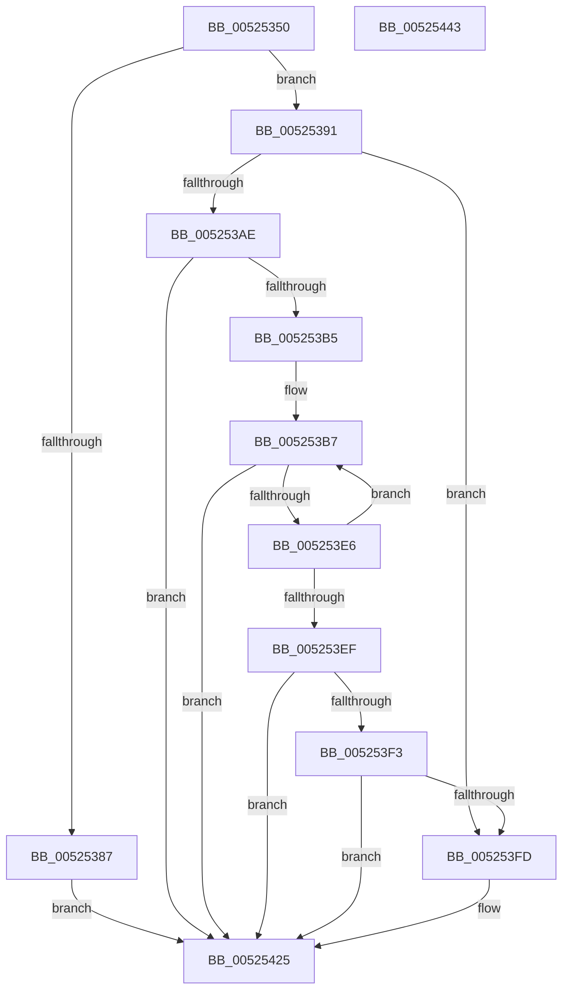

# SymCryptRsaPkcs1VerifySignaturePadding

- RVA: `0x00525350`–`0x00525444` (길이 `244` bytes)
- VA: `0x0000000140525350`
- 실행 섹션: `.text`
- PDB 이름 있음: `예`; PDB Function 태그: `아니요`
- unwind 정보 RVA: `0x000AC264`
- 디코드: `68`개 명령, `244/244` bytes 표시
- 미해석 바이트: `0` (있으면 어셈블리에 `.byte`로 보존)

> 이 문서는 커널 이미지의 기계어와 PDB 기호를 분석해 생성했습니다. 4번과 5번은 함수 원형과 자료형을 바이너리 사용 방식에서 추정한 C 해석이며 원본 소스 복구 결과는 아닙니다.

## 1. Dependencies

- 직접 호출 지점: **2**; 고유 호출 대상: **1**
- 직접 호출자로 확인된 함수: **1**
- RIP 상대 이미지 참조: **0**

### Outgoing calls
- `0x005253DD` → [SymCryptRsaPkcs1CheckSignaturePadding](SymCryptRsaPkcs1CheckSignaturePadding_function_005252A8.md) (function, `0x005252A8`)
- `0x00525420` → [SymCryptRsaPkcs1CheckSignaturePadding](SymCryptRsaPkcs1CheckSignaturePadding_function_005252A8.md) (function, `0x005252A8`)

### Direct callers
- [SymCryptRsaPkcs1Verify](SymCryptRsaPkcs1Verify_function_005272FC.md) at `0x00527411`

### Static image references
- 디코드된 RIP-relative 메모리 참조가 없습니다.

## 2. Other-region calls and transfers

- 다른 실행 섹션으로 향하는 call: **0**
- 별도 외부 분기/꼬리 이동을 확인하지 못했습니다.

## 3. Assembly (complete function range)

```asm
00525350  48 89 5C 24 08                  mov qword ptr [rsp + 8], rbx
00525355  48 89 6C 24 10                  mov qword ptr [rsp + 0x10], rbp
0052535A  48 89 74 24 18                  mov qword ptr [rsp + 0x18], rsi
0052535F  57                              push rdi
00525360  41 54                           push r12
00525362  41 55                           push r13
00525364  41 56                           push r14
00525366  41 57                           push r15
00525368  48 83 EC 40                     sub rsp, 0x40
0052536C  33 C0                           xor eax, eax
0052536E  49 8B F9                        mov rdi, r9
00525371  F7 84 24 A0 00 00 00 FD FF FF FF  test dword ptr [rsp + 0xa0], 0xfffffffd
0052537C  49 8B F0                        mov rsi, r8
0052537F  4C 8B E2                        mov r12, rdx
00525382  4C 8B E9                        mov r13, rcx
00525385  74 0A                           je 0x140525391
00525387  B8 0E 80 00 00                  mov eax, 0x800e
0052538C  E9 94 00 00 00                  jmp 0x140525425
00525391  48 8B AC 24 A8 00 00 00         mov rbp, qword ptr [rsp + 0xa8]
00525399  4C 8B B4 24 98 00 00 00         mov r14, qword ptr [rsp + 0x98]
005253A1  4C 8B BC 24 90 00 00 00         mov r15, qword ptr [rsp + 0x90]
005253A9  48 85 F6                        test rsi, rsi
005253AC  74 4F                           je 0x1405253fd
005253AE  33 DB                           xor ebx, ebx
005253B0  48 85 FF                        test rdi, rdi
005253B3  74 70                           je 0x140525425
005253B5  33 C9                           xor ecx, ecx
005253B7  48 03 C9                        add rcx, rcx
005253BA  4C 89 74 24 38                  mov qword ptr [rsp + 0x38], r14
005253BF  48 89 6C 24 30                  mov qword ptr [rsp + 0x30], rbp
005253C4  49 8B D4                        mov rdx, r12
005253C7  83 64 24 28 00                  and dword ptr [rsp + 0x28], 0
005253CC  4C 89 7C 24 20                  mov qword ptr [rsp + 0x20], r15
005253D1  44 8B 0C CE                     mov r9d, dword ptr [rsi + rcx*8]
005253D5  4C 8B 44 CE 08                  mov r8, qword ptr [rsi + rcx*8 + 8]
005253DA  49 8B CD                        mov rcx, r13
005253DD  E8 C6 FE FF FF                  call 0x1405252a8
005253E2  85 C0                           test eax, eax
005253E4  74 3F                           je 0x140525425
005253E6  FF C3                           inc ebx
005253E8  8B CB                           mov ecx, ebx
005253EA  48 3B CF                        cmp rcx, rdi
005253ED  72 C8                           jb 0x1405253b7
005253EF  85 C0                           test eax, eax
005253F1  74 32                           je 0x140525425
005253F3  F6 84 24 A0 00 00 00 02         test byte ptr [rsp + 0xa0], 2
005253FB  74 28                           je 0x140525425
005253FD  4C 89 74 24 38                  mov qword ptr [rsp + 0x38], r14
00525402  45 33 C9                        xor r9d, r9d
00525405  48 89 6C 24 30                  mov qword ptr [rsp + 0x30], rbp
0052540A  45 33 C0                        xor r8d, r8d
0052540D  C7 44 24 28 01 00 00 00         mov dword ptr [rsp + 0x28], 1
00525415  49 8B D4                        mov rdx, r12
00525418  49 8B CD                        mov rcx, r13
0052541B  4C 89 7C 24 20                  mov qword ptr [rsp + 0x20], r15
00525420  E8 83 FE FF FF                  call 0x1405252a8
00525425  4C 8D 5C 24 40                  lea r11, [rsp + 0x40]
0052542A  49 8B 5B 30                     mov rbx, qword ptr [r11 + 0x30]
0052542E  49 8B 6B 38                     mov rbp, qword ptr [r11 + 0x38]
00525432  49 8B 73 40                     mov rsi, qword ptr [r11 + 0x40]
00525436  49 8B E3                        mov rsp, r11
00525439  41 5F                           pop r15
0052543B  41 5E                           pop r14
0052543D  41 5D                           pop r13
0052543F  41 5C                           pop r12
00525441  5F                              pop rdi
00525442  C3                              ret
00525443  CC                              int3
```

## 4. C-style interpretation (structured pseudocode)

```c
__int64 __fastcall SymCryptRsaPkcs1VerifySignaturePadding(__int64 a1, __int64 a2, __int64 a3, __int64 a4, __int64 a5, __int64 a6, unsigned __int8 a7, __int64 a8)
{
    __int64 result;
    __int64 v_rbx;
    __int64 v_rsp;
    unsigned __int64 v_stack_m28;
    unsigned __int64 v_stack_m30;
    unsigned __int64 v_stack_m38;
    unsigned int v_stack_m40;
    unsigned __int64 v_stack_m48;
    unsigned __int64 v_stack_p10;
    unsigned __int64 v_stack_p18;
    unsigned __int64 v_stack_p8;

    v_stack_p8 = v_rbx;
    v_stack_p10 = v_rbp;
    v_stack_p18 = v_rsi;
    v_rsp = (v_rsp) - (64);
    result = 0;
    if (((a7) & (0xFFFFFFFDULL)) == 0) goto loc_00525391;
    goto loc_00525425;
loc_00525391:
    if (a3 == 0) goto loc_005253FD;
    v_rbx = 0;
    if (a4 == 0) goto loc_00525425;
    a1 = 0;
loc_005253B7:
    a1 = (a1) + (0);
    v_stack_m30 = a6;
    v_stack_m38 = a8;
    v_stack_m48 = a5;
    result = SymCryptRsaPkcs1CheckSignaturePadding(a1, a2, *(unsigned __int64 *)(a3 + a1 * 8 + 8), (unsigned int)(*(unsigned int *)(a3 + a1 * 8)));
    if ((unsigned int)(result) == 0) goto loc_00525425;
    v_rbx = (unsigned int)((v_rbx) + 1);
    if (((unsigned int)((unsigned int)(v_rbx))) < a4) goto loc_005253B7;
    if ((unsigned int)(result) == 0) goto loc_00525425;
    if (((a7) & (2)) != 0) {
        v_stack_m30 = a6;
        a4 = 0;
        v_stack_m38 = a8;
        a3 = 0;
        v_stack_m40 = 1;
        a2 = a2;
        a1 = a1;
        v_stack_m48 = a5;
        result = SymCryptRsaPkcs1CheckSignaturePadding(a1, a2, a3, a4);
    }
    return result;
}
```

## 5. (Beta) C Style

```c
int64_t SymCryptRsaPkcs1VerifySignaturePadding(int64_t Arg1, int64_t Arg2, int64_t Arg3, int64_t Arg4, int64_t Arg5, int64_t Arg6, uint8_t Arg7, int64_t Arg8)
{
    int64_t result;
    int64_t local_rbx;
    int64_t local_rsp;
    uint64_t v_stack_m28;
    uint64_t v_stack_m30;
    uint64_t v_stack_m38;
    uint32_t v_stack_m40;
    uint64_t v_stack_m48;
    uint64_t v_stack_p10;
    uint64_t v_stack_p18;
    uint64_t v_stack_p8;

    v_stack_p8 = local_rbx;
    v_stack_p10 = local_rbp;
    v_stack_p18 = local_rsi;
    local_rsp = (local_rsp) - (64);
    result = 0;
    if (((Arg7) & (0xFFFFFFFDULL)) == 0) goto loc_00525391;
    goto loc_00525425;
loc_00525391:
    if (Arg3 == 0) goto loc_005253FD;
    local_rbx = 0;
    if (Arg4 == 0) goto loc_00525425;
    Arg1 = 0;
loc_005253B7:
    Arg1 = (Arg1) + (0);
    v_stack_m30 = Arg6;
    v_stack_m38 = Arg8;
    v_stack_m48 = Arg5;
    result = SymCryptRsaPkcs1CheckSignaturePadding(Arg1, Arg2, *(uint64_t *)(Arg3 + Arg1 * 8 + 0x8), (uint32_t)(*(uint32_t *)(Arg3 + Arg1 * 8)));
    if ((uint32_t)(result) == 0) goto loc_00525425;
    local_rbx = (uint32_t)((local_rbx) + 1);
    if (((uint32_t)((uint32_t)(local_rbx))) < Arg4) goto loc_005253B7;
    if ((uint32_t)(result) == 0) goto loc_00525425;
    if (((Arg7) & (2)) != 0) {
        v_stack_m30 = Arg6;
        Arg4 = 0;
        v_stack_m38 = Arg8;
        Arg3 = 0;
        v_stack_m40 = 1;
        Arg2 = Arg2;
        Arg1 = Arg1;
        v_stack_m48 = Arg5;
        result = SymCryptRsaPkcs1CheckSignaturePadding(Arg1, Arg2, Arg3, Arg4);
    }
    return result;
}
```

## 6. Execution-region graph

[열기: 2D/3D 그래프와 함수 탐색 컨트롤 패널](../../../control-panel.html?section=text&rva=0x00525350&view=graph)

- 2D 그래프는 위에서 아래로 흐르고, 3D 그래프는 빈 공간을 드래그해 회전합니다. Shift+드래그는 이동, 휠은 확대·축소, 함수 노드 선택은 대상 보고서 이동입니다.

### Static fallback


