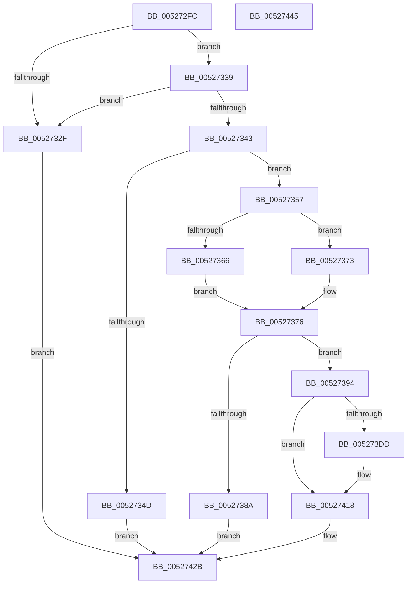

# SymCryptRsaPkcs1Verify

- RVA: `0x005272FC`–`0x00527446` (길이 `330` bytes)
- VA: `0x00000001405272FC`
- 실행 섹션: `.text`
- PDB 이름 있음: `예`; PDB Function 태그: `아니요`
- unwind 정보 RVA: `0x00086C3C`
- 디코드: `86`개 명령, `330/330` bytes 표시
- 미해석 바이트: `0` (있으면 어셈블리에 `.byte`로 보존)

> 이 문서는 커널 이미지의 기계어와 PDB 기호를 분석해 생성했습니다. 4번과 5번은 함수 원형과 자료형을 바이너리 사용 방식에서 추정한 C 해석이며 원본 소스 복구 결과는 아닙니다.

## 1. Dependencies

- 직접 호출 지점: **8**; 고유 호출 대상: **7**
- 직접 호출자로 확인된 함수: **2**
- RIP 상대 이미지 참조: **0**

### Outgoing calls
- `0x00527320` → [SymCryptRsakeySizeofModulus](SymCryptRsakeySizeofModulus_function_00523FB8.md) (function, `0x00523FB8`)
- `0x0052735A` → [SymCryptRsaCoreEncScratchSpace](SymCryptRsaCoreEncScratchSpace_function_00527094.md) (function, `0x00527094`)
- `0x00527369` → [SymCryptRsaCoreEncScratchSpace](SymCryptRsaCoreEncScratchSpace_function_00527094.md) (function, `0x00527094`)
- `0x0052737D` → [SymCryptCallbackAlloc](../6A/SymCryptCallbackAlloc_function_006AC530.md) (function, `0x006AC530`)
- `0x005273D2` → [SymCryptRsaCoreEnc](SymCryptRsaCoreEnc_function_00526F04.md) (function, `0x00526F04`)
- `0x00527411` → [SymCryptRsaPkcs1VerifySignaturePadding](SymCryptRsaPkcs1VerifySignaturePadding_function_00525350.md) (function, `0x00525350`)
- `0x0052741E` → [SymCryptWipe](../51/SymCryptWipe_function_0051F914.md) (function, `0x0051F914`)
- `0x00527426` → [SymCryptCallbackFree](../6A/SymCryptCallbackFree_function_006AC568.md) (function, `0x006AC568`)

### Direct callers
- [SymCryptRsaSelftest](SymCryptRsaSelftest_function_0052B638.md) at `0x0052B7E3`
- [HashpVerifyPkcs1Signature](../../page/84/HashpVerifyPkcs1Signature_function_00841C68.md) at `0x00841EC0`

### Static image references
- 디코드된 RIP-relative 메모리 참조가 없습니다.

## 2. Other-region calls and transfers

- 다른 실행 섹션으로 향하는 call: **0**
- 별도 외부 분기/꼬리 이동을 확인하지 못했습니다.

## 3. Assembly (complete function range)

```asm
005272FC  48 89 5C 24 08                  mov qword ptr [rsp + 8], rbx
00527301  4C 89 4C 24 20                  mov qword ptr [rsp + 0x20], r9
00527306  48 89 54 24 10                  mov qword ptr [rsp + 0x10], rdx
0052730B  55                              push rbp
0052730C  56                              push rsi
0052730D  57                              push rdi
0052730E  41 54                           push r12
00527310  41 55                           push r13
00527312  41 56                           push r14
00527314  41 57                           push r15
00527316  48 83 EC 50                     sub rsp, 0x50
0052731A  4D 8B E8                        mov r13, r8
0052731D  48 8B D9                        mov rbx, rcx
00527320  E8 93 CC FF FF                  call 0x140523fb8
00527325  F7 03 00 10 00 00               test dword ptr [rbx], 0x1000
0052732B  8B F8                           mov edi, eax
0052732D  75 0A                           jne 0x140527339
0052732F  BB 0E 80 00 00                  mov ebx, 0x800e
00527334  E9 F2 00 00 00                  jmp 0x14052742b
00527339  48 39 BC 24 B0 00 00 00         cmp qword ptr [rsp + 0xb0], rdi
00527341  77 EC                           ja 0x14052732f
00527343  83 BC 24 B8 00 00 00 01         cmp dword ptr [rsp + 0xb8], 1
0052734B  75 0A                           jne 0x140527357
0052734D  BB 0B 80 00 00                  mov ebx, 0x800b
00527352  E9 D4 00 00 00                  jmp 0x14052742b
00527357  48 8B CB                        mov rcx, rbx
0052735A  E8 35 FD FF FF                  call 0x140527094
0052735F  8B C0                           mov eax, eax
00527361  48 3B C7                        cmp rax, rdi
00527364  76 0D                           jbe 0x140527373
00527366  48 8B CB                        mov rcx, rbx
00527369  E8 26 FD FF FF                  call 0x140527094
0052736E  44 8B F0                        mov r14d, eax
00527371  EB 03                           jmp 0x140527376
00527373  4C 8B F7                        mov r14, rdi
00527376  49 8D 2C 3E                     lea rbp, [r14 + rdi]
0052737A  48 8B CD                        mov rcx, rbp
0052737D  E8 AE 51 18 00                  call 0x1406ac530
00527382  48 8B F0                        mov rsi, rax
00527385  48 85 C0                        test rax, rax
00527388  75 0A                           jne 0x140527394
0052738A  BB 0F 80 00 00                  mov ebx, 0x800f
0052738F  E9 97 00 00 00                  jmp 0x14052742b
00527394  44 8B A4 24 D0 00 00 00         mov r12d, dword ptr [rsp + 0xd0]
0052739C  4D 8D 3C 06                     lea r15, [r14 + rax]
005273A0  4C 8B 84 24 B0 00 00 00         mov r8, qword ptr [rsp + 0xb0]
005273A8  41 B9 02 00 00 00               mov r9d, 2
005273AE  48 8B 94 24 A8 00 00 00         mov rdx, qword ptr [rsp + 0xa8]
005273B6  48 8B CB                        mov rcx, rbx
005273B9  4C 89 74 24 40                  mov qword ptr [rsp + 0x40], r14
005273BE  48 89 74 24 38                  mov qword ptr [rsp + 0x38], rsi
005273C3  48 89 7C 24 30                  mov qword ptr [rsp + 0x30], rdi
005273C8  4C 89 7C 24 28                  mov qword ptr [rsp + 0x28], r15
005273CD  44 89 64 24 20                  mov dword ptr [rsp + 0x20], r12d
005273D2  E8 2D FB FF FF                  call 0x140526f04
005273D7  8B D8                           mov ebx, eax
005273D9  85 C0                           test eax, eax
005273DB  75 3B                           jne 0x140527418
005273DD  4C 8B 8C 24 C8 00 00 00         mov r9, qword ptr [rsp + 0xc8]
005273E5  49 8B D5                        mov rdx, r13
005273E8  4C 8B 84 24 C0 00 00 00         mov r8, qword ptr [rsp + 0xc0]
005273F0  48 8B 8C 24 98 00 00 00         mov rcx, qword ptr [rsp + 0x98]
005273F8  4C 89 74 24 40                  mov qword ptr [rsp + 0x40], r14
005273FD  48 89 74 24 38                  mov qword ptr [rsp + 0x38], rsi
00527402  44 89 64 24 30                  mov dword ptr [rsp + 0x30], r12d
00527407  48 89 7C 24 28                  mov qword ptr [rsp + 0x28], rdi
0052740C  4C 89 7C 24 20                  mov qword ptr [rsp + 0x20], r15
00527411  E8 3A DF FF FF                  call 0x140525350
00527416  8B D8                           mov ebx, eax
00527418  48 8B D5                        mov rdx, rbp
0052741B  48 8B CE                        mov rcx, rsi
0052741E  E8 F1 84 FF FF                  call 0x14051f914
00527423  48 8B CE                        mov rcx, rsi
00527426  E8 3D 51 18 00                  call 0x1406ac568
0052742B  8B C3                           mov eax, ebx
0052742D  48 8B 9C 24 90 00 00 00         mov rbx, qword ptr [rsp + 0x90]
00527435  48 83 C4 50                     add rsp, 0x50
00527439  41 5F                           pop r15
0052743B  41 5E                           pop r14
0052743D  41 5D                           pop r13
0052743F  41 5C                           pop r12
00527441  5F                              pop rdi
00527442  5E                              pop rsi
00527443  5D                              pop rbp
00527444  C3                              ret
00527445  CC                              int3
```

## 4. C-style interpretation (structured pseudocode)

```c
__int64 __fastcall SymCryptRsaPkcs1Verify(__int64 a1, __int64 a2, __int64 a3, __int64 a4, __int64 a5, unsigned int a6, __int64 a7, __int64 a8, unsigned int a9)
{
    __int64 result;
    __int64 v_rbx;
    __int64 v_rsp;
    unsigned __int64 v_stack_m48;
    unsigned __int64 v_stack_m50;
    unsigned __int64 v_stack_m58;
    unsigned __int64 v_stack_m60;
    unsigned int v_stack_m68;
    unsigned __int64 v_stack_p10;
    unsigned __int64 v_stack_p20;
    unsigned __int64 v_stack_p8;

    v_stack_p8 = v_rbx;
    v_stack_p20 = a4;
    v_stack_p10 = a2;
    v_rsp = (v_rsp) - (80);
    result = SymCryptRsakeySizeofModulus(a1, a2, a3, a4);
    if (((*(unsigned int *)(a1)) & (0x1000ULL)) != 0) goto loc_00527339;
loc_0052732F:
    goto loc_0052742B;
loc_00527339:
    if (a5 > ((unsigned int)((unsigned int)(result)))) goto loc_0052732F;
    if (a6 != 1) goto loc_00527357;
    goto loc_0052742B;
loc_00527357:
    result = SymCryptRsaCoreEncScratchSpace((unsigned int)(0x800BULL), a2, a3, a4);
    if (((unsigned int)((unsigned int)(result))) <= ((unsigned int)((unsigned int)(result)))) goto loc_00527373;
    result = SymCryptRsaCoreEncScratchSpace((unsigned int)(0x800BULL), a2, a3, a4);
    goto loc_00527376;
loc_00527373:
loc_00527376:
    result = SymCryptCallbackAlloc((unsigned int)((unsigned int)(result)) + (unsigned int)((unsigned int)(result)) * 1, a2, a3, a4);
    if (result != 0) goto loc_00527394;
    goto loc_0052742B;
loc_00527394:
    v_stack_m48 = (unsigned int)((unsigned int)(result));
    v_stack_m50 = result;
    v_stack_m58 = (unsigned int)((unsigned int)(result));
    v_stack_m60 = (unsigned int)((unsigned int)(result)) + result * 1;
    v_stack_m68 = (unsigned int)((unsigned int)(a9));
    result = SymCryptRsaCoreEnc((unsigned int)(0x800FULL), v_stack_p20, a5, 2);
    v_rbx = (unsigned int)((unsigned int)(result));
    if ((unsigned int)(result) == 0) {
        a4 = a8;
        a2 = a3;
        a3 = a7;
        a1 = v_stack_p10;
        v_stack_m48 = (unsigned int)((unsigned int)(result));
        v_stack_m50 = result;
        v_stack_m58 = (unsigned int)((unsigned int)(a9));
        v_stack_m60 = (unsigned int)((unsigned int)(result));
        v_stack_m68 = (unsigned int)((unsigned int)(result)) + result * 1;
        result = SymCryptRsaPkcs1VerifySignaturePadding(a1, a2, a3, a4);
        v_rbx = (unsigned int)(result);
    }
    result = SymCryptWipe(result, (unsigned int)((unsigned int)(result)) + (unsigned int)((unsigned int)(result)) * 1, a3, a4);
    result = SymCryptCallbackFree(result, (unsigned int)((unsigned int)(result)) + (unsigned int)((unsigned int)(result)) * 1, a3, a4);
loc_0052742B:
    v_rsp = (v_rsp) + (80);
    return (unsigned int)((unsigned int)(v_rbx));
}
```

## 5. (Beta) C Style

```c
int64_t SymCryptRsaPkcs1Verify(void *Arg1, int64_t Arg2, int64_t Arg3, int64_t Arg4, int64_t Arg5, uint32_t Arg6, int64_t Arg7, int64_t Arg8, uint32_t Arg9)
{
    uint8_t *arg1 = (uint8_t *)Arg1;

    int64_t result;
    int64_t local_rbx;
    int64_t local_rsp;
    uint64_t v_stack_m48;
    uint64_t v_stack_m50;
    uint64_t v_stack_m58;
    uint64_t v_stack_m60;
    uint32_t v_stack_m68;
    uint64_t v_stack_p10;
    uint64_t v_stack_p20;
    uint64_t v_stack_p8;

    v_stack_p8 = local_rbx;
    v_stack_p20 = Arg4;
    v_stack_p10 = Arg2;
    local_rsp = (local_rsp) - (80);
    result = SymCryptRsakeySizeofModulus(Arg1, Arg2, Arg3, Arg4);
    if (((*(uint32_t *)(arg1)) & (0x1000ULL)) != 0) goto loc_00527339;
loc_0052732F:
    goto loc_0052742B;
loc_00527339:
    if (Arg5 > ((uint32_t)((uint32_t)(result)))) goto loc_0052732F;
    if (Arg6 != 1) goto loc_00527357;
    goto loc_0052742B;
loc_00527357:
    result = SymCryptRsaCoreEncScratchSpace((uint32_t)(0x800BULL), Arg2, Arg3, Arg4);
    if (((uint32_t)((uint32_t)(result))) <= ((uint32_t)((uint32_t)(result)))) goto loc_00527373;
    result = SymCryptRsaCoreEncScratchSpace((uint32_t)(0x800BULL), Arg2, Arg3, Arg4);
    goto loc_00527376;
loc_00527373:
loc_00527376:
    result = SymCryptCallbackAlloc((uint32_t)((uint32_t)(result)) + (uint32_t)((uint32_t)(result)) * 1, Arg2, Arg3, Arg4);
    if (result != 0) goto loc_00527394;
    goto loc_0052742B;
loc_00527394:
    v_stack_m48 = (uint32_t)((uint32_t)(result));
    v_stack_m50 = result;
    v_stack_m58 = (uint32_t)((uint32_t)(result));
    v_stack_m60 = (uint32_t)((uint32_t)(result)) + result * 1;
    v_stack_m68 = (uint32_t)((uint32_t)(Arg9));
    result = SymCryptRsaCoreEnc((uint32_t)(0x800FULL), v_stack_p20, Arg5, 2);
    local_rbx = (uint32_t)((uint32_t)(result));
    if ((uint32_t)(result) == 0) {
        Arg4 = Arg8;
        Arg2 = Arg3;
        Arg3 = Arg7;
        Arg1 = v_stack_p10;
        v_stack_m48 = (uint32_t)((uint32_t)(result));
        v_stack_m50 = result;
        v_stack_m58 = (uint32_t)((uint32_t)(Arg9));
        v_stack_m60 = (uint32_t)((uint32_t)(result));
        v_stack_m68 = (uint32_t)((uint32_t)(result)) + result * 1;
        result = SymCryptRsaPkcs1VerifySignaturePadding(Arg1, Arg2, Arg3, Arg4);
        local_rbx = (uint32_t)(result);
    }
    result = SymCryptWipe(result, (uint32_t)((uint32_t)(result)) + (uint32_t)((uint32_t)(result)) * 1, Arg3, Arg4);
    result = SymCryptCallbackFree(result, (uint32_t)((uint32_t)(result)) + (uint32_t)((uint32_t)(result)) * 1, Arg3, Arg4);
loc_0052742B:
    local_rsp = (local_rsp) + (80);
    return (uint32_t)((uint32_t)(local_rbx));
}
```

### 관측된 메모리 오프셋

구조체 형식이 확인되지 않은 접근은 인자 기준의 오프셋으로만 기록했습니다.

| 기준 인자 | 오프셋 표현 | 폭 (bit) | 접근 |
|---|---:|---:|---|
| `Arg1` | `+ 0x0` | `32` | `R` |

## 6. Execution-region graph

[열기: 2D/3D 그래프와 함수 탐색 컨트롤 패널](../../../control-panel.html?section=text&rva=0x005272FC&view=graph)

- 2D 그래프는 위에서 아래로 흐르고, 3D 그래프는 빈 공간을 드래그해 회전합니다. Shift+드래그는 이동, 휠은 확대·축소, 함수 노드 선택은 대상 보고서 이동입니다.

### Static fallback


