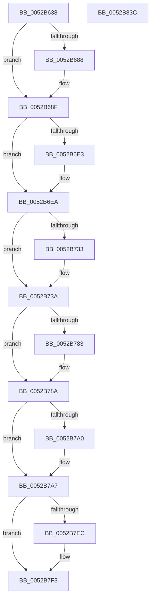

# SymCryptRsaSelftest

- RVA: `0x0052B638`–`0x0052B83D` (길이 `517` bytes)
- VA: `0x000000014052B638`
- 실행 섹션: `.text`
- PDB 이름 있음: `예`; PDB Function 태그: `아니요`
- unwind 정보 RVA: `0x000C33D0`
- 디코드: `125`개 명령, `517/517` bytes 표시
- 미해석 바이트: `0` (있으면 어셈블리에 `.byte`로 보존)

> 이 문서는 커널 이미지의 기계어와 PDB 기호를 분석해 생성했습니다. 4번과 5번은 함수 원형과 자료형을 바이너리 사용 방식에서 추정한 C 해석이며 원본 소스 복구 결과는 아닙니다.

## 1. Dependencies

- 직접 호출 지점: **17**; 고유 호출 대상: **12**
- 직접 호출자로 확인된 함수: **1**
- RIP 상대 이미지 참조: **8**

### Outgoing calls
- `0x0052B676` → [SymCryptCallbackAlloc](../6A/SymCryptCallbackAlloc_function_006AC530.md) (function, `0x006AC530`)
- `0x0052B68A` → [SymCryptFatal](../5B/SymCryptFatal_function_005B24E0.md) (function, `0x005B24E0`)
- `0x0052B6D6` → [SymCryptRsakeyAllocate](SymCryptRsakeyAllocate_function_00522CF4.md) (function, `0x00522CF4`)
- `0x0052B6E5` → [SymCryptFatal](../5B/SymCryptFatal_function_005B24E0.md) (function, `0x005B24E0`)
- `0x0052B72A` → [SymCryptRsakeySetValue](SymCryptRsakeySetValue_function_0052386C.md) (function, `0x0052386C`)
- `0x0052B735` → [SymCryptFatal](../5B/SymCryptFatal_function_005B24E0.md) (function, `0x005B24E0`)
- `0x0052B77A` → [SymCryptRsaPkcs1Sign](SymCryptRsaPkcs1Sign_function_005271A0.md) (function, `0x005271A0`)
- `0x0052B785` → [SymCryptFatal](../5B/SymCryptFatal_function_005B24E0.md) (function, `0x005B24E0`)
- `0x0052B797` → [memcmp](../6C/memcmp_function_006C6B10.md) (function, `0x006C6B10`)
- `0x0052B7A2` → [SymCryptFatal](../5B/SymCryptFatal_function_005B24E0.md) (function, `0x005B24E0`)
- `0x0052B7AE` → [SymCryptInjectError](../4A/SymCryptInjectError_function_004A4FCC.md) (function, `0x004A4FCC`)
- `0x0052B7E3` → [SymCryptRsaPkcs1Verify](SymCryptRsaPkcs1Verify_function_005272FC.md) (function, `0x005272FC`)
- `0x0052B7EE` → [SymCryptFatal](../5B/SymCryptFatal_function_005B24E0.md) (function, `0x005B24E0`)
- `0x0052B7F6` → [SymCryptRsakeyFree](SymCryptRsakeyFree_function_00523844.md) (function, `0x00523844`)
- `0x0052B802` → [SymCryptWipe](../51/SymCryptWipe_function_0051F914.md) (function, `0x0051F914`)
- `0x0052B80A` → [SymCryptCallbackFree](../6A/SymCryptCallbackFree_function_006AC568.md) (function, `0x006AC568`)
- `0x0052B816` → [_security_check_cookie](../6A/_security_check_cookie_function_006AC640.md) (function, `0x006AC640`)

### Direct callers
- [SymCryptRsakeySetValueInternal](SymCryptRsakeySetValueInternal_function_005238D4.md) at `0x00523F87`

### Static image references
- `0x0052B65B` → RVA `0x00E0A740` (`.data`; read)
- `0x0052B68F` → RVA `0x00020668` (`.rdata`; read)
- `0x0052B6A5` → RVA `0x000206E8` (`.rdata`; read)
- `0x0052B6FB` → RVA `0x00020560` (`.rdata`; read)
- `0x0052B707` → RVA `0x00020568` (`.rdata`; read)
- `0x0052B749` → RVA `0x000067B0` (`.rdata`; read)
- `0x0052B754` → RVA `0x00020850` (`.rdata`; read)
- `0x0052B78D` → RVA `0x00020400` (`.rdata`; read)

## 2. Other-region calls and transfers

- 다른 실행 섹션으로 향하는 call: **0**
- 별도 외부 분기/꼬리 이동을 확인하지 못했습니다.

## 3. Assembly (complete function range)

```asm
0052B638  48 8B C4                        mov rax, rsp
0052B63B  48 89 58 08                     mov qword ptr [rax + 8], rbx
0052B63F  48 89 70 10                     mov qword ptr [rax + 0x10], rsi
0052B643  48 89 78 18                     mov qword ptr [rax + 0x18], rdi
0052B647  4C 89 68 20                     mov qword ptr [rax + 0x20], r13
0052B64B  55                              push rbp
0052B64C  41 56                           push r14
0052B64E  41 57                           push r15
0052B650  48 8D 68 A1                     lea rbp, [rax - 0x5f]
0052B654  48 81 EC 90 00 00 00            sub rsp, 0x90
0052B65B  48 8B 05 DE F0 8D 00            mov rax, qword ptr [rip + 0x8df0de]
0052B662  48 33 C4                        xor rax, rsp
0052B665  48 89 45 3F                     mov qword ptr [rbp + 0x3f], rax
0052B669  41 BE 00 01 00 00               mov r14d, 0x100
0052B66F  41 8B CE                        mov ecx, r14d
0052B672  4C 89 75 07                     mov qword ptr [rbp + 7], r14
0052B676  E8 B5 0E 18 00                  call 0x1406ac530
0052B67B  48 8B D8                        mov rbx, rax
0052B67E  BE 53 50 49 46                  mov esi, 0x46495053
0052B683  48 85 C0                        test rax, rax
0052B686  75 07                           jne 0x14052b68f
0052B688  8B CE                           mov ecx, esi
0052B68A  E8 51 6E 08 00                  call 0x1405b24e0
0052B68F  48 8D 05 D2 4F AF FF            lea rax, [rip - 0x50b02e]
0052B696  C7 45 0F 01 00 00 00            mov dword ptr [rbp + 0xf], 1
0052B69D  48 89 45 2F                     mov qword ptr [rbp + 0x2f], rax
0052B6A1  48 8D 4D 0F                     lea rcx, [rbp + 0xf]
0052B6A5  48 8D 05 3C 50 AF FF            lea rax, [rip - 0x50afc4]
0052B6AC  C7 45 13 00 08 00 00            mov dword ptr [rbp + 0x13], 0x800
0052B6B3  41 BF 02 00 00 00               mov r15d, 2
0052B6B9  48 89 45 37                     mov qword ptr [rbp + 0x37], rax
0052B6BD  33 D2                           xor edx, edx
0052B6BF  44 89 7D 17                     mov dword ptr [rbp + 0x17], r15d
0052B6C3  C7 45 1B 01 00 00 00            mov dword ptr [rbp + 0x1b], 1
0052B6CA  41 8D 47 7E                     lea eax, [r15 + 0x7e]
0052B6CE  48 89 45 1F                     mov qword ptr [rbp + 0x1f], rax
0052B6D2  48 89 45 27                     mov qword ptr [rbp + 0x27], rax
0052B6D6  E8 19 76 FF FF                  call 0x140522cf4
0052B6DB  48 8B F8                        mov rdi, rax
0052B6DE  48 85 C0                        test rax, rax
0052B6E1  75 07                           jne 0x14052b6ea
0052B6E3  8B CE                           mov ecx, esi
0052B6E5  E8 F6 6D 08 00                  call 0x1405b24e0
0052B6EA  48 89 7C 24 48                  mov qword ptr [rsp + 0x48], rdi
0052B6EF  48 8D 45 1F                     lea rax, [rbp + 0x1f]
0052B6F3  C7 44 24 40 00 11 00 00         mov dword ptr [rsp + 0x40], 0x1100
0052B6FB  4C 8D 05 5E 4E AF FF            lea r8, [rip - 0x50b1a2]
0052B702  44 89 7C 24 38                  mov dword ptr [rsp + 0x38], r15d
0052B707  48 8D 0D 5A 4E AF FF            lea rcx, [rip - 0x50b1a6]
0052B70E  44 89 7C 24 30                  mov dword ptr [rsp + 0x30], r15d
0052B713  41 B9 01 00 00 00               mov r9d, 1
0052B719  48 89 44 24 28                  mov qword ptr [rsp + 0x28], rax
0052B71E  49 8B D6                        mov rdx, r14
0052B721  48 8D 45 2F                     lea rax, [rbp + 0x2f]
0052B725  48 89 44 24 20                  mov qword ptr [rsp + 0x20], rax
0052B72A  E8 3D 81 FF FF                  call 0x14052386c
0052B72F  85 C0                           test eax, eax
0052B731  74 07                           je 0x14052b73a
0052B733  8B CE                           mov ecx, esi
0052B735  E8 A6 6D 08 00                  call 0x1405b24e0
0052B73A  48 8D 45 07                     lea rax, [rbp + 7]
0052B73E  41 B8 20 00 00 00               mov r8d, 0x20
0052B744  48 89 44 24 48                  mov qword ptr [rsp + 0x48], rax
0052B749  4C 8D 2D 60 B0 AD FF            lea r13, [rip - 0x524fa0]
0052B750  48 8B 45 07                     mov rax, qword ptr [rbp + 7]
0052B754  48 8D 15 F5 50 AF FF            lea rdx, [rip - 0x50af0b]
0052B75B  48 89 44 24 40                  mov qword ptr [rsp + 0x40], rax
0052B760  4D 8B CD                        mov r9, r13
0052B763  48 89 5C 24 38                  mov qword ptr [rsp + 0x38], rbx
0052B768  48 8B CF                        mov rcx, rdi
0052B76B  44 89 7C 24 30                  mov dword ptr [rsp + 0x30], r15d
0052B770  83 64 24 28 00                  and dword ptr [rsp + 0x28], 0
0052B775  4C 89 7C 24 20                  mov qword ptr [rsp + 0x20], r15
0052B77A  E8 21 BA FF FF                  call 0x1405271a0
0052B77F  85 C0                           test eax, eax
0052B781  74 07                           je 0x14052b78a
0052B783  8B CE                           mov ecx, esi
0052B785  E8 56 6D 08 00                  call 0x1405b24e0
0052B78A  4D 8B C6                        mov r8, r14
0052B78D  48 8D 15 6C 4C AF FF            lea rdx, [rip - 0x50b394]
0052B794  48 8B CB                        mov rcx, rbx
0052B797  E8 74 B3 19 00                  call 0x1406c6b10
0052B79C  85 C0                           test eax, eax
0052B79E  74 07                           je 0x14052b7a7
0052B7A0  8B CE                           mov ecx, esi
0052B7A2  E8 39 6D 08 00                  call 0x1405b24e0
0052B7A7  48 8B 55 07                     mov rdx, qword ptr [rbp + 7]
0052B7AB  48 8B CB                        mov rcx, rbx
0052B7AE  E8 19 98 F7 FF                  call 0x1404a4fcc
0052B7B3  83 64 24 40 00                  and dword ptr [rsp + 0x40], 0
0052B7B8  48 8D 15 91 50 AF FF            lea rdx, [rip - 0x50af6f]
0052B7BF  48 8B 45 07                     mov rax, qword ptr [rbp + 7]
0052B7C3  4C 8B CB                        mov r9, rbx
0052B7C6  4C 89 7C 24 38                  mov qword ptr [rsp + 0x38], r15
0052B7CB  41 B8 20 00 00 00               mov r8d, 0x20
0052B7D1  4C 89 6C 24 30                  mov qword ptr [rsp + 0x30], r13
0052B7D6  48 8B CF                        mov rcx, rdi
0052B7D9  44 89 7C 24 28                  mov dword ptr [rsp + 0x28], r15d
0052B7DE  48 89 44 24 20                  mov qword ptr [rsp + 0x20], rax
0052B7E3  E8 14 BB FF FF                  call 0x1405272fc
0052B7E8  85 C0                           test eax, eax
0052B7EA  74 07                           je 0x14052b7f3
0052B7EC  8B CE                           mov ecx, esi
0052B7EE  E8 ED 6C 08 00                  call 0x1405b24e0
0052B7F3  48 8B CF                        mov rcx, rdi
0052B7F6  E8 49 80 FF FF                  call 0x140523844
0052B7FB  48 8B 55 07                     mov rdx, qword ptr [rbp + 7]
0052B7FF  48 8B CB                        mov rcx, rbx
0052B802  E8 0D 41 FF FF                  call 0x14051f914
0052B807  48 8B CB                        mov rcx, rbx
0052B80A  E8 59 0D 18 00                  call 0x1406ac568
0052B80F  48 8B 4D 3F                     mov rcx, qword ptr [rbp + 0x3f]
0052B813  48 33 CC                        xor rcx, rsp
0052B816  E8 25 0E 18 00                  call 0x1406ac640
0052B81B  4C 8D 9C 24 90 00 00 00         lea r11, [rsp + 0x90]
0052B823  49 8B 5B 20                     mov rbx, qword ptr [r11 + 0x20]
0052B827  49 8B 73 28                     mov rsi, qword ptr [r11 + 0x28]
0052B82B  49 8B 7B 30                     mov rdi, qword ptr [r11 + 0x30]
0052B82F  4D 8B 6B 38                     mov r13, qword ptr [r11 + 0x38]
0052B833  49 8B E3                        mov rsp, r11
0052B836  41 5F                           pop r15
0052B838  41 5E                           pop r14
0052B83A  5D                              pop rbp
0052B83B  C3                              ret
0052B83C  CC                              int3
```

## 4. C-style interpretation (structured pseudocode)

```c
__int64 __fastcall SymCryptRsaSelftest(__int64 a1, int a2)
{
    __int64 result;
    __int64 v_rsp;
    unsigned __int64 v_stack_m18;
    unsigned __int64 v_stack_m60;
    unsigned int v_stack_m68;
    unsigned int v_stack_m70;
    unsigned int v_stack_m78;
    unsigned __int64 v_stack_m80;
    unsigned __int64 v_stack_m88;

    *(unsigned __int64 *)(v_rsp + 8) = v_rbx;
    *(unsigned __int64 *)(v_rsp + 16) = v_rsi;
    *(unsigned __int64 *)(v_rsp + 24) = v_rdi;
    *(unsigned __int64 *)(v_rsp + 32) = v_r13;
    v_rsp = (v_rsp) - (144);
    result = (*(unsigned __int64 *)(v_rip + 9302238)) ^ (v_rsp);
    *(unsigned __int64 *)(v_rsp - 95 + 63) = result;
    *(unsigned __int64 *)(v_rsp - 95 + 7) = 256;
    result = SymCryptCallbackAlloc(256, a2, a3, a4);
    if (result == 0) {
        a1 = (unsigned int)((unsigned int)(0x46495053ULL));
        result = SymCryptFatal(a1, a2, a3, a4);
    }
    *(unsigned int *)(v_rsp - 95 + 15) = 1;
    *(unsigned __int64 *)(v_rsp - 95 + 47) = v_rip - 5287982;
    *(unsigned int *)(v_rsp - 95 + 19) = 0x800ULL;
    *(unsigned __int64 *)(v_rsp - 95 + 55) = v_rip - 5287876;
    a2 = 0;
    *(unsigned int *)(v_rsp - 95 + 23) = 2;
    *(unsigned int *)(v_rsp - 95 + 27) = 1;
    *(unsigned __int64 *)(v_rsp - 95 + 31) = 2 + 126;
    *(unsigned __int64 *)(v_rsp - 95 + 39) = 2 + 126;
    result = SymCryptRsakeyAllocate(v_rsp - 95 + 15, a2, a3, a4);
    if (result == 0) {
        a1 = (unsigned int)((unsigned int)(0x46495053ULL));
        result = SymCryptFatal(a1, a2, a3, a4);
    }
    v_stack_m60 = result;
    v_stack_m68 = 0x1100ULL;
    v_stack_m70 = 2;
    v_stack_m78 = 2;
    v_stack_m80 = v_rsp - 95 + 31;
    v_stack_m88 = v_rsp - 95 + 47;
    result = SymCryptRsakeySetValue(v_rip - 5288358, 256, v_rip - 5288354, 1);
    if ((unsigned int)(result) != 0) {
        a1 = (unsigned int)((unsigned int)(0x46495053ULL));
        result = SymCryptFatal(a1, 256, v_rip - 5288354, 1);
    }
    v_stack_m60 = v_rsp - 95 + 7;
    v_stack_m68 = *(unsigned __int64 *)(v_rsp - 95 + 7);
    v_stack_m70 = result;
    v_stack_m78 = 2;
    v_stack_m88 = 2;
    result = SymCryptRsaPkcs1Sign(result, v_rip - 5287691, 32, v_rip - 5394336);
    if ((unsigned int)(result) != 0) {
        a1 = (unsigned int)((unsigned int)(0x46495053ULL));
        result = SymCryptFatal(a1, v_rip - 5287691, 32, v_rip - 5394336);
    }
    result = memcmp(result, v_rip - 5288852, 256, v_rip - 5394336);
    if ((unsigned int)(result) != 0) {
        a1 = (unsigned int)((unsigned int)(0x46495053ULL));
        result = SymCryptFatal(a1, v_rip - 5288852, 256, v_rip - 5394336);
    }
    result = SymCryptInjectError(result, *(unsigned __int64 *)(v_rsp - 95 + 7), 256, v_rip - 5394336);
    v_stack_m70 = 2;
    v_stack_m78 = v_rip - 5394336;
    v_stack_m80 = 2;
    v_stack_m88 = *(unsigned __int64 *)(v_rsp - 95 + 7);
    result = SymCryptRsaPkcs1Verify(result, v_rip - 5287791, 32, result);
    if ((unsigned int)(result) != 0) {
        a1 = (unsigned int)((unsigned int)(0x46495053ULL));
        result = SymCryptFatal(a1, v_rip - 5287791, 32, result);
    }
    result = SymCryptRsakeyFree(result, v_rip - 5287791, 32, result);
    result = SymCryptWipe(result, *(unsigned __int64 *)(v_rsp - 95 + 7), 32, result);
    result = SymCryptCallbackFree(result, *(unsigned __int64 *)(v_rsp - 95 + 7), 32, result);
    a1 = (*(unsigned __int64 *)(v_rsp - 95 + 63)) ^ (v_rsp);
    result = _security_check_cookie(a1, *(unsigned __int64 *)(v_rsp - 95 + 7), 32, result);
    return result;
}
```

## 5. (Beta) C Style

```c
int64_t SymCryptRsaSelftest(int64_t Arg1, int32_t Arg2)
{
    int64_t result;
    int64_t local_rsp;
    uint64_t v_stack_m18;
    uint64_t v_stack_m60;
    uint32_t v_stack_m68;
    uint32_t v_stack_m70;
    uint32_t v_stack_m78;
    uint64_t v_stack_m80;
    uint64_t v_stack_m88;

    *(uint64_t *)(local_rsp + 0x8) = local_rbx;
    *(uint64_t *)(local_rsp + 0x10) = local_rsi;
    *(uint64_t *)(local_rsp + 0x18) = local_rdi;
    *(uint64_t *)(local_rsp + 0x20) = local_r13;
    local_rsp = (local_rsp) - (144);
    result = (*(uint64_t *)(v_rip + 0x8DF0DE)) ^ (local_rsp);
    *(uint64_t *)(local_rsp - 0x5F + 0x3F) = result;
    *(uint64_t *)(local_rsp - 0x5F + 0x7) = 256;
    result = SymCryptCallbackAlloc(256, Arg2, a3, a4);
    if (result == 0) {
        Arg1 = (uint32_t)((uint32_t)(0x46495053ULL));
        result = SymCryptFatal(Arg1, Arg2, a3, a4);
    }
    *(uint32_t *)(local_rsp - 0x5F + 0xF) = 1;
    *(uint64_t *)(local_rsp - 0x5F + 0x2F) = v_rip - 5287982;
    *(uint32_t *)(local_rsp - 0x5F + 0x13) = 0x800ULL;
    *(uint64_t *)(local_rsp - 0x5F + 0x37) = v_rip - 5287876;
    Arg2 = 0;
    *(uint32_t *)(local_rsp - 0x5F + 0x17) = 2;
    *(uint32_t *)(local_rsp - 0x5F + 0x1B) = 1;
    *(uint64_t *)(local_rsp - 0x5F + 0x1F) = 2 + 126;
    *(uint64_t *)(local_rsp - 0x5F + 0x27) = 2 + 126;
    result = SymCryptRsakeyAllocate(local_rsp - 95 + 15, Arg2, a3, a4);
    if (result == 0) {
        Arg1 = (uint32_t)((uint32_t)(0x46495053ULL));
        result = SymCryptFatal(Arg1, Arg2, a3, a4);
    }
    v_stack_m60 = result;
    v_stack_m68 = 0x1100ULL;
    v_stack_m70 = 2;
    v_stack_m78 = 2;
    v_stack_m80 = local_rsp - 95 + 31;
    v_stack_m88 = local_rsp - 95 + 47;
    result = SymCryptRsakeySetValue(v_rip - 5288358, 256, v_rip - 5288354, 1);
    if ((uint32_t)(result) != 0) {
        Arg1 = (uint32_t)((uint32_t)(0x46495053ULL));
        result = SymCryptFatal(Arg1, 256, v_rip - 5288354, 1);
    }
    v_stack_m60 = local_rsp - 95 + 7;
    v_stack_m68 = *(uint64_t *)(local_rsp - 0x5F + 0x7);
    v_stack_m70 = result;
    v_stack_m78 = 2;
    v_stack_m88 = 2;
    result = SymCryptRsaPkcs1Sign(result, v_rip - 5287691, 32, v_rip - 5394336);
    if ((uint32_t)(result) != 0) {
        Arg1 = (uint32_t)((uint32_t)(0x46495053ULL));
        result = SymCryptFatal(Arg1, v_rip - 5287691, 32, v_rip - 5394336);
    }
    result = memcmp(result, v_rip - 5288852, 256, v_rip - 5394336);
    if ((uint32_t)(result) != 0) {
        Arg1 = (uint32_t)((uint32_t)(0x46495053ULL));
        result = SymCryptFatal(Arg1, v_rip - 5288852, 256, v_rip - 5394336);
    }
    result = SymCryptInjectError(result, *(uint64_t *)(local_rsp - 0x5F + 0x7), 256, v_rip - 5394336);
    v_stack_m70 = 2;
    v_stack_m78 = v_rip - 5394336;
    v_stack_m80 = 2;
    v_stack_m88 = *(uint64_t *)(local_rsp - 0x5F + 0x7);
    result = SymCryptRsaPkcs1Verify(result, v_rip - 5287791, 32, result);
    if ((uint32_t)(result) != 0) {
        Arg1 = (uint32_t)((uint32_t)(0x46495053ULL));
        result = SymCryptFatal(Arg1, v_rip - 5287791, 32, result);
    }
    result = SymCryptRsakeyFree(result, v_rip - 5287791, 32, result);
    result = SymCryptWipe(result, *(uint64_t *)(local_rsp - 0x5F + 0x7), 32, result);
    result = SymCryptCallbackFree(result, *(uint64_t *)(local_rsp - 0x5F + 0x7), 32, result);
    Arg1 = (*(uint64_t *)(local_rsp - 0x5F + 0x3F)) ^ (local_rsp);
    result = _security_check_cookie(Arg1, *(uint64_t *)(local_rsp - 0x5F + 0x7), 32, result);
    return result;
}
```

## 6. Execution-region graph

[열기: 2D/3D 그래프와 함수 탐색 컨트롤 패널](../../../control-panel.html?section=text&rva=0x0052B638&view=graph)

- 2D 그래프는 위에서 아래로 흐르고, 3D 그래프는 빈 공간을 드래그해 회전합니다. Shift+드래그는 이동, 휠은 확대·축소, 함수 노드 선택은 대상 보고서 이동입니다.

### Static fallback


