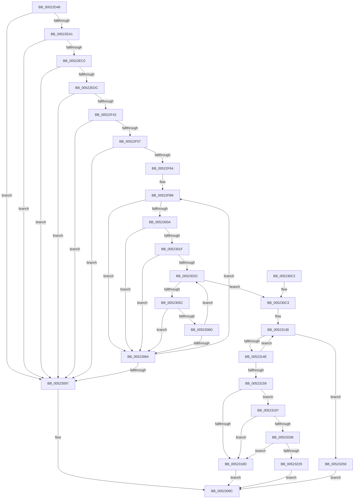

# SymCryptRsakeyCalculatePrimesFromPrivateExponent

- RVA: `0x00522D48`–`0x00523263` (길이 `1,307` bytes)
- VA: `0x0000000140522D48`
- 실행 섹션: `.text`
- PDB 이름 있음: `예`; PDB Function 태그: `예`
- unwind 정보 RVA: `0x000C3208`
- 디코드: `339`개 명령, `1,307/1,307` bytes 표시
- 미해석 바이트: `0` (있으면 어셈블리에 `.byte`로 보존)

> 이 문서는 커널 이미지의 기계어와 PDB 기호를 분석해 생성했습니다. 4번과 5번은 함수 원형과 자료형을 바이너리 사용 방식에서 추정한 C 해석이며 원본 소스 복구 결과는 아닙니다.

## 1. Dependencies

- 직접 호출 지점: **50**; 고유 호출 대상: **29**
- 직접 호출자로 확인된 함수: **1**
- RIP 상대 이미지 참조: **1**

### Outgoing calls
- `0x00522D8D` → [SymCryptSizeofIntFromDigits](SymCryptSizeofIntFromDigits_function_00525D24.md) (function, `0x00525D24`)
- `0x00522DA0` → [SymCryptDigitsFromBits](SymCryptDigitsFromBits_function_0052544C.md) (function, `0x0052544C`)
- `0x00522DA9` → [SymCryptSizeofIntFromDigits](SymCryptSizeofIntFromDigits_function_00525D24.md) (function, `0x00525D24`)
- `0x00522DBB` → [SymCryptSizeofIntFromDigits](SymCryptSizeofIntFromDigits_function_00525D24.md) (function, `0x00525D24`)
- `0x00522DF1` → [SymCryptIntCreate](SymCryptIntCreate_function_0052556C.md) (function, `0x0052556C`)
- `0x00522E05` → [SymCryptIntCreate](SymCryptIntCreate_function_0052556C.md) (function, `0x0052556C`)
- `0x00522E24` → [SymCryptIntCreate](SymCryptIntCreate_function_0052556C.md) (function, `0x0052556C`)
- `0x00522E3C` → [SymCryptModElementCreate](SymCryptModElementCreate_function_00525900.md) (function, `0x00525900`)
- `0x00522E51` → [SymCryptModElementCreate](SymCryptModElementCreate_function_00525900.md) (function, `0x00525900`)
- `0x00522E65` → [SymCryptModElementCreate](SymCryptModElementCreate_function_00525900.md) (function, `0x00525900`)
- `0x00522E7B` → [SymCryptModElementCreate](SymCryptModElementCreate_function_00525900.md) (function, `0x00525900`)
- `0x00522E8C` → [SymCryptIntFromModulus](SymCryptIntFromModulus_function_00525608.md) (function, `0x00525608`)
- `0x00522E94` → [SymCryptIntGetValueLsbits32](SymCryptIntGetValueLsbits32_function_00525668.md) (function, `0x00525668`)
- `0x00522EB3` → [SymCryptIntSetValue](SymCryptIntSetValue_function_00525730.md) (function, `0x00525730`)
- `0x00522EC4` → [SymCryptIntFromModulus](SymCryptIntFromModulus_function_00525608.md) (function, `0x00525608`)
- `0x00522ECF` → [SymCryptIntIsLessThan](SymCryptIntIsLessThan_function_005256C8.md) (function, `0x005256C8`)
- `0x00522EE3` → [SymCryptIntSetValueUint64](SymCryptIntSetValueUint64_function_00525760.md) (function, `0x00525760`)
- `0x00522EEB` → [SymCryptIntBitsizeOfValue](SymCryptIntBitsizeOfValue_function_005254F4.md) (function, `0x005254F4`)
- `0x00522F2D` → [SymCryptIntMulMixedSize](SymCryptIntMulMixedSize_function_005256F8.md) (function, `0x005256F8`)
- `0x00522F35` → [SymCryptIntGetValueLsbits64](SymCryptIntGetValueLsbits64_function_00525680.md) (function, `0x00525680`)
- `0x00522F6C` → [SymCryptIntDivPow2](SymCryptIntDivPow2_function_005255B0.md) (function, `0x005255B0`)
- `0x00522F87` → [SymCryptModElementSetValueUint32](SymCryptModElementSetValueUint32_function_00525A40.md) (function, `0x00525A40`)
- `0x00522FA2` → [SymCryptModElementSetValueNegUint32](SymCryptModElementSetValueNegUint32_function_00525A20.md) (function, `0x00525A20`)
- `0x00522FC8` → [SymCryptModSetRandom](SymCryptModSetRandom_function_00525C18.md) (function, `0x00525C18`)
- `0x00522FF0` → [SymCryptModExp](SymCryptModExp_function_00525B28.md) (function, `0x00525B28`)
- `0x00523001` → [SymCryptModElementIsEqual](SymCryptModElementIsEqual_function_0052594C.md) (function, `0x0052594C`)
- `0x00523016` → [SymCryptModElementIsEqual](SymCryptModElementIsEqual_function_0052594C.md) (function, `0x0052594C`)
- `0x0052303E` → [SymCryptModSquare](SymCryptModSquare_function_00525C84.md) (function, `0x00525C84`)
- `0x0052304F` → [SymCryptModElementIsEqual](SymCryptModElementIsEqual_function_0052594C.md) (function, `0x0052594C`)
- `0x00523064` → [SymCryptModElementIsEqual](SymCryptModElementIsEqual_function_0052594C.md) (function, `0x0052594C`)
- `0x005230A9` → [_security_check_cookie](../6A/_security_check_cookie_function_006AC640.md) (function, `0x006AC640`)
- `0x005230D1` → [SymCryptModElementToInt](SymCryptModElementToInt_function_00525AB0.md) (function, `0x00525AB0`)
- `0x005230E1` → [SymCryptIntSubUint32](SymCryptIntSubUint32_function_005257C0.md) (function, `0x005257C0`)
- `0x005230EA` → [SymCryptIntFromModulus](SymCryptIntFromModulus_function_00525608.md) (function, `0x00525608`)
- `0x00523118` → [SymCryptIntExtendedGcd](SymCryptIntExtendedGcd_function_0052AD54.md) (function, `0x0052AD54`)
- `0x00523120` → [SymCryptIntBitsizeOfValue](SymCryptIntBitsizeOfValue_function_005254F4.md) (function, `0x005254F4`)
- `0x0052313A` → [SymCryptDigitsFromBits](SymCryptDigitsFromBits_function_0052544C.md) (function, `0x0052544C`)
- `0x0052316D` → [SymCryptRsakeyCreateAllObjects](SymCryptRsakeyCreateAllObjects_function_00523720.md) (function, `0x00523720`)
- `0x00523179` → [SymCryptIntFromModulus](SymCryptIntFromModulus_function_00525608.md) (function, `0x00525608`)
- `0x00523184` → [SymCryptIntCopyMixedSize](SymCryptIntCopyMixedSize_function_00525554.md) (function, `0x00525554`)
- `0x005231A1` → [SymCryptIntFromModulus](SymCryptIntFromModulus_function_00525608.md) (function, `0x00525608`)
- `0x005231C2` → [SymCryptIntToModulus](SymCryptIntToModulus_function_00525824.md) (function, `0x00525824`)
- `0x005231CE` → [SymCryptDivisorFromModulus](SymCryptDivisorFromModulus_function_0052547C.md) (function, `0x0052547C`)
- `0x005231DA` → [SymCryptIntFromModulus](SymCryptIntFromModulus_function_00525608.md) (function, `0x00525608`)
- `0x005231F5` → [SymCryptIntDivMod](SymCryptIntDivMod_function_00525584.md) (function, `0x00525584`)
- `0x005231FF` → [SymCryptIntIsEqualUint32](SymCryptIntIsEqualUint32_function_005256B0.md) (function, `0x005256B0`)
- `0x0052320F` → [SymCryptIntFromModulus](SymCryptIntFromModulus_function_00525608.md) (function, `0x00525608`)
- `0x0052321A` → [SymCryptIntCopyMixedSize](SymCryptIntCopyMixedSize_function_00525554.md) (function, `0x00525554`)
- `0x00523233` → [SymCryptIntFromModulus](SymCryptIntFromModulus_function_00525608.md) (function, `0x00525608`)
- `0x0052324F` → [SymCryptIntToModulus](SymCryptIntToModulus_function_00525824.md) (function, `0x00525824`)

### Direct callers
- [SymCryptRsakeySetValueInternal](SymCryptRsakeySetValueInternal_function_005238D4.md) at `0x00523ECB`

### Static image references
- `0x00522D5C` → RVA `0x00E0A740` (`.data`; read)

## 2. Other-region calls and transfers

- 다른 실행 섹션으로 향하는 call: **0**
- 별도 외부 분기/꼬리 이동을 확인하지 못했습니다.

## 3. Assembly (complete function range)

```asm
00522D48  40 53                           push rbx
00522D4A  55                              push rbp
00522D4B  56                              push rsi
00522D4C  57                              push rdi
00522D4D  41 54                           push r12
00522D4F  41 55                           push r13
00522D51  41 56                           push r14
00522D53  41 57                           push r15
00522D55  48 81 EC A8 00 00 00            sub rsp, 0xa8
00522D5C  48 8B 05 DD 79 8E 00            mov rax, qword ptr [rip + 0x8e79dd]
00522D63  48 33 C4                        xor rax, rsp
00522D66  48 89 84 24 90 00 00 00         mov qword ptr [rsp + 0x90], rax
00522D6E  8B 79 14                        mov edi, dword ptr [rcx + 0x14]
00522D71  4C 8B F9                        mov r15, rcx
00522D74  4C 8B B4 24 10 01 00 00         mov r14, qword ptr [rsp + 0x110]
00522D7C  8B CF                           mov ecx, edi
00522D7E  44 89 4C 24 54                  mov dword ptr [rsp + 0x54], r9d
00522D83  4C 89 44 24 58                  mov qword ptr [rsp + 0x58], r8
00522D88  48 89 54 24 78                  mov qword ptr [rsp + 0x78], rdx
00522D8D  E8 92 2F 00 00                  call 0x140525d24
00522D92  8B D8                           mov ebx, eax
00522D94  B9 40 00 00 00                  mov ecx, 0x40
00522D99  89 9C 24 88 00 00 00            mov dword ptr [rsp + 0x88], ebx
00522DA0  E8 A7 26 00 00                  call 0x14052544c
00522DA5  8B C8                           mov ecx, eax
00522DA7  8B F0                           mov esi, eax
00522DA9  E8 76 2F 00 00                  call 0x140525d24
00522DAE  44 8B E0                        mov r12d, eax
00522DB1  8D 2C 3E                        lea ebp, [rsi + rdi]
00522DB4  8B CD                           mov ecx, ebp
00522DB6  44 89 64 24 64                  mov dword ptr [rsp + 0x64], r12d
00522DBB  E8 64 2F 00 00                  call 0x140525d24
00522DC0  41 8B 4F 10                     mov ecx, dword ptr [r15 + 0x10]
00522DC4  44 8B C7                        mov r8d, edi
00522DC7  44 8B E9                        mov r13d, ecx
00522DCA  89 44 24 50                     mov dword ptr [rsp + 0x50], eax
00522DCE  B8 FF 01 00 00                  mov eax, 0x1ff
00522DD3  C1 E9 09                        shr ecx, 9
00522DD6  44 23 E8                        and r13d, eax
00522DD9  8B D3                           mov edx, ebx
00522DDB  44 03 E8                        add r13d, eax
00522DDE  41 C1 ED 09                     shr r13d, 9
00522DE2  44 03 E9                        add r13d, ecx
00522DE5  49 8B CE                        mov rcx, r14
00522DE8  41 C1 E5 06                     shl r13d, 6
00522DEC  44 89 6C 24 60                  mov dword ptr [rsp + 0x60], r13d
00522DF1  E8 76 27 00 00                  call 0x14052556c
00522DF6  4C 03 F3                        add r14, rbx
00522DF9  44 8B C6                        mov r8d, esi
00522DFC  49 8B CE                        mov rcx, r14
00522DFF  41 8B D4                        mov edx, r12d
00522E02  48 8B F8                        mov rdi, rax
00522E05  E8 62 27 00 00                  call 0x14052556c
00522E0A  8B 5C 24 50                     mov ebx, dword ptr [rsp + 0x50]
00522E0E  4D 03 F4                        add r14, r12
00522E11  8B D3                           mov edx, ebx
00522E13  48 89 84 24 80 00 00 00         mov qword ptr [rsp + 0x80], rax
00522E1B  49 8B CE                        mov rcx, r14
00522E1E  44 8B C5                        mov r8d, ebp
00522E21  48 8B F0                        mov rsi, rax
00522E24  E8 43 27 00 00                  call 0x14052556c
00522E29  4D 8B 47 78                     mov r8, qword ptr [r15 + 0x78]
00522E2D  4C 03 F3                        add r14, rbx
00522E30  49 8B CE                        mov rcx, r14
00522E33  41 8B D5                        mov edx, r13d
00522E36  4C 8B E0                        mov r12, rax
00522E39  41 8B DD                        mov ebx, r13d
00522E3C  E8 BF 2A 00 00                  call 0x140525900
00522E41  4D 8B 47 78                     mov r8, qword ptr [r15 + 0x78]
00522E45  4C 03 F3                        add r14, rbx
00522E48  49 8B CE                        mov rcx, r14
00522E4B  41 8B D5                        mov edx, r13d
00522E4E  48 8B E8                        mov rbp, rax
00522E51  E8 AA 2A 00 00                  call 0x140525900
00522E56  4D 8B 47 78                     mov r8, qword ptr [r15 + 0x78]
00522E5A  4C 03 F3                        add r14, rbx
00522E5D  49 8B CE                        mov rcx, r14
00522E60  8B D3                           mov edx, ebx
00522E62  4C 8B E8                        mov r13, rax
00522E65  E8 96 2A 00 00                  call 0x140525900
00522E6A  4D 8B 47 78                     mov r8, qword ptr [r15 + 0x78]
00522E6E  4C 03 F3                        add r14, rbx
00522E71  49 8B CE                        mov rcx, r14
00522E74  48 89 44 24 68                  mov qword ptr [rsp + 0x68], rax
00522E79  8B D3                           mov edx, ebx
00522E7B  E8 80 2A 00 00                  call 0x140525900
00522E80  49 8B 4F 78                     mov rcx, qword ptr [r15 + 0x78]
00522E84  4C 03 F3                        add r14, rbx
00522E87  48 89 44 24 70                  mov qword ptr [rsp + 0x70], rax
00522E8C  E8 77 27 00 00                  call 0x140525608
00522E91  48 8B C8                        mov rcx, rax
00522E94  E8 CF 27 00 00                  call 0x140525668
00522E99  A8 01                           test al, 1
00522E9B  0F 84 F6 01 00 00               je 0x140523097
00522EA1  44 8B 44 24 54                  mov r8d, dword ptr [rsp + 0x54]
00522EA6  4C 8B CF                        mov r9, rdi
00522EA9  48 8B 54 24 58                  mov rdx, qword ptr [rsp + 0x58]
00522EAE  48 8B 4C 24 78                  mov rcx, qword ptr [rsp + 0x78]
00522EB3  E8 78 28 00 00                  call 0x140525730
00522EB8  85 C0                           test eax, eax
00522EBA  0F 85 D7 01 00 00               jne 0x140523097
00522EC0  49 8B 4F 78                     mov rcx, qword ptr [r15 + 0x78]
00522EC4  E8 3F 27 00 00                  call 0x140525608
00522EC9  48 8B D0                        mov rdx, rax
00522ECC  48 8B CF                        mov rcx, rdi
00522ECF  E8 F4 27 00 00                  call 0x1405256c8
00522ED4  85 C0                           test eax, eax
00522ED6  0F 84 BB 01 00 00               je 0x140523097
00522EDC  49 8B 4F 38                     mov rcx, qword ptr [r15 + 0x38]
00522EE0  48 8B D6                        mov rdx, rsi
00522EE3  E8 78 28 00 00                  call 0x140525760
00522EE8  48 8B CE                        mov rcx, rsi
00522EEB  E8 04 26 00 00                  call 0x1405254f4
00522EF0  8B 4C 24 60                     mov ecx, dword ptr [rsp + 0x60]
00522EF4  4D 8B CE                        mov r9, r14
00522EF7  8B B4 24 18 01 00 00            mov esi, dword ptr [rsp + 0x118]
00522EFE  4D 8B C4                        mov r8, r12
00522F01  41 03 47 10                     add eax, dword ptr [r15 + 0x10]
00522F05  48 8B 94 24 80 00 00 00         mov rdx, qword ptr [rsp + 0x80]
00522F0D  C1 E1 02                        shl ecx, 2
00522F10  2B F1                           sub esi, ecx
00522F12  89 44 24 58                     mov dword ptr [rsp + 0x58], eax
00522F16  2B 74 24 50                     sub esi, dword ptr [rsp + 0x50]
00522F1A  48 8B CF                        mov rcx, rdi
00522F1D  2B 74 24 64                     sub esi, dword ptr [rsp + 0x64]
00522F21  2B B4 24 88 00 00 00            sub esi, dword ptr [rsp + 0x88]
00522F28  48 89 74 24 20                  mov qword ptr [rsp + 0x20], rsi
00522F2D  E8 C6 27 00 00                  call 0x1405256f8
00522F32  49 8B CC                        mov rcx, r12
00522F35  E8 46 27 00 00                  call 0x140525680
00522F3A  A8 01                           test al, 1
00522F3C  0F 84 55 01 00 00               je 0x140523097
00522F42  C7 84 24 88 00 00 00 00 00 00 00  mov dword ptr [rsp + 0x88], 0
00522F4D  48 83 E8 01                     sub rax, 1
00522F51  0F 84 40 01 00 00               je 0x140523097
00522F57  48 0F BC D8                     bsf rbx, rax
00522F5B  83 FB 40                        cmp ebx, 0x40
00522F5E  0F 84 33 01 00 00               je 0x140523097
00522F64  8B D3                           mov edx, ebx
00522F66  4D 8B C4                        mov r8, r12
00522F69  49 8B CC                        mov rcx, r12
00522F6C  E8 3F 26 00 00                  call 0x1405255b0
00522F71  4C 8B 44 24 68                  mov r8, qword ptr [rsp + 0x68]
00522F76  4D 8B CE                        mov r9, r14
00522F79  49 8B 57 78                     mov rdx, qword ptr [r15 + 0x78]
00522F7D  B9 01 00 00 00                  mov ecx, 1
00522F82  48 89 74 24 20                  mov qword ptr [rsp + 0x20], rsi
00522F87  E8 B4 2A 00 00                  call 0x140525a40
00522F8C  4C 8B 44 24 70                  mov r8, qword ptr [rsp + 0x70]
00522F91  4D 8B CE                        mov r9, r14
00522F94  49 8B 57 78                     mov rdx, qword ptr [r15 + 0x78]
00522F98  B9 01 00 00 00                  mov ecx, 1
00522F9D  48 89 74 24 20                  mov qword ptr [rsp + 0x20], rsi
00522FA2  E8 79 2A 00 00                  call 0x140525a20
00522FA7  8B 44 24 58                     mov eax, dword ptr [rsp + 0x58]
00522FAB  83 64 24 54 00                  and dword ptr [rsp + 0x54], 0
00522FB0  FF C8                           dec eax
00522FB2  89 44 24 58                     mov dword ptr [rsp + 0x58], eax
00522FB6  49 8B 4F 78                     mov rcx, qword ptr [r15 + 0x78]
00522FBA  4D 8B CE                        mov r9, r14
00522FBD  45 33 C0                        xor r8d, r8d
00522FC0  48 89 74 24 20                  mov qword ptr [rsp + 0x20], rsi
00522FC5  48 8B D5                        mov rdx, rbp
00522FC8  E8 4B 2C 00 00                  call 0x140525c18
00522FCD  44 8B 4C 24 58                  mov r9d, dword ptr [rsp + 0x58]
00522FD2  4D 8B C4                        mov r8, r12
00522FD5  49 8B 4F 78                     mov rcx, qword ptr [r15 + 0x78]
00522FD9  48 8B D5                        mov rdx, rbp
00522FDC  48 89 74 24 38                  mov qword ptr [rsp + 0x38], rsi
00522FE1  4C 89 74 24 30                  mov qword ptr [rsp + 0x30], r14
00522FE6  48 89 6C 24 28                  mov qword ptr [rsp + 0x28], rbp
00522FEB  83 64 24 20 00                  and dword ptr [rsp + 0x20], 0
00522FF0  E8 33 2B 00 00                  call 0x140525b28
00522FF5  4C 8B 44 24 68                  mov r8, qword ptr [rsp + 0x68]
00522FFA  48 8B D5                        mov rdx, rbp
00522FFD  49 8B 4F 78                     mov rcx, qword ptr [r15 + 0x78]
00523001  E8 46 29 00 00                  call 0x14052594c
00523006  85 C0                           test eax, eax
00523008  75 7A                           jne 0x140523084
0052300A  4C 8B 44 24 70                  mov r8, qword ptr [rsp + 0x70]
0052300F  48 8B D5                        mov rdx, rbp
00523012  49 8B 4F 78                     mov rcx, qword ptr [r15 + 0x78]
00523016  E8 31 29 00 00                  call 0x14052594c
0052301B  85 C0                           test eax, eax
0052301D  75 65                           jne 0x140523084
0052301F  C7 44 24 50 01 00 00 00         mov dword ptr [rsp + 0x50], 1
00523027  83 FB 01                        cmp ebx, 1
0052302A  72 58                           jb 0x140523084
0052302C  49 8B 4F 78                     mov rcx, qword ptr [r15 + 0x78]
00523030  4D 8B CE                        mov r9, r14
00523033  4D 8B C5                        mov r8, r13
00523036  48 89 74 24 20                  mov qword ptr [rsp + 0x20], rsi
0052303B  48 8B D5                        mov rdx, rbp
0052303E  E8 41 2C 00 00                  call 0x140525c84
00523043  4C 8B 44 24 68                  mov r8, qword ptr [rsp + 0x68]
00523048  49 8B D5                        mov rdx, r13
0052304B  49 8B 4F 78                     mov rcx, qword ptr [r15 + 0x78]
0052304F  E8 F8 28 00 00                  call 0x14052594c
00523054  49 8B 4F 78                     mov rcx, qword ptr [r15 + 0x78]
00523058  85 C0                           test eax, eax
0052305A  75 67                           jne 0x1405230c3
0052305C  4C 8B 44 24 70                  mov r8, qword ptr [rsp + 0x70]
00523061  49 8B D5                        mov rdx, r13
00523064  E8 E3 28 00 00                  call 0x14052594c
00523069  85 C0                           test eax, eax
0052306B  75 17                           jne 0x140523084
0052306D  48 8B C5                        mov rax, rbp
00523070  49 8B ED                        mov rbp, r13
00523073  4C 8B E8                        mov r13, rax
00523076  8B 44 24 50                     mov eax, dword ptr [rsp + 0x50]
0052307A  FF C0                           inc eax
0052307C  89 44 24 50                     mov dword ptr [rsp + 0x50], eax
00523080  3B C3                           cmp eax, ebx
00523082  76 A8                           jbe 0x14052302c
00523084  8B 44 24 54                     mov eax, dword ptr [rsp + 0x54]
00523088  FF C0                           inc eax
0052308A  89 44 24 54                     mov dword ptr [rsp + 0x54], eax
0052308E  83 F8 64                        cmp eax, 0x64
00523091  0F 82 1F FF FF FF               jb 0x140522fb6
00523097  BF 0E 80 00 00                  mov edi, 0x800e
0052309C  8B C7                           mov eax, edi
0052309E  48 8B 8C 24 90 00 00 00         mov rcx, qword ptr [rsp + 0x90]
005230A6  48 33 CC                        xor rcx, rsp
005230A9  E8 92 95 18 00                  call 0x1406ac640
005230AE  48 81 C4 A8 00 00 00            add rsp, 0xa8
005230B5  41 5F                           pop r15
005230B7  41 5E                           pop r14
005230B9  41 5D                           pop r13
005230BB  41 5C                           pop r12
005230BD  5F                              pop rdi
005230BE  5E                              pop rsi
005230BF  5D                              pop rbp
005230C0  5B                              pop rbx
005230C1  C3                              ret
005230C2  CC                              int3
005230C3  4D 8B CE                        mov r9, r14
005230C6  48 89 74 24 20                  mov qword ptr [rsp + 0x20], rsi
005230CB  4C 8B C7                        mov r8, rdi
005230CE  48 8B D5                        mov rdx, rbp
005230D1  E8 DA 29 00 00                  call 0x140525ab0
005230D6  4C 8B C7                        mov r8, rdi
005230D9  BA 01 00 00 00                  mov edx, 1
005230DE  48 8B CF                        mov rcx, rdi
005230E1  E8 DA 26 00 00                  call 0x1405257c0
005230E6  49 8B 4F 78                     mov rcx, qword ptr [r15 + 0x78]
005230EA  E8 19 25 00 00                  call 0x140525608
005230EF  45 33 ED                        xor r13d, r13d
005230F2  48 89 74 24 40                  mov qword ptr [rsp + 0x40], rsi
005230F7  4C 89 74 24 38                  mov qword ptr [rsp + 0x38], r14
005230FC  48 8B D0                        mov rdx, rax
005230FF  4C 89 6C 24 30                  mov qword ptr [rsp + 0x30], r13
00523104  4C 8B CF                        mov r9, rdi
00523107  4C 89 6C 24 28                  mov qword ptr [rsp + 0x28], r13
0052310C  48 8B CF                        mov rcx, rdi
0052310F  45 8D 45 02                     lea r8d, [r13 + 2]
00523113  4C 89 6C 24 20                  mov qword ptr [rsp + 0x20], r13
00523118  E8 37 7C 00 00                  call 0x14052ad54
0052311D  48 8B CF                        mov rcx, rdi
00523120  E8 CF 23 00 00                  call 0x1405254f4
00523125  49 8D 5F 20                     lea rbx, [r15 + 0x20]
00523129  41 8B ED                        mov ebp, r13d
0052312C  89 03                           mov dword ptr [rbx], eax
0052312E  41 8B 4F 10                     mov ecx, dword ptr [r15 + 0x10]
00523132  2B C8                           sub ecx, eax
00523134  41 89 4F 24                     mov dword ptr [r15 + 0x24], ecx
00523138  8B 0B                           mov ecx, dword ptr [rbx]
0052313A  E8 0D 23 00 00                  call 0x14052544c
0052313F  81 3B 80 00 00 00               cmp dword ptr [rbx], 0x80
00523145  89 43 08                        mov dword ptr [rbx + 8], eax
00523148  0F 82 0B 01 00 00               jb 0x140523259
0052314E  FF C5                           inc ebp
00523150  48 83 C3 04                     add rbx, 4
00523154  83 FD 02                        cmp ebp, 2
00523157  72 DF                           jb 0x140523138
00523159  41 8B 4F 28                     mov ecx, dword ptr [r15 + 0x28]
0052315D  41 8B 47 2C                     mov eax, dword ptr [r15 + 0x2c]
00523161  3B C8                           cmp ecx, eax
00523163  0F 46 C8                        cmovbe ecx, eax
00523166  41 89 4F 30                     mov dword ptr [r15 + 0x30], ecx
0052316A  49 8B CF                        mov rcx, r15
0052316D  E8 AE 05 00 00                  call 0x140523720
00523172  49 8B 8F 80 00 00 00            mov rcx, qword ptr [r15 + 0x80]
00523179  E8 8A 24 00 00                  call 0x140525608
0052317E  48 8B D0                        mov rdx, rax
00523181  48 8B CF                        mov rcx, rdi
00523184  E8 CB 23 00 00                  call 0x140525554
00523189  85 C0                           test eax, eax
0052318B  74 0A                           je 0x140523197
0052318D  BF 0A 80 00 00                  mov edi, 0x800a
00523192  E9 05 FF FF FF                  jmp 0x14052309c
00523197  49 8B 9F 80 00 00 00            mov rbx, qword ptr [r15 + 0x80]
0052319E  48 8B CB                        mov rcx, rbx
005231A1  E8 62 24 00 00                  call 0x140525608
005231A6  45 8B 47 10                     mov r8d, dword ptr [r15 + 0x10]
005231AA  BD 0A 00 00 00                  mov ebp, 0xa
005231AF  44 8B CD                        mov r9d, ebp
005231B2  48 89 74 24 28                  mov qword ptr [rsp + 0x28], rsi
005231B7  48 8B C8                        mov rcx, rax
005231BA  4C 89 74 24 20                  mov qword ptr [rsp + 0x20], r14
005231BF  48 8B D3                        mov rdx, rbx
005231C2  E8 5D 26 00 00                  call 0x140525824
005231C7  49 8B 8F 80 00 00 00            mov rcx, qword ptr [r15 + 0x80]
005231CE  E8 A9 22 00 00                  call 0x14052547c
005231D3  49 8B 4F 78                     mov rcx, qword ptr [r15 + 0x78]
005231D7  48 8B D8                        mov rbx, rax
005231DA  E8 29 24 00 00                  call 0x140525608
005231DF  48 8B C8                        mov rcx, rax
005231E2  48 89 74 24 28                  mov qword ptr [rsp + 0x28], rsi
005231E7  4C 8B CF                        mov r9, rdi
005231EA  4C 89 74 24 20                  mov qword ptr [rsp + 0x20], r14
005231EF  4D 8B C4                        mov r8, r12
005231F2  48 8B D3                        mov rdx, rbx
005231F5  E8 8A 23 00 00                  call 0x140525584
005231FA  33 D2                           xor edx, edx
005231FC  48 8B CF                        mov rcx, rdi
005231FF  E8 AC 24 00 00                  call 0x1405256b0
00523204  85 C0                           test eax, eax
00523206  74 85                           je 0x14052318d
00523208  49 8B 8F 88 00 00 00            mov rcx, qword ptr [r15 + 0x88]
0052320F  E8 F4 23 00 00                  call 0x140525608
00523214  48 8B D0                        mov rdx, rax
00523217  49 8B CC                        mov rcx, r12
0052321A  E8 35 23 00 00                  call 0x140525554
0052321F  8B F8                           mov edi, eax
00523221  85 C0                           test eax, eax
00523223  0F 85 64 FF FF FF               jne 0x14052318d
00523229  49 8B 9F 88 00 00 00            mov rbx, qword ptr [r15 + 0x88]
00523230  48 8B CB                        mov rcx, rbx
00523233  E8 D0 23 00 00                  call 0x140525608
00523238  45 8B 47 10                     mov r8d, dword ptr [r15 + 0x10]
0052323C  48 8B C8                        mov rcx, rax
0052323F  44 8B CD                        mov r9d, ebp
00523242  48 89 74 24 28                  mov qword ptr [rsp + 0x28], rsi
00523247  48 8B D3                        mov rdx, rbx
0052324A  4C 89 74 24 20                  mov qword ptr [rsp + 0x20], r14
0052324F  E8 D0 25 00 00                  call 0x140525824
00523254  E9 43 FE FF FF                  jmp 0x14052309c
00523259  BF 01 80 00 00                  mov edi, 0x8001
0052325E  E9 39 FE FF FF                  jmp 0x14052309c
```

## 4. C-style interpretation (structured pseudocode)

```c
__int64 __fastcall SymCryptRsakeyCalculatePrimesFromPrivateExponent(__int64 a1, __int64 a2, __int64 a3, int a4, __int64 a5, unsigned int a6)
{
    __int64 result;
    __int64 v_r13;
    __int64 v_r14;
    __int64 v_rbp;
    __int64 v_rbx;
    __int64 v_rsi;
    __int64 v_rsp;
    unsigned __int64 v_stack_m58;
    unsigned int v_stack_m60;
    unsigned __int64 v_stack_m68;
    unsigned __int64 v_stack_m70;
    unsigned __int64 v_stack_m78;
    unsigned __int64 v_stack_m80;
    unsigned int v_stack_m84;
    unsigned int v_stack_m88;
    unsigned __int64 v_stack_m90;
    unsigned int v_stack_m94;
    unsigned int v_stack_m98;
    unsigned __int64 v_stack_mB0;
    unsigned __int64 v_stack_mB8;
    unsigned __int64 v_stack_mC0;
    unsigned __int64 v_stack_mC8;
    unsigned __int64 v_stack_p20;
    unsigned __int64 v_stack_p28;
    unsigned __int64 v_stack_p30;
    unsigned __int64 v_stack_p38;
    unsigned __int64 v_stack_p40;

    v_rsp = (v_rsp) - (168);
    result = (*(unsigned __int64 *)(v_rip + 9337309)) ^ (v_rsp);
    v_stack_m58 = result;
    v_stack_m94 = a4;
    v_stack_m90 = a3;
    v_stack_m70 = a2;
    result = SymCryptSizeofIntFromDigits((unsigned int)((unsigned int)((unsigned int)(*(unsigned int *)(a1 + 20)))), a2, a3, a4);
    v_stack_m60 = (unsigned int)((unsigned int)((unsigned int)(result)));
    result = SymCryptDigitsFromBits(64, a2, a3, a4);
    result = SymCryptSizeofIntFromDigits((unsigned int)((unsigned int)(result)), a2, a3, a4);
    v_stack_m84 = (unsigned int)((unsigned int)((unsigned int)(result)));
    result = SymCryptSizeofIntFromDigits((unsigned int)((unsigned int)((unsigned int)((unsigned int)(result)) + (unsigned int)(*(unsigned int *)(a1 + 20)) * 1)), a2, a3, a4);
    v_stack_m98 = (unsigned int)(result);
    a1 = (unsigned int)(((unsigned int)(*(unsigned int *)(a1 + 16))) >> (9));
    v_r13 = (unsigned int)(((unsigned int)((unsigned int)((unsigned int)(*(unsigned int *)(a1 + 16))))) & (511));
    v_r13 = (unsigned int)((v_r13) + (511));
    v_r13 = (unsigned int)((v_r13) >> (9));
    v_r13 = (unsigned int)((v_r13) + ((unsigned int)(a1)));
    v_r13 = (unsigned int)((v_r13) << (6));
    v_stack_m88 = (unsigned int)(v_r13);
    result = SymCryptIntCreate(a5, (unsigned int)((unsigned int)((unsigned int)((unsigned int)(result)))), (unsigned int)((unsigned int)((unsigned int)(*(unsigned int *)(a1 + 20)))), a4);
    v_r14 = (a5) + ((unsigned int)((unsigned int)(result)));
    result = SymCryptIntCreate(v_r14, (unsigned int)((unsigned int)((unsigned int)((unsigned int)(result)))), (unsigned int)((unsigned int)((unsigned int)((unsigned int)(result)))), a4);
    v_r14 = (v_r14) + ((unsigned int)((unsigned int)(result)));
    v_stack_m68 = result;
    result = SymCryptIntCreate(v_r14, (unsigned int)((unsigned int)((unsigned int)(v_stack_m98))), (unsigned int)((unsigned int)((unsigned int)((unsigned int)(result)) + (unsigned int)(*(unsigned int *)(a1 + 20)) * 1)), a4);
    v_r14 = (v_r14) + ((unsigned int)(v_stack_m98));
    result = SymCryptModElementCreate(v_r14, (unsigned int)((unsigned int)(v_r13)), *(unsigned __int64 *)(a1 + 120), a4);
    v_r14 = (v_r14) + ((unsigned int)((unsigned int)(v_r13)));
    result = SymCryptModElementCreate(v_r14, (unsigned int)((unsigned int)(v_r13)), *(unsigned __int64 *)(a1 + 120), a4);
    v_r14 = (v_r14) + ((unsigned int)((unsigned int)(v_r13)));
    result = SymCryptModElementCreate(v_r14, (unsigned int)((unsigned int)((unsigned int)((unsigned int)(v_r13)))), *(unsigned __int64 *)(a1 + 120), a4);
    v_r14 = (v_r14) + ((unsigned int)((unsigned int)(v_r13)));
    v_stack_m80 = result;
    result = SymCryptModElementCreate(v_r14, (unsigned int)((unsigned int)((unsigned int)((unsigned int)(v_r13)))), *(unsigned __int64 *)(a1 + 120), a4);
    v_r14 = (v_r14) + ((unsigned int)((unsigned int)(v_r13)));
    v_stack_m78 = result;
    result = SymCryptIntFromModulus(*(unsigned __int64 *)(a1 + 120), (unsigned int)((unsigned int)((unsigned int)((unsigned int)(v_r13)))), *(unsigned __int64 *)(a1 + 120), a4);
    result = SymCryptIntGetValueLsbits32(result, (unsigned int)((unsigned int)((unsigned int)((unsigned int)(v_r13)))), *(unsigned __int64 *)(a1 + 120), a4);
    if ((((unsigned __int8)(result)) & (1)) == 0) goto loc_00523097;
    result = SymCryptIntSetValue(v_stack_m70, v_stack_m90, (unsigned int)(v_stack_m94), result);
    if ((unsigned int)(result) != 0) goto loc_00523097;
    result = SymCryptIntFromModulus(*(unsigned __int64 *)(a1 + 120), v_stack_m90, (unsigned int)(v_stack_m94), result);
    result = SymCryptIntIsLessThan(result, result, (unsigned int)(v_stack_m94), result);
    if ((unsigned int)(result) == 0) goto loc_00523097;
    result = SymCryptIntSetValueUint64(*(unsigned __int64 *)(a1 + 56), result, (unsigned int)(v_stack_m94), result);
    result = SymCryptIntBitsizeOfValue(result, result, (unsigned int)(v_stack_m94), result);
    result = (unsigned int)((result) + (*(unsigned int *)(a1 + 16)));
    a1 = (unsigned int)(((unsigned int)(v_stack_m88)) << (2));
    v_rsi = (unsigned int)(((unsigned int)(a6)) - ((unsigned int)(a1)));
    v_stack_m90 = (unsigned int)(result);
    v_rsi = (unsigned int)((v_rsi) - (v_stack_m98));
    v_rsi = (unsigned int)((v_rsi) - (v_stack_m84));
    v_rsi = (unsigned int)((v_rsi) - (v_stack_m60));
    v_stack_mC8 = v_rsi;
    result = SymCryptIntMulMixedSize(result, v_stack_m68, result, v_r14);
    result = SymCryptIntGetValueLsbits64(result, v_stack_m68, result, v_r14);
    if ((((unsigned __int8)(result)) & (1)) == 0) goto loc_00523097;
    v_stack_m60 = 0;
    result = (result) - (1);
    if (condition_is_equal) goto loc_00523097;
    if (((unsigned int)((unsigned int)((unsigned int)(v_r13)))) == 64) goto loc_00523097;
    result = SymCryptIntDivPow2(result, (unsigned int)((unsigned int)((unsigned int)((unsigned int)(v_r13)))), result, v_r14);
    v_stack_mC8 = v_rsi;
    result = SymCryptModElementSetValueUint32(1, *(unsigned __int64 *)(a1 + 120), v_stack_m80, v_r14);
    v_stack_mC8 = v_rsi;
    result = SymCryptModElementSetValueNegUint32(1, *(unsigned __int64 *)(a1 + 120), v_stack_m78, v_r14);
    result = (unsigned int)(((unsigned int)(v_stack_m90)) - 1);
    v_stack_m90 = (unsigned int)(result);
loc_00522FB6:
    a3 = 0;
    v_stack_mC8 = v_rsi;
    result = SymCryptModSetRandom(*(unsigned __int64 *)(a1 + 120), result, a3, v_r14);
    v_stack_mB0 = v_rsi;
    v_stack_mB8 = v_r14;
    v_stack_mC0 = result;
    result = SymCryptModExp(*(unsigned __int64 *)(a1 + 120), result, result, (unsigned int)(v_stack_m90));
    result = SymCryptModElementIsEqual(*(unsigned __int64 *)(a1 + 120), result, v_stack_m80, (unsigned int)(v_stack_m90));
    if ((unsigned int)(result) != 0) goto loc_00523084;
    result = SymCryptModElementIsEqual(*(unsigned __int64 *)(a1 + 120), result, v_stack_m78, (unsigned int)(v_stack_m90));
    if ((unsigned int)(result) != 0) goto loc_00523084;
    v_stack_m98 = 1;
    if (((unsigned int)((unsigned int)((unsigned int)(v_r13)))) < 1) goto loc_00523084;
loc_0052302C:
    v_stack_mC8 = v_rsi;
    result = SymCryptModSquare(*(unsigned __int64 *)(a1 + 120), result, result, v_r14);
    result = SymCryptModElementIsEqual(*(unsigned __int64 *)(a1 + 120), result, v_stack_m80, v_r14);
    if ((unsigned int)(result) != 0) goto loc_005230C3;
    result = SymCryptModElementIsEqual(*(unsigned __int64 *)(a1 + 120), result, v_stack_m78, v_r14);
    if ((unsigned int)(result) != 0) goto loc_00523084;
    result = (unsigned int)(((unsigned int)(v_stack_m98)) + 1);
    v_stack_m98 = (unsigned int)(result);
    if (((unsigned int)(result)) <= ((unsigned int)((unsigned int)((unsigned int)(v_r13))))) goto loc_0052302C;
loc_00523084:
    result = (unsigned int)(((unsigned int)(v_stack_m94)) + 1);
    v_stack_m94 = (unsigned int)(result);
    if (((unsigned int)(result)) < 100) goto loc_00522FB6;
loc_00523097:
loc_0052309C:
    a1 = (v_stack_m58) ^ (v_rsp);
    result = _security_check_cookie(a1, result, v_stack_m78, v_r14);
    v_rsp = (v_rsp) + (168);
    return result;
loc_005230C3:
    v_stack_p20 = v_rsi;
    result = SymCryptModElementToInt(a1, result, (unsigned int)(0x800EULL), v_r14);
    result = SymCryptIntSubUint32((unsigned int)(0x800EULL), 1, (unsigned int)(0x800EULL), v_r14);
    result = SymCryptIntFromModulus(*(unsigned __int64 *)(a1 + 120), 1, (unsigned int)(0x800EULL), v_r14);
    v_r13 = 0;
    v_stack_p40 = v_rsi;
    v_stack_p38 = v_r14;
    v_stack_p30 = 0;
    v_stack_p28 = 0;
    v_stack_p20 = 0;
    result = SymCryptIntExtendedGcd((unsigned int)(0x800EULL), result, v_r13 + 2, (unsigned int)(0x800EULL));
    result = SymCryptIntBitsizeOfValue((unsigned int)(0x800EULL), result, v_r13 + 2, (unsigned int)(0x800EULL));
    *(unsigned int *)(a1 + 32) = (unsigned int)(result);
    a1 = (unsigned int)(((unsigned int)(*(unsigned int *)(a1 + 16))) - ((unsigned int)(result)));
    *(unsigned int *)(a1 + 36) = (unsigned int)(a1);
loc_00523138:
    result = SymCryptDigitsFromBits((unsigned int)(*(unsigned int *)(a1 + 32)), result, v_r13 + 2, (unsigned int)(0x800EULL));
    *(unsigned int *)(a1 + 32 + 8) = (unsigned int)(result);
    if ((*(unsigned int *)(a1 + 32)) < 128) goto loc_00523259;
    v_rbp = (unsigned int)((0) + 1);
    v_rbx = (a1 + 32) + (4);
    if (((unsigned int)(v_rbp)) < 2) goto loc_00523138;
    a1 = (unsigned int)(*(unsigned int *)(a1 + 40));
    if (((unsigned int)((unsigned int)(*(unsigned int *)(a1 + 40)))) <= ((unsigned int)((unsigned int)(*(unsigned int *)(a1 + 44))))) { a1 = (unsigned int)((unsigned int)(*(unsigned int *)(a1 + 44))); }
    *(unsigned int *)(a1 + 48) = (unsigned int)(a1);
    result = SymCryptRsakeyCreateAllObjects(a1, result, v_r13 + 2, (unsigned int)(0x800EULL));
    result = SymCryptIntFromModulus(*(unsigned __int64 *)(a1 + 128), result, v_r13 + 2, (unsigned int)(0x800EULL));
    result = SymCryptIntCopyMixedSize((unsigned int)(0x800EULL), result, v_r13 + 2, (unsigned int)(0x800EULL));
    if ((unsigned int)(result) == 0) goto loc_00523197;
loc_0052318D:
    goto loc_0052309C;
loc_00523197:
    result = SymCryptIntFromModulus(*(unsigned __int64 *)(a1 + 128), result, v_r13 + 2, (unsigned int)(0x800EULL));
    v_stack_p28 = v_rsi;
    v_stack_p20 = v_r14;
    result = SymCryptIntToModulus(result, *(unsigned __int64 *)(a1 + 128), (unsigned int)(*(unsigned int *)(a1 + 16)), 10);
    result = SymCryptDivisorFromModulus(*(unsigned __int64 *)(a1 + 128), *(unsigned __int64 *)(a1 + 128), (unsigned int)(*(unsigned int *)(a1 + 16)), 10);
    result = SymCryptIntFromModulus(*(unsigned __int64 *)(a1 + 120), *(unsigned __int64 *)(a1 + 128), (unsigned int)(*(unsigned int *)(a1 + 16)), 10);
    v_stack_p28 = v_rsi;
    v_stack_p20 = v_r14;
    result = SymCryptIntDivMod(result, result, result, (unsigned int)(0x800AULL));
    a2 = 0;
    result = SymCryptIntIsEqualUint32((unsigned int)(0x800AULL), a2, result, (unsigned int)(0x800AULL));
    if ((unsigned int)(result) == 0) goto loc_0052318D;
    result = SymCryptIntFromModulus(*(unsigned __int64 *)(a1 + 136), a2, result, (unsigned int)(0x800AULL));
    result = SymCryptIntCopyMixedSize(result, result, result, (unsigned int)(0x800AULL));
    if ((unsigned int)(result) != 0) goto loc_0052318D;
    result = SymCryptIntFromModulus(*(unsigned __int64 *)(a1 + 136), result, result, (unsigned int)(0x800AULL));
    v_stack_p28 = v_rsi;
    v_stack_p20 = v_r14;
    result = SymCryptIntToModulus(result, *(unsigned __int64 *)(a1 + 136), (unsigned int)(*(unsigned int *)(a1 + 16)), 10);
    goto loc_0052309C;
loc_00523259:
    goto loc_0052309C;
}
```

## 5. (Beta) C Style

```c
int64_t SymCryptRsakeyCalculatePrimesFromPrivateExponent(void *Arg1, int64_t Arg2, int64_t Arg3, int32_t Arg4, int64_t Arg5, uint32_t Arg6)
{
    uint8_t *arg1 = (uint8_t *)Arg1;

    int64_t result;
    int64_t local_r13;
    int64_t local_r14;
    int64_t local_rbp;
    int64_t local_rbx;
    int64_t local_rsi;
    int64_t local_rsp;
    uint64_t v_stack_m58;
    uint32_t v_stack_m60;
    uint64_t v_stack_m68;
    uint64_t v_stack_m70;
    uint64_t v_stack_m78;
    uint64_t v_stack_m80;
    uint32_t v_stack_m84;
    uint32_t v_stack_m88;
    uint64_t v_stack_m90;
    uint32_t v_stack_m94;
    uint32_t v_stack_m98;
    uint64_t v_stack_mB0;
    uint64_t v_stack_mB8;
    uint64_t v_stack_mC0;
    uint64_t v_stack_mC8;
    uint64_t v_stack_p20;
    uint64_t v_stack_p28;
    uint64_t v_stack_p30;
    uint64_t v_stack_p38;
    uint64_t v_stack_p40;

    local_rsp = (local_rsp) - (168);
    result = (*(uint64_t *)(v_rip + 0x8E79DD)) ^ (local_rsp);
    v_stack_m58 = result;
    v_stack_m94 = Arg4;
    v_stack_m90 = Arg3;
    v_stack_m70 = Arg2;
    result = SymCryptSizeofIntFromDigits((uint32_t)((uint32_t)((uint32_t)(*(uint32_t *)(arg1 + 0x14)))), Arg2, Arg3, Arg4);
    v_stack_m60 = (uint32_t)((uint32_t)((uint32_t)(result)));
    result = SymCryptDigitsFromBits(64, Arg2, Arg3, Arg4);
    result = SymCryptSizeofIntFromDigits((uint32_t)((uint32_t)(result)), Arg2, Arg3, Arg4);
    v_stack_m84 = (uint32_t)((uint32_t)((uint32_t)(result)));
    result = SymCryptSizeofIntFromDigits((uint32_t)((uint32_t)((uint32_t)((uint32_t)(result)) + (uint32_t)(*(uint32_t *)(arg1 + 0x14)) * 1)), Arg2, Arg3, Arg4);
    v_stack_m98 = (uint32_t)(result);
    Arg1 = (uint32_t)(((uint32_t)(*(uint32_t *)(arg1 + 0x10))) >> (9));
    local_r13 = (uint32_t)(((uint32_t)((uint32_t)((uint32_t)(*(uint32_t *)(arg1 + 0x10))))) & (511));
    local_r13 = (uint32_t)((local_r13) + (511));
    local_r13 = (uint32_t)((local_r13) >> (9));
    local_r13 = (uint32_t)((local_r13) + ((uint32_t)(Arg1)));
    local_r13 = (uint32_t)((local_r13) << (6));
    v_stack_m88 = (uint32_t)(local_r13);
    result = SymCryptIntCreate(Arg5, (uint32_t)((uint32_t)((uint32_t)((uint32_t)(result)))), (uint32_t)((uint32_t)((uint32_t)(*(uint32_t *)(arg1 + 0x14)))), Arg4);
    local_r14 = (Arg5) + ((uint32_t)((uint32_t)(result)));
    result = SymCryptIntCreate(local_r14, (uint32_t)((uint32_t)((uint32_t)((uint32_t)(result)))), (uint32_t)((uint32_t)((uint32_t)((uint32_t)(result)))), Arg4);
    local_r14 = (local_r14) + ((uint32_t)((uint32_t)(result)));
    v_stack_m68 = result;
    result = SymCryptIntCreate(local_r14, (uint32_t)((uint32_t)((uint32_t)(v_stack_m98))), (uint32_t)((uint32_t)((uint32_t)((uint32_t)(result)) + (uint32_t)(*(uint32_t *)(arg1 + 0x14)) * 1)), Arg4);
    local_r14 = (local_r14) + ((uint32_t)(v_stack_m98));
    result = SymCryptModElementCreate(local_r14, (uint32_t)((uint32_t)(local_r13)), *(uint64_t *)(arg1 + 0x78), Arg4);
    local_r14 = (local_r14) + ((uint32_t)((uint32_t)(local_r13)));
    result = SymCryptModElementCreate(local_r14, (uint32_t)((uint32_t)(local_r13)), *(uint64_t *)(arg1 + 0x78), Arg4);
    local_r14 = (local_r14) + ((uint32_t)((uint32_t)(local_r13)));
    result = SymCryptModElementCreate(local_r14, (uint32_t)((uint32_t)((uint32_t)((uint32_t)(local_r13)))), *(uint64_t *)(arg1 + 0x78), Arg4);
    local_r14 = (local_r14) + ((uint32_t)((uint32_t)(local_r13)));
    v_stack_m80 = result;
    result = SymCryptModElementCreate(local_r14, (uint32_t)((uint32_t)((uint32_t)((uint32_t)(local_r13)))), *(uint64_t *)(arg1 + 0x78), Arg4);
    local_r14 = (local_r14) + ((uint32_t)((uint32_t)(local_r13)));
    v_stack_m78 = result;
    result = SymCryptIntFromModulus(*(uint64_t *)(arg1 + 0x78), (uint32_t)((uint32_t)((uint32_t)((uint32_t)(local_r13)))), *(uint64_t *)(arg1 + 0x78), Arg4);
    result = SymCryptIntGetValueLsbits32(result, (uint32_t)((uint32_t)((uint32_t)((uint32_t)(local_r13)))), *(uint64_t *)(arg1 + 0x78), Arg4);
    if ((((uint8_t)(result)) & (1)) == 0) goto loc_00523097;
    result = SymCryptIntSetValue(v_stack_m70, v_stack_m90, (uint32_t)(v_stack_m94), result);
    if ((uint32_t)(result) != 0) goto loc_00523097;
    result = SymCryptIntFromModulus(*(uint64_t *)(arg1 + 0x78), v_stack_m90, (uint32_t)(v_stack_m94), result);
    result = SymCryptIntIsLessThan(result, result, (uint32_t)(v_stack_m94), result);
    if ((uint32_t)(result) == 0) goto loc_00523097;
    result = SymCryptIntSetValueUint64(*(uint64_t *)(arg1 + 0x38), result, (uint32_t)(v_stack_m94), result);
    result = SymCryptIntBitsizeOfValue(result, result, (uint32_t)(v_stack_m94), result);
    result = (uint32_t)((result) + (*(uint32_t *)(arg1 + 0x10)));
    Arg1 = (uint32_t)(((uint32_t)(v_stack_m88)) << (2));
    local_rsi = (uint32_t)(((uint32_t)(Arg6)) - ((uint32_t)(Arg1)));
    v_stack_m90 = (uint32_t)(result);
    local_rsi = (uint32_t)((local_rsi) - (v_stack_m98));
    local_rsi = (uint32_t)((local_rsi) - (v_stack_m84));
    local_rsi = (uint32_t)((local_rsi) - (v_stack_m60));
    v_stack_mC8 = local_rsi;
    result = SymCryptIntMulMixedSize(result, v_stack_m68, result, local_r14);
    result = SymCryptIntGetValueLsbits64(result, v_stack_m68, result, local_r14);
    if ((((uint8_t)(result)) & (1)) == 0) goto loc_00523097;
    v_stack_m60 = 0;
    result = (result) - (1);
    if (condition_is_equal) goto loc_00523097;
    if (((uint32_t)((uint32_t)((uint32_t)(local_r13)))) == 64) goto loc_00523097;
    result = SymCryptIntDivPow2(result, (uint32_t)((uint32_t)((uint32_t)((uint32_t)(local_r13)))), result, local_r14);
    v_stack_mC8 = local_rsi;
    result = SymCryptModElementSetValueUint32(1, *(uint64_t *)(arg1 + 0x78), v_stack_m80, local_r14);
    v_stack_mC8 = local_rsi;
    result = SymCryptModElementSetValueNegUint32(1, *(uint64_t *)(arg1 + 0x78), v_stack_m78, local_r14);
    result = (uint32_t)(((uint32_t)(v_stack_m90)) - 1);
    v_stack_m90 = (uint32_t)(result);
loc_00522FB6:
    Arg3 = 0;
    v_stack_mC8 = local_rsi;
    result = SymCryptModSetRandom(*(uint64_t *)(arg1 + 0x78), result, Arg3, local_r14);
    v_stack_mB0 = local_rsi;
    v_stack_mB8 = local_r14;
    v_stack_mC0 = result;
    result = SymCryptModExp(*(uint64_t *)(arg1 + 0x78), result, result, (uint32_t)(v_stack_m90));
    result = SymCryptModElementIsEqual(*(uint64_t *)(arg1 + 0x78), result, v_stack_m80, (uint32_t)(v_stack_m90));
    if ((uint32_t)(result) != 0) goto loc_00523084;
    result = SymCryptModElementIsEqual(*(uint64_t *)(arg1 + 0x78), result, v_stack_m78, (uint32_t)(v_stack_m90));
    if ((uint32_t)(result) != 0) goto loc_00523084;
    v_stack_m98 = 1;
    if (((uint32_t)((uint32_t)((uint32_t)(local_r13)))) < 1) goto loc_00523084;
loc_0052302C:
    v_stack_mC8 = local_rsi;
    result = SymCryptModSquare(*(uint64_t *)(arg1 + 0x78), result, result, local_r14);
    result = SymCryptModElementIsEqual(*(uint64_t *)(arg1 + 0x78), result, v_stack_m80, local_r14);
    if ((uint32_t)(result) != 0) goto loc_005230C3;
    result = SymCryptModElementIsEqual(*(uint64_t *)(arg1 + 0x78), result, v_stack_m78, local_r14);
    if ((uint32_t)(result) != 0) goto loc_00523084;
    result = (uint32_t)(((uint32_t)(v_stack_m98)) + 1);
    v_stack_m98 = (uint32_t)(result);
    if (((uint32_t)(result)) <= ((uint32_t)((uint32_t)((uint32_t)(local_r13))))) goto loc_0052302C;
loc_00523084:
    result = (uint32_t)(((uint32_t)(v_stack_m94)) + 1);
    v_stack_m94 = (uint32_t)(result);
    if (((uint32_t)(result)) < 100) goto loc_00522FB6;
loc_00523097:
loc_0052309C:
    Arg1 = (v_stack_m58) ^ (local_rsp);
    result = _security_check_cookie(Arg1, result, v_stack_m78, local_r14);
    local_rsp = (local_rsp) + (168);
    return result;
loc_005230C3:
    v_stack_p20 = local_rsi;
    result = SymCryptModElementToInt(Arg1, result, (uint32_t)(0x800EULL), local_r14);
    result = SymCryptIntSubUint32((uint32_t)(0x800EULL), 1, (uint32_t)(0x800EULL), local_r14);
    result = SymCryptIntFromModulus(*(uint64_t *)(arg1 + 0x78), 1, (uint32_t)(0x800EULL), local_r14);
    local_r13 = 0;
    v_stack_p40 = local_rsi;
    v_stack_p38 = local_r14;
    v_stack_p30 = 0;
    v_stack_p28 = 0;
    v_stack_p20 = 0;
    result = SymCryptIntExtendedGcd((uint32_t)(0x800EULL), result, local_r13 + 2, (uint32_t)(0x800EULL));
    result = SymCryptIntBitsizeOfValue((uint32_t)(0x800EULL), result, local_r13 + 2, (uint32_t)(0x800EULL));
    *(uint32_t *)(arg1 + 0x20) = (uint32_t)(result);
    Arg1 = (uint32_t)(((uint32_t)(*(uint32_t *)(arg1 + 0x10))) - ((uint32_t)(result)));
    *(uint32_t *)(arg1 + 0x24) = (uint32_t)(Arg1);
loc_00523138:
    result = SymCryptDigitsFromBits((uint32_t)(*(uint32_t *)(arg1 + 0x20)), result, local_r13 + 2, (uint32_t)(0x800EULL));
    *(uint32_t *)(arg1 + 0x20 + 0x8) = (uint32_t)(result);
    if ((*(uint32_t *)(arg1 + 0x20)) < 128) goto loc_00523259;
    local_rbp = (uint32_t)((0) + 1);
    local_rbx = (Arg1 + 32) + (4);
    if (((uint32_t)(local_rbp)) < 2) goto loc_00523138;
    Arg1 = (uint32_t)(*(uint32_t *)(arg1 + 0x28));
    if (((uint32_t)((uint32_t)(*(uint32_t *)(arg1 + 0x28)))) <= ((uint32_t)((uint32_t)(*(uint32_t *)(arg1 + 0x2C))))) { Arg1 = (uint32_t)((uint32_t)(*(uint32_t *)(arg1 + 0x2C))); }
    *(uint32_t *)(arg1 + 0x30) = (uint32_t)(Arg1);
    result = SymCryptRsakeyCreateAllObjects(Arg1, result, local_r13 + 2, (uint32_t)(0x800EULL));
    result = SymCryptIntFromModulus(*(uint64_t *)(arg1 + 0x80), result, local_r13 + 2, (uint32_t)(0x800EULL));
    result = SymCryptIntCopyMixedSize((uint32_t)(0x800EULL), result, local_r13 + 2, (uint32_t)(0x800EULL));
    if ((uint32_t)(result) == 0) goto loc_00523197;
loc_0052318D:
    goto loc_0052309C;
loc_00523197:
    result = SymCryptIntFromModulus(*(uint64_t *)(arg1 + 0x80), result, local_r13 + 2, (uint32_t)(0x800EULL));
    v_stack_p28 = local_rsi;
    v_stack_p20 = local_r14;
    result = SymCryptIntToModulus(result, *(uint64_t *)(arg1 + 0x80), (uint32_t)(*(uint32_t *)(arg1 + 0x10)), 10);
    result = SymCryptDivisorFromModulus(*(uint64_t *)(arg1 + 0x80), *(uint64_t *)(arg1 + 0x80), (uint32_t)(*(uint32_t *)(arg1 + 0x10)), 10);
    result = SymCryptIntFromModulus(*(uint64_t *)(arg1 + 0x78), *(uint64_t *)(arg1 + 0x80), (uint32_t)(*(uint32_t *)(arg1 + 0x10)), 10);
    v_stack_p28 = local_rsi;
    v_stack_p20 = local_r14;
    result = SymCryptIntDivMod(result, result, result, (uint32_t)(0x800AULL));
    Arg2 = 0;
    result = SymCryptIntIsEqualUint32((uint32_t)(0x800AULL), Arg2, result, (uint32_t)(0x800AULL));
    if ((uint32_t)(result) == 0) goto loc_0052318D;
    result = SymCryptIntFromModulus(*(uint64_t *)(arg1 + 0x88), Arg2, result, (uint32_t)(0x800AULL));
    result = SymCryptIntCopyMixedSize(result, result, result, (uint32_t)(0x800AULL));
    if ((uint32_t)(result) != 0) goto loc_0052318D;
    result = SymCryptIntFromModulus(*(uint64_t *)(arg1 + 0x88), result, result, (uint32_t)(0x800AULL));
    v_stack_p28 = local_rsi;
    v_stack_p20 = local_r14;
    result = SymCryptIntToModulus(result, *(uint64_t *)(arg1 + 0x88), (uint32_t)(*(uint32_t *)(arg1 + 0x10)), 10);
    goto loc_0052309C;
loc_00523259:
    goto loc_0052309C;
}
```

### 관측된 메모리 오프셋

구조체 형식이 확인되지 않은 접근은 인자 기준의 오프셋으로만 기록했습니다.

| 기준 인자 | 오프셋 표현 | 폭 (bit) | 접근 |
|---|---:|---:|---|
| `Arg1` | `+ 0x0` | `32` | `R` |
| `Arg1` | `+ 0x0` | `32` | `W` |
| `Arg1` | `+ 0x8` | `32` | `W` |
| `Arg1` | `+ 0x10` | `32` | `R` |
| `Arg1` | `+ 0x14` | `32` | `R` |
| `Arg1` | `+ 0x20` | `64` | `R` |
| `Arg1` | `+ 0x24` | `32` | `W` |
| `Arg1` | `+ 0x28` | `32` | `R` |
| `Arg1` | `+ 0x2C` | `32` | `R` |
| `Arg1` | `+ 0x30` | `32` | `W` |
| `Arg1` | `+ 0x38` | `64` | `R` |
| `Arg1` | `+ 0x78` | `64` | `R` |
| `Arg1` | `+ 0x80` | `64` | `R` |
| `Arg1` | `+ 0x88` | `64` | `R` |

## 6. Execution-region graph

[열기: 2D/3D 그래프와 함수 탐색 컨트롤 패널](../../../control-panel.html?section=text&rva=0x00522D48&view=graph)

- 2D 그래프는 위에서 아래로 흐르고, 3D 그래프는 빈 공간을 드래그해 회전합니다. Shift+드래그는 이동, 휠은 확대·축소, 함수 노드 선택은 대상 보고서 이동입니다.

### Static fallback


