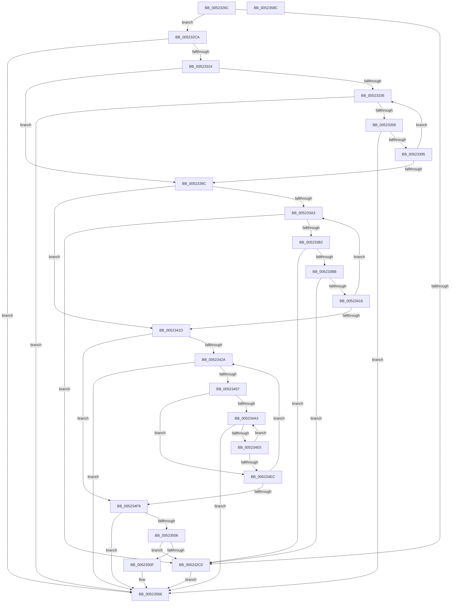

# SymCryptRsakeyCalculatePrivateFields

- RVA: `0x0052326C`–`0x0052358D` (길이 `801` bytes)
- VA: `0x000000014052326C`
- 실행 섹션: `.text`
- PDB 이름 있음: `예`; PDB Function 태그: `아니요`
- unwind 정보 RVA: `0x000C322C`
- 디코드: `205`개 명령, `801/801` bytes 표시
- 미해석 바이트: `0` (있으면 어셈블리에 `.byte`로 보존)

> 이 문서는 커널 이미지의 기계어와 PDB 기호를 분석해 생성했습니다. 4번과 5번은 함수 원형과 자료형을 바이너리 사용 방식에서 추정한 C 해석이며 원본 소스 복구 결과는 아닙니다.

## 1. Dependencies

- 직접 호출 지점: **29**; 고유 호출 대상: **16**
- 직접 호출자로 확인된 함수: **1**
- RIP 상대 이미지 참조: **1**

### Outgoing calls
- `0x005232AB` → [SymCryptIntFromDivisor](SymCryptIntFromDivisor_function_005255F0.md) (function, `0x005255F0`)
- `0x005232CF` → [SymCryptDigitsFromBits](SymCryptDigitsFromBits_function_0052544C.md) (function, `0x0052544C`)
- `0x005232E5` → [SymCryptIntCreate](SymCryptIntCreate_function_0052556C.md) (function, `0x0052556C`)
- `0x00523315` → [SymCryptCrtGenerateInverses](SymCryptCrtGenerateInverses_function_0052AB00.md) (function, `0x0052AB00`)
- `0x0052332A` → [SymCryptIntSetValueUint32](SymCryptIntSetValueUint32_function_00525748.md) (function, `0x00525748`)
- `0x0052333E` → [SymCryptIntFromModulus](SymCryptIntFromModulus_function_00525608.md) (function, `0x00525608`)
- `0x00523349` → [SymCryptIntCopyMixedSize](SymCryptIntCopyMixedSize_function_00525554.md) (function, `0x00525554`)
- `0x00523361` → [SymCryptIntSubUint32](SymCryptIntSubUint32_function_005257C0.md) (function, `0x005257C0`)
- `0x00523379` → [SymCryptIntMulMixedSize](SymCryptIntMulMixedSize_function_005256F8.md) (function, `0x005256F8`)
- `0x00523386` → [SymCryptIntCopyMixedSize](SymCryptIntCopyMixedSize_function_00525554.md) (function, `0x00525554`)
- `0x005233BE` → [SymCryptIntSetValueUint64](SymCryptIntSetValueUint64_function_00525760.md) (function, `0x00525760`)
- `0x005233FA` → [SymCryptIntExtendedGcd](SymCryptIntExtendedGcd_function_0052AD54.md) (function, `0x0052AD54`)
- `0x00523409` → [SymCryptIntIsEqualUint32](SymCryptIntIsEqualUint32_function_005256B0.md) (function, `0x005256B0`)
- `0x0052342D` → [SymCryptIntFromDivisor](SymCryptIntFromDivisor_function_005255F0.md) (function, `0x005255F0`)
- `0x0052343D` → [SymCryptIntFromModulus](SymCryptIntFromModulus_function_00525608.md) (function, `0x00525608`)
- `0x00523448` → [SymCryptIntCopyMixedSize](SymCryptIntCopyMixedSize_function_00525554.md) (function, `0x00525554`)
- `0x0052345A` → [SymCryptIntFromDivisor](SymCryptIntFromDivisor_function_005255F0.md) (function, `0x005255F0`)
- `0x00523465` → [SymCryptIntFromDivisor](SymCryptIntFromDivisor_function_005255F0.md) (function, `0x005255F0`)
- `0x00523473` → [SymCryptIntSubUint32](SymCryptIntSubUint32_function_005257C0.md) (function, `0x005257C0`)
- `0x0052347B` → [SymCryptIntFromDivisor](SymCryptIntFromDivisor_function_005255F0.md) (function, `0x005255F0`)
- `0x00523497` → [SymCryptIntToDivisor](SymCryptIntToDivisor_function_005257D8.md) (function, `0x005257D8`)
- `0x005234BE` → [SymCryptIntDivMod](SymCryptIntDivMod_function_00525584.md) (function, `0x00525584`)
- `0x005234D6` → [SymCryptIntCopyMixedSize](SymCryptIntCopyMixedSize_function_00525554.md) (function, `0x00525554`)
- `0x00523516` → [SymCryptIntFromModulus](SymCryptIntFromModulus_function_00525608.md) (function, `0x00525608`)
- `0x00523525` → [SymCryptIntFromModulus](SymCryptIntFromModulus_function_00525608.md) (function, `0x00525608`)
- `0x0052353D` → [SymCryptIntMulMixedSize](SymCryptIntMulMixedSize_function_005256F8.md) (function, `0x005256F8`)
- `0x00523546` → [SymCryptIntFromModulus](SymCryptIntFromModulus_function_00525608.md) (function, `0x00525608`)
- `0x00523553` → [SymCryptIntIsEqual](SymCryptIntIsEqual_function_00525698.md) (function, `0x00525698`)
- `0x00523573` → [_security_check_cookie](../6A/_security_check_cookie_function_006AC640.md) (function, `0x006AC640`)

### Direct callers
- [SymCryptRsakeySetValueInternal](SymCryptRsakeySetValueInternal_function_005238D4.md) at `0x00523F5C`

### Static image references
- `0x00523280` → RVA `0x00E0A740` (`.data`; read)

## 2. Other-region calls and transfers

- 다른 실행 섹션으로 향하는 call: **0**
- 별도 외부 분기/꼬리 이동을 확인하지 못했습니다.

## 3. Assembly (complete function range)

```asm
0052326C  40 53                           push rbx
0052326E  55                              push rbp
0052326F  56                              push rsi
00523270  57                              push rdi
00523271  41 54                           push r12
00523273  41 55                           push r13
00523275  41 56                           push r14
00523277  41 57                           push r15
00523279  48 81 EC 18 01 00 00            sub rsp, 0x118
00523280  48 8B 05 B9 74 8E 00            mov rax, qword ptr [rip + 0x8e74b9]
00523287  48 33 C4                        xor rax, rsp
0052328A  48 89 84 24 00 01 00 00         mov qword ptr [rsp + 0x100], rax
00523292  4C 8B AC 24 80 01 00 00         mov r13, qword ptr [rsp + 0x180]
0052329A  48 8B F1                        mov rsi, rcx
0052329D  48 8B CA                        mov rcx, rdx
005232A0  4C 89 4C 24 50                  mov qword ptr [rsp + 0x50], r9
005232A5  4D 8B F8                        mov r15, r8
005232A8  4C 8B E2                        mov r12, rdx
005232AB  E8 40 23 00 00                  call 0x1405255f0
005232B0  F7 84 24 90 01 00 00 FF FD FF FF  test dword ptr [rsp + 0x190], 0xfffffdff
005232BB  48 8B E8                        mov rbp, rax
005232BE  74 0A                           je 0x1405232ca
005232C0  BF 0E 80 00 00                  mov edi, 0x800e
005232C5  E9 9C 02 00 00                  jmp 0x140523566
005232CA  B9 40 00 00 00                  mov ecx, 0x40
005232CF  E8 78 21 00 00                  call 0x14052544c
005232D4  48 8D 4C 24 7F                  lea rcx, [rsp + 0x7f]
005232D9  44 8B C0                        mov r8d, eax
005232DC  48 83 E1 E0                     and rcx, 0xffffffffffffffe0
005232E0  BA 80 00 00 00                  mov edx, 0x80
005232E5  E8 82 22 00 00                  call 0x14052556c
005232EA  4C 8B B4 24 88 01 00 00         mov r14, qword ptr [rsp + 0x188]
005232F2  48 8D 96 80 00 00 00            lea rdx, [rsi + 0x80]
005232F9  8B 4E 1C                        mov ecx, dword ptr [rsi + 0x1c]
005232FC  4C 8D 8E 90 00 00 00            lea r9, [rsi + 0x90]
00523303  4C 89 74 24 28                  mov qword ptr [rsp + 0x28], r14
00523308  45 33 C0                        xor r8d, r8d
0052330B  4C 89 6C 24 20                  mov qword ptr [rsp + 0x20], r13
00523310  48 89 44 24 58                  mov qword ptr [rsp + 0x58], rax
00523315  E8 E6 77 00 00                  call 0x14052ab00
0052331A  8B F8                           mov edi, eax
0052331C  85 C0                           test eax, eax
0052331E  0F 85 42 02 00 00               jne 0x140523566
00523324  49 8B D7                        mov rdx, r15
00523327  8D 48 01                        lea ecx, [rax + 1]
0052332A  E8 19 24 00 00                  call 0x140525748
0052332F  33 DB                           xor ebx, ebx
00523331  39 5E 1C                        cmp dword ptr [rsi + 0x1c], ebx
00523334  76 66                           jbe 0x14052339c
00523336  48 8B 8C DE 80 00 00 00         mov rcx, qword ptr [rsi + rbx*8 + 0x80]
0052333E  E8 C5 22 00 00                  call 0x140525608
00523343  48 8B C8                        mov rcx, rax
00523346  48 8B D5                        mov rdx, rbp
00523349  E8 06 22 00 00                  call 0x140525554
0052334E  8B F8                           mov edi, eax
00523350  85 C0                           test eax, eax
00523352  0F 85 0E 02 00 00               jne 0x140523566
00523358  4C 8B C5                        mov r8, rbp
0052335B  8D 50 01                        lea edx, [rax + 1]
0052335E  48 8B CD                        mov rcx, rbp
00523361  E8 5A 24 00 00                  call 0x1405257c0
00523366  4C 8B 44 24 50                  mov r8, qword ptr [rsp + 0x50]
0052336B  4D 8B CD                        mov r9, r13
0052336E  49 8B D7                        mov rdx, r15
00523371  4C 89 74 24 20                  mov qword ptr [rsp + 0x20], r14
00523376  48 8B CD                        mov rcx, rbp
00523379  E8 7A 23 00 00                  call 0x1405256f8
0052337E  48 8B 4C 24 50                  mov rcx, qword ptr [rsp + 0x50]
00523383  49 8B D7                        mov rdx, r15
00523386  E8 C9 21 00 00                  call 0x140525554
0052338B  8B F8                           mov edi, eax
0052338D  85 C0                           test eax, eax
0052338F  0F 85 D1 01 00 00               jne 0x140523566
00523395  FF C3                           inc ebx
00523397  3B 5E 1C                        cmp ebx, dword ptr [rsi + 0x1c]
0052339A  72 9A                           jb 0x140523336
0052339C  33 DB                           xor ebx, ebx
0052339E  39 5E 18                        cmp dword ptr [rsi + 0x18], ebx
005233A1  76 7A                           jbe 0x14052341d
005233A3  48 8B 4C DE 38                  mov rcx, qword ptr [rsi + rbx*8 + 0x38]
005233A8  48 83 F9 01                     cmp rcx, 1
005233AC  0F 84 0E FF FF FF               je 0x1405232c0
005233B2  F6 C1 01                        test cl, 1
005233B5  0F 84 05 FF FF FF               je 0x1405232c0
005233BB  48 8B D5                        mov rdx, rbp
005233BE  E8 9D 23 00 00                  call 0x140525760
005233C3  4C 8B 4C 24 58                  mov r9, qword ptr [rsp + 0x58]
005233C8  49 8B C6                        mov rax, r14
005233CB  48 89 44 24 40                  mov qword ptr [rsp + 0x40], rax
005233D0  41 B8 02 00 00 00               mov r8d, 2
005233D6  48 8B 84 DE A0 00 00 00         mov rax, qword ptr [rsi + rbx*8 + 0xa0]
005233DE  48 8B D5                        mov rdx, rbp
005233E1  4C 89 6C 24 38                  mov qword ptr [rsp + 0x38], r13
005233E6  49 8B CF                        mov rcx, r15
005233E9  48 89 44 24 30                  mov qword ptr [rsp + 0x30], rax
005233EE  48 83 64 24 28 00               and qword ptr [rsp + 0x28], 0
005233F4  48 83 64 24 20 00               and qword ptr [rsp + 0x20], 0
005233FA  E8 55 79 00 00                  call 0x14052ad54
005233FF  48 8B 4C 24 58                  mov rcx, qword ptr [rsp + 0x58]
00523404  BA 01 00 00 00                  mov edx, 1
00523409  E8 A2 22 00 00                  call 0x1405256b0
0052340E  85 C0                           test eax, eax
00523410  0F 84 AA FE FF FF               je 0x1405232c0
00523416  FF C3                           inc ebx
00523418  3B 5E 18                        cmp ebx, dword ptr [rsi + 0x18]
0052341B  72 86                           jb 0x1405233a3
0052341D  8B 46 1C                        mov eax, dword ptr [rsi + 0x1c]
00523420  33 ED                           xor ebp, ebp
00523422  85 C0                           test eax, eax
00523424  0F 84 CF 00 00 00               je 0x1405234f9
0052342A  49 8B CC                        mov rcx, r12
0052342D  E8 BE 21 00 00                  call 0x1405255f0
00523432  48 8B 8C EE 80 00 00 00         mov rcx, qword ptr [rsi + rbp*8 + 0x80]
0052343A  48 8B D8                        mov rbx, rax
0052343D  E8 C6 21 00 00                  call 0x140525608
00523442  48 8B C8                        mov rcx, rax
00523445  48 8B D3                        mov rdx, rbx
00523448  E8 07 21 00 00                  call 0x140525554
0052344D  8B F8                           mov edi, eax
0052344F  85 C0                           test eax, eax
00523451  0F 85 0F 01 00 00               jne 0x140523566
00523457  49 8B CC                        mov rcx, r12
0052345A  E8 91 21 00 00                  call 0x1405255f0
0052345F  49 8B CC                        mov rcx, r12
00523462  48 8B D8                        mov rbx, rax
00523465  E8 86 21 00 00                  call 0x1405255f0
0052346A  48 8B C8                        mov rcx, rax
0052346D  8D 57 01                        lea edx, [rdi + 1]
00523470  4C 8B C3                        mov r8, rbx
00523473  E8 48 23 00 00                  call 0x1405257c0
00523478  49 8B CC                        mov rcx, r12
0052347B  E8 70 21 00 00                  call 0x1405255f0
00523480  44 8B 46 18                     mov r8d, dword ptr [rsi + 0x18]
00523484  48 8B C8                        mov rcx, rax
00523487  45 33 C9                        xor r9d, r9d
0052348A  4C 89 74 24 28                  mov qword ptr [rsp + 0x28], r14
0052348F  49 8B D4                        mov rdx, r12
00523492  4C 89 6C 24 20                  mov qword ptr [rsp + 0x20], r13
00523497  E8 3C 23 00 00                  call 0x1405257d8
0052349C  33 DB                           xor ebx, ebx
0052349E  39 5E 18                        cmp dword ptr [rsi + 0x18], ebx
005234A1  76 49                           jbe 0x1405234ec
005234A3  48 8B 8C DE A0 00 00 00         mov rcx, qword ptr [rsi + rbx*8 + 0xa0]
005234AB  4D 8B CF                        mov r9, r15
005234AE  4C 89 74 24 28                  mov qword ptr [rsp + 0x28], r14
005234B3  45 33 C0                        xor r8d, r8d
005234B6  49 8B D4                        mov rdx, r12
005234B9  4C 89 6C 24 20                  mov qword ptr [rsp + 0x20], r13
005234BE  E8 C1 20 00 00                  call 0x140525584
005234C3  8B C3                           mov eax, ebx
005234C5  49 8B CF                        mov rcx, r15
005234C8  0F AF 46 1C                     imul eax, dword ptr [rsi + 0x1c]
005234CC  03 C5                           add eax, ebp
005234CE  48 8B 94 C6 A8 00 00 00         mov rdx, qword ptr [rsi + rax*8 + 0xa8]
005234D6  E8 79 20 00 00                  call 0x140525554
005234DB  8B F8                           mov edi, eax
005234DD  85 C0                           test eax, eax
005234DF  0F 85 81 00 00 00               jne 0x140523566
005234E5  FF C3                           inc ebx
005234E7  3B 5E 18                        cmp ebx, dword ptr [rsi + 0x18]
005234EA  72 B7                           jb 0x1405234a3
005234EC  8B 46 1C                        mov eax, dword ptr [rsi + 0x1c]
005234EF  FF C5                           inc ebp
005234F1  3B E8                           cmp ebp, eax
005234F3  0F 82 31 FF FF FF               jb 0x14052342a
005234F9  F7 84 24 90 01 00 00 00 02 00 00  test dword ptr [rsp + 0x190], 0x200
00523504  75 60                           jne 0x140523566
00523506  83 F8 02                        cmp eax, 2
00523509  0F 85 B1 FD FF FF               jne 0x1405232c0
0052350F  48 8B 8E 88 00 00 00            mov rcx, qword ptr [rsi + 0x88]
00523516  E8 ED 20 00 00                  call 0x140525608
0052351B  48 8B 8E 80 00 00 00            mov rcx, qword ptr [rsi + 0x80]
00523522  48 8B D8                        mov rbx, rax
00523525  E8 DE 20 00 00                  call 0x140525608
0052352A  4C 8B 44 24 50                  mov r8, qword ptr [rsp + 0x50]
0052352F  48 8B C8                        mov rcx, rax
00523532  4D 8B CD                        mov r9, r13
00523535  4C 89 74 24 20                  mov qword ptr [rsp + 0x20], r14
0052353A  48 8B D3                        mov rdx, rbx
0052353D  E8 B6 21 00 00                  call 0x1405256f8
00523542  48 8B 4E 78                     mov rcx, qword ptr [rsi + 0x78]
00523546  E8 BD 20 00 00                  call 0x140525608
0052354B  48 8B 4C 24 50                  mov rcx, qword ptr [rsp + 0x50]
00523550  48 8B D0                        mov rdx, rax
00523553  E8 40 21 00 00                  call 0x140525698
00523558  8B CF                           mov ecx, edi
0052355A  85 C0                           test eax, eax
0052355C  BF 0E 80 00 00                  mov edi, 0x800e
00523561  0F 44 CF                        cmove ecx, edi
00523564  8B F9                           mov edi, ecx
00523566  8B C7                           mov eax, edi
00523568  48 8B 8C 24 00 01 00 00         mov rcx, qword ptr [rsp + 0x100]
00523570  48 33 CC                        xor rcx, rsp
00523573  E8 C8 90 18 00                  call 0x1406ac640
00523578  48 81 C4 18 01 00 00            add rsp, 0x118
0052357F  41 5F                           pop r15
00523581  41 5E                           pop r14
00523583  41 5D                           pop r13
00523585  41 5C                           pop r12
00523587  5F                              pop rdi
00523588  5E                              pop rsi
00523589  5D                              pop rbp
0052358A  5B                              pop rbx
0052358B  C3                              ret
0052358C  CC                              int3
```

## 4. C-style interpretation (structured pseudocode)

```c
__int64 __fastcall SymCryptRsakeyCalculatePrivateFields(__int64 a1, __int64 a2, __int64 a3, __int64 a4, __int64 a5, __int64 a6, unsigned int a7)
{
    __int64 result;
    __int64 v_rbp;
    __int64 v_rbx;
    __int64 v_rsp;
    unsigned __int64 v_stack_m100;
    unsigned __int64 v_stack_m108;
    unsigned __int64 v_stack_m118;
    unsigned __int64 v_stack_m120;
    unsigned __int64 v_stack_m128;
    unsigned __int64 v_stack_m130;
    unsigned __int64 v_stack_m138;
    unsigned __int64 v_stack_m58;
    unsigned __int64 v_stack_mD9;

    v_rsp = (v_rsp) - (280);
    result = (*(unsigned __int64 *)(v_rip + 9335993)) ^ (v_rsp);
    v_stack_m58 = result;
    v_stack_m108 = a4;
    result = SymCryptIntFromDivisor(a2, a2, a3, a4);
    if (((a7) & (0xFFFFFDFFULL)) == 0) goto loc_005232CA;
loc_005232C0:
    goto loc_00523566;
loc_005232CA:
    result = SymCryptDigitsFromBits(64, a2, a3, a4);
    a1 = (v_stack_mD9) & (-32);
    result = SymCryptIntCreate(a1, 128, (unsigned int)((unsigned int)(result)), a4);
    v_stack_m130 = a6;
    a3 = 0;
    v_stack_m138 = a5;
    v_stack_m100 = result;
    result = SymCryptCrtGenerateInverses((unsigned int)(*(unsigned int *)(a1 + 28)), a1 + 128, a3, a1 + 144);
    if ((unsigned int)(result) != 0) goto loc_00523566;
    result = SymCryptIntSetValueUint32(result + 1, 0, a3, a1 + 144);
    v_rbx = 0;
    if ((*(unsigned int *)(a1 + 28)) <= 0) goto loc_0052339C;
loc_00523336:
    result = SymCryptIntFromModulus(*(unsigned __int64 *)(a1 + v_rbx * 8 + 128), 0, a3, a1 + 144);
    result = SymCryptIntCopyMixedSize(result, result, a3, a1 + 144);
    if ((unsigned int)(result) != 0) goto loc_00523566;
    result = SymCryptIntSubUint32(result, result + 1, result, a1 + 144);
    v_stack_m138 = a6;
    result = SymCryptIntMulMixedSize(result, 0, v_stack_m108, a5);
    result = SymCryptIntCopyMixedSize(v_stack_m108, 0, v_stack_m108, a5);
    if ((unsigned int)(result) != 0) goto loc_00523566;
    v_rbx = (unsigned int)((v_rbx) + 1);
    if (((unsigned int)(v_rbx)) < (*(unsigned int *)(a1 + 28))) goto loc_00523336;
loc_0052339C:
    v_rbx = 0;
    if ((*(unsigned int *)(a1 + 24)) <= 0) goto loc_0052341D;
loc_005233A3:
    if ((*(unsigned __int64 *)(a1 + v_rbx * 8 + 56)) == 1) goto loc_005232C0;
    if ((((unsigned __int8)(*(unsigned __int64 *)(a1 + v_rbx * 8 + 56))) & (1)) == 0) goto loc_005232C0;
    result = SymCryptIntSetValueUint64(*(unsigned __int64 *)(a1 + v_rbx * 8 + 56), result, v_stack_m108, a5);
    v_stack_m118 = a6;
    v_stack_m120 = a5;
    v_stack_m128 = *(unsigned __int64 *)(a1 + v_rbx * 8 + 160);
    result = SymCryptIntExtendedGcd(0, result, 2, v_stack_m100);
    result = SymCryptIntIsEqualUint32(v_stack_m100, 1, 2, v_stack_m100);
    if ((unsigned int)(result) == 0) goto loc_005232C0;
    v_rbx = (unsigned int)((v_rbx) + 1);
    if (((unsigned int)(v_rbx)) < (*(unsigned int *)(a1 + 24))) goto loc_005233A3;
loc_0052341D:
    v_rbp = 0;
    if ((unsigned int)((unsigned int)(*(unsigned int *)(a1 + 28))) == 0) goto loc_005234F9;
loc_0052342A:
    result = SymCryptIntFromDivisor(a2, 1, 2, v_stack_m100);
    result = SymCryptIntFromModulus(*(unsigned __int64 *)(a1 + v_rbp * 8 + 128), 1, 2, v_stack_m100);
    result = SymCryptIntCopyMixedSize(result, result, 2, v_stack_m100);
    if ((unsigned int)(result) != 0) goto loc_00523566;
    result = SymCryptIntFromDivisor(a2, result, 2, v_stack_m100);
    result = SymCryptIntFromDivisor(a2, result, 2, v_stack_m100);
    result = SymCryptIntSubUint32(result, (unsigned int)((unsigned int)(result)) + 1, result, v_stack_m100);
    result = SymCryptIntFromDivisor(a2, (unsigned int)((unsigned int)(result)) + 1, result, v_stack_m100);
    a4 = 0;
    v_stack_m130 = a6;
    v_stack_m138 = a5;
    result = SymCryptIntToDivisor(result, a2, (unsigned int)(*(unsigned int *)(a1 + 24)), a4);
    v_rbx = 0;
    if ((*(unsigned int *)(a1 + 24)) <= 0) goto loc_005234EC;
loc_005234A3:
    v_stack_m130 = a6;
    a3 = 0;
    v_stack_m138 = a5;
    result = SymCryptIntDivMod(*(unsigned __int64 *)(a1 + v_rbx * 8 + 160), a2, a3, 0);
    result = (unsigned int)((0) * (*(unsigned int *)(a1 + 28)));
    result = (unsigned int)((result) + (0));
    result = SymCryptIntCopyMixedSize(0, *(unsigned __int64 *)(a1 + result * 8 + 168), a3, 0);
    if ((unsigned int)(result) != 0) goto loc_00523566;
    v_rbx = (unsigned int)((v_rbx) + 1);
    if (((unsigned int)(v_rbx)) < (*(unsigned int *)(a1 + 24))) goto loc_005234A3;
loc_005234EC:
    v_rbp = (unsigned int)((v_rbp) + 1);
    if (((unsigned int)(v_rbp)) < ((unsigned int)((unsigned int)(*(unsigned int *)(a1 + 28))))) goto loc_0052342A;
loc_005234F9:
    if (((a7) & (512)) != 0) goto loc_00523566;
    if (((unsigned int)((unsigned int)(*(unsigned int *)(a1 + 28)))) != 2) goto loc_005232C0;
    result = SymCryptIntFromModulus(*(unsigned __int64 *)(a1 + 136), *(unsigned __int64 *)(a1 + result * 8 + 168), a3, 0);
    result = SymCryptIntFromModulus(*(unsigned __int64 *)(a1 + 128), *(unsigned __int64 *)(a1 + result * 8 + 168), a3, 0);
    v_stack_m138 = a6;
    result = SymCryptIntMulMixedSize(result, result, v_stack_m108, a5);
    result = SymCryptIntFromModulus(*(unsigned __int64 *)(a1 + 120), result, v_stack_m108, a5);
    result = SymCryptIntIsEqual(v_stack_m108, result, v_stack_m108, a5);
    a1 = (unsigned int)((unsigned int)((unsigned int)((unsigned int)(result))));
    if ((unsigned int)(result) == 0) { a1 = (unsigned int)((unsigned int)(0x800EULL)); }
loc_00523566:
    a1 = (v_stack_m58) ^ (v_rsp);
    result = _security_check_cookie(a1, result, v_stack_m108, a5);
    v_rsp = (v_rsp) + (280);
    return result;
}
```

## 5. (Beta) C Style

```c
int64_t SymCryptRsakeyCalculatePrivateFields(void *Arg1, int64_t Arg2, int64_t Arg3, int64_t Arg4, int64_t Arg5, int64_t Arg6, uint32_t Arg7)
{
    uint8_t *arg1 = (uint8_t *)Arg1;

    int64_t result;
    int64_t local_rbp;
    int64_t local_rbx;
    int64_t local_rsp;
    uint64_t v_stack_m100;
    uint64_t v_stack_m108;
    uint64_t v_stack_m118;
    uint64_t v_stack_m120;
    uint64_t v_stack_m128;
    uint64_t v_stack_m130;
    uint64_t v_stack_m138;
    uint64_t v_stack_m58;
    uint64_t v_stack_mD9;

    local_rsp = (local_rsp) - (280);
    result = (*(uint64_t *)(v_rip + 0x8E74B9)) ^ (local_rsp);
    v_stack_m58 = result;
    v_stack_m108 = Arg4;
    result = SymCryptIntFromDivisor(Arg2, Arg2, Arg3, Arg4);
    if (((Arg7) & (0xFFFFFDFFULL)) == 0) goto loc_005232CA;
loc_005232C0:
    goto loc_00523566;
loc_005232CA:
    result = SymCryptDigitsFromBits(64, Arg2, Arg3, Arg4);
    Arg1 = (v_stack_mD9) & (-32);
    result = SymCryptIntCreate(Arg1, 128, (uint32_t)((uint32_t)(result)), Arg4);
    v_stack_m130 = Arg6;
    Arg3 = 0;
    v_stack_m138 = Arg5;
    v_stack_m100 = result;
    result = SymCryptCrtGenerateInverses((uint32_t)(*(uint32_t *)(arg1 + 0x1C)), Arg1 + 128, Arg3, Arg1 + 144);
    if ((uint32_t)(result) != 0) goto loc_00523566;
    result = SymCryptIntSetValueUint32(result + 1, 0, Arg3, Arg1 + 144);
    local_rbx = 0;
    if ((*(uint32_t *)(arg1 + 0x1C)) <= 0) goto loc_0052339C;
loc_00523336:
    result = SymCryptIntFromModulus(*(uint64_t *)(arg1 + local_rbx * 8 + 0x80), 0, Arg3, Arg1 + 144);
    result = SymCryptIntCopyMixedSize(result, result, Arg3, Arg1 + 144);
    if ((uint32_t)(result) != 0) goto loc_00523566;
    result = SymCryptIntSubUint32(result, result + 1, result, Arg1 + 144);
    v_stack_m138 = Arg6;
    result = SymCryptIntMulMixedSize(result, 0, v_stack_m108, Arg5);
    result = SymCryptIntCopyMixedSize(v_stack_m108, 0, v_stack_m108, Arg5);
    if ((uint32_t)(result) != 0) goto loc_00523566;
    local_rbx = (uint32_t)((local_rbx) + 1);
    if (((uint32_t)(local_rbx)) < (*(uint32_t *)(arg1 + 0x1C))) goto loc_00523336;
loc_0052339C:
    local_rbx = 0;
    if ((*(uint32_t *)(arg1 + 0x18)) <= 0) goto loc_0052341D;
loc_005233A3:
    if ((*(uint64_t *)(arg1 + local_rbx * 8 + 0x38)) == 1) goto loc_005232C0;
    if ((((uint8_t)(*(uint64_t *)(arg1 + local_rbx * 8 + 0x38))) & (1)) == 0) goto loc_005232C0;
    result = SymCryptIntSetValueUint64(*(uint64_t *)(arg1 + local_rbx * 8 + 0x38), result, v_stack_m108, Arg5);
    v_stack_m118 = Arg6;
    v_stack_m120 = Arg5;
    v_stack_m128 = *(uint64_t *)(arg1 + local_rbx * 8 + 0xA0);
    result = SymCryptIntExtendedGcd(0, result, 2, v_stack_m100);
    result = SymCryptIntIsEqualUint32(v_stack_m100, 1, 2, v_stack_m100);
    if ((uint32_t)(result) == 0) goto loc_005232C0;
    local_rbx = (uint32_t)((local_rbx) + 1);
    if (((uint32_t)(local_rbx)) < (*(uint32_t *)(arg1 + 0x18))) goto loc_005233A3;
loc_0052341D:
    local_rbp = 0;
    if ((uint32_t)((uint32_t)(*(uint32_t *)(arg1 + 0x1C))) == 0) goto loc_005234F9;
loc_0052342A:
    result = SymCryptIntFromDivisor(Arg2, 1, 2, v_stack_m100);
    result = SymCryptIntFromModulus(*(uint64_t *)(arg1 + local_rbp * 8 + 0x80), 1, 2, v_stack_m100);
    result = SymCryptIntCopyMixedSize(result, result, 2, v_stack_m100);
    if ((uint32_t)(result) != 0) goto loc_00523566;
    result = SymCryptIntFromDivisor(Arg2, result, 2, v_stack_m100);
    result = SymCryptIntFromDivisor(Arg2, result, 2, v_stack_m100);
    result = SymCryptIntSubUint32(result, (uint32_t)((uint32_t)(result)) + 1, result, v_stack_m100);
    result = SymCryptIntFromDivisor(Arg2, (uint32_t)((uint32_t)(result)) + 1, result, v_stack_m100);
    Arg4 = 0;
    v_stack_m130 = Arg6;
    v_stack_m138 = Arg5;
    result = SymCryptIntToDivisor(result, Arg2, (uint32_t)(*(uint32_t *)(arg1 + 0x18)), Arg4);
    local_rbx = 0;
    if ((*(uint32_t *)(arg1 + 0x18)) <= 0) goto loc_005234EC;
loc_005234A3:
    v_stack_m130 = Arg6;
    Arg3 = 0;
    v_stack_m138 = Arg5;
    result = SymCryptIntDivMod(*(uint64_t *)(arg1 + local_rbx * 8 + 0xA0), Arg2, Arg3, 0);
    result = (uint32_t)((0) * (*(uint32_t *)(arg1 + 0x1C)));
    result = (uint32_t)((result) + (0));
    result = SymCryptIntCopyMixedSize(0, *(uint64_t *)(arg1 + result * 8 + 0xA8), Arg3, 0);
    if ((uint32_t)(result) != 0) goto loc_00523566;
    local_rbx = (uint32_t)((local_rbx) + 1);
    if (((uint32_t)(local_rbx)) < (*(uint32_t *)(arg1 + 0x18))) goto loc_005234A3;
loc_005234EC:
    local_rbp = (uint32_t)((local_rbp) + 1);
    if (((uint32_t)(local_rbp)) < ((uint32_t)((uint32_t)(*(uint32_t *)(arg1 + 0x1C))))) goto loc_0052342A;
loc_005234F9:
    if (((Arg7) & (512)) != 0) goto loc_00523566;
    if (((uint32_t)((uint32_t)(*(uint32_t *)(arg1 + 0x1C)))) != 2) goto loc_005232C0;
    result = SymCryptIntFromModulus(*(uint64_t *)(arg1 + 0x88), *(uint64_t *)(arg1 + result * 8 + 0xA8), Arg3, 0);
    result = SymCryptIntFromModulus(*(uint64_t *)(arg1 + 0x80), *(uint64_t *)(arg1 + result * 8 + 0xA8), Arg3, 0);
    v_stack_m138 = Arg6;
    result = SymCryptIntMulMixedSize(result, result, v_stack_m108, Arg5);
    result = SymCryptIntFromModulus(*(uint64_t *)(arg1 + 0x78), result, v_stack_m108, Arg5);
    result = SymCryptIntIsEqual(v_stack_m108, result, v_stack_m108, Arg5);
    Arg1 = (uint32_t)((uint32_t)((uint32_t)((uint32_t)(result))));
    if ((uint32_t)(result) == 0) { Arg1 = (uint32_t)((uint32_t)(0x800EULL)); }
loc_00523566:
    Arg1 = (v_stack_m58) ^ (local_rsp);
    result = _security_check_cookie(Arg1, result, v_stack_m108, Arg5);
    local_rsp = (local_rsp) + (280);
    return result;
}
```

### 관측된 메모리 오프셋

구조체 형식이 확인되지 않은 접근은 인자 기준의 오프셋으로만 기록했습니다.

| 기준 인자 | 오프셋 표현 | 폭 (bit) | 접근 |
|---|---:|---:|---|
| `Arg1` | `+ 0x18` | `32` | `R` |
| `Arg1` | `+ 0x1C` | `32` | `R` |
| `Arg1` | `+ 0x38 + rbx*8` | `64` | `R` |
| `Arg1` | `+ 0x78` | `64` | `R` |
| `Arg1` | `+ 0x80` | `64` | `R` |
| `Arg1` | `+ 0x80 + rbp*8` | `64` | `R` |
| `Arg1` | `+ 0x80 + rbx*8` | `64` | `R` |
| `Arg1` | `+ 0x88` | `64` | `R` |
| `Arg1` | `+ 0x90` | `64` | `R` |
| `Arg1` | `+ 0xA0 + rbx*8` | `64` | `R` |
| `Arg1` | `+ 0xA8 + rax*8` | `64` | `R` |

## 6. Execution-region graph

[열기: 2D/3D 그래프와 함수 탐색 컨트롤 패널](../../../control-panel.html?section=text&rva=0x0052326C&view=graph)

- 2D 그래프는 위에서 아래로 흐르고, 3D 그래프는 빈 공간을 드래그해 회전합니다. Shift+드래그는 이동, 휠은 확대·축소, 함수 노드 선택은 대상 보고서 이동입니다.

### Static fallback


