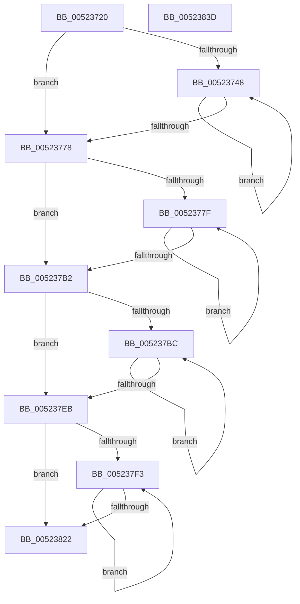

# SymCryptRsakeyCreateAllObjects

- RVA: `0x00523720`–`0x0052383E` (길이 `286` bytes)
- VA: `0x0000000140523720`
- 실행 섹션: `.text`
- PDB 이름 있음: `예`; PDB Function 태그: `아니요`
- unwind 정보 RVA: `0x0005E6B4`
- 디코드: `82`개 명령, `286/286` bytes 표시
- 미해석 바이트: `0` (있으면 어셈블리에 `.byte`로 보존)

> 이 문서는 커널 이미지의 기계어와 PDB 기호를 분석해 생성했습니다. 4번과 5번은 함수 원형과 자료형을 바이너리 사용 방식에서 추정한 C 해석이며 원본 소스 복구 결과는 아닙니다.

## 1. Dependencies

- 직접 호출 지점: **8**; 고유 호출 대상: **6**
- 직접 호출자로 확인된 함수: **2**
- RIP 상대 이미지 참조: **0**

### Outgoing calls
- `0x00523751` → [SymCryptSizeofModulusFromDigits](SymCryptSizeofModulusFromDigits_function_00525D54.md) (function, `0x00525D54`)
- `0x00523760` → [SymCryptModulusCreate](SymCryptModulusCreate_function_00525CF4.md) (function, `0x00525CF4`)
- `0x0052378D` → [SymCryptSizeofModElementFromModulus](SymCryptSizeofModElementFromModulus_function_00525D3C.md) (function, `0x00525D3C`)
- `0x0052379C` → [SymCryptModElementCreate](SymCryptModElementCreate_function_00525900.md) (function, `0x00525900`)
- `0x005237C4` → [SymCryptSizeofIntFromDigits](SymCryptSizeofIntFromDigits_function_00525D24.md) (function, `0x00525D24`)
- `0x005237D3` → [SymCryptIntCreate](SymCryptIntCreate_function_0052556C.md) (function, `0x0052556C`)
- `0x005237F9` → [SymCryptSizeofIntFromDigits](SymCryptSizeofIntFromDigits_function_00525D24.md) (function, `0x00525D24`)
- `0x00523808` → [SymCryptIntCreate](SymCryptIntCreate_function_0052556C.md) (function, `0x0052556C`)

### Direct callers
- [SymCryptRsakeyCalculatePrimesFromPrivateExponent](SymCryptRsakeyCalculatePrimesFromPrivateExponent_function_00522D48.md) at `0x0052316D`
- [SymCryptRsakeySetValueInternal](SymCryptRsakeySetValueInternal_function_005238D4.md) at `0x00523DF6`

### Static image references
- 디코드된 RIP-relative 메모리 참조가 없습니다.

## 2. Other-region calls and transfers

- 다른 실행 섹션으로 향하는 call: **0**
- 별도 외부 분기/꼬리 이동을 확인하지 못했습니다.

## 3. Assembly (complete function range)

```asm
00523720  48 8B C4                        mov rax, rsp
00523723  48 89 58 08                     mov qword ptr [rax + 8], rbx
00523727  48 89 68 10                     mov qword ptr [rax + 0x10], rbp
0052372B  48 89 70 18                     mov qword ptr [rax + 0x18], rsi
0052372F  48 89 78 20                     mov qword ptr [rax + 0x20], rdi
00523733  41 56                           push r14
00523735  48 83 EC 20                     sub rsp, 0x20
00523739  8B 41 1C                        mov eax, dword ptr [rcx + 0x1c]
0052373C  33 ED                           xor ebp, ebp
0052373E  48 8B F1                        mov rsi, rcx
00523741  44 8B F5                        mov r14d, ebp
00523744  85 C0                           test eax, eax
00523746  74 30                           je 0x140523778
00523748  41 8B FE                        mov edi, r14d
0052374B  8B 5C BE 28                     mov ebx, dword ptr [rsi + rdi*4 + 0x28]
0052374F  8B CB                           mov ecx, ebx
00523751  E8 FE 25 00 00                  call 0x140525d54
00523756  48 8B 4C FE 40                  mov rcx, qword ptr [rsi + rdi*8 + 0x40]
0052375B  44 8B C3                        mov r8d, ebx
0052375E  8B D0                           mov edx, eax
00523760  E8 8F 25 00 00                  call 0x140525cf4
00523765  48 89 84 FE 80 00 00 00         mov qword ptr [rsi + rdi*8 + 0x80], rax
0052376D  41 FF C6                        inc r14d
00523770  8B 46 1C                        mov eax, dword ptr [rsi + 0x1c]
00523773  44 3B F0                        cmp r14d, eax
00523776  72 D0                           jb 0x140523748
00523778  44 8B F5                        mov r14d, ebp
0052377B  85 C0                           test eax, eax
0052377D  74 33                           je 0x1405237b2
0052377F  41 8B FE                        mov edi, r14d
00523782  48 8B 9C FE 80 00 00 00         mov rbx, qword ptr [rsi + rdi*8 + 0x80]
0052378A  48 8B CB                        mov rcx, rbx
0052378D  E8 AA 25 00 00                  call 0x140525d3c
00523792  48 8B 4C FE 50                  mov rcx, qword ptr [rsi + rdi*8 + 0x50]
00523797  4C 8B C3                        mov r8, rbx
0052379A  8B D0                           mov edx, eax
0052379C  E8 5F 21 00 00                  call 0x140525900
005237A1  41 FF C6                        inc r14d
005237A4  48 89 84 FE 90 00 00 00         mov qword ptr [rsi + rdi*8 + 0x90], rax
005237AC  44 3B 76 1C                     cmp r14d, dword ptr [rsi + 0x1c]
005237B0  72 CD                           jb 0x14052377f
005237B2  8B 46 18                        mov eax, dword ptr [rsi + 0x18]
005237B5  44 8B F5                        mov r14d, ebp
005237B8  85 C0                           test eax, eax
005237BA  74 2F                           je 0x1405237eb
005237BC  8B 5E 14                        mov ebx, dword ptr [rsi + 0x14]
005237BF  8B CB                           mov ecx, ebx
005237C1  41 8B FE                        mov edi, r14d
005237C4  E8 5B 25 00 00                  call 0x140525d24
005237C9  48 8B 4C FE 60                  mov rcx, qword ptr [rsi + rdi*8 + 0x60]
005237CE  44 8B C3                        mov r8d, ebx
005237D1  8B D0                           mov edx, eax
005237D3  E8 94 1D 00 00                  call 0x14052556c
005237D8  48 89 84 FE A0 00 00 00         mov qword ptr [rsi + rdi*8 + 0xa0], rax
005237E0  41 FF C6                        inc r14d
005237E3  8B 46 18                        mov eax, dword ptr [rsi + 0x18]
005237E6  44 3B F0                        cmp r14d, eax
005237E9  72 D1                           jb 0x1405237bc
005237EB  0F AF 46 1C                     imul eax, dword ptr [rsi + 0x1c]
005237EF  85 C0                           test eax, eax
005237F1  74 2F                           je 0x140523822
005237F3  8B 5C AE 28                     mov ebx, dword ptr [rsi + rbp*4 + 0x28]
005237F7  8B CB                           mov ecx, ebx
005237F9  E8 26 25 00 00                  call 0x140525d24
005237FE  48 8B 4C EE 68                  mov rcx, qword ptr [rsi + rbp*8 + 0x68]
00523803  44 8B C3                        mov r8d, ebx
00523806  8B D0                           mov edx, eax
00523808  E8 5F 1D 00 00                  call 0x14052556c
0052380D  48 89 84 EE A8 00 00 00         mov qword ptr [rsi + rbp*8 + 0xa8], rax
00523815  FF C5                           inc ebp
00523817  8B 46 18                        mov eax, dword ptr [rsi + 0x18]
0052381A  0F AF 46 1C                     imul eax, dword ptr [rsi + 0x1c]
0052381E  3B E8                           cmp ebp, eax
00523820  72 D1                           jb 0x1405237f3
00523822  48 8B 5C 24 30                  mov rbx, qword ptr [rsp + 0x30]
00523827  48 8B 6C 24 38                  mov rbp, qword ptr [rsp + 0x38]
0052382C  48 8B 74 24 40                  mov rsi, qword ptr [rsp + 0x40]
00523831  48 8B 7C 24 48                  mov rdi, qword ptr [rsp + 0x48]
00523836  48 83 C4 20                     add rsp, 0x20
0052383A  41 5E                           pop r14
0052383C  C3                              ret
0052383D  CC                              int3
```

## 4. C-style interpretation (structured pseudocode)

```c
__int64 __fastcall SymCryptRsakeyCreateAllObjects(__int64 a1)
{
    __int64 result;
    __int64 v_r14;
    __int64 v_rbp;
    __int64 v_rsp;
    unsigned __int64 v_stack_p10;
    unsigned __int64 v_stack_p18;
    unsigned __int64 v_stack_p20;
    unsigned __int64 v_stack_p8;

    *(unsigned __int64 *)(v_rsp + 8) = v_rbx;
    *(unsigned __int64 *)(v_rsp + 16) = v_rbp;
    *(unsigned __int64 *)(v_rsp + 24) = v_rsi;
    *(unsigned __int64 *)(v_rsp + 32) = v_rdi;
    v_rsp = (v_rsp) - (32);
    v_rbp = 0;
    if ((unsigned int)((unsigned int)(*(unsigned int *)(a1 + 28))) == 0) goto loc_00523778;
loc_00523748:
    result = SymCryptSizeofModulusFromDigits((unsigned int)((unsigned int)((unsigned int)(*(unsigned int *)(a1 + 0 * 4 + 40)))), a2, a3, a4);
    result = SymCryptModulusCreate(*(unsigned __int64 *)(a1 + 0 * 8 + 64), (unsigned int)((unsigned int)(result)), (unsigned int)((unsigned int)((unsigned int)(*(unsigned int *)(a1 + 0 * 4 + 40)))), a4);
    *(unsigned __int64 *)(a1 + 0 * 8 + 128) = result;
    v_r14 = (unsigned int)((0) + 1);
    if (((unsigned int)(v_r14)) < ((unsigned int)((unsigned int)(*(unsigned int *)(a1 + 28))))) goto loc_00523748;
loc_00523778:
    if ((unsigned int)((unsigned int)(*(unsigned int *)(a1 + 28))) == 0) goto loc_005237B2;
loc_0052377F:
    result = SymCryptSizeofModElementFromModulus(*(unsigned __int64 *)(a1 + 0 * 8 + 128), (unsigned int)((unsigned int)(result)), (unsigned int)((unsigned int)((unsigned int)(*(unsigned int *)(a1 + 0 * 4 + 40)))), a4);
    result = SymCryptModElementCreate(*(unsigned __int64 *)(a1 + 0 * 8 + 80), (unsigned int)((unsigned int)(result)), *(unsigned __int64 *)(a1 + 0 * 8 + 128), a4);
    v_r14 = (unsigned int)((0) + 1);
    *(unsigned __int64 *)(a1 + 0 * 8 + 144) = result;
    if (((unsigned int)(v_r14)) < (*(unsigned int *)(a1 + 28))) goto loc_0052377F;
loc_005237B2:
    if ((unsigned int)((unsigned int)(*(unsigned int *)(a1 + 24))) == 0) goto loc_005237EB;
loc_005237BC:
    result = SymCryptSizeofIntFromDigits((unsigned int)((unsigned int)((unsigned int)(*(unsigned int *)(a1 + 20)))), (unsigned int)((unsigned int)(result)), *(unsigned __int64 *)(a1 + 0 * 8 + 128), a4);
    result = SymCryptIntCreate(*(unsigned __int64 *)(a1 + 0 * 8 + 96), (unsigned int)((unsigned int)(result)), (unsigned int)((unsigned int)((unsigned int)(*(unsigned int *)(a1 + 20)))), a4);
    *(unsigned __int64 *)(a1 + 0 * 8 + 160) = result;
    v_r14 = (unsigned int)((0) + 1);
    if (((unsigned int)(v_r14)) < ((unsigned int)((unsigned int)(*(unsigned int *)(a1 + 24))))) goto loc_005237BC;
loc_005237EB:
    result = (unsigned int)(((unsigned int)(*(unsigned int *)(a1 + 24))) * (*(unsigned int *)(a1 + 28)));
    if ((unsigned int)(result) == 0) goto loc_00523822;
loc_005237F3:
    result = SymCryptSizeofIntFromDigits((unsigned int)((unsigned int)((unsigned int)(*(unsigned int *)(a1 + v_rbp * 4 + 40)))), (unsigned int)((unsigned int)(result)), (unsigned int)((unsigned int)((unsigned int)(*(unsigned int *)(a1 + 20)))), a4);
    result = SymCryptIntCreate(*(unsigned __int64 *)(a1 + v_rbp * 8 + 104), (unsigned int)((unsigned int)(result)), (unsigned int)((unsigned int)((unsigned int)(*(unsigned int *)(a1 + v_rbp * 4 + 40)))), a4);
    *(unsigned __int64 *)(a1 + v_rbp * 8 + 168) = result;
    v_rbp = (unsigned int)((v_rbp) + 1);
    result = (unsigned int)(((unsigned int)(*(unsigned int *)(a1 + 24))) * (*(unsigned int *)(a1 + 28)));
    if (((unsigned int)(v_rbp)) < ((unsigned int)(result))) goto loc_005237F3;
loc_00523822:
    v_rsp = (v_rsp) + (32);
    return result;
}
```

## 5. (Beta) C Style

```c
int64_t SymCryptRsakeyCreateAllObjects(void *Arg1)
{
    uint8_t *arg1 = (uint8_t *)Arg1;

    int64_t result;
    int64_t local_r14;
    int64_t local_rbp;
    int64_t local_rsp;
    uint64_t v_stack_p10;
    uint64_t v_stack_p18;
    uint64_t v_stack_p20;
    uint64_t v_stack_p8;

    *(uint64_t *)(local_rsp + 0x8) = local_rbx;
    *(uint64_t *)(local_rsp + 0x10) = local_rbp;
    *(uint64_t *)(local_rsp + 0x18) = local_rsi;
    *(uint64_t *)(local_rsp + 0x20) = local_rdi;
    local_rsp = (local_rsp) - (32);
    local_rbp = 0;
    if ((uint32_t)((uint32_t)(*(uint32_t *)(arg1 + 0x1C))) == 0) goto loc_00523778;
loc_00523748:
    result = SymCryptSizeofModulusFromDigits((uint32_t)((uint32_t)((uint32_t)(*(uint32_t *)(arg1 + 0x0 * 4 + 0x28)))), a2, a3, a4);
    result = SymCryptModulusCreate(*(uint64_t *)(arg1 + 0x0 * 8 + 0x40), (uint32_t)((uint32_t)(result)), (uint32_t)((uint32_t)((uint32_t)(*(uint32_t *)(arg1 + 0x0 * 4 + 0x28)))), a4);
    *(uint64_t *)(arg1 + 0x0 * 8 + 0x80) = result;
    local_r14 = (uint32_t)((0) + 1);
    if (((uint32_t)(local_r14)) < ((uint32_t)((uint32_t)(*(uint32_t *)(arg1 + 0x1C))))) goto loc_00523748;
loc_00523778:
    if ((uint32_t)((uint32_t)(*(uint32_t *)(arg1 + 0x1C))) == 0) goto loc_005237B2;
loc_0052377F:
    result = SymCryptSizeofModElementFromModulus(*(uint64_t *)(arg1 + 0x0 * 8 + 0x80), (uint32_t)((uint32_t)(result)), (uint32_t)((uint32_t)((uint32_t)(*(uint32_t *)(arg1 + 0x0 * 4 + 0x28)))), a4);
    result = SymCryptModElementCreate(*(uint64_t *)(arg1 + 0x0 * 8 + 0x50), (uint32_t)((uint32_t)(result)), *(uint64_t *)(arg1 + 0x0 * 8 + 0x80), a4);
    local_r14 = (uint32_t)((0) + 1);
    *(uint64_t *)(arg1 + 0x0 * 8 + 0x90) = result;
    if (((uint32_t)(local_r14)) < (*(uint32_t *)(arg1 + 0x1C))) goto loc_0052377F;
loc_005237B2:
    if ((uint32_t)((uint32_t)(*(uint32_t *)(arg1 + 0x18))) == 0) goto loc_005237EB;
loc_005237BC:
    result = SymCryptSizeofIntFromDigits((uint32_t)((uint32_t)((uint32_t)(*(uint32_t *)(arg1 + 0x14)))), (uint32_t)((uint32_t)(result)), *(uint64_t *)(arg1 + 0x0 * 8 + 0x80), a4);
    result = SymCryptIntCreate(*(uint64_t *)(arg1 + 0x0 * 8 + 0x60), (uint32_t)((uint32_t)(result)), (uint32_t)((uint32_t)((uint32_t)(*(uint32_t *)(arg1 + 0x14)))), a4);
    *(uint64_t *)(arg1 + 0x0 * 8 + 0xA0) = result;
    local_r14 = (uint32_t)((0) + 1);
    if (((uint32_t)(local_r14)) < ((uint32_t)((uint32_t)(*(uint32_t *)(arg1 + 0x18))))) goto loc_005237BC;
loc_005237EB:
    result = (uint32_t)(((uint32_t)(*(uint32_t *)(arg1 + 0x18))) * (*(uint32_t *)(arg1 + 0x1C)));
    if ((uint32_t)(result) == 0) goto loc_00523822;
loc_005237F3:
    result = SymCryptSizeofIntFromDigits((uint32_t)((uint32_t)((uint32_t)(*(uint32_t *)(arg1 + local_rbp * 4 + 0x28)))), (uint32_t)((uint32_t)(result)), (uint32_t)((uint32_t)((uint32_t)(*(uint32_t *)(arg1 + 0x14)))), a4);
    result = SymCryptIntCreate(*(uint64_t *)(arg1 + local_rbp * 8 + 0x68), (uint32_t)((uint32_t)(result)), (uint32_t)((uint32_t)((uint32_t)(*(uint32_t *)(arg1 + local_rbp * 4 + 0x28)))), a4);
    *(uint64_t *)(arg1 + local_rbp * 8 + 0xA8) = result;
    local_rbp = (uint32_t)((local_rbp) + 1);
    result = (uint32_t)(((uint32_t)(*(uint32_t *)(arg1 + 0x18))) * (*(uint32_t *)(arg1 + 0x1C)));
    if (((uint32_t)(local_rbp)) < ((uint32_t)(result))) goto loc_005237F3;
loc_00523822:
    local_rsp = (local_rsp) + (32);
    return result;
}
```

### 관측된 메모리 오프셋

구조체 형식이 확인되지 않은 접근은 인자 기준의 오프셋으로만 기록했습니다.

| 기준 인자 | 오프셋 표현 | 폭 (bit) | 접근 |
|---|---:|---:|---|
| `Arg1` | `+ 0x14` | `32` | `R` |
| `Arg1` | `+ 0x18` | `32` | `R` |
| `Arg1` | `+ 0x1C` | `32` | `R` |
| `Arg1` | `+ 0x28 + rbp*4` | `32` | `R` |
| `Arg1` | `+ 0x28 + rdi*4` | `32` | `R` |
| `Arg1` | `+ 0x40 + rdi*8` | `64` | `R` |
| `Arg1` | `+ 0x50 + rdi*8` | `64` | `R` |
| `Arg1` | `+ 0x60 + rdi*8` | `64` | `R` |
| `Arg1` | `+ 0x68 + rbp*8` | `64` | `R` |
| `Arg1` | `+ 0x80 + rdi*8` | `64` | `R` |
| `Arg1` | `+ 0x80 + rdi*8` | `64` | `W` |
| `Arg1` | `+ 0x90 + rdi*8` | `64` | `W` |
| `Arg1` | `+ 0xA0 + rdi*8` | `64` | `W` |
| `Arg1` | `+ 0xA8 + rbp*8` | `64` | `W` |

## 6. Execution-region graph

[열기: 2D/3D 그래프와 함수 탐색 컨트롤 패널](../../../control-panel.html?section=text&rva=0x00523720&view=graph)

- 2D 그래프는 위에서 아래로 흐르고, 3D 그래프는 빈 공간을 드래그해 회전합니다. Shift+드래그는 이동, 휠은 확대·축소, 함수 노드 선택은 대상 보고서 이동입니다.

### Static fallback


