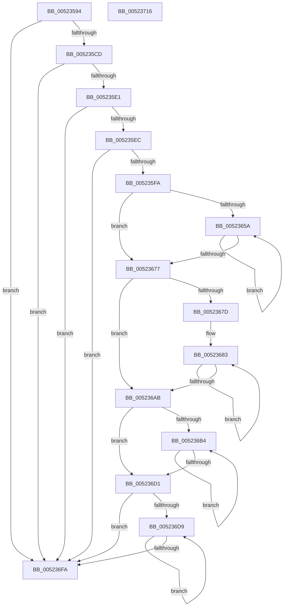

# SymCryptRsakeyCreate

- RVA: `0x00523594`–`0x00523717` (길이 `387` bytes)
- VA: `0x0000000140523594`
- 실행 섹션: `.text`
- PDB 이름 있음: `예`; PDB Function 태그: `아니요`
- unwind 정보 RVA: `0x00060300`
- 디코드: `119`개 명령, `387/387` bytes 표시
- 미해석 바이트: `0` (있으면 어셈블리에 `.byte`로 보존)

> 이 문서는 커널 이미지의 기계어와 PDB 기호를 분석해 생성했습니다. 4번과 5번은 함수 원형과 자료형을 바이너리 사용 방식에서 추정한 C 해석이며 원본 소스 복구 결과는 아닙니다.

## 1. Dependencies

- 직접 호출 지점: **8**; 고유 호출 대상: **6**
- 직접 호출자로 확인된 함수: **2**
- RIP 상대 이미지 참조: **0**

### Outgoing calls
- `0x005235BD` → [SymCryptSizeofRsakeyFromParams](SymCryptSizeofRsakeyFromParams_function_00523FE4.md) (function, `0x00523FE4`)
- `0x00523603` → [SymCryptWipe](../51/SymCryptWipe_function_0051F914.md) (function, `0x0051F914`)
- `0x00523616` → [SymCryptDigitsFromBits](SymCryptDigitsFromBits_function_0052544C.md) (function, `0x0052544C`)
- `0x00523635` → [SymCryptSizeofModulusFromDigits](SymCryptSizeofModulusFromDigits_function_00525D54.md) (function, `0x00525D54`)
- `0x00523645` → [SymCryptModulusCreate](SymCryptModulusCreate_function_00525CF4.md) (function, `0x00525CF4`)
- `0x00523664` → [SymCryptSizeofModulusFromDigits](SymCryptSizeofModulusFromDigits_function_00525D54.md) (function, `0x00525D54`)
- `0x005236BE` → [SymCryptSizeofIntFromDigits](SymCryptSizeofIntFromDigits_function_00525D24.md) (function, `0x00525D24`)
- `0x005236E3` → [SymCryptSizeofIntFromDigits](SymCryptSizeofIntFromDigits_function_00525D24.md) (function, `0x00525D24`)

### Direct callers
- [SymCryptRsakeyAllocate](SymCryptRsakeyAllocate_function_00522CF4.md) at `0x00522D23`
- [HashpVerifyPkcs1Signature](../../page/84/HashpVerifyPkcs1Signature_function_00841C68.md) at `0x00841DB0`

### Static image references
- 디코드된 RIP-relative 메모리 참조가 없습니다.

## 2. Other-region calls and transfers

- 다른 실행 섹션으로 향하는 call: **0**
- 별도 외부 분기/꼬리 이동을 확인하지 못했습니다.

## 3. Assembly (complete function range)

```asm
00523594  48 89 5C 24 08                  mov qword ptr [rsp + 8], rbx
00523599  48 89 6C 24 10                  mov qword ptr [rsp + 0x10], rbp
0052359E  48 89 74 24 18                  mov qword ptr [rsp + 0x18], rsi
005235A3  57                              push rdi
005235A4  41 56                           push r14
005235A6  41 57                           push r15
005235A8  48 83 EC 20                     sub rsp, 0x20
005235AC  48 8B F9                        mov rdi, rcx
005235AF  33 F6                           xor esi, esi
005235B1  49 8B C8                        mov rcx, r8
005235B4  44 8B FE                        mov r15d, esi
005235B7  4D 8B F0                        mov r14, r8
005235BA  48 8B DA                        mov rbx, rdx
005235BD  E8 22 0A 00 00                  call 0x140523fe4
005235C2  8B E8                           mov ebp, eax
005235C4  48 3B DD                        cmp rbx, rbp
005235C7  0F 82 2D 01 00 00               jb 0x1405236fa
005235CD  41 8B 46 04                     mov eax, dword ptr [r14 + 4]
005235D1  2D 00 01 00 00                  sub eax, 0x100
005235D6  3D 00 FF 00 00                  cmp eax, 0xff00
005235DB  0F 87 19 01 00 00               ja 0x1405236fa
005235E1  41 83 7E 0C 01                  cmp dword ptr [r14 + 0xc], 1
005235E6  0F 85 0E 01 00 00               jne 0x1405236fa
005235EC  41 F7 46 08 FD FF FF FF         test dword ptr [r14 + 8], 0xfffffffd
005235F4  0F 85 00 01 00 00               jne 0x1405236fa
005235FA  48 8B D3                        mov rdx, rbx
005235FD  48 8B CF                        mov rcx, rdi
00523600  4C 8B FF                        mov r15, rdi
00523603  E8 0C C3 FF FF                  call 0x14051f914
00523608  89 6F 04                        mov dword ptr [rdi + 4], ebp
0052360B  40 88 77 08                     mov byte ptr [rdi + 8], sil
0052360F  41 8B 4E 04                     mov ecx, dword ptr [r14 + 4]
00523613  89 4F 0C                        mov dword ptr [rdi + 0xc], ecx
00523616  E8 31 1E 00 00                  call 0x14052544c
0052361B  8B C8                           mov ecx, eax
0052361D  89 47 14                        mov dword ptr [rdi + 0x14], eax
00523620  41 8B 46 08                     mov eax, dword ptr [r14 + 8]
00523624  48 8D AF C0 00 00 00            lea rbp, [rdi + 0xc0]
0052362B  89 47 1C                        mov dword ptr [rdi + 0x1c], eax
0052362E  41 8B 46 0C                     mov eax, dword ptr [r14 + 0xc]
00523632  89 47 18                        mov dword ptr [rdi + 0x18], eax
00523635  E8 1A 27 00 00                  call 0x140525d54
0052363A  44 8B 47 14                     mov r8d, dword ptr [rdi + 0x14]
0052363E  48 8B CD                        mov rcx, rbp
00523641  8B D0                           mov edx, eax
00523643  8B D8                           mov ebx, eax
00523645  E8 AA 26 00 00                  call 0x140525cf4
0052364A  48 03 EB                        add rbp, rbx
0052364D  48 89 47 78                     mov qword ptr [rdi + 0x78], rax
00523651  8B 47 1C                        mov eax, dword ptr [rdi + 0x1c]
00523654  8B DE                           mov ebx, esi
00523656  85 C0                           test eax, eax
00523658  74 1D                           je 0x140523677
0052365A  8B C3                           mov eax, ebx
0052365C  48 89 6C C7 40                  mov qword ptr [rdi + rax*8 + 0x40], rbp
00523661  8B 4F 14                        mov ecx, dword ptr [rdi + 0x14]
00523664  E8 EB 26 00 00                  call 0x140525d54
00523669  8B C0                           mov eax, eax
0052366B  FF C3                           inc ebx
0052366D  48 03 E8                        add rbp, rax
00523670  8B 47 1C                        mov eax, dword ptr [rdi + 0x1c]
00523673  3B D8                           cmp ebx, eax
00523675  72 E3                           jb 0x14052365a
00523677  8B D6                           mov edx, esi
00523679  85 C0                           test eax, eax
0052367B  74 2E                           je 0x1405236ab
0052367D  41 B8 FF 01 00 00               mov r8d, 0x1ff
00523683  8B C2                           mov eax, edx
00523685  FF C2                           inc edx
00523687  48 89 6C C7 50                  mov qword ptr [rdi + rax*8 + 0x50], rbp
0052368C  41 8B 46 04                     mov eax, dword ptr [r14 + 4]
00523690  8B C8                           mov ecx, eax
00523692  C1 E8 09                        shr eax, 9
00523695  41 23 C8                        and ecx, r8d
00523698  41 03 C8                        add ecx, r8d
0052369B  C1 E9 09                        shr ecx, 9
0052369E  03 C1                           add eax, ecx
005236A0  C1 E0 06                        shl eax, 6
005236A3  48 03 E8                        add rbp, rax
005236A6  3B 57 1C                        cmp edx, dword ptr [rdi + 0x1c]
005236A9  72 D8                           jb 0x140523683
005236AB  8B 47 18                        mov eax, dword ptr [rdi + 0x18]
005236AE  8B DE                           mov ebx, esi
005236B0  85 C0                           test eax, eax
005236B2  74 1D                           je 0x1405236d1
005236B4  8B C3                           mov eax, ebx
005236B6  48 89 6C C7 60                  mov qword ptr [rdi + rax*8 + 0x60], rbp
005236BB  8B 4F 14                        mov ecx, dword ptr [rdi + 0x14]
005236BE  E8 61 26 00 00                  call 0x140525d24
005236C3  8B C0                           mov eax, eax
005236C5  FF C3                           inc ebx
005236C7  48 03 E8                        add rbp, rax
005236CA  8B 47 18                        mov eax, dword ptr [rdi + 0x18]
005236CD  3B D8                           cmp ebx, eax
005236CF  72 E3                           jb 0x1405236b4
005236D1  0F AF 47 1C                     imul eax, dword ptr [rdi + 0x1c]
005236D5  85 C0                           test eax, eax
005236D7  74 21                           je 0x1405236fa
005236D9  8B CE                           mov ecx, esi
005236DB  48 89 6C CF 68                  mov qword ptr [rdi + rcx*8 + 0x68], rbp
005236E0  8B 4F 14                        mov ecx, dword ptr [rdi + 0x14]
005236E3  E8 3C 26 00 00                  call 0x140525d24
005236E8  8B C8                           mov ecx, eax
005236EA  FF C6                           inc esi
005236EC  48 03 E9                        add rbp, rcx
005236EF  8B 4F 18                        mov ecx, dword ptr [rdi + 0x18]
005236F2  0F AF 4F 1C                     imul ecx, dword ptr [rdi + 0x1c]
005236F6  3B F1                           cmp esi, ecx
005236F8  72 DF                           jb 0x1405236d9
005236FA  48 8B 5C 24 40                  mov rbx, qword ptr [rsp + 0x40]
005236FF  49 8B C7                        mov rax, r15
00523702  48 8B 6C 24 48                  mov rbp, qword ptr [rsp + 0x48]
00523707  48 8B 74 24 50                  mov rsi, qword ptr [rsp + 0x50]
0052370C  48 83 C4 20                     add rsp, 0x20
00523710  41 5F                           pop r15
00523712  41 5E                           pop r14
00523714  5F                              pop rdi
00523715  C3                              ret
00523716  CC                              int3
```

## 4. C-style interpretation (structured pseudocode)

```c
__int64 __fastcall SymCryptRsakeyCreate(__int64 a1, __int64 a2, __int64 a3)
{
    __int64 result;
    __int64 v_rbp;
    __int64 v_rbx;
    __int64 v_rsi;
    __int64 v_rsp;
    unsigned __int64 v_stack_p10;
    unsigned __int64 v_stack_p18;
    unsigned __int64 v_stack_p8;

    v_stack_p8 = v_rbx;
    v_stack_p10 = v_rbp;
    v_stack_p18 = v_rsi;
    v_rsp = (v_rsp) - (32);
    v_rsi = 0;
    result = SymCryptSizeofRsakeyFromParams(a3, a2, a3, a4);
    if (a2 < ((unsigned int)((unsigned int)(result)))) goto loc_005236FA;
    result = (unsigned int)(((unsigned int)(*(unsigned int *)(a3 + 4))) - (256));
    if (((unsigned int)(result)) > 0xFF00ULL) goto loc_005236FA;
    if ((*(unsigned int *)(a3 + 12)) != 1) goto loc_005236FA;
    if (((*(unsigned int *)(a3 + 8)) & (0xFFFFFFFDULL)) != 0) goto loc_005236FA;
    result = SymCryptWipe(a1, a2, a3, a4);
    *(unsigned int *)(a1 + 4) = (unsigned int)((unsigned int)((unsigned int)(result)));
    *(unsigned __int8 *)(a1 + 8) = 0;
    *(unsigned int *)(a1 + 12) = (unsigned int)((unsigned int)(*(unsigned int *)(a3 + 4)));
    result = SymCryptDigitsFromBits((unsigned int)(*(unsigned int *)(a3 + 4)), a2, a3, a4);
    *(unsigned int *)(a1 + 20) = (unsigned int)(result);
    *(unsigned int *)(a1 + 28) = (unsigned int)((unsigned int)(*(unsigned int *)(a3 + 8)));
    *(unsigned int *)(a1 + 24) = (unsigned int)((unsigned int)(*(unsigned int *)(a3 + 12)));
    result = SymCryptSizeofModulusFromDigits((unsigned int)((unsigned int)(result)), a2, a3, a4);
    result = SymCryptModulusCreate(a1 + 192, (unsigned int)((unsigned int)(result)), (unsigned int)(*(unsigned int *)(a1 + 20)), a4);
    v_rbp = (a1 + 192) + ((unsigned int)((unsigned int)(result)));
    *(unsigned __int64 *)(a1 + 120) = result;
    if ((unsigned int)((unsigned int)(*(unsigned int *)(a1 + 28))) == 0) goto loc_00523677;
loc_0052365A:
    *(unsigned __int64 *)(a1 + 0 * 8 + 64) = v_rbp;
    result = SymCryptSizeofModulusFromDigits((unsigned int)(*(unsigned int *)(a1 + 20)), (unsigned int)((unsigned int)(result)), (unsigned int)(*(unsigned int *)(a1 + 20)), a4);
    v_rbx = (unsigned int)((0) + 1);
    v_rbp = (v_rbp) + ((unsigned int)((unsigned int)(result)));
    if (((unsigned int)(v_rbx)) < ((unsigned int)((unsigned int)(*(unsigned int *)(a1 + 28))))) goto loc_0052365A;
loc_00523677:
    if ((unsigned int)((unsigned int)(*(unsigned int *)(a1 + 28))) == 0) goto loc_005236AB;
loc_00523683:
    a2 = (unsigned int)((0) + 1);
    *(unsigned __int64 *)(a1 + 0 * 8 + 80) = v_rbp;
    result = (unsigned int)(((unsigned int)(*(unsigned int *)(a3 + 4))) >> (9));
    a1 = (unsigned int)(((unsigned int)((unsigned int)((unsigned int)(*(unsigned int *)(a3 + 4))))) & (511));
    a1 = (unsigned int)((a1) + (511));
    a1 = (unsigned int)((a1) >> (9));
    result = (unsigned int)((result) + ((unsigned int)(a1)));
    result = (unsigned int)((result) << (6));
    v_rbp = (v_rbp) + (result);
    if (((unsigned int)(a2)) < (*(unsigned int *)(a1 + 28))) goto loc_00523683;
loc_005236AB:
    if ((unsigned int)((unsigned int)(*(unsigned int *)(a1 + 24))) == 0) goto loc_005236D1;
loc_005236B4:
    *(unsigned __int64 *)(a1 + 0 * 8 + 96) = v_rbp;
    result = SymCryptSizeofIntFromDigits((unsigned int)(*(unsigned int *)(a1 + 20)), a2, 511, a4);
    v_rbx = (unsigned int)((0) + 1);
    v_rbp = (v_rbp) + ((unsigned int)((unsigned int)(result)));
    if (((unsigned int)(v_rbx)) < ((unsigned int)((unsigned int)(*(unsigned int *)(a1 + 24))))) goto loc_005236B4;
loc_005236D1:
    result = (unsigned int)(((unsigned int)(*(unsigned int *)(a1 + 24))) * (*(unsigned int *)(a1 + 28)));
    if ((unsigned int)(result) == 0) goto loc_005236FA;
loc_005236D9:
    *(unsigned __int64 *)(a1 + 0 * 8 + 104) = v_rbp;
    result = SymCryptSizeofIntFromDigits((unsigned int)(*(unsigned int *)(a1 + 20)), a2, 511, a4);
    v_rsi = (unsigned int)((v_rsi) + 1);
    v_rbp = (v_rbp) + ((unsigned int)((unsigned int)(result)));
    a1 = (unsigned int)(((unsigned int)(*(unsigned int *)(a1 + 24))) * (*(unsigned int *)(a1 + 28)));
    if (((unsigned int)(v_rsi)) < ((unsigned int)(a1))) goto loc_005236D9;
loc_005236FA:
    v_rsp = (v_rsp) + (32);
    return a1;
}
```

## 5. (Beta) C Style

```c
void *SymCryptRsakeyCreate(void *Arg1, int64_t Arg2, void *Arg3)
{
    uint8_t *arg1 = (uint8_t *)Arg1;
    uint8_t *arg3 = (uint8_t *)Arg3;

    int64_t result;
    int64_t local_rbp;
    int64_t local_rbx;
    int64_t local_rsi;
    int64_t local_rsp;
    uint64_t v_stack_p10;
    uint64_t v_stack_p18;
    uint64_t v_stack_p8;

    v_stack_p8 = local_rbx;
    v_stack_p10 = local_rbp;
    v_stack_p18 = local_rsi;
    local_rsp = (local_rsp) - (32);
    local_rsi = 0;
    result = SymCryptSizeofRsakeyFromParams(Arg3, Arg2, Arg3, a4);
    if (Arg2 < ((uint32_t)((uint32_t)(result)))) goto loc_005236FA;
    result = (uint32_t)(((uint32_t)(*(uint32_t *)(arg3 + 0x4))) - (256));
    if (((uint32_t)(result)) > 0xFF00ULL) goto loc_005236FA;
    if ((*(uint32_t *)(arg3 + 0xC)) != 1) goto loc_005236FA;
    if (((*(uint32_t *)(arg3 + 0x8)) & (0xFFFFFFFDULL)) != 0) goto loc_005236FA;
    result = SymCryptWipe(Arg1, Arg2, Arg3, a4);
    *(uint32_t *)(arg1 + 0x4) = (uint32_t)((uint32_t)((uint32_t)(result)));
    *(uint8_t *)(arg1 + 0x8) = 0;
    *(uint32_t *)(arg1 + 0xC) = (uint32_t)((uint32_t)(*(uint32_t *)(arg3 + 0x4)));
    result = SymCryptDigitsFromBits((uint32_t)(*(uint32_t *)(arg3 + 0x4)), Arg2, Arg3, a4);
    *(uint32_t *)(arg1 + 0x14) = (uint32_t)(result);
    *(uint32_t *)(arg1 + 0x1C) = (uint32_t)((uint32_t)(*(uint32_t *)(arg3 + 0x8)));
    *(uint32_t *)(arg1 + 0x18) = (uint32_t)((uint32_t)(*(uint32_t *)(arg3 + 0xC)));
    result = SymCryptSizeofModulusFromDigits((uint32_t)((uint32_t)(result)), Arg2, Arg3, a4);
    result = SymCryptModulusCreate(Arg1 + 192, (uint32_t)((uint32_t)(result)), (uint32_t)(*(uint32_t *)(arg1 + 0x14)), a4);
    local_rbp = (Arg1 + 192) + ((uint32_t)((uint32_t)(result)));
    *(uint64_t *)(arg1 + 0x78) = result;
    if ((uint32_t)((uint32_t)(*(uint32_t *)(arg1 + 0x1C))) == 0) goto loc_00523677;
loc_0052365A:
    *(uint64_t *)(arg1 + 0x0 * 8 + 0x40) = local_rbp;
    result = SymCryptSizeofModulusFromDigits((uint32_t)(*(uint32_t *)(arg1 + 0x14)), (uint32_t)((uint32_t)(result)), (uint32_t)(*(uint32_t *)(arg1 + 0x14)), a4);
    local_rbx = (uint32_t)((0) + 1);
    local_rbp = (local_rbp) + ((uint32_t)((uint32_t)(result)));
    if (((uint32_t)(local_rbx)) < ((uint32_t)((uint32_t)(*(uint32_t *)(arg1 + 0x1C))))) goto loc_0052365A;
loc_00523677:
    if ((uint32_t)((uint32_t)(*(uint32_t *)(arg1 + 0x1C))) == 0) goto loc_005236AB;
loc_00523683:
    Arg2 = (uint32_t)((0) + 1);
    *(uint64_t *)(arg1 + 0x0 * 8 + 0x50) = local_rbp;
    result = (uint32_t)(((uint32_t)(*(uint32_t *)(arg3 + 0x4))) >> (9));
    Arg1 = (uint32_t)(((uint32_t)((uint32_t)((uint32_t)(*(uint32_t *)(arg3 + 0x4))))) & (511));
    Arg1 = (uint32_t)((Arg1) + (511));
    Arg1 = (uint32_t)((Arg1) >> (9));
    result = (uint32_t)((result) + ((uint32_t)(Arg1)));
    result = (uint32_t)((result) << (6));
    local_rbp = (local_rbp) + (result);
    if (((uint32_t)(Arg2)) < (*(uint32_t *)(arg1 + 0x1C))) goto loc_00523683;
loc_005236AB:
    if ((uint32_t)((uint32_t)(*(uint32_t *)(arg1 + 0x18))) == 0) goto loc_005236D1;
loc_005236B4:
    *(uint64_t *)(arg1 + 0x0 * 8 + 0x60) = local_rbp;
    result = SymCryptSizeofIntFromDigits((uint32_t)(*(uint32_t *)(arg1 + 0x14)), Arg2, 511, a4);
    local_rbx = (uint32_t)((0) + 1);
    local_rbp = (local_rbp) + ((uint32_t)((uint32_t)(result)));
    if (((uint32_t)(local_rbx)) < ((uint32_t)((uint32_t)(*(uint32_t *)(arg1 + 0x18))))) goto loc_005236B4;
loc_005236D1:
    result = (uint32_t)(((uint32_t)(*(uint32_t *)(arg1 + 0x18))) * (*(uint32_t *)(arg1 + 0x1C)));
    if ((uint32_t)(result) == 0) goto loc_005236FA;
loc_005236D9:
    *(uint64_t *)(arg1 + 0x0 * 8 + 0x68) = local_rbp;
    result = SymCryptSizeofIntFromDigits((uint32_t)(*(uint32_t *)(arg1 + 0x14)), Arg2, 511, a4);
    local_rsi = (uint32_t)((local_rsi) + 1);
    local_rbp = (local_rbp) + ((uint32_t)((uint32_t)(result)));
    Arg1 = (uint32_t)(((uint32_t)(*(uint32_t *)(arg1 + 0x18))) * (*(uint32_t *)(arg1 + 0x1C)));
    if (((uint32_t)(local_rsi)) < ((uint32_t)(Arg1))) goto loc_005236D9;
loc_005236FA:
    local_rsp = (local_rsp) + (32);
    return Arg1;
}
```

### 관측된 메모리 오프셋

구조체 형식이 확인되지 않은 접근은 인자 기준의 오프셋으로만 기록했습니다.

| 기준 인자 | 오프셋 표현 | 폭 (bit) | 접근 |
|---|---:|---:|---|
| `Arg1` | `+ 0x4` | `32` | `W` |
| `Arg1` | `+ 0x8` | `8` | `W` |
| `Arg1` | `+ 0xC` | `32` | `W` |
| `Arg1` | `+ 0x14` | `32` | `R` |
| `Arg1` | `+ 0x14` | `32` | `W` |
| `Arg1` | `+ 0x18` | `32` | `R` |
| `Arg1` | `+ 0x18` | `32` | `W` |
| `Arg1` | `+ 0x1C` | `32` | `R` |
| `Arg1` | `+ 0x1C` | `32` | `W` |
| `Arg1` | `+ 0x40 + rax*8` | `64` | `W` |
| `Arg1` | `+ 0x50 + rax*8` | `64` | `W` |
| `Arg1` | `+ 0x60 + rax*8` | `64` | `W` |
| `Arg1` | `+ 0x68 + rcx*8` | `64` | `W` |
| `Arg1` | `+ 0x78` | `64` | `W` |
| `Arg1` | `+ 0xC0` | `64` | `R` |
| `Arg3` | `+ 0x4` | `32` | `R` |
| `Arg3` | `+ 0x8` | `32` | `R` |
| `Arg3` | `+ 0xC` | `32` | `R` |

## 6. Execution-region graph

[열기: 2D/3D 그래프와 함수 탐색 컨트롤 패널](../../../control-panel.html?section=text&rva=0x00523594&view=graph)

- 2D 그래프는 위에서 아래로 흐르고, 3D 그래프는 빈 공간을 드래그해 회전합니다. Shift+드래그는 이동, 휠은 확대·축소, 함수 노드 선택은 대상 보고서 이동입니다.

### Static fallback


