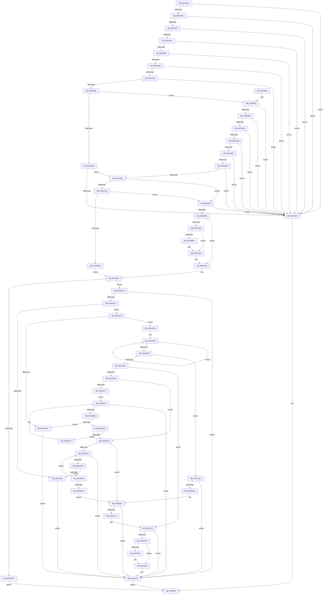

# SymCryptRsakeySetValueInternal

- RVA: `0x005238D4`–`0x00523FAF` (길이 `1,755` bytes)
- VA: `0x00000001405238D4`
- 실행 섹션: `.text`
- PDB 이름 있음: `예`; PDB Function 태그: `아니요`
- unwind 정보 RVA: `0x000C31EC`
- 디코드: `452`개 명령, `1,755/1,755` bytes 표시
- 미해석 바이트: `0` (있으면 어셈블리에 `.byte`로 보존)

> 이 문서는 커널 이미지의 기계어와 PDB 기호를 분석해 생성했습니다. 4번과 5번은 함수 원형과 자료형을 바이너리 사용 방식에서 추정한 C 해석이며 원본 소스 복구 결과는 아닙니다.

## 1. Dependencies

- 직접 호출 지점: **35**; 고유 호출 대상: **17**
- 직접 호출자로 확인된 함수: **1**
- RIP 상대 이미지 참조: **2**

### Outgoing calls
- `0x00523A00` → [SymCryptSizeofIntFromDigits](SymCryptSizeofIntFromDigits_function_00525D24.md) (function, `0x00525D24`)
- `0x00523A0F` → [SymCryptSizeofIntFromDigits](SymCryptSizeofIntFromDigits_function_00525D24.md) (function, `0x00525D24`)
- `0x00523A1B` → [SymCryptSizeofDivisorFromDigits](SymCryptSizeofDivisorFromDigits_function_00525D0C.md) (function, `0x00525D0C`)
- `0x00523B38` → [SymCryptSizeofIntFromDigits](SymCryptSizeofIntFromDigits_function_00525D24.md) (function, `0x00525D24`)
- `0x00523B42` → [SymCryptSizeofIntFromDigits](SymCryptSizeofIntFromDigits_function_00525D24.md) (function, `0x00525D24`)
- `0x00523B4E` → [SymCryptSizeofIntFromDigits](SymCryptSizeofIntFromDigits_function_00525D24.md) (function, `0x00525D24`)
- `0x00523BED` → [SymCryptSizeofIntFromDigits](SymCryptSizeofIntFromDigits_function_00525D24.md) (function, `0x00525D24`)
- `0x00523BF8` → [SymCryptSizeofIntFromDigits](SymCryptSizeofIntFromDigits_function_00525D24.md) (function, `0x00525D24`)
- `0x00523C05` → [SymCryptSizeofIntFromDigits](SymCryptSizeofIntFromDigits_function_00525D24.md) (function, `0x00525D24`)
- `0x00523C61` → [SymCryptCallbackAlloc](../6A/SymCryptCallbackAlloc_function_006AC530.md) (function, `0x006AC530`)
- `0x00523C7C` → [SymCryptIntFromModulus](SymCryptIntFromModulus_function_00525608.md) (function, `0x00525608`)
- `0x00523C92` → [SymCryptIntSetValue](SymCryptIntSetValue_function_00525730.md) (function, `0x00525730`)
- `0x00523CA5` → [SymCryptIntFromModulus](SymCryptIntFromModulus_function_00525608.md) (function, `0x00525608`)
- `0x00523CAD` → [SymCryptIntBitsizeOfValue](SymCryptIntBitsizeOfValue_function_005254F4.md) (function, `0x005254F4`)
- `0x00523CDF` → [SymCryptIntFromModulus](SymCryptIntFromModulus_function_00525608.md) (function, `0x00525608`)
- `0x00523D02` → [SymCryptIntToModulus](SymCryptIntToModulus_function_00525824.md) (function, `0x00525824`)
- `0x00523D52` → [SymCryptIntCreate](SymCryptIntCreate_function_0052556C.md) (function, `0x0052556C`)
- `0x00523DA3` → [SymCryptIntSetValue](SymCryptIntSetValue_function_00525730.md) (function, `0x00525730`)
- `0x00523DB7` → [SymCryptIntBitsizeOfValue](SymCryptIntBitsizeOfValue_function_005254F4.md) (function, `0x005254F4`)
- `0x00523DC2` → [SymCryptDigitsFromBits](SymCryptDigitsFromBits_function_0052544C.md) (function, `0x0052544C`)
- `0x00523DF6` → [SymCryptRsakeyCreateAllObjects](SymCryptRsakeyCreateAllObjects_function_00523720.md) (function, `0x00523720`)
- `0x00523E14` → [SymCryptIntFromModulus](SymCryptIntFromModulus_function_00525608.md) (function, `0x00525608`)
- `0x00523E3C` → [SymCryptIntSetValue](SymCryptIntSetValue_function_00525730.md) (function, `0x00525730`)
- `0x00523E53` → [SymCryptIntFromModulus](SymCryptIntFromModulus_function_00525608.md) (function, `0x00525608`)
- `0x00523E5B` → [SymCryptIntGetValueLsbits32](SymCryptIntGetValueLsbits32_function_00525668.md) (function, `0x00525668`)
- `0x00523E75` → [SymCryptIntFromModulus](SymCryptIntFromModulus_function_00525608.md) (function, `0x00525608`)
- `0x00523E94` → [SymCryptIntToModulus](SymCryptIntToModulus_function_00525824.md) (function, `0x00525824`)
- `0x00523ECB` → [SymCryptRsakeyCalculatePrimesFromPrivateExponent](SymCryptRsakeyCalculatePrimesFromPrivateExponent_function_00522D48.md) (function, `0x00522D48`)
- `0x00523EE6` → [SymCryptIntCreate](SymCryptIntCreate_function_0052556C.md) (function, `0x0052556C`)
- `0x00523F06` → [SymCryptIntCreate](SymCryptIntCreate_function_0052556C.md) (function, `0x0052556C`)
- `0x00523F1D` → [SymCryptDivisorCreate](SymCryptDivisorCreate_function_00525464.md) (function, `0x00525464`)
- `0x00523F5C` → [SymCryptRsakeyCalculatePrivateFields](SymCryptRsakeyCalculatePrivateFields_function_0052326C.md) (function, `0x0052326C`)
- `0x00523F87` → [SymCryptRsaSelftest](SymCryptRsaSelftest_function_0052B638.md) (function, `0x0052B638`)
- `0x00523F9D` → [SymCryptWipe](../51/SymCryptWipe_function_0051F914.md) (function, `0x0051F914`)
- `0x00523FA5` → [SymCryptCallbackFree](../6A/SymCryptCallbackFree_function_006AC568.md) (function, `0x006AC568`)

### Direct callers
- [SymCryptRsakeySetValue](SymCryptRsakeySetValue_function_0052386C.md) at `0x005238C2`

### Static image references
- `0x00523F7D` → RVA `0x00E0F394` (`.data`; read)
- `0x00523F8C` → RVA `0x00E0F394` (`.data`; read/write)

## 2. Other-region calls and transfers

- 다른 실행 섹션으로 향하는 call: **0**
- 별도 외부 분기/꼬리 이동을 확인하지 못했습니다.

## 3. Assembly (complete function range)

```asm
005238D4  48 8B C4                        mov rax, rsp
005238D7  48 89 58 20                     mov qword ptr [rax + 0x20], rbx
005238DB  4C 89 40 18                     mov qword ptr [rax + 0x18], r8
005238DF  48 89 50 10                     mov qword ptr [rax + 0x10], rdx
005238E3  48 89 48 08                     mov qword ptr [rax + 8], rcx
005238E7  55                              push rbp
005238E8  56                              push rsi
005238E9  57                              push rdi
005238EA  41 54                           push r12
005238EC  41 55                           push r13
005238EE  41 56                           push r14
005238F0  41 57                           push r15
005238F2  48 81 EC 80 00 00 00            sub rsp, 0x80
005238F9  44 8B AC 24 10 01 00 00         mov r13d, dword ptr [rsp + 0x110]
00523901  48 8B DA                        mov rbx, rdx
00523904  33 D2                           xor edx, edx
00523906  48 8B E9                        mov rbp, rcx
00523909  89 54 24 4C                     mov dword ptr [rsp + 0x4c], edx
0052390D  89 54 24 40                     mov dword ptr [rsp + 0x40], edx
00523911  89 54 24 48                     mov dword ptr [rsp + 0x48], edx
00523915  41 F7 C5 FF CC FF FF            test r13d, 0xffffccff
0052391C  75 40                           jne 0x14052395e
0052391E  41 F7 C5 00 30 00 00            test r13d, 0x3000
00523925  74 37                           je 0x14052395e
00523927  41 8B C5                        mov eax, r13d
0052392A  25 00 03 00 00                  and eax, 0x300
0052392F  3D 00 02 00 00                  cmp eax, 0x200
00523934  74 28                           je 0x14052395e
00523936  48 85 C9                        test rcx, rcx
00523939  74 23                           je 0x14052395e
0052393B  48 85 DB                        test rbx, rbx
0052393E  74 1E                           je 0x14052395e
00523940  41 83 F9 01                     cmp r9d, 1
00523944  75 18                           jne 0x14052395e
00523946  4D 85 C0                        test r8, r8
00523949  74 13                           je 0x14052395e
0052394B  83 BC 24 00 01 00 00 02         cmp dword ptr [rsp + 0x100], 2
00523953  74 2C                           je 0x140523981
00523955  39 94 24 00 01 00 00            cmp dword ptr [rsp + 0x100], edx
0052395C  74 53                           je 0x1405239b1
0052395E  BF 0E 80 00 00                  mov edi, 0x800e
00523963  48 8B 9C 24 D8 00 00 00         mov rbx, qword ptr [rsp + 0xd8]
0052396B  8B C7                           mov eax, edi
0052396D  48 81 C4 80 00 00 00            add rsp, 0x80
00523974  41 5F                           pop r15
00523976  41 5E                           pop r14
00523978  41 5D                           pop r13
0052397A  41 5C                           pop r12
0052397C  5F                              pop rdi
0052397D  5E                              pop rsi
0052397E  5D                              pop rbp
0052397F  C3                              ret
00523980  CC                              int3
00523981  48 8B 8C 24 F0 00 00 00         mov rcx, qword ptr [rsp + 0xf0]
00523989  48 85 C9                        test rcx, rcx
0052398C  74 D0                           je 0x14052395e
0052398E  48 8B 84 24 F8 00 00 00         mov rax, qword ptr [rsp + 0xf8]
00523996  48 85 C0                        test rax, rax
00523999  74 C3                           je 0x14052395e
0052399B  48 39 11                        cmp qword ptr [rcx], rdx
0052399E  74 BE                           je 0x14052395e
005239A0  48 39 51 08                     cmp qword ptr [rcx + 8], rdx
005239A4  74 B8                           je 0x14052395e
005239A6  48 39 10                        cmp qword ptr [rax], rdx
005239A9  74 B3                           je 0x14052395e
005239AB  48 39 50 08                     cmp qword ptr [rax + 8], rdx
005239AF  74 AD                           je 0x14052395e
005239B1  48 8B B4 24 18 01 00 00         mov rsi, qword ptr [rsp + 0x118]
005239B9  48 8B BC 24 E0 00 00 00         mov rdi, qword ptr [rsp + 0xe0]
005239C1  44 8B 66 14                     mov r12d, dword ptr [rsi + 0x14]
005239C5  48 85 FF                        test rdi, rdi
005239C8  75 29                           jne 0x1405239f3
005239CA  39 94 24 00 01 00 00            cmp dword ptr [rsp + 0x100], edx
005239D1  77 20                           ja 0x1405239f3
005239D3  45 8B F4                        mov r14d, r12d
005239D6  41 8B C4                        mov eax, r12d
005239D9  41 C1 E6 08                     shl r14d, 8
005239DD  41 81 C6 C0 00 00 00            add r14d, 0xc0
005239E4  C1 E0 04                        shl eax, 4
005239E7  41 3B C6                        cmp eax, r14d
005239EA  44 0F 47 F0                     cmova r14d, eax
005239EE  E9 63 02 00 00                  jmp 0x140523c56
005239F3  83 7E 1C 02                     cmp dword ptr [rsi + 0x1c], 2
005239F7  0F 85 61 FF FF FF               jne 0x14052395e
005239FD  41 8B CC                        mov ecx, r12d
00523A00  E8 1F 23 00 00                  call 0x140525d24
00523A05  43 8D 0C 24                     lea ecx, [r12 + r12]
00523A09  89 44 24 40                     mov dword ptr [rsp + 0x40], eax
00523A0D  8B D8                           mov ebx, eax
00523A0F  E8 10 23 00 00                  call 0x140525d24
00523A14  41 8B CC                        mov ecx, r12d
00523A17  89 44 24 48                     mov dword ptr [rsp + 0x48], eax
00523A1B  E8 EC 22 00 00                  call 0x140525d0c
00523A20  89 44 24 4C                     mov dword ptr [rsp + 0x4c], eax
00523A24  45 8B CC                        mov r9d, r12d
00523A27  41 C1 E1 04                     shl r9d, 4
00523A2B  41 8B CC                        mov ecx, r12d
00523A2E  C1 E1 05                        shl ecx, 5
00523A31  41 8B C4                        mov eax, r12d
00523A34  44 3B C9                        cmp r9d, ecx
00523A37  44 89 4C 24 50                  mov dword ptr [rsp + 0x50], r9d
00523A3C  1B C9                           sbb ecx, ecx
00523A3E  C1 E0 07                        shl eax, 7
00523A41  83 E1 10                        and ecx, 0x10
00523A44  44 8B D8                        mov r11d, eax
00523A47  83 C0 40                        add eax, 0x40
00523A4A  83 C1 10                        add ecx, 0x10
00523A4D  41 0F AF CC                     imul ecx, r12d
00523A51  4D 8D BB 00 02 00 00            lea r15, [r11 + 0x200]
00523A58  3B C1                           cmp eax, ecx
00523A5A  0F 47 C8                        cmova ecx, eax
00523A5D  41 8B C4                        mov eax, r12d
00523A60  C1 E0 06                        shl eax, 6
00523A63  8B D0                           mov edx, eax
00523A65  44 8B C1                        mov r8d, ecx
00523A68  48 8D 04 40                     lea rax, [rax + rax*2]
00523A6C  48 8D 0C 41                     lea rcx, [rcx + rax*2]
00523A70  4C 03 F9                        add r15, rcx
00523A73  8D 4A 40                        lea ecx, [rdx + 0x40]
00523A76  44 3B C9                        cmp r9d, ecx
00523A79  89 4C 24 54                     mov dword ptr [rsp + 0x54], ecx
00523A7D  8B C1                           mov eax, ecx
00523A7F  4C 89 7C 24 70                  mov qword ptr [rsp + 0x70], r15
00523A84  41 0F 47 C1                     cmova eax, r9d
00523A88  41 8B CC                        mov ecx, r12d
00523A8B  44 8B F0                        mov r14d, eax
00523A8E  4D 3B FE                        cmp r15, r14
00523A91  44 8B D0                        mov r10d, eax
00523A94  4D 0F 47 D7                     cmova r10, r15
00523A98  C1 E1 08                        shl ecx, 8
00523A9B  8D 41 40                        lea eax, [rcx + 0x40]
00523A9E  44 8B C8                        mov r9d, eax
00523AA1  4D 3B F9                        cmp r15, r9
00523AA4  89 44 24 44                     mov dword ptr [rsp + 0x44], eax
00523AA8  4C 8D 4A 40                     lea r9, [rdx + 0x40]
00523AAC  49 0F 47 C7                     cmova rax, r15
00523AB0  4E 8D 0C 48                     lea r9, [rax + r9*2]
00523AB4  8D 81 C0 00 00 00               lea eax, [rcx + 0xc0]
00523ABA  39 44 24 50                     cmp dword ptr [rsp + 0x50], eax
00523ABE  0F 47 44 24 50                  cmova eax, dword ptr [rsp + 0x50]
00523AC3  8B C8                           mov ecx, eax
00523AC5  41 8D 44 24 01                  lea eax, [r12 + 1]
00523ACA  C1 E0 09                        shl eax, 9
00523ACD  41 03 C0                        add eax, r8d
00523AD0  48 89 4C 24 60                  mov qword ptr [rsp + 0x60], rcx
00523AD5  4D 3B CA                        cmp r9, r10
00523AD8  89 44 24 58                     mov dword ptr [rsp + 0x58], eax
00523ADC  8B D0                           mov edx, eax
00523ADE  41 8D 8B 80 00 00 00            lea ecx, [r11 + 0x80]
00523AE5  8B 44 24 44                     mov eax, dword ptr [rsp + 0x44]
00523AE9  4D 8B C2                        mov r8, r10
00523AEC  4D 0F 47 C1                     cmova r8, r9
00523AF0  44 8B E8                        mov r13d, eax
00523AF3  4D 3B FD                        cmp r15, r13
00523AF6  0F 47 C2                        cmova eax, edx
00523AF9  03 C8                           add ecx, eax
00523AFB  48 8B 44 24 60                  mov rax, qword ptr [rsp + 0x60]
00523B00  4D 3B FE                        cmp r15, r14
00523B03  44 0F 47 F2                     cmova r14d, edx
00523B07  4D 3B CA                        cmp r9, r10
00523B0A  44 0F 47 F1                     cmova r14d, ecx
00523B0E  49 3B C0                        cmp rax, r8
00523B11  44 0F 47 F0                     cmova r14d, eax
00523B15  44 03 74 24 48                  add r14d, dword ptr [rsp + 0x48]
00523B1A  44 03 F3                        add r14d, ebx
00523B1D  44 03 74 24 4C                  add r14d, dword ptr [rsp + 0x4c]
00523B22  44 8B AC 24 10 01 00 00         mov r13d, dword ptr [rsp + 0x110]
00523B2A  48 85 FF                        test rdi, rdi
00523B2D  0F 84 1B 01 00 00               je 0x140523c4e
00523B33  41 8D 4C 24 01                  lea ecx, [r12 + 1]
00523B38  E8 E7 21 00 00                  call 0x140525d24
00523B3D  41 8B CC                        mov ecx, r12d
00523B40  8B F8                           mov edi, eax
00523B42  E8 DD 21 00 00                  call 0x140525d24
00523B47  B9 01 00 00 00                  mov ecx, 1
00523B4C  03 F8                           add edi, eax
00523B4E  E8 D1 21 00 00                  call 0x140525d24
00523B53  8B 4E 0C                        mov ecx, dword ptr [rsi + 0xc]
00523B56  44 8B F9                        mov r15d, ecx
00523B59  44 8B 4C 24 44                  mov r9d, dword ptr [rsp + 0x44]
00523B5E  C1 E9 09                        shr ecx, 9
00523B61  8D 14 07                        lea edx, [rdi + rax]
00523B64  B8 FF 01 00 00                  mov eax, 0x1ff
00523B69  44 23 F8                        and r15d, eax
00523B6C  44 03 F8                        add r15d, eax
00523B6F  8B 44 24 54                     mov eax, dword ptr [rsp + 0x54]
00523B73  41 C1 EF 09                     shr r15d, 9
00523B77  44 03 F9                        add r15d, ecx
00523B7A  48 8B 4C 24 60                  mov rcx, qword ptr [rsp + 0x60]
00523B7F  41 C1 E7 08                     shl r15d, 8
00523B83  3B C8                           cmp ecx, eax
00523B85  0F 47 C1                        cmova eax, ecx
00523B88  8B E8                           mov ebp, eax
00523B8A  48 39 6C 24 70                  cmp qword ptr [rsp + 0x70], rbp
00523B8F  44 8B C0                        mov r8d, eax
00523B92  4C 0F 47 44 24 70               cmova r8, qword ptr [rsp + 0x70]
00523B98  41 69 C4 80 11 00 00            imul eax, r12d, 0x1180
00523B9F  49 8B C8                        mov rcx, r8
00523BA2  4C 89 44 24 60                  mov qword ptr [rsp + 0x60], r8
00523BA7  83 C0 40                        add eax, 0x40
00523BAA  49 3B C0                        cmp rax, r8
00523BAD  89 44 24 54                     mov dword ptr [rsp + 0x54], eax
00523BB1  48 0F 47 C8                     cmova rcx, rax
00523BB5  4C 3B C9                        cmp r9, rcx
00523BB8  48 89 4C 24 78                  mov qword ptr [rsp + 0x78], rcx
00523BBD  48 8B C1                        mov rax, rcx
00523BC0  8B 4C 24 50                     mov ecx, dword ptr [rsp + 0x50]
00523BC4  49 0F 47 C1                     cmova rax, r9
00523BC8  83 C1 10                        add ecx, 0x10
00523BCB  48 3B C8                        cmp rcx, rax
00523BCE  48 89 44 24 68                  mov qword ptr [rsp + 0x68], rax
00523BD3  4C 8B C0                        mov r8, rax
00523BD6  41 8B C6                        mov eax, r14d
00523BD9  4C 0F 47 C1                     cmova r8, rcx
00523BDD  41 03 D7                        add edx, r15d
00523BE0  4C 03 C2                        add r8, rdx
00523BE3  49 3B C0                        cmp rax, r8
00523BE6  77 5E                           ja 0x140523c46
00523BE8  41 8D 4C 24 01                  lea ecx, [r12 + 1]
00523BED  E8 32 21 00 00                  call 0x140525d24
00523BF2  41 8B CC                        mov ecx, r12d
00523BF5  44 8B F0                        mov r14d, eax
00523BF8  E8 27 21 00 00                  call 0x140525d24
00523BFD  B9 01 00 00 00                  mov ecx, 1
00523C02  44 03 F0                        add r14d, eax
00523C05  E8 1A 21 00 00                  call 0x140525d24
00523C0A  48 39 6C 24 70                  cmp qword ptr [rsp + 0x70], rbp
00523C0F  8B 54 24 54                     mov edx, dword ptr [rsp + 0x54]
00523C13  0F 47 6C 24 58                  cmova ebp, dword ptr [rsp + 0x58]
00523C18  48 3B 54 24 60                  cmp rdx, qword ptr [rsp + 0x60]
00523C1D  0F 47 EA                        cmova ebp, edx
00523C20  8B 54 24 44                     mov edx, dword ptr [rsp + 0x44]
00523C24  48 3B 54 24 78                  cmp rdx, qword ptr [rsp + 0x78]
00523C29  0F 47 EA                        cmova ebp, edx
00523C2C  8B 54 24 50                     mov edx, dword ptr [rsp + 0x50]
00523C30  83 C2 10                        add edx, 0x10
00523C33  8B CA                           mov ecx, edx
00523C35  48 3B 4C 24 68                  cmp rcx, qword ptr [rsp + 0x68]
00523C3A  0F 47 EA                        cmova ebp, edx
00523C3D  44 03 F0                        add r14d, eax
00523C40  44 03 F5                        add r14d, ebp
00523C43  45 03 F7                        add r14d, r15d
00523C46  48 8B AC 24 C0 00 00 00         mov rbp, qword ptr [rsp + 0xc0]
00523C4E  48 8B 9C 24 C8 00 00 00         mov rbx, qword ptr [rsp + 0xc8]
00523C56  41 8B C6                        mov eax, r14d
00523C59  41 8B CE                        mov ecx, r14d
00523C5C  48 89 44 24 68                  mov qword ptr [rsp + 0x68], rax
00523C61  E8 CA 88 18 00                  call 0x1406ac530
00523C66  4C 8B F8                        mov r15, rax
00523C69  48 85 C0                        test rax, rax
00523C6C  75 0A                           jne 0x140523c78
00523C6E  BF 0F 80 00 00                  mov edi, 0x800f
00523C73  E9 EB FC FF FF                  jmp 0x140523963
00523C78  48 8B 4E 78                     mov rcx, qword ptr [rsi + 0x78]
00523C7C  E8 87 19 00 00                  call 0x140525608
00523C81  44 8B 84 24 08 01 00 00         mov r8d, dword ptr [rsp + 0x108]
00523C89  4C 8B C8                        mov r9, rax
00523C8C  48 8B D3                        mov rdx, rbx
00523C8F  48 8B CD                        mov rcx, rbp
00523C92  E8 99 1A 00 00                  call 0x140525730
00523C97  8B F8                           mov edi, eax
00523C99  85 C0                           test eax, eax
00523C9B  0F 85 F6 02 00 00               jne 0x140523f97
00523CA1  48 8B 4E 78                     mov rcx, qword ptr [rsi + 0x78]
00523CA5  E8 5E 19 00 00                  call 0x140525608
00523CAA  48 8B C8                        mov rcx, rax
00523CAD  E8 42 18 00 00                  call 0x1405254f4
00523CB2  8B E8                           mov ebp, eax
00523CB4  89 46 10                        mov dword ptr [rsi + 0x10], eax
00523CB7  3B 46 0C                        cmp eax, dword ptr [rsi + 0xc]
00523CBA  76 0A                           jbe 0x140523cc6
00523CBC  BF 0E 80 00 00                  mov edi, 0x800e
00523CC1  E9 D1 02 00 00                  jmp 0x140523f97
00523CC6  81 FD 00 01 00 00               cmp ebp, 0x100
00523CCC  73 0A                           jae 0x140523cd8
00523CCE  BF 01 80 00 00                  mov edi, 0x8001
00523CD3  E9 BF 02 00 00                  jmp 0x140523f97
00523CD8  48 8B 5E 78                     mov rbx, qword ptr [rsi + 0x78]
00523CDC  48 8B CB                        mov rcx, rbx
00523CDF  E8 24 19 00 00                  call 0x140525608
00523CE4  48 8B C8                        mov rcx, rax
00523CE7  41 B9 01 00 00 00               mov r9d, 1
00523CED  48 8B 44 24 68                  mov rax, qword ptr [rsp + 0x68]
00523CF2  44 8B C5                        mov r8d, ebp
00523CF5  48 89 44 24 28                  mov qword ptr [rsp + 0x28], rax
00523CFA  48 8B D3                        mov rdx, rbx
00523CFD  4C 89 7C 24 20                  mov qword ptr [rsp + 0x20], r15
00523D02  E8 1D 1B 00 00                  call 0x140525824
00523D07  4C 8B 84 24 D0 00 00 00         mov r8, qword ptr [rsp + 0xd0]
00523D0F  33 D2                           xor edx, edx
00523D11  C7 46 18 01 00 00 00            mov dword ptr [rsi + 0x18], 1
00523D18  49 8B 04 D0                     mov rax, qword ptr [r8 + rdx*8]
00523D1C  48 89 44 D6 38                  mov qword ptr [rsi + rdx*8 + 0x38], rax
00523D21  FF C2                           inc edx
00523D23  3B 56 18                        cmp edx, dword ptr [rsi + 0x18]
00523D26  72 F0                           jb 0x140523d18
00523D28  48 8B 94 24 E0 00 00 00         mov rdx, qword ptr [rsp + 0xe0]
00523D30  48 85 D2                        test rdx, rdx
00523D33  0F 85 75 01 00 00               jne 0x140523eae
00523D39  39 94 24 00 01 00 00            cmp dword ptr [rsp + 0x100], edx
00523D40  0F 86 2D 02 00 00               jbe 0x140523f73
00523D46  8B 7C 24 40                     mov edi, dword ptr [rsp + 0x40]
00523D4A  45 8B C4                        mov r8d, r12d
00523D4D  8B D7                           mov edx, edi
00523D4F  49 8B CF                        mov rcx, r15
00523D52  E8 15 18 00 00                  call 0x14052556c
00523D57  83 66 30 00                     and dword ptr [rsi + 0x30], 0
00523D5B  4E 8D 2C 3F                     lea r13, [rdi + r15]
00523D5F  41 8B EE                        mov ebp, r14d
00523D62  48 89 44 24 58                  mov qword ptr [rsp + 0x58], rax
00523D67  48 8B C8                        mov rcx, rax
00523D6A  2B EF                           sub ebp, edi
00523D6C  33 C0                           xor eax, eax
00523D6E  89 44 24 40                     mov dword ptr [rsp + 0x40], eax
00523D72  39 46 1C                        cmp dword ptr [rsi + 0x1c], eax
00523D75  76 7C                           jbe 0x140523df3
00523D77  EB 05                           jmp 0x140523d7e
00523D79  48 8B 4C 24 58                  mov rcx, qword ptr [rsp + 0x58]
00523D7E  44 8B 84 24 08 01 00 00         mov r8d, dword ptr [rsp + 0x108]
00523D86  4C 8B C9                        mov r9, rcx
00523D89  8B D8                           mov ebx, eax
00523D8B  48 8B 84 24 F8 00 00 00         mov rax, qword ptr [rsp + 0xf8]
00523D93  48 8B 14 D8                     mov rdx, qword ptr [rax + rbx*8]
00523D97  48 8B 84 24 F0 00 00 00         mov rax, qword ptr [rsp + 0xf0]
00523D9F  48 8B 0C D8                     mov rcx, qword ptr [rax + rbx*8]
00523DA3  E8 88 19 00 00                  call 0x140525730
00523DA8  8B F8                           mov edi, eax
00523DAA  85 C0                           test eax, eax
00523DAC  0F 85 E5 01 00 00               jne 0x140523f97
00523DB2  48 8B 4C 24 58                  mov rcx, qword ptr [rsp + 0x58]
00523DB7  E8 38 17 00 00                  call 0x1405254f4
00523DBC  8B C8                           mov ecx, eax
00523DBE  89 44 9E 20                     mov dword ptr [rsi + rbx*4 + 0x20], eax
00523DC2  E8 85 16 00 00                  call 0x14052544c
00523DC7  89 44 9E 28                     mov dword ptr [rsi + rbx*4 + 0x28], eax
00523DCB  8B 4E 30                        mov ecx, dword ptr [rsi + 0x30]
00523DCE  3B C8                           cmp ecx, eax
00523DD0  0F 47 C1                        cmova eax, ecx
00523DD3  89 46 30                        mov dword ptr [rsi + 0x30], eax
00523DD6  81 7C 9E 20 80 00 00 00         cmp dword ptr [rsi + rbx*4 + 0x20], 0x80
00523DDE  0F 82 EA FE FF FF               jb 0x140523cce
00523DE4  8B 44 24 40                     mov eax, dword ptr [rsp + 0x40]
00523DE8  FF C0                           inc eax
00523DEA  89 44 24 40                     mov dword ptr [rsp + 0x40], eax
00523DEE  3B 46 1C                        cmp eax, dword ptr [rsi + 0x1c]
00523DF1  72 86                           jb 0x140523d79
00523DF3  48 8B CE                        mov rcx, rsi
00523DF6  E8 25 F9 FF FF                  call 0x140523720
00523DFB  33 C0                           xor eax, eax
00523DFD  89 44 24 40                     mov dword ptr [rsp + 0x40], eax
00523E01  39 46 1C                        cmp dword ptr [rsi + 0x1c], eax
00523E04  0F 86 EF 00 00 00               jbe 0x140523ef9
00523E0A  48 8B 8C C6 80 00 00 00         mov rcx, qword ptr [rsi + rax*8 + 0x80]
00523E12  8B D8                           mov ebx, eax
00523E14  E8 EF 17 00 00                  call 0x140525608
00523E19  44 8B 84 24 08 01 00 00         mov r8d, dword ptr [rsp + 0x108]
00523E21  4C 8B C8                        mov r9, rax
00523E24  48 8B 84 24 F8 00 00 00         mov rax, qword ptr [rsp + 0xf8]
00523E2C  48 8B 14 D8                     mov rdx, qword ptr [rax + rbx*8]
00523E30  48 8B 84 24 F0 00 00 00         mov rax, qword ptr [rsp + 0xf0]
00523E38  48 8B 0C D8                     mov rcx, qword ptr [rax + rbx*8]
00523E3C  E8 EF 18 00 00                  call 0x140525730
00523E41  8B F8                           mov edi, eax
00523E43  85 C0                           test eax, eax
00523E45  0F 85 4C 01 00 00               jne 0x140523f97
00523E4B  48 8B 8C DE 80 00 00 00         mov rcx, qword ptr [rsi + rbx*8 + 0x80]
00523E53  E8 B0 17 00 00                  call 0x140525608
00523E58  48 8B C8                        mov rcx, rax
00523E5B  E8 08 18 00 00                  call 0x140525668
00523E60  A8 01                           test al, 1
00523E62  0F 84 54 FE FF FF               je 0x140523cbc
00523E68  48 8B BC DE 80 00 00 00         mov rdi, qword ptr [rsi + rbx*8 + 0x80]
00523E70  48 8B CF                        mov rcx, rdi
00523E73  8B DD                           mov ebx, ebp
00523E75  E8 8E 17 00 00                  call 0x140525608
00523E7A  44 8B 46 10                     mov r8d, dword ptr [rsi + 0x10]
00523E7E  48 8B C8                        mov rcx, rax
00523E81  41 B9 0A 00 00 00               mov r9d, 0xa
00523E87  48 89 5C 24 28                  mov qword ptr [rsp + 0x28], rbx
00523E8C  48 8B D7                        mov rdx, rdi
00523E8F  4C 89 6C 24 20                  mov qword ptr [rsp + 0x20], r13
00523E94  E8 8B 19 00 00                  call 0x140525824
00523E99  8B 44 24 40                     mov eax, dword ptr [rsp + 0x40]
00523E9D  FF C0                           inc eax
00523E9F  89 44 24 40                     mov dword ptr [rsp + 0x40], eax
00523EA3  3B 46 1C                        cmp eax, dword ptr [rsi + 0x1c]
00523EA6  0F 82 5E FF FF FF               jb 0x140523e0a
00523EAC  EB 4B                           jmp 0x140523ef9
00523EAE  44 8B 8C 24 08 01 00 00         mov r9d, dword ptr [rsp + 0x108]
00523EB6  48 8B CE                        mov rcx, rsi
00523EB9  4C 8B 84 24 E8 00 00 00         mov r8, qword ptr [rsp + 0xe8]
00523EC1  44 89 74 24 28                  mov dword ptr [rsp + 0x28], r14d
00523EC6  4C 89 7C 24 20                  mov qword ptr [rsp + 0x20], r15
00523ECB  E8 78 EE FF FF                  call 0x140522d48
00523ED0  8B F8                           mov edi, eax
00523ED2  85 C0                           test eax, eax
00523ED4  0F 85 BD 00 00 00               jne 0x140523f97
00523EDA  8B 7C 24 40                     mov edi, dword ptr [rsp + 0x40]
00523EDE  45 8B C4                        mov r8d, r12d
00523EE1  8B D7                           mov edx, edi
00523EE3  49 8B CF                        mov rcx, r15
00523EE6  E8 81 16 00 00                  call 0x14052556c
00523EEB  41 8B EE                        mov ebp, r14d
00523EEE  48 89 44 24 58                  mov qword ptr [rsp + 0x58], rax
00523EF3  2B EF                           sub ebp, edi
00523EF5  4E 8D 2C 3F                     lea r13, [rdi + r15]
00523EF9  8B 5C 24 48                     mov ebx, dword ptr [rsp + 0x48]
00523EFD  47 8D 04 24                     lea r8d, [r12 + r12]
00523F01  8B D3                           mov edx, ebx
00523F03  49 8B CD                        mov rcx, r13
00523F06  E8 61 16 00 00                  call 0x14052556c
00523F0B  4C 03 EB                        add r13, rbx
00523F0E  45 8B C4                        mov r8d, r12d
00523F11  8B 5C 24 4C                     mov ebx, dword ptr [rsp + 0x4c]
00523F15  49 8B CD                        mov rcx, r13
00523F18  8B D3                           mov edx, ebx
00523F1A  48 8B F8                        mov rdi, rax
00523F1D  E8 42 15 00 00                  call 0x140525464
00523F22  44 8B 84 24 10 01 00 00         mov r8d, dword ptr [rsp + 0x110]
00523F2A  4A 8D 14 2B                     lea rdx, [rbx + r13]
00523F2E  2B 6C 24 48                     sub ebp, dword ptr [rsp + 0x48]
00523F32  41 81 E0 00 02 00 00            and r8d, 0x200
00523F39  2B 6C 24 4C                     sub ebp, dword ptr [rsp + 0x4c]
00523F3D  4C 8B CF                        mov r9, rdi
00523F40  44 89 44 24 30                  mov dword ptr [rsp + 0x30], r8d
00523F45  4C 8B 44 24 58                  mov r8, qword ptr [rsp + 0x58]
00523F4A  8B CD                           mov ecx, ebp
00523F4C  48 89 4C 24 28                  mov qword ptr [rsp + 0x28], rcx
00523F51  48 8B CE                        mov rcx, rsi
00523F54  48 89 54 24 20                  mov qword ptr [rsp + 0x20], rdx
00523F59  48 8B D0                        mov rdx, rax
00523F5C  E8 0B F3 FF FF                  call 0x14052326c
00523F61  8B F8                           mov edi, eax
00523F63  85 C0                           test eax, eax
00523F65  75 30                           jne 0x140523f97
00523F67  44 8B AC 24 10 01 00 00         mov r13d, dword ptr [rsp + 0x110]
00523F6F  C6 46 08 01                     mov byte ptr [rsi + 8], 1
00523F73  44 89 2E                        mov dword ptr [rsi], r13d
00523F76  41 0F BA E5 08                  bt r13d, 8
00523F7B  72 1A                           jb 0x140523f97
00523F7D  8B 05 11 B4 8E 00               mov eax, dword ptr [rip + 0x8eb411]
00523F83  A8 08                           test al, 8
00523F85  75 0D                           jne 0x140523f94
00523F87  E8 AC 76 00 00                  call 0x14052b638
00523F8C  F0 83 0D 00 B4 8E 00 08         lock or dword ptr [rip + 0x8eb400], 8
00523F94  83 0E 01                        or dword ptr [rsi], 1
00523F97  41 8B D6                        mov edx, r14d
00523F9A  49 8B CF                        mov rcx, r15
00523F9D  E8 72 B9 FF FF                  call 0x14051f914
00523FA2  49 8B CF                        mov rcx, r15
00523FA5  E8 BE 85 18 00                  call 0x1406ac568
00523FAA  E9 B4 F9 FF FF                  jmp 0x140523963
```

## 4. C-style interpretation (structured pseudocode)

```c
__int64 __fastcall SymCryptRsakeySetValueInternal(__int64 a1, __int64 a2, __int64 a3, int a4, __int64 a5, __int64 a6, __int64 a7, __int64 a8, unsigned int a9, unsigned int a10, unsigned int a11, __int64 a12)
{
    __int64 result;
    __int64 v_r10;
    __int64 v_r13;
    __int64 v_r14;
    __int64 v_r15;
    __int64 v_rbp;
    __int64 v_rdi;
    __int64 v_rsp;
    unsigned int v_stack_m6C;
    unsigned int v_stack_m70;
    unsigned int v_stack_m78;
    unsigned __int64 v_stack_p20;
    unsigned __int64 v_stack_p28;
    unsigned int v_stack_p30;
    unsigned int v_stack_p40;
    unsigned int v_stack_p44;
    unsigned int v_stack_p48;
    unsigned int v_stack_p4C;
    unsigned int v_stack_p50;
    unsigned int v_stack_p54;
    unsigned int v_stack_p58;
    unsigned __int64 v_stack_p60;
    unsigned __int64 v_stack_p68;
    unsigned __int64 v_stack_p70;
    unsigned __int64 v_stack_p78;
    unsigned __int64 v_stack_pC0;
    unsigned __int64 v_stack_pC8;
    unsigned __int64 v_stack_pD0;

    *(unsigned __int64 *)(v_rsp + 32) = v_rbx;
    *(unsigned __int64 *)(v_rsp + 24) = a3;
    *(unsigned __int64 *)(v_rsp + 16) = a2;
    *(unsigned __int64 *)(v_rsp + 8) = a1;
    v_rsp = (v_rsp) - (128);
    a2 = 0;
    v_stack_m6C = 0;
    v_stack_m78 = 0;
    v_stack_m70 = 0;
    if ((((unsigned int)((unsigned int)(a11))) & (0xFFFFCCFFULL)) != 0) goto loc_0052395E;
    if ((((unsigned int)((unsigned int)(a11))) & (0x3000ULL)) == 0) goto loc_0052395E;
    result = (unsigned int)(((unsigned int)((unsigned int)((unsigned int)(a11)))) & (768));
    if (((unsigned int)(result)) == 512) goto loc_0052395E;
    if (a1 == 0) goto loc_0052395E;
    if (0 == 0) goto loc_0052395E;
    if (a4 != 1) goto loc_0052395E;
    if (a3 == 0) goto loc_0052395E;
    if (a9 == 2) goto loc_00523981;
    if (a9 == 0) goto loc_005239B1;
loc_0052395E:
loc_00523963:
    v_rsp = (v_rsp) + (128);
    return (unsigned int)((unsigned int)((unsigned int)(0x800EULL)));
loc_00523981:
    if (a7 == 0) goto loc_0052395E;
    if (a8 == 0) goto loc_0052395E;
    if ((*(unsigned __int64 *)(a7)) == 0) goto loc_0052395E;
    if ((*(unsigned __int64 *)(a7 + 8)) == 0) goto loc_0052395E;
    if ((*(unsigned __int64 *)(a8)) == 0) goto loc_0052395E;
    if ((*(unsigned __int64 *)(a8 + 8)) == 0) goto loc_0052395E;
loc_005239B1:
    if (a5 != 0) goto loc_005239F3;
    if (a9 > 0) goto loc_005239F3;
    v_r14 = (unsigned int)(((unsigned int)((unsigned int)((unsigned int)(*(unsigned int *)(a12 + 20))))) << (8));
    v_r14 = (unsigned int)((v_r14) + (192));
    result = (unsigned int)(((unsigned int)((unsigned int)((unsigned int)(*(unsigned int *)(a12 + 20))))) << (4));
    if (((unsigned int)(result)) > ((unsigned int)(v_r14))) { v_r14 = (unsigned int)(result); }
    goto loc_00523C56;
loc_005239F3:
    if ((*(unsigned int *)(a12 + 28)) != 2) goto loc_0052395E;
    result = SymCryptSizeofIntFromDigits((unsigned int)((unsigned int)((unsigned int)(*(unsigned int *)(a12 + 20)))), a2, a3, a4);
    v_stack_p40 = (unsigned int)(result);
    result = SymCryptSizeofIntFromDigits((unsigned int)(*(unsigned int *)(a12 + 20)) + (unsigned int)(*(unsigned int *)(a12 + 20)) * 1, a2, a3, a4);
    v_stack_p48 = (unsigned int)(result);
    result = SymCryptSizeofDivisorFromDigits((unsigned int)((unsigned int)((unsigned int)(*(unsigned int *)(a12 + 20)))), a2, a3, a4);
    v_stack_p4C = (unsigned int)(result);
    a4 = (unsigned int)(((unsigned int)((unsigned int)((unsigned int)(*(unsigned int *)(a12 + 20))))) << (4));
    a1 = (unsigned int)(((unsigned int)((unsigned int)((unsigned int)(*(unsigned int *)(a12 + 20))))) << (5));
    v_stack_p50 = a4;
    result = (unsigned int)(((unsigned int)((unsigned int)((unsigned int)(*(unsigned int *)(a12 + 20))))) << (7));
    a1 = (unsigned int)((a1) & (16));
    result = (unsigned int)((result) + (64));
    a1 = (unsigned int)((a1) + (16));
    a1 = (unsigned int)((a1) * ((unsigned int)((unsigned int)(*(unsigned int *)(a12 + 20)))));
    if (((unsigned int)(result)) > ((unsigned int)(a1))) { a1 = (unsigned int)(result); }
    result = (unsigned int)(((unsigned int)((unsigned int)((unsigned int)(*(unsigned int *)(a12 + 20))))) << (6));
    v_r15 = ((unsigned int)((unsigned int)(result)) + 512) + (a1 + result + result * 2 * 2);
    v_stack_p54 = (unsigned int)((unsigned int)((unsigned int)(result)) + 64);
    v_stack_p70 = v_r15;
    result = (unsigned int)((unsigned int)((unsigned int)((unsigned int)(result)) + 64));
    if (a4 > ((unsigned int)((unsigned int)((unsigned int)(result)) + 64))) { result = a4; }
    v_r10 = (unsigned int)((unsigned int)(result));
    if (v_r15 > ((unsigned int)((unsigned int)(result)))) { v_r10 = v_r15; }
    a1 = (unsigned int)(((unsigned int)((unsigned int)((unsigned int)(*(unsigned int *)(a12 + 20))))) << (8));
    v_stack_p44 = (unsigned int)(a1 + 64);
    result = a1 + 64;
    if (v_r15 > ((unsigned int)((unsigned int)(a1 + 64)))) { result = v_r15; }
    result = a1 + 192;
    if (v_stack_p50 > ((unsigned int)(a1 + 192))) { result = v_stack_p50; }
    result = (unsigned int)(((unsigned int)(*(unsigned int *)(a12 + 20)) + 1) << (9));
    result = (unsigned int)((result) + ((unsigned int)((unsigned int)((unsigned int)(a1)))));
    v_stack_p60 = (unsigned int)((unsigned int)(result));
    v_stack_p58 = (unsigned int)(result);
    a3 = v_r10;
    if ((result + (unsigned int)((unsigned int)(result)) + 64 * 2) > v_r10) { a3 = result + (unsigned int)((unsigned int)(result)) + 64 * 2; }
    result = (unsigned int)(v_stack_p44);
    if (v_r15 > ((unsigned int)((unsigned int)((unsigned int)(v_stack_p44))))) { result = (unsigned int)((unsigned int)((unsigned int)(result))); }
    a1 = (unsigned int)(((unsigned int)((unsigned int)(result)) + 128) + ((unsigned int)(result)));
    v_r14 = (unsigned int)((unsigned int)(result));
    if (v_r15 > ((unsigned int)((unsigned int)(result)))) { v_r14 = (unsigned int)((unsigned int)((unsigned int)(result))); }
    if ((result + (unsigned int)((unsigned int)(result)) + 64 * 2) > v_r10) { v_r14 = (unsigned int)(a1); }
    if (v_stack_p60 > a3) { v_r14 = (unsigned int)(v_stack_p60); }
    v_r14 = (unsigned int)((v_r14) + (v_stack_p48));
    v_r14 = (unsigned int)((v_r14) + ((unsigned int)((unsigned int)((unsigned int)(result)))));
    v_r14 = (unsigned int)((v_r14) + (v_stack_p4C));
    if (a5 == 0) goto loc_00523C4E;
    result = SymCryptSizeofIntFromDigits((unsigned int)(*(unsigned int *)(a12 + 20)) + 1, (unsigned int)((unsigned int)(result)), a3, result + (unsigned int)((unsigned int)(result)) + 64 * 2);
    result = SymCryptSizeofIntFromDigits((unsigned int)((unsigned int)((unsigned int)(*(unsigned int *)(a12 + 20)))), (unsigned int)((unsigned int)(result)), a3, result + (unsigned int)((unsigned int)(result)) + 64 * 2);
    v_rdi = (unsigned int)(((unsigned int)((unsigned int)(result))) + ((unsigned int)(result)));
    result = SymCryptSizeofIntFromDigits(1, (unsigned int)((unsigned int)(result)), a3, result + (unsigned int)((unsigned int)(result)) + 64 * 2);
    a1 = (unsigned int)(((unsigned int)(*(unsigned int *)(a12 + 12))) >> (9));
    v_r15 = (unsigned int)(((unsigned int)((unsigned int)((unsigned int)(*(unsigned int *)(a12 + 12))))) & (511));
    v_r15 = (unsigned int)((v_r15) + (511));
    v_r15 = (unsigned int)((v_r15) >> (9));
    v_r15 = (unsigned int)((v_r15) + ((unsigned int)(a1)));
    v_r15 = (unsigned int)((v_r15) << (8));
    result = (unsigned int)(v_stack_p54);
    if (((unsigned int)(v_stack_p60)) > ((unsigned int)((unsigned int)(v_stack_p54)))) { result = (unsigned int)(v_stack_p60); }
    a3 = (unsigned int)((unsigned int)(result));
    if (v_stack_p70 > ((unsigned int)((unsigned int)(result)))) { a3 = v_stack_p70; }
    result = (unsigned int)((result) * ((unsigned int)((unsigned int)(*(unsigned int *)(a12 + 20)))));
    v_stack_p60 = a3;
    result = (unsigned int)((result) + (64));
    v_stack_p54 = (unsigned int)(result);
    if (result > a3) { a3 = result; }
    v_stack_p78 = a3;
    if (((unsigned int)(v_stack_p44)) > a3) { a3 = (unsigned int)(v_stack_p44); }
    a1 = (unsigned int)(((unsigned int)(v_stack_p50)) + (16));
    v_stack_p68 = a3;
    if (a1 > a3) { a3 = a1; }
    a2 = (unsigned int)((v_rdi + result * 1) + ((unsigned int)(v_r15)));
    a3 = (a3) + (a2);
    result = (unsigned int)((unsigned int)(v_r14));
    v_rbp = (unsigned int)((unsigned int)(result));
    if (((unsigned int)((unsigned int)(v_r14))) <= a3) {
        a1 = (unsigned int)(*(unsigned int *)(a12 + 20)) + 1;
        result = SymCryptSizeofIntFromDigits(a1, a2, a3, (unsigned int)(v_stack_p44));
        a1 = (unsigned int)((unsigned int)(*(unsigned int *)(a12 + 20)));
        v_r14 = (unsigned int)(result);
        result = SymCryptSizeofIntFromDigits(a1, a2, a3, (unsigned int)(v_stack_p44));
        a1 = 1;
        v_r14 = (unsigned int)((v_r14) + ((unsigned int)(result)));
        result = SymCryptSizeofIntFromDigits(a1, a2, a3, (unsigned int)(v_stack_p44));
        a2 = v_stack_p54;
        v_rbp = (unsigned int)((unsigned int)(result));
        if (v_stack_p70 > ((unsigned int)((unsigned int)(result)))) { v_rbp = v_stack_p58; }
        if (a2 > v_stack_p60) { v_rbp = (unsigned int)(a2); }
        a2 = v_stack_p44;
        if (a2 > v_stack_p78) { v_rbp = (unsigned int)(a2); }
        a2 = v_stack_p50;
        a2 = (unsigned int)((a2) + (16));
        a1 = (unsigned int)(a2);
        if (a1 > v_stack_p68) { v_rbp = (unsigned int)(a2); }
        v_r14 = (unsigned int)((v_r14) + ((unsigned int)(result)));
        v_r14 = (unsigned int)((v_r14) + ((unsigned int)(v_rbp)));
        v_r14 = (unsigned int)((v_r14) + ((unsigned int)(v_r15)));
    }
loc_00523C4E:
loc_00523C56:
    v_stack_p68 = (unsigned int)((unsigned int)(v_r14));
    result = SymCryptCallbackAlloc((unsigned int)((unsigned int)(v_r14)), a2, a3, (unsigned int)(v_stack_p44));
    if (result != 0) goto loc_00523C78;
    goto loc_00523963;
loc_00523C78:
    result = SymCryptIntFromModulus(*(unsigned __int64 *)(a12 + 120), a2, a3, (unsigned int)(v_stack_p44));
    result = SymCryptIntSetValue(v_stack_pC0, v_stack_pC8, (unsigned int)(a10), result);
    if ((unsigned int)(result) != 0) goto loc_00523F97;
    result = SymCryptIntFromModulus(*(unsigned __int64 *)(a12 + 120), v_stack_pC8, (unsigned int)(a10), result);
    result = SymCryptIntBitsizeOfValue(result, v_stack_pC8, (unsigned int)(a10), result);
    *(unsigned int *)(a12 + 16) = (unsigned int)(result);
    if (((unsigned int)(result)) <= (*(unsigned int *)(a12 + 12))) goto loc_00523CC6;
loc_00523CBC:
    goto loc_00523F97;
loc_00523CC6:
    if (((unsigned int)((unsigned int)((unsigned int)(result)))) >= 256) goto loc_00523CD8;
loc_00523CCE:
    goto loc_00523F97;
loc_00523CD8:
    result = SymCryptIntFromModulus(*(unsigned __int64 *)(a12 + 120), v_stack_pC8, (unsigned int)(a10), result);
    v_stack_p28 = v_stack_p68;
    v_stack_p20 = result;
    result = SymCryptIntToModulus(result, *(unsigned __int64 *)(a12 + 120), (unsigned int)((unsigned int)((unsigned int)((unsigned int)(result)))), 1);
    a2 = 0;
    *(unsigned int *)(a12 + 24) = 1;
loc_00523D18:
    *(unsigned __int64 *)(a12 + a2 * 8 + 56) = *(unsigned __int64 *)(v_stack_pD0 + a2 * 8);
    a2 = (unsigned int)((a2) + 1);
    if (((unsigned int)(a2)) < (*(unsigned int *)(a12 + 24))) goto loc_00523D18;
    if (a5 != 0) goto loc_00523EAE;
    if (a9 <= ((unsigned int)(a5))) goto loc_00523F73;
    result = SymCryptIntCreate(result, (unsigned int)((unsigned int)((unsigned int)(v_stack_p40))), (unsigned int)((unsigned int)((unsigned int)(*(unsigned int *)(a12 + 20)))), 1);
    v_stack_p58 = result;
    v_rbp = (unsigned int)(((unsigned int)((unsigned int)(v_r14))) - ((unsigned int)((unsigned int)(v_stack_p40))));
    result = 0;
    v_stack_p40 = 0;
    if ((*(unsigned int *)(a12 + 28)) <= 0) goto loc_00523DF3;
    goto loc_00523D7E;
loc_00523D79:
loc_00523D7E:
    result = SymCryptIntSetValue(*(unsigned __int64 *)(a7 + 0 * 8), *(unsigned __int64 *)(a8 + 0 * 8), (unsigned int)(a10), v_stack_p58);
    if ((unsigned int)(result) != 0) goto loc_00523F97;
    result = SymCryptIntBitsizeOfValue(v_stack_p58, *(unsigned __int64 *)(a8 + 0 * 8), (unsigned int)(a10), v_stack_p58);
    *(unsigned int *)(a12 + 0 * 4 + 32) = (unsigned int)(result);
    result = SymCryptDigitsFromBits((unsigned int)((unsigned int)(result)), *(unsigned __int64 *)(a8 + 0 * 8), (unsigned int)(a10), v_stack_p58);
    *(unsigned int *)(a12 + 0 * 4 + 40) = (unsigned int)(result);
    if (((unsigned int)((unsigned int)(*(unsigned int *)(a12 + 48)))) > ((unsigned int)(result))) { result = (unsigned int)((unsigned int)(*(unsigned int *)(a12 + 48))); }
    *(unsigned int *)(a12 + 48) = (unsigned int)(result);
    if ((*(unsigned int *)(a12 + 0 * 4 + 32)) < 128) goto loc_00523CCE;
    result = (unsigned int)(((unsigned int)(v_stack_p40)) + 1);
    v_stack_p40 = (unsigned int)(result);
    if (((unsigned int)(result)) < (*(unsigned int *)(a12 + 28))) goto loc_00523D79;
loc_00523DF3:
    result = SymCryptRsakeyCreateAllObjects(a12, *(unsigned __int64 *)(a8 + 0 * 8), (unsigned int)(a10), v_stack_p58);
    result = 0;
    v_stack_p40 = 0;
    if ((*(unsigned int *)(a12 + 28)) <= 0) goto loc_00523EF9;
loc_00523E0A:
    result = SymCryptIntFromModulus(*(unsigned __int64 *)(a12 + result * 8 + 128), *(unsigned __int64 *)(a8 + 0 * 8), (unsigned int)(a10), v_stack_p58);
    result = SymCryptIntSetValue(*(unsigned __int64 *)(a7 + 0 * 8), *(unsigned __int64 *)(a8 + 0 * 8), (unsigned int)(a10), result);
    if ((unsigned int)(result) != 0) goto loc_00523F97;
    result = SymCryptIntFromModulus(*(unsigned __int64 *)(a12 + 0 * 8 + 128), *(unsigned __int64 *)(a8 + 0 * 8), (unsigned int)(a10), result);
    result = SymCryptIntGetValueLsbits32(result, *(unsigned __int64 *)(a8 + 0 * 8), (unsigned int)(a10), result);
    if ((((unsigned __int8)(result)) & (1)) == 0) goto loc_00523CBC;
    result = SymCryptIntFromModulus(*(unsigned __int64 *)(a12 + 0 * 8 + 128), *(unsigned __int64 *)(a8 + 0 * 8), (unsigned int)(a10), result);
    v_stack_p28 = (unsigned int)((unsigned int)(v_rbp));
    v_stack_p20 = (unsigned int)(v_stack_p40) + result * 1;
    result = SymCryptIntToModulus(result, *(unsigned __int64 *)(a12 + 0 * 8 + 128), (unsigned int)(*(unsigned int *)(a12 + 16)), 10);
    result = (unsigned int)(((unsigned int)(v_stack_p40)) + 1);
    v_stack_p40 = (unsigned int)(result);
    if (((unsigned int)(result)) < (*(unsigned int *)(a12 + 28))) goto loc_00523E0A;
    goto loc_00523EF9;
loc_00523EAE:
    v_stack_p28 = (unsigned int)(v_r14);
    v_stack_p20 = result;
    result = SymCryptRsakeyCalculatePrimesFromPrivateExponent(a12, *(unsigned __int64 *)(a12 + 0 * 8 + 128), a6, (unsigned int)(a10));
    if ((unsigned int)(result) != 0) goto loc_00523F97;
    result = SymCryptIntCreate(result, (unsigned int)((unsigned int)((unsigned int)(v_stack_p40))), (unsigned int)((unsigned int)((unsigned int)(*(unsigned int *)(a12 + 20)))), (unsigned int)(a10));
    v_stack_p58 = result;
    v_rbp = (unsigned int)(((unsigned int)((unsigned int)(v_r14))) - ((unsigned int)((unsigned int)(v_stack_p40))));
loc_00523EF9:
    result = SymCryptIntCreate((unsigned int)(v_stack_p40) + result * 1, (unsigned int)((unsigned int)((unsigned int)(v_stack_p48))), (unsigned int)(*(unsigned int *)(a12 + 20)) + (unsigned int)(*(unsigned int *)(a12 + 20)) * 1, (unsigned int)(a10));
    v_r13 = ((unsigned int)(v_stack_p40) + result * 1) + ((unsigned int)(v_stack_p48));
    result = SymCryptDivisorCreate(v_r13, (unsigned int)((unsigned int)((unsigned int)(v_stack_p4C))), (unsigned int)((unsigned int)((unsigned int)(*(unsigned int *)(a12 + 20)))), (unsigned int)(a10));
    v_rbp = (unsigned int)((v_rbp) - (v_stack_p48));
    a3 = (unsigned int)(((unsigned int)(a11)) & (512));
    v_rbp = (unsigned int)((v_rbp) - (v_stack_p4C));
    v_stack_p30 = (unsigned int)(a3);
    v_stack_p28 = (unsigned int)((unsigned int)(v_rbp));
    v_stack_p20 = (unsigned int)(v_stack_p4C) + v_r13 * 1;
    result = SymCryptRsakeyCalculatePrivateFields(a12, result, v_stack_p58, result);
    if ((unsigned int)(result) != 0) goto loc_00523F97;
    *(unsigned __int8 *)(a12 + 8) = 1;
loc_00523F73:
    *(unsigned int *)(a12) = (unsigned int)((unsigned int)(a11));
    if (condition_is_below) goto loc_00523F97;
    result = (unsigned int)(*(unsigned int *)(v_rip + 9352209));
    if ((((unsigned __int8)((unsigned int)(*(unsigned int *)(v_rip + 9352209)))) & (8)) == 0) {
        result = SymCryptRsaSelftest(a12, result, v_stack_p58, result);
    }
loc_00523F97:
    result = SymCryptWipe(result, (unsigned int)((unsigned int)(v_r14)), v_stack_p58, result);
    result = SymCryptCallbackFree(result, (unsigned int)((unsigned int)(v_r14)), v_stack_p58, result);
    goto loc_00523963;
}
```

## 5. (Beta) C Style

```c
int64_t SymCryptRsakeySetValueInternal(int64_t Arg1, int64_t Arg2, int64_t Arg3, int32_t Arg4, int64_t Arg5, int64_t Arg6, void *Arg7, void *Arg8, uint32_t Arg9, uint32_t Arg10, uint32_t Arg11, void *Arg12)
{
    uint8_t *arg7 = (uint8_t *)Arg7;
    uint8_t *arg8 = (uint8_t *)Arg8;
    uint8_t *arg12 = (uint8_t *)Arg12;

    int64_t result;
    int64_t local_r10;
    int64_t local_r13;
    int64_t local_r14;
    int64_t local_r15;
    int64_t local_rbp;
    int64_t local_rdi;
    int64_t local_rsp;
    uint32_t v_stack_m6C;
    uint32_t v_stack_m70;
    uint32_t v_stack_m78;
    uint64_t v_stack_p20;
    uint64_t v_stack_p28;
    uint32_t v_stack_p30;
    uint32_t v_stack_p40;
    uint32_t v_stack_p44;
    uint32_t v_stack_p48;
    uint32_t v_stack_p4C;
    uint32_t v_stack_p50;
    uint32_t v_stack_p54;
    uint32_t v_stack_p58;
    uint64_t v_stack_p60;
    uint64_t v_stack_p68;
    uint64_t v_stack_p70;
    uint64_t v_stack_p78;
    uint64_t v_stack_pC0;
    uint64_t v_stack_pC8;
    uint64_t v_stack_pD0;

    *(uint64_t *)(local_rsp + 0x20) = local_rbx;
    *(uint64_t *)(local_rsp + 0x18) = Arg3;
    *(uint64_t *)(local_rsp + 0x10) = Arg2;
    *(uint64_t *)(local_rsp + 0x8) = Arg1;
    local_rsp = (local_rsp) - (128);
    Arg2 = 0;
    v_stack_m6C = 0;
    v_stack_m78 = 0;
    v_stack_m70 = 0;
    if ((((uint32_t)((uint32_t)(Arg11))) & (0xFFFFCCFFULL)) != 0) goto loc_0052395E;
    if ((((uint32_t)((uint32_t)(Arg11))) & (0x3000ULL)) == 0) goto loc_0052395E;
    result = (uint32_t)(((uint32_t)((uint32_t)((uint32_t)(Arg11)))) & (768));
    if (((uint32_t)(result)) == 512) goto loc_0052395E;
    if (Arg1 == 0) goto loc_0052395E;
    if (0 == 0) goto loc_0052395E;
    if (Arg4 != 1) goto loc_0052395E;
    if (Arg3 == 0) goto loc_0052395E;
    if (Arg9 == 2) goto loc_00523981;
    if (Arg9 == 0) goto loc_005239B1;
loc_0052395E:
loc_00523963:
    local_rsp = (local_rsp) + (128);
    return (uint32_t)((uint32_t)((uint32_t)(0x800EULL)));
loc_00523981:
    if (Arg7 == NULL) goto loc_0052395E;
    if (Arg8 == NULL) goto loc_0052395E;
    if ((*(uint64_t *)(arg7)) == 0) goto loc_0052395E;
    if ((*(uint64_t *)(arg7 + 0x8)) == 0) goto loc_0052395E;
    if ((*(uint64_t *)(arg8)) == 0) goto loc_0052395E;
    if ((*(uint64_t *)(arg8 + 0x8)) == 0) goto loc_0052395E;
loc_005239B1:
    if (Arg5 != 0) goto loc_005239F3;
    if (Arg9 > 0) goto loc_005239F3;
    local_r14 = (uint32_t)(((uint32_t)((uint32_t)((uint32_t)(*(uint32_t *)(arg12 + 0x14))))) << (8));
    local_r14 = (uint32_t)((local_r14) + (192));
    result = (uint32_t)(((uint32_t)((uint32_t)((uint32_t)(*(uint32_t *)(arg12 + 0x14))))) << (4));
    if (((uint32_t)(result)) > ((uint32_t)(local_r14))) { local_r14 = (uint32_t)(result); }
    goto loc_00523C56;
loc_005239F3:
    if ((*(uint32_t *)(arg12 + 0x1C)) != 2) goto loc_0052395E;
    result = SymCryptSizeofIntFromDigits((uint32_t)((uint32_t)((uint32_t)(*(uint32_t *)(arg12 + 0x14)))), Arg2, Arg3, Arg4);
    v_stack_p40 = (uint32_t)(result);
    result = SymCryptSizeofIntFromDigits((uint32_t)(*(uint32_t *)(arg12 + 0x14)) + (uint32_t)(*(uint32_t *)(arg12 + 0x14)) * 1, Arg2, Arg3, Arg4);
    v_stack_p48 = (uint32_t)(result);
    result = SymCryptSizeofDivisorFromDigits((uint32_t)((uint32_t)((uint32_t)(*(uint32_t *)(arg12 + 0x14)))), Arg2, Arg3, Arg4);
    v_stack_p4C = (uint32_t)(result);
    Arg4 = (uint32_t)(((uint32_t)((uint32_t)((uint32_t)(*(uint32_t *)(arg12 + 0x14))))) << (4));
    Arg1 = (uint32_t)(((uint32_t)((uint32_t)((uint32_t)(*(uint32_t *)(arg12 + 0x14))))) << (5));
    v_stack_p50 = Arg4;
    result = (uint32_t)(((uint32_t)((uint32_t)((uint32_t)(*(uint32_t *)(arg12 + 0x14))))) << (7));
    Arg1 = (uint32_t)((Arg1) & (16));
    result = (uint32_t)((result) + (64));
    Arg1 = (uint32_t)((Arg1) + (16));
    Arg1 = (uint32_t)((Arg1) * ((uint32_t)((uint32_t)(*(uint32_t *)(arg12 + 0x14)))));
    if (((uint32_t)(result)) > ((uint32_t)(Arg1))) { Arg1 = (uint32_t)(result); }
    result = (uint32_t)(((uint32_t)((uint32_t)((uint32_t)(*(uint32_t *)(arg12 + 0x14))))) << (6));
    local_r15 = ((uint32_t)((uint32_t)(result)) + 512) + (Arg1 + result + result * 2 * 2);
    v_stack_p54 = (uint32_t)((uint32_t)((uint32_t)(result)) + 64);
    v_stack_p70 = local_r15;
    result = (uint32_t)((uint32_t)((uint32_t)((uint32_t)(result)) + 64));
    if (Arg4 > ((uint32_t)((uint32_t)((uint32_t)(result)) + 64))) { result = Arg4; }
    local_r10 = (uint32_t)((uint32_t)(result));
    if (local_r15 > ((uint32_t)((uint32_t)(result)))) { local_r10 = local_r15; }
    Arg1 = (uint32_t)(((uint32_t)((uint32_t)((uint32_t)(*(uint32_t *)(arg12 + 0x14))))) << (8));
    v_stack_p44 = (uint32_t)(Arg1 + 64);
    result = Arg1 + 64;
    if (local_r15 > ((uint32_t)((uint32_t)(Arg1 + 64)))) { result = local_r15; }
    result = Arg1 + 192;
    if (v_stack_p50 > ((uint32_t)(Arg1 + 192))) { result = v_stack_p50; }
    result = (uint32_t)(((uint32_t)(*(uint32_t *)(arg12 + 0x14)) + 1) << (9));
    result = (uint32_t)((result) + ((uint32_t)((uint32_t)((uint32_t)(Arg1)))));
    v_stack_p60 = (uint32_t)((uint32_t)(result));
    v_stack_p58 = (uint32_t)(result);
    Arg3 = local_r10;
    if ((result + (uint32_t)((uint32_t)(result)) + 64 * 2) > local_r10) { Arg3 = result + (uint32_t)((uint32_t)(result)) + 64 * 2; }
    result = (uint32_t)(v_stack_p44);
    if (local_r15 > ((uint32_t)((uint32_t)((uint32_t)(v_stack_p44))))) { result = (uint32_t)((uint32_t)((uint32_t)(result))); }
    Arg1 = (uint32_t)(((uint32_t)((uint32_t)(result)) + 128) + ((uint32_t)(result)));
    local_r14 = (uint32_t)((uint32_t)(result));
    if (local_r15 > ((uint32_t)((uint32_t)(result)))) { local_r14 = (uint32_t)((uint32_t)((uint32_t)(result))); }
    if ((result + (uint32_t)((uint32_t)(result)) + 64 * 2) > local_r10) { local_r14 = (uint32_t)(Arg1); }
    if (v_stack_p60 > Arg3) { local_r14 = (uint32_t)(v_stack_p60); }
    local_r14 = (uint32_t)((local_r14) + (v_stack_p48));
    local_r14 = (uint32_t)((local_r14) + ((uint32_t)((uint32_t)((uint32_t)(result)))));
    local_r14 = (uint32_t)((local_r14) + (v_stack_p4C));
    if (Arg5 == 0) goto loc_00523C4E;
    result = SymCryptSizeofIntFromDigits((uint32_t)(*(uint32_t *)(arg12 + 0x14)) + 1, (uint32_t)((uint32_t)(result)), Arg3, result + (uint32_t)((uint32_t)(result)) + 64 * 2);
    result = SymCryptSizeofIntFromDigits((uint32_t)((uint32_t)((uint32_t)(*(uint32_t *)(arg12 + 0x14)))), (uint32_t)((uint32_t)(result)), Arg3, result + (uint32_t)((uint32_t)(result)) + 64 * 2);
    local_rdi = (uint32_t)(((uint32_t)((uint32_t)(result))) + ((uint32_t)(result)));
    result = SymCryptSizeofIntFromDigits(1, (uint32_t)((uint32_t)(result)), Arg3, result + (uint32_t)((uint32_t)(result)) + 64 * 2);
    Arg1 = (uint32_t)(((uint32_t)(*(uint32_t *)(arg12 + 0xC))) >> (9));
    local_r15 = (uint32_t)(((uint32_t)((uint32_t)((uint32_t)(*(uint32_t *)(arg12 + 0xC))))) & (511));
    local_r15 = (uint32_t)((local_r15) + (511));
    local_r15 = (uint32_t)((local_r15) >> (9));
    local_r15 = (uint32_t)((local_r15) + ((uint32_t)(Arg1)));
    local_r15 = (uint32_t)((local_r15) << (8));
    result = (uint32_t)(v_stack_p54);
    if (((uint32_t)(v_stack_p60)) > ((uint32_t)((uint32_t)(v_stack_p54)))) { result = (uint32_t)(v_stack_p60); }
    Arg3 = (uint32_t)((uint32_t)(result));
    if (v_stack_p70 > ((uint32_t)((uint32_t)(result)))) { Arg3 = v_stack_p70; }
    result = (uint32_t)((result) * ((uint32_t)((uint32_t)(*(uint32_t *)(arg12 + 0x14)))));
    v_stack_p60 = Arg3;
    result = (uint32_t)((result) + (64));
    v_stack_p54 = (uint32_t)(result);
    if (result > Arg3) { Arg3 = result; }
    v_stack_p78 = Arg3;
    if (((uint32_t)(v_stack_p44)) > Arg3) { Arg3 = (uint32_t)(v_stack_p44); }
    Arg1 = (uint32_t)(((uint32_t)(v_stack_p50)) + (16));
    v_stack_p68 = Arg3;
    if (Arg1 > Arg3) { Arg3 = Arg1; }
    Arg2 = (uint32_t)((local_rdi + result * 1) + ((uint32_t)(local_r15)));
    Arg3 = (Arg3) + (Arg2);
    result = (uint32_t)((uint32_t)(local_r14));
    local_rbp = (uint32_t)((uint32_t)(result));
    if (((uint32_t)((uint32_t)(local_r14))) <= Arg3) {
        Arg1 = (uint32_t)(*(uint32_t *)(arg12 + 0x14)) + 1;
        result = SymCryptSizeofIntFromDigits(Arg1, Arg2, Arg3, (uint32_t)(v_stack_p44));
        Arg1 = (uint32_t)((uint32_t)(*(uint32_t *)(arg12 + 0x14)));
        local_r14 = (uint32_t)(result);
        result = SymCryptSizeofIntFromDigits(Arg1, Arg2, Arg3, (uint32_t)(v_stack_p44));
        Arg1 = 1;
        local_r14 = (uint32_t)((local_r14) + ((uint32_t)(result)));
        result = SymCryptSizeofIntFromDigits(Arg1, Arg2, Arg3, (uint32_t)(v_stack_p44));
        Arg2 = v_stack_p54;
        local_rbp = (uint32_t)((uint32_t)(result));
        if (v_stack_p70 > ((uint32_t)((uint32_t)(result)))) { local_rbp = v_stack_p58; }
        if (Arg2 > v_stack_p60) { local_rbp = (uint32_t)(Arg2); }
        Arg2 = v_stack_p44;
        if (Arg2 > v_stack_p78) { local_rbp = (uint32_t)(Arg2); }
        Arg2 = v_stack_p50;
        Arg2 = (uint32_t)((Arg2) + (16));
        Arg1 = (uint32_t)(Arg2);
        if (Arg1 > v_stack_p68) { local_rbp = (uint32_t)(Arg2); }
        local_r14 = (uint32_t)((local_r14) + ((uint32_t)(result)));
        local_r14 = (uint32_t)((local_r14) + ((uint32_t)(local_rbp)));
        local_r14 = (uint32_t)((local_r14) + ((uint32_t)(local_r15)));
    }
loc_00523C4E:
loc_00523C56:
    v_stack_p68 = (uint32_t)((uint32_t)(local_r14));
    result = SymCryptCallbackAlloc((uint32_t)((uint32_t)(local_r14)), Arg2, Arg3, (uint32_t)(v_stack_p44));
    if (result != 0) goto loc_00523C78;
    goto loc_00523963;
loc_00523C78:
    result = SymCryptIntFromModulus(*(uint64_t *)(arg12 + 0x78), Arg2, Arg3, (uint32_t)(v_stack_p44));
    result = SymCryptIntSetValue(v_stack_pC0, v_stack_pC8, (uint32_t)(Arg10), result);
    if ((uint32_t)(result) != 0) goto loc_00523F97;
    result = SymCryptIntFromModulus(*(uint64_t *)(arg12 + 0x78), v_stack_pC8, (uint32_t)(Arg10), result);
    result = SymCryptIntBitsizeOfValue(result, v_stack_pC8, (uint32_t)(Arg10), result);
    *(uint32_t *)(arg12 + 0x10) = (uint32_t)(result);
    if (((uint32_t)(result)) <= (*(uint32_t *)(arg12 + 0xC))) goto loc_00523CC6;
loc_00523CBC:
    goto loc_00523F97;
loc_00523CC6:
    if (((uint32_t)((uint32_t)((uint32_t)(result)))) >= 256) goto loc_00523CD8;
loc_00523CCE:
    goto loc_00523F97;
loc_00523CD8:
    result = SymCryptIntFromModulus(*(uint64_t *)(arg12 + 0x78), v_stack_pC8, (uint32_t)(Arg10), result);
    v_stack_p28 = v_stack_p68;
    v_stack_p20 = result;
    result = SymCryptIntToModulus(result, *(uint64_t *)(arg12 + 0x78), (uint32_t)((uint32_t)((uint32_t)((uint32_t)(result)))), 1);
    Arg2 = 0;
    *(uint32_t *)(arg12 + 0x18) = 1;
loc_00523D18:
    *(uint64_t *)(arg12 + Arg2 * 8 + 0x38) = *(uint64_t *)(v_stack_pD0 + Arg2 * 8);
    Arg2 = (uint32_t)((Arg2) + 1);
    if (((uint32_t)(Arg2)) < (*(uint32_t *)(arg12 + 0x18))) goto loc_00523D18;
    if (Arg5 != 0) goto loc_00523EAE;
    if (Arg9 <= ((uint32_t)(Arg5))) goto loc_00523F73;
    result = SymCryptIntCreate(result, (uint32_t)((uint32_t)((uint32_t)(v_stack_p40))), (uint32_t)((uint32_t)((uint32_t)(*(uint32_t *)(arg12 + 0x14)))), 1);
    v_stack_p58 = result;
    local_rbp = (uint32_t)(((uint32_t)((uint32_t)(local_r14))) - ((uint32_t)((uint32_t)(v_stack_p40))));
    result = 0;
    v_stack_p40 = 0;
    if ((*(uint32_t *)(arg12 + 0x1C)) <= 0) goto loc_00523DF3;
    goto loc_00523D7E;
loc_00523D79:
loc_00523D7E:
    result = SymCryptIntSetValue(*(uint64_t *)(arg7 + 0x0 * 8), *(uint64_t *)(arg8 + 0x0 * 8), (uint32_t)(Arg10), v_stack_p58);
    if ((uint32_t)(result) != 0) goto loc_00523F97;
    result = SymCryptIntBitsizeOfValue(v_stack_p58, *(uint64_t *)(arg8 + 0x0 * 8), (uint32_t)(Arg10), v_stack_p58);
    *(uint32_t *)(arg12 + 0x0 * 4 + 0x20) = (uint32_t)(result);
    result = SymCryptDigitsFromBits((uint32_t)((uint32_t)(result)), *(uint64_t *)(arg8 + 0x0 * 8), (uint32_t)(Arg10), v_stack_p58);
    *(uint32_t *)(arg12 + 0x0 * 4 + 0x28) = (uint32_t)(result);
    if (((uint32_t)((uint32_t)(*(uint32_t *)(arg12 + 0x30)))) > ((uint32_t)(result))) { result = (uint32_t)((uint32_t)(*(uint32_t *)(arg12 + 0x30))); }
    *(uint32_t *)(arg12 + 0x30) = (uint32_t)(result);
    if ((*(uint32_t *)(arg12 + 0x0 * 4 + 0x20)) < 128) goto loc_00523CCE;
    result = (uint32_t)(((uint32_t)(v_stack_p40)) + 1);
    v_stack_p40 = (uint32_t)(result);
    if (((uint32_t)(result)) < (*(uint32_t *)(arg12 + 0x1C))) goto loc_00523D79;
loc_00523DF3:
    result = SymCryptRsakeyCreateAllObjects(Arg12, *(uint64_t *)(arg8 + 0x0 * 8), (uint32_t)(Arg10), v_stack_p58);
    result = 0;
    v_stack_p40 = 0;
    if ((*(uint32_t *)(arg12 + 0x1C)) <= 0) goto loc_00523EF9;
loc_00523E0A:
    result = SymCryptIntFromModulus(*(uint64_t *)(arg12 + result * 8 + 0x80), *(uint64_t *)(arg8 + 0x0 * 8), (uint32_t)(Arg10), v_stack_p58);
    result = SymCryptIntSetValue(*(uint64_t *)(arg7 + 0x0 * 8), *(uint64_t *)(arg8 + 0x0 * 8), (uint32_t)(Arg10), result);
    if ((uint32_t)(result) != 0) goto loc_00523F97;
    result = SymCryptIntFromModulus(*(uint64_t *)(arg12 + 0x0 * 8 + 0x80), *(uint64_t *)(arg8 + 0x0 * 8), (uint32_t)(Arg10), result);
    result = SymCryptIntGetValueLsbits32(result, *(uint64_t *)(arg8 + 0x0 * 8), (uint32_t)(Arg10), result);
    if ((((uint8_t)(result)) & (1)) == 0) goto loc_00523CBC;
    result = SymCryptIntFromModulus(*(uint64_t *)(arg12 + 0x0 * 8 + 0x80), *(uint64_t *)(arg8 + 0x0 * 8), (uint32_t)(Arg10), result);
    v_stack_p28 = (uint32_t)((uint32_t)(local_rbp));
    v_stack_p20 = (uint32_t)(v_stack_p40) + result * 1;
    result = SymCryptIntToModulus(result, *(uint64_t *)(arg12 + 0x0 * 8 + 0x80), (uint32_t)(*(uint32_t *)(arg12 + 0x10)), 10);
    result = (uint32_t)(((uint32_t)(v_stack_p40)) + 1);
    v_stack_p40 = (uint32_t)(result);
    if (((uint32_t)(result)) < (*(uint32_t *)(arg12 + 0x1C))) goto loc_00523E0A;
    goto loc_00523EF9;
loc_00523EAE:
    v_stack_p28 = (uint32_t)(local_r14);
    v_stack_p20 = result;
    result = SymCryptRsakeyCalculatePrimesFromPrivateExponent(Arg12, *(uint64_t *)(arg12 + 0x0 * 8 + 0x80), Arg6, (uint32_t)(Arg10));
    if ((uint32_t)(result) != 0) goto loc_00523F97;
    result = SymCryptIntCreate(result, (uint32_t)((uint32_t)((uint32_t)(v_stack_p40))), (uint32_t)((uint32_t)((uint32_t)(*(uint32_t *)(arg12 + 0x14)))), (uint32_t)(Arg10));
    v_stack_p58 = result;
    local_rbp = (uint32_t)(((uint32_t)((uint32_t)(local_r14))) - ((uint32_t)((uint32_t)(v_stack_p40))));
loc_00523EF9:
    result = SymCryptIntCreate((uint32_t)(v_stack_p40) + result * 1, (uint32_t)((uint32_t)((uint32_t)(v_stack_p48))), (uint32_t)(*(uint32_t *)(arg12 + 0x14)) + (uint32_t)(*(uint32_t *)(arg12 + 0x14)) * 1, (uint32_t)(Arg10));
    local_r13 = ((uint32_t)(v_stack_p40) + result * 1) + ((uint32_t)(v_stack_p48));
    result = SymCryptDivisorCreate(local_r13, (uint32_t)((uint32_t)((uint32_t)(v_stack_p4C))), (uint32_t)((uint32_t)((uint32_t)(*(uint32_t *)(arg12 + 0x14)))), (uint32_t)(Arg10));
    local_rbp = (uint32_t)((local_rbp) - (v_stack_p48));
    Arg3 = (uint32_t)(((uint32_t)(Arg11)) & (512));
    local_rbp = (uint32_t)((local_rbp) - (v_stack_p4C));
    v_stack_p30 = (uint32_t)(Arg3);
    v_stack_p28 = (uint32_t)((uint32_t)(local_rbp));
    v_stack_p20 = (uint32_t)(v_stack_p4C) + local_r13 * 1;
    result = SymCryptRsakeyCalculatePrivateFields(Arg12, result, v_stack_p58, result);
    if ((uint32_t)(result) != 0) goto loc_00523F97;
    *(uint8_t *)(arg12 + 0x8) = 1;
loc_00523F73:
    *(uint32_t *)(arg12) = (uint32_t)((uint32_t)(Arg11));
    if (condition_is_below) goto loc_00523F97;
    result = (uint32_t)(*(uint32_t *)(v_rip + 0x8EB411));
    if ((((uint8_t)((uint32_t)(*(uint32_t *)(v_rip + 0x8EB411)))) & (8)) == 0) {
        result = SymCryptRsaSelftest(Arg12, result, v_stack_p58, result);
    }
loc_00523F97:
    result = SymCryptWipe(result, (uint32_t)((uint32_t)(local_r14)), v_stack_p58, result);
    result = SymCryptCallbackFree(result, (uint32_t)((uint32_t)(local_r14)), v_stack_p58, result);
    goto loc_00523963;
}
```

### 관측된 메모리 오프셋

구조체 형식이 확인되지 않은 접근은 인자 기준의 오프셋으로만 기록했습니다.

| 기준 인자 | 오프셋 표현 | 폭 (bit) | 접근 |
|---|---:|---:|---|
| `Arg7` | `+ 0x0 + rbx*8` | `64` | `R` |
| `Arg8` | `+ 0x0 + rbx*8` | `64` | `R` |
| `Arg12` | `+ 0x0` | `32` | `R/W` |
| `Arg12` | `+ 0x0` | `32` | `W` |
| `Arg12` | `+ 0x8` | `8` | `W` |
| `Arg12` | `+ 0xC` | `32` | `R` |
| `Arg12` | `+ 0x10` | `32` | `R` |
| `Arg12` | `+ 0x10` | `32` | `W` |
| `Arg12` | `+ 0x14` | `32` | `R` |
| `Arg12` | `+ 0x18` | `32` | `R` |
| `Arg12` | `+ 0x18` | `32` | `W` |
| `Arg12` | `+ 0x1C` | `32` | `R` |
| `Arg12` | `+ 0x20 + rbx*4` | `32` | `R` |
| `Arg12` | `+ 0x20 + rbx*4` | `32` | `W` |
| `Arg12` | `+ 0x28 + rbx*4` | `32` | `W` |
| `Arg12` | `+ 0x30` | `32` | `R` |
| `Arg12` | `+ 0x30` | `32` | `R/W` |
| `Arg12` | `+ 0x30` | `32` | `W` |
| `Arg12` | `+ 0x38 + rdx*8` | `64` | `W` |
| `Arg12` | `+ 0x78` | `64` | `R` |
| `Arg12` | `+ 0x80 + rax*8` | `64` | `R` |
| `Arg12` | `+ 0x80 + rbx*8` | `64` | `R` |

## 6. Execution-region graph

[열기: 2D/3D 그래프와 함수 탐색 컨트롤 패널](../../../control-panel.html?section=text&rva=0x005238D4&view=graph)

- 2D 그래프는 위에서 아래로 흐르고, 3D 그래프는 빈 공간을 드래그해 회전합니다. Shift+드래그는 이동, 휠은 확대·축소, 함수 노드 선택은 대상 보고서 이동입니다.

### Static fallback


